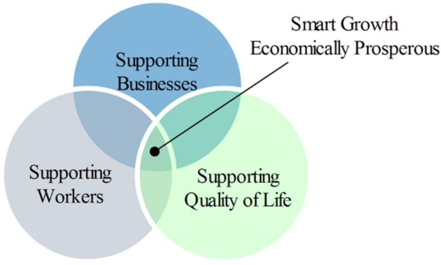
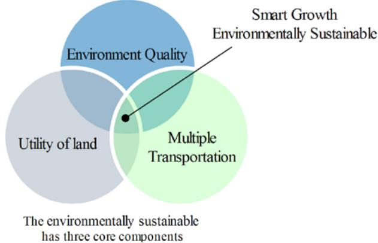
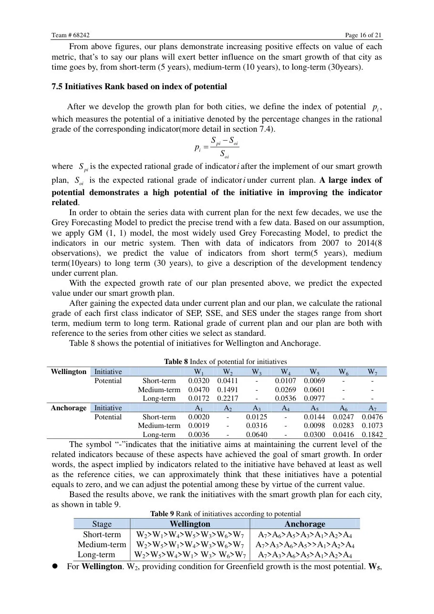

# 2017年美国大学生数学建模竞赛（MCM/ICM）O奖论文范例：E题 迈向可持续城市

原件为竞赛论文。补充：文中的阅读练习及“参考解答”为整理时增加，原件图文保留出处。

本文档整理自2017年美国大学生数学建模竞赛（MCM/ICM）获得Outstanding Winner (O奖)的E题论文《Towards A Sustainable City》。该论文针对城市蔓延带来的经济、社会和环境问题，基于智慧增长理论（Smart Growth Theory），构建了成功智慧增长指标体系（SSG），并对新西兰惠灵顿和美国安克雷奇两个中等城市的现有规划进行评估，提出了具体的改进方案。内容涵盖摘要、目录及正文第一部分（Introduction）。

## 一、摘要部分

### 摘要 1

**原文摘要：**

In consequence of the urban sprawl, the world is witnessing a series of economic, social and environmental problems. Formulating reasonable urban plan, which is crucial and critical to tackle these problems, is a complicated issue that should embrace the goals of economic prosperity, social equity and environmental sustainability. Fortunately, the Smart Growth Theory provides us new ideas to deal with those problems. In this paper, we focus on how to evaluate the performance of a smart growth plan, and how to formulate a smart growth plan with consideration of the unique needs for a city.

First, we establish a set of metrics to analyze the determinant factors in evaluation of smart growth. To find out what on earth the outcomes of a smart growth plan will be, we do a research on the relationship between the goals of three E’s and the ten principles. After that, based on analysis for a large body of case studies from EPA and Smart Growth America, we construct a metric named SSG (Success of Smart Growth). It consists of SEP (affected by economic prosperity), SSE (affected by social equity) and SES (affected by environmental sustainability). Each contains three first class indicators and different quantities of second class indicators.

Next, to research the current growth plan for two mid-sized cities in different continents, we select Wellington, the capital of New Zeal and Anchorage, a city in Alaska, America as objects we focus on. Besides, we select some cities which have been implemented smart growth plan for a long period of time as the reference standard to evaluate the success of a city’s current plan. With method of Grey Relational Analysis, we calculate rational grade of each metric by use of related data collected from authority websites. The results tell us that both cities develop well in some aspect of smart growth but still have a long way to achieve the goal of high smart growth.

Then, based on the three key steps from case study in EPA to formulate a smart growth plan, we set goals for each city by virtue of the evaluation results above. Besides, we indentify the existing strengths and barriers based on unique characteristics such as demographics, geographic conditions and expected growth rates in order to find the opportunities and challenges for each city. Moreover, with the method of PCA, we determine the principle components of each first class indicator for two cities. By integration of these key information, as well as referenc to Getting to Smart Growth 100 policies for implementation, we formulate 7 specific initiatives for the two cities, respectively. Furthermore, with application of the evaluation method we form, we compare the performance between current plan and our plan by setting hypothesis and extending data with Grey Forecasting Model. The results show that our plans will exert increasingly positive impacts on the smart growth of each city as time goes by.

Also, we define an index of potential for the initiatives in our plans. According to the index value, we rank the initiatives in order of high potential to low potential. What’s more, we apply the Malthusian growth model to predict the change of population when the population has an additional 50% increase by 2050. The results demonstrate that our plan still perform well.

Finally, we test the sensitivity of our model, conclude the strengths and weakness, and give our thoughts about future work.

**参考解答：**
这是一篇典型的数学建模竞赛论文摘要结构，逻辑清晰，涵盖了以下要素：
1.  **背景与问题**：城市蔓延导致经济、社会、环境问题，需要制定合理的城市规划。
2.  **方法概述**：
    *   构建指标体系：提出SSG（成功智慧增长）指标，包含SEP（经济繁荣）、SSE（社会公平）、SES（环境可持续性）三个一级指标及其二级指标。
    *   案例选择：选取新西兰惠灵顿（Wellington）和美国安克雷奇（Anchorage）作为研究对象，选取长期实施智慧增长的城市作为参考标准。
    *   模型应用：使用灰色关联分析（Grey Relational Analysis）评估现状；使用主成分分析（PCA）确定指标主成分；使用灰色预测模型（Grey Forecasting Model）对比当前计划与优化计划的效果；使用马尔萨斯人口增长模型（Malthusian growth model）预测人口变化。
3.  **结果与结论**：两城市在部分方面发展良好但仍有差距；提出了7项具体倡议；通过敏感性分析验证了模型的稳健性。

**知识点：**数学建模论文写作

## 1 Introduction

知识点：[可持续发展指数 SDI 的构建与指标体系结构](../../../topics/数学建模/kechixu_zhibiao.md)、[Summary Sheet（摘要页）的撰写规范](../../../topics/数学建模/zhaiyao_xiezuo.md)

### 1.1 Background

In the late 1990s, researchers realized that the development of urban sprawl brought a series of economic, social and environmental problems[1].

Economic problems mainly refer to the low-density expansion of cities, which cause the increase of per capita cost of service facilities, the waste of land resources and the recession of central area.

Social problems mainly refer to the social negative impacts of urban sprawl. Especially, a serious problem is the spatial separation of different races and different income groups, which contributes to the social violence and racism.

Environmental problems mainly refer to the environment negative impacts of urban sprawl, such as the reduction of agricultural land and wetlands, the environmental pollution resulting from the use of motor vehicles.

So accompany with the urbanization, the challenge emerging is how to manage city in order to maintain its advantages of innovation and flexibility, realize its potential to provide high quality living conditions, significantly reduce resource consumption and environmental impact. To deal with these challenges, there was born a theory called smart growth, a way to build cities, towns, neighborhoods that are Economical prosperity, social Equity, and Environmental sustainability[2]. In order words, a smart growth plan aims at achieving the goal we call three E's of sustainability. Besides, these exists ten principles to help achieve the goal of smart growth. To embrace a more depict description of the smart growth, pay attention to figure 1.

Except for adhering to the goal of three E's of sustainability, the unique needs such as demographics, growth needs, and geographical conditions of a city, are key factors to formulate a specific smart growth plan for the city itself.

知识点：[问题重述与分析（Problem Restatement and Analysis）](../../../topics/数学建模/wenti_chongshu.md)、[影响因素评估指标体系构建（温度、湿度、经济、教育等）](../../../topics/数学建模/yingxiang_zhibiao.md)、[可持续发展指数 SDI 的构建与指标体系结构](../../../topics/数学建模/kechixu_zhibiao.md)

### 1.2 Restatement of problems

To help implement smart growth theories into city design around the world, we are required to select two mid-sized cities (a population of between 100,000 and 500,000), on two different continents. Under circumstances of the two cities, we need to do as follows：

Task1. Create a metric system to evaluate the success of a smart growth city under consideration of three E's of sustainability.

Task2. Research how the current growth plan of each city meets the smart principles and how successful the plan is.

Task3. Develop a growth plan for both cities based on the geography, expected growth rates, and economic opportunities, later evaluate the plans.

Task4. Rank the individual initiatives in accordance with the order from the most potential to the least potential. Then compare and contrast the ranks between two countries.

Task5. Discuss how the plan supports the level of growth that the population of each city increases by 50%.

知识点：[问题重述与分析（Problem Restatement and Analysis）](../../../topics/数学建模/wenti_chongshu.md)、[影响因素评估指标体系构建（温度、湿度、经济、教育等）](../../../topics/数学建模/yingxiang_zhibiao.md)、[TOPSIS 模型构建步骤（逼近理想解排序法）](../../../topics/数学建模/topsis_moxing.md)

### 1.3 Overview of our work

We first introduce the relationship between goals of three E's and the ten principles for smart growth by searching key words in related definitions form Smart Growth America.

We establish three metrics of smart growth, totally including 9 first class indicators and 23 second class indicators in section 5.

Then we select two cities, one is Wellington in New Zealand, and the other is Anchorage, Alaska in America as the objects we focus on.

We form an assessment criterion with reference to the development of some cities with a long history of smart growth. After that, we apply the method of Grey Relational Analysis to determine the degree of success for the current urban plan in section 6.

In next section, we formulate the smart growth plan which contains 7 specific initiatives based on Principal Component Analysis for each city, according to the following key steps[3]:

A. Setting goals.

B. Identifying existing Strengths and barriers.

C. Selecting the right policy tools and initiatives.

We define an index of development potential to evaluate the performance of our initiatives. Then rank the initiatives in line with the percentage changes in the rational grade after the implementing of our plans. Furthermore, we analyze the sensitivity of our plan under circumstance that the population increases by 50% by 2050.

The structure of sustainability is as follows, where T represents 10 principles of smart growth.

## 2 General Assumptions and Justifications

To simplify the problem, we have the following basic assumptions，which are properly justified.

## 3 Variable Description

| Variables | Descriptions | First appearing page |
| :--- | :--- | :--- |
| $T_i$ | The $i$ th principle among the ten principles | 5 |
| $G_i$ | The $i$ th goal of three E’s of sustainability | 5 |
| SSG | The metric to measure the success of smart growth | 6 |
| SEP | The metric to measure the success of economic prosperity | 6 |
| SSE | The metric to measure the success of social equity | 6 |
| SES | The metric to measure the success of environmental sustainability | 6 |
| $SEP_{ij}$ | The $j$ th second class indicator of the $i$ th first class indicator for SEP | 7 |
| $SSE_{ij}$ | The $j$ th second class indicator of the $i$ th first class indicator for SSE | 9 |
| $SES_{ij}$ | The $j$ th second class indicator of the $i$ th first class indicator for SES | 11 |
| $s_{ij}$ | The $j$ th city observation on the $i$ th indicator | 12 |
| $\gamma_{ij}$ | The grey rational coefficient for the $j$ th second class indicator of the $i$ th first class indicator | 12 |
| $\delta_i$ | The rational grade of the $i$ th first class indicator | 13 |
| $W_i$ | The $i$ th initiatives in Wellington’s smart growth plan | 15 |
| $A_i$ | The $i$ th initiatives in Anchorage’s smart growth plan | 15 |
| $P_i$ | The index of the development potential for initiatives $i$ | 17 |

## 4 Policy Tools for Smart Growth

As is stated before, the ten principles help for achieving the three general goals, so we can regard the principles as policy tools for plan formulation. Strictly speaking, each principle exerts effects on all the three E's. But comparatively, targets of different principles are not completely equivalent. Here we tend to find the relationship between ten principles and three E's, in order to figure out the guiding principles of growth plan formulation for different goals. We collect key words from What Is Smart Growth in website of Smart Growth America [4]. What we find is that each tool is intended for more than one goal, we show it in table 1.

If a city mainly intends to achieve Economical prosperity, the initiatives should pay prior attention to policy tools T1, T6, T7, T8, and T9; If a city mainly intends to achieve social Equity, the initiatives should pay prior attention to policy tools T3, T8, T9 and T10; If a city mainly intends to achieve Environmental sustainability, the initiatives should pay prior attention to policy tools T1, T2, T6, T7 and T8.

**Table 1. Policy tools for smart growth (G1: Economically prosperity. G2: social Equity G3:Environmental sustainability)**

| | Principles as General policy Tools | key words from What Is Smart Growth in website of Smart Growth America | Intentions |
| :--- | :--- | :--- | :--- |
| T1: | Mix land uses | support businesses, improve safety, enhance vitality, live closer | G1,G3 |
| T2: | Take advantage of compact building design | more people to jobs, homes, businesses, making the most of public investments | G1,G3 |
| T3: | Create a range of housing opportunities and choices | more choices, different income, religions, races | G2 |
| T4: | Create walkable neighborhoods | safely and conveniently | G3 |
| T5: | Foster distinctive, attractive communities with a strong sense of place | natural features, historic structures, public art | G3 |
| T6: | Preserve open space, farmland, natural beauty, and critical environmental areas | natural recreation areas, protecting them from natural disasters, animal and plant habitats | G1,G3 |
| T7: | Strengthen and direct development towards existing communities | makes the most of the investments | G1,G3 |
| T8: | Provide a variety of transportation choices | high-quality public transportation, safe and convenient biking and walking infrastructure | G1,G2,G3 |
| T9: | Make development decisions predictable, fair, and cost effective | development decisions ,more timely, cost-effective, predictable | G1,G2 |
| T10: | Encourage community and stakeholder collaboration in development decisions | strategies by the people who live and work there | G2 |

## 5 Success of Smart Growth Metric System

According to the three E’s of sustainability and the 10 principles of smart growth, we choose indicators from both different case study of smart growth in EPA website and the features of cities we select. For example, we focus on Fair treatment, Meaningful involvement, Equitable development to research the social Equity in smart growth [5]. Besides, the components of economic development are from the case study A KELSO, WASHINGTON [3]. As for Environmental sustainability, we pay attention to land use, transportation and environment quality.

知识点：[文献综述与研究背景撰写方法](../../../topics/数学建模/wenxian_zongshu.md)、[影响因素评估指标体系构建（温度、湿度、经济、教育等）](../../../topics/数学建模/yingxiang_zhibiao.md)、[可持续发展指数 SDI 的构建与指标体系结构](../../../topics/数学建模/kechixu_zhibiao.md)

### 5.1 Metric of SEP

#### 5.1.1 Potential Indicators for Economical Prosperity

In this section, we refer to the case study *Using Smart Growth Strategies to Foster Economic Development: A Kelso, Washington, Case Study* to analyze the success of economy. In the study, the economic development consists of three components, respectively are Supporting Businesses, Supporting Workers and Supporting Quality of Life.

To embrace a more depict description of the components of economical prosperity, pay attention to figure 3.

**Supporting Businesses.** This component of a smart growth economic development strategy focuses on understanding the current composition and location of businesses, jobs, and potential emerging entrepreneurs in the community. In that way, the business diversity indicates the extent of harmonious development in economic. The per capital GDP and the tax income measure the level of economic development.

**Supporting Workers.** Workforce development is important to ensure that residents can successfully compete for employment opportunities and that all residents have the opportunity to benefit from economic prosperity. To ensure the opportunities of employment, the city plan should aim at providing all kinds of occupations for different workers and developing the skills of workers, which can be realized by the development of education. Furthermore, the larger the population density is, the larger of size of the city will be, and the more labor force for economical construction will be.

**Supporting Quality of Life.** One of the aims of economic development is to improve the quality of people’s life. Among these factors, the amenities serve people, the cost of living implying the living burden and total crime implying safety of living are taken into our consideration.

#### 5.1.2 The SEP Metric system.

Based on the above analysis to the potential indicators of economical prosperity, we develop a metric named Success of Economical Prosperity (SEP) to describe the extent to success of a city’s smart growth in area of Economical Prosperity. The metric includes three first class indicators and ten second class indicators. We show the metric of SEP in table 2.

**Table 2. Indicators in SEP metric system.**

| SEP | Indicators | Notation | Indicators | Notation | Target |
| :--- | :--- | :--- | :--- | :--- | :--- |
| **Supporting Businesses** | $\text{SEP}_1$ | Business diversity | $\text{SEP}_{11}$ | ↑ |
| | | GDP per capita | $\text{SEP}_{12}$ | ↑ |
| | | Tax income | $\text{SEP}_{13}$ | ↑ |
| **Supporting Workers** | $\text{SEP}_2$ | Population density | $\text{SEP}_{21}$ | ↑ |
| | | Educational attainment | $\text{SEP}_{22}$ | ↑ |
| | | Unemployment rate | $\text{SEP}_{23}$ | ↓ |
| | | Occupational diversity | $\text{SEP}_{24}$ | ↑ |
| **Supporting Quality of Life** | $\text{SEP}_3$ | Cost of living | $\text{SEP}_{31}$ | ↓ |
| | | Amenities | $\text{SEP}_{32}$ | ↑ |
| | | Total crime | $\text{SEP}_{33}$ | ↓ |

The target ↑ (↓) indicates that the increase (decrease) of the value will help promote the extent to success of economical prosperity in smart growth. In all, the metric of SEP can be finally expressed by a function of $\mathrm { S E P _ { 1 } }$ , $\mathrm { S E P _ { 2 } }$ and ${ \mathrm { S E P } } _ { 3 }$ as $ \mathrm { S E P } = f ( \mathrm { S E P _ { 1 } } , \mathrm { S E P _ { 2 } } , \mathrm { S E P _ { 3 } } ) $. The diversity can be calculated by Shannon diversity index.

知识点：[影响因素评估指标体系构建（温度、湿度、经济、教育等）](../../../topics/数学建模/yingxiang_zhibiao.md)、[层次分析法 AHP（Analytic Hierarchy Process）用于综合评价](../../../topics/数学建模/ahp_fangfa.md)、[TOPSIS 模型构建步骤（逼近理想解排序法）](../../../topics/数学建模/topsis_moxing.md)

### 5.2 Metric of SSE

#### 5.2.1 Potential Indicators for Social Equity

In this section, we discuss the indicators of social equity. The social equity refers to improvement of the long-standing environmental, health, and economic disparities in low-income, minority, and tribal communities. Because these communities face an array of challenges, including proximity to polluting facilities, barriers to participating in decision-making processes, disproportionate levels of chronic disease, neighborhood disinvestment, and poor or no access to jobs and services [5]. Refers to the Smart Growth and Equitable Development in website of EPA, we sum up three components of social equity, which are fair treatment, meaningful involvement and equitable development. The component relationship of social equity is displayed in figure 4.

## 5.2.1 社会公平的潜在指标

**公平对待（Fair Treatment）。** 公平对待意味着任何群体都不应承担由工业、政府或商业运营与政策所带来的负面环境后果的过大份额。也就是说，所有人，不论种族、民族或经济地位，都应有机会享有与环境相关的决策和行动所带来的积极成果，例如更清洁的空气和水、更好的健康以及经济活力。鉴于环境质量更适合被纳入环境可持续性分析，我们主要关注收入分配和医疗保健体系。

- 收入中位数（Median income）：较大的收入中位数表明收入分配具有较高的公平性。
- 医疗保健指数（Health care index）：衡量医疗保健水平。数值越大，意味着城市越发达、越公平。

**有意义参与（Meaningful Involvement）。** 有意义参与意味着公众应有机会参与可能影响其环境和健康的决策。我们采用政策参与度这一指标来衡量参与程度。

**公平发展（Equitable Development）。** 它指一系列创建社区和区域的方法，使各种收入、种族和民族的居民都能参与并受益于塑造其居住地的决策。因此，我们分析宗教自由和种族公平的程度，二者均为正向指标。

知识点：[影响因素评估指标体系构建（温度、湿度、经济、教育等）](../../../topics/数学建模/yingxiang_zhibiao.md)、[可持续发展指数 SDI 的构建与指标体系结构](../../../topics/数学建模/kechixu_zhibiao.md)

### 5.2.2 SSE 指标体系

基于上述对社会公平潜在指标的分析，我们构建了一个名为“社会公平成功度”（Success of Social Equity，SSE）的指标，用以描述城市在 social equity 方面智慧增长的成功程度。该指标包括三个一级指标和五个二级指标。表 3 给出了 SSE 指标体系。

表 3. SSE 指标体系中的指标。

| 一级指标 | 记号 | 二级指标 | 记号 | 目标 |
|---|---|---|---|---|
| 公平对待 | $SSE_1$ | 收入中位数 | $SSE_{11}$ | ↑ |
| 公平对待 | $SSE_1$ | 医疗保健指数 | $SSE_{12}$ | ↑ |
| 有意义参与 | $SSE_2$ | 政策参与度 | $SSE_{21}$ | ↑ |
| 公平发展 | $SSE_3$ | 宗教自由 | $SSE_{31}$ | ↑ |
| 公平发展 | $SSE_3$ | 种族公平 | $SSE_{32}$ | ↑ |

目标 ↑ 表示数值增大有助于提升智慧增长中社会公平的成功程度。

SSE 指标最终可表示为 $SSE_1$、$SSE_2$ 和 $SSE_3$ 的函数，即 $SSE = f(SSE_1, SSE_2, SSE_3)$。此外，宗教自由和种族公平的程度由香农多样性指数公式计算：

$$
SSE_{31} = -\sum_{i=1}^{m} d_i \ln(d_i), \quad SSE_{32} = -\sum_{i=1}^{m} d_i \ln(d_i)
$$

其中 $d_i$ 为第 $i$ 类占总量的百分比。

## 5.3 SES 指标

知识点：[可持续发展指数 SDI 的构建与指标体系结构](../../../topics/数学建模/kechixu_zhibiao.md)、[影响因素评估指标体系构建（温度、湿度、经济、教育等）](../../../topics/数学建模/yingxiang_zhibiao.md)、[符号说明与术语定义（Nomenclature / Symbols and Definitions）](../../../topics/数学建模/fuhao_shuoming.md)

### 5.3.1 环境可持续性的潜在指标

在浏览 EPA 网站上有关环境主题的内容[6]后，我们认识到环境可持续性包含空气、化学品、气候变化、绿色生活、土地、废物与清理、水等关键词，以及许多其他主题。我们将这些主题分为三类：第一类是环境质量，第二类是土地利用效用，最后一类是多式联运。图 5 展示了这一关系。

**环境质量（Environment Quality）。** 衡量环境可持续性最直观的指标是环境质量，它可以直接从空气、水和噪声方面的污染程度反映出来。此外，绿地面积越大，城市的环保程度越高。

**土地利用效用（Utility of land）。** 根据城市蔓延理论[7]，蔓延程度的度量可分为八个维度。我们依据该理论对土地利用效用作如下定义。

集中度（Concentration）是指住房单元不成比例地集中在相对少数区域或均匀分布的程度。

$$
SES_{21} = \frac{\left(\sum_{i=1}^{N} \left(D_u(i) - D_d(i)\right)^2 / N\right)^{\frac{1}{2}}}{\sum_{i=1}^{N} D_d(i) / N}
$$

其中 $i$ 为分析中使用的中等空间尺度，$D_u(i)$ 为第 $i$ 类土地利用占城市总面积的密度，$D_d(i)$ 为第 $i$ 类土地利用占可开发城市面积的密度。

混合用途（Mixed used）是指两种不同土地利用（例如住宅单元和金融单元）的大量数量存在于同一区域内，且这种格局在整个城市中普遍存在的程度。

$$
SES_{22} = \frac{\sum_{i=1}^{N} D_d(i) \left(D_d(j) / S\right)}{D_u(i)}
$$

它表示 $i$ 存在于 $j$ 所占据的任何区域。

聚类（Clustering）是指任一平方英里区域内的开发集中于其内含四个半平方英里方格之一（而非均匀分布于整个区域）的程度。

$$
SES_{21} = \frac{\sum_{i=1}^{N} \left(D_u(i) - D_d(i)\right) / N}{\sum_{i=1}^{N} D_u(i) / N}
$$

**多式联运（Multiple Transportation）。** 显然，公共交通在人们日常生活中所占比例越高，对环境质量越会产生积极影响。此外，交通规划合理性的衡量标准之一是交通安全。

# 迈向可持续城市（MCM/ICM O奖论文范例）

本部分整理自《2017年美国大学生数学建模竞赛（MCM/ICM）O奖论文范例：E题 迈向可持续城市》第 6 部分，内容涵盖环境可持续性度量系统、综合智能增长度量及惠灵顿与安克雷奇两城的现状分析。

## 一、环境可持续性度量系统 (SES)

基于前文对潜在环境可持续性指标的分析，本文提出“环境可持续性成功度”（Success of Environmental Sustainability, SES）指标，用于描述城市在环境可持续性方面智能增长的实现程度。该体系包含三个一级指标和八个二级指标，如表 4 所示。

知识点：[可持续发展指数 SDI 的构建与指标体系结构](../../../topics/数学建模/kechixu_zhibiao.md)、[影响因素评估指标体系构建（温度、湿度、经济、教育等）](../../../topics/数学建模/yingxiang_zhibiao.md)、[文献综述与研究背景撰写方法](../../../topics/数学建模/wenxian_zongshu.md)

### 选择 1：SES 指标体系构成

| 一级指标 | 符号 | 二级指标 | 符号 | 目标趋势 |
| :--- | :---: | :--- | :---: | :---: |
| **环境质量** (Environment Quality) | $SES_1$ | 空气污染指数 Air pollution index | $SES_{11}$ | ↓ |
| | | 水污染指数 Water pollution index | $SES_{12}$ | ↓ |
| | | 绿地面积 Green area | $SES_{13}$ | ↑ |
| **土地利用效用** (Utility of land) | $SES_2$ | 集中度 Concentration | $SES_{21}$ | ↑ |
| | | 混合用地 Mixed used | $SES_{22}$ | ↑ |
| | | 聚集度 Clustering | $SES_{23}$ | ↑ |
| **多元交通** (Multiple Transportation) | $SES_3$ | 公共交通比例 Ratio of public transportation | $SES_{31}$ | ↑ |
| | | 交通安全 Traffic Safety | $SES_{32}$ | ↑ |

- **目标趋势说明**：↑表示该指标值越高越有利于提升环境可持续性；↓表示该指标值越低越有利于提升环境可持续性。
- **综合公式**：SES 最终可表示为三个一级指标的函数：
  $$ SES = f(SES_1, SES_2, SES_3) $$

## 二、智能增长综合度量 (SSG)

在构建社会公平性度量（SEP）、经济繁荣性度量（SSE）和环境可持续性度量（SES）的基础上，本文通过整合这三者来构建智能增长综合度量（Smart Growth Success, SSG）。考虑到环境可持续性在经济繁荣和社会公平中起决定性作用，本文赋予 SEP、SSE 和 SES 的权重分别为 0.3、0.3 和 0.4。

SSG 的计算公式如下：

$$
\begin{array}{r l} SSG & = \theta_ {1} SEP + \theta_ {2} SSE + \theta_ {3} SES \\ & = 0.3 SEP + 0.3 SSE + 0.4 SES \end{array}
$$

一个较高的 SSG 值表明该城市的智能增长取得了较高程度的成功。

## 三、现有规划分析 (Analysis for current plans)

知识点：[可持续发展指数 SDI 的构建与指标体系结构](../../../topics/数学建模/kechixu_zhibiao.md)、[影响因素评估指标体系构建（温度、湿度、经济、教育等）](../../../topics/数学建模/yingxiang_zhibiao.md)、[一般假设及其合理性说明（Assumptions and Justifications）](../../../topics/数学建模/jiaben_shezhi.md)

### 6.1 选定重点区域 (Selecting the focus area)

#### 6.1.1 重点城市：惠灵顿与安克雷奇

根据城市发展理论，城市发展可分为三个阶段：聚集（clustering）、分散（decentralization）和网络化（networking）。本文选取处于“分散阶段”（低密度阶段）的两个城市，因为这两个阶段迫切需要发展智能增长策略。

- **惠灵顿 (Wellington)**：新西兰首都，人口约 45 万。
- **安克雷奇 (Anchorage)**：美国阿拉斯加州城市，人口约 30 万。

根据美国环保署（EPA）介绍的智能增长案例，部分美国城市已长期实施智能增长。其中，亚特兰大（Atlanta）、波特兰（Portland）和奥斯汀（Austin）等城市被选为参考标准，用于评估上述两城当前增长计划的成功度。

#### 6.1.2 数据来源

我们需要收集超过 20 种指标数据。其中，政策参与度（policy participation）和水污染指数（water pollution index）的数据严重不足，导致无法量化指标 $SSE_2$（有意义的参与 Meaningful Involvement）。两座城市的数据来源不同：

- **美国城市（安克雷奇）**：主要从各类统计网站收集，主要来源为 AreaVibes [8] 和 City-Data [9]。
- **惠灵顿**：从新西兰统计局 Statistics New Zealand [10] 收集。

#### 6.1.3 现有城市规划

我们仔细浏览了惠灵顿和安克雷奇的现有城市规划，总结出以下关键目标和举措：

- **惠灵顿**：旨在建设一个紧凑的城市（compact city）、宜居的城市（livable city）、融入自然的城市（city set in nature）以及具有韧性的城市（resilient city）[11]。
- **安克雷奇**：依赖平衡区域增长、填充式开发与重建、社区多样性、多户型住宅、对环境敏感的开发、居住用地保护与恢复以及主要交通等战略指导 [12]。

知识点：[问题重述与分析（Problem Restatement and Analysis）](../../../topics/数学建模/wenti_chongshu.md)、[模型参数的确定（基于数据拟合或实验选择）](../../../topics/数学建模/canshu_queding.md)、[影响因素评估指标体系构建（温度、湿度、经济、教育等）](../../../topics/数学建模/yingxiang_zhibiao.md)

### 6.2 衡量两城的增长计划 (Measure the growth plan of two cities)

#### 6.2.1 灰色关联分析的应用

由于二级指标与一级指标之间存在复杂且不确定的相关性，若采用完美信息假设的方法，很难分析它们对“三大 E"（环境、社会、经济）目标的明确影响。因此，本文采用灰色系统理论分支——灰色关联分析（Grey Relational Analysis, GRA）。该方法能够捕捉因素间的相互作用，并指示每个指标的灰色关联度。

**步骤 1：基于指标分类的归一化**

根据指标的目标和影响方向，将指标分为三类：“越高越好”、“越低越好”和“中间最好”。参考表 2、表 3 和表 4，除“越低越好”指标（如失业率、生活成本、总犯罪率和污染指数）外，其余均为“越高越好”指标。

对于“越高越好”指标，采用最大差异归一化方法：
$$ x_{ij} = \frac{s_{ij} - s_{i \min}}{s_{i \max} - s_{i \min}} $$

对于“越低越好”指标，采用最小差异归一化方法：
$$ x_{ij} = \frac{s_{i \max} - s_{ij}}{s_{i \max} - s_{i \min}} $$

其中，$s_{ij}$ 表示第 $j$ 个城市在第 $i$ 个指标上的观测值。

**步骤 2：选择参考序列**

参考序列由每个指标的最优值组成。鉴于智能增长的历史悠久，本文使用所选参考城市（亚特兰大、波特兰、奥斯汀等）的指标平均值作为参考序列。

参考序列表示为：$\boldsymbol{x}_0 = \{x_{01}^1, x_{02}^1, ..., x_{31}^3, x_{32}^3\}$

# 2017年美国大学生数学建模竞赛（MCM/ICM）O奖论文范例：E题 迈向可持续城市

本部分整理自《2017年美国大学生数学建模竞赛（MCM/ICM）O奖论文范例：E题 迈向可持续城市》习题第 13–14 页，由识别工具读出并整理。

## 6.2.2 The Evaluation Results

知识点：[可持续发展指数 SDI 的构建与指标体系结构](../../../topics/数学建模/kechixu_zhibiao.md)、[影响因素评估指标体系构建（温度、湿度、经济、教育等）](../../../topics/数学建模/yingxiang_zhibiao.md)、[模型参数的确定（基于数据拟合或实验选择）](../../../topics/数学建模/canshu_queding.md)

### 计算灰色关联系数与评价值

Step 3. Compute grey rational coefficient $\gamma _ { i j }$ with respect to the jth second class indicator of the first class indicator. The equation is

$$
\gamma_ {i j} = \frac {\Delta_ {\min} + \tau \Delta_ {\max}}{\Delta_ {i j} + \tau \Delta_ {\max}}
$$

where ${ \Delta _ { i j } } = { x _ { i j } } - { x _ { 0 j } } , { \Delta _ { \operatorname* { m a x } } } = \operatorname* { m a x } _ { i } \operatorname* { m a x } _ { j } { \Delta _ { i j } } , { \Delta _ { \operatorname* { m i n } } } = \operatorname* { m i n } _ { i } \operatorname* { m i n } _ { j } { \Delta _ { i j } }$ , and resolution ratio $\tau$ is set 0.5 to optimally improve the significance of the difference of the difference among rational coefficients.

Step 4. Calculate the rational grade of each first class indicator respectively by taking the average of its rational coefficient.

$$
\delta_ {i} = \frac {1}{n} \sum_ {j = 1} ^ {n} \gamma_ {i j}
$$

where n is the number of second class indicators of the ith first class indicator.

The rational grade demonstrates the connection between the city we research and those cities which have achieve a lot in smart growth. The larger the value of rational grade of the indicator is, the higher the success of the plan implied by this indicator will be.

Soon after the processing of data, we calculate the rational grade of each first class indicator of the two cities. We show the GRA results in table 5.

Table 5 rational grade of each metric in two cities

| | SEP | | | SSE | | SES | | |
| :--- | :--- | :--- | :--- | :--- | :--- | :--- | :--- | :--- |
| | $\text{SEP}_1$ | $\text{SEP}_2$ | $\text{SEP}_3$ | $\text{SSE}_1$ | $\text{SSE}_3$ | $\text{SES}_1$ | $\text{SES}_2$ | $\text{SES}_3$ |
| Wellington | 0.7393 | 0.6774 | 0.7513 | 0.7172 | 0.7318 | 0.6586 | 0.9073 | 0.6840 |
| Anchorage | 0.6624 | 0.7566 | 0.4140 | 0.7098 | 0.7683 | 0.6720 | 0.8577 | 0.8111 |

After calculating the average of each metric, we get Wellington (SEP (0.7227), SSE (0.7245), SES (0.7500)), whose weighted average with weight (0.3, 0.3, 0.4) is 0.7341; the Anchorage (SEP (0.6110), SSE (0.7390), SES (0.7803)), whose weighted average with weight (0.3, 0.3, 0.4) is 0.7171. For a depict comparison, we draw a radar chart as showed in figure 6.

To analyze how successful the city’s current growth plan is, taking the average value of indicators for those cities which have implemented smart growth for a long time as our reference standard, we define four degrees of growth with reference to the literature[13] as follows. On account of the boundaries of four degrees are not exact, the ranges overlap.

Ⅰ. High smart growth: with value of rational grade between 0.7~1.

Ⅱ. Smart growth: with value of rational grade between 0.5~0.8.

Ⅲ. Sprawl growth: with value of rational grade between 0.2~0.6.

Ⅳ. High sprawl growth: with value of rational grade between 0.1~0.3.

Comparing the rational grade to the range of four degrees, we infer that,

The current growth plan for both city reaches a degree of smart growth in some extent. Because most of cities have more or less implement the method of smart growth.

Both cities have comparitively huge potentials to reach a high smart growth. It’s obvious that there is still a long way to go to keep up with those cities which implement long-term smart growth. Because the rational grade is lower than 0.8 for each metric.

Wellington does slightly better in the balanced development adhering to the goals of three E’s than Anchorage, especially in supporting quality of life in area of economical prosperity.

Anchorage develops better both in social equity and environmental sustainability, but behaves badly in supporting quality of life.

## 7 Growth plans for both cities

With the analysis above, both cities still have a long way to go in achieving high smart growth. In order to improve the current plan to support the three E's of smart growth，we formulate the smart growth plan in order of following three steps[3]: A. Setting the goals, B. Identifying existing strengths and barriers, C. Selecting the right policy tools and initiatives.

知识点：[可持续发展指数 SDI 的构建与指标体系结构](../../../topics/数学建模/kechixu_zhibiao.md)、[层次分析法 AHP（Analytic Hierarchy Process）用于综合评价](../../../topics/数学建模/ahp_fangfa.md)

### 7.1 Goals for Wellington and Anchorage.

Based on the analysis in section 6.2.2, development of both cities are not as well as the reference cities in all aspects of three Es, so the ultimate goals for both two cities are achieving balance in economical prosperity, social equity and environmental sustainability. Only differentiate in the focal points of the smart growth and the priority.

知识点：[任务分解与目标明确](../../../topics/数学建模/renwu_fenjie.md)、[可持续发展指数 SDI 的构建与指标体系结构](../../../topics/数学建模/kechixu_zhibiao.md)

### 7.2 Identifying existing strengths and barriers based on characteristics

The unique characteristic refers to the geography, expected growth rates, and economic opportunities of the cities. Here we analyze the strengths or opportunity, barriers or challenges during the process of getting to the development goals.

####  The existing strengths and barriers of Wellington

#####  Strengths

Wellington is at the south-western tip of the North Island on Cook Strait, separating the North and South Islands. Although it has a pretty large square of land, the land is also concentrated and mixed used. Meanwhile, the supporting on business and quality of life are put significant amount of effort by the governments, such as making efforts to decrease the total crime rate. Besides, it provides equitable development which ensures the economic opportunities.

#####  Barriers

Compared to the cities with high smart growth, Wellington still has low forest coverage rate. Poor environment quality is another factor that needs to be improved. Besides, there is still some unfair treatment, such as the unreasonable distribution of income and the high cost of health treatment.

####  The existing strengths and barriers of Anchorage

#####  Strengths

Anchorage is on a strip of coastal lowland and extends up the lower alpine slopes of the Chugach Mountains. With small coastal lowland, the utility of land for Anchorage is more sufficient. In addition, the approach of transportation is multiple. Almost three quarters of inhabitants regard the car as their first choice. 9.1% of inhabitants are willing to walk or bicycle and 3.2% of inhabitants choose to take the bus. Furthermore, the development is still equitable as well.

# 2017年美国大学生数学建模竞赛（MCM/ICM）O奖论文范例：E题 迈向可持续城市（习题）

本资料整理自2017年MCM/ICM E题获O奖的论文范例，主要涵盖政策工具选择、具体计划制定及基于假设情景的性能评估部分。内容涉及惠灵顿（Wellington）和安克雷奇（Anchorage）两座城市在环境可持续性（SES）、社会公平性（SSE）和经济繁荣度（SEP）三个维度的具体增长计划及指标变化预测。

## 一、政策工具与倡议的选择

知识点：[任务分解与目标明确](../../../topics/数学建模/renwu_fenjie.md)、[可持续发展指数 SDI 的构建与指标体系结构](../../../topics/数学建模/kechixu_zhibiao.md)

### 选择 1

**背景与障碍分析**

由于地理条件的限制，经济发展速度相对缓慢。例如，人均GDP比具有智慧增长特征的城市平均水平低四分之一。同时，安全环境不容乐观，犯罪率较高。

**知识点：** 城市可持续发展

知识点：[可持续发展指数 SDI 的构建与指标体系结构](../../../topics/数学建模/kechixu_zhibiao.md)、[影响因素评估指标体系构建（温度、湿度、经济、教育等）](../../../topics/数学建模/yingxiang_zhibiao.md)

### 选择 2

**7.3 选择政策工具和倡议**

根据对两座城市的分析，惠灵顿主要在环境可持续性方面表现较差，而在经济繁荣方面表现较好。为了保持环境的可持续发展，指标的优先级为 SES（社会-环境系统）、SSE（社会-社会系统）和 SEP（社会-经济系统）。同时，安克雷奇的障碍在于经济发展。因此，计划应首先关注 SEP，然后关注 SES 和 SSE 的改善。通常，一项政策不仅能在特定指标上发挥作用，还可能对不同方面的其他指标产生影响。因此，有必要找出每个指标的主成分。更直观的流程图参见图 10（附录）。

使用主成分分析法（PCA），这是一种统计程序，使用正交变换将一组可能相关的变量的观测值转换为一组线性无关变量的值 [14]，我们通过 SPSS 确定了每个指标的主要指标。结合第 4 节和第 6.3.2 节的分析，我们大致确定了政策工具和具体倡议。

**惠灵顿的计划：** 考虑到七个主成分（SES 两个，SSE 两个，SEP 三个），以及其当前的优势和障碍，我们给出了具体的倡议、相应的政策工具和每个倡议涉及的指标，见表 6。

**表 6 惠灵顿智慧增长计划**

| Metric | Policy tools (principles) | Initiatives for Wellington smart growth (one typical initiative) | Indicator components |
| :--- | :--- | :--- | :--- |
| **SES** | $T_1, T_2, T_6, T_7, T_8$ | $W_1$: Use innovative permitting approaches to protect critical environmental areas. | $SES_{11}, SES_{21}, SES_{22}, SES_{31}, SES_{32}$ |
| | | $W_2$: Provide condition for Greenfield growth. | $SES_{13}, SES_{23}$ |
| **SSE** | $T_3, T_8, T_9, T_{10}$ | $W_3$: Creating communities for all incomes, races, and ethnicities involved in. | $SSE_{31}, SSE_{32}$ |
| | | $W_4$: Improve income distribution mechanism to narrow the gap between rich and poor. | $SSE_{11}$ |
| **SEP** | $T_1, T_6, T_7, T_8, T_9$ | $W_5$: Strengthen the financial investment in infrastructure construction. | $SEP_{11}, SEP_{21}, SEP_{22}, SEP_{31}, SEP_{33}$ |
| | | $W_6$: Encourage all types of entrepreneurship. | $SEP_{12}, SEP_{24}$ |
| | | $W_7$: Create job opportunities by attracting investment. | $SEP_{13}, SEP_{23}$ |

**安克雷奇的计划：** 我们也考虑了主成分（SEP 两个，SSE 两个，SES 两个——*注：原文此处误写为两个SEP，结合下文表格应为两个SES*），给出了七项倡议。结合政策工具和每个倡议涉及的指标，我们在表 7 中展示了该计划。

**表 7 安克雷奇智慧增长计划**

| Metric | Policy tools (principles) | Initiatives for Anchorage smart growth | Indicator components |
| :--- | :--- | :--- | :--- |
| **SEP** | $T_1, T_6, T_7, T_8, T_9$ | A1: Provide skills training for dense workers. | $SEP_{12}, SEP_{13}, SEP_{21}, SEP_{22}, SEP_{23}, SEP_{24}, SEP_{31}, SEP_{33}$ |
| | | A2: Develop a wide range of industries. | $SEP_{11}$ |
| **SSE** | $T_3, T_8, T_9, T_{10}$ | A3: Develop a fair health insurance system. | $SSE_{11}, SSE_{12}, SSE_{32}$ |
| | | A4: Legislation protects the history and culture of different religions. | $SSE_{31}$ |
| **SES** | $T_1, T_2, T_6, T_7, T_8$ | A5: Adopt comprehensive plans and sub-area plans that encourage a mix of land uses. | $SES_{22}, SES_{23}, SES_{31}, SES_{32}$ |
| | | A6: Manage the transition between higher- and lower-density neighborhoods. | $SES_{11}, SES_{21}$ |
| | | A7: Encourage the use of public transport by some incentives. | $SES_{31}$ |

**知识点：** 主成分分析, 政策评估

## 二、智慧增长计划的性能评估

知识点：[影响因素评估指标体系构建（温度、湿度、经济、教育等）](../../../topics/数学建模/yingxiang_zhibiao.md)、[可持续发展指数 SDI 的构建与指标体系结构](../../../topics/数学建模/kechixu_zhibiao.md)

### 选择 3

**7.4 智慧增长计划的性能评估**

#### 假设设定

我们假设我们在 6.3.3 节中提出的计划将基本导致以下指标的变化。变化率符合参考城市的平均水平。

**对于惠灵顿：**

-   $W_1$ 主要有助于土地利用混合度的增长。我们假设该值在短期（5年）内增加 5%，中期（10年）内增加 10%，长期（30年）内增加 20%。
-   $W_2$ 旨在增加绿地面积。根据参考城市的平均水平，我们设定该值在短期增加 5%，中期增加 15%，长期增加 20%。
-   $W_4$ 旨在提高中位数收入，我们假设其在短期增加 10%，中期增加 20%，长期增加 30%。
-   $W_5$ 旨在提高教育水平，我们假设其在短期增加 5%，中期增加 20%，长期增加 30%。此外，它导致人口密度在短期增加 5%，中期增加 15%，长期增加 40%。
-   其他倡议旨在维持当前水平或仅产生轻微变化。

**对于安克雷奇：**

-   $A_1$ 旨在支持工人，这可以通过 $SEP_{21}$ 来衡量。因此，我们假设人口密度在短期增加 5%，中期增加 10%，长期增加 30%。
-   $A_3$ 旨在促进健康护理水平，我们设定其在短期增加 5%，中期增加 10%，长期增加 15%。
-   $A_5$ 主要有助于土地利用混合度的增长。我们假设该值在短期增加 5%，中期增加 10%，长期增加 20%。
-   $A_6$ 旨在提高土地利用集中度，我们假设该值在短期增加 5%，中期增加 10%，长期增加 15%。
-   $A_7$ 导致公共交通比率在短期增加 3%，中期增加 6%，长期增加 9%。
-   其他倡议旨在维持当前水平或仅产生轻微变化。

**知识点：** 假设检验, 时间序列预测

知识点：[数学建模的基本步骤（问题分析、模型假设、建立、求解、检验、推广）](../../../topics/数学建模/jianmo_buzhou.md)、[一般假设及其合理性说明（Assumptions and Justifications）](../../../topics/数学建模/jiaben_shezhi.md)、[模型参数的确定（基于数据拟合或实验选择）](../../../topics/数学建模/canshu_queding.md)

### 选择 4

**智慧增长计划随时间的性能**

在对假设设定下的数据进行处理后，我们展示了在我们为每个城市制定的计划下，SSE、SES 和 SEP 值在不同发展阶段分布情况。我们在图 7 中给出了直观展示。

 *图 7 展示了不同发展阶段的 SSE、SES 和 SEP 值分布*

**知识点：** 数据可视化, 模型验证

From above figures, our plans demonstrate increasing positive effects on value of each metric, that’s to say our plans will exert better influence on the smart growth of that city as time goes by, from short-term (5 years), medium-term (10 years), to long-term (30years).

知识点：[长期预测模型（如20年可持续发展计划预测）](../../../topics/数学建模/nian_yuce.md)、[模型优缺点分析（Strengths and Weaknesses）](../../../topics/数学建模/youque_dian.md)、[参数合理性验证](../../../topics/数学建模/canshu_heli_xing.md)

### 7.5 Initiatives Rank based on index of potential

After we develop the growth plan for both cities, we define the index of potential $p _ { i }$ which measures the potential of a initiative denoted by the percentage changes in the rational grade of the corresponding indicator(more detail in section 7.4).

$$
p _ {i} = \frac {S _ { p i} - S _ { o i}}{S _ { o i}}
$$

where $S _ { p i }$ is the expected rational grade of indicator i after the implement of our smart growth plan, $S _ { o i }$ is the expected rational grade of indicator i under current plan. A large index of potential demonstrates a high potential of the initiative in improving the indicator related.

In order to obtain the series data with current plan for the next few decades, we use the Grey Forecasting Model to predict the precise trend with a few data. Based on our assumption, we apply GM (1, 1) model, the most widely used Grey Forecasting Model, to predict the indicators in our metric system. Then with data of indicators from 2007 to 2014(8 observations), we predict the value of indicators from short term(5 years), medium term(10years) to long term (30 years), to give a description of the development tendency under current plan.

With the expected growth rate of our plan presented above, we predict the expected value under our smart growth plan.

After gaining the expected data under current plan and our plan, we calculate the rational grade of each first class indicator of SEP, SSE, and SES under the stages range from short term, medium term to long term. Rational grade of current plan and our plan are both with reference to the series from other cities we select as standard.

Table 8 shows the potential of initiatives for Wellington and Anchorage.

**Table 8 Index of potential for initiatives**

| City | Initiative | Short-term | Medium-term | Long-term |
| :--- | :--- | :--- | :--- | :--- |
| **Wellington** | $W_1$ | 0.0320 | 0.0470 | 0.0172 |
| | $W_2$ | 0.0411 | 0.1491 | 0.2217 |
| | $W_3$ | - | - | - |
| | $W_4$ | 0.0107 | 0.0269 | 0.0536 |
| | $W_5$ | 0.0069 | 0.0601 | 0.0977 |
| | $W_6$ | - | - | - |
| | $W_7$ | - | - | - |
| **Anchorage** | $A_1$ | 0.0020 | 0.0019 | 0.0036 |
| | $A_2$ | - | - | - |
| | $A_3$ | 0.0125 | 0.0316 | 0.0640 |
| | $A_4$ | - | - | - |
| | $A_5$ | 0.0144 | 0.0098 | 0.0300 |
| | $A_6$ | 0.0247 | 0.0283 | 0.0416 |
| | $A_7$ | 0.0476 | 0.1073 | 0.1842 |

The symbol “-”indicates that the initiative aims at maintaining the current level of the related indicators because of these aspects have achieved the goal of smart growth. In order words, the aspect implied by indicators related to the initiative have behaved at least as well as the reference cities, we can approximately think that these initiatives have a potential equals to zero, and we can adjust the potential among these by virtue of the current value.

Based the results above, we rank the initiatives with the smart growth plan for each city, as shown in table 9.

**Table 9 Rank of initiatives according to potential**

| Stage | Wellington | Anchorage |
| :--- | :--- | :--- |
| Short-term | $W_2 > W_1 > W_4 > W_5 > W_3 > W_6 > W_7$ | $A_7 > A_6 > A_5 > A_3 > A_1 > A_2 > A_4$ |
| Medium-term | $W_2 > W_5 > W_1 > W_4 > W_3 > W_6 > W_7$ | $A_7 > A_3 > A_6 > A_5 > A_1 > A_2 > A_4$ |
| Long-term | $W_2 > W_5 > W_4 > W_1 > W_3 > W_6 > W_7$ | $A_7 > A_3 > A_6 > A_5 > A_1 > A_2 > A_4$ |

For Wellington. $\mathrm { W } _ { 2 } ,$ providing condition for Greenfield growth is the most potential. $\mathbf { W _ { 5 } } ,$ strengthening the financial investment in infrastructure construction gets more and more potential as time goes by.

## 7.6 Analysis of a given population growth rate

If the population of each city increases by an additional 50% by 2050, there will be profound impact on wide range of our life, including economy, equity and environment.

知识点：[模型参数的确定（基于数据拟合或实验选择）](../../../topics/数学建模/canshu_queding.md)、[模型优缺点分析（Strengths and Weaknesses）](../../../topics/数学建模/youque_dian.md)

### Economy affects

With a larger size of populations, the pressure of business and labors are even higher than ever before. We use the Malthusian growth model, widely regarded in the field of population ecology as the first principle of population dynamics, to express the law of population growth. The differential equation is

$$
\begin{array}{l} \frac {d P _ {i} (t)}{d t} = r P _ {i} (t) \\ P _ {i} (t _ {0}) = P _ {i 0} \end{array}
$$

where $P _ { i } ( t )$ is the population of city i at time t, r is the population growth rate, $P _ { i 0 }$ is the initial population size at time t. By formulation $r { = } \frac { P _ { i } ( t ) } { t P _ { i 0 } }$ , with the initial population, we can get the population growth rate is 1.16% on average every year. So the hypothesized setting of our smart growth plans must be adjusted to adapt to this level of growth. In other words, Population density increases by 5.8% in short-term, 11.6% in medium-term, and 35% in long-term. What’s more, the GDP per capita tend to decrease in short-term.

知识点：[人口密度修正系数与新公式](../../../topics/数学建模/renkou_midu.md)、[模型参数的确定（基于数据拟合或实验选择）](../../../topics/数学建模/canshu_queding.md)

### Equity affects

Accompanying with the increase of population, more and more people are in demand for equitable access to job opportunities. The indicator which can be affected a lot in metric of SSE may be the median income, on account of a high possibility of people losing job. Set the increase ratio of median income increase by 5% in short-term, 10% in medium-term, and 20% in long-term may be more appropriate.

知识点：[可持续发展指数 SDI 的构建与指标体系结构](../../../topics/数学建模/kechixu_zhibiao.md)、[模型参数的确定（基于数据拟合或实验选择）](../../../topics/数学建模/canshu_queding.md)

### Environment affects

The planning department will prefer to make full use of land and develop more ways of public transportation. So the hypothesized setting for the indicator, ratio of public transportation, will be higher than 3% in short-term, 6% in medium-term and 9% in long-term. The concentration of land also needs to be adjusted to meet the increasing demand for land resources. Here we set the increase ratio of public transportation 5%, 10%, 15% in three stages, and 10%, 15%, 20% for concentration of land.

知识点：[可持续发展指数 SDI 的构建与指标体系结构](../../../topics/数学建模/kechixu_zhibiao.md)、[模型参数的确定（基于数据拟合或实验选择）](../../../topics/数学建模/canshu_queding.md)、[长期预测模型（如20年可持续发展计划预测）](../../../topics/数学建模/nian_yuce.md)

### Performance of our plan in long term.

After the adjustment of our hypothesized settings, we apply the same method in section 7.4 to evaluate the performance of our plan under such level of growth. Given that the additional increase of population lasts to 2050, our analysis is based on problem of long term.

As is shown in figure 8, under the circumstances of an additional 50% increase of the population by 2050, our plan performs better than the current plan of each city. After adjustments of our hypothesized settings to meet the growth needs, the plan still performs better than the current plan of each city but does not perform as well as our origin plan.

## 7.7 Sensitivity analysis

In our model of Grey Relational Analysis, the grey rational grade varies from different resolution ratio $\tau$. We test the sensitivity of grey rational grade with and without our plan.

Take the example for the long-term plan. It is obvious that grey rational grade with our plan is higher than that without plan. And with the increase of resolution rate, the grade initially increase then tends to remain unchanged. Evidently, $\tau=0.5$ is a good choice.

## 8 Evaluation of the model

知识点：[数学建模的基本步骤（问题分析、模型假设、建立、求解、检验、推广）](../../../topics/数学建模/jianmo_buzhou.md)、[敏感性分析方法（Sensitivity Analysis，单参数与多参数变动）](../../../topics/数学建模/minganxing_fenxi.md)、[模型优缺点分析（Strengths and Weaknesses）](../../../topics/数学建模/youque_dian.md)

### 8.1 Strengths

Our metric for the degree of success of smart growth (SSG) in a city, and its three components, SEP, SSE and SES are given detail description according to the literature reference and actual situation.

We take comprehensive utilization of the methods, Grey Relational Analysis, Principle Component Analysis, and Grey Forecasting Model. So our model is convincing and

知识点：[文献综述与研究背景撰写方法](../../../topics/数学建模/wenxian_zongshu.md)、[模型优缺点分析（Strengths and Weaknesses）](../../../topics/数学建模/youque_dian.md)、[Summary Sheet（摘要页）的撰写规范](../../../topics/数学建模/zhaiyao_xiezuo.md)

### 8.2 Weakness

Data deviation: data we collect is from multiple websites, the difference in statistical standards may result in bias conclusions. What’s more, the lack of data for more indicators may lead to the errors in evaluation system.

Lack of reference cities: the number of the cities we use as reference standard may be small, which may be not able to sufficiently support our analysis.

Subjectivity: a lot of subjective methods are in the model, and some indicators are born in terms of our own experience and intuition. Some may be not credible.

知识点：[模型优缺点分析（Strengths and Weaknesses）](../../../topics/数学建模/youque_dian.md)、[参数合理性验证](../../../topics/数学建模/canshu_heli_xing.md)、[文献综述与研究背景撰写方法](../../../topics/数学建模/wenxian_zongshu.md)

### 9 Conclusions and Future work

#### 9.1 Conclusions

In this paper, we have considered the indicators of the success of smart growth of a city and assist Wellington(New Zealand) and Anchorage (America) to develop a growth plan over the next few years. First we construct a success of smart growth metric system (SSG) in accordance with the three E’s of sustainability and the 10 principles of smart growth. We divide SSG into three components, the success of economical prosperity (SEP), the success of social equity (SSE) and the success of environmental sustainability(SES). And we develop them based on the second class indicators, widely used in EPA website and literatures. When incorporating them, we assign fixed weights (0.3,0.3,0.4) to SEP, SSE and SES as the basic consideration which sustainable environment plays a decisive role among them.

In terms of the theory of urban growth, we choose two cities in decentralization, the low-density stage needs to necessarily developing the smart growth. Due to the sophisticated and uncertain correlation between the first class indicators and the second class indicators, we apply the Grey Relational Analysis to capture the interactions among the indicators. According to the smart growth case introduction in EPA, we regard some of America cities implementing smart growth for a long time as our reference series to evaluate the success of a cities’ current growth plan. By our SSG system, both cities are at the edge of smart growth and have comparatively great potentials to reach a high smart growth.

To reach a high smart growth for both cities, we develop a growth plan based on the smart growth principles. We formulate the smart growth plan in order of following three steps. After setting the goals and identifying existing strengths and barriers, we develop seven initiatives for short term, medium term and long term. And all of our plans perform efficiently for different terms.

Finally, we defined index of potential to measure the potential of a initiative. By GM(1, 1) model, the most widely used Grey Forecasting Model, we predict the indicators in the next 40 years, and initiative $W_2$ ranks first in Wellington, initiative $A_7$ ranks first in Anchorage. The plan after some adjustments, still perform well under circumstances of an additional 50% increase of the population by 2050.

#### 9.2 Future work

Uncontrovertibly, there are many drawbacks in our model, such as the few data to analysis. We have to do a lot more to improve our work.

More data is needed.

There are some real data missing that we can not collect a data set for a long time. As a result, the prediction may not as precise as we anticipate.

Focus on the difference of the current policies.

One of our drawbacks is poor analysis on the policy participation. If we have more time, it is necessary to incorporate sufficient data of policy participation.

Involve BP neutral network and SLEUTH models.

BP neutral network and SLEUTH models are excellent model when tackling huge amount of samples. We can apply the model to make good use of the data to simulated the real situations.

知识点：[数学建模的基本步骤（问题分析、模型假设、建立、求解、检验、推广）](../../../topics/数学建模/jianmo_buzhou.md)、[模型优缺点分析（Strengths and Weaknesses）](../../../topics/数学建模/youque_dian.md)、[长期预测模型（如20年可持续发展计划预测）](../../../topics/数学建模/nian_yuce.md)

### References

[1] Jing Guan, Research on smart growth, Research on Financial and Economic Issues, February，2013

[2] Smart Growth: Improving lives by improving communities, Retrieved from https://smartgrowthamerica.org/

[3] Using Smart Growth Strategies to Foster Economic Development: A Kelso, Washington, Case Study, Retrieved from https://www.epa.gov/sites/production/files/2015-05/documents/using-smart-growth-strategies-foster-economic-development-kelso.pdf.

[4] What is smart growth, Retrieved from https://smartgrowthamerica.org/our-vision/what-is-smart-growth/

[5] Smart Growth and Equitable Development, Retrieved from https://www.epa.gov/smartgrowth/smart-growth-and-equitable-development

[6] Environmental Topics, Retrieved from https://www.epa.gov/environmental-topics

[7] Galster G, Hanson R, Ratcliffe MR, Wolman H, Coleman S, Freihage [J] Wrestling sprawl to the ground: Defining and measuring an elusive concept

[8] AreaVibes, Retrieved from http://www.areavibes.com/search/

[9] City-Data, Retrieved from http://www.city-data.com/

[10] Statistics New Zealand, Retrieved from http://stats.govt.nz/

[11] Wellington Urban Growth Plan, Urban Development and Transport Strategy 2014

[12] Anchorage 2020, Anchorage Bowl Comprehensive Plan, 58.

[13] Jing Long, The Study of Urban-rural Land Use Smart Growth Based on BP Neural Networks [J] 2013.6

[14] P.T.harker Alternative modes of questioning in the analytic hierarchy process, Math modeling, Vol.9,No.3-5,1987

知识点：[文献综述与研究背景撰写方法](../../../topics/数学建模/wenxian_zongshu.md)

### Appendix

知识点：[数学建模的基本步骤（问题分析、模型假设、建立、求解、检验、推广）](../../../topics/数学建模/jianmo_buzhou.md)
