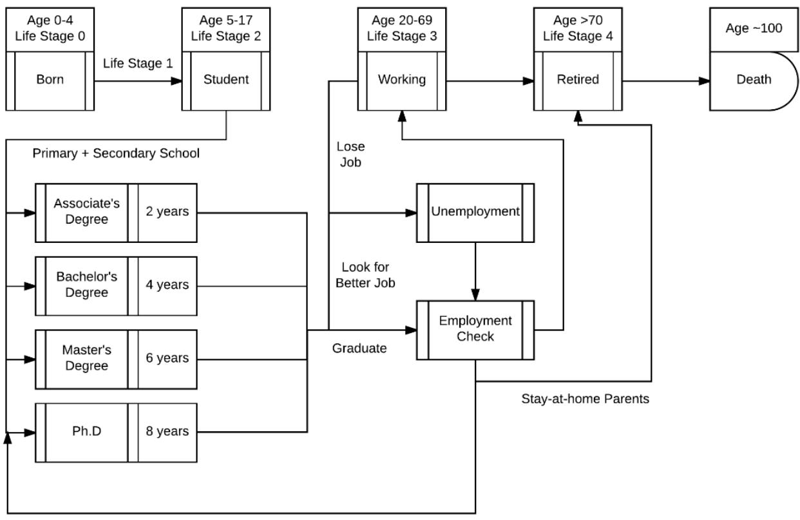
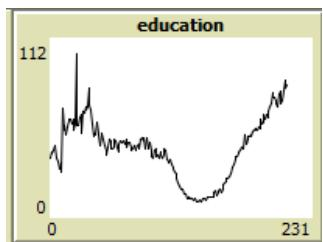

# 2017年美国大学生数学建模竞赛O奖论文（68940）

原件为竞赛论文。补充：文中的阅读练习及“参考解答”为整理时增加，原件图文保留出处。

## Summary

Understanding the socioeconomic processes and tensions underlying population stability is imperative for establishing a population of humans on Mars. The objective of our team was to develop governmental and welfare policies that would allow for a population of 10,000 new residents on Mars to develop an egalitarian civilization that surpasses similar civilizations on Earth. To accomplish this goal, our team was tasked with building a model that evaluates the parameters related to income, education, and equality for the new population.

We developed an agent-based model that simulates a population of 10,000 agents on Mars using real world data given by the US Census' data on occupational income. In our model, each agent, or Martian citizen, progresses through their lifecycle by attending college, searching for jobs, and earning income. The government then protects these individual agents from economic harm using programs such as welfare and minimum wage. To maximize both social welfare and productivity, we chose to monitor the state of the economy and create metrics that would measure the effect of agent-based factors on the community's well-being. We measured multiple parameters of the community generated by these agents, which allowed us to evaluate the condition of the economy. From these parameters, we generated three metrics: the Income Metric I, the Education Metric E, and the Equality Metric Q. The income metric favors higher per capita income values on Mars and punishes a wage gap between the rich and the poor that is either too large or too small. The education metric measures the amount of unemployment as an economical factor and the student-to-faculty ratio as a social welfare factor so as to evaluate education through both the lens of productivity and well-being. Finally, the Equality Metric compares the proportion of women in occupations on Mars to their proportion in jobs on Earth to illustrate the dynamic social equality present in Population Zero. Additionally, our model includes several economic indicators and properties like the inflation rate, a progressive tax system, total investment, and government debt to add further to the dynamic equilibrium of the economy.

Using our model, we found that the best initial population had a mean age of 37 and a ratio of 1:10 of innovators to producers. Analysis of our metrics suggests that the Martian society can support more than 10,000 people in case of an emergency migration from Earth, assuming that infrastructure is present. We found that a minimum wage of \$70,000 provided the greatest benefit to society. As maternity and paternity leave lengths did not have a great impact on GDP, we determined that a maternity leave length of 10 months and a paternity leave length of 3 months. Government control of inflation proved to be critical to maintaining the purchasing power of the people. A progressive tax system served to increase income inequality while keeping investment high and government debt low, allowing the government to provide for increased education and infrastructure needs in the future. Most importantly, a happiness survey can be utilized to create a strong, collaborative society working to reach common goals.

## Policy Advisory

January 24, 2017

Dr. Isabelle C. Moss
Director of LIFE
Quai Gustave-Ador
1207 Genève, Switzerland

Dear Dr. Moss:

Thank you for working with us to design a plan to colonize Mars! We are excited to be a part of humanity's greatest advancement since the Moon Landing – UTOPIA: 2100. We have developed a model to address your concerns about the social and economic equality in UTOPIA: 2100. We aimed to produce policy measures that would maximize income equality, gender equality, and educational advancement in the society.

Considering the complexity of describing governmental policy for a society on an entirely new planet, we developed an intricate, agent-based model that suggested that the initial population should be composed of a 50:50 ratio of males:females to optimize the equality metric. We also determined that the occupations of each person should be chosen so that the proportion of people in each job (as defined by the Bureau of Labor Statistics) is conserved. We found that choosing a population with a mean age of 37, and which consisted of more teenagers and children than older people, resulted in high GDP values and optimized the education and income metrics (see image below). Selecting a population with a 10% proportion of innovators (those individuals with jobs in management and science who are more likely to invest in technological advancement) produced optimal unemployment rates. Other factors such as marital status and ethnicity are less influential on the overall development of the colony, so ensuring that these demographics are equally represented is adequate. The use of unskilled labor has become substantially lower when compared to the 21st century due to the rise of automation and innovations in the robotics industry. Therefore, we suggest that the government require and fund the two-year college education of all people, eliminating "unskilled labor" from UTOPIA: 2100. When we tested various population distributions, we noticed some oscillations in education demand. In particular, after a few years into the model, the demand for education slowly fell over time. However, as the new generation came into the college education system, a huge spike in the education demand occurred. To mitigate the effects of this influx, the Martian government should be prepared to provide funds during the sudden influx of students.

# 2017年美国大学生数学建模竞赛O奖论文（68940）第2部分：政策建议与引言

本文整理自2017年美国大学生数学建模竞赛O奖论文（Team #68940），内容涵盖社会福利政策建议、政府职责阐述、幸福指数测量及项目背景介绍。

## 二、政策建议与社会福利

### 选择 1：社会福利基础

为了实现新火星文明的社会福利，政府必须能够提供全民医疗保健、大学学费资助、社会保障和福利。我们还测试了各种社会福利措施，如最低工资。根据我们的收入指标，设定最低工资为 **\$70,000**（已按2100年的预期通货膨胀调整）将为社会提供最佳效益。另一方面，产假和陪产假对经济影响微乎其微。将这两项假期分别设定为 **10个月** 和 **3个月**，可能有助于提高我们人口的幸福感和福祉。

- A. 最低工资应设定为 \$50,000
- B. 最低工资应设定为 \$70,000
- C. 产假应设定为 6个月
- D. 陪产假应设定为 12个月

答案：B。
知识点：[问题重述与分析（Problem Restatement and Analysis）](../../../topics/数学建模/wenti_chongshu.md)、[文献综述与研究背景撰写方法](../../../topics/数学建模/wenxian_zongshu.md)

### 选择 2：政府责任与税收制度

政府还负责 UTOPIA: 2100 所有公民的社会和经济福祉。因此，中央银行机构必须确保通货膨胀率低于收入增长率，以防止购买力损失并保持高投资水平。我们提议实行**累进税制**以帮助资助政府支出，同时减少收入不平等。税率应维持在这样一个水平：政府不会赚取巨额资金，且人们不会因政府而失去大量辛苦赚来的收入。应在就业部门实施严格的非歧视政策，以增加性别平等；不应因性别、种族和其他特征而拒绝人们的工作机会。

- A. 采用固定比例税制
- B. 实行累进税制
- C. 取消税收以刺激经济
- D. 仅向富人征税

答案：B。
知识点：[任务分解与目标明确](../../../topics/数学建模/renwu_fenjie.md)

### 选择 3：幸福指数测量

衡量 UTOPIA: 2100 进步的一个极其高效可靠的方法是**幸福指数**。这可以通过实施一项调查来测量，公民在调查中报告他们对政府政策（如产假/陪产假时长、失业率和通货膨胀）的满意度。通过这种调查提高人民的整体幸福感，政府可以赢得人民的信任，并形成一种强大的协作社会，共同努力实现共同目标。

- A. GDP增长率
- B. 幸福指数
- C. 失业率
- D. 人口出生率

答案：B。
知识点：[文献综述与研究背景撰写方法](../../../topics/数学建模/wenxian_zongshu.md)、[问题重述与分析（Problem Restatement and Analysis）](../../../topics/数学建模/wenti_chongshu.md)、[数学建模的基本步骤（问题分析、模型假设、建立、求解、检验、推广）](../../../topics/数学建模/jianmo_buzhou.md)

### 选择 4：人口结构目标

遵循上述政策，我们希望实现以下目标：
1. 发展一个庞大的中产阶级，构成人口的绝大多数。我们也希望将最低工资工人的数量最小化，并只保留极少数极度富有的人。
2. 失业率稳定且低，教育体系能够充分容纳并教育人口。我们最终希望政府为所有学生提供四年制大学教育的补贴。
3. 每个职业领域的女性与男性比例相等。

- A. 最大化贫富差距
- B. 发展庞大中产阶级，最小化最低工资工人
- C. 完全消除高等教育补贴
- D. 限制女性进入特定行业

答案：B。
知识点：[文献综述与研究背景撰写方法](../../../topics/数学建模/wenxian_zongshu.md)、[问题重述与分析（Problem Restatement and Analysis）](../../../topics/数学建模/wenti_chongshu.md)、[任务分解与目标明确](../../../topics/数学建模/renwu_fenjie.md)

### 选择 5：基础设施与灾难应对

有了这些政策，政府只需随着人口规模的增长开发物理基础设施（如住房、食品生产设施等）。考虑到初始人口规模和特征，跟上人口增长应该不难。如果地球发生灾难导致需要大规模迁移，火星政府需要改善其物理基础设施以适应大量移民的涌入。然而，不需要大幅改变任何政策。

- A. 灾难发生时需废除所有经济政策
- B. 仅需关注政治改革
- C. 改善物理基础设施以适应移民，无需大幅改变政策
- D. 停止接收任何来自地球的移民

答案：C。
知识点：[问题重述与分析（Problem Restatement and Analysis）](../../../topics/数学建模/wenti_chongshu.md)

### 选择 6：项目愿景

休斯顿，我们有麻烦了！星际、金融与探索政策实验室（LIFE）进行了多项研究，设计了基础设施，并进行了科学实验，以使第一批人类人口能够在火星上生活。这批首批人口被称为“零号人口”（Population Zero），将包括 **10,000人**。零号人口的任务是通过最大化公民在工作场所的经济产出和幸福度，创建一个可持续的社会。

- A. 零号人口为 100,000人
- B. 零号人口为 10,000人
- C. 零号人口为 1,000人
- D. 零号人口为 1,000,000人

答案：B。
知识点：[任务分解与目标明确](../../../topics/数学建模/renwu_fenjie.md)

### 选择 7：UTOPIA: 2100 的目标

本项目称为 **UTOPIA: 2100**，旨在为22世纪创造一个最优劳动力，让所有人享有最高生活质量，并展望火星未来100年的可持续发展愿景。这个火星社区将由经济、政府、劳动力和司法系统中的**平等主义原则**驱动。

- A. 由资本主义原则驱动
- B. 由社会主义原则驱动
- C. 由平等主义原则驱动
- D. 由军事独裁原则驱动

答案：C。
知识点：[任务分解与目标明确](../../../topics/数学建模/renwu_fenjie.md)

### 选择 8：团队任务

在开发零号人口的经济 - 劳动力 - 教育体系的过程中，LIFE 委托我们的数学家和政策顾问小组制定一套政策，以促进向火星的迁移。我们团队的目标是考虑收入、教育和公平性如何与零号人口的目标相关联，并提供适应此类星际社区项目的政策建议。

- A. 仅关注军事防御
- B. 仅关注资源开采
- C. 综合考虑收入、教育和公平性
- D. 仅关注医疗系统

答案：C。
知识点：[多目标优化模型（药物相对充足阶段的配送策略）](../../../topics/数学建模/duo_mubiao_youhua.md)、[问题重述与分析（Problem Restatement and Analysis）](../../../topics/数学建模/wenti_chongshu.md)、[任务分解与目标明确](../../../topics/数学建模/renwu_fenjie.md)

### 选择 9：问题重述

我们小组的任务是制定政策建议，使零号人口能够最大化其公民在工作场所的经济产出和幸福度。UTOPIA: 2100 项目的愿景是在火星上产生一个可持续的人口。国际火星联盟（ICM）为我们的小组提供了制定这些建议的指导方针。

- A. 最大化利润
- B. 最大化经济产出和幸福感
- C. 最小化成本
- D. 最大化出口量

答案：B。
知识点：[任务分解与目标明确](../../../topics/数学建模/renwu_fenjie.md)、[文献综述与研究背景撰写方法](../../../topics/数学建模/wenxian_zongshu.md)

### 选择 10：参数定义

我们要为人口零号的收入、教育和社会平等相关因素定义参数。这涉及考虑劳动力人口统计、教育人口统计、促进这些参数的政府基础设施，以及确保最大化这些参数的政策。

- A. 仅定义收入参数
- B. 仅定义教育参数
- C. 定义收入、教育和社会平等的综合参数
- D. 仅定义政治参数

答案：C。
知识点：[符号说明与术语定义（Nomenclature / Symbols and Definitions）](../../../topics/数学建模/fuhao_shuoming.md)、[模型参数的确定（基于数据拟合或实验选择）](../../../topics/数学建模/canshu_queding.md)、[影响因素评估指标体系构建（温度、湿度、经济、教育等）](../../../topics/数学建模/yingxiang_zhibiao.md)

### 选择 11：样本人口合成

我们要合成一个包含 10,000 人的样本人口，以确保 UTOPIA: 2100 的目标得以实现。在此过程中，我们必须考虑年龄、性别和教育的人口统计特征。此外，该人口必须能够促进 UTOPIA: 2100 的目标。

- A. 随机生成人口
- B. 基于年龄、性别和教育特征合成人口
- C. 仅基于年龄特征
- D. 仅基于教育特征

答案：B。
知识点：[文献综述与研究背景撰写方法](../../../topics/数学建模/wenxian_zongshu.md)、[问题重述与分析（Problem Restatement and Analysis）](../../../topics/数学建模/wenti_chongshu.md)、[数学建模的基本步骤（问题分析、模型假设、建立、求解、检验、推广）](../../../topics/数学建模/jianmo_buzhou.md)

### 选择 12：模型构建

最后，我们要构建一个模型来描述未来十年的种群动态。在此过程中，我们必须确定平衡生产力和福祉的工资分布。我们还被要求描述可以改善我们模型的创新。此外，我们对100年计划进行敏感性分析，并考虑从地球到火星的紧急疏散迁移模式。

- A. 仅构建静态模型
- B. 构建描述种群动态的动态模型
- C. 仅构建财务模型
- D. 仅构建交通模型

答案：B。
知识点：[数学建模的基本步骤（问题分析、模型假设、建立、求解、检验、推广）](../../../topics/数学建模/jianmo_buzhou.md)、[任务分解与目标明确](../../../topics/数学建模/renwu_fenjie.md)、[动态规划求解（状态变量、决策变量、状态转移函数、值函数）](../../../topics/数学建模/dongtai_guihua.md)

### 假设 1

原文指出由于难以预测所有可能影响模型的变量和因素，因此做出了一些假设以构建可运行的模型。

- 每个火星人都上大学以获得至少副学士学位（Associate’s Degree）。
  - 理由：鉴于在火星上生存所需的高技术水平以及22世纪对教育的高需求[1]，我们强制要求所有公民接受良好教育。

答案：无（此为论文中的陈述性假设，非考题标准答案）
知识点：[一般假设及其合理性说明（Assumptions and Justifications）](../../../topics/数学建模/jiaben_shezhi.md)

### 假设 2

- 教育文凭在2年、4年、6年和8年的时间间隔颁发。
  - 理由：假设每个学生遵循传统的学位获取模式：2年副学士，4年学士，6年硕士，8年博士。本模型未涵盖需要超过8年才能获得的其它学位选项。

答案：无
知识点：[一般假设及其合理性说明（Assumptions and Justifications）](../../../topics/数学建模/jiaben_shezhi.md)

### 假设 3

- 只要个体处于工作年龄且不是永久性的家庭主妇/主夫，他们就会积极寻找工作。
  - 理由：在本模型中，追求工作和成为有生产力的公民比拥有需要更高等级教育的学位更重要。在一个平等社会中，火星公民的社会福利不应取决于他们所拥有的学历。

答案：无
知识点：[一般假设及其合理性说明（Assumptions and Justifications）](../../../topics/数学建模/jiaben_shezhi.md)

### 假设 4

- 火星人口将在70岁退休，预期寿命为100岁。
  - 理由：根据联合国人口局数据，22世纪预期寿命将为100岁[2]。此外，从历史图表[3]可以看出，平均退休年龄从1991年的57岁增加到2012年的60岁，大约每过7年增加1岁。推算至2100年，70岁的退休年龄是一个合理的估计。

答案：无
知识点：[模型参数的确定（基于数据拟合或实验选择）](../../../topics/数学建模/canshu_queding.md)、[一般假设及其合理性说明（Assumptions and Justifications）](../../../topics/数学建模/jiaben_shezhi.md)

### 假设 5

- 种族、民族或宗教不影响人口在火星上的进步能力。
  - 理由：由种族、民族和宗教带来的文化价值观难以量化或在模型中表达。

答案：无
知识点：[问题重述与分析（Problem Restatement and Analysis）](../../../topics/数学建模/wenti_chongshu.md)、[一般假设及其合理性说明（Assumptions and Justifications）](../../../topics/数学建模/jiaben_shezhi.md)、[文献综述与研究背景撰写方法](../../../topics/数学建模/wenxian_zongshu.md)

### 假设 6

- 收入、各职业工人数目和一般价格将以与当前相同的年增长率增加。
  - 理由：使用相同的年增长率是从当前数据外推22世纪收入、价格和职业岗位的一种合理方式。

答案：无
知识点：[一般假设及其合理性说明（Assumptions and Justifications）](../../../topics/数学建模/jiaben_shezhi.md)

### 假设 7

- 必要的基础设施（例如房屋和其他必需品）在零代人口（Population Zero）到来之前已经存在于火星上。
  - 理由：假设LIFE组织已经建立了支持零代人口的基础设施是合理的。

答案：无
知识点：[一般假设及其合理性说明（Assumptions and Justifications）](../../../topics/数学建模/jiaben_shezhi.md)

### 假设 8

- 不考虑个体代理人之间的亲属关系。
  - 理由：在基于代理的模型中表示家庭单位需要一个底层网络。这样的网络计算密集，且在10,000个节点上进行评估很困难。

答案：无
知识点：[数学建模的基本步骤（问题分析、模型假设、建立、求解、检验、推广）](../../../topics/数学建模/jianmo_buzhou.md)

### 假设 9

- 死亡时间不依赖于生活中发生的事件。
  - 理由：我们的模型没有考虑收入、职业与健康之间难以量化的关系。

答案：无
知识点：[数学建模的基本步骤（问题分析、模型假设、建立、求解、检验、推广）](../../../topics/数学建模/jianmo_buzhou.md)、[一般假设及其合理性说明（Assumptions and Justifications）](../../../topics/数学建模/jiaben_shezhi.md)

### 假设 10

- 除了产假和陪产假外，我们的模型不考虑任何其他形式的休假。
  - 理由：在我们的模型中，很难量化会导致代理人休无薪假的生活事件。

答案：无
知识点：[一般假设及其合理性说明（Assumptions and Justifications）](../../../topics/数学建模/jiaben_shezhi.md)、[文献综述与研究背景撰写方法](../../../topics/数学建模/wenxian_zongshu.md)

### 问题 1

**核心主题：** 社会福利和生产力的最大化。
**背景：** 火星上的新社会基于平等主义原则，必须能够在提供公民福祉的同时创造无与伦比的經濟。

**关键特征 1：个人主动性（Personal Initiative）**
- 每个人都应该有动力提高自身的福祉。
- 这种动力通常表现为更高的工资。
- 缺乏个人主动性是导致共产主义衰落的主要原因之一[4]。
- **建模策略：** 不要将人口成员的行为简化为一组变量，而是保持每个个体代理人的特征，以便在模型中体现个人主动性。

**关键特征 2：社会福利（Social Welfare）**
- 火星政府应能提供资金用于医疗保健、大学教育、产假/陪产假及其他对社会有益公共物品。
- 这将使火星文明在社会福利项目方面有可能超越美国。

答案：无
知识点：[多目标优化模型（药物相对充足阶段的配送策略）](../../../topics/数学建模/duo_mubiao_youhua.md)、[任务分解与目标明确](../../../topics/数学建模/renwu_fenjie.md)、[数学建模的基本步骤（问题分析、模型假设、建立、求解、检验、推广）](../../../topics/数学建模/jianmo_buzhou.md)

### 设计 1

**方法选择：** 基于代理的模型（Agent-Based Model, ABM）。
**理由：**
1. 虽然考虑了基于微分方程的模型，但传统微分方程模型无法体现个人主动性。
2. 此类系统往往忽略了由于离散代理人的行为而非连续变量引起的复杂相互作用。
3. ABM能准确代表个人对社会的影响以及公民内部和外部的相互作用。
**工具：** NetLogo。

答案：无
知识点：[数学建模的基本步骤（问题分析、模型假设、建立、求解、检验、推广）](../../../topics/数学建模/jianmo_buzhou.md)、[一般假设及其合理性说明（Assumptions and Justifications）](../../../topics/数学建模/jiaben_shezhi.md)、[模型优缺点分析（Strengths and Weaknesses）](../../../topics/数学建模/youque_dian.md)

### 设计 2

**案例描述：Bob的生命周期**
为了理解系统的 mechanics 和 interactions，通过分析一个出生在火星的人 Bob 的生命来描述模型。

**生命周期分类：**
模型根据年龄和职业将人分为4个生命周期阶段（0, 1, 2, 3, 4）。
- **阶段 0 (出生):** Bob 出生时，生命周期为 0。
- **阶段 1 (小学):** 5岁时开始上小学，生命周期设为 1。
- **教育阶段:** Bob 继续接受教育直到高中毕业。由于政府支付并强制要求大学教育，Bob 获得副学士学位（Associate’s degree）。

**就业与再教育逻辑：**
1. **求职尝试 1 (副学士后):**
   - 只能搜索教育要求≤2年的工作。
   - **成功:** 立即接受工作。
   - **失败:**
     - 以概率 $p_2$ 继续找工作（归类为失业）。
     - 以概率 $(1 - p_2)$ 回到学校。

2. **重返学校 (学士阶段):**
   - 继续教育并获得学士学位（Bachelor’s degree）。
   - **求职尝试 2:**
     - 搜索教育要求≤4年的工作。
     - **成功:** 接受工作。
     - **失败:**
       - 以概率 $(1 - p_4)$ 再次回到学校（获得硕士学位 Master’s degree）。
       - 否则继续找工作（搜索教育要求≤6年的工作）。

3. **重返学校 (硕士阶段):**
   - 如果仍未找到工作并以概率 $(1 - p_6)$ 再次回到学校，获得博士学位（Ph.D.）。

4. **最终求职 (博士阶段):**
   - 以概率 $p_8 = 1$ 离开学院。
   - 继续寻找任何教育要求的工作，直到找到为止。

答案：无
知识点：[任务分解与目标明确](../../../topics/数学建模/renwu_fenjie.md)

### 选择 1

**题干：**
在模型中，如果鲍勃拥有学士、硕士或博士学位，他有可能获得一份学历要求低于其实际学历的工作。例如，假设鲍勃拥有硕士学位并正在找工作。虽然目前没有学历要求为6年或4年的职位空缺，但有一个学历要求为2年的职位空缺。鲍勃接受了这份工作，并被归类为“就业不足”（underemployed），因为他对这份工作来说“资格过高”。

- **A.** 鲍勃会立即辞职并继续寻找更高学历要求的工作。
- **B.** 鲍勃会在继续工作的同时继续寻找工作。如果发现学历要求为4年或6年的职位空缺，他会辞去当前工作并接管新工作。如果找到多个不同学历要求（均高于当前工作）的职位，他会选择满足条件且学历要求最高的那个。一旦鲍勃获得的职位学历要求与其教育水平匹配，他就不再被归类为就业不足。

答案：B。
知识点：[人力资本网络模型（Human Capital Network, HCM）](../../../topics/数学建模/renli_ziben.md)、[离职事件（Demission/Turnover Event）定义与算法](../../../topics/数学建模/lizhi_suanfa.md)

### 简答 1

**题干：**
为了确定模型中每一步可用的职位集合，我们需要表明火星上可能出现的职位分布的数据。作者使用了什么数据来源？如何 extrapolate（外推）到2100年？对于每个职业类型，最小学历要求是如何确定的？

**参考解答：**
1.  **数据来源：** 使用美国劳工统计局（BLS）2011年至2015年的数据。BLS将所有职业分为22个主要类别。每个类别包含该类别的人数、平均收入、中位数收入、第10百分位收入、第25百分位收入、第75百分位收入和第90百分位收入。
2.  **外推方法：** 对每个个体职业，利用这5年的可用数据进行指数拟合，以确定收入和工人数量的年增长率。给定这些增长率，将当前美国的就业和收入值按比例缩放至2100年的美国水平。
3.  **学历要求确定：** BLS并未提供这22种职业的最小教育水平。因此，作者参考独立来源来确定这些值。计算结果总结在附录的表1和表2中。

知识点：[模型参数的确定（基于数据拟合或实验选择）](../../../topics/数学建模/canshu_queding.md)

### 计算 1

**题干：**
在模型的每一个时间点（tick），都会评估“收入文件”和“职位分布”。由于火星人口与美国人口不同，具有意义的是每种职业的工人与整个劳动力的比率，而不是每种职业的工人数量。请写出将某职业 $i$ 的值 $v_i$ 转换为该职业占总职位分数的公式。此外，计算火星上实际职位数量时，需要乘以劳动力市场规模，该规模由哪些部分组成？考虑到现实世界中职位创建和消除不是瞬时的，模型如何处理这一灵活性？

**参考解答：**
1.  **职位分数转换公式：**
    将每种职业 $i$ 的值 $v_i$ 替换为以下公式以获得属于职业 $i$ 的总职位分数：
    $$
    \frac {v _ {i}}{\sum_ {i} v _ {i}}
    $$
2.  **劳动力市场规模组成：**
    实际职位数量等于以下三部分之和：
    -   正在工作的人数
    -   失业个人的数量
    -   当时积极求职的大学生子集
3.  **处理灵活性：**
    为了 accounted for（考虑）这种不即时性，可用职位集合每年重置一次，而不是每个 tick 重置。注意在模型中，ticks 每年评估6次。

## 三、收入分配与增长机制

知识点：[数学建模的基本步骤（问题分析、模型假设、建立、求解、检验、推广）](../../../topics/数学建模/jianmo_buzhou.md)、[符号说明与术语定义（Nomenclature / Symbols and Definitions）](../../../topics/数学建模/fuhao_shuoming.md)

### 简答 2

**题干：**
模型如何确定每个雇佣工人的收入？请详细说明“百分位”（percentile）的分配规则，包括插值计算、最低薪资限制以及最高薪资的处理方式。此外，工人收入随时间的增长是如何设定的？

**参考解答：**
1.  **百分位分配：**
    每个工人被赋予一个“百分位”。
    -   如果百分位是10，工人获得第10百分位收入。
    -   如果百分位是25，工人获得第25百分位收入。
    -   如果百分位在10到25之间，工人获得第10和第25百分位收入的加权平均值。若工人被赋予百分位 $x$，其收入计算公式为：
        $$
        (2 5 - x) \times (\text { percentile } 1 0) + (x - 1 0) \times (\text { percentile } 2 5)
        $$
2.  **极端情况处理：**
    -   如果工人的百分位低于10，他获得最低工资（将在后文详细描述）。
    -   如果工人的百分位高于90，由于缺乏数据无法插值，因此将其设置为第90百分位收入。
3.  **收入增长：**
    工人的收入每年增加一个固定金额，该金额由其工作的增长率给出。

知识点：[人力资本网络模型（Human Capital Network, HCM）](../../../topics/数学建模/renli_ziben.md)、[模型参数的确定（基于数据拟合或实验选择）](../../../topics/数学建模/canshu_queding.md)

### 计算 2

**题干：**
当工人获得工作时，他从10到50之间随机分配一个百分位作为起薪。当“零号人口”到达火星时，他们的薪水根据其年龄和教育程度从大学毕业开始时的适当百分位开始。为了使员工在其任期内至少增长20个百分位，作者找到了中位数任期是多少？据此设定的百分位增长率是多少？另外，每年工人失去工作的概率是多少？

**参考解答：**
1.  **中位数任期：** 4.3年 [42]。
2.  **百分位增长率计算：**
    目标增长：20个百分位。
    增长率 = $\frac { 2 0 } { 4 . 3 } = 4 . 6 5$ （每十年或每年？原文语境暗示这是年度增长率参数，尽管单位未明确标注为%/year，但通常此类模型参数为年化率）。
3.  **失业概率：** 每年有2%的机会工人会失去工作 [43]。

## 四、职业退出与社会角色

知识点：[任务分解与目标明确](../../../topics/数学建模/renwu_fenjie.md)、[一般假设及其合理性说明（Assumptions and Justifications）](../../../topics/数学建模/jiaben_shezhi.md)、[模型优缺点分析（Strengths and Weaknesses）](../../../topics/数学建模/youque_dian.md)

### 简答 3

**题干：**
除了失业，工人还有什么其他可能性退出劳动力市场？成为“居家父母”（stay-at-home parent）的概率取决于什么因素？请列出不同教育水平下男性和女性成为居家父母的概率表。

**参考解答：**
1.  **退出原因：** 工人有概率辞职并成为“居家父母”。在这种情况下，工人从劳动力市场中移除，其生活阶段设置为4，但在达到70岁之前不领取社会保障金。
2.  **影响因素：** 成为居家父母的概率取决于性别，并且与其教育水平成反比 [50, 51, 52]。
3.  **概率表：**

| 教育水平 | 男性 | 女性 |
| :--- | :--- | :--- |
| Associate (副学士) | 0.07 | 0.25 |
| Bachelor (学士) | 0.03 | 0.19 |
| Master (硕士) | 0.02 | 0.09 |
| Ph. D (博士) | 0.01 | 0.06 |

## 教育程度概率设定

根据2015年美国人口普查局关于教育程度的数据 [28]，设置概率 $p_2, p_4, p_6$ 和 $p_8$：

| Associate | Bachelor | Master | Ph. D |
| :---: | :---: | :---: | :---: |
| 22537 | 46515 | 18683 | 6987 |

以 $p_4$ 为例进行说明。$p_4$ 定义为拥有学士学位的人数与拥有学士及以上学位人数之比。因此：

$$
p_4 = \frac{46515}{46515 + 18683 + 6987} = 0.49
$$

知识点：[任务分解与目标明确](../../../topics/数学建模/renwu_fenjie.md)、[模型参数的确定（基于数据拟合或实验选择）](../../../topics/数学建模/canshu_queding.md)、[问题重述与分析（Problem Restatement and Analysis）](../../../topics/数学建模/wenti_chongshu.md)

### 出生与死亡

现在考虑模型中的另一个智能体 Alice。Alice 大约 26 岁，有工作，并与 Bob 结婚（注2）。由于 Alice 是 18 到 50 岁之间的女性，她有生育孩子的可能性。该概率 $p_{\mathrm{baby}}$ 是年龄 ($a$) 和之前已孕育孩子数量 ($b$) 的函数。该概率与之前已孕育孩子的数量成反比，因为已经有很多孩子的人不太可能再次生育。该概率在 26 岁时达到峰值（如文献 [38] 所示），并在 18 岁和 50 岁的边界处较低。因此：

$$
p_{\mathrm{baby}} = k \times \frac{\left(\frac{\frac{1}{6} a - 3}{(\frac{1}{6} a - 4)^2 + 1}\right)}{b + 1}
$$

注意，此指标与常数 $k$ 成正比。为了模拟世界出生率为 2.4 [39]，我们使用常数 $k = 0.265$（注3）（通过试错法确定）。如果 Alice 将要生孩子，她的计时器就会启动。一旦该计时器达到 9 个月，婴儿就会出生。婴儿出生后，Alice 至少在未来 15 个月内不能再生育。

当 Alice 的婴儿计时器达到 7 个月时，她开始休产假（如果她有工作）。产假的长度在模型测试期间变化，以确定其对后面讨论的不同指标的影响。Alice 在产假期间获得的工资不计入任何收入指标中，因为这些是由政府补贴的转移支付。当 Alice 的产假结束时，Bob 的陪产假开始。陪产假的长度也是变化的（注4）。

让我们再次考虑 Bob，他现在 70 岁了。Bob 现在退休并开始从政府领取社会保障金。Bob 的生命阶段设置为 4，并继续以这种方式生活一段时间。当人们出生时，他们的寿命是使用伽马分布预先确定的。平均寿命为 100 年，变异为 10 年。一旦 Bob 的年龄等于他的寿命，他就死了。这就是我们在 UTOPIA: 2100 模型中一个人的一生周期。

注2： 请注意，模型中没有内置家庭结构；为了便于解释，我们在此假设存在这种结构。
注3： 当 Population Zero 在模型中初始化时，该常数会在 20 年内增加到其最终值，以防止出现大的婴儿潮——这也模拟了人们在火星上不会立即以高速度繁殖的事实。
注4： 在实际模型中，当 Alice 的产假结束时，一位尚未休假且正在工作的随机男性的陪产假将开始。

为了说明生命周期，我们提供了以下流程图。

知识点：[模型参数的确定（基于数据拟合或实验选择）](../../../topics/数学建模/canshu_queding.md)、[参数合理性验证](../../../topics/数学建模/canshu_heli_xing.md)、[一般假设及其合理性说明（Assumptions and Justifications）](../../../topics/数学建模/jiaben_shezhi.md)

### 全球通胀

当我们开始考虑货币成本和官僚机构时，重要的是要考虑从现在到 22 世纪发生的全球通胀。下图展示了 1923 年至 2012 年的美国通胀情况 [37]：

*(注：原文此处引用图表展示美国通胀趋势，随后指出若直接外推可能存在偏差)*

为了避免这一陷阱，我们考虑加拿大的通胀率。从下图中可以看出，加拿大具有非常稳定的通胀率 [40]：

由于加拿大倾向于经济稳定而非快速经济增长，我们将我们的经济模式仿照加拿大经济，因为我们的目标是最大化生产力和社会福利。目前的加拿大通胀率约为 1.3% [41]，因此这将用作将 21 世纪转换为 22 世纪货币价值的世界通胀率。

知识点：[一般假设及其合理性说明（Assumptions and Justifications）](../../../topics/数学建模/jiaben_shezhi.md)、[参数合理性验证](../../../topics/数学建模/canshu_heli_xing.md)

### 经济指标与基本要素

Population Zero 的目标是创建一个在经济实力上远超地球上类似社会的社会，同时在收入、工作场所平等和教育方面实现社会均衡。因此，监控由我们的基于智能体的模型所引发的经济状况非常重要。我们计算各种经济指标，以便跟踪 UTOPIA: 2100 的发展和进步。

#### 税收

为了保持收入平等，我们实施了一个包含 5 个税级的累进税制。所有税收均从每个消费者的收入中扣除。这些税率主要代表所得税率，但也可以调整为包括销售税、财产税等。每个税级的税率是“整体税率”（OTR）的一部分，OTR 在模型测试期间进行调整。我们可以改变税率以确定其对 GDP、政府债务和我们收入指标的影响。以下是税级及其对应的税率：

| Tax Bracket | Tax Rate |
| :--- | :--- |
| $\leq$ Minimum Wage | 0% |
| Minimum Wage - $(\frac{\text{Minimum Wage} + \text{Income Mean}}{2})$ | $\frac{\text{OTR}}{6}$ |
| $(\frac{\text{Minimum Wage} + \text{Income Mean}}{2})$ - Income Mean | $\frac{\text{OTR}}{5}$ |
| Income Mean - 75th Income Percentile | $\frac{\text{OTR}}{4}$ |
| 75th Income Percentile - 90th Income Percentile | $\frac{\text{OTR}}{3}$ |
| $\geq$ 90th Income Percentile | $\frac{\text{OTR}}{2}$ |

#### 政府支出与债务

为了成为一个理想的社会，政府必须支付造福社会的公共产品费用。如前所述，政府必须支付所有学生的大学教育费用、社会保障、福利、基础设施和医疗保健费用。除医疗保健外，上述各项支出的资金数额是根据美国政府的比例计算的，而医疗保健费用则是从

## 参数化与社会福利

Canada. The values are \$42,155 per student per year (education) [31], \$168,281,905 per 10,000 people per year (health care) [32], \$158,625,722 per 10,000 people per year (infrastructure) [30], \$59,000 per unemployed person per year (welfare) [34], and \$45,000 per person over 70 per year (social security) [33].

Government debt is the accumulated value of the budget deficit over time. The deficit is calculated by the total money collected through annual taxes minus the total annual government spending.

知识点：[模型参数的确定（基于数据拟合或实验选择）](../../../topics/数学建模/canshu_queding.md)、[数学建模的基本步骤（问题分析、模型假设、建立、求解、检验、推广）](../../../topics/数学建模/jianmo_buzhou.md)、[任务分解与目标明确](../../../topics/数学建模/renwu_fenjie.md)

### 通货膨胀

To model inflation rates in our society, we consider the following graph [53]:

This graph is approximately sinusoidal. Though there are deviations, we can reasonably assume that inflation tends to follow a sinusoidal pattern.

The inflation over time (in our model) is given as a function of two sinusoids. This function models the cyclic nature of inflation while also accounting for yearly fluctuations. The fluctuations in inflation that occur over long periods of time tend to coincide with the business cycle, and are represented with a larger change in amplitude. Consequently, brief variation in inflation, represented by the amplitude of the sinusoid with an annual period, is relatively small.

$$
\mathrm{Inflation}(t) = 0.0025 \sin\left(\frac{2\pi t}{20}\right) + 0.008 - 0.0005 \cos(2\pi t)
$$

Inflation directly affects our model by reigning back income growth. In particular, our model divides every person's salary by the combined effect of inflation to obtain its "real value". Minimum wage, welfare, and social security are unaffected by this since the government is presumed to update these values to keep up with inflation.

知识点：[数学建模的基本步骤（问题分析、模型假设、建立、求解、检验、推广）](../../../topics/数学建模/jianmo_buzhou.md)、[模型参数的确定（基于数据拟合或实验选择）](../../../topics/数学建模/canshu_queding.md)、[一般假设及其合理性说明（Assumptions and Justifications）](../../../topics/数学建模/jiaben_shezhi.md)

### 失业率

The unemployment rate is given by the following function:

$$
\mathrm{Unemployment} = \frac{\mathrm{Number\ of\ Workers}}{\mathrm{Labor\ Force}}
$$

We can think of unemployment as a metric of how poorly the current education levels in the population match the actual set of available jobs. Therefore a high unemployment implies that the current education system is not working properly and requires intervention.

知识点：[问题重述与分析（Problem Restatement and Analysis）](../../../topics/数学建模/wenti_chongshu.md)、[一般假设及其合理性说明（Assumptions and Justifications）](../../../topics/数学建模/jiaben_shezhi.md)、[影响因素评估指标体系构建（温度、湿度、经济、教育等）](../../../topics/数学建模/yingxiang_zhibiao.md)

### 边际消费倾向（MPC）

The MPC is a variable quantity in our model. It is set to 0.9 to mimic the MPC of the United States in 2016 [29]. MPC controls the amount of consumer expenditures and the investment schedule as detailed later.

知识点：[模型参数的确定（基于数据拟合或实验选择）](../../../topics/数学建模/canshu_queding.md)、[一般假设及其合理性说明（Assumptions and Justifications）](../../../topics/数学建模/jiaben_shezhi.md)、[参数合理性验证](../../../topics/数学建模/canshu_heli_xing.md)

### 消费支出

All consumers (people) spend an amount of money equal to welfare (as it is the bare minimum wage necessary to survive). In other words, if a consumer had 0 income, he or she will still spend the amount of dollars equal to welfare. For every dollar of income thereafter, a consumer spends MPC of that. Therefore in total, a consumer spends

$$
\mathrm{Income} \times \mathrm{MPC} + \mathrm{Welfare}
$$

知识点：[数学建模的基本步骤（问题分析、模型假设、建立、求解、检验、推广）](../../../topics/数学建模/jianmo_buzhou.md)、[一般假设及其合理性说明（Assumptions and Justifications）](../../../topics/数学建模/jiaben_shezhi.md)

### 利率

The interest rate is a value varied for testing purposes that determines the effectiveness of investment spending. The rate is constant since reserve banks do not generally change the rate. It is currently set to 0.75% [35].

知识点：[模型参数的确定（基于数据拟合或实验选择）](../../../topics/数学建模/canshu_queding.md)、[参数合理性验证](../../../topics/数学建模/canshu_heli_xing.md)

### 投资支出

People invest money proportionally to the amount they save from their income (retired and college students do not invest). Investment spending is inversely proportional to inflation, as people would be less likely to invest in weaker money. Since a consumer saves $(1 - \mathrm{MPC})$ for every dollar amount gained in income, and consumers are welfare in debt with 0 income, the total amount of savings is $(1 - \mathrm{MPC})\left(\mathrm{income} - \frac{\mathrm{welfare}}{1 - \mathrm{MPC}}\right)$

$$
\mathrm{Investment} = \frac{\left(\mathrm{Income} - \frac{\mathrm{Welfare}}{1 - \mathrm{MPC}}\right)(1 - \mathrm{MPC})}{1 + \mathrm{Inflation}}
$$

Investment spending leads to returns on investment for consumers.

知识点：[一般假设及其合理性说明（Assumptions and Justifications）](../../../topics/数学建模/jiaben_shezhi.md)、[符号说明与术语定义（Nomenclature / Symbols and Definitions）](../../../topics/数学建模/fuhao_shuoming.md)

### 国内生产总值（GDP）

GDP is calculated as a sum of Consumer Expenditures, Government Spending, Investment Spending, and Net Exports. However, because we are aiming to create a self-sustaining society, we assume that there are no Net Exports. A steadily rising GDP indicates a growing yet stable economy.

## 社会福利与生产率的参数化

知识点：[可持续发展指数 SDI 的构建与指标体系结构](../../../topics/数学建模/kechixu_zhibiao.md)、[模型参数的确定（基于数据拟合或实验选择）](../../../topics/数学建模/canshu_queding.md)

### 收入指标

We design three metrics to measure the success of Population Zero in maximizing productivity and well being. The values of these three metrics are used to determine the success of Population Zero over a ten-year period. The income metric measures the population's propensity to facilitate a productive economy whilst punishing a wage gap that may be detrimental to the happiness and social welfare of the population. In general, the mean income of Population Zero should rise faster than inflation so as to maintain a stable economy. Furthermore, an increasing mean income also facilitates a wealthier economy, and therefore a productive society. However, it is often the case that only a certain section of the population is capable of increasing their income, whilst others are constrained by societal factors. To punish such a gap between the rich and the poor, our income metric $I$ is the multiplicative combination of a component $\mu_I$ that accounts for increase in mean income and a component $\sigma_I$ that

# 2017年美国大学生数学建模竞赛O奖论文（68940）习题

本节内容整理自《2017年美国大学生数学建模竞赛O奖论文（68940）》第 14–15 页，主要涉及收入指标、教育指标和性别平等指标的模型构建与计算逻辑。

## 一、收入指标 (Income Metric)

知识点：[影响因素评估指标体系构建（温度、湿度、经济、教育等）](../../../topics/数学建模/yingxiang_zhibiao.md)、[可持续发展指数 SDI 的构建与指标体系结构](../../../topics/数学建模/kechixu_zhibiao.md)、[任务分解与目标明确](../../../topics/数学建模/renwu_fenjie.md)

### 选择 1：收入指标的定义与构成

原文指出，收入指标 $I$ 用于衡量人口分配状况，其计算公式为：

$$
I = \mu_{I} \cdot \sigma_{I}
$$

其中：
- $\mu_{I}$ 是平均收入，定义为不在休假状态的工人总收入与处于生命周期阶段 3（工作人口）的人数之比：
  $$
  \mu_{I} = \frac{\mathrm{Total\ income\ of\ workers\ not\ on\ leave}}{\mathrm{Number\ of\ people\ at\ lifestage\ 3}}
  $$
  5注：休产假/陪产假的员工被视为收入为 0。

- $\sigma_{I}$ 是一个惩罚项，旨在对过大或过小的工资差距进行惩罚：
  - **小差距**：会导致政府财富再分配，因缺乏资本和创新激励而降低经济生产力。
  - **大差距**：损害社会福利，导致中产阶级不断减少。
  
  其函数形式为：
  $$
  \sigma_{I} = \frac{\sigma}{(\sigma)^{2} + 0.55}
  $$
  其中 $\sigma$ 为标准差，即（不在休假状态的工人总收入）/（收入均值）。

该函数曲线从 $(0,0)$ 快速上升至峰值，然后缓慢收敛至零。常数 $0.55$ 的确定依据如下：
1. 发达国家基尼系数约为 $0.4$ [55]。
2. 利用收入呈对数正态分布的特性，通过转换公式 $G = \mathrm{erf}\left(\frac{\sigma}{2}\right)$ [56]，推导出当 $G=0.4$ 时，$\sigma \approx 0.74$。
3. 求解使方差函数在 $\sigma = 0.74$ 处达到峰值的常数，结果为 $0.55$。

**答案：** 该模型通过引入惩罚项 $\sigma_I$ 来平衡收入差距，既避免贫富悬殊，又防止过度平均化导致的效率低下。

**参考解答：** 相比于直接计算基尼系数（Gini Coefficient），本模型提出的收入指标 $I$ 在计算上更为高效。基尼系数的定义如下：
$$
G = \frac{\sum_{i=1}^{n} \sum_{j=1}^{n} |x_i - x_j|}{2n \sum_{i=1}^{n} x_i}
$$
基尼系数计算了每对人之间的收入差异并进行了归一化，虽然全面但计算复杂度极高（$O(n^2)$）。因此，团队开发了收入指标 $I$ 作为计算替代方案。

**补充说明：**
根据美国数据：
- 2015 年人均收入为 \$36,257 [45]。
- 经通胀调整后，该数值约为 \$176,769。
- 估计的 $\sigma_I$ 值小于 $0.5$ [44]。
- 据此计算，2095 年美国的人均收入指标 $I = 88,384$。
- Population Zero 的目标是实现收入指标 $I > 150,000$。

## 二、教育指标 (Education Metric)

知识点：[模型参数的确定（基于数据拟合或实验选择）](../../../topics/数学建模/canshu_queding.md)、[一般假设及其合理性说明（Assumptions and Justifications）](../../../topics/数学建模/jiaben_shezhi.md)、[模型优缺点分析（Strengths and Weaknesses）](../../../topics/数学建模/youque_dian.md)

### 选择 2：教育指标的构建逻辑

教育指标 $E$ 用于衡量火星上为 Population Zero 提供的教育质量。大学系统的目标有两个：
1. 通过公众教育提高社区生产力。
2. 提供适当、均衡且参与感强的教育以带来社会效益。

为了直接衡量教育对经济的影响，团队将**失业率**视为教育与工作不匹配（education/job mismatch）的指标，这直接关联到毕业生找到工作的数量。同时，为了体现教学质量，将失业率乘以**师生比**。在此师生比中，分母并非单纯的教师人数，而是所有教师教龄的总和。

**注意：** $E$ 值越小，表示教育系统越好。

计算公式为：
$$
E = \text{Unemployment} \times \frac{\text{Number of Students}}{\sum_{\text{faculty}} \text{Years of Education}}
$$

**计算示例：**
基于 2010 年美国数据：
- 政府资助的学生人数：47,929,619 [46]。
- 高中教师总数：3,385,000 [47]。
- 每位教师平均教龄：4.58 年 [48]。
- 失业率：9.6% [49]。

代入计算得 2010 年的教育指标值为 $E = 0.0297$。
Population Zero 的目标是使教育指标不超过 $E < 0.03$。

## 三、平等指标 (Equality Metric)

知识点：[影响因素评估指标体系构建（温度、湿度、经济、教育等）](../../../topics/数学建模/yingxiang_zhibiao.md)、[符号说明与术语定义（Nomenclature / Symbols and Definitions）](../../../topics/数学建模/fuhao_shuoming.md)、[模型参数的确定（基于数据拟合或实验选择）](../../../topics/数学建模/canshu_queding.md)

### 选择 3：性别平等指标的评估

平等指标 $Q$ 用于衡量火星各职位中女性比例与地球相应比例的差异。UTOPIA: 2100 的目标之一是确保女性在各行各业中得到准确代表。

**意义：**
- 平等为生产力和福利铺平道路。
- 稳定两性竞争环境，规范职场体验，从而提高生产力。
- 促进多元性，培养开放思维、包容性和同理心，有利于社会福祉。

计算公式为：
$$
Q = \frac{1}{\mathrm{LaborForce}} \sum_{j \in \mathrm{jobs}} c_j \cdot W_j
$$

其中参数定义如下：
- $c_i$：权重，代表该职业类型中女性的代表性不足程度。
  $$
  c_i = \frac{\# \text{ of women in job type on Earth}}{\text{total } \# \text{ of people in job type on Earth}} - \frac{\# \text{ of women in job type on Mars}}{\text{total } \# \text{ of people in job type on Mars}}
  $$
- $W_i$：该职业类型中的女性人数（包括休产假或陪产假的女性）。

**结果分析：**
由于该指标的构建方式是将火星与地球的现有比例进行比较，因此在地球上 $Q$ 的值恒为 0。
Population Zero 的目标是实现平等指标 $Q > 3.5$。

## 四、指标间的关联性

这三个指标通过经济指标相互关联，其中**失业率**是影响所有三个指标的关键因素：
1. **收入指标**：随着失业率上升，更多人依赖福利，收入指标下降。
2. **教育指标**：教育指标与失业率成正比，失业率上升导致 $E$ 值增加（这是一个负面指标）。
3. **平等指标**：失业率上升会破坏平等指标。解雇更多员工可能导致女性主导行业的男女比例失衡。

**注意：** 模型中所有指标每两个月评估一次。

# 2017年美国大学生数学建模竞赛O奖论文（68940）

本资料整理自《2017年美国大学生数学建模竞赛O奖论文（68940）》第 8 部分（共 14 部分），对应原件第 16–17 页。内容涉及人口模型构建、工资分布分析及社会指标讨论，属于建模论文的正文分析部分，非传统习题试卷。根据规范，将其整理为知识点与课程目录形式，归类为“复习要点”或“课件”性质的结构化笔记，以便检索和复习。

kind: 复习要点
course: 数学建模
source: 2017 MCM O Award Paper 68940, Part 8 (Pages 16-17)

## 一、人口模型构建特征

知识点：[符号说明与术语定义（Nomenclature / Symbols and Definitions）](../../../topics/数学建模/fuhao_shuoming.md)、[影响因素评估指标体系构建（温度、湿度、经济、教育等）](../../../topics/数学建模/yingxiang_zhibiao.md)、[模型优缺点分析（Strengths and Weaknesses）](../../../topics/数学建模/youque_dian.md)

### 人口零代（Population Zero）合成样本

在模型中，我们合成了一个包含 10,000 人的样本人口。仅考虑每个智能体（agent）的性别、年龄和职业。

- **教育水平**：与每个职业相关联的教育水平是预定义的。因此，分配给每个人的职业反映了该智能体所拥有的教育水平。
- **性别分布**：通过等概率随机抽样，结果为女性 4,954 人，男性 5,046 人。
- **年龄分布**：所有人的年龄由正态分布确定，均值 $\mu = 30$ 岁，标准差 $\sigma = 24$。
    - 取该分布的绝对值以消除负年龄值，并增加送往火星的青少年和儿童数量。
    - 此年龄分布设计旨在紧密 resemblance 发达国家的年龄分布 [5]。
    - 合成后的年龄分布均值为 $\mu = 36.7$ 岁。
- **职业分布**：通过对劳工统计局（Bureau of Labor Statistics）数据进行外推的比例进行加权抽样确定。

知识点：[模型参数的确定（基于数据拟合或实验选择）](../../../topics/数学建模/canshu_queding.md)、[模型验证方法概述（随机模型与确定性模型验证）](../../../topics/数学建模/moxing_yanzheng.md)

### 创新者与生产者分类

在 22 个主要职业中，我们将三个职业定义为涉及“创新者”的职业，其余定义为涉及“生产者”的职业。

- **创新者职业**：
    1. 管理职业
    2. 计算机和数学职业
    3. 生命、物理和社会科学职业
- **创新者数量**：总人口中包含 1,421 名创新者。
- **社会功能**：
    - 从社会层面看，创新者的功能是通过投资资金和为他人创造就业来生成资本6。
    - 创新者对于维持平等主义社会的福利至关重要。
    - 然而，创新者也可能加剧贫富差距。
- **初始比例**：初始数据集保持创新者与生产者为 1:10 的比例，以最大化福利和收入平等。
- **敏感性分析**：进行了多种职业分布类型的敏感性分析，以理解创新者和生产者在火星社会中的影响。

6 创新者比典型公民多投资 50%；详见附录。

知识点：[数学建模的基本步骤（问题分析、模型假设、建立、求解、检验、推广）](../../../topics/数学建模/jianmo_buzhou.md)、[敏感性分析方法（Sensitivity Analysis，单参数与多参数变动）](../../../topics/数学建模/minganxing_fenxi.md)、[人口密度修正系数与新公式](../../../topics/数学建模/renkou_midu.md)

### 劳动力与技术假设

- **非熟练劳动**：由于自动化兴起和机器人行业的创新，预计非熟练劳动的使用量将大幅降低，相比 20 世纪。
- **政府教育支持**：模型运行设定政府支付并支持所有成员接受两年大学教育，从而产生高度受过教育的熟练公民群体。
- **生产力提升**：这些公民可以与自动化技术协同工作，提高生产力，而不是与自动化竞争，从而减轻在火星上生活的挑战性任务。

知识点：[人力资本网络模型（Human Capital Network, HCM）](../../../topics/数学建模/renli_ziben.md)、[数学建模的基本步骤（问题分析、模型假设、建立、求解、检验、推广）](../../../topics/数学建模/jianmo_buzhou.md)

### 家庭结构假设

在 Population Zero 中，无需考虑家庭与单身人士的比例分布，因为人们登陆火星后立即繁殖的可能性相对较低。

## 二、结果分析：最优工资与最低工资分布

知识点：[一般假设及其合理性说明（Assumptions and Justifications）](../../../topics/数学建模/jiaben_shezhi.md)

### 福利与最低工资计算逻辑

- **失业福利**：基于美国平均城市生活所需最低金额计算，并根据 2095 年的通货膨胀进行调整 [34]。
- **最低工资**：由火星政府设定的值。
- **过低风险**：如果最低工资太低，GDP 会显著下降，消费支出减少，平均收入降低，导致收入指标下降。此外，如果最低工资接近福利金额，民众将缺乏工作动力。
- **过高风险**：如果最低工资太高，人群中的变异可能太少，降低“个人主动性”的潜力，从而降低收入指标。

知识点：[一般假设及其合理性说明（Assumptions and Justifications）](../../../topics/数学建模/jiaben_shezhi.md)、[确定模型的定点与稳定性分析](../../../topics/数学建模/dingdian_wending.md)、[模型优缺点分析（Strengths and Weaknesses）](../../../topics/数学建模/youque_dian.md)

### 数据表分析

<table>
<tr><th>Minimum Wage</th><th>Income Metric</th><th>GDP</th></tr>
<tr><td>65000</td><td>181056</td><td>2431800000</td></tr>
<tr><td>70000</td><td>183379</td><td>2443000000</td></tr>
<tr><td>75000</td><td>182186</td><td>2445000000</td></tr>
<tr><td>80000</td><td>182909</td><td>2448000000</td></tr>
</table>

- **相关性**：最低工资与 GDP 之间存在明显的正相关关系（符合预期）。
- **增长趋势**：
    - 最低工资从 65,000 增加到 70,000（增幅约 5,000），GDP 初期增加了约 1,100 万。
    - 随后每增加 5,000，GDP 增加约 200 万。
- **收入指标峰值**：收入指标在最低工资为 70,000 美元时达到峰值。
- **结论**：鉴于高收入指标和 GDP 的大幅增长，**\$70,000** 是最具逻辑性的最低工资考量值。

答案：最低工资设定为 \$70,000 时，综合福利（GDP 增长与收入指标平衡）最优。

## 三、新思想的贡献与社会指标

知识点：[模型参数的确定（基于数据拟合或实验选择）](../../../topics/数学建模/canshu_queding.md)、[影响因素评估指标体系构建（温度、湿度、经济、教育等）](../../../topics/数学建模/yingxiang_zhibiao.md)、[参数合理性验证](../../../topics/数学建模/canshu_heli_xing.md)

### 技术进步与教育资助

- **非熟练工作自动化**：随着技术进步，更多“非熟练”工作可交给机器人或其他自动化设备。
- **就业保障**：由于政府要求并为所有人提供两年大学教育，工人不太可能因机器替代而失业。
- **高等教育扩展**：随着技术进一步发展和 GDP 增加，政府可以开始资助所有人的四年制大学教育，造就更熟练、高效的工作队伍。
- **激励机制**：工人技能水平提高带来的 GDP 和生产率增长，也将作为政府补贴大学教育的激励措施。

知识点：[任务分解与目标明确](../../../topics/数学建模/renwu_fenjie.md)、[一般假设及其合理性说明（Assumptions and Justifications）](../../../topics/数学建模/jiaben_shezhi.md)、[模型参数的确定（基于数据拟合或实验选择）](../../../topics/数学建模/canshu_queding.md)

### 幸福指数（Happiness Index）

- **重要性**：衡量 UTOPIA: 2100 成功的关键指标。
- **主观性**：虽然主要是主观的（因此在定量模型中无法准确测量），但实施此类措施允许政府提高社会整体幸福感。
- **计算方法**：政府可通过调查计算幸福指数，问题类似于 http://www.grossnationalhappiness.com/Questionnaire/Questionnaire2014.pdf 中的问题。
- **调查内容**：包括对产假/陪产假的满意度、教育机会和一般压力水平等问题。
- **社会影响**：通过提高人们的整体幸福感，政府可以获得人民的信任，形成强大的、协作的社会，共同努力实现共同目标。

# 2017年美国大学生数学建模竞赛O奖论文（68940）

本文档整理自《2017年美国大学生数学建模竞赛O奖论文（68940）》第 9 部分，对应原稿第 18–19 页。内容涉及产假/陪产假长度、劳动力子群体税收及长期模型参数对经济指标的影响分析。

## 一、产假与陪产假时长（Maternity and Paternity Leave）

知识点：[问题重述与分析（Problem Restatement and Analysis）](../../../topics/数学建模/wenti_chongshu.md)、[数学建模的基本步骤（问题分析、模型假设、建立、求解、检验、推广）](../../../topics/数学建模/jianmo_buzhou.md)

### 产假与陪产假时长对经济的影响

产假和陪产假的时长在经济方面呈现出有趣的优势和劣势。虽然处于产假和陪产假期间的人员确实获得收入，但他们参与经济活动的程度大大降低，因此对整体国内生产总值（GDP）的贡献较少，因为他们的收入本质上被视为转移支付。此外，处于休假期间人员的收入不计入总体收入指标，因为这样做会代表不准确的人口生产力。通过实施幸福指数调查，政府可以很容易地计算出既能最大化收入指标又能保持高幸福感的休假时长。

通过改变模型中的产假/陪产假时长，我们发现7：

<table>
<tr><td colspan="2">产假 - 10个月</td><td colspan="2">陪产假 - 3个月</td></tr>
<tr><td>陪产假</td><td>收入指标</td><td>产假</td><td>收入指标</td></tr>
<tr><td>1个月</td><td>181415.918</td><td>2个月</td><td>184061.442</td></tr>
<tr><td>2个月</td><td>182953.169</td><td>4个月</td><td>182521.232</td></tr>
<tr><td>3个月</td><td>182705.453</td><td>6个月</td><td>182033.492</td></tr>
<tr><td>4个月</td><td>181697.193</td><td>8个月</td><td>182696.682</td></tr>
<tr><td>5个月</td><td>182111.493</td><td>10个月</td><td>182705.453</td></tr>
<tr><td>6个月</td><td>182256.076</td><td>12个月</td><td>184019.439</td></tr>
<tr><td>7个月</td><td>183022.395</td><td>14个月</td><td>182867.229</td></tr>
<tr><td>8个月</td><td>181720.176</td><td>16个月</td><td>183826.363</td></tr>
<tr><td>9个月</td><td>182812.225</td><td>18个月</td><td>183220.033</td></tr>
<tr><td>10个月</td><td>182756.155</td><td>20个月</td><td>182181.098</td></tr>
</table>

在上表中，我们可以看到产假/陪产假与收入指标之间的关系具有高度任意性：2个月和12个月的产假返回几乎相同的收入指标。因此，我们可以得出结论，增加产假和陪产假所associated的成本与幸福指数增加所带来的价值相比是微不足道的。

> 7 陪产假是相对于10个月的产假设定的，产假是相对于3个月的陪产假设定的。

## 二、劳动力的子群体（The Subgroups of the Workforce）

知识点：[参数合理性验证](../../../topics/数学建模/canshu_heli_xing.md)、[敏感性分析方法（Sensitivity Analysis，单参数与多参数变动）](../../../topics/数学建模/minganxing_fenxi.md)

### 累进税制下的劳动力与政府债务

我们在模型设计中实施了一个累进税制，将劳动力划分为几个纳税等级。处于较高纳税等级的人更强烈地偏好较低的税率。这反映在收入指标上，即随着税率的降低，收入指标增加。

然而，较低的税率也导致政府债务的巨大增加。这种关系描述如下：

<table>
<tr><td>税率</td><td>收入指标</td><td>政府债务</td></tr>
<tr><td>30</td><td>202442</td><td>2435615966</td></tr>
<tr><td>35</td><td>200593</td><td>2203859518</td></tr>
<tr><td>40</td><td>198452</td><td>1991658290</td></tr>
<tr><td>45</td><td>193952</td><td>1772320817</td></tr>
<tr><td>50</td><td>192268</td><td>1575884465</td></tr>
<tr><td>55</td><td>189427</td><td>1389024511</td></tr>
<tr><td>60</td><td>186683</td><td>1186607709</td></tr>
<tr><td>65</td><td>184507</td><td>1016978870</td></tr>
<tr><td>70</td><td>180049</td><td>871943235</td></tr>
<tr><td>75</td><td>177063</td><td>711551404</td></tr>
<tr><td>80</td><td>174896</td><td>538459074</td></tr>
<tr><td>85</td><td>171446</td><td>401100465</td></tr>
<tr><td>90</td><td>168890</td><td>282366320</td></tr>
</table>

我们还将劳动力细分为创新者和非创新者，其中创新者的投资额约为非创新者的1.5倍。随着税率的提高，这些创新者的投资显著减少。然而，如果我们的文明要在长期内成长和发展，这种投资是必不可少的。税率与投资之间的关系如下：

<table>
<tr><td>税率</td><td>创新者的投资</td></tr>
<tr><td>35</td><td>15275282</td></tr>
<tr><td>40</td><td>12381247</td></tr>
<tr><td>45</td><td>10046593</td></tr>
<tr><td>50</td><td>7301852</td></tr>
<tr><td>55</td><td>6418527</td></tr>
<tr><td>60</td><td>3215712</td></tr>
</table>

请注意，投资对税率具有很强的弹性。因此，我们应该尽可能努力降低税率，以确保高水平的投资。

## 三、百年模型（100-year Model）

知识点：[数学建模的基本步骤（问题分析、模型假设、建立、求解、检验、推广）](../../../topics/数学建模/jianmo_buzhou.md)、[参数合理性验证](../../../topics/数学建模/canshu_heli_xing.md)、[有效性参数（Effectiveness Parameter）与搜索模式对比](../../../topics/数学建模/youxiaoxing_canshu.md)

### 长期模型中的通货膨胀影响

当我们将模型从10年扩展到100年时，有必要考虑其他参数。例如，通货膨胀在长达100年的经济增长中开始发挥关键作用。如果通货膨胀高于给定职业收入的增长率，从事该职业的工人将开始失去购买力。这导致更大的收入差距，表现为较低的收入指标值。

为应对通货膨胀对收入增长的不利影响，我们实施了一项政府政策以抑制通胀。通过中央银行机构（通过购买证券），政府可以调节通胀，以确保大多数工人不会失去购买力。我们在模型中通过将通胀率设定在围绕一个不会损害绝大多数工人的数值波动来实现这一点。

长期模型中另一个重要参数是“婴儿常数”（baby constant），这是一个有助于确定人口增长率的因素。如果将婴儿常数在 100 年内设为静态值，起初会出现巨大的婴儿潮。这股新生儿浪潮随后会在 20 年后涌入就业市场，导致失业率飙升。为了防止这种灾难发生，我们允许婴儿常数在 20 年内逐渐增加到其最终值。这导致新生儿的浪潮小得多，并使人口在不大幅推高失业率的情况下更快地稳定下来。逐渐增加婴儿常数也考虑到这样一个事实：人们在抵达新星球后不太可能立即繁殖，而是倾向于逐渐安定下来。

知识点：[长期预测模型（如20年可持续发展计划预测）](../../../topics/数学建模/nian_yuce.md)、[模型参数的确定（基于数据拟合或实验选择）](../../../topics/数学建模/canshu_queding.md)

### 年龄动态随时间的行为

当模型初始运行时，在年龄分布中可以看到一组明显的代际波，如图 3a 所示。图 3a 右侧的波是“零号人口”（Population Zero），而所有其他波都是在火星上出生的新人口。随着时间推移，原始人口逐渐消失，新一代人口的波浪完全接管，如图 3b 所示。有趣的是，所有测试的人口最终都达到了图 3c 中可见的稳态，此时出生率和死亡率大致相等，人口增长保持稳定。代际波变得难以区分。这是联合国描述的发达国家人口年龄分布形式 [5]。

在出生率和死亡率相等之前发生的短期不稳定性并非没有缺点。当“零号人口”首次初始化时，自然很少有婴儿出生。因此，几年后，目前处于高等教育体系中的个体非常少。随着模型的进展，更多的婴儿出生，导致新生儿数量突然激增。当这些儿童升入大学时，教育需求突然激增：

由于教育指标受自然市场力量支配，政府必须在此类教育需求高峰期进行干预，提供额外资金和就业机会。

知识点：[问题重述与分析（Problem Restatement and Analysis）](../../../topics/数学建模/wenti_chongshu.md)、[一般假设及其合理性说明（Assumptions and Justifications）](../../../topics/数学建模/jiaben_shezhi.md)、[确定模型的定点与稳定性分析](../../../topics/数学建模/dingdian_wending.md)

### 敏感性分析

我们进行了不同的初始人口选择，并比较了对指标和经济指标的影响。由于我们仅基于年龄、性别和职业进行选择，以下所有选择过程都具有高度可持续性。

| Size | Population Characteristics | Notes |
| :--- | :--- | :--- |
| 10000 | Population Zero | See Characteristics of Population Zero |
| 10000 | 25% female, 75% male | male/female ratio stabilizes at 1 after 100 years; population increases for 30 years and decreases later, ends at 9000; equality still rises but equality is lower; relatively low GDP |
| 10000 | 75% female, 25% male | population increases steadily to 28000; male/female ratio stabilizes at 1 after 100 years; equality rises but higher than usual; GDP rises for 20 years, falls for 20 years, then rises from then on out; GDP is higher than usual |
| 10000 | age, occupation, and sex have an equal chance of being selected | third lowest GDP before Population 2; Equality is approximately same; population slightly increases to 11000 |
| 10000 | older people (mean of 60) | lowest GDP; population falls continuous until 80 years in where it stabilizes to 4000; equality peaks at its highest at 50 years but decreases normally to an average equality |
| 10000 | 50% innovators and 50% producers with occupation ratios conserved | GDP and equality are steady increase; unemployment peaks at 11% in 15 years which is much worse than the other populations; education metric is very high; income metric is the lowest out of all the populations |

所有人口最终都表现出约 3-4% 的稳定失业率。所有人口的平等性指标约为 10。收入指标通常高于 400,000，并随时间稳步上升。收入分布向左偏斜，但维持了一个中产阶级。人口群体之间的主要差异在于人口相对于最初选择的 10,000 人的增长方式。对于更不受限制的增长，75% 女性和 25% 男性的人口是最优的。对于更保守的增长，年龄、性别和职业相互独立的人口更为合适。需要注意的是，简单地将“创新者”塞入人口会导致非常高的失业率和其他问题。

# 2017年美国大学生数学建模竞赛O奖论文（68940）习题第11部分

本部分整理自《2017年美国大学生数学建模竞赛O奖论文（68940）》第11部分，主要涉及模型对大规模移民影响的测试、模型的优缺点分析以及结论与未来工作。内容基于原文识别结果进行整理和校对。

## 十一、模型敏感性分析与稳健性检验

知识点：[敏感性分析方法（Sensitivity Analysis，单参数与多参数变动）](../../../topics/数学建模/minganxing_fenxi.md)、[模型优缺点分析（Strengths and Weaknesses）](../../../topics/数学建模/youque_dian.md)、[一般假设及其合理性说明（Assumptions and Justifications）](../../../topics/数学建模/jiaben_shezhi.md)

### 综合 1

**背景与目的：**
为了测试由于地球上可能发生的灾难（如“行星大小的彗星撞击”）导致迁移阶段人口规模增加的影响，我们在不同的人口规模下测试了我们的模型。我们使用个人特征的随机分布来模拟紧急情况下无法挑选迁移人口的事实。

**实验设置：**
- **人口规模采样：** 10,000, 20,000, 40,000, 60,000, 80,000, 和 100,000。
- **性别分布：** 每个代理（agent）有均等的概率为男性或女性。
- **年龄分布：** 年龄在1到100岁之间均匀分布。
- **职业分布：** 职业分布没有优先考虑任何一种特定职业。

**结果分析：**
- **经济指标：** 正常迁移人口显示出更高的GDP和更高的收入指标（几乎是零号人口的两倍）。
- **人口增长：** 在所有模拟中，人口总是增长，尽管速度缓慢。
- **平等指标：** 通常高于零号人口（Population Zero）。
- **失业率：** 所有人口的失业率基本相同。
- **教育指标：** 与零号人口相比，迁移人口的教育指标显著提高。
- **GDP趋势：** 在迁移模式中，GDP随人口线性增加。
- **其他特征：** 测试的不同迁移紧急情况下的其他特征具有可比性。

**初步结论：**
我们的模型表明，通过这些政策，我们的经济可以处理具有随机属性的人民的大规模迁移。然而，基础设施未包含在我们的基于代理的模型中，如果发生此类迁移，必须重新评估。

## 十二、模型的优缺点分析

知识点：[模型优缺点分析（Strengths and Weaknesses）](../../../topics/数学建模/youque_dian.md)、[数学建模的基本步骤（问题分析、模型假设、建立、求解、检验、推广）](../../../topics/数学建模/jianmo_buzhou.md)、[模型参数的确定（基于数据拟合或实验选择）](../../../topics/数学建模/canshu_queding.md)

### 综合 2

#### 优点（Strengths）

- **社会经济方面的全面性：**
  我们的模型融入了文明的许多社会经济方面，如就业市场、税收、人口增长和教育系统。这使我们能够做出关于UTOPIA: 2100发展的知情预测，并使我们能够准备好应对从模型中预测的挑战。

- **基于代理的方法的优势：**
  我们的基于代理的模型允许在每个代理中出现不同的组合，如年龄、性别、教育和收入。与连续模型不同，在连续模型中我们被迫概括这些组合并在广义范围内量化不同变量之间的相互作用，基于代理的方法允许我们的模型更好地描述可能发生的作用，并揭示纯数学通常无法量化的结果。

- **模型的稳健性与时间尺度：**
  我们的模型是稳健的，因为它允许对任意大时间尺度上的大规模迁移进行经济考虑。虽然我们只严格测试了模型100年的有效性，但我们知道，只要通货膨胀、利率和其他经济指标的模式保持不变，且年龄分布达到均衡，模型将继续做出预测。

- **动态指标的持续评估：**
  我们的模型利用持续评估的指标，从而允许我们在人口压力的不同点观察经济和福利的状态。例如，在两代人之间，往往缺乏教师和学生过剩，这通过教育指标的增加得到体现。因此，政策不仅可以解决火星上的初始人口问题，还可以分析模型中某些间隔的政策选项。

- **动态元素的引入：**
  我们的模型包含大量随时间变化的动态元素。例如，每个公民都被赋予动态收入，该收入受正弦通货膨胀和税收的动态影响。通过允许特征变化，我们减少了假设的数量，从而减少了在模型因人口特征变化而受到压力时可能失效的不变临界点的数量。

#### 缺点（Weaknesses）

- **对当前数据的依赖：**
  我们的模型严重依赖于当前的普查数据，包括就业、通货膨胀、收入增长、学士学位百分比等。因此，这些数据中的相对较小变化可能会在80年内累积成大量的变化。

- **纯经济性质忽略基础设施：**
  我们的模型本质上是严格经济的。因此，我们的模型没有考虑到在大规模文明发展所需的基础设施。特别是，我们的模型可能暗示较大的初始人口比实际情况更容易消化。

- **概率性本质：**
  我们的模型本质上是概率性的，这意味着在相同的初始设置下运行时会返回略有不同的值。因此，必须多次运行我们的模型以确定一个值。

- **未考虑家庭结构：**
  我们的模型没有考虑家庭结构。实际上，可能存在家庭内部收入和互动的转移，这些在本模型中未得到充分考虑。

## 十三、结论与未来工作

知识点：[模型优缺点分析（Strengths and Weaknesses）](../../../topics/数学建模/youque_dian.md)、[数学建模的基本步骤（问题分析、模型假设、建立、求解、检验、推广）](../../../topics/数学建模/jianmo_buzhou.md)

### 综合 3

**研究任务回顾：**
我们的任务是在10年和100年的时间跨度内，建模和表征火星人口的收入、教育和平等状况，以最大化新文明的社会福利和生产力。我们从创建一个基于代理的模型开始，该模型表征了每个火星公民的个人倡议和政府提供的社会福利的综合效应。通过定义收入、教育和平等指标，我们能够识别火星经济的正负特征。

**主要发现：**
- **最佳初始人口：** 最佳初始人口的平均年龄为37岁，创新者与生产者的比例为1:10。
- **紧急情况下的人口承载力：** 假设有充足的基础设施，火星社会可以在紧急情况下支持超过10,000人。
- **最优休假政策：** 产假长度为10个月，陪产假长度为3个月是最优的。
- **最低工资：** 最低工资确定为约$70,000时最优。
- **财政与税收政策：** 政府对通货膨胀的控制和累进税制有助于在保持高投资和低政府债务的同时增加收入不平等，使政府能够提供更多的教育和基础设施需求。
- **幸福感调查：** 可以利用幸福感调查来建立一个强大的协作社会，共同实现共同目标。

**未来工作展望：**
- **家庭结构：** 如果有足够的时间，我们的小组可以通过实施底层网络来模拟继承，将模型扩展到包括家庭结构。
- **基础设施参数：** 我们还可以在考虑从地球到火星的大规模迁移时将基础设施作为潜在参数。
- **结语：** To infinity and beyond!

# Appendix

## 附录：职业统计数据

知识点：[文献综述与研究背景撰写方法](../../../topics/数学建模/wenxian_zongshu.md)、[数学建模的基本步骤（问题分析、模型假设、建立、求解、检验、推广）](../../../topics/数学建模/jianmo_buzhou.md)

### 表 1：2015年各职业领域从业人数与教育年限

| Name | Education | Workers in 2015 |
| :--- | :--- | :--- |
| Management Occupations | 6 [6] | 1.0174 |
| Business and Financial Operations Occupations | 4 [7] | 1.0184 |
| Computer and Mathematical Occupations | 6 [8] | 1.0229 |
| Architecture and Engineering Occupations | 4 [9] | 1.0179 |
| Life, Physical, and Social Science Occupations | 8 [10] | 1.0134 |
| Community and Social Service Occupations | 2 [11] | 1.0128 |
| Legal Occupations | 8 [12] | 1.0127 |
| Education, Training, and Library Occupations | 4 [13] | 1.0102 |
| Arts, Design, Entertainment, Sports, and Media Occupations | 4 [14] | 1.0138 |
| Healthcare Practitioners and Technical Occupations | 8 [15] | 1.0169 |
| Healthcare Support Occupations | 8 [16] | 1.0190 |
| Protective Service Occupations | 4 [17] | 1.0108 |
| Food Preparation and Serving Related Occupations | 2 [18] | 1.0157 |
| Building and Grounds Cleaning and Maintenance Occupations | 2 [19] | 1.0143 |
| Personal Care and Service Occupations | 2 [20] | 1.0100 |
| Sales and Related Occupations | 4 [21] | 1.0112 |
| Office and Administrative Support Occupations | 4 [22] | 1.0159 |
| Farming, Fishing, and Forestry Occupations | 2 [23] | 1.0202 |
| Construction and Extraction Occupations | 2 [24] | 1.0165 |
| Installation, Maintenance, and Repair Occupations | 2 [25] | 1.0148 |
| Production Occupations | 4 [26] | 1.0143 |
| Transportation and Material Moving Occupations | 2 [27] | 1.0141 |

知识点：[符号说明与术语定义（Nomenclature / Symbols and Definitions）](../../../topics/数学建模/fuhao_shuoming.md)、[任务分解与目标明确](../../../topics/数学建模/renwu_fenjie.md)

### 表 2：各职业领域收入及收入增长率

| Name | Income | Income Growth Rate |
| :--- | :--- | :--- |
| Management Occupations | 115020 | 6936990 |
| Business and Financial Operations Occupations | 73800 | 7032560 |
| Computer and Mathematical Occupations | 86170 | 4005250 |
| Architecture and Engineering Occupations | 82980 | 2475390 |
| Life, Physical, and Social Science Occupations | 71220 | 1146110 |
| Community and Social Service Occupations | 46160 | 1972140 |
| Legal Occupations | 103460 | 1062370 |
| Education, Training, and Library Occupations | 53000 | 8542670 |
| Arts, Design, Entertainment, Sports, and Media Occupations | 56980 | 1843600 |
| Healthcare Practitioners and Technical Occupations | 77800 | 8021800 |
| Healthcare Support Occupations | 29520 | 3989910 |
| Protective Service Occupations | 44610 | 3351620 |
| Food Preparation and Serving Related Occupations | 22850 | 12577080 |
| Building and Grounds Cleaning and Maintenance Occupations | 27080 | 4407050 |
| Personal Care and Service Occupations | 25650 | 4307500 |
| Sales and Related Occupations | 39320 | 14462120 |
| Office and Administrative Support Occupations | 36330 | 21846420 |
| Farming, Fishing, and Forestry Occupations | 26360 | 454230 |
| Construction and Extraction Occupations | 47580 | 5477820 |
| Installation, Maintenance, and Repair Occupations | 45990 | 5374150 |
| Production Occupations | 36220 | 9073290 |
| Transportation and Material Moving Occupations | 35160 | 9536610 |

## Population Characteristics

Every person in the population has certain characteristics associated with them that helps determine their interactions in the society and economy. We now provide a brief description of these characteristics.

• Age – This value reports the age of the person and is set to zero when the person is born.

• Job – This value represents the person’s job field (0 - 22). If the person does not have a job, this value is set to -1.

• Working? – This value reports true if the person has a job and false if they do not have a job.

• Education – This value represents the number of years of education of the person (0 - Not yet in college, 2 - Associate, 4 - Bachelor, 6 - Master, 8 - Ph. D).

• Student? – This value reports true if the person is in school/college and false if they are not.

• Sex – This value reports the sex of the person (male or female)

• On-leave – This value represents the number of months of maternity/paternity leave that a person has. If on-leave = 0, the person is not on leave.

• Income – This value represents the net-income of the person.

• Gross-Income – This value represents the gross-income of the person.

• Lifestage – This value represents the lifestage of the person: 0 if infant, 1 if student, 2 if college, 3 if adult, and 4 if retired/stay-at-home-parent.

• Time-In-Job – This value represents the amount of time that a person has been in his/her latest job.

• Experience – This value represents the total amount of time that a person has worked in all of their jobs (their total work experience).

• Growth Rate – This value represents the percentile growth rate of a person. It is a randomly selected value normally distributed about a mean of 4.6 and a standard deviation of .4

• Percentile – This value represents the income percentile of the person.

• Underemployed? – This value reports true if the person is overqualified for their job (i.e. their level of education is greater than the education requirement of their job) and false if they are not.

• Baby-Cooldown – This value represents the time that a person cannot have another baby. If this value is 0, the person can have another baby (given that they are of the appropriate age).

• Num-Babies – This value represents the number of children that a baby has. It is inversely proportional to the probability that a person will have another baby.

• Innovator – This value represents whether or not a person will be an innovator (0 - Non Innovator, 1 - Innovator). Approximately 10% of the population is composed of innovators, and innovators tend to invest 50% more than non-innovators (this amount is set by the user).

• Death – This value represents the lifespan of a person. If a person’s age equals his lifespan, he will die.

## References

[1] “A Skills Model for 22nd Century Higher Education.” The Blue Review. 19 June 2013. Web. 23 Jan. 2017.

[2] “World Population to 2300.” UN Journal (n.d.): n. pag. Web. 22 Jan. 2017.

[3] Gallup, Inc. “In U.S., Average Retirement Age Up to 61.” Gallup.com. 15 May 2013. Web. 22 Jan. 2017.

[4] “Communism and Computer Ethics.” Communism: Work Ethic and Motivation. Stanford University, n.d. Web. 22 Jan. 2017.

[5] “World Population Ageing.” Department of Economic and Social Affairs. United Nations. 2013. Web. Jan. 22. 2017.

[6] “What are the Requirements Needed to Obtain a Business Management Degree?” BusinessManagementDegree.net. 2017. Web. 22. Jan. 2017.

[7] “What are the Educational Requirements for a Financial Advisor Career?” Learn.org. 2017. Web. 22. Jan. 2017.

[8] “Computer Programmer Education Requirements and Career Information.” Study.com. 2017. Web. 22. Jan. 2017.

[9] “Architect Educational Requirements.” Study.com. 2017. Web. Jan. 22. 2017.

[10] “Cancer Researcher: Job Description and Education Requirements.” Study.com. 2017. Web. Jan. 22. 2017.

[11] “Becoming a Social Worker: Starting Out.” SocialWorkLicensure.org. 2017. Web. 22. Jan. 2017.

[12] “Business Law Career Options and Education Requirements.” Study.com. 2017. Web. Jan. 22. 2017.

[13] “What do you have to major in to become a Teacher?” Study.com. 2017. Web. Jan. 22. 2017.

[14] “Fashion Designer: Education Requirements and Career Info” Study.com. 2017. Web. Jan. 22. 2017.

[15] “Requirements to Become a Doctor in the U.S.” Study.com. 2017. Web. Jan. 22. 2017.

[16] American Society of Anesthesiologists. “How to Prepare for a Career in Anesthesiology.” ASAHQ.org. 2017. Web. 22. Jan. 2017.

[17] “Joining the Central Intelligence Agency.” CIAAgentEdu.org. 2017. Web. Jan. 22. 2017.

[18] Eisele, Greg. “How Long is Culinary School?” The University of Tennessee. Jan. 19. 2016. Web. Jan. 22. 2017.

[19] “Building Maintenance Education Requirements and Degree Program Info.” Study.com. 2017. Web. Jan. 22. 2017.

[20] “Personal Care Worker: Job Description, Salary Info and Requirements.” Study.com. 2017. Web. Jan. 22. 2017.

## References

[21] “Sales Associate: Job Description, Requirements and Career Information.” Study.com. 2017. Web. Jan. 22. 2017.

[22] “Office Manager: Job Profile and Education Requirements.” Study.com. 2017. Web. Jan. 22. 2017.

[23] “Forestry Training Programs and Requirements.” Study.com. 2017. Web. Jan. 22. 2017.

[24] “Construction Degree Programs and College Majors.” Study.com. 2017. Web. Jan. 22. 2017.

[25] “Cable Technician: Job Duties and Requirements.” Study.com. 2017. Web. Jan. 22. 2017.

[26] “Career Information for a Degree in Industrial Engineering.” Study.com. Web. Jan. 22. 2017.

[27] “Transportation Degree Programs with Course Descriptions.” Study.com. 2017. Web. Jan. 22. 2017.

[28] “Educational Attainment in the United States: 2013 - Detailed Tables.” U.S. Census Bureau, Demographic Internet Staff. Web. 22 Jan. 2017.

[29] Ross, Sean. ”How Does the Marginal Propensity to Consume in the United States Compare to Other Countries?” Investopedia. 04 June 2015. Web. 22 Jan. 2017.

[30] ”What Is the Total Government Spending?” US Total Government Spending in dollar Trillion, Breakdown for 2017 - Charts. Web. 22 Jan. 2017.

[31] “Cost and Length of Associates Degree Programs.” Associates Degree. AssociatesDegree.com. 2017. Web. 22. Jan. 2017.

[32] “Spending.” Canadian Institute for Health Information. 2017. Web. Jan. 22. 2017.

[33] “Fact Sheet - Social Security.” Social Security. Social Security Administration. 2016. Web. Jan. 22. 2017.

[34] Glasmeier, Amy K. “Living Wage Calculation for North Carolina.” Living Wage Calculator. Massachusetts Institute of Technology. 2017. Web. Jan. 22. 2017.

[35] Tankersley, Jim. “Federal Reserve raises interest rates for second time in a decade.” The Washington Post. 14 Dec. 2016. Web. Jan. 22. 2017.

[36] The Space Report. Rep. Colorado Springs: Space Foundation, 2016. Print.

[37] ”Inflation, Consumer Prices (annual %).” Inflation, Consumer Prices (annual %) — Data. Web. 22 Jan. 2017.

[38] “Delayed Childbearing: More Women Are Having Their First Child Later in Life.” Centers for Disease Control and Prevention. Centers for Disease Control and Prevention, 12 Aug. 2009. Web. 22 Jan. 2017.

[39] “Fertility Rate, Total (births per Woman).” Fertility Rate, Total (births per Woman) — Data. Web. 22 Jan. 2017.

[40] Media, Triami. “Historic Inflation Canada - CPI Inflation.” Historic Inflation Canada – Historic CPI Inflation Canada. Web. 22 Jan. 2017.

[41] Staff. “Canada’s Inflation Rate Ticks up to 1.3% in September.” Global News. 21 Oct. 2016. Web. 22 Jan. 2017.

[42] “Employee Tenure Summary.” U.S. Bureau of Labor Statistics. United States Department of Labor. 22. Sep. 2016. Web. Jan. 22. 2017.

[43] Blastland, Michael. “Go Figure: How Likely Are You to Lose Your Job?” BBC News. BBC, 08 Dec. 2011. Web. 22 Jan. 2017.

[44] Dagum, Camilo. “Income Inequality Measures.” Encyclopedia of Statistical Sciences (2004): n. pag. Web.

[45] Proctor, Bernadette D. et al. “Income and Poverty in the United States.” U.S. Department of Commerce. Sep. 2016. Web. Jan. 22. 2017.

[46] Bauman, Kurt and Davis, Jessica. “Estimates of School Enrollment by Grade in the American Community Survey, the Current Population Survey, and the Common Core of Data.” Economic and Housing Statistics Division. U.S. Census Bureau. Dec. 31. 2013. Web. Jan. 22. 2017.

[47] “Number and Percentage Distribution of Teachers in Public and Private Elementary and Secondary Schools, by Selected Teacher Characteristics: Selected Years, 1987-88 through 2011-12.” National Center for Education Statistics. U.S. Department of Education. July 2013. Web. Jan. 22. 2017.

[48] “Highest Degree Earned, Years of Full-time Teaching Experience, and Average Class Size for Teachers in Public Elementary and Secondary Schools, by State: 2011-12.” National Center for Education Statistics. IES, n.d. Web. 23 Jan. 2017.

[49] “State Unemployment Rates in 2010.” TED: The Economics Daily. Bureau of Labor Statistics, United States Department of Labor. March 01. 2011. Web. Jan. 22. 2017.

[50] Cohn, D’Vera, Gretchen Livingston, and Wendy Wang. “Chapter 2: Stay-at-Home Mothers by Demographic Group.” Pew Research Center’s Social & Demographic Trends Project. 08 Apr. 2014. Web. 22 Jan. 2017.

[51] Livingston, Gretchen. “Chapter 1: The Likelihood of Being a Stay-at-Home Father.” Pew Research Center’s Social & Demographic Trends Project. 05 June 2014. Web. 22 Jan. 2017.

[52] Livingston, Gretchen. “Opting Out? About 10% of Highly Educated Moms Are Staying at Home.” Pew Research Center. 07 May 2014. Web. 22 Jan. 2017.

[53] ”Bogleheads.org.” CPI Max and Min Changes since 1913 - Bogleheads.org. Web. 23 Jan. 2017.

[54] Payne, Stephen. “The Info List - Gini Index.” TheInfoList.com. 2015. Web. Jan. 22. 2017.

[55] Bourne, Murray. “The Gini Coefficient of Wealth Distribution.” The InMath Blog. SquareCirclez. Feb. 24. 2010. Web. Jan. 22. 2017.

[56] Crow, E. L., & Shimizu, K. (Eds.). (1988). Lognormal distributions: Theory and applications (Vol. 88). New York: M. Dekker, page 11.

知识点：[符号说明与术语定义（Nomenclature / Symbols and Definitions）](../../../topics/数学建模/fuhao_shuoming.md)、[文献综述与研究背景撰写方法](../../../topics/数学建模/wenxian_zongshu.md)
