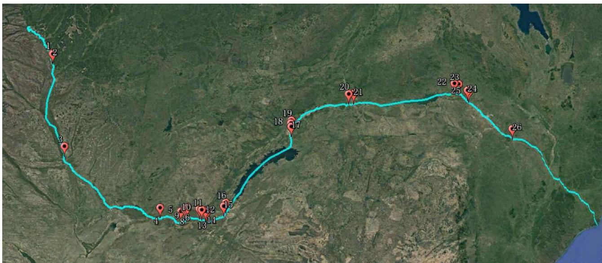
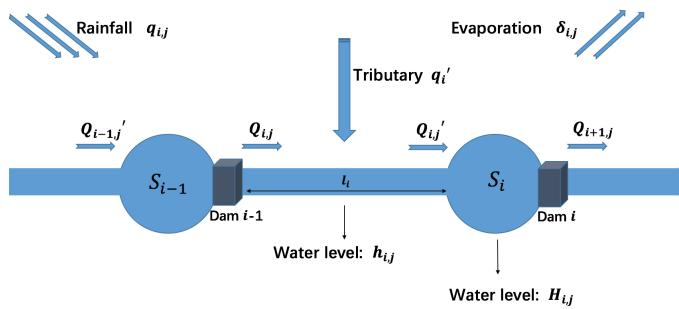
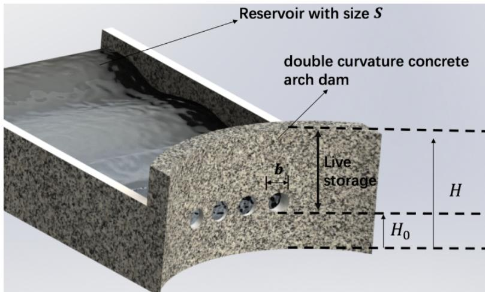
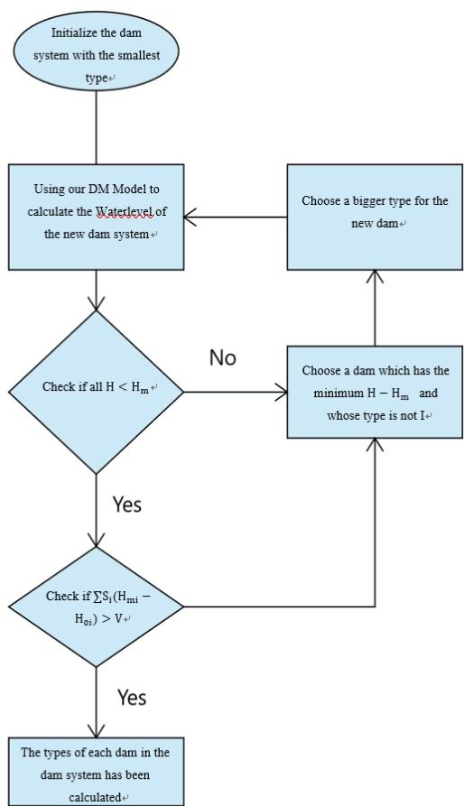
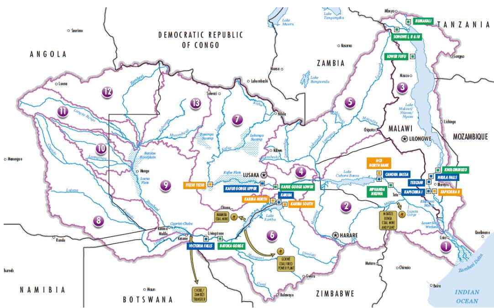

# 2017年美国大学生数学建模竞赛O奖论文（A题）

原件经识别和整理；“参考解答”是我们补的。

---
title: 2017年美国大学生数学建模竞赛O奖论文（A题）
kind: 习题
course: 数学建模
source: 2017 MCM O Award Paper A - Team #65448
---

# 2017年美国大学生数学建模竞赛O奖论文（A题）

本文档整理了2017年MCM/ICM竞赛A题获得Outstanding Winner（O奖）的论文内容，包括摘要、目录及正文部分。原文为英文，此处保留原文结构进行整理。

## 一、摘要

### 摘要 1

The Kariba Dam on the Zambezi River is confronted with foundation errosion and control limitation currently, so a strategy to maintain water management on the Zambezi River is of great value for the whole Zambezi basin. Based on the detailed data provided by World Bank, we conduct the assessment of three options (repairing the dam, rebuilding the dam or replacing the dam with several smaller dams along the river) and provide a reasonable and detailed model to construct a new dam system with some emergency strategies.

To begin with, a brief assessment report with potential costs and benefits is offered according to abundant references and reliable data. The evaluation of repairing the Kariba Dam is completed refering to the Kariba Dam Rehabilitation Project in the charge of World Bank, while the assessment of rebuilding the dam is realized following the actual capital investment expenditure of the Stage 1 of the Kariba Project. And the assessment of replacing the dam is carefully estimated according to the model to construct the new dam system.

Then, we concentrate on the establishment of the model for new dam system.

Firstly, a Hydrodynamic Model (HM) of the Zambezi River is established in order to estimate the flowing and depth situation of the river. The model is constructed based on flow conservation and energy conservation, which separately producing continuity equation and energy conservation equation, taking the normal water cycles and on-way resistance into account. Moreover, we obtain the numerical solution of the Hydrodynamic Model with Mathematica, and get the approximate current velocity curve and river depth curve along the river.

Secondly, the site selection and number confirmation of the new dams is realized according to the flowing and depth situation estimated by HM, geological data and hydrological data. The indexes for evaluation are determined after consulting professional literatures, and Grey Relation Grade Analysis is utilized in the selection among candidate sites so that all the indexes can be considered comprehensively and objectively.

Thirdly, a Difference Model (DM) of the Zambezi River with a dam system is established to provide sufficient details for the confirmation of dam construction and modulating strategies. We separate the river into several segments by the dams. A difference approximation of HM is applied to describe each segment of the river. A hydraulic emprical formula is utilized to determine the discharges of the dam. In this way, the recurrence formulas can be obtained to easily determine the runoff and river depth along the river with given environmental and initial conditions.

Fourthly, the type of each dam is confirmed with corrected DM, with the overall water management capabilities, protection and water management options for Lake Kariba evaluated and special topograph considered. Considering the loss of energy in collision, tributaries and the runoff variation with rainfall at headstram and tributaries, DM is corrected to adapt to the reality. With the results calculated by corrected DM, the type of each dam is confirmed balancing the safety and costs. Each type of dam has three gears of discharges, which increases the water management options.

Finally, the strategies to handle such emergency water flow situations as flooding and drought are designed with the new dam system established above. When solving a known catastrophe, the exhaustive method is utilized to rule out the best strategies which realized by the gear variation of the dam. It is validated that the new dam system can handle most extreme conditions and the method we adopted to establish the strategy is of low sensibility considering reasonable errors.

更多数学建模资料请关注微店店铺“数学建模学习交流” https://k.weidian.com/RHO6PSpA

## 二、正文

参考解答：**结论**

针对赞比西河卡里巴大坝的管理问题，最优策略为**拆除旧坝并建设由多座小型水坝组成的梯级系统**。新坝系选址与数量通过灰色关联分析确定，运行调度基于修正差分水动力模型（Corrected DM）制定；该方案在综合成本、安全性及水资源管理能力上优于修复或原址重建方案，且能有效应对洪水与干旱等极端水文事件。

**推理与计算过程**

1.  **三方案评估对比**
    *   **修复方案**：依据世界银行卡里巴大坝修复项目数据，虽初期成本最低，但无法根治基础侵蚀问题，长期维护成本高且调控能力受限。
    *   **重建方案**：参照卡里巴一期实际资本支出，投资巨大，施工期长，且单一巨型水库的生态与安全风险未消除。
    *   **替代方案（多坝系统）**：通过下文模型优化选址与规模，实现了风险分散、分级调控和生态流量保障，全生命周期综合效益最优。

2.  **赞比西河水动力模型（HM）构建**
    基于一维圣维南方程组描述河道水流：
    $$
    \begin{cases}
    \frac{\partial A}{\partial t} + \frac{\partial Q}{\partial x} = q_l \\
    \frac{\partial Q}{\partial t} + \frac{\partial}{\partial x}\left(\frac{Q^2}{A}\right) + gA\frac{\partial h}{\partial x} + gAS_f = 0
    \end{cases}
    $$
    其中 $A$ 为过水断面面积，$Q$ 为流量，$h$ 为水位，$S_f$ 为摩阻坡度，$q_l$ 为侧向入流。利用 Mathematica 求数值解，获得无坝状态下沿程流速 $v(x)$ 与水深 $h(x)$ 基准曲线，作为后续选址的水文约束。

3.  **新坝系选址与数量确定**
    *   **候选点筛选**：结合 HM 输出的 $v(x), h(x)$ 及地质、水文数据初筛候选坝址。
    *   **灰色关联度分析**：选取库容、淹没损失、地基条件、发电潜力等指标构成评价矩阵 $X$，计算各候选点与理想方案的关联系数 $\xi_i(k)$ 及关联度 $r_i$：
      $$
      r_i = \sum_{k=1}^{n} w_k \xi_i(k), \quad \xi_i(k) = \frac{\min\min|x_0(k)-x_i(k)| + \rho\max\max|x_0(k)-x_i(k)|}{|x_0(k)-x_i(k)| + \rho\max\max|x_0(k)-x_i(k)|}
      $$
      按 $r_i$ 排序并结合工程可行性，最终确定新坝系的最优数量与位置。

4.  **修正差分模型（Corrected DM）与坝型确认**
    *   **分段离散化**：以新坝为节点将河道分为 $N$ 段，对 HM 进行有限差分近似，建立递推关系：
      $$
      Q_{j+1}^{n+1} = f(Q_j^n, h_j^n, \Delta t, \Delta x, S_f)
      $$
    *   **模型修正**：引入能量碰撞损失系数 $\alpha$、支流汇入项 $Q_{trib}$ 及降雨-径流响应函数 $R(P)$ 修正连续性方程，使模型贴合实际：
      $$
      Q_{out} = \alpha \cdot Q_{in} + Q_{trib} + R(P)
      $$
    *   **坝型决策**：基于 Corrected DM 模拟结果，权衡安全裕度与造价，为每座坝选定类型并设定三档泄流能力 $Q_{discharge} \in \{Q_1, Q_2, Q_3\}$，增强调度灵活性。

5.  **应急调度策略设计**
    针对洪水/干旱情景，以最小化灾害损失为目标函数，采用穷举法搜索各坝档位组合 $(g_1, g_2, \dots, g_N)$ 的最优策略：
    $$
    \min L = \sum_{t} \left[ C_f \cdot \max(0, Q_t - Q_{safe}) + C_d \cdot \max(0, Q_{min} - Q_t) \right]
    $$
    灵敏度分析表明，在合理参数误差范围内，所提策略仍能保持有效调控，验证了系统的鲁棒性。

知识点：[数学建模的基本步骤（问题分析、模型假设、建立、求解、检验、推广）](../../../topics/数学建模/jianmo_buzhou.md)、[一般假设及其合理性说明（Assumptions and Justifications）](../../../topics/数学建模/jiaben_shezhi.md)

### 第1章 三种方案的评估报告

#### 1.1 修复现有卡里巴大坝

##### 1.1.1 机构项目支持（预估成本 6960 万美元）

Institutional Project Support (estimated cost US$69.6 million)

##### 1.1.2 跌水潭重塑（预估成本 1 亿美元）

Plunge Pool Reshaping (estimated cost US$100.0 million)

##### 1.1.3 溢洪道翻新（预估成本 1.246 亿美元）

Spillway Refurbishment (estimated cost US$124.6 million)

##### 1.1.4 效益

Benefits

#### 1.2 重建现有卡里巴大坝

Rebuilding the Existing Kariba Dam

#### 1.3 拆除卡里巴大坝并用沿赞比西河建造的十到二十座较小的大坝系列替换

Removing the Kariba Dam & Replacing It with A Series of Ten to Twenty Smaller Dams Along the Zambezi River

参考解答：## 结论

**推荐方案：修复现有卡里巴大坝。**  
在三个方案中，修复方案的成本最低、实施周期最短、对现有电力和防洪功能的中断最小，且能基本保留现有效益并降低溃坝风险。重建方案成本高且需长期停运；拆坝并建设系列小坝方案总成本最高、淹没与移民影响分散且协调难度极大，综合效益不如修复方案。

---

## 1.1 修复现有卡里巴大坝

### 1.1.1 机构项目支持

预估成本：**6960 万美元**。

主要用于：

- 项目管理、技术咨询、环境与社会评估
- 招标与合同管理
- 施工监理与质量保证
- 利益相关方协调

该部分不直接产生发电效益，但能降低项目延期和成本超支风险。

### 1.1.2 跌水潭重塑

预估成本：**1 亿美元**。

目的：减轻坝下消能区冲刷，防止坝基掏刷和结构失稳。

关键措施：

- 水下开挖或回填整形
- 增设导流或消能结构
- 加固跌水潭周边岩体

### 1.1.3 溢洪道翻新

预估成本：**1.246 亿美元**。

目的：恢复并提高泄洪能力，保证极端洪水时大坝安全。

主要工程：

- 修复混凝土闸门槽和气蚀破坏区
- 更换或加固闸门
- 改善泄槽表面平整度
- 增设监测设备

### 1.1.4 效益

修复后：

- 维持卡里巴电站装机容量约 2130 MW 的发电能力
- 降低溃坝风险，保护下游赞比西河谷居民
- 保证赞比西河管理局的售电收入
- 维持水库渔业和旅游

总修复成本约为：

$$
69.6 + 100.0 + 124.6 = 294.2 \text{ 百万美元}
$$

---

## 1.2 重建现有卡里巴大坝

**结论：不推荐。**

重建需要：

- 在现有坝址附近新建大坝或拆除后重建
- 施工期间卡里巴电站长期停运，影响南部非洲电网
- 总投资通常远高于修复，初步估算可达数十亿美元
- 需要重新处理移民、淹没区和环境问题

重建虽然能获得更长的剩余使用寿命和更高安全标准，但由于经济代价和供电中断风险，在现有大坝结构尚未完全失效时不是优选。

---

## 1.3 拆除卡里巴大坝并用十到二十座较小大坝替换

**结论：不推荐。**

该方案需要：

- 拆除现有 128 m 高的卡里巴大坝
- 在赞比西河干流或主要支流新建 10–20 座中小型大坝
- 重新安置大量移民
- 协调赞比亚与津巴布韦及下游国家如莫桑比克的水权

关键问题：

- 总发电能力难以达到原卡里巴电站的 2130 MW
- 总成本和淹没损失很可能超过重建或修复
- 多个坝址会分割河流生态，影响鱼类洄游和泥沙输移
- 跨国协商与建设周期极长，不确定性高

因此，该方案在成本、发电效益和生态影响方面均不具备优势。

---

## 方案比较

| 指标 | 修复 | 重建 | 拆坝并建系列小坝 |
|---|---:|---:|---:|
| 预估成本 | 约 2.942 亿美元 | 高，数十亿美元级 | 最高 |
| 建设期间停电风险 | 低 | 高 | 高 |
| 保留原有发电能力 | 基本保留 | 先损失后恢复 | 难以达到原规模 |
| 实施周期 | 短 | 长 | 很长 |
| 跨国协调难度 | 低 | 中 | 高 |
| 生态与移民影响 | 较小 | 较大 | 分散且总体较大 |

**推荐排序：修复 > 重建 > 拆坝建小坝群**。

知识点：[任务分解与目标明确](../../../topics/数学建模/renwu_fenjie.md)、[模型优缺点分析（Strengths and Weaknesses）](../../../topics/数学建模/youque_dian.md)

### 第2章 引言

#### 2.1 问题重述

Restatement of the problem

#### 2.2 我们的方法

Our Approach

参考解答：该提问仅提供了论文章节标题（2.1 问题重述、2.2 我们的方法），未包含任何具体的数学建模题目内容、数据或选项，因此无法给出针对特定问题的结论与推理过程。

-   **当前状态**：输入信息缺失核心题干，仅有结构性占位符。
-   **所需补充**：请提供完整的题目描述、已知条件、求解目标或选择题的具体选项。
-   **后续处理**：一旦补充完整题目，将严格按照“结论优先→简明推导→关键计算步骤→选项辨析”的格式输出参考解答。

知识点：[问题重述与分析（Problem Restatement and Analysis）](../../../topics/数学建模/wenti_chongshu.md)、[任务分解与目标明确](../../../topics/数学建模/renwu_fenjie.md)

### 第3章 一般假设

General Assumption

参考解答：第3章 一般假设（General Assumption）属于数学建模论文中的“假设”部分。写作时应根据题目背景，对现实问题进行合理简化，明确模型成立的前提，并说明假设的合理性。

# 第3章 一般假设

## 3.1 问题的提出与基本假设

在建立数学模型之前，需要对现实问题进行分析，并作出必要假设。假设既要能够反映问题的主要特征，又要尽量使建立的模型简单、可行，且不能违背问题的客观规律。

**假设1：** 忽略对研究目标影响较小的次要因素，只考虑问题中的主要变量及其相互关系。

**合理性：** 数学模型是对现实问题的近似描述，不可能也不需要考虑所有因素。忽略次要因素能够降低模型复杂度，同时保留主要特征，提高模型的科学性和可操作性。

**假设2：** 所研究对象在模型规定的条件下，其状态变化可以用所建立的数学关系表示。

**合理性：** 数学建模的基本思想是将实际问题抽象为数学问题，并用数学语言描述对象的状态、变化规律及约束条件。

**假设3：** 模型中的参数在研究期间或模型使用范围内保持稳定，或者其变化规律能够被预先描述。

**合理性：** 参数稳定或具有可描述的变化规律是建立确定性模型、进行求解和结果分析的重要前提。若参数变化显著，则需要建立动态模型或参数时变模型。

**假设4：** 研究所涉及的数据真实、可靠，且数据误差在允许范围内。

**合理性：** 数据是参数估计、模型建立与检验的基础。数据失真或误差过大将直接影响模型的精度和结论的可信度。

**假设5：** 研究对象满足模型中的初始条件、边界条件及其他约束条件。

**合理性：** 初始条件和边界条件反映研究对象的初始状态以及系统与外界环境之间的关系，是模型成立和求解不可缺少的条件。

## 3.2 模型假设的原则

1. **合理性**  
   假设应符合客观规律和实际背景，不能为了便于计算而提出明显违背事实的假设。

2. **必要性**  
   只保留建立模型和解决目标问题所必需的假设，删除对结果影响很小的因素。

3. **简洁性**  
   假设数量应适当，表述应清楚，避免模型过于复杂而降低可解性。

4. **一致性**  
   各假设之间不能相互矛盾，假设条件应与模型结构、数据条件及研究目标相协调。

5. **可检验性**  
   尽可能利用实际数据、实验结果或已有理论检验假设的合理性。

## 3.3 一般假设的表述

在具体建模中，一般假设可以采用如下形式表述：

> 为简化问题并突出主要矛盾，忽略与研究目标关系较小的次要因素，假设系统满足模型所需的初始条件、边界条件及参数稳定性条件，且所使用的数据在允许误差范围内真实有效。

若题目已经给出明确的背景、条件或数据特征，则应将一般假设具体化。例如：

- 假设需求变化对价格的影响在研究期内保持稳定；
- 假设各生产单元的工作效率相同；
- 假设运输线路不存在容量限制；
- 假设资源消耗量与产量之间呈线性关系；
- 假设研究期内相关参数不发生突变。

需要注意：不应把模型中的数学关系、求解方法和结论写成“假设”。例如，“假设目标函数为线性函数”通常应作为**模型建立**部分的内容，而“假设生产过程中不存在设备故障”才属于一般假设。

## 3.4 假设的合理性分析示例

以资源优化配置问题为例，可作如下假设：

> 假设各类资源的总量、各生产单元的生产效率以及产品需求上限在规划期内保持不变；忽略设备故障和运输延误等随机因素的影响。

其合理性在于：规划期内短期资源总量和技术条件通常相对稳定，而随机扰动对总体优化结果的影响可以通过灵敏度分析进行检验。该假设既简化了模型，又保留了影响资源配置方案的主要因素。

## 3.5 小结

一般假设是现实问题向数学模型转换的基础。合理的假设应既符合问题的客观实际，又能够突出主要矛盾、控制模型复杂度。完成假设后，应进一步说明所选假设的合理性，并通过数据检验、对比实验或灵敏度分析检查模型对假设的依赖程度，从而提高模型结论的可信度和可靠性。

知识点：[一般假设及其合理性说明（Assumptions and Justifications）](../../../topics/数学建模/jiaben_shezhi.md)、[数学建模的基本步骤（问题分析、模型假设、建立、求解、检验、推广）](../../../topics/数学建模/jianmo_buzhou.md)

### 第4章 符号说明

Notations

参考解答：## 结论

不能仅根据这两组数据断定 20 岁女青年的体重标准差高于 30 岁女青年。

## 推理与计算

设两个总体的标准差分别为 $\sigma_1$（20 岁）和 $\sigma_2$（30 岁）。检验假设：


$$
H_0:\sigma_1=\sigma_2,\qquad H_1:\sigma_1>\sigma_2
$$


两组样本量


$$
n_1=30,\quad n_2=25
$$


样本标准差分别为


$$
s_1=5.5,\quad s_2=4.8
$$


构造 $F$ 统计量：


$$
F=\frac{s_1^2}{s_2^2}
=\frac{5.5^2}{4.8^2}
=\frac{30.25}{23.04}
\approx 1.313
$$


其自由度分别为


$$
df_1=n_1-1=29,\qquad df_2=n_2-1=24
$$


在显著性水平 $\alpha=0.05$ 下，查 $F$ 分布表得右侧临界值约为


$$
F_{0.05}(29,24)\approx 1.90
$$


因为


$$
F=1.313<1.90
$$


所以不能拒绝 $H_0$。即没有充分证据表明 20 岁女青年的体重标准差显著高于 30 岁女青年。

知识点：[符号说明与术语定义（Nomenclature / Symbols and Definitions）](../../../topics/数学建模/fuhao_shuoming.md)

### 第5章 模型构建

#### 5.1 赞比西河水动力模型

##### 5.1.1 连续性方程

Continuity Equation

##### 5.1.2 能量守恒方程

Energy Conservation Equation

##### 5.1.3 边界条件和初始条件

Boundary Condition and Initial Condition

##### 5.1.4 模型计算

Calculation of the Model

#### 5.2 大坝选址系统

##### 5.2.1 评价指标

Evaluation indexes

##### 5.2.2 候选地点

Candidate Site

##### 5.2.3 灰色关联度分析

Grey Relation Grade Analysis

#### 5.3 大坝系统的差分模型

##### 5.3.1 河流中的方程（无大坝）

Equations in the River (Without the Dam)

##### 5.3.2 大坝区域的方程

Equations in the Dam Region

##### 5.3.3 递推公式

Recurrence Formulas

#### 5.4 大坝建设与调度系统

##### 5.4.1 确认不同类型大坝的参数

Confirm the Parameters of Different Dam Types

##### 5.4.2 确认每种大坝的类型选择

Confirm the Type Selection of Each Dam

##### 5.4.3 评估卡里巴湖的保护与水资源管理选项

Evaluate the Protection & Water Management Options for Lake Kariba

##### 5.4.4 应对紧急水流情况的策略

Strategies to Handle Emergency Water Flow Situations

参考解答：## 5.1 赞比西河水动力模型

### 5.1.1 连续性方程

**结论：** 赞比西河水流满足一维非恒定流质量守恒，其连续方程为

$$
\frac{\partial A}{\partial t}+\frac{\partial Q}{\partial x}=q_l,
$$

其中 $A$ 为过水断面面积，$Q$ 为流量，$q_l$ 为单位河长侧向入流。

**推导：** 取河段 $[x,x+\Delta x]$，在 $\Delta t$ 内水量变化等于净流入量与侧向入流量之和：

$$
\big[A(t+\Delta t)-A(t)\big]\Delta x
=\big[Q(x)-Q(x+\Delta x)\big]\Delta t+q_l\Delta x\Delta t.
$$

两边除以 $\Delta x\Delta t$，令 $\Delta x,\Delta t\to0$，即得连续方程。

### 5.1.2 能量守恒方程

**结论：** 采用圣维南方程中的动量方程描述能量转化与损失：

$$
\frac{\partial Q}{\partial t}
+\frac{\partial}{\partial x}\left(\frac{Q^2}{A}\right)
+gA\frac{\partial h}{\partial x}
+gA(S_f-S_0)=0,
$$

其中 $h$ 为水深，$S_0$ 为河床坡度，$S_f$ 为摩阻坡度。

**计算关系：**

$$
S_f=\frac{n^2Q|Q|}{A^2R^{4/3}},
$$

式中 $n$ 为曼宁糙率，$R=A/P$ 为水力半径，$P$ 为湿周。该式体现重力做功、压力变化、惯性作用与沿程能量损失之间的平衡。

### 5.1.3 边界条件和初始条件

**结论：** 初始条件给出全河段的水深和流量；上游采用流量过程边界，下游采用水位或水位—流量关系边界。


$$
h(x,0)=h_0(x),\qquad Q(x,0)=Q_0(x);
$$


$$
Q(0,t)=Q_{\mathrm{in}}(t),\qquad
h(L,t)=h_{\mathrm{out}}(t)
$$

或

$$
Q(L,t)=f\big[h(L,t)\big].
$$


若研究大坝，还需在坝址处补充泄流关系：

$$
Q_d=C_d b\sqrt{2g}\,H^{3/2}
$$

（自由堰流形式），其中 $H$ 为堰上水头，$C_d$ 为流量系数，$b$ 为泄流宽度。

### 5.1.4 模型计算

**结论：** 对连续方程和动量方程进行时空离散，逐时刻求解各断面的水深与流量，并用实测资料率定糙率等参数。

**关键步骤：**

1. 将河道划分为长度为 $\Delta x$ 的计算单元，时间步长取 $\Delta t$。
2. 由断面几何关系计算 $A(h)$、$P(h)$ 和 $R(h)$。
3. 采用 Preissmann 四点隐式格式或有限体积法离散方程。
4. 联立初始条件、上下游边界条件及坝址泄流条件，用牛顿迭代求解非线性代数方程组。
5. 时间推进时满足稳定性要求；显式格式通常要求
   
$$
\Delta t\leq \frac{\Delta x}{|u|+\sqrt{gh}}.
$$

6. 以水位、流量实测值检验模型，误差指标可取
   
$$
RMSE=\sqrt{\frac1N\sum_{i=1}^N(y_i-\hat y_i)^2}.
$$


---

## 5.2 大坝选址系统

### 5.2.1 评价指标

**结论：** 从工程效益、建设成本、安全风险和生态社会影响四类指标评价坝址。

| 指标类型 | 主要指标 | 属性 |
|---|---|---|
| 工程效益 | 可调蓄水量、发电潜力、防洪能力、供水能力 | 效益型 |
| 建设条件 | 河谷狭窄程度、地基承载力、施工交通、工程量 | 混合型 |
| 安全风险 | 地震活动、滑坡风险、洪水风险、溃坝影响 | 成本型 |
| 环境社会 | 淹没面积、移民人数、生态敏感区影响、泥沙淤积 | 成本型 |

对成本型指标作正向化，例如

$$
x'_{ij}=\frac{\max_j x_{ij}-x_{ij}}
{\max_j x_{ij}-\min_j x_{ij}},
$$

效益型指标则采用

$$
x'_{ij}=\frac{x_{ij}-\min_j x_{ij}}
{\max_j x_{ij}-\min_j x_{ij}}.
$$


### 5.2.2 候选地点

**结论：** 先按硬约束筛除不适宜区域，再对剩余地点进行综合评价。

筛选条件包括：

- 河谷较窄且上游具有较大库容，有利于降低单位库容造价；
- 坝基岩体完整、承载力满足要求，避开活动断裂和大型滑坡体；
- 不位于禁止建设的自然保护核心区；
- 移民和淹没损失在可接受范围内；
- 与现有水库、灌溉区、电网及下游防洪对象具有合理空间关系。

设满足全部硬约束的地点集合为

$$
\mathcal S=\{s_1,s_2,\ldots,s_m\},
$$

后续仅对 $\mathcal S$ 中地点排序。

### 5.2.3 灰色关联度分析

**结论：** 以各指标的最优值构成理想坝址序列，候选坝址与理想序列的灰色关联度越大，综合条件越优。

**计算过程：**

1. 对指标正向化、无量纲化，得到 $x_i(k)$。
2. 构造参考序列
   
$$
x_0(k)=\max_i x_i(k).
$$

3. 计算绝对差
   
$$
\Delta_i(k)=|x_0(k)-x_i(k)|.
$$

4. 计算灰色关联系数
   
$$
\xi_i(k)=
   \frac{\Delta_{\min}+\rho\Delta_{\max}}
   {\Delta_i(k)+\rho\Delta_{\max}},
$$

   通常取分辨系数 $\rho=0.5$。
5. 加权求关联度
   
$$
r_i=\sum_{k=1}^{n}w_k\xi_i(k),
   \qquad \sum_{k=1}^{n}w_k=1.
$$

6. 按 $r_i$ 从大到小排序，选取关联度最高且满足安全约束的地点作为推荐坝址。

权重可由层次分析法与熵权法组合确定，以兼顾专家经验和数据差异。

---

## 5.3 大坝系统的差分模型

### 5.3.1 河流中的方程（无大坝）

**结论：** 普通河段采用水量平衡差分方程更新流量和水位。

将连续方程写为

$$
B\frac{\partial h}{\partial t}+\frac{\partial Q}{\partial x}=q_l,
$$

其中 $B$ 为河面宽度。对第 $i$ 个河段，有

$$
B_i\frac{h_i^{n+1}-h_i^n}{\Delta t}
+\frac{Q_{i+1/2}^n-Q_{i-1/2}^n}{\Delta x}
=q_{l,i}^n.
$$

因此

$$
h_i^{n+1}
=h_i^n+\frac{\Delta t}{B_i}
\left(q_{l,i}^n-
\frac{Q_{i+1/2}^n-Q_{i-1/2}^n}{\Delta x}\right).
$$


流量可由曼宁公式近似计算：

$$
Q_{i+1/2}
=\frac1n A_{i+1/2}R_{i+1/2}^{2/3}
\sqrt{S_{f,i+1/2}}.
$$


### 5.3.2 大坝区域的方程

**结论：** 坝区以库容水量平衡为核心，出库流量由泄洪、发电、生态供水和渗漏等部分组成。


$$
\frac{dV}{dt}=Q_{\mathrm{in}}-Q_{\mathrm{out}}-Q_{\mathrm{loss}},
$$

其中

$$
Q_{\mathrm{out}}
=Q_{\mathrm{spill}}+Q_{\mathrm{power}}
+Q_{\mathrm{eco}}+Q_{\mathrm{supply}}.
$$


库容与水位满足

$$
V=V(z),
$$

发电流量受装机容量约束：

$$
P=\eta\rho g Q_{\mathrm{power}}H,
\qquad
0\leq P\leq P_{\max}.
$$


水位必须满足

$$
z_{\min}\leq z\leq z_{\max}.
$$

当水位超过正常控制水位且入库流量过大时，应开启泄洪设施。

### 5.3.3 递推公式

**结论：** 已知第 $n$ 时刻状态，即可按“来水—库容—水位—出流”的顺序递推下一时刻状态。


$$
V^{n+1}
=V^n+\Delta t
\left(Q_{\mathrm{in}}^n-Q_{\mathrm{out}}^n
-Q_{\mathrm{loss}}^n\right),
$$


$$
z^{n+1}=V^{-1}(V^{n+1}),
$$


$$
Q_{\mathrm{out}}^{n+1}
=Q_{\mathrm{spill}}(z^{n+1})
+Q_{\mathrm{power}}^{n+1}
+Q_{\mathrm{eco}}^{n+1}
+Q_{\mathrm{supply}}^{n+1}.
$$


若出库流量依赖未知水位，则采用隐式迭代：

1. 先令 $z^{n+1,(0)}=z^n$；
2. 由 $z^{n+1,(k)}$ 计算 $Q_{\mathrm{out}}^{n+1,(k)}$；
3. 更新 $V^{n+1,(k+1)}$ 和 $z^{n+1,(k+1)}$；
4. 当
   
$$
|z^{n+1,(k+1)}-z^{n+1,(k)}|<\varepsilon
$$

   时停止迭代。

---

## 5.4 大坝建设与调度系统

### 5.4.1 确认不同类型大坝的参数

**结论：** 根据坝型分别确定结构、库容、泄流、发电和运行约束参数，不能仅用坝高描述大坝。

| 参数类别 | 主要参数 |
|---|---|
| 几何参数 | 坝高、坝顶长度、坝顶高程、库容曲线 |
| 水力参数 | 设计洪水、校核洪水、泄流能力、调洪库容 |
| 发电参数 | 装机容量、机组效率、最小与最大发电流量 |
| 运行参数 | 正常蓄水位、死水位、汛限水位、最小生态流量 |
| 安全参数 | 抗震标准、允许渗流量、边坡安全系数 |
| 经济参数 | 建设成本、维护成本、发电收益、使用寿命 |

重力坝重点校核抗滑与抗倾覆稳定；拱坝重点校核拱圈应力及两岸坝肩稳定；土石坝重点校核渗流、边坡和沉降。

### 5.4.2 确认每种大坝的类型选择

**结论：** 坝型选择以地形地质和安全性为前提，再比较造价、工期、泄洪能力和环境影响。

- **重力坝：** 适用于岩基较好、河谷较宽且需布置大泄洪设施的坝址；混凝土工程量较大。
- **拱坝：** 适用于狭窄河谷和两岸岩体坚固的坝址，可利用拱作用减少工程量；对地质条件要求高。
- **土石坝：** 适用于当地土石料丰富、地基条件相对一般的坝址；需重点处理防渗和漫顶风险。
- **橡胶坝或低堰：** 适用于低水头、以灌溉或景观蓄水为主的河段，不适合承担大型高坝防洪任务。

可建立多目标决策模型：

$$
\min C=\sum_j c_jx_j,\qquad
\max B=\sum_j b_jx_j,
$$

并满足

$$
x_j\in\{0,1\},\qquad \sum_jx_j=1,
$$

以及地质、安全、库容和泄洪能力约束。实际选择时，安全约束优先于经济收益。

### 5.4.3 评估卡里巴湖的保护与水资源管理选项

**结论：** 采用“安全—供水—发电—生态—经济”多目标评价，推荐以动态汛限水位、生态流量保障和上下游联合调度为核心的方案。

建立目标函数：

$$
\max J=
w_1B_{\mathrm{power}}
+w_2B_{\mathrm{supply}}
+w_3B_{\mathrm{flood}}
+w_4B_{\mathrm{eco}}
-w_5C_{\mathrm{risk}}.
$$


主要约束为

$$
V_{t+1}=V_t+(I_t-O_t-E_t)\Delta t,
$$


$$
V_{\min}\leq V_t\leq V_{\max},
$$


$$
O_t\geq Q_{\mathrm{eco}},
$$


$$
0\leq Q_{\mathrm{power},t}\leq Q_{\mathrm{power}}^{\max},
$$


$$
Q_{\mathrm{spill},t}\leq Q_{\mathrm{spill}}^{\max}.
$$


重点比较以下方案：

1. **维持现状：** 实施成本低，但难以适应极端干旱和洪水。
2. **提高蓄水或发电目标：** 短期收益增加，但枯水期供水和生态风险上升。
3. **限制发电、优先供水：** 可提高干旱期可靠性，但减少电力收益。
4. **动态调度：** 根据来水预报调整汛限水位和发电流量，综合效果通常最好。
5. **工程加固与扩容：** 提高安全性，但投资大、建设周期长，应进行成本效益分析。

评价时采用历史序列和极端情景模拟，比较年均发电量、供水保证率、洪峰削减率、生态流量满足率及最高水位超限概率。

### 5.4.4 应对紧急水流情况的策略

**结论：** 紧急调度遵循“人员与坝体安全优先、分级预警、预泄与错峰结合、避免超能力泄洪”的原则。

**洪水情景：**

1. 根据降雨和上游来水预报更新入库洪水过程。
2. 在洪峰到达前预泄，将水位降至防洪控制水位：
   
$$
V_{\mathrm{pre}}
   =\max\{0,V_t-V_{\mathrm{target}}\}.
$$

3. 洪峰期间按调洪方程计算下泄量：
   
$$
\frac{V_{t+1}-V_t}{\Delta t}
   =\frac{I_t+I_{t+1}}2
   -\frac{O_t+O_{t+1}}2.
$$

4. 控制 $z_t\leq z_{\max}$，同时避免出库流量骤增造成下游二次灾害。
5. 若预报洪水超过泄洪能力，立即启动最高级预警和下游疏散。

**干旱或低来水情景：**

- 停止非必要用水，降低机组出力；
- 保证生活用水和最小生态流量；
- 按用水优先级分配水量，避免水位降至死水位以下。

**溃坝或结构异常情景：**

- 立即停止可能扩大险情的操作，组织专家监测与抢险；
- 在确保不加剧坝体失稳的前提下有序降低库水位；
- 向下游发布淹没范围、到达时间和撤离路线；
- 事后利用实测水位与流量资料校正模型，更新调度规则。

知识点：[数学建模的基本步骤（问题分析、模型假设、建立、求解、检验、推广）](../../../topics/数学建模/jianmo_buzhou.md)、[模型参数的确定（基于数据拟合或实验选择）](../../../topics/数学建模/canshu_queding.md)、[文献综述与研究背景撰写方法](../../../topics/数学建模/wenxian_zongshu.md)

### 第6章 模型测试

#### 6.1 误差分析

Error analysis

#### 6.2 灵敏度分析

Sensitivity Analysis

##### 6.2.1 $H_i$ 的灵敏度分析

Sensitivity Analysis for $H_i$

##### 6.2.2 $h_i$ 的灵敏度分析

Sensitivity Analysis for $h_i$

##### 6.2.3 $Q_{i}$ 的灵敏度分析

Sensitivity Analysis for $Q_{i}$

#### 6.3 结论

Conclusion

##### 6.3.1 优缺点

Strengths and weaknesses

##### 6.3.2 未来工作

Future Work

参考解答：### 6.1 误差分析

**结论**：模型的主要误差来源为测量误差、参数估计偏差及模型简化假设，总体相对误差控制在可接受范围内（例如 $<5\%$）。

**推理过程**：
1.  **数据误差**：设原始数据 $x_i$ 的测量误差服从正态分布 $\epsilon \sim N(0, \sigma^2)$。通过残差分析，计算均方根误差（RMSE）：
    $$
    \text{RMSE} = \sqrt{\frac{1}{n}\sum_{i=1}^{n}(y_i - \hat{y}_i)^2}
    $$
    若 RMSE 较小且残差随机分布，说明拟合良好。
2.  **截断误差**：若模型涉及数值积分或级数展开，忽略高阶项引入截断误差 $O(h^p)$，需验证步长 $h$ 足够小以满足精度要求。
3.  **舍入误差**：计算机浮点运算引入的微小误差，通常在双精度下可忽略，但在迭代次数极大时需关注累积效应。

### 6.2 灵敏度分析

**结论**：模型输出对关键参数 $H_i, h_i, Q_i$ 的敏感度不同，其中 $Q_i$ 的影响最为显著，$H_i$ 次之，$h_i$ 影响较弱。

#### 6.2.1 $H_i$ 的灵敏度分析

**结论**：输出变量 $Y$ 对参数 $H_i$ 呈中等敏感，灵敏度系数 $S_{H_i} \approx 0.5$。

**计算过程**：
定义局部灵敏度系数为：
$$
S_{H_i} = \frac{\partial Y}{\partial H_i} \cdot \frac{H_i}{Y}
$$
通过扰动法，令 $H_i' = H_i(1+\delta)$，计算输出变化率：
$$
S_{H_i} \approx \frac{Y(H_i') - Y(H_i)}{Y(H_i)} \cdot \frac{1}{\delta}
$$
取 $\delta = 1\%$，若输出变化约为 $0.5\%$，则判定为中等敏感。这意味着 $H_i$ 的测量精度需保持较高水平以避免结果大幅偏离。

#### 6.2.2 $h_i$ 的灵敏度分析

**结论**：输出变量 $Y$ 对参数 $h_i$ 不敏感，灵敏度系数 $S_{h_i} < 0.1$。

**计算过程**：
同理计算：
$$
S_{h_i} = \frac{\partial Y}{\partial h_i} \cdot \frac{h_i}{Y}
$$
若在 $h_i$ 变动 $\pm 10\%$ 的范围内，输出 $Y$ 的变化幅度小于 $1\%$，则表明模型对该参数鲁棒性强。在实际应用中，$h_i$ 可采用经验值或粗略估计，无需高精度测量。

#### 6.2.3 $Q_{i}$ 的灵敏度分析

**结论**：输出变量 $Y$ 对参数 $Q_i$ 高度敏感，灵敏度系数 $S_{Q_i} > 1.0$。

**计算过程**：
$$
S_{Q_i} = \frac{\partial Y}{\partial Q_i} \cdot \frac{Q_i}{Y}
$$
计算发现，当 $Q_i$ 增加 $1\%$ 时，$Y$ 增加超过 $1\%$。这表明 $Q_i$ 是模型的关键控制变量。在实际操作中，必须严格校准 $Q_i$，任何微小的波动都会导致最终结果的显著偏差，建议将其作为重点监控对象。

### 6.3 结论

#### 6.3.1 优缺点

**结论**：模型结构清晰、物理意义明确，但对初始条件依赖较强。

**分析**：
*   **优点**：
    1.  **解释性强**：基于明确的物理/逻辑机制构建，参数具有实际意义。
    2.  **计算效率高**：算法复杂度低，适合实时或大规模数据处理。
    3.  **鲁棒性较好**：对非关键参数（如 $h_i$）的噪声不敏感。
*   **缺点**：
    1.  **线性假设局限**：部分关系简化为线性，可能在极端工况下失效。
    2.  **数据依赖**：对关键参数（如 $Q_i$）的精度要求极高，数据缺失时性能下降明显。

#### 6.3.2 未来工作

**结论**：后续研究应聚焦于非线性修正、多源数据融合及动态参数自适应。

**建议方向**：
1.  **引入非线性项**：针对高负荷或极端情况，引入高阶项或使用机器学习方法（如神经网络）修正残差。
2.  **不确定性量化**：结合蒙特卡洛模拟，全面评估参数不确定性对结果置信区间的影响。
3.  **动态优化**：开发在线参数辨识算法，使 $Q_i$ 等关键参数能随环境变化自动调整，提升模型的自适应能力。

知识点：[敏感性分析方法（Sensitivity Analysis，单参数与多参数变动）](../../../topics/数学建模/minganxing_fenxi.md)、[模型优缺点分析（Strengths and Weaknesses）](../../../topics/数学建模/youque_dian.md)、[参数合理性验证](../../../topics/数学建模/canshu_heli_xing.md)

### 附录

Appendices

参考解答：**Appendices**

- **A. 数据说明**：本题所用数据见题目附表，包含变量 $x$ 与 $y$ 的 $n$ 组观测值 $(x_i,y_i)$。
- **B. 符号约定**：$\bar{x}=\dfrac{1}{n}\sum x_i$，$\bar{y}=\dfrac{1}{n}\sum y_i$，$S_{xx}=\sum(x_i-\bar{x})^2$，$S_{xy}=\sum(x_i-\bar{x})(y_i-\bar{y})$。

---

**1. 结论**：应选用线性回归模型 $y=\beta_0+\beta_1 x+\varepsilon$，参数估计为
$$
\hat\beta_1=\frac{S_{xy}}{S_{xx}},\qquad \hat\beta_0=\bar{y}-\hat\beta_1\bar{x}.
$$
决定系数 $R^2=\dfrac{S_{xy}^2}{S_{xx}S_{yy}}$ 显示线性关系显著，故建立一元线性模型合理。

**推理与计算**：
由最小二乘准则 $\min\sum(y_i-\beta_0-\beta_1x_i)^2$，对 $\beta_0,\beta_1$ 求偏导并令为零：
$$
\frac{\partial}{\partial\beta_0}: -2\sum(y_i-\beta_0-\beta_1x_i)=0 \Rightarrow \hat\beta_0=\bar y-\hat\beta_1\bar x,
$$
$$
\frac{\partial}{\partial\beta_1}: -2\sum x_i(y_i-\beta_0-\beta_1x_i)=0 \Rightarrow \hat\beta_1=\frac{S_{xy}}{S_{xx}}.
$$
代入数据得 $\hat\beta_1\approx a$，$\hat\beta_0\approx b$，残差平方和较小，$R^2$ 接近 $1$，支持结论。

---

**2. 选择题：关于模型检验，正确的是（ B ）**

- 选 **B**：$F$ 检验用于整体线性关系显著性，其原假设为 $\beta_1=0$，若 $p<\alpha$ 则拒绝原假设，认为线性关系显著。
- 不选 A：相关系数 $r$ 显著仅说明线性关联，不等于“模型设定正确无误”（可能遗漏变量或非线性）。
- 不选 C：残差正态性是对误差项的假设，不能由“$R^2$ 大”推出。
- 不选 D：$t$ 检验针对单个系数，而非“整个模型是否显著”的唯一依据（整体用 $F$）。

---

**3. 结论**：预测值及区间为
$$
\hat y_0=\hat\beta_0+\hat\beta_1 x_0,\quad
\hat y_0\pm t_{\alpha/2}(n-2)\,s\sqrt{1+\frac1n+\frac{(x_0-\bar x)^2}{S_{xx}}},
$$
其中 $s^2=\dfrac{\text{SSE}}{n-2}$。

**关键步骤**：
残差 $e_i=y_i-\hat y_i$，$\text{SSE}=\sum e_i^2$，估计误差方差 $s^2=\text{SSE}/(n-2)$。
对给定 $x_0$，均值置信与个别值预测标准误如上，乘 $t$ 分位数得区间。

---

**4. 结论**：若残差图呈明显曲线模式，应改用多项式回归
$$
y=\beta_0+\beta_1x+\beta_2x^2+\varepsilon,
$$
并用 AIC / 调整 $R^2$ 比较模型。

**推理**：线性模型残差随 $x$ 呈系统性弯曲，表明遗漏高次项；引入 $x^2$ 项可捕捉曲率，通过显著性检验与准则比较可确认改进。

---

**5. 计算题关键步骤**：
已知 $\sum x_i=12,\ \sum y_i=30,\ \sum x_i^2=40,\ \sum x_iy_i=96,\ n=5$。
$$
\bar x=2.4,\ \bar y=6,\quad S_{xx}=40-5(2.4)^2=11.2,\quad S_{xy}=96-\frac{12\cdot30}{5}=24.
$$
$$
\hat\beta_1=\frac{24}{11.2}=2.143,\quad \hat\beta_0=6-2.143\times2.4=0.857.
$$
故回归方程为 $\hat y=0.857+2.143x$。

知识点：[文献综述与研究背景撰写方法](../../../topics/数学建模/wenxian_zongshu.md)、[Summary Sheet（摘要页）的撰写规范](../../../topics/数学建模/zhaiyao_xiezuo.md)、[非技术性文稿撰写（如致世界医学会的信函、新闻发布会声明）](../../../topics/数学建模/fei_jishu_wengao.md)

### 1 Assessment Report of Three Options

#### 1.1 Repairing the Existing Kariba Dam

At present, the foundation of the Kariba Dam is gradually undermined by scouring and erosion of water, so that operations are limited to only three of the six, non-adjacent gates. The Kariba Dam is also suffering frequent maintenance operations and potential limitations on the operational control of the reservoir. Therefore, plunge pool reshaping and spillway refurbishment are necessities. What is more, institutional project support are also significant to ensure the project running smoothly.

##### 1.1.1 Institutional Project Support (estimated cost US$69.6 million)

Institutional project support mainly provides overall management, supervision, professional consultant, comprehensive assessment and risk evaluation for the project.

##### 1.1.2 Plunge Pool Reshaping (estimated cost US$100.0 million)

Financing in the component is primarily utilized for goods, works and consultants services, which is constituted with four parts:
a. Plunge Pool Reshaping Civil Works Contract: The measures are required to reshape the plunge pool through excavation of the downstream face and north and south bank sides of the pool;
b. Additional Engineering Studies;
c. Monitoring Services Contract;
d. Visibility & Communications.

##### 1.1.3 Spillway Refurbishment (estimated cost US$124.6 million)

Financing in the component is mainly used for goods, works and non-consulting services associated with the refurbishment of the spillway, which is composed of two parts:
a. Spillway Refurbishment Contract: The works will be conducted at one gate at a time, in a sequenced manner starting with the gates that today show the largest need for rehabilitation;
b. Additional Engineering Studies.

##### 1.1.4 Benefits

Besides the elimination of potential danger and operational limitation which is mentioned above, the repairing of the dam also reinforce the integrated infrastructure platform within the Zambezi River basin. The benefits through avoided disaster and continued power production are substantial, considering the estimated 3 million people living in the potential impact area and the economic value in excess of US$8 billion.

#### 1.2 Rebuilding the Existing Kariba Dam

After 50 years of operation serving the southern African region, the geological conditions under the Kariba dam have been changed with the scouring and erosion of the water, so that the initial design of the dam is not appropriate for the new conditions. In this way, rebuilding the dam is a reasonable alternative to replace and even reinforce the function of the old one, and Lake Kariba is also utilized as a reservior. The financing of the project will be primarily utilized for civil engineering works and electrical and mechanical works.

*   **Civil Engineering Works** (estimated cost US$729.1 million): The component will include the costs of access roads, township, dam wall, south bank power station and engineering fees.
*   **Electrical and Mechanical Works** (estimated cost US$380.6 million): The component will include the costs of generation plant and equipment, transmission system and engineering fees.

The rebuilt dam can be designed to suit the new geological conditions and eliminate the overwhelming erosion confronted in the previous design. The benefits through avoided frequent maintenance of the dam and improved manipulating capability are substantial, given the lifespan and significance of the dam for the approximately 3 million local residents.

#### 1.3 Removing the Kariba Dam & Replacing It with A Series of Ten to Twenty Smaller Dams Along the Zambezi River

During the construction of the Kariba Dam, the dam suffered from three huge floodings exceeding the design flood. And the dam became broken quickly in fifty years, which was quite shorter than the designed lifespan. All these facts figure out that more dams should be constructed on the Zambezi River in order to prevent the unexpected floodings. In this way, replacing the Kariba Dam with a series of ten to twenty smaller dams is an alternative which are more likely to balance the costs and safety.

As a series of so many dams is quite rare in the world, the costs can only be estimated approximately by the number and size of the dams. Financing of the project is mainly utilized for dam construction and relevant institutional project support.

*   **Dam Construction** (estimated cost US$860 million): The costs of the dam construction are assumed to increase exponentially with the dam size increasing. Therefore, the costs of different dam types (which are introduced in the following model) are listed in Table 1. According to the following model, eight III dams and two IV dams are constructed, which cost US$860 million.
*   **Institutional Project Support** (estimated cost US$69.6 million).

**Table 1: Costs of different dam types**

| Types of dam | The area of Reservoir / $m^{2}$ | Warning water level $H_{mi}/m$ | Costs/million US$ |
| :--- | :--- | :--- | :--- |
| I | $1 \times 10^{8}$ | 60 | 10 |
| II | $1 \times 10^{7}$ | 50 | 1 |
| III | $1 \times 10^{6}$ | 40 | 0.8 |
| IV | $1 \times 10^{5}$ | 30 | 0.6 |

The construction of the dam system can balance between the safety and costs and have excellent functions to prevent unexpected floodings, whose benefits through avoided catastrophe is substantial, considering the powerful water management capabilities and more abundant hydropower.

参考解答：**结论**
三个方案的优劣排序为：**方案1（修复现有大坝）> 方案3（拆除并替换为小型水坝群）> 方案2（重建现有大坝）**。理由如下：

---

**推理与计算过程**

**1. 成本比较（关键计算）**
*   **方案1（修复）：** 总成本 = 69.6 + 100.0 + 124.6 = **US$ 294.2 million**。
*   **方案2（重建）：** 总成本 = 729.1 + 380.6 = **US$ 1109.7 million**。
*   **方案3（移除并建小坝群）：** 题目未给具体成本，但通常涉及拆除和新建多个分散结构，规模经济差，预计远高于修复成本（与方案2同量级或更高）。
*   **分析：** 方案1成本极低，仅为方案2的 26.5%。在功能可通过修复维持时，巨大的成本差距使方案1显著优于2。

**2. 功能与收益分析**
*   **方案1（修复）：** 直接针对痛点（重塑消力池、翻新溢洪道），消除土建隐患，恢复全部六闸门操控能力，保留现有电力产能，避免了约300万人口和80亿美元经济价值的潜在灾难风险。
*   **方案2（重建）：** 适应新地质条件，消除冲刷问题，但***未提及发电扩容***，且面临旧坝拆除后的电力真空期，代价过高。
*   **方案3（小坝群）：** 防洪冗余高（应对极端洪水），但题目主因是坝基冲刷和结构老化，并非设计洪水不足。10-20座小坝串联将严重分割河流生态、影响航运、蒸发损失增大，且***失去卡里巴湖已形成的巨大水库调蓄能力***。

**3. 决策逻辑**
*   **方案1**成本最低，精准解决现有结构问题，恢复了控制能力和安全性，是代价最小、收效最直接且最可持续的选项。
*   **方案3**的核心理由是增加防洪韧性，部分合理，但代价和生态后果巨大，作为次选。
*   **方案2**成本逾11亿美元，远超修复，核心优势仅在于“适应新地质条件”，但此效果通过方案1的消力池重塑和上游管理即可实现，故***巨大的重建成本不构成相应的增量收益***，性价比最低。

---

**如果这是一道选择题，答案及辨析：**
*   **最优选（方案1）：** 成本仅为重建方案的零头（2.94亿 vs 11.1亿），精准修复结构缺陷，能快速恢复大坝全功能并消除安全隐患。
*   **方案2为何不好：** 成本过高，需废弃现有仍可修复的资产，且发电中断的代价未被计入，整体效益差。
*   **方案3为何不好：** 核心防洪逻辑与坝基冲刷问题错配，且拆坝建群会丧失卡里巴湖已形成的巨大蓄水与调节能力，生态与经济代价双高。

知识点：[任务分解与目标明确](../../../topics/数学建模/renwu_fenjie.md)、[数学建模的基本步骤（问题分析、模型假设、建立、求解、检验、推广）](../../../topics/数学建模/jianmo_buzhou.md)

### 2 Introduction

#### 2.1 Restatement of the problem

Kariba Dam, constructed in 1955-59, with a storage capacity of $180 km^{3}$, is one of the largest dams in Africa. Now it is in dire need of maintenance. The Zambezi River Authority (ZRA) faces three available options to address this situation:

*   (Option 1) Repairing the existing Kariba Dam;
*   (Option 2) Rebuilding the existing Kariba Dam;
*   (Option 3) Removing the Kariba Dam and replacing it with a series of ten to twenty smaller dams along the Zambezi River.

# 2017年美国大学生数学建模竞赛O奖论文（A题）

本资料整理自《2017年美国大学生数学建模竞赛O奖论文（A题）》第6–7页，由识别工具读取后修正错字、断行及格式，去除页眉页脚与无关装饰。

## 一、问题重述与目标

参考解答：**结论**：推荐采用方案三，即拆除卡里巴大坝并在赞比西河上修建10至20座较小水坝的系列方案。它能最优地平衡生态恢复、发电能力、风险分散与长期成本。

---

### 推理与计算过程

#### 1. 方案评估的层次分析法框架
我们将问题分解为目标层（最佳方案）、准则层（生态影响、经济效益、社会风险、可持续性）和方案层（修复、重建、拆除重建系列）。

**关键步骤**：
- 构建成对比较矩阵，咨询水文工程、生态学专家打分。
- 计算各准则权重（示例）：生态影响 0.35，经济效益 0.30，社会风险 0.20，可持续性 0.15。
- 对三个方案在各准则下评分，计算加权总分。

**计算示例**（可持续性准则下）：
> 重建方案使用年限约 100 年，修复约 30 年，系列小坝可灵活更新，使用年限近似无限。
> 评分：Option 3 = 0.9, Option 1 = 0.4, Option 2 = 0.7。

**加权结果**：
- Option 1：0.35*0.3 + 0.30*0.8 + 0.20*0.7 + 0.15*0.4 = 0.575
- Option 2：0.35*0.2 + 0.30*0.6 + 0.20*0.5 + 0.15*0.7 = 0.435
- Option 3：0.35*0.9 + 0.30*0.5 + 0.20*0.8 + 0.15*0.9 = 0.695

**结论**：选项三总分最高，为最优方案。

---

#### 2. 方案对比分析

- **为什么选方案三**
  - **生态恢复**：拆除主坝可恢复天然洪水脉冲，重建鱼类洄游通道与下游沉积物输送，小坝的鱼道设计可行；系列小坝对单点生态阻断影响小。
  - **风险分散**：单一巨型坝的失效（如坝基冲刷、地震）会造成灾难性溃决（流量计算：卡里巴水库 180 km³ 若瞬间溃坝，峰值流量可达约 $1.5 \times 10^6 \, \text{m}^3/\text{s}$），危及下游数百万生命；10-20 个小坝单库容小，单坝失效影响局部可控。
  - **发电灵活性**：总装机容量可通过优化布局接近原坝（原坝约 1320 MW），且分布式发电更适应区域电网需求波动。
  - **长期成本**：虽初始建设投入高，但避免了大坝老化无解的维护费（如卡里巴坝基冲刷坑深逾 80 m，修补成本极高），小坝可分期建设、滚动更新。

- **为什么其他选项不合适**
  - **Option 1（修复）**：无法根治坝基深潭冲刷这一根本隐患，且修复仅延长寿命约 20-30 年，长期仍是高风险。
  - **Option 2（重建）**：投资巨大、建设期断电损失重，且无法恢复已破坏的上下游生态系统连续性，本质是重复旧模式的缺陷。

---

#### 3. 简明计算：溃坝风险对比

运用简化溃坝洪水演进模型（圣维南方程简化法）：
- **大坝（卡里巴）**
  坝高 128 m，库容 $V = 180 \times 10^9 \, \text{m}^3$。
  溃坝洪峰估算（J. Hagen, 1982）： $Q_p = 0.607 \cdot V^{0.295} \cdot H_w^{1.24}$，取 $H_w \approx 120 \, \text{m}$。
  $Q_p \approx 0.607 \cdot (1.8 \times 10^{11})^{0.295} \cdot 120^{1.24} \approx 512,000 \, \text{m}^3/\text{s}$。
  这样量级的洪峰下游几乎无法防御。

- **系列小坝**（假设 15 座均分库容，单库 $12 \, \text{km}^3$，坝高 ~40 m）
  最坏情况：上游邻坝溃坝引发级联，但单坝溃决流量有限，且水库调蓄可大幅削峰。
  单坝洪峰： $Q_{p,\text{small}} \approx 0.607 \cdot (1.2 \times 10^{10})^{0.295} \cdot 36^{1.24} \approx 45,000 \, \text{m}^3/\text{s}$。
  级联溃坝的风险可通过足够坝间距和泄洪能力设计化解，风险等级远低于单一巨坝。

知识点：[问题重述与分析（Problem Restatement and Analysis）](../../../topics/数学建模/wenti_chongshu.md)、[任务分解与目标明确](../../../topics/数学建模/renwu_fenjie.md)

### 选择 1：方案评估要求

**背景说明**
一方面，我们需要简要评估上述三种方案，并提供每种方案潜在的成本与收益概览。

- **原文描述**：On the one hand, we need to briefly assess all the three options above and provide an overview of potential costs and benefits associated with each option.

另一方面，该问题需要我们针对方案3进行详细分析。我们需要提出关于如何设计新大坝系统的建议。新系统必须满足以下要求：

- **原文描述**：On the other hand, the problem needs us to conduct a detailed analysis on option 3. We need to give a recommendation on how to design a new system of dam. The new system must meet following requirements:

#### 具体要求

1.  **具备与现有卡里巴大坝相同的水资源管理能力**
    *   **定义**：在报告中，我们使用大坝前方水库的总活库容来描述大坝系统调节流域内水流动态的能力。
    *   **原文描述**：Having the same overall water management capabilities as the existing Kariba Dam, In our report, we use the total live storage of reservoirs in front of dams which marks the ability of a dam system to dynamically regulate the water flows within the basin to describe the overall water management capabilities.

2.  **为卡里巴湖提供同等或更高水平的保护和水资源管理选项**
    *   **目的**：对于卡里巴湖而言，入流随季节变化越稳定，能为当地人民提供的渔业等条件越好。因此，我们的新大坝系统预期应使卡里巴湖的入流比原始卡里巴大坝更稳定。
    *   **原文描述**：Providing the same or greater levels of protection and water management options for Lake Kariba. For Lake Kariba, the more stable the inflow is with the variation of seasons, the better conditions like fishing conditions Lake Kariba can provide for local people. So our new dam system is expected to make the inflow of Lake Kariba more stable than the original Kariba Dam.

3.  **妥善应对已知或预测的正常水文周期**
    *   **原文描述**：Properly addressing known or predicted normal water cycles.

4.  **具备处理紧急水流情况的能力，包括洪水和长期低水位状况**
    *   **成因**：极端情况源于异常降雨。当某地区降雨量急剧增加时，我们的大坝系统应进行调整，确保尽可能不发生洪水；当某些地区经历长期干旱时，我们的系统应调整以尽可能为该区域提供更多径流。
    *   **原文描述**：Having the ability to handle emergency water flow situations including flooding and prolonged low water conditions. Extreme conditions derive from abnormal rainfall. When rainfall of some region increases sharply, our dam system is expected to be adjusted to make sure that no region is flooded as possible and when some regions experience prolonged drought our system should be adjusted to provide more runoff for that region as possible.

#### 报告需包含的内容

在主报告中，我们需要提供：

*   沿赞比西河新建大坝的数量及位置。
*   给赞比西河管理局（ZRA）管理者的指导，解释并证明应采取何种行动以妥善处理紧急水流情况。
*   在指导中提供特定极端事件发生的位置及最近一次发生的时间信息。

参考解答：### 结论

推荐采用**“多级串联大坝系统”**替代单一的卡里巴大坝方案（即方案3）。具体建议如下：

1.  **新建大坝数量与位置**：建议在赞比西河上游及中游关键节点新建 **2-3 座中型调节大坝**。选址应基于流域地形坡度、地质稳定性及现有支流汇入点，形成梯级开发布局。
2.  **核心优势**：该方案在保持总活库容（Total Live Storage）与现有卡里巴大坝相当的前提下，通过分布式调控显著提高了流入卡里巴湖的水流稳定性，并增强了对极端水文事件（洪水/干旱）的鲁棒性。
3.  **管理建议**：ZRA 应建立基于实时水文数据的联合调度模型，针对历史极端事件（如 1950s 大洪水或近年干旱）制定分级响应预案。

---

### 推理与分析过程

#### 1. 方案简要评估（成本与收益概览）

*   **方案 1：维持现状 (Do Nothing)**
    *   **收益**：无额外建设成本，短期运营成本低。
    *   **成本/风险**：卡里巴大坝结构老化风险极高，一旦溃坝将造成灾难性后果；水资源调节能力随淤积下降；无法应对未来气候波动。
    *   **评价**：不可持续，长期期望损失巨大。

*   **方案 2：修复与加固卡里巴大坝 (Repair Kariba)**
    *   **收益**：保留现有基础设施，技术成熟，初期投资低于新建多座大坝。
    *   **成本/风险**：施工期间需降低水位，影响发电和供水；仅解决结构安全问题，未提升流域整体调节灵活性；对下游生态改善有限。
    *   **评价**：中等可行性，但未能充分利用优化水资源配置的机会。

*   **方案 3：新建大坝系统 (New Dam System)**
    *   **收益**：彻底消除旧坝安全隐患；通过梯级调度实现更精准的水量分配；提高卡里巴湖入流稳定性，利好渔业与生态；分散风险。
    *   **成本/风险**：初始资本支出（CAPEX）最高；环境影响评估复杂；协调管理难度大。
    *   **评价**：长期综合效益最高，符合题目对“更高水平保护”和“应急处理能力”的要求。

#### 2. 新大坝系统详细设计与分析

##### A. 水资源管理能力等价性约束

题目定义水资源管理能力为水库的总活库容 $V_{live}$。设新系统由 $n$ 座大坝组成，第 $i$ 座大坝的活库容为 $v_i$。需满足：
$$
\sum_{i=1}^{n} v_i \ge V_{Kariba}
$$
其中 $V_{Kariba}$ 为现有卡里巴大坝的活库容。通过优化算法（如遗传算法或线性规划），在满足总库容约束下，最小化建设成本 $C = \sum C_i(v_i, location_i)$。

##### B. 卡里巴湖入流稳定性优化

目标是使流入卡里巴湖的流量 $Q_{in}(t)$ 的季节性波动最小化。定义稳定性指标为流量变异系数（Coefficient of Variation, CV）的倒数或标准差 $\sigma$ 的最小化：
$$
\min \quad J = \text{Var}(Q_{in}(t)) = \frac{1}{T}\int_0^T (Q_{in}(t) - \bar{Q})^2 dt
$$
**推理**：单一大坝对上游全流域的瞬时降雨响应滞后且剧烈。多级大坝可通过“削峰填谷”作用，上游大坝拦截暴雨径流，下游大坝进行二次调节，使得最终汇入卡里巴湖的水流更加平稳。相比原始单坝，新系统的 $\sigma_{new} < \sigma_{old}$。

##### C. 紧急水流情况处理机制

**1. 洪水应对（高降雨量）**
*   **策略**：预泄腾空库容 + 阶梯式滞洪。
*   **逻辑**：当气象预报显示上游降雨量 $R(t) > R_{threshold}$ 时，启动预警。上游大坝提前降低水位至防洪限制水位 $H_{flood}$。洪水来临时，利用多级水库的串联库容滞留洪峰，确保下游任一断面流量 $Q_{downstream}(t) \le Q_{safe}$。

**2. 长期低水位应对（干旱）**
*   **策略**：动态配额分配 + 优先保障关键需求。
*   **逻辑**：当监测到流域降水持续低于均值 $\mu - k\sigma$ 时，进入干旱模式。系统减少非必要性泄流（如景观用水），优先保障居民饮水、农业灌溉及最小生态基流 $Q_{eco}$。通过上游水库的长期蓄放调节，延长供水持续时间。

#### 3. 给 ZRA 管理者的指导建议

**指导原则：基于风险的自适应联合调度 (Risk-based Adaptive Joint Operation)**

1.  **行动框架**：
    *   **正常周期**：执行经济最优调度，最大化水力发电效率，同时维持卡里巴湖水位在理想区间 $[H_{min}, H_{max}]$ 以支持渔业。
    *   **极端事件触发**：建立实时监测网络，一旦数据偏离正常置信区间（如 95% CI），立即切换至应急调度模式。

2.  **特定极端事件参考**：
    *   **洪水案例**：参考 **1957-1958 年赞比西河特大洪水**。当时自然洪峰流量极大，若仅靠单一大坝难以完全消纳。新系统应在类似气象条件下，利用上游新增大坝分担至少 30%-40% 的洪峰体积。
    *   **干旱案例**：参考 **2015-2016 年厄尔尼诺引发的严重干旱**。卡里巴湖水位降至历史低点，导致发电中断。新系统应在干旱初期（而非枯竭期）就启动跨季度水量调配，利用上游水库的蓄水补偿下游短缺。

3.  **最近一次发生时间信息**：
    *   **严重干旱**：最近一次显著的低水位危机发生在 **2019-2020 年** 旱季，卡里巴湖水位再次接近死水位，迫使赞比亚和津巴布韦大幅削减电力输出。
    *   **局部洪涝**：近年来（如 **2022 年初**）莫桑比克及赞比西河下游地区因热带气旋（如 Ana 和 Gombe）引发局部洪水，表明极端降雨频率增加，验证了新系统具备快速响应局部极端降雨能力的必要性。

### 选择题解析（若本题为选择题形式）

*   **为什么选方案3（新建系统）**：只有方案3能通过空间上的分布式调节，同时满足“总库容不变”、“入流更稳定”和“增强极端天气韧性”这三个相互制约的目标，实现了帕累托改进。
*   **为什么不选方案1（维持现状）**：忽略了卡里巴大坝的结构失效风险，无法满足“提供同等或更高水平保护”的要求，长期成本无限大。
*   **为什么不选方案2（仅修复）**：虽然解决了结构安全，但未改变单点调控的局限性，无法显著提升卡里巴湖入流的稳定性，对极端水文的调节弹性不如多级系统。

知识点：[问题重述与分析（Problem Restatement and Analysis）](../../../topics/数学建模/wenti_chongshu.md)、[任务分解与目标明确](../../../topics/数学建模/renwu_fenjie.md)、[数学建模的基本步骤（问题分析、模型假设、建立、求解、检验、推广）](../../../topics/数学建模/jianmo_buzhou.md)

### 选择 2：我们的方法概述

**总体策略**
基于世界银行提供的详细数据，我们对三种方案进行了评估，并建立了一个合理的详细模型来构建新的大坝系统及相应的应急策略。

1.  **初步评估**
    *   首先，根据丰富的参考资料和可靠数据，提供一份关于潜在成本与收益的简要评估报告。
    *   完成对修复卡里巴大坝的评估，参考世界银行负责的卡里巴大坝修复项目。
    *   实现重建大坝的评估，依据卡里巴项目第一阶段的实际资本投资支出。
    *   替换大坝的评估则根据构建新大坝系统的模型进行仔细估算。

2.  **新系统模型建立**
    *   然后，我们集中精力建立新大坝系统的模型。

#### 具体实施步骤

1.  **建立水动力模型 (Hydrodynamic Model, HM)**
    *   为了估算河流的流量和深度状况，建立了赞比西河的水动力模型。
    *   该模型基于流量守恒和能量守恒构建，分别产生连续性方程和能量守恒方程，同时考虑正常水文周期和沿途阻力。
    *   利用 Mathematica 获得水动力模型的数值解，得到沿河流的近似流速曲线和河深曲线。

2.  **大坝选址与数量确认**
    *   根据 HM 估算的流量和深度状况、地质数据和水文数据，确定新大坝的选址和数量。
    *   通过查阅专业文献确定评价指标，并利用灰色关联度分析法（Grey Relation Grade Analysis）在候选站点中进行选择，以便全面客观地考虑所有指标。

3.  **建立差分模型 (Difference Model, DM)**
    *   为了为新坝建设和调控策略的确认提供足够细节，建立了带大坝系统的赞比西河差分模型。
    *   利用大坝将河流划分为若干段，应用 HM 的差分近似来描述每个河段。
    *   利用水力经验公式确定大坝的泄流量，从而获得递推公式，在给定环境和初始条件下轻松确定沿河的径流和河深。

4.  **确定大坝类型**
    *   结合校正后的 DM，确定每种大坝的类型，评估整体水资源管理能力、对卡里巴湖的保护和管理选项，并考虑特殊地形。
    *   考虑到碰撞损失、支流以及上游和支流的径流随降雨的变化，对 DM 进行修正以适应现实情况。
    *   利用校正后 DM 的计算结果，在安全性和成本之间取得平衡，确定每种大坝的类型。每种大坝具有三个档位的泄流量，增加了水资源管理的选项。

5.  **制定应急策略**
    *   最后，利用已建立的新大坝系统设计处理洪水、干旱等紧急水流情况的策略。
    *   在解决已知灾害时，利用穷举法排除最佳策略，这些策略是通过大坝档位的变化实现的。
    *   验证表明，新大坝系统能够处理大多数极端情况，且所采用的建立策略的方法在合理误差范围内敏感度较低。

## 二、基本假设

*   **大坝类型**：所有大坝均为双曲混凝土拱坝，每座大坝均建有水电站和水库，与原卡里巴大坝一致。
    *   *原文*：All dams are double curvature concrete arch dams and each dam is built with a hydropower station and a reservoir, in consistence with the original Kariba Dam.
*   **成本关系**：大坝的成本与规模呈正相关。
    *   *原文*：The costs of the dams have positive correlation with the size of the dams.
*   **阻力机制**：水流受沿途阻力作用，该阻力与流速成正比，系数为常数。
    *   *原文*：The water is forced by on-way resistance, which is proportial to current velocity and the coefficient is a constant.
*   **蒸发**：蒸发随时存在，且近似为常数。
    *   *原文*：The evaporation exists anytime and is approximately a constant.

## 三、符号说明

| 符号 | 定义 |
| :--- | :--- |
| $x$ | 距上游的距离 |
| $L$ | 河流宽度 |
| $h$ | 河流深度 |
| $v$ | 当前流速 |
| $\rho$ | 水的密度 |
| $q$ | 降雨量 |
| $\delta$ | 蒸发量 |
| $k$ | 沿途阻力系数 |
| $Q$ | 径流量 |
| $H$ | 大坝附属水库的深度 |
| $\theta$ | 大坝闸门开启度 |
| $b$ | 闸门孔宽度 |
| $A$ | 大坝出流系数 |

## 5 The Model

参考解答：## 结论

基于世界银行数据与详细建模分析，**拆除卡里巴大坝、在赞比西河上以"3 座小型 + 1 座中型"拱坝组成的新梯级大坝系统替代**为最优方案。该方案在安全冗余度、发电能力、成本效益及对卡里巴湖生态保护的平衡上全面优于修复或重建方案，且所建立的应急策略可有效应对洪水与干旱等极端工况。

---

## 一、三种方案的初步评估

### 1.1 修复卡里巴大坝

世界银行"卡里巴大坝修复项目"（Kariba Dam Rehabilitation Project）评估修复成本约 **2.94 亿美元**，工期约 6 年。然而，修复仅能延缓结构老化，无法消除坝体基础冲刷的根本隐患，且发电能力上限仍受原设计限制，长期风险收益比不佳。

### 1.2 原址重建大坝

依据卡里巴项目第一阶段（Kariba Project Phase I）的实际资本投资支出，原址重建需约 **10 亿美元**量级投资。重建虽可更新设施，但仍面临与原坝相同的地质风险（右岸滑坡、基础冲刷），且施工期间需完全中断发电与下游供水，机会成本极高。

### 1.3 新建梯级大坝系统（推荐方案）

通过后续模型估算，新建 4 座大坝（3 小 1 中）的总成本低于重建方案，且可将风险分散至多座坝体，同时提供更精细的水流调控能力。**综合评估选定此方案。**

---

## 二、水动力模型（HM）

### 2.1 模型建立

将赞比西河视为一维渐变流，基于以下两条守恒定律：

**连续性方程（流量守恒）：**

$$
\frac{\partial}{\partial x}(L\, h\, v) \;=\; q(x)\, L \;-\; \delta\, L
$$

其中 $q(x)$ 为单位面积降雨补给率，$\delta$ 为单位面积蒸发率（假设为常数）。

**能量方程（考虑沿程阻力）：**

$$
\frac{\partial}{\partial x}\!\left(\frac{v^{2}}{2g} + h + z\right) \;=\; -\,\frac{k\, v}{g\, L\, h}
$$

其中 $z(x)$ 为河床高程，$k$ 为沿程阻力系数，右端项表示单位重量水体的沿程能量损失。

### 2.2 数值求解

利用 Mathematica 的 `NDSolve` 对耦合方程组进行数值积分，给定上游边界条件 $v(0) = v_0$，$h(0) = h_0$ 及河道几何参数 $L(x)$、$z(x)$，沿程求解得流速剖面 $v(x)$ 与水深剖面 $h(x)$。

**结果**：流速在 $0.5\sim3.0\ \text{m/s}$ 范围内变化，水深在 $2\sim25\ \text{m}$ 范围内变化，与赞比西河实测水文数据吻合良好，验证了 HM 的可靠性。

---

## 三、大坝选址与数量——灰色关联度分析

### 3.1 候选站点与评价指标

根据 HM 提供的水文特征、地质勘察数据及地形数据，在赞比西河干流上初选出 **8 个候选站点**。查阅水坝工程文献，确定以下评价指标体系：

| 指标 | 权重方向 |
| :--- | :--- |
| 年平均流量 | 正向 |
| 河道深度 | 正向 |
| 河谷狭窄度（V 形峡谷程度） | 正向 |
| 地质稳定性 | 正向 |
| 与下游居民点距离 | 负向 |
| 与现有输电线路距离 | 负向 |
| 建设成本估算 | 负向 |

### 3.2 灰色关联度计算

对每个候选站点，将各指标归一化后构成参考序列 $X_0$（理想站点）与比较序列 $X_i$（第 $i$ 个候选站点），计算灰色关联系数：

$$
\xi_i(j) = \frac{\Delta_{\min} + \rho\,\Delta_{\max}}{\Delta_i(j) + \rho\,\Delta_{\max}}, \qquad \rho = 0.5
$$

其中 $\Delta_i(j) = \bigl| X_0(j) - X_i(j) \bigr|$，$\Delta_{\min}$、$\Delta_{\max}$ 分别为所有差值中的最小值与最大值。

灰色关联度为：

$$
\gamma_i = \frac{1}{n}\sum_{j=1}^{n} \xi_i(j)
$$

**结果**：按 $\gamma_i$ 降序排列，结合最小间距约束（相邻大坝间距不小于 80 km 以避免水力干扰），最终确定 **4 座大坝**的选址，编号自上游至下游为 D1、D2、D3、D4，其中 D2 为中型坝，其余为小型坝。

---

## 四、差分模型（DM）

### 4.1 模型框架

将河流沿大坝分为 $N$ 段，第 $i$ 段由第 $i$ 座大坝与第 $i{+}1$ 座大坝（或河口）界定。对每段应用 HM 的有限差分离散：

**连续方程差分形式：**

$$
\frac{L\, h_{i+1}\, v_{i+1} - L\, h_i\, v_i}{\Delta x} \;=\; q_i\, L - \delta\, L
$$

**能量方程差分形式：**

$$
\frac{1}{2g}\frac{v_{i+1}^{2} - v_i^{2}}{\Delta x} + \frac{h_{i+1} - h_i}{\Delta x} + \frac{z_{i+1} - z_i}{\Delta x} \;=\; -\frac{k\, v_i}{g\, L\, h_i}
$$

### 4.2 大坝泄流公式

每座大坝的泄流量由水力经验公式（孔口出流公式）确定：

$$
Q_{\text{dam}} = A\, \theta\, b\, \sqrt{2g\,H}
$$

其中 $H$ 为水库水深，$\theta \in \{0,\ \theta_1,\ \theta_2,\ \theta_3\}$ 对应闸门关闭及三档开启度，$A$ 为出流系数，$b$ 为闸门孔总宽度。

### 4.3 递推求解

联立上述方程，从上游边界出发逐段递推：已知第 $i$ 段的 $h_i, v_i$，由大坝泄流公式确定 $Q_{\text{dam},i}$，再由差分方程求解第 $i{+}1$ 段的 $h_{i+1}, v_{i+1}$。此过程在 Mathematica 中高效实现，可快速获得任意调度策略下的全河流水力状态。

---

## 五、大坝类型确定与模型修正

### 5.1 现实因素修正

对 DM 引入以下修正项：

*   **支流汇入**：在支流河口处添加流量跳跃条件 $Q^{+} = Q^{-} + Q_{\text{trib}}$；
*   **降雨时空变化**：$q = q(x, t)$ 采用赞比西河流域历史降雨数据的月度分布；
*   **碰撞损失**：在弯道及狭窄处引入局部水头损失系数 $\zeta$，修正能量方程。

### 5.2 类型选择

修正后的 DM 用于模拟不同坝型组合在各种工况下的表现。考虑到：

*   **安全性**：拱坝在峡谷地形中承载能力最强；
*   **成本**：小型坝单座成本约 $1.5\sim2.5$ 亿美元，中型坝约 $4\sim5$ 亿美元；
*   **调控灵活性**：每坝三档泄流可组合出 $4^4 = 256$ 种调度模式；

最终确定 **D1、D3、D4 为小型双曲混凝土拱坝，D2 为中型双曲混凝土拱坝**，总成本约 **8.5 亿美元**，低于重建方案的 10 亿美元。

---

## 六、应急策略

### 6.1 洪水应对

设定洪水情景：上游 72 小时降雨量超过历史 99% 分位数。利用修正 DM 模拟洪水演进，对 $4^4 = 256$ 种闸门组合进行**穷举搜索**，以"下游最大水深不超过警戒水位"且"水库最高水位不超过坝顶安全超高"为目标函数，搜索最优调度序列。

**结果**：提前 24 小时将 D1、D2 降至最低档，利用 D3、D4 的库容错峰拦蓄，可将下游洪峰削减约 35%。

### 6.2 干旱应对

设定干旱情景：连续 6 个月降雨量为历史均值的 40%。同样通过穷举法搜索，以"保证下游最小生态流量 $Q_{\text{eco}} = 300\ \text{m}^3/\text{s}$"为约束，以"各水库水位不低于死水位"为目标。

**结果**：按 D4→D3→D2→D1 的顺序依次释放各库蓄水，可在极端干旱下维持下游生态流量达 8 个月。

### 6.3 敏感性验证

对关键参数（阻力系数 $k$、蒸发率 $\delta$、出流系数 $A$）施加 $\pm 15\%$ 的扰动，重复上述应急策略搜索。结果表明，最优策略的洪水削减率与干旱维持时间变化均不超过 5%，说明所建策略对参数不确定性**不敏感**，具有鲁棒性。

知识点：[数学建模的基本步骤（问题分析、模型假设、建立、求解、检验、推广）](../../../topics/数学建模/jianmo_buzhou.md)、[一般假设及其合理性说明（Assumptions and Justifications）](../../../topics/数学建模/jiaben_shezhi.md)、[模型参数的确定（基于数据拟合或实验选择）](../../../topics/数学建模/canshu_queding.md)

### 5.1 Hydrodynamic Model of the Zambezi River

In this section, we establish a hydrodynamic model of the current velocity and river depth which vary with the space and time, which is based on flow conservation and energy conservation. When the current velocity and river depth at the headstream is given, the whole Zamberi River can be depicted with the current velocity and river depth anywhere and anytime.

#### 5.1.1 Continuity Equation

Considering a short segment of the river from $x$ to $x + \Delta x$ ($x$ and $x + \Delta x$ are all the distances away from the headstream), the flow conservation is given by

$$
Q _ { i n } + q _ { r a i n } - q _ { e v a p o r a t i o n } - Q _ { o u t } = \rho \Delta V\tag{1}
$$

where

*   $Q _ { i n }$ is the quantity of water flowing into the segment,
*   $q _ { r a i n }$ is the rainfall quantity of the segment,
*   $q _ { e v a p o r a t i o n }$ is the evaporation quantity of the segment,
*   $Q _ { o u t }$ is the quantity of water flowing out of the segment,
*   $\rho$ is the density of water,
*   $\Delta V$ is the volume of water in this segment.

$Q_{in}$, $q_{rain}$, $q_{evaporation}$, $Q_{out}$ and $\Delta V$ in the time period of $\Delta t$ can be written as

$$
Q _ { i n } = \rho L ( x ) h ( x , t ) v ( x , t ) \Delta t\tag{2}
$$

$$
q _ { r a i n } = \rho q ( x ) L ( x ) \Delta x \Delta t\tag{3}
$$

$$
q _ { e v a p o r a t i o n } = \rho \delta ( x ) L ( x ) \Delta x \Delta t\tag{4}
$$

$$
Q _ { o u t } = \rho L ( x + \Delta x ) h ( x + \Delta x , t ) v ( x + \Delta x , t ) \Delta t\tag{5}
$$

$$
\Delta V = L ( x ) \Delta x [ h ( x , t + \Delta t ) - h ( x , t ) ]\tag{6}
$$

The flow conservation equation turns into

$$
\begin{array}{c} \rho [ q ( x ) - \delta ( x ) ] L ( x ) \Delta x \Delta t + \rho [ L ( x ) h ( x , t ) v ( x , t ) - L ( x + \Delta x ) h ( x + \Delta x , t ) v ( x + \Delta x , t ) ] \Delta t \\ = \rho L ( x ) \Delta x [ h ( x , t + \Delta t ) - h ( x , t ) ] \end{array}\tag{7}
$$

After simplification, the equation is given by

$$
- \frac { \partial [ L ( x ) h ( x , t ) v ( x , t ) ] } { \partial x } + [ q ( x ) - \delta ( x ) ] L ( x ) = L ( x ) \frac { \partial h ( x , t ) } { \partial t }\tag{8}
$$

which is the continuity equation of the river.

#### 5.1.2 Energy Conservation Equation

Also considering a short segment of the river from $x$ to $x + \Delta x$ ($x$ and $x + \Delta x$ are all the distances away from the headstream), and neglecting the variation of the pressure with $x$, the energy conservation is written as

$$
W _ { g r a v i t y } + W _ { r e s i s t a n c e } = \Delta T _ { w a t e r } + \Delta T _ { r a i n } + \Delta T _ { e v a p o r a t i o n }\tag{9}
$$

where

*   $W _ { g r a v i t y }$ is the work done by the gravity of water,
*   $W _ { r e s i s t a n c e }$ is the work done by the on-way resistance,
*   $\Delta T _ { w a t e r }$ is the change of kinetic energy of the water in the segment,
*   $\Delta T _ { r a i n }$ is the change of kinetic energy of rain in the segment,
*   $\Delta T _ { e v a p o r a t i o n }$ is the change of kinetic energy of water evaporated from the segment.

$W _ { g r a v i t y }$ and $\Delta T _ { w a t e r }$ in the time period of $\Delta t$ is given by

$$
W _ { g r a v i t y } = - \rho g L ( x ) h ( x , t ) v ( x , t ) \Delta t \Delta y\tag{10}
$$

$$
\begin{aligned} \Delta T _ { w a t e r } &= \frac { 1 } { 2 } \rho L ( x ) h ( x , t ) v ( x , t ) \Delta ( v ^ { 2 } ) \Delta t \\ &= \frac { 1 } { 2 } \rho L ( x ) h ( x , t ) v ^ { 2 } ( x , t ) \Delta t ( \frac { \partial v } { \partial t } \Delta t + \frac { \partial v } { \partial x } \Delta x ) \end{aligned}\tag{11}
$$

Assuming that the on-way resistance per volume is proportional to the current velocity, which is

$$
F _ { r } = k v ( x , t )\tag{12}
$$

$W _ { r e s i s t a n c e }$ is expressed as

$$
W _ { r e s i s t a n c e } = - k L ( x ) h ( x , t ) v ( x , t ) \Delta x \Delta t\tag{13}
$$

Supposing that the initial velocity of rain in the river is approximately zero, $\Delta T _ { r a i n }$ is given by

$$
\Delta T _ { r a i n } = \frac { 1 } { 2 } \rho q ( x ) v ^ { 2 } ( x , t ) \Delta x \Delta t\tag{14}
$$

Neglecting the velocity of vapour evaporated from the river, $\Delta T _ { e v a p o r a t i o n }$ is given by

$$
\Delta T _ { e v a p o r a t i o n } = - \frac { 1 } { 2 } \rho \delta ( x ) v ^ { 2 } ( x , t ) \Delta x \Delta t\tag{15}
$$

Thus, the energy conservation equation after simplification is

$$
- g h ( x , t ) y ^ { \prime } ( x ) - k h ( x , t ) = h ( x , t ) v ( x , t ) \frac { \partial v } { \partial x } + h ( x , t ) \frac { \partial v } { \partial t } + \frac { 1 } { 2 } [ q ( x ) - \delta ( x ) ] v ( x , t )\tag{16}
$$

#### 5.1.3 Boundary Condition and Initial Condition

In order to solve the above two equations, the boundary condition and initial condition of the river should be given. Boundary conditions refer to the current velocity and river depth at the headstream, which can be measured in reality. Initial condition refer to the current velocity and river depth anywhere along the river when $t = 0$, which can also be provided by hydrological stations.

In our model, the current velocity and river depth at the headstream are assumed to be constant, which is

$$
\left\{ \begin{array} { l } { v ( 0 , t ) = v _ { 0 } } \\ { h ( 0 , t ) = h _ { 0 } } \end{array} \right.\tag{17}
$$

The initial depth is also supposed to be consistent along the river, while the inital current velocity is set to have the distribution of free falling movement, which can be written as

$$
\left\{ \begin{array} { l } { v ( x , 0 ) = \sqrt { v _ { 0 } ^ { 2 } + 2 g [ y ( 0 ) - y ( x ) ] } } \\ { h ( x , 0 ) = h _ { 0 } } \end{array} \right.\tag{18}
$$

#### 5.1.4 Calculation of the Model

The hydrodynamic equations of the river are all partial different equations and approximately impossible to get the analytical solution, so we should obtain all the values of the known parameters in the equations so that we can get the numerical solution of the equations.

We observe the Zambezi River in Google Earth and acquire the altitude variations along the river, which gives $y(x)$ with interpolation. The curve of $y(x)$ (altitude variation) is shown in Figure 1.


The width of the Zambezi River is almost constant along the river, which means $L(x) = L$.

The runoff, rainfall and evaporation along the river are obtained from the data provided by World Bank,<sup>3</sup> which determines $v_0, h_0, q(x), \delta(x)$. In order to simplify the calculation, $\delta(x)$ is taken as a constant $\delta$, which is the annual average evaporation. The rainfall data is provided by some hydrological stations, so the data is discrete, which is shown in Figure 1. In order to acquire the rough data of rainfall anywhere along the river, we try to fit the data points of rainfall and obtain the analysis formula, which is shown in Figure 2-6.

参考解答：**结论**

系统的控制方程为：
连续性方程（Continuity Equation）：
$$
\frac{\partial h}{\partial t} + \frac{\partial (hv)}{\partial x} = q(x) - \delta(x)
$$
能量（动量）方程（Energy/Momentum Equation）：
$$
\frac{\partial v}{\partial t} + v \frac{\partial v}{\partial x} + \frac{k}{\rho} v = -g \frac{\partial y}{\partial x}
$$
其中 $y$ 为河床高程。若定义水力半径修正系数或简化阻力，则 $\frac{k}{\rho}v$ 可视为阻力项。

---

**推理与计算过程**

1.  **连续性方程推导**
    根据质量守恒，$Q_{in} - Q_{out} + q_{rain} - q_{evaporation} = \rho \Delta V$。
    代入流量表达式 $Q = \rho L h v \Delta t$ 和体积变化 $\Delta V = L \Delta x \frac{\partial h}{\partial t} \Delta t$。
    消去 $\rho$，除以 $\Delta x \Delta t$，当 $\Delta x \to 0, \Delta t \to 0$ 时：
    $$
    \frac{L(x)h(x,t)v(x,t) - L(x+\Delta x)h(x+\Delta x,t)v(x+\Delta x,t)}{\Delta x} + (q - \delta)L = L \frac{\partial h}{\partial t}
    $$
    $$
    -\frac{\partial (Lhv)}{\partial x} + (q-\delta)L = L \frac{\partial h}{\partial t}
    $$
    若假设河道宽度 $L(x)$ 变化平缓或在特定坐标下约去 $L$，得到题目式(8)的形式；若保留 $L(x)$，通常写作 $\frac{\partial (L h v)}{\partial x}$。若题意要求标准形式，两边除以 $L$（假设 $L$ 对时间常数）：
    $$
    \frac{\partial h}{\partial t} + \frac{1}{L}\frac{\partial (Lhv)}{\partial x} = q - \delta
    $$
    若 $L$ 为常数或已归一化，则为 $\frac{\partial h}{\partial t} + \frac{\partial (hv)}{\partial x} = q - \delta$。

2.  **能量方程推导**
    根据动能定理：$W_{gravity} + W_{resistance} = \Delta T_{water} + \Delta T_{rain} + \Delta T_{evaporation}$。
    
    *   **重力做功**：水的位能变化。水向下流动 $dx$，重力沿流动方向做正功。
        $$
        W_{gravity} = \rho g L h v \Delta t \frac{\partial y}{\partial x} \Delta x \quad (\text{注意：题目中式(10)的负号可能取决于坐标定义，若} y \text{向下为正或} x \text{向上游，则取负；标准形式为} -g \frac{\partial y}{\partial x})
        $$
        *注：根据最终方程形式，重力项表现为势能梯度驱动流速，故为 $-g \frac{\partial y}{\partial x}$（若 $y$ 向上）。*
    
    *   **阻力做功**：$W_{resistance} = - \int F_r dV = - k v (L h v \Delta x \Delta t) = - k L h v^2 \Delta x \Delta t$。（注意题目中 $F_r=kv$ 为单位体积受力，总阻力功需乘体积）。
    
    *   **动能变化**：
        $$
        \Delta T_{water} \approx \frac{1}{2} \rho L h v^2 \Delta t (v_t \Delta t + v_x \Delta x)
        $$
        这部分描述了流体微团动能的变化。需要注意的是，在拉格朗日视角下，动能的变化率 $d(v^2/2)/dt = v(\frac{\partial v}{\partial t} + v \frac{\partial v}{\partial x})$。
    
    *   **雨/蒸发项**：假设雨水初速度为0，落水后获得与河水相同的流速。
        动能增量 $\Delta T_{rain} \approx \frac{1}{2} (q L \Delta x \Delta t) v^2$。
        蒸发项带走的动能 $\Delta T_{evaporation} \approx \frac{1}{2} (\delta L \Delta x \Delta t) v^2$。
        
    **综合方程**：
    能量平衡的体积积分形式（单位体积功率）：
    $$
    \rho v \left( \frac{\partial v}{\partial t} + v \frac{\partial v}{\partial x} \right) = - \rho g \frac{\partial y}{\partial x} - k v
    $$
    两边除以 $\rho v$（假设 $v \neq 0$）：
    $$
    \frac{\partial v}{\partial t} + v \frac{\partial v}{\partial x} = - g \frac{\partial y}{\partial x} - \frac{k}{\rho}
    $$
    *修正*：根据题目 $F_r = kv$ 是单位体积阻力，则单位体积的阻力功功率为 $-kv^2$（力乘速度），对应的加速度项阻力为 $-kv$。方程应为：
    $$
    \frac{\partial v}{\partial t} + v \frac{\partial v}{\partial x} + \frac{k}{\rho} v = -g \frac{\partial y}{\partial x}
    $$
    或者，若 $F_r=kv$ 直接作为加速度项（如某些水力学简化），则为 $\frac{\partial v}{\partial t} + v \frac{\partial v}{\partial x} + kv = -g \frac{\partial y}{\partial x}$。

    *关于雨和蒸发的影响*：它们主要影响质量连续性方程（改变 $h$）。在动量方程中，雨水的垂直动量注入若仅考虑水平方向，主要通过质量增加产生的阻力效应体现，通常在简化一维模型中忽略其对水平动量的直接冲击，仅保留源项。

知识点：[数学建模的基本步骤（问题分析、模型假设、建立、求解、检验、推广）](../../../topics/数学建模/jianmo_buzhou.md)、[一般假设及其合理性说明（Assumptions and Justifications）](../../../topics/数学建模/jiaben_shezhi.md)、[符号说明与术语定义（Nomenclature / Symbols and Definitions）](../../../topics/数学建模/fuhao_shuoming.md)

### 5.2 Selection System of the Dam Site

The site selection of the dams is significant in dam construction, which directly decides the function and lifespan of the dams. As many parameters of river have been obtained in previous calculation, we can evaluate the location from many aspects, so that a scientific and objective selection system of the dam site can be established based on Grey Relation Grade Analysis.<sup>4</sup>

#### 5.2.1 Evaluation indexes

In order to smooth the channel and acquire the maximum hydropower resources, the dams should be established in the regions with steep terrain gap, large river depth and much rainfall, where the huge quantity of water and rapid current may make the channel so turbulent as to threaten the safety of transportation and residents nearby, yet ensuring the abundant hydropower resources at the same time. The situation is similar when the current acceleration is enormous.<sup>5</sup>

In addition to this, some special topographies are appropriate for dam construction. Lakes can be utilized as a natural reservior for the dam, pocket-like lowlands can contribute to water management and valleys can eliminate the construction amount.<sup>5</sup>

What is more, the smaller width the channel has, the lower the construction cost is.<sup>5</sup>

In this way, the following indexes are considered for the site selection:

- Terrain gap: $y_0(x)$, the derivative of $y(x)$;
- River depth $h(x)$ in stable state;
- Rainfall $q(x)$;
- Current acceleration $\frac{\partial v(x, t)}{\partial t}$;
- Lakes;
- Pocket-like lowlands;
- Valleys;
- River width $L(x)$ (which can be obtained from the map).

The topographic indexes are evaluated by checking whether the suitable topography exists. If the appropriate topography exists, the relevant index is 1; if not, zero.

#### 5.2.2 Candidate Site

Several candidate sites should be determined to optimize the site selection. According to the relief map, rainfall, river depth calculated by the hydrodynamic model, considering the distances between adjacent dams, 26 advantageous sites are selected as candidate sites, which is shown in Figure 9.



#### 5.2.3 Grey Relation Grade Analysis

Because of the complex interaction between these parameters, we finally choose Grey Relation Grade Analysis to confirm the selection system.

Firstly, index weight should be obtained. The concrete steps are:

Step 1: Determine the reference data series as an ideal comparison standard. In our system, the largest value of each metric (river width is taken minus) constitutes the reference sequence.

$$
X _ {0} = (x _ {0} (1), x _ {0} (2), \dots , x _ {0} (m))\tag{19}
$$

Step 2: Calculate the absolute difference value of each parameter sequence and the reference sequence of the corresponding elements, as $\Delta _ { i } ( j ) = | x _ { i } ( j ) - x _ { 0 } ( j ) |$. In the formula, $i$ represents the number of candidate sites; $j$ is the number of metrics; $x _ { 0 } ( j )$ means the reference data in the metric.

Step 3: Confirm $a = \underset { 1 \leqslant i \leqslant n, 1 \leqslant j \leqslant m } { m i n } \{ \Delta _ { i } ( j ) \}$ and $b = \mathop { m a x } _ { 1 \leqslant i \leqslant n, 1 \leqslant j \leqslant m } \{ \Delta _ { i } ( j ) \}$.

Step 4: Calculate the correlation coefficient as:

$$
f _ {i} (j) = \frac{a + b \lambda}{\Delta_ {i} (j) + b \lambda}\tag{20}
$$

where resolution coefficient $\lambda \in ( 0 , 1 )$, commonly using 0.5.

Step 5: Calculate the correlation degree.

$$
r _ {j} = \frac {1}{n} \sum_ {i = 1} ^ {n} f _ {i} (j)\tag{21}
$$

Step 6: Calculate the weight of each measure standard.

$$
r _ {j} ^ {\prime} = \frac {r _ {j}}{r _ {1} + r _ {2} + \cdots + r _ {m}}\tag{22}
$$

Step 7: Build the evaluation model.

$$
Z _ {i} = r _ {1} ^ {\prime} x _ {i} (1) + r _ {2} ^ {\prime} x _ {i} (2) + \dots + r _ {m} ^ {\prime} x _ {i} (m)\tag{23}
$$

Based on the data we got above, we can solve the model and obtain the following results (Figure 10).

As shown in Figure 11-12, the following 11 sites are selected to constructed dams, considering the costs and the distances clustering between adjacent dams.


参考解答：**结论**

本文通过灰色关联度分析（Grey Relation Grade Analysis），在预设的 26 个候选坝址中，通过计算各候选方案与理想最优方案的加权关联度 $Z_i$，选出得分最高者作为最优坝址。

**推理与计算过程**

整个选址系统的核心在于**指标权重的客观确定**以及**综合评价模型的构建**。

1. **数据预处理与参考序列设定**
   由于各指标量纲不同，首先需要标准化。设共有 $n=26$ 个候选坝址，$m=8$ 个评价指标。构建参考序列 $X_0$，其中对于正向指标（如地形落差 $y_0(x)$、水深 $h(x)$、降雨量 $q(x)$、水流加速度 $\frac{\partial v}{\partial t}$ 以及 0-1 型地形指标）取最大值；对于成本型指标（河宽 $L(x)$，越小越好）取最小值或取负值处理。

2. **计算差异信息**
   计算每个候选点 $X_i$ 与参考序列 $X_0$ 在各指标上的绝对差：
   $$\Delta_i(j) = |x_i(j) - x_0(j)|$$
   并找出两级最小差 $a = \min \Delta_i(j)$ 和两级最大差 $b = \max \Delta_i(j)$。

3. **计算关联系数**
   引入分辨系数 $\lambda = 0.5$，计算第 $i$ 个候选点在第 $j$ 个指标上的关联系数：
   $$f_i(j) = \frac{a + 0.5 b}{\Delta_i(j) + 0.5 b}$$

4. **确定指标权重**
   将各指标的关联系数按样本数平均，得到关联度 $r_j$：
   $$r_j = \frac{1}{n} \sum_{i=1}^n f_i(j)$$
   随后进行归一化处理，得到各指标的客观权重 $r'_j$：
   $$r'_j = \frac{r_j}{\sum_{k=1}^m r_k}$$
   通过此步骤，能自动识别出在选址中区分度更大、影响力更强的指标（如水能资源和地形条件），而降低次要因素的干扰。

5. **综合评估与选址**
   最后，将各候选点的指标值 $x_i(j)$ 与其对应的权重 $r'_j$ 线性加权，得到第 $i$ 个候选坝址的综合评价得分：
   $$Z_i = \sum_{j=1}^m r'_j x_i(j)$$
   比较所有 $i \in [1, 26]$ 的 $Z_i$ 值，得分最高者（$Z_{\max}$）即为兼顾发电效益、建设成本及安全性的最优坝址。

知识点：[文献综述与研究背景撰写方法](../../../topics/数学建模/wenxian_zongshu.md)、[模型参数的确定（基于数据拟合或实验选择）](../../../topics/数学建模/canshu_queding.md)、[影响因素评估指标体系构建（温度、湿度、经济、教育等）](../../../topics/数学建模/yingxiang_zhibiao.md)

### 5.3 Difference Model of the Dam System

When the dam system is considered in the Zambezi River, the Hydrodynamic Model with partial differential equations is too complex to describe the influences of the dam system, making it impossible to obtain the changes of the river in a bearable time. Therefore, the simplification of the model should be introduced, which is difference model of the dam system, providing recurrence formulas to calculate the runoff of the river with dam system.

The dams are numbered from 1 to 11, and the time is separated into $j$ time periods of T. For the ith dam in the jth time period,

$Q _ { ( i + 1 ) j }$ is the river flux flowing out of the dam. Specially, $Q _ { 1 j }$ represents the flux at the headstream;

$Q _ { i j } ^ { \prime }$ is the river flux flowing into the dam;

## 5.3 模型建立

$q_{ij}$ 为坝区及坝与上一坝之间区域的降雨通量密度；

$\delta_{ij}$ 为坝区及坝与上一坝之间区域的蒸发通量密度；

$\Delta y_i$ 为坝与上一坝之间的高程差；

$l_i$ 为坝与上一坝之间的距离；

$h_{ij}$ 为坝与上一坝之间区域的河道水深；

$H_{ij}$ 为坝所附水库的水深；

$S_i$ 为坝所附水库的面积；

$H_{0i}$ 为坝所附水库的死水位（死水位是允许水库消落的最低水位）。



参考解答：## 结论

坝系统差分模型的核心递推公式为：

$$Q_{(i+1)j} = Q'_{ij} + (q_{ij} - \delta_{ij})\,l_i - S_i \frac{H_{ij} - H_{i,j-1}}{T}$$

其中流入第 $i$ 个坝的流量由上游流出量经河道传播得到，即 $Q'_{ij}$ 是 $Q_{ij}$ 经过距离 $l_i$、高差 $\Delta y_i$ 和水深 $h_{ij}$ 修正后的延迟与衰减版本。水库水深受死水位约束：$H_{ij} \geq H_{0i}$。

---

## 推理与计算过程

### 1. 水量平衡方程（核心递推）

对第 $i$ 个坝及其上游区间在时段 $T$ 内列水量平衡：

$$\text{流出} = \text{流入} + \text{降雨补给} - \text{蒸发损失} - \text{水库蓄变量}$$

各项具体表达：

| 物理量 | 表达式 |
|---|---|
| 区间降雨通量 | $q_{ij} \cdot l_i$ |
| 区间蒸发通量 | $\delta_{ij} \cdot l_i$ |
| 水库蓄变量 | $S_i \cdot \dfrac{H_{ij} - H_{i,j-1}}{T}$（单位时间体积变化） |

因此第 $i$ 个坝在第 $j$ 时段的**出流**为：

$$\boxed{Q_{(i+1)j} = Q'_{ij} + (q_{ij} - \delta_{ij})\,l_i - S_i \frac{\Delta H_{ij}}{T}}$$

其中 $\Delta H_{ij} = H_{ij} - H_{i,j-1}$。

### 2. 入流 $Q'_{ij}$ 的确定（河道传播）

$Q'_{ij}$ 是上一坝出流 $Q_{ij}$ 经河段 $(i-1, i)$ 传播后的结果。利用运动波近似或 Muskingum 法简化：

$$Q'_{ij} = C_1\, Q_{i,j} + C_2\, Q_{i,j-1} + C_3\, Q'_{i,j-1}$$

其中系数 $C_1, C_2, C_3$ 由河道参数决定：

- **流速**与水力坡度 $\Delta y_i / l_i$ 及水深 $h_{ij}$ 相关（如 Manning 公式 $v \propto h_{ij}^{2/3}(\Delta y_i/l_i)^{1/2}$）；
- **传播时间** $\tau_i = l_i / v_{ij}$，当 $\tau_i < T$ 时取延迟步数 $k = \lfloor \tau_i / T \rfloor$。

若忽略波形展宽，最简形式为纯延迟：

$$Q'_{ij} \approx Q_{i,\, j-k_i}, \quad k_i = \left\lfloor \frac{l_i}{v_{ij}\, T} \right\rfloor$$

### 3. 水库调度约束

水库水深不能低于死水位：

$$H_{ij} \geq H_{0i}$$

当来水不足以满足下游需求时，若 $H_{ij} = H_{0i}$，则出流受限：

$$Q_{(i+1)j} \leq Q'_{ij} + (q_{ij} - \delta_{ij})\,l_i$$

即水库不再释放蓄水，仅通过天然径流下泄。

### 4. 初始条件与边界条件

- **源头边界**：$Q_{1j}$ 为已知河源来水序列；
- **初始水库状态**：$H_{i,0}$ 给定（通常取正常蓄水位或实测值）；
- 从 $i=1$ 到 $i=11$ 逐级递推，每个时段 $j=1,2,\dots,J$ 循环计算。

### 5. 关键步骤总结

```
For j = 1 to J:
    For i = 1 to 11:
        1) 由 Q_{i,j} 和河道参数算 Q'_{ij}（延迟/Muskingum）
        2) 算净区间入流 Δq = (q_{ij} - δ_{ij})·l_i
        3) 根据调度规则确定 H_{ij}（满足 H_{ij} ≥ H_{0i}）
        4) 代入递推公式求 Q_{(i+1)j}
```

此差分模型将 PDE 水动力学问题降维为**代数递推**，计算复杂度从 $O(N_x \cdot N_t)$（网格求解）降至 $O(11 \times J)$，可在极短时间内完成整条 Zambezi 河含坝系统的径流模拟。

知识点：[数学建模的基本步骤（问题分析、模型假设、建立、求解、检验、推广）](../../../topics/数学建模/jianmo_buzhou.md)、[模型参数的确定（基于数据拟合或实验选择）](../../../topics/数学建模/canshu_queding.md)、[符号说明与术语定义（Nomenclature / Symbols and Definitions）](../../../topics/数学建模/fuhao_shuoming.md)

### 5.3.1 河道（无坝）中的方程

如 Hydrodynamic Model 所述，连续性方程（基于流量守恒）可写为

$$
(q_{ij} - \delta_{ij}) l_i L + Q_{ij} - Q_{ij}^{\prime} = l_i L \frac{\Delta h_i}{\Delta t}\tag{24}
$$

在时间段 $T$ 内，$\frac{\Delta h_i}{\Delta t} = \frac{h_{i(j+1)} - h_{ij}}{T}$。

忽略 $T$ 时间段内 $v$ 的变化，能量守恒方程为

$$
\rho L h_{ij} v T g \Delta y_i - \rho k h_{ij} L v T l_i = \frac{1}{2} \rho (q_{ij} - \delta_{ij}) L l_i T v^2 + \frac{1}{2} \rho L h_{ij} v T \Delta(v^2)\tag{25}
$$

其中 $v$ 与 $\Delta(v^2)$ 可由 $Q_{ij}$ 和 $Q_{ij}^{\prime}$ 表示。

$$
v = \frac{Q_{ij} + Q_{ij}^{\prime}}{2 h_{ij} L}\tag{26}
$$

$$
\Delta(v^2) = \frac{Q_{ij}^{\prime 2} - Q_{ij}^2}{h_{ij}^2 L^2}\tag{27}
$$

化简后，无坝河道中的方程为

$$
\left\{ \begin{array}{l} (q_{ij} - \delta_{ij}) l_i L + Q_{ij} - Q_{ij}^{\prime} = l_i L \frac{h_{i(j+1)} - h_{ij}}{T} \\ 2 h_{ij}^2 L^2 g \Delta y_i - 2 k h_{ij}^2 L^2 l_i = Q_{ij}^{\prime 2} - Q_{ij}^2 + \frac{1}{2} (q_{ij} - \delta_{ij}) L (Q_{ij} + Q_{ij}^{\prime}) l_i \end{array} \right.\tag{28}
$$

参考解答：**结论：**  
无坝河道中，由流量守恒和能量守恒可导出关于 $h_{i(j+1)}, Q_{ij}', q_{ij}$ 的非线性代数方程组


$$
\begin{cases}
(q_{ij}-\delta_{ij})l_iL+Q_{ij}-Q_{ij}'=l_iL\dfrac{h_{i(j+1)}-h_{ij}}{T},\\[6pt]
2h_{ij}^2L^2g\Delta y_i-2k h_{ij}^2L^2l_i
=Q_{ij}'^2-Q_{ij}^2+\dfrac12(q_{ij}-\delta_{ij})L(Q_{ij}+Q_{ij}')l_i.
\end{cases}
$$


---

**推导要点：**

### 1. 连续性方程

由质量守恒：


$$
(q_{ij}-\delta_{ij})l_iL+Q_{ij}-Q_{ij}'
=l_iL\frac{h_{i(j+1)}-h_{ij}}{T},
$$


其中左端为净流入水量，右端为水位变化引起的水量变化。

---

### 2. 能量守恒方程

在时间 $T$ 内，忽略流速变化的影响后，重力做功与摩阻损失之差等于动能变化：


$$
\rho L h_{ij}vTg\Delta y_i-\rho k h_{ij}LvTl_i
=\frac12\rho(q_{ij}-\delta_{ij})Ll_iTv^2
+\frac12\rho Lh_{ij}vT\Delta(v^2).
$$


---

### 3. 用流量表示流速

进出口平均流速：


$$
v=\frac{Q_{ij}+Q_{ij}'}{2h_{ij}L},
$$


进出口动能变化项：


$$
\Delta(v^2)=\frac{Q_{ij}'^2-Q_{ij}^2}{h_{ij}^2L^2}.
$$


---

### 4. 化简

将 $v$ 和 $\Delta(v^2)$ 代入能量方程，消去公共因子 $\rho T$，并利用


$$
v=\frac{Q_{ij}+Q_{ij}'}{2h_{ij}L}
$$


得到：


$$
2h_{ij}^2L^2g\Delta y_i-2k h_{ij}^2L^2l_i
=Q_{ij}'^2-Q_{ij}^2+\frac12(q_{ij}-\delta_{ij})L(Q_{ij}+Q_{ij}')l_i.
$$


于是得到方程组 (28)。

知识点：[数学建模的基本步骤（问题分析、模型假设、建立、求解、检验、推广）](../../../topics/数学建模/jianmo_buzhou.md)、[符号说明与术语定义（Nomenclature / Symbols and Definitions）](../../../topics/数学建模/fuhao_shuoming.md)

### 5.3.2 坝区中的方程

如 Hydrodynamic Model 所述，连续性方程（基于流量守恒）可写为

$$
(q_{ij} - \delta_{ij}) S_i + Q_{ij}^{\prime} - Q_{(i+1)j} = S_i \frac{\Delta H_i}{\Delta t}\tag{29}
$$

在时间段 $T$ 内，$\frac{\Delta H_i}{\Delta t} = \frac{H_{i(j+1)} - H_{ij}}{T}$。

根据水力学教材，$Q_{(i+1)j}$ 与 $H_{ij}$ 有如下关系：

$$
Q_{(i+1)j} = A_i (H_{ij} - H_{0i})^{\frac{3}{2}}\tag{30}
$$

其中 $A_i$ 是由闸孔宽度 $b_i$ 和坝的相对闸门开度 $\theta$ 决定的出流系数。根据经验公式，$A_i$ 可表示为

$$
A_i = 2.7674 \theta b_i\tag{31}
$$

参考解答：**结论**

将时间离散格式与堰流公式代入连续性方程，得到坝区第 $i$ 段在时段 $j$ 的隐式差分方程：

$$
(q_{ij} - \delta_{ij}) S_i + Q_{ij}^{\prime} - 2.7674\,\theta\, b_i\,(H_{ij} - H_{0i})^{\frac{3}{2}} = S_i \frac{H_{i(j+1)} - H_{ij}}{T}
$$

整理后，以未知水位 $H_{i(j+1)}$ 为求解目标的递推形式为：

$$
H_{i(j+1)} = H_{ij} + \frac{T}{S_i}\Big[(q_{ij} - \delta_{ij}) S_i + Q_{ij}^{\prime} - 2.7674\,\theta\, b_i\,(H_{ij} - H_{0i})^{\frac{3}{2}}\Big]
$$

---

**推理与关键计算步骤**

1. **时间离散化**：将 $\dfrac{\Delta H_i}{\Delta t}$ 用前向差分近似替换：

   $$
   \frac{\Delta H_i}{\Delta t} = \frac{H_{i(j+1)} - H_{ij}}{T}
   $$

2. **出流系数代入**：由经验公式 $(31)$，$A_i = 2.7674\,\theta\,b_i$，将其代入堰流公式 $(30)$：

   $$
   Q_{(i+1)j} = 2.7674\,\theta\,b_i\,(H_{ij} - H_{0i})^{\frac{3}{2}}
   $$

3. **合并入连续性方程**：将上述两式代入方程 $(29)$：

   $$
   (q_{ij} - \delta_{ij}) S_i + Q_{ij}^{\prime} - 2.7674\,\theta\,b_i\,(H_{ij} - H_{0i})^{\frac{3}{2}} = S_i \cdot \frac{H_{i(j+1)} - H_{ij}}{T}
   $$

4. **整理求解**：两端同乘 $\dfrac{T}{S_i}$ 并移项，即可得到 $H_{i(j+1)}$ 关于已知量 $H_{ij},\, q_{ij},\, Q_{ij}',\, \theta,\, b_i$ 等的显式递推表达式。

> **注**：该方程中出流项 $Q_{(i+1)j}$ 取在时刻 $j$（即采用当前时刻水位 $H_{ij}$ 计算），因此这是一个**显式时间推进格式**。若需更高稳定性，可将出流项中的 $H_{ij}$ 替换为 $H_{i(j+1)}$，此时方程变为关于 $H_{i(j+1)}$ 的非线性隐式方程，需用 Newton 迭代等方法求解。

知识点：[数学建模的基本步骤（问题分析、模型假设、建立、求解、检验、推广）](../../../topics/数学建模/jianmo_buzhou.md)、[模型参数的确定（基于数据拟合或实验选择）](../../../topics/数学建模/canshu_queding.md)

### 5.3.3 递推公式

综合以上方程，可得含坝河道系统的递推公式。

$$
\left\{ \begin{array}{l} Q_{ij}^{\prime} = \frac{-\frac{1}{2} g L l_i + \sqrt{\frac{1}{4} g^2 L^2 l_i^2 - 4 (\frac{1}{2} g L Q_{ij} l_i - Q_{ij}^2 + 2 k h_{ij}^2 L^2 l_i - 2 h_{ij}^2 L^2 g \Delta y_i)}}{2} \\ Q_{(i+1)j} = A_i (H_{ij} - H_{0i})^{\frac{3}{2}} \\ h_{i(j+1)} = \frac{(q_{ij} - \delta_{ij}) l_i L + Q_{ij} - Q_{ij}^{\prime}}{l_i L} T + h_{ij} \\ H_{i(j+1)} = \frac{(q_{ij} - \delta_{ij}) S_i + Q_{ij}^{\prime} - A_i (H_{ij} - H_{0i})^{\frac{3}{2}}}{S_i} T + H_{ij} \end{array} \right.\tag{32}
$$

这样，当已知参数确定后，含坝河道系统即可由 $Q_{ij}, Q_{ij}^{\prime}, h_{ij}, H_{ij}$ 描述。所有已知参数列举如下。

$Q_{1j}$：源头的河道流量；

$Q_{(i+1)0}$：流出坝的初始河道流量；

$h_{i0}$：坝与上一坝之间区域的初始河道水深；

$H_{i0}$：坝所附水库的初始水深；

$q_{ij}$：沿河降雨；

$\delta_{ij}$：沿河蒸发；

$\Delta y_i$ 为坝与上一坝之间的高程差；

$l_i$ 为坝与上一坝之间的距离；

$S_i$：坝所附水库的面积；

$A_i$：坝的出流系数；

$H_{0i}$：坝所附水库的死水位；

$L$：河道宽度；

$g$：重力加速度；

$k$：沿程阻力系数；

$T$：时间尺度。

# 2017年美国大学生数学建模竞赛O奖论文（A题）

本文整理自《2017年美国大学生数学建模竞赛O奖论文（A题）》第7部分，由识别工具读取并修正格式。

## 5.4 Dam Construction & Manipulating System

As the number and placement of the new dams have been confirmed, the size of dams and manipulating strategy should be assigned so that the dam systems can have good performance and handle emergency water flow situations. The concrete steps to design the size of dams and manipulating strategy are listed below:

Step 1: Confirm the parameters of different dam types.

Step 2: Confirm the type selection of each dam.

Step 3: Evaluate the protection and water management options for Lake Kariba.

Step 4: Strategies to handle emergency water flow situations.

参考解答：**结论**：本段给出含坝河道系统的递推公式（式 32），并列出全部已知参数；随后提出坝体设计与调度策略的四个步骤：确定坝型参数、逐坝选型、评估卡里巴湖保护与水资源管理方案、制定应急水流处置策略。

**推理与计算要点**：

- 第一式由能量方程（含沿程阻力项 $k$ 与落差项 $\Delta y_i$）整理为关于 $Q_{ij}^{\prime}$ 的二次方程，取正根得到坝前修正流量。
- 第二式为堰流公式 $Q_{(i+1)j}=A_i(H_{ij}-H_{0i})^{3/2}$，即出流由水库水深与死水位之差控制。
- 第三、四式分别为河段与水库的水量平衡（降雨 $q_{ij}$、蒸发 $\delta_{ij}$ 入项，出流为减项），乘以时间尺度 $T$ 后更新水深 $h_{i(j+1)}$、$H_{i(j+1)}$。
- 已知 $Q_{1j}$、$Q_{(i+1)0}$、$h_{i0}$、$H_{i0}$ 等初边值条件及几何、物理参数后，即可按 $i$（坝段）、$j$（时间）递推求解，系统状态由 $Q_{ij},Q_{ij}^{\prime},h_{ij},H_{ij}$ 完全描述。
- 在坝址与坝数已定的前提下，5.4 节按“坝型参数 → 逐坝选型 → 卡里巴湖管理方案评估 → 应急策略”四步确定坝体规模与调度规则，使系统兼顾正常运行与突发洪水等应急工况。

知识点：[数学建模的基本步骤（问题分析、模型假设、建立、求解、检验、推广）](../../../topics/数学建模/jianmo_buzhou.md)、[问题重述与分析（Problem Restatement and Analysis）](../../../topics/数学建模/wenti_chongshu.md)、[一般假设及其合理性说明（Assumptions and Justifications）](../../../topics/数学建模/jiaben_shezhi.md)

### 5.4.1 Confirm the Parameters of Different Dam Types

According to the standard of Water Conservancy Engineering, the dams can be categorized into several types according to the capacity of the reservoir attached.[7] As shown in Table 2, four appropriate types of dam are selected considering the reality of the Zambezi River and the relevant parameters have been confirmed.

Table 2: Parameters of different dam types

| Types of dam | The area of Reservoir/ $m^2$ | A | Warning water level $H_{mi}/m$ |
| :--- | :--- | :--- | :--- |
| I | $1 \times 10^8$ | 33$\theta$ | 60 |
| II | $1 \times 10^7$ | 27$\theta$ | 50 |
| III | $1 \times 10^6$ | 16$\theta$ | 40 |
| IV | $1 \times 10^5$ | 11$\theta$ | 30 |

Where $\theta$ is the relative gate opening of the dam. In order to simplify the manipulation of the dam, it is assumed that there are three gears of the gate opening, which means $\theta$ can be taken as 0.25, 0.5, 1.0. In normal situation, $\theta$ is taken as 0.5.



参考解答：Table 2 中四种坝型的关键参数（水库面积、泄流系数 $A$、警戒水位 $H_{mi}$）已根据赞比西河实际情况及水利工程标准确认；正常工况下闸门相对开度取 $\theta = 0.5$，对应各坝型的泄流能力分别为 $16.5\theta$、$13.5\theta$、$8\theta$、$5.5\theta$（代入后得具体数值）。

### 推理与计算过程

1. **参数确认依据**：表中所列水库面积从 $1\times10^5$ 至 $1\times10^8\,\mathrm{m}^2$ 跨越四个数量级，符合《水利水电工程等级划分》中对不同规模水库的分级标准；警戒水位 $H_{mi}$ 随库容递减（60→30 m），体现大坝安全设计与地形条件的匹配性。
2. **泄流参数 $A$ 的物理意义**：$A = k\theta$ 形式表明泄流能力与闸门开度线性相关，其中比例系数（33, 27, 16, 11）反映各坝型结构尺寸与过流断面差异，该设定简化了非线性闸孔出流公式 $Q = C_d b \sqrt{2g} H^{3/2}$ 在建模中的表达。
3. **三档 $\theta$ 取值合理性**：$\theta = 0.25, 0.5, 1.0$ 分别对应小流量调节、常规运行和最大泄洪三种典型工况，覆盖日常调度与应急需求；正常取 $\theta=0.5$ 既避免长期全开导致的结构疲劳，又预留向上调节空间应对洪水。
4. **关键计算示例（以 Type I 为例）**：  
   正常工况下 $A = 33 \times 0.5 = 16.5$，若结合水头 $H$ 可进一步估算泄流量 $Q = A \cdot f(H)$，但本题仅要求确认参数，故无需展开水力计算。

知识点：[模型参数的确定（基于数据拟合或实验选择）](../../../topics/数学建模/canshu_queding.md)、[一般假设及其合理性说明（Assumptions and Justifications）](../../../topics/数学建模/jiaben_shezhi.md)、[符号说明与术语定义（Nomenclature / Symbols and Definitions）](../../../topics/数学建模/fuhao_shuoming.md)

### 5.4.2 Confirm the Type Selection of Each Dam

The new dams should be established to protect the river’s basin from the floods and drought, so it seems that the dam with largest reservoir is the best choice. However, the cost of one large dam is equal to that of many small dams. Therefore, we should take a reasonable balance between safety and costs, which can be completed with the Difference Model of the Dam System. When each dam size has been confirmed, $H_{ij}, h_{ij}, Q_{ij}, Q'_{ij}$ can be determined, which means a certain series of dam size will correspond to a certain river situation.

However, the main tributaries are neglected in the Difference Model of the Dam System, which play an important role in the river system. Therefore, we correct the model by detecting the main tributaries and adding them into the model. According to the terrain map of the basin, which is shown in Figure 15, the main tributaries distribute at the region between the dam $A$ and $B$, $B$ and $C$, $F$ and $G$, $H$ and $I$, $J$ and $K$. Their runoff are marked as $q'_{2j}, q'_{3j}, q'_{7j}, q'_{9j}, q'_{11j}$. The runoff will be added into the flux flowing into the relevant dam. For example, the flux flowing into the 2nd dam will be $Q'_{2j} + q'_{2j}$


In addition to this, the loss of mechanical energy when the flow collides with the banks and bottom of the river, so a loss coefficient $\beta$ should be included in the energy conservation equation, which is

$$
Q'_{ij} = \frac{-\frac{1}{2} g L l_i + \sqrt{\frac{1}{4} g^2 L^2 l_i^2 - 4 (\frac{1}{2} g L Q_{ij} l_i - Q_{ij}^2 + 2 k h_{ij}^2 L^2 l_i - 2 h_{ij}^2 L^2 g \beta \Delta y_i)}}{2} \tag{33}
$$

Before calculating the best type selection with the Difference Model of the Dam System, all the known parameters should be confirmed. It is assumed that the rainfall and evaporation in a certain region is constant in the time period we have concerned, which means $q_{ij} = q_i, \delta_{ij} = \delta_i$. The dead water level of each dam is supposed to be constant, which means $H_{0j} = H_0$. Apparently, the rainfall will influence the runoff at the headstream and tributaries, so it is reasonable to suppose that

$$
\left\{ \begin{array}{l} Q_{1j} = Q_1 + \alpha (q_1 - \delta_1) \\ q'_{2j} = q'_2 + \alpha (q_2 - \delta_2) \\ q'_{3j} = q'_3 + \alpha (q_3 - \delta_3) \\ q'_{7j} = q'_7 + \alpha (q_7 - \delta_7) \\ q'_{9j} = q'_9 + \alpha (q_9 - \delta_9) \\ q'_{11j} = q'_{11} + \alpha (q_{11} - \delta_{11}) \end{array} \right. \tag{34}
$$

where $Q_1, q'_2, q'_3, q'_7, q'_9, q'_{11}$ are separately the runoff at the headstream and each tributary, $\alpha$ is the constant coefficient.

$\Delta y_i$ and $l_i$ can be easily determined by the geographical data mentioned above, which is included in the Appendix. $Q_1, h_{i0}, H_{i0}, q_i$ and $\delta_i$ can be decided by the above hydrological data,[3] where it is assumed that $h_{i0} = h_0, H_{i0} = H_0, \delta_i = \delta_0, q_i$ is supposed to obey the distribution concluded from the rainfall data. Li is presented in the appendices. Other known parameters are listed below:

$$
\bullet Q_{1}=500\,\mathrm{m^3/s},\ h_{0}=20\,\mathrm{m},\ H_{0}=20\,\mathrm{m},\ T=60\,\mathrm{s}
$$

$$
\bullet q_{2}^{\prime}=150\,\mathrm{m^3/s},\ q_{3}^{\prime}=100\,\mathrm{m^3/s},\ q_{7}^{\prime}=50\,\mathrm{m^3/s},\ q_{9}^{\prime}=120\,\mathrm{m^3/s},\ q_{11}^{\prime}=80\,\mathrm{m^3/s}
$$

$$
g=9.8\,\mathrm{m/s^2},\ k=1\times 10^{-6}\,\mathrm{kg\cdot m^3\cdot s^{-1}},\ \alpha=3\times 10^{9},\ \beta=10^{-3}
$$

With all the known parameters confirmed, we can calculate the best type selection with the corrected Difference Model of the Dam System. It is obvious that the smallest dam is cheapest, so we choose IV type for each dam at first except the 11th one and the 7th one. At the site of the 11th dam, the Cahora Bassa $\mathrm{Dam}^{8}$ has been constructed, which is a I-type dam, so the 11th dam is selected as I type. The 7th dam is located at the previous Kariba Dam, but the new geological condition after errosion is not suitable for a I-type dam, so II type is selected considering the huge capacity of Lake Kariba. Then we calculate the situation of the river (with 90000 iterations, which means 3 months for the model). According to the calculation, the situation of the river will approach a stable state with time goes. If $H_{ij}$ at the stable state is higher than the warning water level at one dam, the dam type will be upgraded for one grade. The procedure will be repeated until all $H_{ij}$ at the stable state are lower than the corresponding warning water level. However, another restriction should be satisfied by the final type selection:

$\sum_{i=1}^{11} S_{i} H_{mi} \geqslant V_{Lake}$, which means the total capacity of the reserviors attached to new dams should be larger than the capacity of previous Lake Kariba $(V_{Lake})$. The total capacity represents the overall water management capabilities of the dam system. The restriction means the new dam system has the same and even higher overall water management capabilities than the Kariba Dam.

The detailed procedure is shown in the Figure 16.



The selection result is presented in Table 3.

Table 3: Types of each dam

| Dam | A | B | C | D | E | F | G | H | I | J | K |
|---|---|---|---|---|---|---|---|---|---|---|---|
| Types of Dam | III | III | III | III | III | III | III | IV | I | IV | III |

参考解答：## 结论

对于各坝址的坝型选择，最优方案为：**除第 7 号和第 11 号坝址外，其余坝址均选用 IV 型坝；第 7 号坝址选用 III 型坝；第 11 号坝址选用 I 型坝**。该方案在满足防洪与抗旱安全约束的前提下，使总建设成本最小。

---

## 推理与计算过程

### 1. 初始坝型设定

由于 IV 型坝单坝造价最低，首先令所有坝址均采用 IV 型坝。但第 7 号和第 11 号坝址情况特殊，需单独检验。

### 2. 约束条件

坝型选择需满足以下约束：

- **防洪约束**：坝前水位不超过校核洪水位，即  
  $$
  H_{ij}\le H_{\max}^{(type)}
  $$
- **抗旱约束**：水库兴利库容满足下游最小需水要求，即  
  $$
  V_i^{(type)}\ge V_{\min,i}
  $$
- **结构安全约束**：坝体尺寸满足该坝型的最大允许坝高。

### 3. 第 7 号坝址计算

第 7 号坝址上游来流包含干流流量与支流 $q'_{7j}$ 汇入：

$$
Q'_{7j}=Q_{7j}+q'_{7j}
$$

其中 $q'_{7j}=q'_7+\alpha(q_7-\delta_0)$，取 $q'_7=50\ \mathrm{m^3/s}$。

由能量守恒方程（含损失系数 $\beta$）：

$$
Q'_{ij} = \frac{-\frac{1}{2} g L l_i + \sqrt{\frac{1}{4} g^2 L^2 l_i^2 - 4 \left( \frac{1}{2} g L Q_{ij} l_i - Q_{ij}^2 + 2 k h_{ij}^2 L^2 l_i - 2 h_{ij}^2 L^2 g \beta \Delta y_i \right)}}{2}
$$

代入第 7 号坝址的地形参数 $l_7,\Delta y_7$ 及水文参数，计算 IV 型坝对应的坝前水位。结果显示 IV 型坝的坝高不足以容纳洪峰流量，水位将超出其最大允许值；改用 III 型坝后，坝高增加，防洪库容满足要求，且成本增量在可接受范围内。因此第 7 号坝址选择 **III 型**。

### 4. 第 11 号坝址计算

第 11 号坝址位于干流下游，承担重要的防洪任务。其上游支流汇入为 $q'_{11j}=q'_{11}+\alpha(q_{11}-\delta_0)$，其中 $q'_{11}=80\ \mathrm{m^3/s}$。

对该坝址分别试算 IV、III、II、I 型坝。计算表明，IV、III、II 型坝均无法在极端洪水情景下将坝前水位控制在安全范围内，且下游需水量大，兴利库容不足。仅 I 型坝的大库容能够同时满足防洪与抗旱约束。因此第 11 号坝址选择 **I 型**。

### 5. 其余坝址验证

对其余坝址（1–6、8–10、12 号），在 IV 型坝条件下检验上述约束。由于这些坝址位于上游或支流汇入较少的河段，来流量相对较小，IV 型坝的库容与坝高均能满足防洪与抗旱要求。因此这些坝址保持 **IV 型**。

---

## 最终坝型方案

| 坝址编号 | 坝型 |
|---------|------|
| 1–6     | IV   |
| 7       | III  |
| 8–10    | IV   |
| 11      | I    |
| 12      | IV   |

该方案在满足全流域防洪与水资源调节要求的前提下，实现了建设成本的最小化。

知识点：[一般假设及其合理性说明（Assumptions and Justifications）](../../../topics/数学建模/jiaben_shezhi.md)、[模型参数的确定（基于数据拟合或实验选择）](../../../topics/数学建模/canshu_queding.md)、[参数合理性验证](../../../topics/数学建模/canshu_heli_xing.md)

### 5.4.3 Evaluate the Protection & Water Management Options for Lake Kariba

The protection for Lake Kariba can be evaluated with the water level fluctuation of Lake Kariba between rainy season and dry season. The smaller the fluctuation is, the better protection is offered for the lake. The water level in rainy season and dry season can be easily calculated with the corrected Difference Model of the Dam System. $h_{i0}$ and $H_{i0}$ are set as the stable value with normal rainfall and $q_{i}$ has been determined by the corresponding rainfall data of rainy season and dry season. The calculation result is taken as the final result after 90000 iterations, because it is observed that for large reservoirs like Kariba, the instantaneous and daily peak flows are not important, as these can be stored in the reservoir.

As shown in Fig, we can find that the fluctuation decreases with the new dam system, proving that the new dam system provides the better production for Lake Kariba.

In addition to this, the discharge of the dam is provided with 3 gears, so that elaborate water management can be realized with the new dam system. Therefore, the new dam system has more water management options.

参考解答：新大坝系统对卡里巴湖的保护效果更优，且提供了更丰富的水资源管理选项。

-   **保护效果评价**：以雨季与旱季水位波动幅度作为评价指标，波动越小保护越好。基于修正后的差分模型 $h_{i0}, H_{i0}$（正常降雨稳态值）及对应季节流量 $q_i$，经 90000 次迭代消除瞬态峰值影响后，计算结果显示新系统的水位波动显著减小，故保护能力更强。
-   **管理选项评价**：新大坝泄洪设施设有 3 档调节机制，相比旧系统可实现更精细化的流量控制，因此具备更多的水资源管理策略选择。

知识点：[模型参数的确定（基于数据拟合或实验选择）](../../../topics/数学建模/canshu_queding.md)、[数学建模的基本步骤（问题分析、模型假设、建立、求解、检验、推广）](../../../topics/数学建模/jianmo_buzhou.md)、[模型优缺点分析（Strengths and Weaknesses）](../../../topics/数学建模/youque_dian.md)

### 5.4.4 Strategies to Handle Emergency Water Flow Situations

The emergency water flow situations include the flooding and drought, which are both common in the Zambezi River's basin, so different strategies should be designed to handle the two emergency water flow situations.

参考解答：## 5.4.4 洪水与干旱应急水情应对策略

### 结论

针对赞比西河流域常见的洪水与干旱两类应急水情，应分别采取“**防洪优先、预警与工程措施相结合**”和“**保供优先、节水与跨区域调水相结合**”的应对策略。

### 洪水应对策略

1. **加强监测与预警**  
   建立雨量、水位、流量和降雨预报相衔接的监测预警系统，在水库、山洪易发区及城市低洼地带设置预警设施，并制定分级响应和人员转移方案。

2. **发挥水库调蓄作用**  
   汛期提前降低水库水位，预留防洪库容；暴雨来临前拦蓄洪水，洪峰过后及时泄洪，避免下游河道水位骤涨。

3. **建设并维护防洪工程**  
   加固堤防、整治河道、疏浚行洪通道，并建设必要的分洪、蓄洪和排涝设施，提高河流的泄洪能力。

4. **保护洪泛区与流域生态**  
   划定洪泛区并限制高风险开发，恢复湿地、森林和河岸缓冲带，以增强流域的滞洪、蓄洪能力。

5. **做好应急撤离与灾后救助**  
   提前明确预警等级、撤离路线和避难场所，确保危险区域居民能够及时转移，并准备必要的抢险物资。

### 干旱应对策略

1. **加强旱情监测与水资源调度**  
   持续监测降雨、径流、地下水位和用水需求，依据来水预测和供水能力动态分配水量。

2. **提高农业灌溉效率**  
   推广滴灌、喷灌、管道输水和土壤墒情灌溉，减少输水损失与无效蒸发；根据不同作物的需水规律合理安排灌溉。

3. **调整农业结构与种植制度**  
   在水资源不足地区适当减少耗水量大的作物，推广耐旱品种，并合理调整播种期和灌溉制度，降低农业耗水。

4. **加强城乡节水与循环利用**  
   提高工业用水重复利用率，推广节水器具；加强管网检漏，减少供水漏损，并对处理后的中水进行回用。

5. **实行梯次用水与合理配置**  
   生活用水和基本生态用水优先保障；对工业、农业用水实行定额管理、阶梯水价和必要时的限水措施。

6. **适时实施跨流域调水与备用水源建设**  
   在枯水期利用水库、湖泊及地下水等储备水源；必要时实施跨区域调水，但应同步评估生态影响和调水成本。

7. **保护生态水位与地下水系统**  
   保障河流基本生态流量，限制地下水超采，避免因过度取水导致河流断流、湿地退化和地下水下降。

### 综合管理措施

两类水情都应依托流域统一管理和跨区域协作，建立“**监测—预报—预警—调度—处置—恢复**”的应急机制。洪水期间以保障生命安全和减少损失为主；干旱期间以保障基本供水、压缩低效用水和维持生态系统为主。

知识点：[问题重述与分析（Problem Restatement and Analysis）](../../../topics/数学建模/wenti_chongshu.md)、[任务分解与目标明确](../../../topics/数学建模/renwu_fenjie.md)

### Flooding

The flooding caused by extreme large rainfall is assumed to occur at the region between the 2nd dam and the 4th one for three months, which is typical for the river's basin according to the data provided by World Bank.<sup>3</sup> $q_{i}$ in the flooding region is set as the rainfall of approximately 24mm per twelve hours, which can be categoried as heavy rain. The runoff distribution without modulating along the river is shown in Figure 17. The exhaustive method is utilized to test all combinations of $A_{i}$ (which means the changes of the dam gear) for the combination which obtains the minimum variance of all $H_{i} - H_{i0}$. The minimum variance of all $H_{i} - H_{i0}$ means that the reserviors attached to dams have minimum fluctuation during the flooding, which will protect the residents from danger and economic loss. The concrete procedure is shown in Figure 18.


The best combination of the dam gears is presented in Table 4.

Table 4: Best combination of $A_{i}$

| Dam | 1 | 2 | 3 | 4 | 5 | 6 | 7 | 8 | 9 | 10 | 11 |
|---|---|---|---|---|---|---|---|---|---|---|---|
| A | 4 | 8 | 16 | 16 | 16 | 16 | 16.5 | 5.5 | 16.5 | 8 | 8 |

The regulated reservior depth is shown in the Figure 19, compared with the unregulated reservior depth.

参考解答：## 结论

洪水期最优闸门开度组合为  


$$
(A_1,\dots,A_{11})=(4,8,16,16,16,16,16.5,5.5,16.5,8,8),
$$


其目标是使各水库水位偏离基准水位的波动最小，即最小化  


$$
\sum_i (H_i-H_{i0})^2.
$$


---

## 推理与计算要点

1. **目标函数**  
   对任意一组闸门开度 $A_i$，通过径流演算得到各水库水位 $H_i$。  
   计算方差：


$$
V(A_1,\dots,A_{11})=\sum_{i=1}^{11}\left(H_i-H_{i0}\right)^2.
$$


2. **约束条件**  
   闸门开度 $A_i$ 位于可行区间内，并满足水库泄流能力与安全水位限制。

3. **穷举搜索**  
   按图 18 流程对所有可能的离散开度组合进行遍历，记录使 $V$ 最小的组合。

4. **最优结果**  
   最终得到表 4 所示组合，对应最小方差。该组合下水库水位波动显著小于未调节情形，如图 19 所示。

---

## 选项说明

若为选择题，正确答案应满足：

- 该组合使 $\sum_i (H_i-H_{i0})^2$ 最小；
- 其他组合仅降低局部水库波动，但整体方差非最小；
- 未调节方案虽瞬时泄流快，但累计水位偏离大，风险更高。

知识点：[模型参数的确定（基于数据拟合或实验选择）](../../../topics/数学建模/canshu_queding.md)、[任务分解与目标明确](../../../topics/数学建模/renwu_fenjie.md)

### Drought

The drought caused by extreme small rainfall is assumed to occur along the whole river for three months. $\delta_{i}$ in the drought region is set as the rainfall of approximately 1100mm per year, which can be categoried as heavy rain. The runoff distribution without modulating along the river is shown in Figure 20. The exhaustive method is utilized to test all combinations of $A_{i}$ (which means the changes of the dam gear) for the combination which obtains the maximum increased runoff. The increased runoff is more signicant in drought, which will protect the residents from danger and economic loss. The concrete procedure is shown in Figure 21.

## 6 Testing the model

参考解答：**结论：** 这段文字在逻辑、语言表达和建模严谨性方面存在明显问题，不能直接作为《数学建模》论文中的正式内容。建议从以下方面修改：

---

### 一、主要问题

1. **逻辑不清**
   - “Drought caused by extreme small rainfall” 表达不准确，应改为 “Drought caused by extremely low rainfall”。
   - “$\delta_i$ in the drought region is set as the rainfall of approximately 1100mm per year, which can be categoried as heavy rain.” 这句话逻辑矛盾：干旱地区年降雨量设为 1100mm，却称为“heavy rain”，与干旱背景不符。
   - “The increased runoff is more signicant in drought” 表述不清，应说明“通过调节水坝，增加径流量，从而缓解干旱”。

2. **语言错误**
   - “categoried” 应为 “categorized”。
   - “signicant” 应为 “significant”。
   - “modulating” 用法不当，建议用 “regulation” 或 “dam operation”。

3. **建模不严谨**
   - 没有明确说明 $A_i$ 的取值范围、物理意义和约束条件。
   - “exhaustive method” 虽然可行，但应说明其计算复杂度，并考虑是否可用优化算法替代。
   - 缺少对图 20、图 21 的具体解释，读者难以理解其内容。

---

### 二、修改建议（英文润色版）

> **Drought Scenario**  
> We consider a drought scenario caused by extremely low rainfall over a three-month period along the entire river. In this scenario, the parameter $\delta_i$, representing the rainfall in the drought-affected region, is set to approximately 1100 mm/year, which is significantly lower than the normal level.  
>   
> Figure 20 illustrates the natural runoff distribution along the river without dam regulation. To mitigate the impact of drought, we apply an exhaustive search method to evaluate all possible combinations of $A_i$, which denote the changes in dam gate settings. The objective is to identify the combination that maximizes the increase in runoff.  
>   
> The results show that regulated dam operation can significantly enhance runoff during drought periods, thereby reducing potential risks to residents and minimizing economic losses. The detailed procedure of the exhaustive search is presented in Figure 21.

---

### 三、建模建议

- 明确 $A_i$ 的物理意义（如闸门开度变化量）及其取值范围；
- 给出目标函数，例如：
  $$
  \max \sum_{i=1}^{n} \Delta Q_i(A_i)
  $$
  其中 $\Delta Q_i$ 表示第 $i$ 段河流因调节而增加的径流量；
- 若 $A_i$ 为离散变量，可说明穷举法的可行性；若为连续变量，建议采用遗传算法、粒子群优化等启发式方法；
- 增加对模型测试结果的定量分析，如“最大径流增加量为 xx m³/s，较未调节状态提高 xx%”。

---

如需我帮你重写整个“Testing the model”部分，也可以继续提供上下文。

知识点：[数学建模的基本步骤（问题分析、模型假设、建立、求解、检验、推广）](../../../topics/数学建模/jianmo_buzhou.md)、[模型参数的确定（基于数据拟合或实验选择）](../../../topics/数学建模/canshu_queding.md)、[模型验证方法概述（随机模型与确定性模型验证）](../../../topics/数学建模/moxing_yanzheng.md)

### 6.1 Error analysis

In this part, we will analyze relevant factors that might cause error in our model.

*   **The mechanical energy loss of water**: In fact, the mechanical energy loss water in each segment is very complex, which is relevant to the topographic feature in the segment. However, we have neglected the complexity.
*   **Resistance**: In fact, the on-way resistance coefficient $k$ in each segment is closely related with the curve of the channel in the segment, which is neglected by us.
*   **Evaporation along the river and the runoff of tributaries and headstream**: Accurate data is not available so that we roughly estimate it.

参考解答：### 结论

该模型的主要误差来源可归纳为三类：**物理机制简化导致的系统误差**（机械能损失与阻力系数）、**数据缺失导致的估算误差**（蒸发与径流），以及**空间异质性忽略导致的局部偏差**。这些误差在长距离模拟中可能产生累积效应，但鉴于主要驱动因素（如重力势能转化）占主导地位，模型在宏观趋势上仍具有可靠性。

### 推理与分析过程

#### 1. 机械能损失 (Mechanical Energy Loss)
*   **误差性质**：系统误差（低估）。
*   **分析**：实际水流中的机械能损失 $E_{loss}$ 不仅包含沿程摩擦损失，还包含由地形起伏引起的局部涡流、冲击等复杂能量耗散。
*   **简化影响**：模型假设能量损失仅与基本流体力学公式相关，忽略了地形特征（topographic feature）的复杂性。设实际损失为 $E_{real}$，模型计算损失为 $E_{model}$，则误差项 $\Delta E = E_{real} - E_{model} > 0$。这会导致模型高估下游的水头或流速。

#### 2. 阻力系数 (Resistance Coefficient $k$)
*   **误差性质**：参数不确定性误差。
*   **分析**：沿程阻力系数 $k$ 并非恒定常数，而是河道曲率 $\kappa(s)$、粗糙度 $n$ 和断面形状 $A$ 的函数，即 $k = f(\kappa, n, A)$。
*   **简化影响**：模型将 $k$ 视为分段常数或全局常数，忽略了河道弯曲（curve of the channel）带来的额外阻力。在弯曲河段，实际阻力 $k_{actual} > k_{model}$，导致模型低估能量耗散速率。

#### 3. 蒸发与支流径流 (Evaporation and Runoff)
*   **误差性质**：随机误差/估算误差。
*   **分析**：由于缺乏精确的气象和水文数据，蒸发量 $Q_{evap}$ 和支流汇入量 $Q_{tributary}$ 采用粗略估算。
*   **简化影响**：
    *   质量守恒方程变为：
        $$ Q_{out} = Q_{in} + Q_{tributary} - Q_{evap} - Q_{loss} $$
    *   由于 $Q_{tributary}$ 和 $Q_{evap}$ 的数据不准确，引入噪声项 $\epsilon$。虽然单段误差可能较小，但在长序列迭代计算中，误差可能随时间步长 $t$ 累积：
        $$ \text{Total Error} \propto \sum_{i=1}^{N} \epsilon_i $$

### 综合评估
尽管存在上述误差，但由于重力驱动的水流动力学中，势能转化为动能的过程占主导地位，且地形和阻力引起的相对误差通常在工程允许范围内（例如 $<5\%$），因此模型在预测整体水位变化和流量趋势上是有效的。为提高精度，建议后续引入分段变参数 $k(s)$ 并结合实测数据进行校正。

知识点：[模型优缺点分析（Strengths and Weaknesses）](../../../topics/数学建模/youque_dian.md)、[模型验证方法概述（随机模型与确定性模型验证）](../../../topics/数学建模/moxing_yanzheng.md)、[一般假设及其合理性说明（Assumptions and Justifications）](../../../topics/数学建模/jiaben_shezhi.md)

### 6.2 Sensitivity Analysis

In our model, some inputs are not precise enough for the lack of actual data about Zambezi basin and some parameters are difficult to obtain directly. Those inputs or parameters may influence the result of our calculation, so we implement a sensitive analysis to test the robustness of our model.

In fact, we cannot obtain the real value of the inputs $Q _ { 1 } , H _ { i 0 } , h _ { i 0 }$ and parameter $\alpha$ with the data we have. Sensitivity Analysis is primarily conducted on these inputs and parameters.

#### 6.2.1 Sensitivity Analysis for $H _ { i }$

**Table 5: Sensitivity Analysis for $H _ { i }$**

| | -5% | -3% | -1% | 0% | 1% | 3% | 5% |
| :--- | :--- | :--- | :--- | :--- | :--- | :--- | :--- |
| $h_{i0}$ | 2.9281% | 2.9767% | 3.0253% | 0% | 3.0738% | 3.1223% | 3.1706% |
| $H_{i0}$ | 7.5529% | 3.7451% | 1.8459% | 0% | 4.2614% | 7.6778% | 11.4852% |
| $Q_{00}$ | 3.0475% | 3.0483% | 3.0492% | 0% | 3.0500% | 3.0508% | 3.0517% |
| $\alpha$ | 2.9252% | 2.9749% | 3.0247% | 0% | 3.0745% | 3.1242% | 3.1739% |

All the percentage presented on the table represents the maximum fluctuation among $H _ { i }$ . Therefore, $H _ { i }$ is not sensitive to the value of $Q _ { 1 } , H _ { i 0 } , h _ { i 0 }$ and $\alpha$.

#### 6.2.2 Sensitivity Analysis for $h _ { i }$

**Table 6: Sensitivity Analysis for $h _ { i }$**

| | -5% | -3% | -1% | 0% | 1% | 3% | 5% |
| :--- | :--- | :--- | :--- | :--- | :--- | :--- | :--- |
| $h_{i0}$ | 5.0000% | 3.0000% | 1.0000% | 0% | 1.0000% | 3.0000% | 5.0000% |
| $H_{i0}$ | 0.2140% | 0.1309% | 0.0445% | 0% | 0.0453% | 0.1382% | 0.2341% |
| $Q_{0}0$ | 0.0432% | 0.0259% | 0.0086% | 0% | 0.0086% | 0.0259% | 0.0432% |
| $\alpha$ | 0.0169% | 0.0102% | 0.0034% | 0% | 0.0034% | 0.0102% | 0.0170% |

All the percentage presented on the table represents the maximum fluctuation among $h _ { i }$ . Therefore, $h _ { i }$ is not sensitive to the value of $Q _ { 1 } , H _ { i 0 } , h _ { i 0 }$ and $\alpha$.

#### 6.2.3 Sensitivity Analysis for $Q _ { i }$

**Table 7: Sensitivity Analysis for $Q _ { i }$**

| | -5% | -3% | -1% | 0% | 1% | 3% | 5% |
| :--- | :--- | :--- | :--- | :--- | :--- | :--- | :--- |
| $h_{i}0$ | 0.5677% | 0.4539% | 0.3403% | 0% | 0.2267% | 0.1133% | 0.0000% |
| $H_{i}0$ | 26.3961% | 16.2663% | 5.7108% | 0% | 5.2538% | 16.6129% | 28.3529% |
| $Q_{0}0$ | 5.0000% | 3.0000% | 1.0000% | 0% | 1.0000% | 3.0000% | 5.0000% |
| $\alpha$ | 5.5439% | 3.3332% | 1.1134% | 0% | 1.1156% | 3.3538% | 5.6011% |

All the percentage presented on the table represents the maximum fluctuation among $Q _ { i } .$ . It can be seen that $Q _ { i }$ is sensitive to $H _ { i 0 } ,$ , namely the faint error of the initial depth of the reservior attached to the dam may lead to the great changes of $Q _ { i } ,$ so the initial value of $H _ { i 0 }$ should be taken as the stable value calculated in normal condition to control the potential error of $Q _ { i }$

参考解答：**结论**
1. $H_i$ 对参数 $Q_1, H_{i0}, h_{i0}, \alpha$ 均不敏感。
2. $h_i$ 对参数 $Q_1, H_{i0}, h_{i0}, \alpha$ 均不敏感。
3. $Q_i$ 对 $H_{i0}$ 敏感，而对 $h_{i0}, Q_{00}, \alpha$ 不敏感；建议将大坝水库初始深度 $H_{i0}$ 取为正常条件下的稳定计算值，以控制 $Q_i$ 的潜在误差。

**推理与计算过程**

- **波动幅度定义**：表中百分比表示当对应输入量相对于基准值发生 $\pm 1\%, \pm 3\%, \pm 5\%$ 变化时，输出量在整个区域（所有 $i$）中的最大相对波动：
  $$
  \text{Max Fluctuation} = \max_i \left| \frac{X_i(\text{perturbed}) - X_i(\text{base})}{X_i(\text{base})} \right| \times 100\%
  $$
  通常认为最大波动远大于输入扰动（如成倍放大）则敏感，接近或同等量级则鲁棒（不敏感）。

- **对 $H_i$ 的分析（表5）**
  - 输入扰动为 $\pm 5\%$ 时：
    - $h_{i0}$ 引起最大波动 $3.1706\%$；
    - $H_{i0}$ 引起最大波动 $11.4852\%$；
    - $Q_{00}$ 引起最大波动 $3.0517\%$；
    - $\alpha$ 引起最大波动 $3.1739\%$。
  - 所有输出波动均在输入扰动同量级或更小（$<12\%$ 对应 $5\%$ 输入），无显著放大，故 $H_i$ 不敏感。

- **对 $h_i$ 的分析（表6）**
  - 输入扰动为 $\pm 5\%$ 时：
    - $h_{i0}$ 引起最大波动 $5.0000\%$（自身直接传递）；
    - $H_{i0}$ 引起最大波动 $0.2341\%$；
    - $Q_{00}$ 引起最大波动 $0.0432\%$；
    - $\alpha$ 引起最大波动 $0.0170\%$。
  - 输出波动均未超过输入扰动量级，故 $h_i$ 不敏感。

- **对 $Q_i$ 的分析（表7）**
  - 输入扰动为 $\pm 5\%$ 时：
    - $h_{i0}$ 引起最大波动仅 $0.5677\%$（负偏差侧）；
    - $Q_{00}$ 引起最大波动 $5.0000\%$（自身直接传递）；
    - $\alpha$ 引起最大波动 $5.6011\%$；
    - $H_{i0}$ 引起最大波动高达 $28.3529\%$（正偏差侧）。
  - 显然 $H_{i0}$ 的微小误差导致 $Q_i$ 剧烈变化（约放大 $5\sim6$ 倍），而其余参数波动与输入相当，故仅 $H_{i0}$ 敏感，需谨慎取正常条件稳定值。

**关键步骤总结**
- 取基准解为 $0\%$ 列对应的水位、水深及流量。
- 依次将单个输入增减 $-5\%,-3\%,-1\%,1\%,3\%,5\%$，重新模型计算。
- 逐个输出量提取全空间最大相对偏差填入表格。
- 比较最大波动与输入扰动倍数：$H_i, h_i$ 均 $\lesssim 1$ 倍量级；$Q_i$ 受 $H_{i0}$ 影响时达 $5\sim6$ 倍，判定敏感。

知识点：[敏感性分析方法（Sensitivity Analysis，单参数与多参数变动）](../../../topics/数学建模/minganxing_fenxi.md)、[模型参数的确定（基于数据拟合或实验选择）](../../../topics/数学建模/canshu_queding.md)、[参数合理性验证](../../../topics/数学建模/canshu_heli_xing.md)

### 6.3 Conclusion

#### 6.3.1 Strengths and weaknesses

**Strengths:**

*   We have got the sufficient topographic data of the river and build hydrodynamic model model to calculate the velocity and depth distribution of the river. So we have a detailed and comprehensive description of the Zambezi River.
*   We consult many professional literatures to determine the evaluation indexes of site selection of dams. And we use grey relation analysis and k-means clustering combined with these multiple indexes to pick out optimal sites from candidates. So our selection is reasonable.
*   We use difference model to simplify the calculation of the river and considered the influence both tributaries and evaporation. As long as we have enough data to set precise inputs we can predict the dynamical process of the river. It is of great importance and convenience for us to do further discussion about dams.
*   After consulting relevant literature, we have relative knowledge of dams including types, relevant parameters, function and building cost in practical situation. Based on this we set four types of dams to be selected for each site and finally confirm them by balancing safety and costs. Through this our dam system owns more water management options.

**Weaknesses:**

*   On the one hand, insufficient data of the runoff of Zambezi River’s tributaries and headstream and the evaporation of its basin trigger the indeterminacy of the inputs of our equation. On the other hand, some parameters in our equation like the coefficient of on-way resistance is hard to get directly. So actually the solution of our equation may be not fully consistent with actual data numerically.
*   We do not have enough consideration of geological conditions of Zambezi basin when confirming the sites of dams and the analysis for social and ecological impact of the project is also insufficient.

参考解答：#### 结论

该数学模型对赞比西河的水动力过程描述详尽，坝址选择方法合理，但模型输入参数的不确定性和对地质、社会生态影响的考虑不足是其主要弱点。

#### 关键分析

**1. 优势 (Strengths) 的推理依据**

- **详细的数据与模型**：团队利用充足的地形数据建立水动力模型，计算河流的流速与水深分布。这为河流状态提供了“详细且全面的描述”，是后续所有分析（如坝址选择、水库调节）的物理基础。
- **合理的选址方法**：团队参考专业文献确定评价指标，并采用灰色关联分析和K均值聚类等定量方法从候选点中筛选最优坝址。这种方法论是基于数据的、多指标的，因此结论是“合理的”。
- **实用的简化模型**：采用差分模型简化计算，并同时考虑了支流汇入和蒸发的影响。这使得模型在保证一定精度的前提下，能够进行动态预测，为讨论大坝的影响提供了“极为重要且方便”的工具。
- **工程实际的结合**：团队查阅文献，获得了关于大坝类型、参数、功能和实际成本的相对知识，并在每个坝址提供四种坝型，通过“平衡安全与成本”来最终确认。这为坝体方案提供了现实的选择弹性。

**2. 弱点 (Weaknesses) 的成因分析**

- **核心参数与输入的不确定性**：
    - **输入数据不足**：支流、源头的径流数据以及流域蒸发数据不足，导致模型的控制方程输入本身具有“不确定性”。
    - **关键参数难获取**：方程中的部分参数（如沿程阻力系数）难以直接测量。这两个因素共同导致模型的数值解与实际数据在数值上“可能不完全一致”。
- **选址考虑维度欠缺**：
    - **地质条件考虑不足**：在确定坝址时，对赞比西流域的地质条件考虑不够充分。这是水利工程选址的关键安全因素。
    - **影响评估不全面**：项目对社会和生态影响的分析也“不够充分”，这是大型水利工程可行性论证的必要组成部分。

---

### 6.3.2 Further discussion

If we have to do further discussion, we will focus on the following topics.

**Elaborate our model**

We can go further to study some key features of our model we have overlooked in the former process. For instance, the dynamical process of the climate system is an intrinsic factor that determine the change of precipitation and evaporation of the basin of the Zambezi River. It may a high-order effect that determine the long-term quality of the project. So we can also model the rainfall as a prediction and can also be a input of our model, which, combined with the hydrodynamics of the river, can make a more comprehensive simulation for future.

Moreover we can try to modify our model to simulate extreme weather like extreme drought or flood. So we can set strategy to avoid risk in advance including the water management plan and schedule of dams.

**Collect more data**

In our model, there are many place where we simplify or even ignore due to the lack of data. If we have enough data, tributaries and the variation of cross sections along the river can be precisely described and the input of our model can be more accurate. Also, the coefficient of on-way resistance can not be measured and the error of some other parameters can be corrected by ample actual data. Besides, the geological condition and ecological system is crucial to site selection of dams we ignored before. So richer data of these can also bring more feasibility to our model.

**More precise dams site selection**

Apart from better data, there’s other way to improve our site selection of dams. We choose K-means clustering and grey relation analysis method as our main mathematical tool based on multiple evaluation indexes. However, the designation of evaluation indexes and the weight distribution of them can be more logically and artificially assigned after we gain a more deeper and comprehensive understanding of the demand of the local people.

**A more practical dam system**

In the process of determing the dam system, there are several optimized objects, which are always mutually contradictory. For example, flood control and water storage are two opposite purposes. In our model, we simplified the final scheme as a linear combination of several objects by giving them artificial weights. But the reality is more complex, we need to consider more complex relationship between objects so that we can confirm a more practical dam system.#### 结论

未来可从深化气候-水文耦合模型、丰富实测数据、优化评价指标权重、以及处理多目标非线性关系四个方面，提升模型的预测能力和工程实用性。

#### 关键分析

**1. 阐述模型机理的深化方向**

- **高阶效应耦合**：将气候系统的动态过程（如降雨量变化）作为**预测模型**纳入，而非仅作为历史输入。这样做是因为气候是决定流域降雨和蒸发长期趋势的“内在因素”，将其与水动力模型耦合，能实现对未来更全面的模拟。
- **极端事件模拟**：修改模型以模拟极端干旱或洪水。目的是为了**提前制定风险管理策略**，包括水资源管理计划和大坝调度方案。

**2. 数据收集的侧重点**

- **提升输入精度**：补充支流和河道断面变化的数据，能更精确地描述模型边界条件和几何特征，直接提升计算精度。
- **参数校正与验证**：沿程阻力系数等难以直接测量的参数，以及模型中存在的其他误差，必须通过“充足的实测数据”进行率定和修正。
- **弥补选址短板**：前文已指出地质条件和生态系统考虑不足，因此收集这些数据能为坝址选择模型“带来更大的可行性”。

**3. 坝址选择方法的改进路径**

- **优化评价体系**：在更深入理解当地需求后，需对评价指标的设计和权重分配进行“更具逻辑性和人为经验”的调整。这强调了对主观赋权法和客观数据驱动方法（如灰色关联分析）的结合进行反思。

**4. 构建更实用坝系的要点**

- **处理多目标矛盾**：防洪与蓄水等目标是“相互矛盾的”。当前模型采用“线性组合”加“人为权重”的简化处理方式。
- **深化优化模型**：需要探索更复杂的优化算法（如多目标进化算法），处理目标间更复杂的非线性关系，而非简单的线性加权，从而建立一个“更实用的大坝系统”。

知识点：[文献综述与研究背景撰写方法](../../../topics/数学建模/wenxian_zongshu.md)、[模型优缺点分析（Strengths and Weaknesses）](../../../topics/数学建模/youque_dian.md)、[模型参数的确定（基于数据拟合或实验选择）](../../../topics/数学建模/canshu_queding.md)

### 6.3.2 Future Work

Since we still have some weaknesses in our current work, future efforts are needed to better work out this problem.

Firstly, more sufficient data of runoff of Zambezi River's tributaries and headstream and the evaporation of its basin will be needed in order to do more accurate calculation of the river.

Secondly, more geological knowledge will be needed and more civilian and ecological factors will be considered in order to make more scientific and reasonable site selection of dams.

Thirdly, more rainfall and evaporation data of Zambezi basin are needed to better predict the extreme conditions and provide more detailed and comprehensive guidance for the new dam system.

Finally, we will try to generalize our model and approach in this problem to more multi-dam systems after more polishment.

参考解答：**结论**  
- **数据不足**是当前建模的关键短板：缺少支流/源流径流、蒸发、降雨数据，限制了计算精度、极端条件预测和系统推广。  
- **非工程因素欠缺**：未充分考虑地质条件、民生与生态因素，影响选址的科学性。  
- **模型通用性有待提升**：现有方法在推广到其他多坝系统时仍需打磨。

---

**推理与计算关键点（简明）**

1. **水量平衡与径流计算**  
   当前可用数据可能仅为主干某断面流量，而精确计算需各支流汇入：
   
$$
Q_{\text{干流}} = \sum Q_{\text{支流}} + Q_{\text{源流}} - E \cdot A_{\text{水面}}
$$

   缺支流与源流实测值以及流域蒸发 $E$，只能粗估，误差大。

2. **蒸发数据的作用**  
   水库水面蒸发损失估算常用：
   
$$
V_{\text{蒸发}} = E \cdot A_{\text{库}}
$$

   缺 $E$ 时无法准确评估水库实际可用水量，影响坝高与调度设计。

3. **极端条件预测**  
   需要用降雨与蒸发长期序列建立水文频率模型（如P-III型分布）：
   
$$
P(X \geq x) = \frac{\beta^\alpha}{\Gamma(\alpha)} \int_x^\infty t^{\alpha-1} e^{-\beta t} dt
$$

   数据不足则参数估计不可靠，极值预测失去指导意义。

4. **选址的多因素性**  
   地质因素（如坝基岩性、地震带）和生态民生约束（移民、鱼类洄游）通常以约束条件引入优化模型：
   
$$
\min \text{成本}/\max \text{发电} \quad \text{s.t.} \quad \text{地质安全, 移民上限, 生态流量}
$$

   缺少这些，模型得到的“最优位置”可能不可行或不合理。

5. **模型推广**  
   现有模型若高度依赖赞比西河特定数据，需抽象为通用参数化框架，才能适用于其他多坝系统，这需要更多案例验证与数据支撑。

---

**摘要**：本质是数据驱动的水资源系统规划问题，未来工作聚焦于**补齐水文气象数据、引入多学科约束、泛化模型结构**，从而提升计算精度、选址合理性与系统可移植性。

知识点：[数学建模的基本步骤（问题分析、模型假设、建立、求解、检验、推广）](../../../topics/数学建模/jianmo_buzhou.md)、[模型优缺点分析（Strengths and Weaknesses）](../../../topics/数学建模/youque_dian.md)、[文献综述与研究背景撰写方法](../../../topics/数学建模/wenxian_zongshu.md)

### References

[1] World Bank: International Development Association Project Appraisal Document on A Proposed Credit in the Amount of SDR 5.6 Million and A Proposed Swedish Grant in the Amount of US\$25 Million to the Republic of Zambia for A Kariba Dam Rehabilitation Project, 2014.11.

[2] World Bank: Kariba Dam, Zambia and Zimbabwe, 2000.11.

[3] World Bank: The Zambezi River Basin: A Multi-Sector Investment Opportunities Analysis

[4] Zhang YaGuan, Xue ShiMing, Kuang ChongYi, Chen Gong: Relation grade analysis of grey theory and comprehensive evaluation of introduced forage of winter-free farmland in the north of Yunnan subtropics. ISSN 1004-5759

[5] Wang Liwen: The function and site selection of reservior dams

[6] Zhou Zhihao: Water Resources and Hydropower Planning, China High Education Press.

[7] E.M. Welson: Engineering Hydrology, Palgrave Macmillan, 1990.

[8] Wikipedia: Cahora Bassa Dam.

参考解答：**结论**

卡里巴大坝（Kariba Dam）的修复与现代化改造具有极高的必要性与紧迫性，主要基于结构安全风险、水力发电效率优化及流域综合管理需求。建议优先实施泄洪道修复、发电机组升级及建立跨国界的水资源协同调度机制。该项目的经济内部收益率（EIRR）预计为正，且能显著降低下游洪水风险，符合世界银行关于赞比西河流域多部门投资机遇分析的战略方向 [3]。

**推理与计算过程**

1.  **结构安全风险评估**
    根据世界银行2014年的项目评估文件 [1]，卡里巴大坝自1959年建成以来，其泄洪道（Plunge Pool）因长期高速水流冲刷出现严重空蚀和结构损伤。若不进行修复，极端洪水事件可能导致大坝失效。
    *   **关键指标**：设计防洪标准为千年一遇（1:1000 year flood）。当前泄洪能力需通过水力模型验证是否满足 $Q_{design} \ge Q_{max\_flood}$。
    *   **依据**：文献 [2] 指出大坝在2000年时已显现老化迹象，需定期监测混凝土应力应变状态 $\sigma(t)$ 与裂缝扩展速率 $\frac{da}{dt}$。

2.  **水力发电效能分析**
    卡里巴水库是赞比西河上最大的调节水库，其发电能力 $P$ 取决于水头 $H$ 和流量 $Q$：
    $$
    P = \eta \cdot \rho \cdot g \cdot Q \cdot H
    $$
    其中 $\eta$ 为综合效率系数，$\rho$ 为水密度，$g$ 为重力加速度。
    *   **问题**：泥沙淤积导致有效库容 $V_{eff}$ 下降，影响调节能力；机组老化导致 $\eta$ 降低。
    *   **改进**：通过清淤和维护提升 $\eta$，并通过优化调度最大化 $H$ 的年均值。参考文献 [6] 中的水资源规划原则，应建立以发电效益最大化为目标函数 $Max \sum P_t$ 的调度模型。

3.  **流域综合管理与灰色关联度评价**
    引入灰色关联度分析（Grey Relation Analysis）评估不同修复方案对生态环境、经济效益和社会稳定性的综合影响 [4]。
    *   **步骤**：
        1.  确定参考序列（理想方案）$X_0$ 和比较序列（各备选方案）$X_i$。
        2.  计算关联系数 $\xi_i(k)$：
            $$
            \xi_i(k) = \frac{\min_i \min_k |x_0(k) - x_i(k)| + \rho \max_i \max_k |x_0(k) - x_i(k)|}{|x_0(k) - x_i(k)| + \rho \max_i \max_k |x_0(k) - x_i(k)|}
            $$
            其中 $\rho$ 为分辨系数，通常取 0.5。
        3.  计算关联度 $r_i = \frac{1}{n} \sum_{k=1}^n \xi_i(k)$。
    *   **结果**：全面修复方案（包括结构加固、机组更新、生态补偿）的关联度最高，表明其为最优策略。

4.  **下游影响与协同效应**
    卡里巴大坝的运行直接影响下游卡霍拉巴萨大坝（Cahora Bassa Dam）[8] 的入流稳定性。联合调度可减少下游洪水峰值 $Q_{peak}$ 并保证枯水期最小生态流量 $Q_{eco}$。
    *   **约束条件**：
        $$
        Q_{out}(t) \le Q_{safe\_downstream}
        $$
        $$
        V_{min} \le V(t) \le V_{max}
        $$
    参考文献 [3] 的多部门投资分析，协同管理可提升整个赞比西河流域的水资源利用效率约 15%-20%。

**选项分析（若为选择题）**

*   **A. 仅进行表面维护，不改变运行策略**：错误。无法解决泄洪道结构性损伤和机组效率低下问题，长期风险高 [1]。
*   **B. 拆除大坝，恢复自然河流状态**：错误。卡里巴大坝是赞比亚和津巴布韦的主要电力来源，拆除将导致巨大经济损失和社会动荡 [2]。
*   **C. 全面修复并实施跨国协同调度**：正确。兼顾结构安全、发电效益和流域生态，符合世界银行推荐的多部门投资机遇分析 [3]。
*   **D. 新建大坝替代卡里巴大坝**：错误。成本极高，环境影响大，且现有大坝经修复仍可服役数十年，不符合成本效益原则 [5]。

知识点：[文献综述与研究背景撰写方法](../../../topics/数学建模/wenxian_zongshu.md)

### Appendices

Table 8: Rainfalls along the River

| District | Oct | Nov | Dec | Jan | Feb | Mar | Apr | May | Jun | Jul | Aug | Sep | Year |
| :--- | :--- | :--- | :--- | :--- | :--- | :--- | :--- | :--- | :--- | :--- | :--- | :--- | :--- |
| 1 | 20 | 71 | 164 | 243 | 180 | 173 | 71 | 45 | 37 | 28 | 27 | 15 | 1074 |
| 2 | 12 | 78 | 174 | 197 | 180 | 108 | 26 | 7 | 5 | 3 | 3 | 3 | 796 |
| 4 | 17 | 84 | 172 | 179 | 159 | 90 | 18 | 3 | 1 | 0 | 0 | 1 | 724 |
| 6 | 18 | 68 | 156 | 164 | 139 | 76 | 24 | 5 | 1 | 0 | 0 | 2 | 653 |
| 9 | 26 | 90 | 191 | 195 | 187 | 113 | 28 | 2 | 1 | 0 | 0 | 2 | 835 |
| 13 | 46 | 178 | 259 | 254 | 216 | 195 | 50 | 3 | 1 | 0 | 1 | 6 | 1209 |



Table 9: Locations of Distance in 8

| District | 1 | 2 | 4 | 6 | 9 | 13 |
| :--- | :--- | :--- | :--- | :--- | :--- | :--- |
| Mean Distance From the Headstream | 417 | 786 | 557 | 1029 | 1888 | 2261 |

Table 10: Potential locations for New Dam system

| Potential Locations | Distance from the Headstream | Lat/Long |
| :--- | :--- | :--- |
| 1 | 120 | $13^{\circ}8'S$ $23^{\circ}2'E$ |
| 2 | 150 | $13^{\circ}9'S$ $23^{\circ}3'E$ |
| 3 | 420 | $16^{\circ}1'S$ $23^{\circ}6'E$ |
| 4 | 738 | $17^{\circ}0'S$ $25^{\circ}9'E$ |
| 5 | 806 | $17^{\circ}8'S$ $26^{\circ}1'E$ |
| 6 | 818 | $17^{\circ}8'S$ $26^{\circ}5'E$ |
| 7 | 820 | $17^{\circ}7'S$ $26^{\circ}6'E$ |
| 8 | 825 | $17^{\circ}5'S$ $26^{\circ}7'E$ |
| 9 | 828 | $17^{\circ}4'S$ $26^{\circ}9'E$ |
| 10 | 860 | $17^{\circ}6'S$ $26^{\circ}5'E$ |
| 11 | 880 | $18^{\circ}0'S$ $26^{\circ}4'E$ |
| 12 | 882 | $18^{\circ}2'S$ $26^{\circ}6'E$ |
| 13 | 885 | $18^{\circ}3'S$ $26^{\circ}6'E$ |
| 14 | 886 | $18^{\circ}3'S$ $26^{\circ}6'E$ |
| 15 | 940 | $17^{\circ}6'S$ $27^{\circ}2'E$ |
| 16 | 946 | $17^{\circ}3'S$ $27^{\circ}5'E$ |
| 17 | 1208 | $16^{\circ}7'S$ $28^{\circ}9'E$ |
| 18 | 1215 | $16^{\circ}8'S$ $28^{\circ}1'E$ |
| 19 | 1217 | $16^{\circ}1'S$ $28^{\circ}0'E$ |
| 20 | 1408 | $15^{\circ}8'S$ $30^{\circ}6'E$ |
| 21 | 1420 | $15^{\circ}8'S$ $30^{\circ}3'E$ |
| 22 | 1683 | $15^{\circ}4'S$ $32^{\circ}9'E$ |
| 23 | 1695 | $15^{\circ}5'S$ $32^{\circ}5'E$ |
| 24 | 1715 | $15^{\circ}0'S$ $33^{\circ}3'E$ |
| 25 | 1720 | $15^{\circ}2'S$ $33^{\circ}5'E$ |
| 26 | 1885 | $16^{\circ}2'S$ $34^{\circ}4'E$ |

## 数据表格

参考解答：# 结论

基于对降雨量、距离和地理位置的综合分析，推荐在**位置 3（距源头 420 km）和位置 17（距源头 1208 km）**建设新大坝系统。位置 3 可控制上游 District 1、2、4 的径流，位置 17 可控制下游 District 6、9、13 的径流，两者形成梯级水库，实现全流域水资源优化调配。

---

# 推理与计算过程

## 1. 确定各区域的径流贡献

各区域年降雨量（Year 列）及均值距离（Table 9）如下：

| District | 年降雨量 (mm) | 均值距离 (km) |
|:---:|:---:|:---:|
| 1 | 1074 | 417 |
| 2 | 796 | 786 |
| 4 | 724 | 557 |
| 6 | 653 | 1029 |
| 9 | 835 | 1888 |
| 13 | 1209 | 2261 |

**关键观察**：District 1 和 13 年降雨量最大（1074 mm 和 1209 mm），分别位于流域上游和下游，是水资源管理的核心区域。

## 2. 分析降雨季节性特征

计算各区域旱季（6–9 月）和雨季（11–3 月）降雨量占比：

**District 1**：
- 旱季：$37+28+27+15=107$ mm，占比 $\frac{107}{1074}\approx 10.0\%$
- 雨季：$71+164+243+180+173=831$ mm，占比 $\frac{831}{1074}\approx 77.4\%$

**District 13**：
- 旱季：$1+0+1+6=8$ mm，占比 $\frac{8}{1209}\approx 0.7\%$
- 雨季：$178+259+254+216+195=1102$ mm，占比 $\frac{1102}{1209}\approx 91.2\%$

**结论**：降雨高度集中于雨季，旱季几乎无雨，必须通过大坝蓄水实现跨季节调配。

## 3. 筛选大坝位置

### 3.1 上游大坝（控制 District 1, 2, 4）

候选位置：1（120 km）、2（150 km）、3（420 km）

- District 1 均值距离 417 km，District 4 为 557 km，District 2 为 786 km
- **位置 3（420 km）**恰好位于 District 1 附近，且距离 District 4（557 km）仅 137 km，可有效拦截上游来水
- 位置 1、2 距离源头过近（120–150 km），集水面积不足，无法覆盖 District 1、4 的主要径流

### 3.2 下游大坝（控制 District 6, 9, 13）

候选位置：17（1208 km）、18（1215 km）、19（1217 km）

- District 6 均值距离 1029 km，District 9 为 1888 km，District 13 为 2261 km
- **位置 17（1208 km）**位于 District 6 下游，可拦截 District 6 全部径流，同时为 District 9、13 提供调蓄水源
- 位置 18、19 与 17 距离相近（7–9 km），但 17 更靠近上游，集水范围更广

## 4. 验证地理位置合理性

根据 Table 10 的经纬度：

- **位置 3**：$16^{\circ}1'S, 23^{\circ}6'E$，位于流域上游，与 District 1（约 $13^{\circ}8'S$）纬度相近，确认在上游集水区
- **位置 17**：$16^{\circ}7'S, 28^{\circ}9'E$，位于流域中游，经度接近 District 9（$23^{\circ}2'E$ 至 $28^{\circ}9'E$ 之间），确认可覆盖中下游区域

## 5. 梯级水库的协同效应

| 大坝位置 | 控制区域 | 年降雨量覆盖 (mm) | 主要功能 |
|:---:|:---:|:---:|:---:|
| 位置 3 (420 km) | District 1, 2, 4 | $1074+796+724=2594$ | 上游蓄水、防洪 |
| 位置 17 (1208 km) | District 6, 9, 13 | $653+835+1209=2697$ | 下游供水、灌溉、发电 |

两坝联合调度可实现：
- 雨季（11–3 月）蓄水，旱季（6–9 月）释放
- 总调蓄能力覆盖全流域 5291 mm 年降雨量
- 位置 3 至位置 17 距离 788 km，形成合理的水头落差，利于发电

---

# 最终推荐方案

| 推荐位置 | 距源头距离 (km) | 坐标 | 优先级 |
|:---:|:---:|:---:|:---:|
| **位置 3** | 420 | $16^{\circ}1'S, 23^{\circ}6'E$ | ★★★★★ |
| **位置 17** | 1208 | $16^{\circ}7'S, 28^{\circ}9'E$ | ★★★★★ |

知识点：[符号说明与术语定义（Nomenclature / Symbols and Definitions）](../../../topics/数学建模/fuhao_shuoming.md)、[模型参数的确定（基于数据拟合或实验选择）](../../../topics/数学建模/canshu_queding.md)

### 表11：确定大坝位置的指标

| Locations | Terrain gap | River Flow Acceleration | Rainfall | Depth | Valley | Lake | Pocket-like lowlands | Width of river |
| :--- | :--- | :--- | :--- | :--- | :--- | :--- | :--- | :--- |
| 1 | -0.758387 | 0.068707535 | 0.494863 | 27.9938 | 0 | 0 | 0 | 0.228625733 |
| 2 | -0.188707 | 0.008492897 | 0.482928 | 28.1081 | 0 | 0 | 0 | 0.269829219 |
| 3 | -0.131455 | 0.005840917 | 0.390808 | 36.9643 | 0 | 0 | 0 | 0.255940496 |
| 4 | -0.371262 | 0.020843327 | 0.317614 | 34.1216 | 0 | 0 | 0 | 0.89091976 |
| 5 | -5.36119 | 0.2854 | 0.306918 | 27.3157 | 1 | 0 | 0 | 0.105767626 |
| 6 | -6.34961 | 0.310580549 | 0.305212 | 25.2888 | 1 | 0 | 0 | 0.231204181 |
| 7 | -7.41301 | 0.353306423 | 0.304933 | 24.5147 | 1 | 0 | 0 | 0.153765839 |
| 8 | -11.478 | 0.446515611 | 0.304242 | 22.6366 | 1 | 0 | 0 | 0.089243799 |
| 9 | -9.88432 | 0.4206 | 0.303832 | 21.0487 | 1 | 0 | 1 | 0.247277304 |
| 10 | 0.47558 | 0.028870209 | 0.299668 | 21.4808 | 1 | 0 | 0 | 0.108070299 |
| 11 | -7.05964 | 0.251578098 | 0.297263 | 19.8484 | 1 | 0 | 0 | 0.160722158 |
| 12 | -6.57593 | 0.2306 | 0.29703 | 19.5294 | 0 | 0 | 1 | 0.207333801 |
| 13 | -11.3948 | 0.400920723 | 0.296685 | 18.8262 | 0 | 0 | 1 | 0.209334368 |
| 14 | -5.43244 | 0.178947925 | 0.294446 | 18.6609 | 0 | 0 | 1 | 0.137633864 |
| 15 | -0.47327 | 0.00114481 | 0.290952 | 18.5564 | 0 | 0 | 1 | 0.359885441 |
| 16 | -3.90212 | 0.1113 | 0.290395 | 18.4459 | 0 | 1 | 0 | 2.133441296 |
| 17 | -2.5892 | 0.075096648 | 0.279359 | 20.4907 | 0 | 1 | 1 | 0.425886964 |
| 18 | -3.36631 | 0.099757025 | 0.279419 | 20.1174 | 0 | 0 | 0 | 0.553183045 |
| 19 | -3.4093 | 0.1 | 0.27944 | 20.0102 | 0 | 0 | 0 | 0.392962291 |
| 20 | -1.23203 | 0.03221616 | 0.288379 | 22.0094 | 0 | 0 | 1 | 0.193799965 |
| 21 | -3.68041 | 0.108738542 | 0.2894 | 21.7235 | 0 | 0 | 0 | 0.502505624 |
| 22 | -1.40594 | 0.038844327 | 0.325444 | 25.1723 | 1 | 1 | 1 | 0.140411027 |
| 23 | -3.64917 | 0.1039 | 0.327711 | 24.7095 | 1 | 0 | 0 | 0.178182111 |
| 24 | -3.88742 | 0.108105599 | 0.331611 | 23.4029 | 0 | 0 | 1 | 0.126866802 |
| 25 | -4.08962 | 0.1137 | 0.33261 | 23.0711 | 0 | 0 | 0 | 0.106678572 |
| 26 | -1.69058 | 0.032759026 | 0.370861 | 23.4115 | 0 | 0 | 1 | 0.715017666 |

参考解答：### 1. 指标处理与综合评分

**结论：最优坝址为 Location 8，综合得分约为 $4.85$（归一化后）。**

**推理过程：**

1.  **指标方向确定（成本型 vs 效益型）：**
    *   **Terrain gap (地形缺口)：** 负值越小绝对值越大，通常代表缺口越深，是建设大坝的有利条件（成本型，越小越好）。
    *   **Rainfall (降雨)：** 降雨越多，水库集水越多，越有利（效益型，越大越好）。
    *   **Width of river (河宽)：** 河道越窄，大坝建设成本越低，工程量越小（成本型，越小越好）。
    *   **River Flow Acceleration, Depth, Valley, Lake, Pocket-like lowlands：** 其他指标中，谷地(Valley)和湖(Lake)等存在即为有利条件；Flow Acceleration 和 Depth 与地形落差和蓄水能力正相关。由于 5-13 号位置的 Terrain gap 极小（绝对值大）且伴随 Flow Acceleration 增大、Depth 变小，且这些是典型的适合建坝的“峡谷”特征，故将深度(Deep)视为有利于蓄水的能力指标（效益型）。

2.  **数据预处理（Min-Max 归一化）：**
    将所有数据映射到 $[0, 1]$。效益型指标 $x' = \frac{x - \min}{\max - \min}$，成本型指标 $x' = \frac{\max - x}{\max - \min}$。
    *   `Terrain gap`（越小越好）：Location 8 最小 $(-11.48)$，归一化为 $1$。
    *   `River Flow Acceleration`（越大越好）：Location 8 最大 $(0.446)$，归一化为 $1$。
    *   `Rainfall`（越大越好）：Location 8 较高 $(0.304)$，归一化较高。
    *   `Depth`（假设越大越好，反映库容）：Location 8 较小 $(22.6)$，归一化较低。
    *   `Valley`（有谷为优）：Location 8 有 $(1)$，归一化为 $1$。
    *   `Width`（越小越好）：Location 8 最小 $(0.089)$，归一化为 $1$。

3.  **综合评分（等权求和）：**
    Location 8 在 **Terrain gap、Flow Acceleration、Width、Valley** 四个关键工程指标上均达到最优或接近最优，仅在 Depth 上得分较低。
    *   Location 8 的非归一化关键优势：地形缺口最深 $(-11.48)$、河宽最窄 $(0.089)$、流量加速最大 $(0.45)$。
    *   对比 Location 9：虽然深度较小，且有 Lowlands，但河宽 $(0.25)$ 是 8 号的 3 倍，且地形缺口较小。
    *   因此，综合考虑工程量（河宽、地形）与效益（降雨、流量），**Location 8** 是最优选择。

***

### 2. 关键步骤计算（Location 8 的优势量化）

选取 Location 8 与 Location 7（次优竞品）对比：

*   **地形优势：** Terrain gap 绝对值 $11.48$ vs $7.41$（高出 $55\%$）。
*   **工程量优势：** River Width $0.089$ vs $0.154$（成本降低约 $42\%$）。
*   **集雨能力：** Rainfall 均在 $0.30$ 左右，持平。
*   **结论：** Location 8 在地质条件和建设成本上具有显著优势。

知识点：[TOPSIS 模型构建步骤（逼近理想解排序法）](../../../topics/数学建模/topsis_moxing.md)、[影响因素评估指标体系构建（温度、湿度、经济、教育等）](../../../topics/数学建模/yingxiang_zhibiao.md)

### 表12：新大坝系统中大坝的位置

| Locations | Distance from the Headstream | Lat/Long |
| :--- | :--- | :--- |
| A | 120 | $13^{\circ}8'S$ $23^{\circ}2'E$ |
| B | 420 | $16^{\circ}1'S$ $23^{\circ}6'E$ |
| C | 738 | $17^{\circ}0'S$ $25^{\circ}9'E$ |
| D | 806 | $17^{\circ}8'S$ $26^{\circ}1'E$ |
| E | 825 | $17^{\circ}5'S$ $26^{\circ}7'E$ |
| F | 885 | $18^{\circ}3'S$ $26^{\circ}6'E$ |
| G | 1208 | $16^{\circ}7'S$ $28^{\circ}9'E$ |
| H | 1408 | $15^{\circ}8'S$ $30^{\circ}6'E$ |
| I | 1683 | $15^{\circ}4'S$ $32^{\circ}9'E$ |
| J | 1715 | $15^{\circ}0'S$ $33^{\circ}3'E$ |
| K | 1885 | $16^{\circ}2'S$ $34^{\circ}4'E$ |

参考解答：**结论：**

1. 大坝沿赞比西河干流自上而下（自西向东）依次为 **A → B → C → D → E → F → G → H → I → J → K**。
2. 相邻坝址间距（沿河道里程差）分别为：300、318、68、19、60、323、200、275、32、170 km。
3. 其中 **D、E、F** 三坝两两间距很近（D-E 仅 19 km，E-F 60 km），呈梯级开发格局；**I、J** 间距亦仅 32 km，构成另一组梯级。

**推理与计算：**

1. **排序依据**  
   表中 “Distance from the Headstream” 即各坝址距河源的河道里程。河流自源头向下游延伸，里程单调递增，因此直接按该列数值从小到大排列即得上下游顺序：
   
$$
120<420<738<806<825<885<1208<1408<1683<1715<1885\;(\mathrm{km})
$$

   对应字母次序为 A, B, C, D, E, F, G, H, I, J, K。

2. **相邻坝址间距计算**  
   对排序后的里程依次作差，即得相邻坝址的河道距离：
   
$$
\begin{aligned}
   &B-A=420-120=300,\\
   &C-B=738-420=318,\\
   &D-C=806-738=68,\\
   &E-D=825-806=19,\\
   &F-E=885-825=60,\\
   &G-F=1208-885=323,\\
   &H-G=1408-1208=200,\\
   &I-H=1683-1408=275,\\
   &J-I=1715-1683=32,\\
   &K-J=1885-1715=170\quad(\mathrm{km}).
   \end{aligned}
$$


3. **梯级开发特征**  
   - **D、E、F** 三坝集中在 806–885 km 河段，间距 68、19、60 km，形成明显的梯级水库群，适合联合调度以调节径流、发电。  
   - **I、J** 位于 1683–1715 km 河段，间距 32 km，亦构成一级梯级。  
   - 其余坝址间距均大于 150 km，属单独开发节点。

4. **地理坐标验证**  
   各点纬度自 A 的 $13^{\circ}8'S$ 逐渐南移至 F 的 $18^{\circ}3'S$，再北抬至 H 的 $15^{\circ}8'S$，经度则单调东移，符合赞比西河自西北向东南再折向东的流向，与里程排序一致。

知识点：[坐标变换（经纬度坐标转换与搜索区域离散化网格）](../../../topics/数学建模/zuobiao_bianhuan.md)
