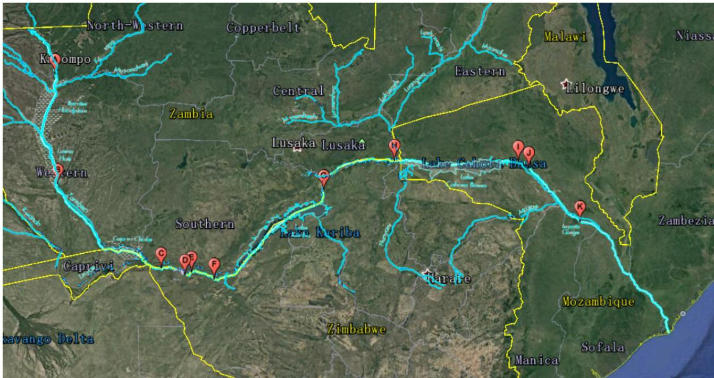
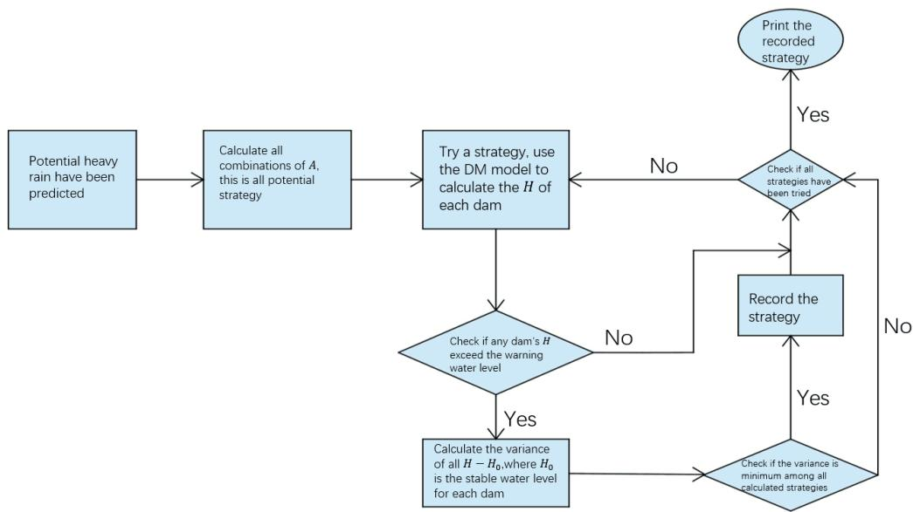

# 2017年美国大学生数学建模竞赛O奖论文（A题）

原件为竞赛论文。补充：文中的阅读练习及“参考解答”为整理时增加，原件图文保留出处。

本文档整理了2017年MCM/ICM竞赛A题获得Outstanding Winner（O奖）的论文内容，包括摘要、目录及正文部分。原文为英文，此处保留原文结构进行整理。

## 一、摘要

### 摘要 1

The Kariba Dam on the Zambezi River is confronted with foundation errosion and control limitation currently, so a strategy to maintain water management on the Zambezi River is of great value for the whole Zambezi basin. Based on the detailed data provided by World Bank, we conduct the assessment of three options (repairing the dam, rebuilding the dam or replacing the dam with several smaller dams along the river) and provide a reasonable and detailed model to construct a new dam system with some emergency strategies.

To begin with, a brief assessment report with potential costs and benefits is offered according to abundant references and reliable data. The evaluation of repairing the Kariba Dam is completed refering to the Kariba Dam Rehabilitation Project in the charge of World Bank, while the assessment of rebuilding the dam is realized following the actual capital investment expenditure of the Stage 1 of the Kariba Project. And the assessment of replacing the dam is carefully estimated according to the model to construct the new dam system.

Then, we concentrate on the establishment of the model for new dam system.

Firstly, a Hydrodynamic Model (HM) of the Zambezi River is established in order to estimate the flowing and depth situation of the river. The model is constructed based on flow conservation and energy conservation, which separately producing continuity equation and energy conservation equation, taking the normal water cycles and on-way resistance into account. Moreover, we obtain the numerical solution of the Hydrodynamic Model with Mathematica, and get the approximate current velocity curve and river depth curve along the river.

Secondly, the site selection and number confirmation of the new dams is realized according to the flowing and depth situation estimated by HM, geological data and hydrological data. The indexes for evaluation are determined after consulting professional literatures, and Grey Relation Grade Analysis is utilized in the selection among candidate sites so that all the indexes can be considered comprehensively and objectively.

Thirdly, a Difference Model (DM) of the Zambezi River with a dam system is established to provide sufficient details for the confirmation of dam construction and modulating strategies. We separate the river into several segments by the dams. A difference approximation of HM is applied to describe each segment of the river. A hydraulic emprical formula is utilized to determine the discharges of the dam. In this way, the recurrence formulas can be obtained to easily determine the runoff and river depth along the river with given environmental and initial conditions.

Fourthly, the type of each dam is confirmed with corrected DM, with the overall water management capabilities, protection and water management options for Lake Kariba evaluated and special topograph considered. Considering the loss of energy in collision, tributaries and the runoff variation with rainfall at headstram and tributaries, DM is corrected to adapt to the reality. With the results calculated by corrected DM, the type of each dam is confirmed balancing the safety and costs. Each type of dam has three gears of discharges, which increases the water management options.

Finally, the strategies to handle such emergency water flow situations as flooding and drought are designed with the new dam system established above. When solving a known catastrophe, the exhaustive method is utilized to rule out the best strategies which realized by the gear variation of the dam. It is validated that the new dam system can handle most extreme conditions and the method we adopted to establish the strategy is of low sensibility considering reasonable errors.

更多数学建模资料请关注微店店铺“数学建模学习交流” https://k.weidian.com/RHO6PSpA

## 二、正文

知识点：[数学建模的基本步骤（问题分析、模型假设、建立、求解、检验、推广）](../../../topics/数学建模/jianmo_buzhou.md)、[一般假设及其合理性说明（Assumptions and Justifications）](../../../topics/数学建模/jiaben_shezhi.md)

### 第1章 三种方案的评估报告

#### 1.1 修复现有卡里巴大坝

##### 1.1.1 机构项目支持（预估成本 6960 万美元）

Institutional Project Support (estimated cost US$69.6 million)

##### 1.1.2 跌水潭重塑（预估成本 1 亿美元）

Plunge Pool Reshaping (estimated cost US$100.0 million)

##### 1.1.3 溢洪道翻新（预估成本 1.246 亿美元）

Spillway Refurbishment (estimated cost US$124.6 million)

##### 1.1.4 效益

Benefits

#### 1.2 重建现有卡里巴大坝

Rebuilding the Existing Kariba Dam

#### 1.3 拆除卡里巴大坝并用沿赞比西河建造的十到二十座较小的大坝系列替换

Removing the Kariba Dam & Replacing It with A Series of Ten to Twenty Smaller Dams Along the Zambezi River

知识点：[任务分解与目标明确](../../../topics/数学建模/renwu_fenjie.md)、[模型优缺点分析（Strengths and Weaknesses）](../../../topics/数学建模/youque_dian.md)

### 第2章 引言

#### 2.1 问题重述

Restatement of the problem

#### 2.2 我们的方法

Our Approach

知识点：[问题重述与分析（Problem Restatement and Analysis）](../../../topics/数学建模/wenti_chongshu.md)、[任务分解与目标明确](../../../topics/数学建模/renwu_fenjie.md)

### 第3章 一般假设

General Assumption

知识点：[一般假设及其合理性说明（Assumptions and Justifications）](../../../topics/数学建模/jiaben_shezhi.md)、[数学建模的基本步骤（问题分析、模型假设、建立、求解、检验、推广）](../../../topics/数学建模/jianmo_buzhou.md)

### 第4章 符号说明

Notations

知识点：[符号说明与术语定义（Nomenclature / Symbols and Definitions）](../../../topics/数学建模/fuhao_shuoming.md)

### 第5章 模型构建

#### 5.1 赞比西河水动力模型

##### 5.1.1 连续性方程

Continuity Equation

##### 5.1.2 能量守恒方程

Energy Conservation Equation

##### 5.1.3 边界条件和初始条件

Boundary Condition and Initial Condition

##### 5.1.4 模型计算

Calculation of the Model

#### 5.2 大坝选址系统

##### 5.2.1 评价指标

Evaluation indexes

##### 5.2.2 候选地点

Candidate Site

##### 5.2.3 灰色关联度分析

Grey Relation Grade Analysis

#### 5.3 大坝系统的差分模型

##### 5.3.1 河流中的方程（无大坝）

Equations in the River (Without the Dam)

##### 5.3.2 大坝区域的方程

Equations in the Dam Region

##### 5.3.3 递推公式

Recurrence Formulas

#### 5.4 大坝建设与调度系统

##### 5.4.1 确认不同类型大坝的参数

Confirm the Parameters of Different Dam Types

##### 5.4.2 确认每种大坝的类型选择

Confirm the Type Selection of Each Dam

##### 5.4.3 评估卡里巴湖的保护与水资源管理选项

Evaluate the Protection & Water Management Options for Lake Kariba

##### 5.4.4 应对紧急水流情况的策略

Strategies to Handle Emergency Water Flow Situations

知识点：[数学建模的基本步骤（问题分析、模型假设、建立、求解、检验、推广）](../../../topics/数学建模/jianmo_buzhou.md)、[模型参数的确定（基于数据拟合或实验选择）](../../../topics/数学建模/canshu_queding.md)、[文献综述与研究背景撰写方法](../../../topics/数学建模/wenxian_zongshu.md)

### 第6章 模型测试

#### 6.1 误差分析

Error analysis

#### 6.2 灵敏度分析

Sensitivity Analysis

##### 6.2.1 $H_i$ 的灵敏度分析

Sensitivity Analysis for $H_i$

##### 6.2.2 $h_i$ 的灵敏度分析

Sensitivity Analysis for $h_i$

##### 6.2.3 $Q_{i}$ 的灵敏度分析

Sensitivity Analysis for $Q_{i}$

#### 6.3 结论

Conclusion

##### 6.3.1 优缺点

Strengths and weaknesses

##### 6.3.2 未来工作

Future Work

知识点：[敏感性分析方法（Sensitivity Analysis，单参数与多参数变动）](../../../topics/数学建模/minganxing_fenxi.md)、[模型优缺点分析（Strengths and Weaknesses）](../../../topics/数学建模/youque_dian.md)、[参数合理性验证](../../../topics/数学建模/canshu_heli_xing.md)

### 附录

Appendices

知识点：[文献综述与研究背景撰写方法](../../../topics/数学建模/wenxian_zongshu.md)、[Summary Sheet（摘要页）的撰写规范](../../../topics/数学建模/zhaiyao_xiezuo.md)、[非技术性文稿撰写（如致世界医学会的信函、新闻发布会声明）](../../../topics/数学建模/fei_jishu_wengao.md)

### 1 Assessment Report of Three Options

#### 1.1 Repairing the Existing Kariba Dam

At present, the foundation of the Kariba Dam is gradually undermined by scouring and erosion of water, so that operations are limited to only three of the six, non-adjacent gates. The Kariba Dam is also suffering frequent maintenance operations and potential limitations on the operational control of the reservoir. Therefore, plunge pool reshaping and spillway refurbishment are necessities. What is more, institutional project support are also significant to ensure the project running smoothly.

##### 1.1.1 Institutional Project Support (estimated cost US$69.6 million)

Institutional project support mainly provides overall management, supervision, professional consultant, comprehensive assessment and risk evaluation for the project.

##### 1.1.2 Plunge Pool Reshaping (estimated cost US$100.0 million)

Financing in the component is primarily utilized for goods, works and consultants services, which is constituted with four parts:
a. Plunge Pool Reshaping Civil Works Contract: The measures are required to reshape the plunge pool through excavation of the downstream face and north and south bank sides of the pool;
b. Additional Engineering Studies;
c. Monitoring Services Contract;
d. Visibility & Communications.

##### 1.1.3 Spillway Refurbishment (estimated cost US$124.6 million)

Financing in the component is mainly used for goods, works and non-consulting services associated with the refurbishment of the spillway, which is composed of two parts:
a. Spillway Refurbishment Contract: The works will be conducted at one gate at a time, in a sequenced manner starting with the gates that today show the largest need for rehabilitation;
b. Additional Engineering Studies.

##### 1.1.4 Benefits

Besides the elimination of potential danger and operational limitation which is mentioned above, the repairing of the dam also reinforce the integrated infrastructure platform within the Zambezi River basin. The benefits through avoided disaster and continued power production are substantial, considering the estimated 3 million people living in the potential impact area and the economic value in excess of US$8 billion.

#### 1.2 Rebuilding the Existing Kariba Dam

After 50 years of operation serving the southern African region, the geological conditions under the Kariba dam have been changed with the scouring and erosion of the water, so that the initial design of the dam is not appropriate for the new conditions. In this way, rebuilding the dam is a reasonable alternative to replace and even reinforce the function of the old one, and Lake Kariba is also utilized as a reservior. The financing of the project will be primarily utilized for civil engineering works and electrical and mechanical works.

*   **Civil Engineering Works** (estimated cost US$729.1 million): The component will include the costs of access roads, township, dam wall, south bank power station and engineering fees.
*   **Electrical and Mechanical Works** (estimated cost US$380.6 million): The component will include the costs of generation plant and equipment, transmission system and engineering fees.

The rebuilt dam can be designed to suit the new geological conditions and eliminate the overwhelming erosion confronted in the previous design. The benefits through avoided frequent maintenance of the dam and improved manipulating capability are substantial, given the lifespan and significance of the dam for the approximately 3 million local residents.

#### 1.3 Removing the Kariba Dam & Replacing It with A Series of Ten to Twenty Smaller Dams Along the Zambezi River

During the construction of the Kariba Dam, the dam suffered from three huge floodings exceeding the design flood. And the dam became broken quickly in fifty years, which was quite shorter than the designed lifespan. All these facts figure out that more dams should be constructed on the Zambezi River in order to prevent the unexpected floodings. In this way, replacing the Kariba Dam with a series of ten to twenty smaller dams is an alternative which are more likely to balance the costs and safety.

As a series of so many dams is quite rare in the world, the costs can only be estimated approximately by the number and size of the dams. Financing of the project is mainly utilized for dam construction and relevant institutional project support.

*   **Dam Construction** (estimated cost US$860 million): The costs of the dam construction are assumed to increase exponentially with the dam size increasing. Therefore, the costs of different dam types (which are introduced in the following model) are listed in Table 1. According to the following model, eight III dams and two IV dams are constructed, which cost US$860 million.
*   **Institutional Project Support** (estimated cost US$69.6 million).

**Table 1: Costs of different dam types**

| Types of dam | The area of Reservoir / $m^{2}$ | Warning water level $H_{mi}/m$ | Costs/million US$ |
| :--- | :--- | :--- | :--- |
| I | $1 \times 10^{8}$ | 60 | 10 |
| II | $1 \times 10^{7}$ | 50 | 1 |
| III | $1 \times 10^{6}$ | 40 | 0.8 |
| IV | $1 \times 10^{5}$ | 30 | 0.6 |

The construction of the dam system can balance between the safety and costs and have excellent functions to prevent unexpected floodings, whose benefits through avoided catastrophe is substantial, considering the powerful water management capabilities and more abundant hydropower.

知识点：[任务分解与目标明确](../../../topics/数学建模/renwu_fenjie.md)、[数学建模的基本步骤（问题分析、模型假设、建立、求解、检验、推广）](../../../topics/数学建模/jianmo_buzhou.md)

### 2 Introduction

#### 2.1 Restatement of the problem

Kariba Dam, constructed in 1955-59, with a storage capacity of $180 km^{3}$, is one of the largest dams in Africa. Now it is in dire need of maintenance. The Zambezi River Authority (ZRA) faces three available options to address this situation:

*   (Option 1) Repairing the existing Kariba Dam;
*   (Option 2) Rebuilding the existing Kariba Dam;
*   (Option 3) Removing the Kariba Dam and replacing it with a series of ten to twenty smaller dams along the Zambezi River.

# 2017年美国大学生数学建模竞赛O奖论文（A题）

## 一、问题重述与目标

知识点：[问题重述与分析（Problem Restatement and Analysis）](../../../topics/数学建模/wenti_chongshu.md)、[任务分解与目标明确](../../../topics/数学建模/renwu_fenjie.md)

### 选择 1：方案评估要求

**背景说明**
一方面，我们需要简要评估上述三种方案，并提供每种方案潜在的成本与收益概览。

- **原文描述**：On the one hand, we need to briefly assess all the three options above and provide an overview of potential costs and benefits associated with each option.

另一方面，该问题需要我们针对方案3进行详细分析。我们需要提出关于如何设计新大坝系统的建议。新系统必须满足以下要求：

- **原文描述**：On the other hand, the problem needs us to conduct a detailed analysis on option 3. We need to give a recommendation on how to design a new system of dam. The new system must meet following requirements:

#### 具体要求

1.  **具备与现有卡里巴大坝相同的水资源管理能力**
    *   **定义**：在报告中，我们使用大坝前方水库的总活库容来描述大坝系统调节流域内水流动态的能力。
    *   **原文描述**：Having the same overall water management capabilities as the existing Kariba Dam, In our report, we use the total live storage of reservoirs in front of dams which marks the ability of a dam system to dynamically regulate the water flows within the basin to describe the overall water management capabilities.

2.  **为卡里巴湖提供同等或更高水平的保护和水资源管理选项**
    *   **目的**：对于卡里巴湖而言，入流随季节变化越稳定，能为当地人民提供的渔业等条件越好。因此，我们的新大坝系统预期应使卡里巴湖的入流比原始卡里巴大坝更稳定。
    *   **原文描述**：Providing the same or greater levels of protection and water management options for Lake Kariba. For Lake Kariba, the more stable the inflow is with the variation of seasons, the better conditions like fishing conditions Lake Kariba can provide for local people. So our new dam system is expected to make the inflow of Lake Kariba more stable than the original Kariba Dam.

3.  **妥善应对已知或预测的正常水文周期**
    *   **原文描述**：Properly addressing known or predicted normal water cycles.

4.  **具备处理紧急水流情况的能力，包括洪水和长期低水位状况**
    *   **成因**：极端情况源于异常降雨。当某地区降雨量急剧增加时，我们的大坝系统应进行调整，确保尽可能不发生洪水；当某些地区经历长期干旱时，我们的系统应调整以尽可能为该区域提供更多径流。
    *   **原文描述**：Having the ability to handle emergency water flow situations including flooding and prolonged low water conditions. Extreme conditions derive from abnormal rainfall. When rainfall of some region increases sharply, our dam system is expected to be adjusted to make sure that no region is flooded as possible and when some regions experience prolonged drought our system should be adjusted to provide more runoff for that region as possible.

#### 报告需包含的内容

在主报告中，我们需要提供：

*   沿赞比西河新建大坝的数量及位置。
*   给赞比西河管理局（ZRA）管理者的指导，解释并证明应采取何种行动以妥善处理紧急水流情况。
*   在指导中提供特定极端事件发生的位置及最近一次发生的时间信息。

知识点：[问题重述与分析（Problem Restatement and Analysis）](../../../topics/数学建模/wenti_chongshu.md)、[任务分解与目标明确](../../../topics/数学建模/renwu_fenjie.md)、[数学建模的基本步骤（问题分析、模型假设、建立、求解、检验、推广）](../../../topics/数学建模/jianmo_buzhou.md)

### 选择 2：我们的方法概述

**总体策略**
基于世界银行提供的详细数据，我们对三种方案进行了评估，并建立了一个合理的详细模型来构建新的大坝系统及相应的应急策略。

1.  **初步评估**
    *   首先，根据丰富的参考资料和可靠数据，提供一份关于潜在成本与收益的简要评估报告。
    *   完成对修复卡里巴大坝的评估，参考世界银行负责的卡里巴大坝修复项目。
    *   实现重建大坝的评估，依据卡里巴项目第一阶段的实际资本投资支出。
    *   替换大坝的评估则根据构建新大坝系统的模型进行仔细估算。

2.  **新系统模型建立**
    *   然后，我们集中精力建立新大坝系统的模型。

#### 具体实施步骤

1.  **建立水动力模型 (Hydrodynamic Model, HM)**
    *   为了估算河流的流量和深度状况，建立了赞比西河的水动力模型。
    *   该模型基于流量守恒和能量守恒构建，分别产生连续性方程和能量守恒方程，同时考虑正常水文周期和沿途阻力。
    *   利用 Mathematica 获得水动力模型的数值解，得到沿河流的近似流速曲线和河深曲线。

2.  **大坝选址与数量确认**
    *   根据 HM 估算的流量和深度状况、地质数据和水文数据，确定新大坝的选址和数量。
    *   通过查阅专业文献确定评价指标，并利用灰色关联度分析法（Grey Relation Grade Analysis）在候选站点中进行选择，以便全面客观地考虑所有指标。

3.  **建立差分模型 (Difference Model, DM)**
    *   为了为新坝建设和调控策略的确认提供足够细节，建立了带大坝系统的赞比西河差分模型。
    *   利用大坝将河流划分为若干段，应用 HM 的差分近似来描述每个河段。
    *   利用水力经验公式确定大坝的泄流量，从而获得递推公式，在给定环境和初始条件下轻松确定沿河的径流和河深。

4.  **确定大坝类型**
    *   结合校正后的 DM，确定每种大坝的类型，评估整体水资源管理能力、对卡里巴湖的保护和管理选项，并考虑特殊地形。
    *   考虑到碰撞损失、支流以及上游和支流的径流随降雨的变化，对 DM 进行修正以适应现实情况。
    *   利用校正后 DM 的计算结果，在安全性和成本之间取得平衡，确定每种大坝的类型。每种大坝具有三个档位的泄流量，增加了水资源管理的选项。

5.  **制定应急策略**
    *   最后，利用已建立的新大坝系统设计处理洪水、干旱等紧急水流情况的策略。
    *   在解决已知灾害时，利用穷举法排除最佳策略，这些策略是通过大坝档位的变化实现的。
    *   验证表明，新大坝系统能够处理大多数极端情况，且所采用的建立策略的方法在合理误差范围内敏感度较低。

## 二、基本假设

*   **大坝类型**：所有大坝均为双曲混凝土拱坝，每座大坝均建有水电站和水库，与原卡里巴大坝一致。
    *   *原文*：All dams are double curvature concrete arch dams and each dam is built with a hydropower station and a reservoir, in consistence with the original Kariba Dam.
*   **成本关系**：大坝的成本与规模呈正相关。
    *   *原文*：The costs of the dams have positive correlation with the size of the dams.
*   **阻力机制**：水流受沿途阻力作用，该阻力与流速成正比，系数为常数。
    *   *原文*：The water is forced by on-way resistance, which is proportial to current velocity and the coefficient is a constant.
*   **蒸发**：蒸发随时存在，且近似为常数。
    *   *原文*：The evaporation exists anytime and is approximately a constant.

## 三、符号说明

| 符号 | 定义 |
| :--- | :--- |
| $x$ | 距上游的距离 |
| $L$ | 河流宽度 |
| $h$ | 河流深度 |
| $v$ | 当前流速 |
| $\rho$ | 水的密度 |
| $q$ | 降雨量 |
| $\delta$ | 蒸发量 |
| $k$ | 沿途阻力系数 |
| $Q$ | 径流量 |
| $H$ | 大坝附属水库的深度 |
| $\theta$ | 大坝闸门开启度 |
| $b$ | 闸门孔宽度 |
| $A$ | 大坝出流系数 |

## 5 The Model

知识点：[数学建模的基本步骤（问题分析、模型假设、建立、求解、检验、推广）](../../../topics/数学建模/jianmo_buzhou.md)、[一般假设及其合理性说明（Assumptions and Justifications）](../../../topics/数学建模/jiaben_shezhi.md)、[模型参数的确定（基于数据拟合或实验选择）](../../../topics/数学建模/canshu_queding.md)

### 5.1 Hydrodynamic Model of the Zambezi River

In this section, we establish a hydrodynamic model of the current velocity and river depth which vary with the space and time, which is based on flow conservation and energy conservation. When the current velocity and river depth at the headstream is given, the whole Zamberi River can be depicted with the current velocity and river depth anywhere and anytime.

#### 5.1.1 Continuity Equation

Considering a short segment of the river from $x$ to $x + \Delta x$ ($x$ and $x + \Delta x$ are all the distances away from the headstream), the flow conservation is given by

$$
Q _ { i n } + q _ { r a i n } - q _ { e v a p o r a t i o n } - Q _ { o u t } = \rho \Delta V\tag{1}
$$

where

*   $Q _ { i n }$ is the quantity of water flowing into the segment,
*   $q _ { r a i n }$ is the rainfall quantity of the segment,
*   $q _ { e v a p o r a t i o n }$ is the evaporation quantity of the segment,
*   $Q _ { o u t }$ is the quantity of water flowing out of the segment,
*   $\rho$ is the density of water,
*   $\Delta V$ is the volume of water in this segment.

$Q_{in}$, $q_{rain}$, $q_{evaporation}$, $Q_{out}$ and $\Delta V$ in the time period of $\Delta t$ can be written as

$$
Q _ { i n } = \rho L ( x ) h ( x , t ) v ( x , t ) \Delta t\tag{2}
$$

$$
q _ { r a i n } = \rho q ( x ) L ( x ) \Delta x \Delta t\tag{3}
$$

$$
q _ { e v a p o r a t i o n } = \rho \delta ( x ) L ( x ) \Delta x \Delta t\tag{4}
$$

$$
Q _ { o u t } = \rho L ( x + \Delta x ) h ( x + \Delta x , t ) v ( x + \Delta x , t ) \Delta t\tag{5}
$$

$$
\Delta V = L ( x ) \Delta x [ h ( x , t + \Delta t ) - h ( x , t ) ]\tag{6}
$$

The flow conservation equation turns into

$$
\begin{array}{c} \rho [ q ( x ) - \delta ( x ) ] L ( x ) \Delta x \Delta t + \rho [ L ( x ) h ( x , t ) v ( x , t ) - L ( x + \Delta x ) h ( x + \Delta x , t ) v ( x + \Delta x , t ) ] \Delta t \\ = \rho L ( x ) \Delta x [ h ( x , t + \Delta t ) - h ( x , t ) ] \end{array}\tag{7}
$$

After simplification, the equation is given by

$$
- \frac { \partial [ L ( x ) h ( x , t ) v ( x , t ) ] } { \partial x } + [ q ( x ) - \delta ( x ) ] L ( x ) = L ( x ) \frac { \partial h ( x , t ) } { \partial t }\tag{8}
$$

which is the continuity equation of the river.

#### 5.1.2 Energy Conservation Equation

Also considering a short segment of the river from $x$ to $x + \Delta x$ ($x$ and $x + \Delta x$ are all the distances away from the headstream), and neglecting the variation of the pressure with $x$, the energy conservation is written as

$$
W _ { g r a v i t y } + W _ { r e s i s t a n c e } = \Delta T _ { w a t e r } + \Delta T _ { r a i n } + \Delta T _ { e v a p o r a t i o n }\tag{9}
$$

where

*   $W _ { g r a v i t y }$ is the work done by the gravity of water,
*   $W _ { r e s i s t a n c e }$ is the work done by the on-way resistance,
*   $\Delta T _ { w a t e r }$ is the change of kinetic energy of the water in the segment,
*   $\Delta T _ { r a i n }$ is the change of kinetic energy of rain in the segment,
*   $\Delta T _ { e v a p o r a t i o n }$ is the change of kinetic energy of water evaporated from the segment.

$W _ { g r a v i t y }$ and $\Delta T _ { w a t e r }$ in the time period of $\Delta t$ is given by

$$
W _ { g r a v i t y } = - \rho g L ( x ) h ( x , t ) v ( x , t ) \Delta t \Delta y\tag{10}
$$

$$
\begin{aligned} \Delta T _ { w a t e r } &= \frac { 1 } { 2 } \rho L ( x ) h ( x , t ) v ( x , t ) \Delta ( v ^ { 2 } ) \Delta t \\ &= \frac { 1 } { 2 } \rho L ( x ) h ( x , t ) v ^ { 2 } ( x , t ) \Delta t ( \frac { \partial v } { \partial t } \Delta t + \frac { \partial v } { \partial x } \Delta x ) \end{aligned}\tag{11}
$$

Assuming that the on-way resistance per volume is proportional to the current velocity, which is

$$
F _ { r } = k v ( x , t )\tag{12}
$$

$W _ { r e s i s t a n c e }$ is expressed as

$$
W _ { r e s i s t a n c e } = - k L ( x ) h ( x , t ) v ( x , t ) \Delta x \Delta t\tag{13}
$$

Supposing that the initial velocity of rain in the river is approximately zero, $\Delta T _ { r a i n }$ is given by

$$
\Delta T _ { r a i n } = \frac { 1 } { 2 } \rho q ( x ) v ^ { 2 } ( x , t ) \Delta x \Delta t\tag{14}
$$

Neglecting the velocity of vapour evaporated from the river, $\Delta T _ { e v a p o r a t i o n }$ is given by

$$
\Delta T _ { e v a p o r a t i o n } = - \frac { 1 } { 2 } \rho \delta ( x ) v ^ { 2 } ( x , t ) \Delta x \Delta t\tag{15}
$$

Thus, the energy conservation equation after simplification is

$$
- g h ( x , t ) y ^ { \prime } ( x ) - k h ( x , t ) = h ( x , t ) v ( x , t ) \frac { \partial v } { \partial x } + h ( x , t ) \frac { \partial v } { \partial t } + \frac { 1 } { 2 } [ q ( x ) - \delta ( x ) ] v ( x , t )\tag{16}
$$

#### 5.1.3 Boundary Condition and Initial Condition

In order to solve the above two equations, the boundary condition and initial condition of the river should be given. Boundary conditions refer to the current velocity and river depth at the headstream, which can be measured in reality. Initial condition refer to the current velocity and river depth anywhere along the river when $t = 0$, which can also be provided by hydrological stations.

In our model, the current velocity and river depth at the headstream are assumed to be constant, which is

$$
\left\{ \begin{array} { l } { v ( 0 , t ) = v _ { 0 } } \\ { h ( 0 , t ) = h _ { 0 } } \end{array} \right.\tag{17}
$$

The initial depth is also supposed to be consistent along the river, while the inital current velocity is set to have the distribution of free falling movement, which can be written as

$$
\left\{ \begin{array} { l } { v ( x , 0 ) = \sqrt { v _ { 0 } ^ { 2 } + 2 g [ y ( 0 ) - y ( x ) ] } } \\ { h ( x , 0 ) = h _ { 0 } } \end{array} \right.\tag{18}
$$

#### 5.1.4 Calculation of the Model

The hydrodynamic equations of the river are all partial different equations and approximately impossible to get the analytical solution, so we should obtain all the values of the known parameters in the equations so that we can get the numerical solution of the equations.

We observe the Zambezi River in Google Earth and acquire the altitude variations along the river, which gives $y(x)$ with interpolation. The curve of $y(x)$ (altitude variation) is shown in Figure 1.

The width of the Zambezi River is almost constant along the river, which means $L(x) = L$.

The runoff, rainfall and evaporation along the river are obtained from the data provided by World Bank,3 which determines $v_0, h_0, q(x), \delta(x)$. In order to simplify the calculation, $\delta(x)$ is taken as a constant $\delta$, which is the annual average evaporation. The rainfall data is provided by some hydrological stations, so the data is discrete, which is shown in Figure 1. In order to acquire the rough data of rainfall anywhere along the river, we try to fit the data points of rainfall and obtain the analysis formula, which is shown in Figure 2-6.

知识点：[数学建模的基本步骤（问题分析、模型假设、建立、求解、检验、推广）](../../../topics/数学建模/jianmo_buzhou.md)、[一般假设及其合理性说明（Assumptions and Justifications）](../../../topics/数学建模/jiaben_shezhi.md)、[符号说明与术语定义（Nomenclature / Symbols and Definitions）](../../../topics/数学建模/fuhao_shuoming.md)

### 5.2 Selection System of the Dam Site

The site selection of the dams is significant in dam construction, which directly decides the function and lifespan of the dams. As many parameters of river have been obtained in previous calculation, we can evaluate the location from many aspects, so that a scientific and objective selection system of the dam site can be established based on Grey Relation Grade Analysis.4

#### 5.2.1 Evaluation indexes

In order to smooth the channel and acquire the maximum hydropower resources, the dams should be established in the regions with steep terrain gap, large river depth and much rainfall, where the huge quantity of water and rapid current may make the channel so turbulent as to threaten the safety of transportation and residents nearby, yet ensuring the abundant hydropower resources at the same time. The situation is similar when the current acceleration is enormous.5

In addition to this, some special topographies are appropriate for dam construction. Lakes can be utilized as a natural reservior for the dam, pocket-like lowlands can contribute to water management and valleys can eliminate the construction amount.5

What is more, the smaller width the channel has, the lower the construction cost is.5

In this way, the following indexes are considered for the site selection:

- Terrain gap: $y_0(x)$, the derivative of $y(x)$;
- River depth $h(x)$ in stable state;
- Rainfall $q(x)$;
- Current acceleration $\frac{\partial v(x, t)}{\partial t}$;
- Lakes;
- Pocket-like lowlands;
- Valleys;
- River width $L(x)$ (which can be obtained from the map).

The topographic indexes are evaluated by checking whether the suitable topography exists. If the appropriate topography exists, the relevant index is 1; if not, zero.

#### 5.2.2 Candidate Site

Several candidate sites should be determined to optimize the site selection. According to the relief map, rainfall, river depth calculated by the hydrodynamic model, considering the distances between adjacent dams, 26 advantageous sites are selected as candidate sites, which is shown in Figure 9.

#### 5.2.3 Grey Relation Grade Analysis

Because of the complex interaction between these parameters, we finally choose Grey Relation Grade Analysis to confirm the selection system.

Firstly, index weight should be obtained. The concrete steps are:

Step 1: Determine the reference data series as an ideal comparison standard. In our system, the largest value of each metric (river width is taken minus) constitutes the reference sequence.

$$
X _ {0} = (x _ {0} (1), x _ {0} (2), \dots , x _ {0} (m))\tag{19}
$$

Step 2: Calculate the absolute difference value of each parameter sequence and the reference sequence of the corresponding elements, as $\Delta _ { i } ( j ) = | x _ { i } ( j ) - x _ { 0 } ( j ) |$. In the formula, $i$ represents the number of candidate sites; $j$ is the number of metrics; $x _ { 0 } ( j )$ means the reference data in the metric.

Step 3: Confirm $a = \underset { 1 \leqslant i \leqslant n, 1 \leqslant j \leqslant m } { m i n } \{ \Delta _ { i } ( j ) \}$ and $b = \mathop { m a x } _ { 1 \leqslant i \leqslant n, 1 \leqslant j \leqslant m } \{ \Delta _ { i } ( j ) \}$.

Step 4: Calculate the correlation coefficient as:

$$
f _ {i} (j) = \frac{a + b \lambda}{\Delta_ {i} (j) + b \lambda}\tag{20}
$$

where resolution coefficient $\lambda \in ( 0 , 1 )$, commonly using 0.5.

Step 5: Calculate the correlation degree.

$$
r _ {j} = \frac {1}{n} \sum_ {i = 1} ^ {n} f _ {i} (j)\tag{21}
$$

Step 6: Calculate the weight of each measure standard.

$$
r _ {j} ^ {\prime} = \frac {r _ {j}}{r _ {1} + r _ {2} + \cdots + r _ {m}}\tag{22}
$$

Step 7: Build the evaluation model.

$$
Z _ {i} = r _ {1} ^ {\prime} x _ {i} (1) + r _ {2} ^ {\prime} x _ {i} (2) + \dots + r _ {m} ^ {\prime} x _ {i} (m)\tag{23}
$$

Based on the data we got above, we can solve the model and obtain the following results (Figure 10).

As shown in Figure 11-12, the following 11 sites are selected to constructed dams, considering the costs and the distances clustering between adjacent dams.

知识点：[文献综述与研究背景撰写方法](../../../topics/数学建模/wenxian_zongshu.md)、[模型参数的确定（基于数据拟合或实验选择）](../../../topics/数学建模/canshu_queding.md)、[影响因素评估指标体系构建（温度、湿度、经济、教育等）](../../../topics/数学建模/yingxiang_zhibiao.md)

### 5.3 Difference Model of the Dam System

When the dam system is considered in the Zambezi River, the Hydrodynamic Model with partial differential equations is too complex to describe the influences of the dam system, making it impossible to obtain the changes of the river in a bearable time. Therefore, the simplification of the model should be introduced, which is difference model of the dam system, providing recurrence formulas to calculate the runoff of the river with dam system.

The dams are numbered from 1 to 11, and the time is separated into $j$ time periods of T. For the ith dam in the jth time period,

$Q _ { ( i + 1 ) j }$ is the river flux flowing out of the dam. Specially, $Q _ { 1 j }$ represents the flux at the headstream;

$Q _ { i j } ^ { \prime }$ is the river flux flowing into the dam;

## 5.3 模型建立

$q_{ij}$ 为坝区及坝与上一坝之间区域的降雨通量密度；

$\delta_{ij}$ 为坝区及坝与上一坝之间区域的蒸发通量密度；

$\Delta y_i$ 为坝与上一坝之间的高程差；

$l_i$ 为坝与上一坝之间的距离；

$h_{ij}$ 为坝与上一坝之间区域的河道水深；

$H_{ij}$ 为坝所附水库的水深；

$S_i$ 为坝所附水库的面积；

$H_{0i}$ 为坝所附水库的死水位（死水位是允许水库消落的最低水位）。

知识点：[数学建模的基本步骤（问题分析、模型假设、建立、求解、检验、推广）](../../../topics/数学建模/jianmo_buzhou.md)、[模型参数的确定（基于数据拟合或实验选择）](../../../topics/数学建模/canshu_queding.md)、[符号说明与术语定义（Nomenclature / Symbols and Definitions）](../../../topics/数学建模/fuhao_shuoming.md)

### 5.3.1 河道（无坝）中的方程

如 Hydrodynamic Model 所述，连续性方程（基于流量守恒）可写为

$$
(q_{ij} - \delta_{ij}) l_i L + Q_{ij} - Q_{ij}^{\prime} = l_i L \frac{\Delta h_i}{\Delta t}\tag{24}
$$

在时间段 $T$ 内，$\frac{\Delta h_i}{\Delta t} = \frac{h_{i(j+1)} - h_{ij}}{T}$。

忽略 $T$ 时间段内 $v$ 的变化，能量守恒方程为

$$
\rho L h_{ij} v T g \Delta y_i - \rho k h_{ij} L v T l_i = \frac{1}{2} \rho (q_{ij} - \delta_{ij}) L l_i T v^2 + \frac{1}{2} \rho L h_{ij} v T \Delta(v^2)\tag{25}
$$

其中 $v$ 与 $\Delta(v^2)$ 可由 $Q_{ij}$ 和 $Q_{ij}^{\prime}$ 表示。

$$
v = \frac{Q_{ij} + Q_{ij}^{\prime}}{2 h_{ij} L}\tag{26}
$$

$$
\Delta(v^2) = \frac{Q_{ij}^{\prime 2} - Q_{ij}^2}{h_{ij}^2 L^2}\tag{27}
$$

化简后，无坝河道中的方程为

$$
\left\{ \begin{array}{l} (q_{ij} - \delta_{ij}) l_i L + Q_{ij} - Q_{ij}^{\prime} = l_i L \frac{h_{i(j+1)} - h_{ij}}{T} \\ 2 h_{ij}^2 L^2 g \Delta y_i - 2 k h_{ij}^2 L^2 l_i = Q_{ij}^{\prime 2} - Q_{ij}^2 + \frac{1}{2} (q_{ij} - \delta_{ij}) L (Q_{ij} + Q_{ij}^{\prime}) l_i \end{array} \right.\tag{28}
$$

知识点：[数学建模的基本步骤（问题分析、模型假设、建立、求解、检验、推广）](../../../topics/数学建模/jianmo_buzhou.md)、[符号说明与术语定义（Nomenclature / Symbols and Definitions）](../../../topics/数学建模/fuhao_shuoming.md)

### 5.3.2 坝区中的方程

如 Hydrodynamic Model 所述，连续性方程（基于流量守恒）可写为

$$
(q_{ij} - \delta_{ij}) S_i + Q_{ij}^{\prime} - Q_{(i+1)j} = S_i \frac{\Delta H_i}{\Delta t}\tag{29}
$$

在时间段 $T$ 内，$\frac{\Delta H_i}{\Delta t} = \frac{H_{i(j+1)} - H_{ij}}{T}$。

根据水力学教材，$Q_{(i+1)j}$ 与 $H_{ij}$ 有如下关系：

$$
Q_{(i+1)j} = A_i (H_{ij} - H_{0i})^{\frac{3}{2}}\tag{30}
$$

其中 $A_i$ 是由闸孔宽度 $b_i$ 和坝的相对闸门开度 $\theta$ 决定的出流系数。根据经验公式，$A_i$ 可表示为

$$
A_i = 2.7674 \theta b_i\tag{31}
$$

知识点：[数学建模的基本步骤（问题分析、模型假设、建立、求解、检验、推广）](../../../topics/数学建模/jianmo_buzhou.md)、[模型参数的确定（基于数据拟合或实验选择）](../../../topics/数学建模/canshu_queding.md)

### 5.3.3 递推公式

综合以上方程，可得含坝河道系统的递推公式。

$$
\left\{ \begin{array}{l} Q_{ij}^{\prime} = \frac{-\frac{1}{2} g L l_i + \sqrt{\frac{1}{4} g^2 L^2 l_i^2 - 4 (\frac{1}{2} g L Q_{ij} l_i - Q_{ij}^2 + 2 k h_{ij}^2 L^2 l_i - 2 h_{ij}^2 L^2 g \Delta y_i)}}{2} \\ Q_{(i+1)j} = A_i (H_{ij} - H_{0i})^{\frac{3}{2}} \\ h_{i(j+1)} = \frac{(q_{ij} - \delta_{ij}) l_i L + Q_{ij} - Q_{ij}^{\prime}}{l_i L} T + h_{ij} \\ H_{i(j+1)} = \frac{(q_{ij} - \delta_{ij}) S_i + Q_{ij}^{\prime} - A_i (H_{ij} - H_{0i})^{\frac{3}{2}}}{S_i} T + H_{ij} \end{array} \right.\tag{32}
$$

这样，当已知参数确定后，含坝河道系统即可由 $Q_{ij}, Q_{ij}^{\prime}, h_{ij}, H_{ij}$ 描述。所有已知参数列举如下。

$Q_{1j}$：源头的河道流量；

$Q_{(i+1)0}$：流出坝的初始河道流量；

$h_{i0}$：坝与上一坝之间区域的初始河道水深；

$H_{i0}$：坝所附水库的初始水深；

$q_{ij}$：沿河降雨；

$\delta_{ij}$：沿河蒸发；

$\Delta y_i$ 为坝与上一坝之间的高程差；

$l_i$ 为坝与上一坝之间的距离；

$S_i$：坝所附水库的面积；

$A_i$：坝的出流系数；

$H_{0i}$：坝所附水库的死水位；

$L$：河道宽度；

$g$：重力加速度；

$k$：沿程阻力系数；

$T$：时间尺度。

# 2017年美国大学生数学建模竞赛O奖论文（A题）

本文整理自《2017年美国大学生数学建模竞赛O奖论文（A题）》第7部分，由识别工具读取并修正格式。

## 5.4 Dam Construction & Manipulating System

As the number and placement of the new dams have been confirmed, the size of dams and manipulating strategy should be assigned so that the dam systems can have good performance and handle emergency water flow situations. The concrete steps to design the size of dams and manipulating strategy are listed below:

Step 1: Confirm the parameters of different dam types.

Step 2: Confirm the type selection of each dam.

Step 3: Evaluate the protection and water management options for Lake Kariba.

Step 4: Strategies to handle emergency water flow situations.

知识点：[数学建模的基本步骤（问题分析、模型假设、建立、求解、检验、推广）](../../../topics/数学建模/jianmo_buzhou.md)、[问题重述与分析（Problem Restatement and Analysis）](../../../topics/数学建模/wenti_chongshu.md)、[一般假设及其合理性说明（Assumptions and Justifications）](../../../topics/数学建模/jiaben_shezhi.md)

### 5.4.1 Confirm the Parameters of Different Dam Types

According to the standard of Water Conservancy Engineering, the dams can be categorized into several types according to the capacity of the reservoir attached.[7] As shown in Table 2, four appropriate types of dam are selected considering the reality of the Zambezi River and the relevant parameters have been confirmed.

Table 2: Parameters of different dam types

| Types of dam | The area of Reservoir/ $m^2$ | A | Warning water level $H_{mi}/m$ |
| :--- | :--- | :--- | :--- |
| I | $1 \times 10^8$ | 33$\theta$ | 60 |
| II | $1 \times 10^7$ | 27$\theta$ | 50 |
| III | $1 \times 10^6$ | 16$\theta$ | 40 |
| IV | $1 \times 10^5$ | 11$\theta$ | 30 |

Where $\theta$ is the relative gate opening of the dam. In order to simplify the manipulation of the dam, it is assumed that there are three gears of the gate opening, which means $\theta$ can be taken as 0.25, 0.5, 1.0. In normal situation, $\theta$ is taken as 0.5.

知识点：[模型参数的确定（基于数据拟合或实验选择）](../../../topics/数学建模/canshu_queding.md)、[一般假设及其合理性说明（Assumptions and Justifications）](../../../topics/数学建模/jiaben_shezhi.md)、[符号说明与术语定义（Nomenclature / Symbols and Definitions）](../../../topics/数学建模/fuhao_shuoming.md)

### 5.4.2 Confirm the Type Selection of Each Dam

The new dams should be established to protect the river’s basin from the floods and drought, so it seems that the dam with largest reservoir is the best choice. However, the cost of one large dam is equal to that of many small dams. Therefore, we should take a reasonable balance between safety and costs, which can be completed with the Difference Model of the Dam System. When each dam size has been confirmed, $H_{ij}, h_{ij}, Q_{ij}, Q'_{ij}$ can be determined, which means a certain series of dam size will correspond to a certain river situation.

However, the main tributaries are neglected in the Difference Model of the Dam System, which play an important role in the river system. Therefore, we correct the model by detecting the main tributaries and adding them into the model. According to the terrain map of the basin, which is shown in Figure 15, the main tributaries distribute at the region between the dam $A$ and $B$, $B$ and $C$, $F$ and $G$, $H$ and $I$, $J$ and $K$. Their runoff are marked as $q'_{2j}, q'_{3j}, q'_{7j}, q'_{9j}, q'_{11j}$. The runoff will be added into the flux flowing into the relevant dam. For example, the flux flowing into the 2nd dam will be $Q'_{2j} + q'_{2j}$

In addition to this, the loss of mechanical energy when the flow collides with the banks and bottom of the river, so a loss coefficient $\beta$ should be included in the energy conservation equation, which is

$$
Q'_{ij} = \frac{-\frac{1}{2} g L l_i + \sqrt{\frac{1}{4} g^2 L^2 l_i^2 - 4 (\frac{1}{2} g L Q_{ij} l_i - Q_{ij}^2 + 2 k h_{ij}^2 L^2 l_i - 2 h_{ij}^2 L^2 g \beta \Delta y_i)}}{2} \tag{33}
$$

Before calculating the best type selection with the Difference Model of the Dam System, all the known parameters should be confirmed. It is assumed that the rainfall and evaporation in a certain region is constant in the time period we have concerned, which means $q_{ij} = q_i, \delta_{ij} = \delta_i$. The dead water level of each dam is supposed to be constant, which means $H_{0j} = H_0$. Apparently, the rainfall will influence the runoff at the headstream and tributaries, so it is reasonable to suppose that

$$
\left\{ \begin{array}{l} Q_{1j} = Q_1 + \alpha (q_1 - \delta_1) \\ q'_{2j} = q'_2 + \alpha (q_2 - \delta_2) \\ q'_{3j} = q'_3 + \alpha (q_3 - \delta_3) \\ q'_{7j} = q'_7 + \alpha (q_7 - \delta_7) \\ q'_{9j} = q'_9 + \alpha (q_9 - \delta_9) \\ q'_{11j} = q'_{11} + \alpha (q_{11} - \delta_{11}) \end{array} \right. \tag{34}
$$

where $Q_1, q'_2, q'_3, q'_7, q'_9, q'_{11}$ are separately the runoff at the headstream and each tributary, $\alpha$ is the constant coefficient.

$\Delta y_i$ and $l_i$ can be easily determined by the geographical data mentioned above, which is included in the Appendix. $Q_1, h_{i0}, H_{i0}, q_i$ and $\delta_i$ can be decided by the above hydrological data,[3] where it is assumed that $h_{i0} = h_0, H_{i0} = H_0, \delta_i = \delta_0, q_i$ is supposed to obey the distribution concluded from the rainfall data. Li is presented in the appendices. Other known parameters are listed below:

$$
\bullet Q_{1}=500\,\mathrm{m^3/s},\ h_{0}=20\,\mathrm{m},\ H_{0}=20\,\mathrm{m},\ T=60\,\mathrm{s}
$$

$$
\bullet q_{2}^{\prime}=150\,\mathrm{m^3/s},\ q_{3}^{\prime}=100\,\mathrm{m^3/s},\ q_{7}^{\prime}=50\,\mathrm{m^3/s},\ q_{9}^{\prime}=120\,\mathrm{m^3/s},\ q_{11}^{\prime}=80\,\mathrm{m^3/s}
$$

$$
g=9.8\,\mathrm{m/s^2},\ k=1\times 10^{-6}\,\mathrm{kg\cdot m^3\cdot s^{-1}},\ \alpha=3\times 10^{9},\ \beta=10^{-3}
$$

With all the known parameters confirmed, we can calculate the best type selection with the corrected Difference Model of the Dam System. It is obvious that the smallest dam is cheapest, so we choose IV type for each dam at first except the 11th one and the 7th one. At the site of the 11th dam, the Cahora Bassa $\mathrm{Dam}^{8}$ has been constructed, which is a I-type dam, so the 11th dam is selected as I type. The 7th dam is located at the previous Kariba Dam, but the new geological condition after errosion is not suitable for a I-type dam, so II type is selected considering the huge capacity of Lake Kariba. Then we calculate the situation of the river (with 90000 iterations, which means 3 months for the model). According to the calculation, the situation of the river will approach a stable state with time goes. If $H_{ij}$ at the stable state is higher than the warning water level at one dam, the dam type will be upgraded for one grade. The procedure will be repeated until all $H_{ij}$ at the stable state are lower than the corresponding warning water level. However, another restriction should be satisfied by the final type selection:

$\sum_{i=1}^{11} S_{i} H_{mi} \geqslant V_{Lake}$, which means the total capacity of the reserviors attached to new dams should be larger than the capacity of previous Lake Kariba $(V_{Lake})$. The total capacity represents the overall water management capabilities of the dam system. The restriction means the new dam system has the same and even higher overall water management capabilities than the Kariba Dam.

The detailed procedure is shown in the Figure 16.

The selection result is presented in Table 3.

Table 3: Types of each dam

| Dam | A | B | C | D | E | F | G | H | I | J | K |
|---|---|---|---|---|---|---|---|---|---|---|---|
| Types of Dam | III | III | III | III | III | III | III | IV | I | IV | III |

知识点：[一般假设及其合理性说明（Assumptions and Justifications）](../../../topics/数学建模/jiaben_shezhi.md)、[模型参数的确定（基于数据拟合或实验选择）](../../../topics/数学建模/canshu_queding.md)、[参数合理性验证](../../../topics/数学建模/canshu_heli_xing.md)

### 5.4.3 Evaluate the Protection & Water Management Options for Lake Kariba

The protection for Lake Kariba can be evaluated with the water level fluctuation of Lake Kariba between rainy season and dry season. The smaller the fluctuation is, the better protection is offered for the lake. The water level in rainy season and dry season can be easily calculated with the corrected Difference Model of the Dam System. $h_{i0}$ and $H_{i0}$ are set as the stable value with normal rainfall and $q_{i}$ has been determined by the corresponding rainfall data of rainy season and dry season. The calculation result is taken as the final result after 90000 iterations, because it is observed that for large reservoirs like Kariba, the instantaneous and daily peak flows are not important, as these can be stored in the reservoir.

As shown in Fig, we can find that the fluctuation decreases with the new dam system, proving that the new dam system provides the better production for Lake Kariba.

In addition to this, the discharge of the dam is provided with 3 gears, so that elaborate water management can be realized with the new dam system. Therefore, the new dam system has more water management options.

知识点：[模型参数的确定（基于数据拟合或实验选择）](../../../topics/数学建模/canshu_queding.md)、[数学建模的基本步骤（问题分析、模型假设、建立、求解、检验、推广）](../../../topics/数学建模/jianmo_buzhou.md)、[模型优缺点分析（Strengths and Weaknesses）](../../../topics/数学建模/youque_dian.md)

### 5.4.4 Strategies to Handle Emergency Water Flow Situations

The emergency water flow situations include the flooding and drought, which are both common in the Zambezi River's basin, so different strategies should be designed to handle the two emergency water flow situations.

知识点：[问题重述与分析（Problem Restatement and Analysis）](../../../topics/数学建模/wenti_chongshu.md)、[任务分解与目标明确](../../../topics/数学建模/renwu_fenjie.md)

### Flooding

The flooding caused by extreme large rainfall is assumed to occur at the region between the 2nd dam and the 4th one for three months, which is typical for the river's basin according to the data provided by World Bank.3 $q_{i}$ in the flooding region is set as the rainfall of approximately 24mm per twelve hours, which can be categoried as heavy rain. The runoff distribution without modulating along the river is shown in Figure 17. The exhaustive method is utilized to test all combinations of $A_{i}$ (which means the changes of the dam gear) for the combination which obtains the minimum variance of all $H_{i} - H_{i0}$. The minimum variance of all $H_{i} - H_{i0}$ means that the reserviors attached to dams have minimum fluctuation during the flooding, which will protect the residents from danger and economic loss. The concrete procedure is shown in Figure 18.

The best combination of the dam gears is presented in Table 4.

Table 4: Best combination of $A_{i}$

| Dam | 1 | 2 | 3 | 4 | 5 | 6 | 7 | 8 | 9 | 10 | 11 |
|---|---|---|---|---|---|---|---|---|---|---|---|
| A | 4 | 8 | 16 | 16 | 16 | 16 | 16.5 | 5.5 | 16.5 | 8 | 8 |

The regulated reservior depth is shown in the Figure 19, compared with the unregulated reservior depth.

知识点：[模型参数的确定（基于数据拟合或实验选择）](../../../topics/数学建模/canshu_queding.md)、[任务分解与目标明确](../../../topics/数学建模/renwu_fenjie.md)

### Drought

The drought caused by extreme small rainfall is assumed to occur along the whole river for three months. $\delta_{i}$ in the drought region is set as the rainfall of approximately 1100mm per year, which can be categoried as heavy rain. The runoff distribution without modulating along the river is shown in Figure 20. The exhaustive method is utilized to test all combinations of $A_{i}$ (which means the changes of the dam gear) for the combination which obtains the maximum increased runoff. The increased runoff is more signicant in drought, which will protect the residents from danger and economic loss. The concrete procedure is shown in Figure 21.

## 6 Testing the model

知识点：[数学建模的基本步骤（问题分析、模型假设、建立、求解、检验、推广）](../../../topics/数学建模/jianmo_buzhou.md)、[模型参数的确定（基于数据拟合或实验选择）](../../../topics/数学建模/canshu_queding.md)、[模型验证方法概述（随机模型与确定性模型验证）](../../../topics/数学建模/moxing_yanzheng.md)

### 6.1 Error analysis

In this part, we will analyze relevant factors that might cause error in our model.

*   **The mechanical energy loss of water**: In fact, the mechanical energy loss water in each segment is very complex, which is relevant to the topographic feature in the segment. However, we have neglected the complexity.
*   **Resistance**: In fact, the on-way resistance coefficient $k$ in each segment is closely related with the curve of the channel in the segment, which is neglected by us.
*   **Evaporation along the river and the runoff of tributaries and headstream**: Accurate data is not available so that we roughly estimate it.

知识点：[模型优缺点分析（Strengths and Weaknesses）](../../../topics/数学建模/youque_dian.md)、[模型验证方法概述（随机模型与确定性模型验证）](../../../topics/数学建模/moxing_yanzheng.md)、[一般假设及其合理性说明（Assumptions and Justifications）](../../../topics/数学建模/jiaben_shezhi.md)

### 6.2 Sensitivity Analysis

In our model, some inputs are not precise enough for the lack of actual data about Zambezi basin and some parameters are difficult to obtain directly. Those inputs or parameters may influence the result of our calculation, so we implement a sensitive analysis to test the robustness of our model.

In fact, we cannot obtain the real value of the inputs $Q _ { 1 } , H _ { i 0 } , h _ { i 0 }$ and parameter $\alpha$ with the data we have. Sensitivity Analysis is primarily conducted on these inputs and parameters.

#### 6.2.1 Sensitivity Analysis for $H _ { i }$

**Table 5: Sensitivity Analysis for $H _ { i }$**

| | -5% | -3% | -1% | 0% | 1% | 3% | 5% |
| :--- | :--- | :--- | :--- | :--- | :--- | :--- | :--- |
| $h_{i0}$ | 2.9281% | 2.9767% | 3.0253% | 0% | 3.0738% | 3.1223% | 3.1706% |
| $H_{i0}$ | 7.5529% | 3.7451% | 1.8459% | 0% | 4.2614% | 7.6778% | 11.4852% |
| $Q_{00}$ | 3.0475% | 3.0483% | 3.0492% | 0% | 3.0500% | 3.0508% | 3.0517% |
| $\alpha$ | 2.9252% | 2.9749% | 3.0247% | 0% | 3.0745% | 3.1242% | 3.1739% |

All the percentage presented on the table represents the maximum fluctuation among $H _ { i }$ . Therefore, $H _ { i }$ is not sensitive to the value of $Q _ { 1 } , H _ { i 0 } , h _ { i 0 }$ and $\alpha$.

#### 6.2.2 Sensitivity Analysis for $h _ { i }$

**Table 6: Sensitivity Analysis for $h _ { i }$**

| | -5% | -3% | -1% | 0% | 1% | 3% | 5% |
| :--- | :--- | :--- | :--- | :--- | :--- | :--- | :--- |
| $h_{i0}$ | 5.0000% | 3.0000% | 1.0000% | 0% | 1.0000% | 3.0000% | 5.0000% |
| $H_{i0}$ | 0.2140% | 0.1309% | 0.0445% | 0% | 0.0453% | 0.1382% | 0.2341% |
| $Q_{0}0$ | 0.0432% | 0.0259% | 0.0086% | 0% | 0.0086% | 0.0259% | 0.0432% |
| $\alpha$ | 0.0169% | 0.0102% | 0.0034% | 0% | 0.0034% | 0.0102% | 0.0170% |

All the percentage presented on the table represents the maximum fluctuation among $h _ { i }$ . Therefore, $h _ { i }$ is not sensitive to the value of $Q _ { 1 } , H _ { i 0 } , h _ { i 0 }$ and $\alpha$.

#### 6.2.3 Sensitivity Analysis for $Q _ { i }$

**Table 7: Sensitivity Analysis for $Q _ { i }$**

| | -5% | -3% | -1% | 0% | 1% | 3% | 5% |
| :--- | :--- | :--- | :--- | :--- | :--- | :--- | :--- |
| $h_{i}0$ | 0.5677% | 0.4539% | 0.3403% | 0% | 0.2267% | 0.1133% | 0.0000% |
| $H_{i}0$ | 26.3961% | 16.2663% | 5.7108% | 0% | 5.2538% | 16.6129% | 28.3529% |
| $Q_{0}0$ | 5.0000% | 3.0000% | 1.0000% | 0% | 1.0000% | 3.0000% | 5.0000% |
| $\alpha$ | 5.5439% | 3.3332% | 1.1134% | 0% | 1.1156% | 3.3538% | 5.6011% |

All the percentage presented on the table represents the maximum fluctuation among $Q _ { i } .$ . It can be seen that $Q _ { i }$ is sensitive to $H _ { i 0 } ,$ , namely the faint error of the initial depth of the reservior attached to the dam may lead to the great changes of $Q _ { i } ,$ so the initial value of $H _ { i 0 }$ should be taken as the stable value calculated in normal condition to control the potential error of $Q _ { i }$

知识点：[敏感性分析方法（Sensitivity Analysis，单参数与多参数变动）](../../../topics/数学建模/minganxing_fenxi.md)、[模型参数的确定（基于数据拟合或实验选择）](../../../topics/数学建模/canshu_queding.md)、[参数合理性验证](../../../topics/数学建模/canshu_heli_xing.md)

### 6.3 Conclusion

#### 6.3.1 Strengths and weaknesses

**Strengths:**

*   We have got the sufficient topographic data of the river and build hydrodynamic model model to calculate the velocity and depth distribution of the river. So we have a detailed and comprehensive description of the Zambezi River.
*   We consult many professional literatures to determine the evaluation indexes of site selection of dams. And we use grey relation analysis and k-means clustering combined with these multiple indexes to pick out optimal sites from candidates. So our selection is reasonable.
*   We use difference model to simplify the calculation of the river and considered the influence both tributaries and evaporation. As long as we have enough data to set precise inputs we can predict the dynamical process of the river. It is of great importance and convenience for us to do further discussion about dams.
*   After consulting relevant literature, we have relative knowledge of dams including types, relevant parameters, function and building cost in practical situation. Based on this we set four types of dams to be selected for each site and finally confirm them by balancing safety and costs. Through this our dam system owns more water management options.

**Weaknesses:**

*   On the one hand, insufficient data of the runoff of Zambezi River’s tributaries and headstream and the evaporation of its basin trigger the indeterminacy of the inputs of our equation. On the other hand, some parameters in our equation like the coefficient of on-way resistance is hard to get directly. So actually the solution of our equation may be not fully consistent with actual data numerically.
*   We do not have enough consideration of geological conditions of Zambezi basin when confirming the sites of dams and the analysis for social and ecological impact of the project is also insufficient.

知识点：[文献综述与研究背景撰写方法](../../../topics/数学建模/wenxian_zongshu.md)、[模型优缺点分析（Strengths and Weaknesses）](../../../topics/数学建模/youque_dian.md)、[模型参数的确定（基于数据拟合或实验选择）](../../../topics/数学建模/canshu_queding.md)

### 6.3.2 Future Work

Since we still have some weaknesses in our current work, future efforts are needed to better work out this problem.

Firstly, more sufficient data of runoff of Zambezi River's tributaries and headstream and the evaporation of its basin will be needed in order to do more accurate calculation of the river.

Secondly, more geological knowledge will be needed and more civilian and ecological factors will be considered in order to make more scientific and reasonable site selection of dams.

Thirdly, more rainfall and evaporation data of Zambezi basin are needed to better predict the extreme conditions and provide more detailed and comprehensive guidance for the new dam system.

Finally, we will try to generalize our model and approach in this problem to more multi-dam systems after more polishment.

知识点：[数学建模的基本步骤（问题分析、模型假设、建立、求解、检验、推广）](../../../topics/数学建模/jianmo_buzhou.md)、[模型优缺点分析（Strengths and Weaknesses）](../../../topics/数学建模/youque_dian.md)、[文献综述与研究背景撰写方法](../../../topics/数学建模/wenxian_zongshu.md)

### References

[1] World Bank: International Development Association Project Appraisal Document on A Proposed Credit in the Amount of SDR 5.6 Million and A Proposed Swedish Grant in the Amount of US\$25 Million to the Republic of Zambia for A Kariba Dam Rehabilitation Project, 2014.11.

[2] World Bank: Kariba Dam, Zambia and Zimbabwe, 2000.11.

[3] World Bank: The Zambezi River Basin: A Multi-Sector Investment Opportunities Analysis

[4] Zhang YaGuan, Xue ShiMing, Kuang ChongYi, Chen Gong: Relation grade analysis of grey theory and comprehensive evaluation of introduced forage of winter-free farmland in the north of Yunnan subtropics. ISSN 1004-5759

[5] Wang Liwen: The function and site selection of reservior dams

[6] Zhou Zhihao: Water Resources and Hydropower Planning, China High Education Press.

[7] E.M. Welson: Engineering Hydrology, Palgrave Macmillan, 1990.

[8] Wikipedia: Cahora Bassa Dam.

知识点：[文献综述与研究背景撰写方法](../../../topics/数学建模/wenxian_zongshu.md)

### Appendices

Table 8: Rainfalls along the River

| District | Oct | Nov | Dec | Jan | Feb | Mar | Apr | May | Jun | Jul | Aug | Sep | Year |
| :--- | :--- | :--- | :--- | :--- | :--- | :--- | :--- | :--- | :--- | :--- | :--- | :--- | :--- |
| 1 | 20 | 71 | 164 | 243 | 180 | 173 | 71 | 45 | 37 | 28 | 27 | 15 | 1074 |
| 2 | 12 | 78 | 174 | 197 | 180 | 108 | 26 | 7 | 5 | 3 | 3 | 3 | 796 |
| 4 | 17 | 84 | 172 | 179 | 159 | 90 | 18 | 3 | 1 | 0 | 0 | 1 | 724 |
| 6 | 18 | 68 | 156 | 164 | 139 | 76 | 24 | 5 | 1 | 0 | 0 | 2 | 653 |
| 9 | 26 | 90 | 191 | 195 | 187 | 113 | 28 | 2 | 1 | 0 | 0 | 2 | 835 |
| 13 | 46 | 178 | 259 | 254 | 216 | 195 | 50 | 3 | 1 | 0 | 1 | 6 | 1209 |

Table 9: Locations of Distance in 8

| District | 1 | 2 | 4 | 6 | 9 | 13 |
| :--- | :--- | :--- | :--- | :--- | :--- | :--- |
| Mean Distance From the Headstream | 417 | 786 | 557 | 1029 | 1888 | 2261 |

Table 10: Potential locations for New Dam system

| Potential Locations | Distance from the Headstream | Lat/Long |
| :--- | :--- | :--- |
| 1 | 120 | $13^{\circ}8'S$ $23^{\circ}2'E$ |
| 2 | 150 | $13^{\circ}9'S$ $23^{\circ}3'E$ |
| 3 | 420 | $16^{\circ}1'S$ $23^{\circ}6'E$ |
| 4 | 738 | $17^{\circ}0'S$ $25^{\circ}9'E$ |
| 5 | 806 | $17^{\circ}8'S$ $26^{\circ}1'E$ |
| 6 | 818 | $17^{\circ}8'S$ $26^{\circ}5'E$ |
| 7 | 820 | $17^{\circ}7'S$ $26^{\circ}6'E$ |
| 8 | 825 | $17^{\circ}5'S$ $26^{\circ}7'E$ |
| 9 | 828 | $17^{\circ}4'S$ $26^{\circ}9'E$ |
| 10 | 860 | $17^{\circ}6'S$ $26^{\circ}5'E$ |
| 11 | 880 | $18^{\circ}0'S$ $26^{\circ}4'E$ |
| 12 | 882 | $18^{\circ}2'S$ $26^{\circ}6'E$ |
| 13 | 885 | $18^{\circ}3'S$ $26^{\circ}6'E$ |
| 14 | 886 | $18^{\circ}3'S$ $26^{\circ}6'E$ |
| 15 | 940 | $17^{\circ}6'S$ $27^{\circ}2'E$ |
| 16 | 946 | $17^{\circ}3'S$ $27^{\circ}5'E$ |
| 17 | 1208 | $16^{\circ}7'S$ $28^{\circ}9'E$ |
| 18 | 1215 | $16^{\circ}8'S$ $28^{\circ}1'E$ |
| 19 | 1217 | $16^{\circ}1'S$ $28^{\circ}0'E$ |
| 20 | 1408 | $15^{\circ}8'S$ $30^{\circ}6'E$ |
| 21 | 1420 | $15^{\circ}8'S$ $30^{\circ}3'E$ |
| 22 | 1683 | $15^{\circ}4'S$ $32^{\circ}9'E$ |
| 23 | 1695 | $15^{\circ}5'S$ $32^{\circ}5'E$ |
| 24 | 1715 | $15^{\circ}0'S$ $33^{\circ}3'E$ |
| 25 | 1720 | $15^{\circ}2'S$ $33^{\circ}5'E$ |
| 26 | 1885 | $16^{\circ}2'S$ $34^{\circ}4'E$ |

## 数据表格

知识点：[符号说明与术语定义（Nomenclature / Symbols and Definitions）](../../../topics/数学建模/fuhao_shuoming.md)、[模型参数的确定（基于数据拟合或实验选择）](../../../topics/数学建模/canshu_queding.md)

### 表11：确定大坝位置的指标

| Locations | Terrain gap | River Flow Acceleration | Rainfall | Depth | Valley | Lake | Pocket-like lowlands | Width of river |
| :--- | :--- | :--- | :--- | :--- | :--- | :--- | :--- | :--- |
| 1 | -0.758387 | 0.068707535 | 0.494863 | 27.9938 | 0 | 0 | 0 | 0.228625733 |
| 2 | -0.188707 | 0.008492897 | 0.482928 | 28.1081 | 0 | 0 | 0 | 0.269829219 |
| 3 | -0.131455 | 0.005840917 | 0.390808 | 36.9643 | 0 | 0 | 0 | 0.255940496 |
| 4 | -0.371262 | 0.020843327 | 0.317614 | 34.1216 | 0 | 0 | 0 | 0.89091976 |
| 5 | -5.36119 | 0.2854 | 0.306918 | 27.3157 | 1 | 0 | 0 | 0.105767626 |
| 6 | -6.34961 | 0.310580549 | 0.305212 | 25.2888 | 1 | 0 | 0 | 0.231204181 |
| 7 | -7.41301 | 0.353306423 | 0.304933 | 24.5147 | 1 | 0 | 0 | 0.153765839 |
| 8 | -11.478 | 0.446515611 | 0.304242 | 22.6366 | 1 | 0 | 0 | 0.089243799 |
| 9 | -9.88432 | 0.4206 | 0.303832 | 21.0487 | 1 | 0 | 1 | 0.247277304 |
| 10 | 0.47558 | 0.028870209 | 0.299668 | 21.4808 | 1 | 0 | 0 | 0.108070299 |
| 11 | -7.05964 | 0.251578098 | 0.297263 | 19.8484 | 1 | 0 | 0 | 0.160722158 |
| 12 | -6.57593 | 0.2306 | 0.29703 | 19.5294 | 0 | 0 | 1 | 0.207333801 |
| 13 | -11.3948 | 0.400920723 | 0.296685 | 18.8262 | 0 | 0 | 1 | 0.209334368 |
| 14 | -5.43244 | 0.178947925 | 0.294446 | 18.6609 | 0 | 0 | 1 | 0.137633864 |
| 15 | -0.47327 | 0.00114481 | 0.290952 | 18.5564 | 0 | 0 | 1 | 0.359885441 |
| 16 | -3.90212 | 0.1113 | 0.290395 | 18.4459 | 0 | 1 | 0 | 2.133441296 |
| 17 | -2.5892 | 0.075096648 | 0.279359 | 20.4907 | 0 | 1 | 1 | 0.425886964 |
| 18 | -3.36631 | 0.099757025 | 0.279419 | 20.1174 | 0 | 0 | 0 | 0.553183045 |
| 19 | -3.4093 | 0.1 | 0.27944 | 20.0102 | 0 | 0 | 0 | 0.392962291 |
| 20 | -1.23203 | 0.03221616 | 0.288379 | 22.0094 | 0 | 0 | 1 | 0.193799965 |
| 21 | -3.68041 | 0.108738542 | 0.2894 | 21.7235 | 0 | 0 | 0 | 0.502505624 |
| 22 | -1.40594 | 0.038844327 | 0.325444 | 25.1723 | 1 | 1 | 1 | 0.140411027 |
| 23 | -3.64917 | 0.1039 | 0.327711 | 24.7095 | 1 | 0 | 0 | 0.178182111 |
| 24 | -3.88742 | 0.108105599 | 0.331611 | 23.4029 | 0 | 0 | 1 | 0.126866802 |
| 25 | -4.08962 | 0.1137 | 0.33261 | 23.0711 | 0 | 0 | 0 | 0.106678572 |
| 26 | -1.69058 | 0.032759026 | 0.370861 | 23.4115 | 0 | 0 | 1 | 0.715017666 |

知识点：[TOPSIS 模型构建步骤（逼近理想解排序法）](../../../topics/数学建模/topsis_moxing.md)、[影响因素评估指标体系构建（温度、湿度、经济、教育等）](../../../topics/数学建模/yingxiang_zhibiao.md)

### 表12：新大坝系统中大坝的位置

| Locations | Distance from the Headstream | Lat/Long |
| :--- | :--- | :--- |
| A | 120 | $13^{\circ}8'S$ $23^{\circ}2'E$ |
| B | 420 | $16^{\circ}1'S$ $23^{\circ}6'E$ |
| C | 738 | $17^{\circ}0'S$ $25^{\circ}9'E$ |
| D | 806 | $17^{\circ}8'S$ $26^{\circ}1'E$ |
| E | 825 | $17^{\circ}5'S$ $26^{\circ}7'E$ |
| F | 885 | $18^{\circ}3'S$ $26^{\circ}6'E$ |
| G | 1208 | $16^{\circ}7'S$ $28^{\circ}9'E$ |
| H | 1408 | $15^{\circ}8'S$ $30^{\circ}6'E$ |
| I | 1683 | $15^{\circ}4'S$ $32^{\circ}9'E$ |
| J | 1715 | $15^{\circ}0'S$ $33^{\circ}3'E$ |
| K | 1885 | $16^{\circ}2'S$ $34^{\circ}4'E$ |

知识点：[坐标变换（经纬度坐标转换与搜索区域离散化网格）](../../../topics/数学建模/zuobiao_bianhuan.md)
