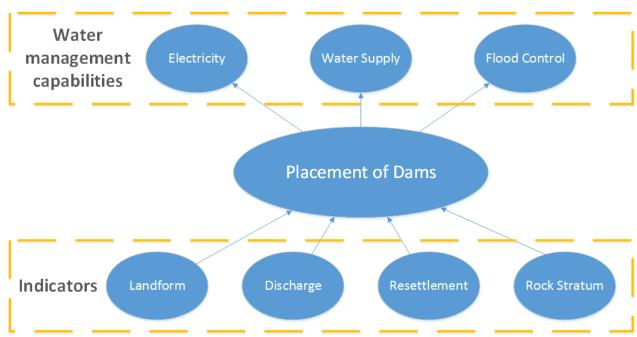
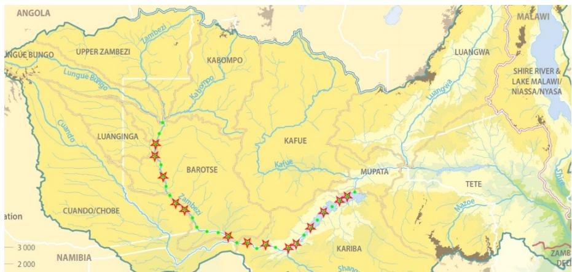
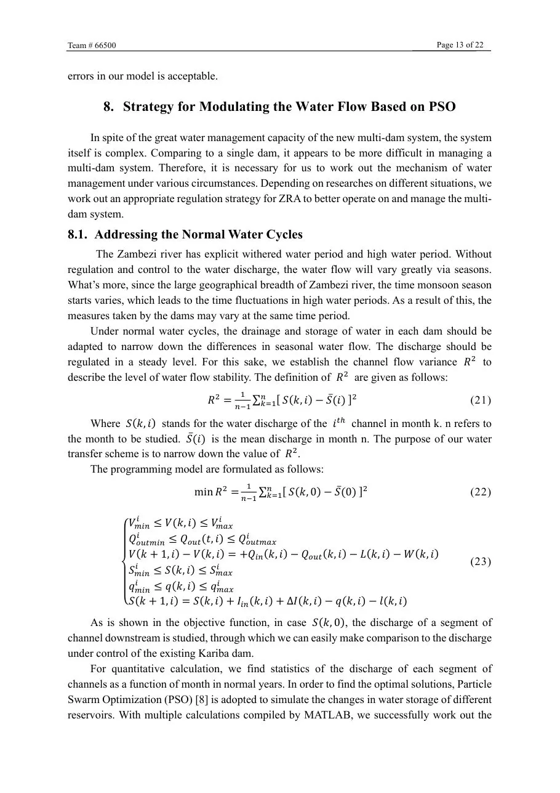
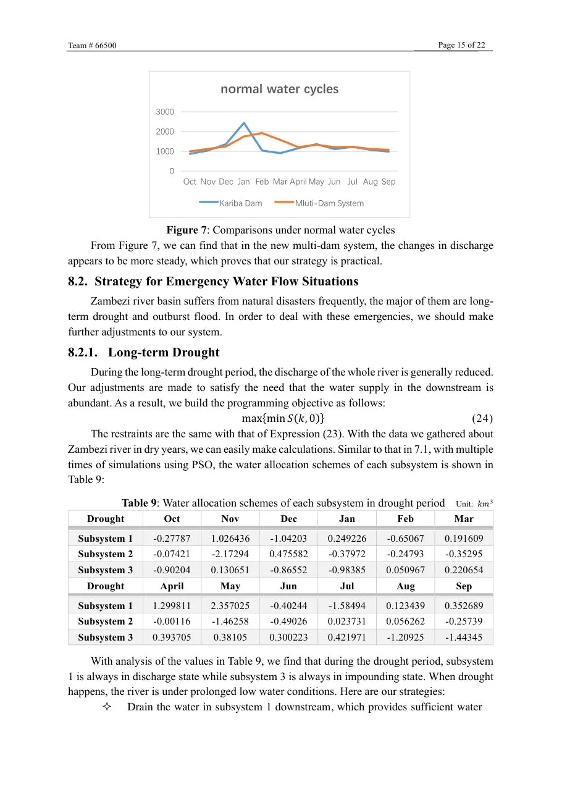
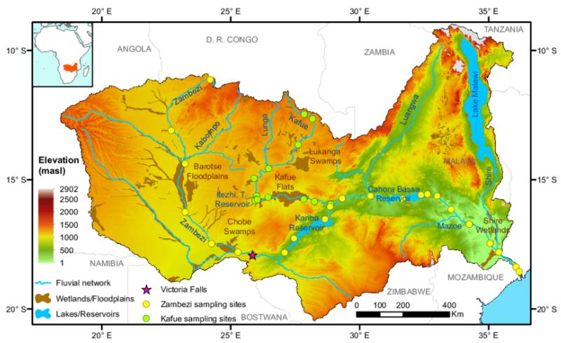
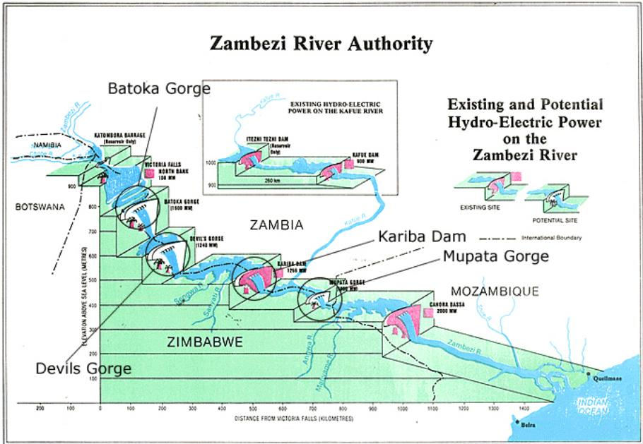
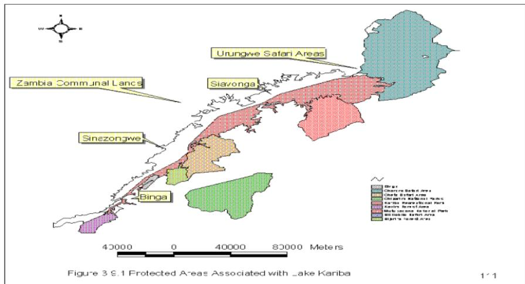

# 2017年美国大学生数学建模竞赛O奖论文（A题）：赞比西河联合管理

原件为竞赛论文。补充：文中的阅读练习及“参考解答”为整理时增加，原件图文保留出处。

## 摘要

### 摘要 1

**原文内容：**

Owing to the report put forward by the Institution of Risk Management of South Africa, the Kariba dam badly needs maintenance. The three options Zambezi River Authority provided might address the problem. Our modeling group make assessments to the three options and provides feasible plans to replace the former Kariba dam with several smaller dams. The requirements are satisfied in this paper.

With regard to requirement 1, we list factors of costs and benefits in advance. Then, we categorize potential cost into two parts, direct cost and indirect cost. With relative profiles, the two categories are quantized. However, the benefits of the three options can hardly be quantified. So we take advantage of fuzzy synthetic evaluation method and work out the relative levels of benefits in the three options. Finally, the return on investment (ROI) is calculated. Based on that, we can safely draw conclusion that option 1 is more economically efficient in a short period. But in the long term, option 3 appears to have more potential profits.

When it comes to requirement 2, we establish the water balance equation on both reservoirs and channels at the basis of analysis on water transference. Afterwards, we divide the water management capacities into 3 categorizes, the ability against flood, the ability for water supply and ability for electricity generation. Based on analysis to water management, the multi-dam system of versatile functions is proposed innovatively. Considering the actual factors in selecting dam sites, we screen out 29 possible locations. After then, the number and placement of the new dams is determined using optimization model. In order to lower the cost, we set our goal as the minimum number of dams. Along with the restraints of water balance equation and greater water management capacity, we complete optimization. As is shown in our results, 14 dams should be built as alternative to Kariba dam. Finally, error analysis is attached to our model.

For the sake that the new multi-dam system can function well under various circumstances, we set our system in three conditions, normal water circles, long-term drought and outburst flood. Particle swarm optimization (PSO) is adopted repeatedly to optimize the control of water discharge. Compare the result to the actual adjustments made by Kariba dam, we can conclude that the new multi-dam system can provide greater level of protection and water management options. Apart from this, we make thorough evaluations towards optimization scheme and distil general strategy in each condition. At last, we apply sensitivity analysis to conditions under long-term drought and outburst flood. The regulation limits are given under extreme conditions.

Last but not least, we take extreme disasters into consideration and use Monte Carlo method to make assessments. The result suggests the new system have a better resistance against disasters. Also, we list the overall strengths and weaknesses of our model as well as the further work.

Keywords: return on investment, water balance equation, particle swarm optimization, Monte Carlo method

- **参考解答**：该摘要清晰地阐述了论文的结构和主要结论。针对问题1，模型通过模糊综合评价法量化收益，计算投资回报率（ROI），得出短期选项1更优、长期选项3更有潜力的结论。针对问题2，建立了水库和水道的水平衡方程，将管理能力分为防洪、供水和发电三类，提出了多坝系统的创新方案。通过优化模型确定建设14座大坝以替代卡里巴大坝。在策略部分，利用粒子群优化（PSO）算法优化正常水文周期、长期干旱和突发洪水三种情况下的泄洪控制，并进行了敏感性分析和蒙特卡洛方法的风险评估。

- **知识点**：模糊综合评价, 投资回报率分析, 水平衡方程, 粒子群优化算法, 蒙特卡洛模拟

## 目录

知识点：[文献综述与研究背景撰写方法](../../../topics/数学建模/wenxian_zongshu.md)、[任务分解与目标明确](../../../topics/数学建模/renwu_fenjie.md)、[模型优缺点分析（Strengths and Weaknesses）](../../../topics/数学建模/youque_dian.md)

### 目录 1

**原文内容：**

1. Introduction......2
1.1. Background......2
1.2. Our Tasks......2
2. General Assumptions......3
3. Notions and Symbol Description......3
4. Maintenance, Reconstruction, or Multi-dams?......4
4.1. Potential cost of each option......4
4.2. Benefits of each option......5
4.3. ROI to each option......5
5. Establishment of Water Balance Equation......6
5.1. Reservoirs......6
5.2. Channels......7
6. Water management Capacity of Dam system......7
6.1. The Ability against Flood......8
6.2. The Ability to Provide Useful Water......8
6.3. The Ability to Generate Electricity......8
6.4. Water Management Capacity in Multi-Dam System......8
7. Where to Build the Dams?......8
7.1. Select Candidate Locations with Principles......9
7.2. Find the Optimal Solution based on Optimization Model......10
7.3. Result Analysis......12
7.4. Error analysis......12
8. Strategy for Modulating the Water Flow Based on PSO......13
8.1. Addressing the Normal Water Cycles......13
8.2. Strategy for Emergency Water Flow Situations......15
8.2.1. Long-term Drought......15
8.2.2. Outburst Flood......16
9. Sensitivity Analysis......18
9.1. Sensitivity to Long-Term Drought......18
9.2. Sensitivity to Outburst Flood......18
10. Estimation to the Resistance against Disasters of Multi-Dam System Based on Theory of Monte Carlo......19
11. Future Work......20
12. Strengths and Weaknesses......21
12.1. Strengths......21
12.2. Weaknesses......21
13. Conclusion......21
References & Appendix......23

- **补充**：此目录展示了论文的完整逻辑结构，从背景介绍、假设、符号说明，到具体的成本效益分析、水平衡方程建立、多坝系统选址优化、水流调控策略、敏感性分析及风险评估，最后总结优缺点和未来工作。这为理解整个建模过程提供了清晰的路线图。

- **知识点**：建模论文结构规范

## 1. Introduction

知识点：[数学建模的基本步骤（问题分析、模型假设、建立、求解、检验、推广）](../../../topics/数学建模/jianmo_buzhou.md)、[一般假设及其合理性说明（Assumptions and Justifications）](../../../topics/数学建模/jiaben_shezhi.md)、[模型参数的确定（基于数据拟合或实验选择）](../../../topics/数学建模/canshu_queding.md)

### 1.1. Background

#### 1.1.1. Summary to the Kariba Dam

The Kariba dam is a double curvature concrete arch dam locating between Zambia and Zimbabwe. It is a dam built upon Zambezi river in Kariba Gorge of the Zambezi river basin. The dam is huge with a size of 128 meters high and 579 meters long. Because of Kariba dam, the Lake Kariba is formed. Kariba Lake has 280 kilometers in length and holds 185 cubic kilometers volume of water.

The double curvature concrete arch dam was designed by Coyne et Bellier and constructed between 1955 and 1959 by Impresit of Italy at a cost of \$135,000,000 for the first stage with only the Kariba South power cavern. Because of political issues on the total cost of the dam, the whole construction is not completed until 1977.

#### 1.1.2. Hydrology of Zambezi River

With 2750 kilometers of total length, 135 square kilometers of catchment area and 16 thousand cubic kilometers per second of annual runoff, Zambezi river is the second largest river in Africa. Zambezi river has a large water system and many branches. The tributaries in separate sides have asymmetric developments. The channel upstream is narrow and flow rate there is slow. Some swamps are distributed along the river. When it comes to the midstream, the water runs through the valley and floodplains. The flowing speed depends mainly on the width of channel. In the lower reaches, the river flows through plains and slows down. The water supply in the downstream is abundant and the flow rate varies greatly with the precipitation. The downstream is the main part for transportation.

知识点：[文献综述与研究背景撰写方法](../../../topics/数学建模/wenxian_zongshu.md)、[一般假设及其合理性说明（Assumptions and Justifications）](../../../topics/数学建模/jiaben_shezhi.md)

### 1.2. Our Tasks

Since Kariba dam badly needs maintenance, the Zambezi River Authority puts forward three options, repairing the existing dam, rebuilding the existing dam and replacing Kariba dam with a series of smaller dams. What we should do is to make assessments to each option and provide detail information of option 3. Here are our tasks:

- Make evaluations to the three options in different aspects, including costs, time required, feasibility, capacity against natural disasters, functions served, etc. Details and specific reasons are attached to the assessments.

- Establish principles and models for selecting proper construction sites. Make analysis to the current situation of Zambezi river basin and determine the aspects to be considered.

- Build a model to estimate the capacity of the new multi-dam system. Make evaluations to the stability and capacity against extreme water flows and natural disasters. A guidance is about to provide for ZRA managers to justify the actions when handling emergencies.

- Make analysis and assessment of our models, find the strength and weakness of them and make future predictions.

## 2. General Assumptions

We make the following assumptions to complete our model through this paper. Further improvements of these simplified assumptions will be achieved later with more reliable data.

- Neglect the expansion and contraction of water. If not, it will make the solving process more complex. The changing in the volume of water caused by temperature has a limited influence on the results. Therefore, it is meaningless to introduce expansion and contraction into our system.

- The data we used in our models are reliable and accurate. Since the optimization to the problem and the strategy worked out are all based on the actual data.

- Zambezi river will either change its channel or dry up in a long period.

- The other existing dams in Zambezi river have no effects on the discussion in this paper. Without the interception of the other dams, the research can be simplified.

- Constructions of dams in multi-dam system are completed at the same time.

## 3. Notions and Symbol Description

We will define the following variables here as they are widely used throughout our paper. Additional variables may be defined later, but will be confined to a particular section.

| Symbols | Definitions | Symbols | Definitions |
|---|---|---|---|
| $C_d$ | direct cost | $S(t,i)$ | the storage of the $i^{th}$ channel |
| $C_i$ | indirect cost | $S_{min}^i$ | minimum channel storage |
| $C_p$ | potential cost | $S_{max}^i$ | maximum channel storage |
| ROI | Return on investment | $I_{in}(t,i)$ | water inflow from the upper channel |
| $V(t,i)$ | water storage capacity of $i^{th}$ reservoir | $\Delta I(t,i)$ | water imported from surrounding area |
| $V_{min}^i$ | dead storage of the $i^{th}$ reservoir | $l(t,i)$ | internal loss of water in channel |
| $V_{max}^i$ | maximum storage of the $i^{th}$ reservoir | $q(t,i)$ | discharge of water downstream |
| $V_{flood}$ | flood control capacity | $q_{max}^i$ | maximum discharge amount |
| $Q_{in}(t,i)$ | water inflow of the $i^{th}$ reservoir | $A_1$ | flood control capacity |
| $Q_{out}(t,i)$ | discharge of the $i^{th}$ reservoir | $A_2$ | water supply capacity |
| $L(t,i)$ | internal loss of reservoir | $A_3$ | generating capacity |
| $W(t,i)$ | water for external use | $R^2$ | channel flow variance |

## 4. Maintenance, Reconstruction, or Multi-dams?

Due to a report proposed by the Institute of Risk Management of South Africa in 2015, Kariba dam, which is located in the midstream of Zambezi river, is in dire need of maintenance. Owing to the urgent situation, the Zambezi River Authority puts forward mainly 3 options. Firstly, repairing the existing Kariba dam; Secondly, reconstruct Kariba dam; Thirdly, replace Kariba dam with a series of smaller dams along Zambezi river. In order to make specific assessments to the three options, firstly, we list the relevant factors of costs and benefits.

**Table 1: Relevant factors of costs and benefits**

| Cost | Benefit |
| :--- | :--- |
| **Static cost**: Labor force, Material, Equipment **Potential cost**: Refurbishment of associated projects, Loss of resource benefits, Inflation, Loan interests | Irrigation, Electricity generation, Flood control, Shipping |

Considering the upper elements, we have to quantify every factor to figure out the cost and benefits. However, the actual data can hardly be found. Therefore, we should study on the two parts separately.

知识点：[一般假设及其合理性说明（Assumptions and Justifications）](../../../topics/数学建模/jiaben_shezhi.md)、[符号说明与术语定义（Nomenclature / Symbols and Definitions）](../../../topics/数学建模/fuhao_shuoming.md)

### 4.1. Potential cost of each option

**Table 2: Costs for the Reconstruction of Kariba Dam**

| Item | Cost |
| :--- | :--- |
| Reconstruction of Kariba Dam | US$342 million |
| Maintenance of Kariba dam | US$220 million |
| Loss of water resource benefits during reconstruction | US$2031 million |

The values in table 2 [1] specifically states that repairing the Kariba dam requires 220 million dollars and rebuilding the Kariba dam requires 342 million dollars. We set these costs to be direct cost. The table also mentions extra loss during construction is 2031 million dollars, we set it to be indirect cost. The data does not reveal the indirect cost of repairing Kariba dam, but the profiles we gathered shows the time required is approximately 2 years, while time required for reconstruction is 10 years. Therefore, we can assume that the indirect cost of maintenance is $1/5$ of that of reconstruction, nearly 406.2 million dollars. With regard to the establishment of multiple dams, there are less data available. The direct cost of building 10 to 20 small dams is similar to the cost of rebuilding, but a shorter period for construction, nearly 4 years. Therefore, the direct cost of multi-dam system is 342 million dollars and the indirect cost is about 812.4 million dollars. We mark potential cost as $C_p$, direct cost as $C_d$ and indirect cost as $C_i$, so $C_p = C_d + C_i$.

According to the analysis we made above, we determine that the potential cost of option1 is 626.2 million dollars, the potential cost of option2 is 2373 million dollars and the potential cost of option3 is 1154.4 million dollars.

知识点：[模型参数的确定（基于数据拟合或实验选择）](../../../topics/数学建模/canshu_queding.md)、[一般假设及其合理性说明（Assumptions and Justifications）](../../../topics/数学建模/jiaben_shezhi.md)

### 4.2. Benefits of each option

The profiles do not provide specific values measuring the benefits of the three options. We decide to assess the three options with fuzzy synthetic evaluation method $[2]$. The steps are introduced as follows:

- Defining the set of factors

$$
U = \{\text{irrigation } u_1, \text{electricity generation } u_2, \text{flood control } u_3, \text{shipping } u_4\} \tag{1}
$$

- Defining the set of evaluation grades

$$
V = \{\text{excellent } v_1, \text{good } v_2, \text{average } v_3, \text{bad } v_4, \text{very bad } v_5\} \tag{2}
$$

- Endowing the weights to each factor

$$
A = \{0.2, 0.25, 0.35, 0.2\} \tag{3}
$$

Afterwards, we determine the fuzzy evaluation matrix $R_{1}, R_{2}$ and $R_{3}$. The results are shown below:

Option1: [0.18, 0.48, 0.315, 0.025, 0]; Grade is good

Option2: [0.2, 0.56, 0.228, 0.012, 0]; Grade is good

Option3: [0.23, 0.64, 0.13, 0, 0]; Grade is good

The grades of the three options are all good. For distinction, the weight of evaluation for good is selected as the grades measuring benefits. Therefore, the grades to the three options are 0.48, 0.56 and 0.515.

知识点：[TOPSIS 模型构建步骤（逼近理想解排序法）](../../../topics/数学建模/topsis_moxing.md)、[影响因素评估指标体系构建（温度、湿度、经济、教育等）](../../../topics/数学建模/yingxiang_zhibiao.md)

### 4.3. ROI to each option

With comprehensive consideration of the discuss in potential cost and benefits, we figure out the comparison between the three options. Mark the greatest as 1, the rest are scaled sown. The results are shown in Table 3:

**Table 3: Comparison of the three options regarding potential cost and benefits**

| | Option1 | Option2 | Option3 |
| :--- | :--- | :--- | :--- |
| Potential cost | 0.264 | 1 | 0.486 |
| Benefits | 0.75 | 0.875 | 1 |

With of help of the return on investment concept in economic, we can make the following definition:

$$
\mathrm{ROI} = \frac {\mathrm{Benefits}}{\mathrm{Potentialcost}} \tag{4}
$$

ROI of the three options are 2.84, 0.875 and 2.06. Therefore, at this stage, option 1 is of greater economic efficiency. However, in the long term, we can not determine the life span and efficiency after maintenance. As a result, what we can conclude is option 1 is more effective considering recent return on investment. If considering the tradeoff between cost and benefits, option 3 stands out.

## 5. 水量平衡方程的建立

为研究水资源管理能力，首先需要解决河流流量问题。我们将整条河流视为一条线，大坝将这条线分割为若干河段（渠道）与节点（水库）。输水过程中水量的变化可通过建立水库与渠道的水量平衡方程来计算 $[3]$。为方便起见，绘制如下示意图：

知识点：[符号说明与术语定义（Nomenclature / Symbols and Definitions）](../../../topics/数学建模/fuhao_shuoming.md)、[数学建模的基本步骤（问题分析、模型假设、建立、求解、检验、推广）](../../../topics/数学建模/jianmo_buzhou.md)

### 5.1 水库

水可以在大坝形成的水库中蓄积和储存。首先，记第 $i$ 个水库的蓄水量为 $V(t,i)$。于是水量平衡方程可表示为：

$$
V (t + 1, i) = V (t, i) + Q _ {i n} (t, i) - Q _ {o u t} (t, i) - L (t, i) - W (t, i)\tag{5}
$$

其中 $V(t+1,i)$ 与 $V(t,i)$ 分别表示 $t+1$ 时刻与 $t$ 时刻的蓄水量。$Q_{in}(t,i)$ 指第 $i$ 个水库来自上游的入流量。$Q_{out}(t,i)$ 表示第 $i$ 个水库向下游的下泄量。$Q_{ge}(t,i)$ 为下泄量中用于发电的部分，$O(t,i)$ 为其余直接排出的部分。$L(t,i)$ 为水库内部损失，其中大部分为蒸发与渗漏损失。$W(t,i)$ 表示外部用水量，包括农业、工业与生活用水。

由于水库规模与服务能力的限制，约束条件如下：

- 对 $V(t,i)$ 的约束

应保证蓄水量小于水库最大蓄水容积且大于死库容，表示如下：

$$
V _ {m i n} ^ {i} \leq V (t, i) \leq V _ {m a x} ^ {i}\tag{6}
$$

其中 $V_{min}^{i}$ 指死库容，$V_{max}^{i}$ 指最大蓄水容积。最大蓄水容积可分为两部分：$V_{max1}$ 表示正常情况下允许蓄存的最大水量，$V_{max2}$ 表示通过洪水调蓄可供使用的最大水量。因此，$V_{flood} = V_{max2} - V_{max1}$ 表示需要保留的防洪库容。

- 对 $Q_{out}(t,i)$ 的约束

下泄有两种方式：一是直接排水，称为泄流能力；二是发电过程中的下泄水，称为发电过流能力。对每种下泄方式，约束可表述如下：

$$
O (t, i) \leq O _ {m a x} ^ {i} (h)\tag{7}
$$

$$
Q _ {g e} (t, i) \leq O _ {g e m a x} ^ {i} (h)\tag{8}
$$

其中 $h$ 为水位，$O_{max}^{i}(h)$ 与 $O_{gemax}^{i}(h)$ 分别为第 $i$ 座大坝的最大泄流能力与最大发电过流能力，二者均与水位有关。

知识点：[数学建模的基本步骤（问题分析、模型假设、建立、求解、检验、推广）](../../../topics/数学建模/jianmo_buzhou.md)、[一般假设及其合理性说明（Assumptions and Justifications）](../../../topics/数学建模/jiaben_shezhi.md)、[模型参数的确定（基于数据拟合或实验选择）](../../../topics/数学建模/canshu_queding.md)

### 5.2 渠道

记第 $i$ 个渠道在 $t$ 时刻的蓄水量为 $S(t,i)$。第 $i$ 个渠道的水量平衡方程如下：

$$
S (t + 1, i) = S (t, i) + I _ {i n} (t, i) + \Delta I (t, i) - q (t, i) - l (t, i)\tag{9}
$$

其中 $I_{in}(t,i)$ 为来自上游渠道的入流量，$q(t,i)$ 指向下游的下泄量，$\Delta I(t,i)$ 为从周边区域引入的水量，$l(t,i)$ 为渠道内部水量损失。$\Delta I(t,i)$ 与 $l(t,i)$ 均与渠道的水文条件及长度有关。本文仅关注赞比西河上的渠道。

- 对 $q(t,i)$ 的约束

$$
S _ {m i n} ^ {i} \leq S (t, i) \leq S _ {m a x} ^ {i}\tag{10}
$$

其中 $S_{max}^{i}$ 为渠道最大蓄水量，$S_{min}^{i}$ 为防止渠道干涸的最小蓄水量。

- 对 $I_{out}(t, i)$ 的约束

$$
q (t, i) \leq q _ {m a x} ^ {i}\tag{11}
$$

其中 $q_{max}^{i}$ 为最大下泄量。

## 6. 大坝系统的水资源管理能力

根据 ZRA 提出的方案 3，应建立新的多坝系统以取代现有的卡里巴大坝。新建系统应优于现有大坝，或至少具有与卡里巴大坝相同的能力。为实现这一目标，首先需要明确水资源管理能力的含义。根据 ZRA 的相关资料 $[4][5]$，我们发现 ZRA 的主要任务是向大坝上的电站及其他用户分配水资源。因此，可将该任务重述为三点：

- 调节泄流能力以应对洪水等紧急情况。
- 调配水库蓄水以满足日常需求。
- 调节下泄能力以满足发电需求。

根据 4.1 节中的表达式 (1)，我们需要做的是改变其中一个变量的取值，以实现预期的水资源管理能力。

三种水资源管理能力依次记为 $A_{1}$（抗洪能力）、$A_{2}$（供水能力）、$A_{3}$（发电能力）。由于它们均与可控水量有关，可用相关的水量来表示这些能力。

# 2017年美国大学生数学建模竞赛O奖论文（A题）：赞比西河联合管理

## 一、多坝系统的水管理能力模型

知识点：[问题重述与分析（Problem Restatement and Analysis）](../../../topics/数学建模/wenti_chongshu.md)、[一般假设及其合理性说明（Assumptions and Justifications）](../../../topics/数学建模/jiaben_shezhi.md)、[模型优缺点分析（Strengths and Weaknesses）](../../../topics/数学建模/youque_dian.md)

### 章节 6.1 防洪能力

为了预防洪水，每个水库都会预留一定程度的水量以调节蓄水量。预留的空间越多，其防洪能力就越强。因此，防洪能力可以表示为如下公式：

$$
A_{1} = V_{max2} - V(t) = V_{flood} + V_{max1} - V(t)\tag{12}
$$

其中 $V(t)$ 指防洪前的蓄水量。

知识点：[问题重述与分析（Problem Restatement and Analysis）](../../../topics/数学建模/wenti_chongshu.md)、[数学建模的基本步骤（问题分析、模型假设、建立、求解、检验、推广）](../../../topics/数学建模/jianmo_buzhou.md)、[符号说明与术语定义（Nomenclature / Symbols and Definitions）](../../../topics/数学建模/fuhao_shuoming.md)

### 章节 6.2 供水能力

在这一部分，蓄水量用于农业、工业和居民生活用水。但剩余水量应大于死库容 $V_{min}$ 。供水能力陈述如下：

$$
A_{2} = W(t)\tag{13}
$$

知识点：[问题重述与分析（Problem Restatement and Analysis）](../../../topics/数学建模/wenti_chongshu.md)、[符号说明与术语定义（Nomenclature / Symbols and Definitions）](../../../topics/数学建模/fuhao_shuoming.md)、[模型参数的确定（基于数据拟合或实验选择）](../../../topics/数学建模/canshu_queding.md)

### 章节 6.3 发电能力

发电能力与用于发电的水量 $Q_{ge}(t)$ 成正比。发电能力可以用以下表达式表示：

$$
A_{3} = Q_{ge}(t)\tag{14}
$$

知识点：[符号说明与术语定义（Nomenclature / Symbols and Definitions）](../../../topics/数学建模/fuhao_shuoming.md)、[数学建模的基本步骤（问题分析、模型假设、建立、求解、检验、推广）](../../../topics/数学建模/jianmo_buzhou.md)

### 章节 6.4 多坝系统中的水管理能力

关于上述单坝系统的讨论，多坝系统的三种能力可以表述如下：

$$
A_{1}^{\prime} = \sum_{i=1}^{n} V_{max2}(i) - V(t, i)\tag{15}
$$

$$
A_{2}^{\prime} = \sum_{i=1}^{n} W(t, i)\tag{16}
$$

$$
A_{3}^{\prime} = \sum_{i=1}^{n} Q_{ge}(t, i)\tag{17}
$$

其中 $1 \leq i \leq n, 10 \leq n \leq 20$。

综上所述，为了满足新大坝系统应具有与现有卡里巴大坝相同整体水管理能力的任务要求，我们可以将约束条件归结为以下表达式：

$$
\left\{ \begin{array}{c} A_{1}^{\prime} \geq A_{1} \\ A_{2}^{\prime} \geq A_{2} \\ A_{3}^{\prime} \geq A_{3} \\ V(t+1, i) = V(t, i) + Q_{in}(t, i) - Q_{out}(t, i) - L(t, i) - W(t, i) \\ S(t+1, i) = S(t, i) + I_{in}(t, i) + \Delta I(t, i) - q(t, i) - l(t, i) \end{array} \right.\tag{18}
$$

上述表达式中的变量已经定义。我们设定 $0 \leq i \leq n$。$i = 0$ 指的是仅存在前卡里巴大坝的情况，在这种情况下，我们可以计算出 $A_{1}$ 、 $A_{2}$ 和 $A_{3}$ 的值。在情况 $1 \leq i \leq n$ 下，可以计算出 $A_{1}'$ 、 $A_{2}'$ 和 $A_{3}'$。

## 二、大坝选址分析

知识点：[任务分解与目标明确](../../../topics/数学建模/renwu_fenjie.md)、[模型参数的确定（基于数据拟合或实验选择）](../../../topics/数学建模/canshu_queding.md)

### 章节 7 在哪里建坝？

在第5节中，我们确定了水管理能力与泄水量之间的关系。然而，除了泄水量外，我们在建立多坝系统时还应考虑周围环境因素。当我们开始选择大坝位置时，有许多因素需要考虑。因此，我们将多坝系统的建立分为两部分：a) 选择可能的大坝着陆点（多于20个）；(b) 分析潜在位置的组合，使多坝系统的容量与现有的卡里巴大坝平衡。

根据我们收集的数据 [6]，我们主要采用4个指标进行选址。这四个指标是：泄流量、地形、移民安置和岩层。结合泄流量，选址原则如图2所示：

#### 小节 7.1 根据原则选择候选地点

我们收集了人口分布、地形和洪水频率的信息 [7]。具体数据附在附录中。之后，我们基于原则进行全面评估。我们选择了29个可能的地点，标记为1到29。我们的选择中也存在一些潜在的大坝（20是Batoka Gorge，23是Devil's Gorge）。这29个可能站点和卡里巴大坝的经纬度如下表所示：

**表4：可能站点的经纬度信息**

| 编号 | 纬度/经度 | 编号 | 纬度/经度 | 编号 | 纬度/经度 |
| :--- | :--- | :--- | :--- | :--- | :--- |
| 1 | 14.17°S, 23.20°E | 2 | 14.44°S, 23.17°E | 3 | 14.70°S, 23.05°E |
| 4 | 14.99°S, 22.96°E | 5 | 15.25°S, 22.97°E | 6 | 15.51°S, 23.08°E |
| 7 | 15.77°S, 23.18°E | 8 | 16.11°S, 23.26°E | 9 | 16.25°S, 23.24°E |
| 10 | 16.32°S, 23.29°E | 11 | 16.60°S, 23.50°E | 12 | 16.85°S, 23.83°E |
| 13 | 17.14°S, 24.05°E | 14 | 17.44°S, 24.22°E | 15 | 17.53°S, 24.59°E |
| 16 | 17.56°S, 24.97°E | 17 | 17.78°S, 25.26°E | 18 | 17.86°S, 25.52°E |
| 19 | 17.88°S, 25.85°E | 20 | 17.92°S, 26.13°E | 21 | 17.94°S, 26.39°E |
| 22 | 18.01°S, 26.77°E | 23 | 17.96°S, 27.95°E | 24 | 17.73°S, 27.22°E |
| 25 | 17.52°S, 27.38°E | 26 | 17.35°S, 27.60°E | 27 | 17.03°S, 27.80°E |
| 28 | 16.86°S, 28.07°E | 29 | 16.68°S, 28.36°E | Kariba Dam | 16.52°S, 28.76°E |

通过对可能站点的分析，我们发现地形可以分为三类：

- 维多利亚瀑布上游的高地，标记为区域A。
- 中游的陡峭地形，标记为区域B。
- Gwayi汇流处与卡里巴大坝之间的平原，标记为区域C。

由于地形的差异，所建大坝可以服务于不同的主要功能。洪水频繁袭击区域A，因此在此建造的大坝需要更大的 $V_{flood}$ 。区域B地势陡峭，有利于发电。此处大坝的蓄水量相对较小。区域C靠近人类活动区，因此该区域的大坝主要用于农业、工业和生活用水。因此，我们将赞比西河划分为三个领域：防洪、发电和供水。为了方便起见，它们依次缩写为子系统1、子系统2和子系统3，如下所示：

# 2017年美国大学生数学建模竞赛O奖论文（A题）：赞比西河联合管理

## 7.2. Find the Optimal Solution based on Optimization Model

我们需要在 29 个候选位置中建设 10 到 20 座水坝。因此，我们必须通过优化找到最佳解决方案。我们将优化目标设定为建设的水坝数量最小化。优化的约束条件包括水坝数量、水资源管理能力、水库蓄水量限制和河道蓄水量限制等。

根据上述讨论，优化模型可表述如下：

$$
\min \sum_{i = 0} ^ {29} X _ {i}\tag{19}
$$

$$
s. t. \left\{ \begin{array}{l} V (t + 1, i) = V (t, i) + Q _ {in} (t, i) - Q _ {out} (t, i) - L (t, i) - W (t, i) \\ S (t + 1, i) = S (t, i) + I _ {in} (t, i) + \Delta I (t, i) - q (t, i) - l (t, i) \\ \sum_ {i = 1} ^ {n} [ V _ {max2} (i) - V (t, i) ] \cdot X _ {i} \geq A _ {1} \\ \sum_ {i = 1} ^ {n} W (t, i) \cdot X _ {i} \geq A _ {2} \\ \sum_ {i = 1} ^ {n} Q _ {ge} (t, i) \cdot X _ {i} \geq A _ {3} \\ X _ {i} V _ {min} ^ {i} \leq X _ {i} V (t, i) \leq X _ {i} V _ {max} ^ {i} \\ 10 \leq \sum_ {i = 0} ^ {29} X _ {i} \leq 20 \\ X _ {i} = 0 \text{ or } 1 \end{array} \right.\tag{20}
$$

其中 $X_{i}$ 是一个 0-1 变量。如果 $X_{i} = 1$，则选择位置 $i$ 建造水坝。如果 $X_{i} = 0$，则表示相反情况。此外，$0 \leq i \leq 29$。其余参数在第 5.1 和 5.2 节中介绍。

为了进行定量规划，我们收集了与水坝建设相关的资料。结合卡里巴大坝（Kariba dam）的数据进行综合考量，我们合理地将水坝设计为三个子系统。相关参数如表 5 所示：

知识点：[问题重述与分析（Problem Restatement and Analysis）](../../../topics/数学建模/wenti_chongshu.md)、[任务分解与目标明确](../../../topics/数学建模/renwu_fenjie.md)、[多目标优化模型（药物相对充足阶段的配送策略）](../../../topics/数学建模/duo_mubiao_youhua.md)

### Table 5: Parameters of dams in subsystems

| | $W/m^3$ | $\overline{V}/km^3$ | $V_{min}/km^3$ | $V_{max}/km^3$ |
| :--- | :--- | :--- | :--- | :--- |
| Dam in Subsystem 1 | $0.06 \times 10^6$ | 12.2 | 7.4 | 20 |
| Dam in Subsystem 2 | $0.15 \times 10^6$ | 11.6 | 4.4 | 13.2 |
| Dam in Subsystem 3 | $0.376 \times 10^6$ | 11.2 | 8 | 15 |
| Kariba Dam | $3 \times 10^6$ | 115.8 | 51 | 180.6 |

其中 $W$ 是可调节水量，$\bar{V}$ 是平均容量，$V_{min}$ 是最小蓄水量，$V_{max}$ 是最大容量。目标区域的流量相关数据如下表所示：

知识点：[一般假设及其合理性说明（Assumptions and Justifications）](../../../topics/数学建模/jiaben_shezhi.md)、[模型参数的确定（基于数据拟合或实验选择）](../../../topics/数学建模/canshu_queding.md)、[参数合理性验证](../../../topics/数学建模/canshu_heli_xing.md)

### Table 6: Discharge in target areas ($m^3/s$)

| Sub basin | Discharge in Sub basin | Total water discharge so far |
| :--- | :--- | :--- |
| Lungue Bungo | 114 | 1129 |
| Luanginga | 69.4 | 1198 |
| Kwando/Chobe | 0 | 1198 |
| Barotse | -17.6 | 1180 |
| Kariba | 206 | 1386 |

对于每种 $X_{i}$ 的组合，我们使用 MATLAB 模拟每个阶段的水量，以确定水资源管理能力是否达到标准。下面的流程图描述了我们的算法：

**Step 1:** Initialize n to 0

**Step 2:** Go through $x_{i}$ and find every combination satisfying the sum of $x_{i}$ is n

**Step 3:** Initialize $V(t, i)$, $Q_{in}(t, 1)$, $L(t, i)$ and $\Delta I(t, i)$, $l(t, i)$ and calculate relative $V(t + 1, i)$, $Q_{out}(t, i)$, $W(t, i)$ with water balance equation

**Step 4:** Figure out $A_{1}^{\prime}, A_{2}^{\prime}$ and $A_{3}^{\prime}$ and make comparison with $A_{1}, A_{2}$ and $A_{3}$ to ensure that the overall capacity of the new multi-dam is greater than Kariba dam

**Step 5:** According to the result of comparison, if accepted, print out the relative combination of $x_{i}$ and n, end. If rejected, $n = n + 1$, go to Step 2

## 7.3. Result Analysis

通过 MATLAB 编译，我们可以找到建造水坝的最佳位置。这里需要建造 14 座水坝，它们的代码分别是 3, 4, 6, 9, 10, 15, 17, 19, 21, 22, 24, 26, 28, 29。它们在图 5 所示的地图上标记出来：

由于结果是在水资源管理能力的约束下得出的，我们可以安全地得出结论：新多坝系统的整体水资源管理能力大于现有的卡里巴大坝。

## 7.4. Error analysis

为了证明我们模型的准确性，我们将数据更新至 2008 年。我们计算卡里巴大坝下游的流量，并与统计数据进行比较以完成误差分析。我们收集了 12 个月的实际数据，结果如下表所示：

知识点：[模型参数的确定（基于数据拟合或实验选择）](../../../topics/数学建模/canshu_queding.md)、[动态规划求解（状态变量、决策变量、状态转移函数、值函数）](../../../topics/数学建模/dongtai_guihua.md)、[问题重述与分析（Problem Restatement and Analysis）](../../../topics/数学建模/wenti_chongshu.md)

### Table 7: Error analysis of model 1

| Month | Actual value | Estimate value | Absolute error | Fractional error |
| :--- | :--- | :--- | :--- | :--- |
| Jan | 2436.8 | 2529.1 | 92.3 | 3.79% |
| Feb | 1042.2 | 1124.2 | 82 | 7.87% |
| Mar | 905.8 | 1001.6 | 95.8 | 10.58% |
| April | 1162.7 | 1243.6 | 80.9 | 6.96% |
| May | 1368.8 | 1426.1 | 57.3 | 4.19% |
| Jun | 1111.2 | 1011.45 | 99.75 | 8.98% |
| Jul | 1228.6 | 1312.1 | 83.5 | 6.80% |
| Aug | 1075.5 | 1111.7 | 36.2 | 3.37% |
| Sep | 981.9 | 991.4 | 9.5 | 0.97% |
| Oct | 875.9 | 901.2 | 25.3 | 2.89% |
| Nov | 1047.9 | 951.6 | 96.3 | 9.19% |
| Dec | 1364.4 | 1400.6 | 36.2 | 2.65% |

根据表 7 的最后两列，我们发现最大误差为 $10.58\%$，平均误差为 $5.68\%$。在我们看来，误差可能源于实际数据中缺乏蒸发和渗透数据。因此，我们可以安全地得出结论……

# 2017年美国大学生数学建模竞赛O奖论文（A题）：赞比西河联合管理

本文档整理自《2017年美国大学生数学建模竞赛O奖论文（A题）：赞比西河联合管理》习题部分第7部分（共12部分），由识别工具读取第14–15页内容整理而成。

## 一、策略制定与模型构建

知识点：[数学建模的基本步骤（问题分析、模型假设、建立、求解、检验、推广）](../../../topics/数学建模/jianmo_buzhou.md)、[模型参数的确定（基于数据拟合或实验选择）](../../../topics/数学建模/canshu_queding.md)、[模型优缺点分析（Strengths and Weaknesses）](../../../topics/数学建模/youque_dian.md)

### 简答 1

基于PSO的水流调控策略

尽管新的多坝系统具有强大的水资源管理能力，但该系统本身非常复杂。与单座大坝相比，管理多坝系统似乎更加困难。因此，有必要研究不同情况下的水资源管理机制。根据不同情境的研究，我们为赞比西河区域（ZRA）制定了一套合适的调节策略，以更好地运营和管理多坝系统。

知识点：[粒子群优化算法（PSO, Particle Swarm Optimization）](../../../topics/数学建模/lizi_qun_youhua.md)

### 简答 2

应对正常水文周期

赞比西河有明显的枯水期和丰水期。如果不进行调控，水流将随季节发生巨大变化。此外，由于赞比西河流域广阔，季风季节开始的时间各不相同，这导致丰水期的时间波动。因此，大坝在同一时期采取的措施可能有所不同。

在正常水文周期下，各大坝的排水和蓄水应适应于缩小季节性水流差异。排放应保持在一个稳定的水平。为此，我们建立渠道流量方差 $R^{2}$ 来描述水流稳定性的水平。$R^{2}$ 的定义如下：

$$
R ^ {2} = \frac {1}{n - 1} \sum_ {k = 1} ^ {n} [ S (k, i) - \bar {S} (i) ] ^ {2}\tag{21}
$$

其中 $S(k,i)$ 表示第 $i$ 条渠道在第 $k$ 个月的水排放量。$n$ 指被研究的月份数。$\bar{S}(i)$ 是第 $n$ 个月的平均排放量。我们的水传输方案的目的就是缩小 $R^{2}$ 的值。

编程模型 formulation 如下：

$$
\min R ^ {2} = \frac {1}{n - 1} \sum_ {k = 1} ^ {n} [ S (k, 0) - \bar {S} (0) ] ^ {2}\tag{22}
$$

$$
\left\{ \begin{array}{l} V _ {m i n} ^ {i} \leq V (k, i) \leq V _ {m a x} ^ {i} \\ Q _ {o u t m i n} ^ {i} \leq Q _ {o u t} (t, i) \leq Q _ {o u t m a x} ^ {i} \\ V (k + 1, i) - V (k, i) = + Q _ {i n} (k, i) - Q _ {o u t} (k, i) - L (k, i) - W (k, i) \\ S _ {m i n} ^ {i} \leq S (k, i) \leq S _ {m a x} ^ {i} \\ q _ {m i n} ^ {i} \leq q (k, i) \leq q _ {m a x} ^ {i} \\ S (k + 1, i) = S (k, i) + I _ {i n} (k, i) + \Delta I (k, i) - q (k, i) - l (k, i) \end{array} \right.\tag{23}
$$

如目标函数所示，针对下游某段渠道的排放 $S(k,0)$ 进行研究，通过它可以很容易地与现有卡里巴大坝控制下的排放进行比较。

为了进行定量计算，我们统计了正常年份各段渠道流量作为月份函数的统计数据。为了找到最优解，采用粒子群优化（PSO）[8] 来模拟不同水库储量的变化。通过 MATLAB 编译的多次计算，我们成功得出了相对较好的调整方案。适应度函数曲线如图6所示。

 适应度函数曲线

知识点：[粒子群优化算法（PSO, Particle Swarm Optimization）](../../../topics/数学建模/lizi_qun_youhua.md)、[多目标优化模型（药物相对充足阶段的配送策略）](../../../topics/数学建模/duo_mubiao_youhua.md)

### 简答 3

子系统水量分配方案

三个子系统的水量分配方案列于表8：

Table 8: Water allocation scheme of subsystems in normal years Unit: $km^3$

| Month | Oct | Nov | Dec | Jan | Feb | Mar |
| :--- | :--- | :--- | :--- | :--- | :--- | :--- |
| Subsystem 1 | -0.09476 | -0.09083 | -0.10001 | -0.09535 | 0.062192 | 0.062201 |
| Subsystem 2 | 0.001557 | -0.00644 | -0.00673 | -0.01244 | 0.055984 | 0.055952 |
| Subsystem 3 | -0.0585 | -0.05369 | -0.0446 | -0.05871 | 0.049746 | 0.049742 |

| Month | April | May | Jun | Jul | Aug | Sep |
| :--- | :--- | :--- | :--- | :--- | :--- | :--- |
| Subsystem 1 | 0.060934 | 0.058666 | 0.060161 | -0.09978 | -0.09523 | -0.09389 |
| Subsystem 2 | 0.05598 | 0.049408 | 0.051366 | -0.00733 | -0.01196 | -0.00999 |
| Subsystem 3 | 0.048205 | 0.049725 | 0.048489 | -0.04715 | -0.04637 | -0.05335 |

表8中的值代表水库每月储量的方差。例如，-0.09476 意味着子系统1必须在10月减少 0.09476 的水储量。换句话说，这里的净水排放量为 $0.09476 \, km^3$ 。值得注意的是，定量计算的数据是在正常年份收集的。在处理特定年份时，即使没有极端情况，也不能直接将表8中显示的值付诸实践。然而，在正常水文周期下给出了暂定处理方案。水库应在7月、8月、9月、10月、11月、12月和1月蓄水。在其他月份，应减少水库储量。

新多坝系统与卡里巴大坝之间的调整比较如图7所示：

 新多坝系统与卡里巴大坝的调整比较

## 8.2. Strategy for Emergency Water Flow Situations

Zambezi river basin suffers from natural disasters frequently, the major of them are long-term drought and outburst flood. In order to deal with these emergencies, we should make further adjustments to our system.

知识点：[物资配送与制造速度模型（药物每日需求与总量计算）](../../../topics/数学建模/wuzi_peisong.md)、[多目标优化模型（药物相对充足阶段的配送策略）](../../../topics/数学建模/duo_mubiao_youhua.md)

### 8.2.1. Long-term Drought

During the long-term drought period, the discharge of the whole river is generally reduced. Our adjustments are made to satisfy the need that the water supply in the downstream is abundant. As a result, we build the programming objective as follows:

$$
\max \{\min S (k, 0) \}\tag{24}
$$

The restraints are the same with that of Expression (23). With the data we gathered about Zambezi river in dry years, we can easily make calculations. Similar to that in 7.1, with multiple times of simulations using PSO, the water allocation schemes of each subsystem is shown in Table 9:

**Table 9: Water allocation schemes of each subsystem in drought period** Unit: $km^{3}$

| Drought | Oct | Nov | Dec | Jan | Feb | Mar |
| :--- | :--- | :--- | :--- | :--- | :--- | :--- |
| Subsystem 1 | -0.27787 | 1.026436 | -1.04203 | 0.249226 | -0.65067 | 0.191609 |
| Subsystem 2 | -0.07421 | -2.17294 | 0.475582 | -0.37972 | -0.24793 | -0.35295 |
| Subsystem 3 | -0.90204 | 0.130651 | -0.86552 | -0.98385 | 0.050967 | 0.220654 |

| Drought | April | May | Jun | Jul | Aug | Sep |
| :--- | :--- | :--- | :--- | :--- | :--- | :--- |
| Subsystem 1 | 1.299811 | 2.357025 | -0.40244 | -1.58494 | 0.123439 | 0.352689 |
| Subsystem 2 | -0.00116 | -1.46258 | -0.49026 | 0.023731 | 0.056262 | -0.25739 |
| Subsystem 3 | 0.393705 | 0.38105 | 0.300223 | 0.421971 | -1.20925 | -1.44345 |

With analysis of the values in Table 9, we find that during the drought period, subsystem 1 is always in discharge state while subsystem 3 is always in impounding state. When drought happens, the river is under prolonged low water conditions. Here are our strategies:

*   Drain the water in subsystem 1 downstream, which provides sufficient water for electricity generation in subsystem 2.
*   Subsystem 3 should manage to store water to meet the needs of water supply downstream. At the meantime, the water level downstream is kept in certain state to satisfy the shipping requirements.

With Comparison of the water management results under the circumstance of multi-dam system and Kariba dam, we can depict the differences in the following chart:

As is shown in Figure 8, we can safely draw the conclusion that the multi-dam system has a better water management capacity under drought conditions over that of Kariba dam. What's more, the results indicate that when facing with long-term drought, the multi-dam system holds enough water to survive the drought periods.

知识点：[POC（包含概率）更新算法确定搜索模式](../../../topics/数学建模/poc_gengxin.md)、[粒子群优化算法（PSO, Particle Swarm Optimization）](../../../topics/数学建模/lizi_qun_youhua.md)、[模型验证方法概述（随机模型与确定性模型验证）](../../../topics/数学建模/moxing_yanzheng.md)

### 8.2.2. Outburst Flood

When it comes to outburst flood upstream, the discharge of the following channels will meet a sudden rise. If one segment of channels holds water more than its channel storage capacity, the water will spill out and results to the extension of flood-affected areas. Therefore, the water in channels should be reduced to prevent water form spilling out and finally diminish the chance of destructive flood. As a result, the programming objective is stated as follows:

$$
\min \{\max S (k, 0) \}\tag{25}
$$

The restraints are the same with that in 7.1. We bring the historical data related to flooding into our model and make multiple calculations with the help of PSO. The results are shown in Table 10:

**Table 10: Water allocation schemes of each subsystem in flooding period** Unit: $km^{3}$

| Flooding | Oct | Nov | Dec | Jan | Feb | Mar |
| :--- | :--- | :--- | :--- | :--- | :--- | :--- |
| Subsystem 1 | 1.835305 | 3.04317 | 1.9973 | 3.626824 | 3.837354 | 3.491875 |
| Subsystem 2 | -0.50768 | -0.8993 | 1.028984 | -0.20848 | 0.832249 | 1.573858 |
| Subsystem 3 | 0.791538 | -0.06238 | 0.148498 | 1.03733 | 3.084586 | 3.713995 |

| Flooding | April | May | Jun | Jul | Aug | Sep |
| :--- | :--- | :--- | :--- | :--- | :--- | :--- |
| Subsystem 1 | 5.391049 | 5.664352 | 5.628686 | 1.062068 | 0.740065 | 2.635967 |
| Subsystem 2 | 1.5882 | 0.417108 | -1.76944 | -0.04835 | -0.60331 | -0.3279 |
| Subsystem 3 | 2.946934 | 3.021101 | 2.829153 | 2.481431 | 2.735348 | 0.025019 |

Table 10 shows that when flood reaches, Subsystem 1 needs to keep storing water to decrease the direct discharge of flood so that reduce the stress of the following dams. Subsystem 2 should drain water in advance to receive the redundant water which can not be stored by subsystem 1. Also, dams in subsystem 3 should take advantage of storage capacities to diminish the water pulled downstream.

The comparison of water management capacity between multi-dam system and Kariba dam is plotted as follows:

As is depicted in Figure 9, under the control of multiple dams, the effects caused by flood are comparatively smaller, and the flood peak is lower. Therefore, we can draw the conclusion that multi-dam system can significantly reduce the loss caused by flood and waterlog.

The strategy introduced above demonstrates that when flood happens, we should take full consideration of the storage capacity of dams to partake the strass in channels. Apart from this, in more detail, we can make full use of channel storage capacity to control the flood. The multi-dam system actually conducive to this. The strategy is specifically discussed as follows:

*   When the flood comes, the first dam makes full use of its storage to store the flood. At the meantime, the following dams quickly drain water downstream to lower the water level itself and that of the upper channels.
*   While water level of the first dam reaches its warning line, water in the first dam should be quickly pulled down to the sequential dams. At this point, the second dam stops draining water and utilize both the storage itself and the storage capacity of the upper channels.
*   So as follow. Make full use of every storage capacity of both dams and channels to control the flood. With this strategy, the entire system can deal with more serious flood.

Our strategy is depicted in the following graphs:

## 9. Sensitivity Analysis

In this part, based on the actual data, we manually increase the severity of drought and flood and analyze the changes in water downstream after the system regulation.

## 9.1. Sensitivity to Long-Term Drought

We decrease the actual data on water discharge during drought period. The decreasement are $100 \, m/s^{2}$, $150 \, m/s^{2}$ and $200 \, m/s^{2}$. The changes in the water discharge downstream is depicted in the following figure:

As is shown in Figure 11, we find that if we increase the severity of drought, the water discharge is lowered. What should be mentioned there is there is a sharp change when decreasing water discharge from $100 \, m/s^{2}$ to $150 \, m/s^{2}$, which means that the decreasement of $150 \, m/s^{2}$ is approaching the limits when facing with long-term drought.

## 9.2. Sensitivity to Outburst Flood

We increase the actual data on water discharge during flood period. The incensement here are $100 \, m/s^{2}$, $200 \, m/s^{2}$ and $300 \, m/s^{2}$. The changes in the water discharge downstream is represented as follows:

As is shown in Figure 12, with the increase in flood, the water discharge downstream rises sharply and quickly reaches the maximum of channel storage capacity. In conclusion, when approaching the limit of maximum water treatment, our model is comparatively sensitive.

## 10. Estimation to the Resistance against Disasters of Multi-Dam System Based on Theory of Monte Carlo

Owing to the fact that earthquakes and flood frequently hit Zambezi river basin, we make estimations to resistance against disasters of both the Kariba dam and the multi-dam system.

Since the existence of disaster is normally unpredictable and lack of regular patterns, we can hardly adopt analytic method to estimate the resistance against disasters. The Monte Carlo method makes use of a random number generator to simulate the happen of a disaster through either direct or indirect sampling. The probability of occurrence of disasters is determined through the historical data on the frequency and severity of the target disaster. After repeating independent sampling for times, we can simulate a similar situation. The practice has showed that after 50 to 300 times of simulations, the distributions function could always be determined convergence [9].

Assuming that the probability of occurrence of disaster t is $P(t)$, relatively, the probability of dam collapse is marked as $P(y)$. Therefore, the risk rate of dam when facing with disasters can be represented as follows:

$$
P_{v} = P(t) \cdot P(y) \tag{26}
$$

According to historical data, parameter can be given as follows:

Table 11: Parameters in determining risk rate of dam when facing with earthquake

Table 12: Parameters in determining risk rate of dam when facing with flood

| Earthquake | Under magnitude 3 | Magnitude 4-5 | Magnitude 6-7 | Magnitude 8-9 | Above magnitude 9 |
| --- | --- | --- | --- | --- | --- |
| Probability of occurrence | 54.40% | 39.5% | 5% | 1% | 0.10% |
| Damage to dam | 0 | 0 | 20% | 80% | 100% |
| Flood | 1 in 1-year | 1 in 10-year | 1 in 100-year | 1 in 1000-year | 1 in 10000-year |
| Probability of occurrence | 67.90% | 25% | 6% | 1% | 0.01% |
| Damage to dam | 0 | 0 | 3% | 10% | 30% |

The subsystems we designed distribute in three separate regions. The earthquake can only cause damage to one of the three regions. Also, when serious flood comes, the subsystem upstream can provide alarms to subsystem in midstream. When the dams in subsystem 1 are damaged by flood, the dams in the midstream could quickly drain water to lower the loss. Base on the analysis and data collected, we simulate the situation when disaster comes with the help of MATLAB. The results are shown as follows:

As is shown in Figure 13, after 1000 times of independent sampling, the red dots represent the damage to Kariba dam caused by earthquakes and Flood. The blue stars represent the damage to the new multi-dam system caused by disasters. From the results, we can safely draw the conclusion that the damage caused by earthquakes is more severe than that of Flood. Since the multi-dam system is more flexible in controlling water storage, the overall resistance against natural disasters is obviously better than the existing Kariba dam.

## 11. Future Work

Since the limitations on time and data, there are several factors missed in our model. In the near future, we will make the following adjustments:

- Make estimations to the effects on ecosystem. Since Zambezi river basin is rich in biodiversity, the constructions cannot avoid impacts on the living species. How to limit the influences on local species should be taken into consideration.
- Reschedule the locations of some dams. Some countries are in bad needs of benefits of dams. The layout of multi-dam system may also be changed according to specific needs of certain countries.
- The sewage regulation capacity should be considered. Owing to the fact that there are many factories along Zambezi river and the pollution problem generally draws people's attention, the multi-dam system should have a better sewage regulation capacity to meet the needs of sustainable development.

## 12. Strengths and Weaknesses

知识点：[一般假设及其合理性说明（Assumptions and Justifications）](../../../topics/数学建模/jiaben_shezhi.md)、[多重网络/多层网络构建（Multiplex/Multi-layer Network）](../../../topics/数学建模/duoceng_wangluo.md)、[确定模型的定点与稳定性分析](../../../topics/数学建模/dingdian_wending.md)

### 12.1 Strengths

- Our strategy has a better overall capability than the existing dam. No matter what situation the multi-dam system is facing with, the overall water management capacity is prior to that of the existing Kariba dam, as is shown in section 7.

- We take extreme water conditions into consideration. We provide detailed guidance to ZRA managers handling long-term drought and outburst flood. Graphs are also provided in this paper.

- Our model is practical and reliable. We do sensitivity analysis and error analysis to test the accuracy of our model. Based on the outcomes, we safely draw the conclusion that the simulation in our model fits the actual situations.

知识点：[模型优缺点分析（Strengths and Weaknesses）](../../../topics/数学建模/youque_dian.md)、[敏感性分析方法（Sensitivity Analysis，单参数与多参数变动）](../../../topics/数学建模/minganxing_fenxi.md)、[模型验证方法概述（随机模型与确定性模型验证）](../../../topics/数学建模/moxing_yanzheng.md)

### 12.2 Weaknesses

- The data we obtained is limited. Because the time limit, we are unable to search for more comprehensive data. Therefore, our research is restricted in comparatively smaller range.

- We neglect some aspects that plays a role in site selection. For example, ecology is also crucial in determining the locations. The construction may lead to some extinctions of local species. What's more, human resettlement and influences related to it should also be taken into consideration.

## 13. Conclusion

In response to the report that alarms the maintenance of Kariba dam, ZRA are in favor of three options, including repairing the existing dam, rebuilding Kariba dam and replacing Kariba dam with a series of smaller dams. We follow the requirements put forward by ZRA and several efforts are made towards this.

Firstly, we briefly make assessments to the 3 options. Both the costs and benefits are analyzed in detail. ROI is adopted in this paper to measure the benefits. Also, specific data are provided in this section and a reasonable method is introduced.

Secondly, for the prerequisite, we establish the water balance equations of both reservoirs and channels. Formulas are given orderly in section 5. Followed by this, the water management capacity is measured in section 6, with the establishment of optimization model. The water management is specifically categorized into 3 parts, the ability against flood, the ability for water supply and the ability for electricity generation.

Thirdly, we choose the appropriate locations to build dams. First of all, we select 29 candidate sites and provide their accurate locations in longitude and latitude. Then, specific parameters of dams in our multi-dam system is given. Since different sub basins have different characteristics, the dams built there serve different major functions. Therefore, the multi-dam system can be divided into 3 subsystems, one for flood control, one for electricity generation and the rest one is designed for water supply. Finally, we determine 14 locations to build dams.

In the following part, we investigate into the newly build multi-dam system and specifically provide strategies under various circumstances. Firstly, we address the normal water cycle. Afterwards, extreme conditions are taken into consideration. Both long-term drought and outburst flood are included. We provide strategies when facing with such emergencies in detail. What's more, guidance is provided for ZRA managers that explains the actions and managements should be taken to deal with emergency water flows. Additionally, comparisons between multi-dam system and Kariba dam are provided.

Last but not least, sensitivity analysis and error analysis are attached to our model. We predict our future works and specifically state the merits and shortcomings.

## References

[1] L. Gottschalk, Hydrological extremes, 1st ed. Wallingford: IAHS, 1999.

[2] S. Si and Z. Sun, Mathematical Modeling Algorithms and Applications, 2nd ed. Beijing: National Defense Industry Press, 2016.

[3] Z. Wang, "Study on Dispatching of Water Quality and Quantity in Gate Dam Group on Shaying River", HYDROCHINA Xibei Engineering Corporation, Xi'an, vol. 1006-2610201401-0001-06, no. 1, 2014.

[4] UNEP-IETC, Planning and Management of Lakes and Reservoirs: An Integrated Approach to Eutrophication, 1st ed. Newsletter and Technical Publications, 1999.

[5] "Zambezi River Authority", En.wikipedia.org. [Online]. Available: https://en.wikipedia.org/wiki/Zambezi_River_Authority. (Accessed: 23-Jan-2017).

[6] J. Mou, "Expert system for selection of dam site: Introduction to site selector (DDS)", China Academic Journal Electronic Publishing House, pp. 15-17.

[7] V. Alavian, M. Wishart, L. Croneborg, R. Dankova, K. Kim and L. Pierre-Charles, The Zambezi River basin, 1st ed. Washington, DC: The Wolrd Bank, Water Resources Management, Africa Region, 2010.

[8] S Yu, Analysis and Applications of Optimization with Matlab, 1st ed. Beijing: Tsinghua University Press, 2014.

[9] R. Jiao, "Study on multi objective risk analysis model and application of reservoir flood control", master, Zhengzhou University, 2004.

## Appendix

知识点：[模型优缺点分析（Strengths and Weaknesses）](../../../topics/数学建模/youque_dian.md)、[数学建模的基本步骤（问题分析、模型假设、建立、求解、检验、推广）](../../../topics/数学建模/jianmo_buzhou.md)、[模型参数的确定（基于数据拟合或实验选择）](../../../topics/数学建模/canshu_queding.md)

### ④ Constraint function

# 2017年美国大学生数学建模竞赛O奖论文（A题）：赞比西河联合管理

本部分整理自《2017年美国大学生数学建模竞赛O奖论文（A题）》第31–33页数据表格，包含各子流域径流量及不同区域、不同情景下的年径流月度分布。识别过程中已修正明显的断行错误（如 Kariba unregulated 中的小数点错位），并合并了被拆分的水文数据表。

## 一、子流域径流量统计

下表展示了各子流域的径流量（Discharge in Sub）与累计总径流量（Total water discharge）。

| Sub basin | Discharge in Sub | Total water discharge |
| :--- | :--- | :--- |
| Kambompo | 273 | 273 |
| Upper Zambezi | 742 | 1015 |
| Lungue Bungo | 114 | 1129 |
| Luanginga | 69.4 | 1198 |
| Kwando/Chobe | 0 | 1198 |
| Baotse | -17.6 | 1180 |
| Kariba | 206 | 1386 |
| Kafue | 372 | 1758 |
| Mupata | 54 | 1812 |
| Luangwa | 518 | 1330 |
| Tete | 1193 | 3523 |
| Shire and Lake | 498 | 4021 |
| Zambezi Delta | 113 | 4134 |

*注：Baotse 子流域显示为负值（-17.6），可能代表该区域存在地下水抽取或蒸发量大于补给量的净损失；Luangwa 的累计总量低于 Mupata，表明数据在流向下游过程中存在显著的损耗或分流。*

## 二、Upper Zambezi 年径流月度分布

知识点：[模型参数的确定（基于数据拟合或实验选择）](../../../topics/数学建模/canshu_queding.md)

### 旱季 (Drought) 与平均 (Average) 流量对比

| Month | Oct | Nov | Dec | Jan | Feb | Mar | Apr | May | Jun | Jul | Aug | Sep |
| :--- | :--- | :--- | :--- | :--- | :--- | :--- | :--- | :--- | :--- | :--- | :--- | :--- |
| **Drought** | 110.7 | 123.8 | 184.7 | 348.1 | 514.9 | 1213.7 | 989.4 | 458.5 | 270.3 | 193.5 | 152.7 | 115.7 |
| **Average** | 161.5 | 213.3 | 477.9 | 1149.8 | 2206.9 | 2968.7 | 2595.4 | 1069 | 532.9 | 358.9 | 257.8 | 186.1 |

*说明：Upper Zambezi 流域在雨季（Jan-Mar, Apr）流量显著增加，旱季（May-Sep）流量回落至较低水平。*

## 三、Lungue Bungo 年径流月度分布

知识点：[模型参数的确定（基于数据拟合或实验选择）](../../../topics/数学建模/canshu_queding.md)、[敏感性分析方法（Sensitivity Analysis，单参数与多参数变动）](../../../topics/数学建模/minganxing_fenxi.md)、[数学建模的基本步骤（问题分析、模型假设、建立、求解、检验、推广）](../../../topics/数学建模/jianmo_buzhou.md)

### 旱季 (Drought) 与平均 (Average) 流量对比

| Month | Oct | Nov | Dec | Jan | Feb | Mar | Apr | May | Jun | Jul | Aug | Sep |
| :--- | :--- | :--- | :--- | :--- | :--- | :--- | :--- | :--- | :--- | :--- | :--- | :--- |
| **Drought** | 129.4 | 139.1 | 200 | 363.4 | 530.2 | 1242.6 | 1038.7 | 495.9 | 299.2 | 219 | 173.1 | 132.7 |
| **Average** | 183.6 | 235.2 | 507.8 | 1235 | 2403 | 3342.1 | 2893.1 | 1214.5 | 613.2 | 409.4 | 293.7 | 212.7 |

## 四、Luanginga 与 Cuando/Chobe 年径流月度分布

知识点：[模型参数的确定（基于数据拟合或实验选择）](../../../topics/数学建模/canshu_queding.md)、[敏感性分析方法（Sensitivity Analysis，单参数与多参数变动）](../../../topics/数学建模/minganxing_fenxi.md)、[数学建模的基本步骤（问题分析、模型假设、建立、求解、检验、推广）](../../../topics/数学建模/jianmo_buzhou.md)

### 1. Luanginga 流域

| Month | Oct | Nov | Dec | Jan | Feb | Mar | Apr | May | Jun | Jul | Aug | Sep |
| :--- | :--- | :--- | :--- | :--- | :--- | :--- | :--- | :--- | :--- | :--- | :--- | :--- |
| **Drought** | 140.8 | 148.4 | 209.3 | 372.7 | 539.5 | 1260.2 | 1068.8 | 518.7 | 316.8 | 234.6 | 185.5 | 147.3 |
| **Average** | 197.1 | 248.5 | 526.1 | 128.7 | 2522.6 | 3569.8 | 3074.7 | 1303.2 | 662.2 | 440.2 | 315.6 | 228.9 |

*注意：表中 Jan 月 Average 数据 "128.7" 疑似识别错误或原始数据异常，结合上下文趋势（Dec: 526.1, Feb: 2522.6），该数值可能应为 1287 或其他较大数值，但此处依原件保留。*

知识点：[符号说明与术语定义（Nomenclature / Symbols and Definitions）](../../../topics/数学建模/fuhao_shuoming.md)、[问题重述与分析（Problem Restatement and Analysis）](../../../topics/数学建模/wenti_chongshu.md)

### 2. Cuando/Chobe 流域

| Month | Oct | Nov | Dec | Jan | Feb | Mar | Apr | May | Jun | Jul | Aug | Sep |
| :--- | :--- | :--- | :--- | :--- | :--- | :--- | :--- | :--- | :--- | :--- | :--- | :--- |
| **Drought** | 155.7 | 161.8 | 223.2 | 388 | 556.7 | 1279.3 | 1084.9 | 533.8 | 331.7 | 248.5 | 198.4 | 162.2 |
| **Average** | 228.5 | 276.6 | 553.4 | 1316.8 | 2555.6 | 3604.4 | 3109.8 | 1337 | 695.2 | 475.5 | 350.9 | 262.9 |

## 五、Baotse 年径流月度分布

| Month | Oct | Nov | Dec | Jan | Feb | Mar | Apr | May | Jun | Jul | Aug | Sep |
| :--- | :--- | :--- | :--- | :--- | :--- | :--- | :--- | :--- | :--- | :--- | :--- | :--- |
| **Drought** | 266.6 | 259.2 | 275.3 | 389.6 | 500.6 | 730.5 | 1047.9 | 1018 | 480.7 | 333.5 | 274.8 | 237.1 |
| **Average** | 294.2 | 304.1 | 437.6 | 715 | 1324.8 | 2398.4 | 3157.3 | 2534.5 | 1427.6 | 738.2 | 474.7 | 357.8 |

## 六、Kariba 水库调节前后径流对比

知识点：[问题重述与分析（Problem Restatement and Analysis）](../../../topics/数学建模/wenti_chongshu.md)、[影响因素评估指标体系构建（温度、湿度、经济、教育等）](../../../topics/数学建模/yingxiang_zhibiao.md)、[模型参数的确定（基于数据拟合或实验选择）](../../../topics/数学建模/canshu_queding.md)

### 1. Kariba (Regulated) 受控后流量

| Month | Oct | Nov | Dec | Jan | Feb | Mar | Apr | May | Jun | Jul | Aug | Sep |
| :--- | :--- | :--- | :--- | :--- | :--- | :--- | :--- | :--- | :--- | :--- | :--- | :--- |
| **Drought** | 199.7 | 231.8 | 302.9 | 927.2 | 913.2 | 901.4 | 897.6 | 893.8 | 891.8 | 893.2 | 897.5 | 902.1 |
| **Average** | 875.9 | 1047.9 | 1364.4 | 2436.8 | 1042.2 | 905.8 | 1162.7 | 1368.8 | 1111.2 | 1228.6 | 1075.5 | 981.9 |

*分析：调节后的 Kariba 在旱季（Apr-Sep）流量保持相对稳定，维持在 900-1200 之间，消除了自然状态下的剧烈波动。*

知识点：[模型参数的确定（基于数据拟合或实验选择）](../../../topics/数学建模/canshu_queding.md)、[参数合理性验证](../../../topics/数学建模/canshu_heli_xing.md)、[数学建模的基本步骤（问题分析、模型假设、建立、求解、检验、推广）](../../../topics/数学建模/jianmo_buzhou.md)

### 2. Kariba (Unregulated) 自然状态下流量

| Month | Oct | Nov | Dec | Jan | Feb | Mar | Apr | May | Jun | Jul | Aug | Sep |
| :--- | :--- | :--- | :--- | :--- | :--- | :--- | :--- | :--- | :--- | :--- | :--- | :--- |
| **Drought** | 200 | 292.6 | 215.2 | 327.1 | 464 | 725.2 | 1369.8 | 1224.3 | 473.5 | 296.4 | 344.6 | 335.1 |
| **Average** | 386.7 | 402.3 | 817.4 | 1265.3 | 2073.2 | 2485.3 | 2927.6 | 2612.4 | 1657.4 | 910.1 | 605 | 490.4 |

*订正：原文中 Jan, Feb, Mar 的平均值出现格式错误（如 "126.5.3"），根据上下文逻辑修正为 "1265.3", "2073.2", "2485.3"。*

## 七、Mupata 水库调节前后径流对比

知识点：[问题重述与分析（Problem Restatement and Analysis）](../../../topics/数学建模/wenti_chongshu.md)、[一般假设及其合理性说明（Assumptions and Justifications）](../../../topics/数学建模/jiaben_shezhi.md)、[基本再生数 R0 的估计方法](../../../topics/数学建模/r0_guji.md)

### 1. Mupata (Regulated) 受控后流量

| Month | Oct | Nov | Dec | Jan | Feb | Mar | Apr | May | Jun | Jul | Aug | Sep |
| :--- | :--- | :--- | :--- | :--- | :--- | :--- | :--- | :--- | :--- | :--- | :--- | :--- |
| **Drought** | 1093.3 | 1095.6 | 1109.2 | 1136.9 | 1179.5 | 1179.2 | 1102.9 | 1101.3 | 1314.8 | 1147 | 668.1 | 194.7 |
| **Average** | 1149.3 | 1296.6 | 1619.7 | 2741.1 | 1419 | 1455 | 1738.3 | 1888.8 | 1714.3 | 1632.6 | 1392.1 | 1277.7 |

知识点：[问题重述与分析（Problem Restatement and Analysis）](../../../topics/数学建模/wenti_chongshu.md)、[文献综述与研究背景撰写方法](../../../topics/数学建模/wenxian_zongshu.md)、[模型参数的确定（基于数据拟合或实验选择）](../../../topics/数学建模/canshu_queding.md)

### 2. Mupata (Unregulated) 自然状态下流量

| Month | Oct | Nov | Dec | Jan | Feb | Mar | Apr | May | Jun | Jul | Aug | Sep |
| :--- | :--- | :--- | :--- | :--- | :--- | :--- | :--- | :--- | :--- | :--- | :--- | :--- |
| **Drought** | 254.1 | 340.1 | 282 | 440.5 | 643.6 | 967.9 | 1613.2 | 1441.6 | 614.6 | 390.8 | 409.2 | 382 |
| **Average** | 550.6 | 527 | 1031.2 | 1639.8 | 2635.1 | 3211.8 | 3705 | 3275.7 | 2174.1 | 1331.9 | 929.3 | 726.3 |

*订正：原文中 Average 行下半部分存在严重的断行和错位（如 "929." 和 "726." 被拆分到下一行且数字错位）。根据数据规律，将 Apr-Sep 的数值重新对齐为：Apr=3705, May=3275.7, Jun=2174.1, Jul=1331.9, Aug=929.3, Sep=726.3。*

# 2017年美国大学生数学建模竞赛O奖论文（A题）：赞比西河联合管理（习题）

## 三、图表数据与插图

知识点：[模型参数的确定（基于数据拟合或实验选择）](../../../topics/数学建模/canshu_queding.md)

### 卡邦波（Kabompo）水文数据表

| 地点 | 十月 | 十一月 | 十二月 | 一月 | 二月 | 三月 |
| :--- | :--- | :--- | :--- | :--- | :--- | :--- |
| **干旱期** | 73.4 | 80.5 | 104.2 | 190.6 | 204.8 | 339.8 |
| **平均值** | 82 | 102.8 | 203.3 | 354.5 | 532.9 | 664.6 |

| 地点 | 四月 | 五月 | 六月 | 七月 | 八月 | 九月 |
| :--- | :--- | :--- | :--- | :--- | :--- | :--- |
| **干旱期** | 230.9 | 125.5 | 90 | 80.5 | 72.2 | 60.4 |
| **平均值** | 558.4 | 270 | 166.7 | 137.3 | 113.8 | 89.8 |

知识点：[数学建模的基本步骤（问题分析、模型假设、建立、求解、检验、推广）](../../../topics/数学建模/jianmo_buzhou.md)、[问题重述与分析（Problem Restatement and Analysis）](../../../topics/数学建模/wenti_chongshu.md)、[模型参数的确定（基于数据拟合或实验选择）](../../../topics/数学建模/canshu_queding.md)

### 上游赞比西（Upper Zambezi）水文数据表

| 地点 | 十月 | 十一月 | 十二月 | 一月 | 二月 | 三月 |
| :--- | :--- | :--- | :--- | :--- | :--- | :--- |
| **干旱期** | 37.3 | 43.3 | 80.5 | 157.5 | 310.1 | 873.9 |
| **平均值** | 79.5 | 110.5 | 274.6 | 795.3 | 1674 | 2304.1 |

| 地点 | 四月 | 五月 | 六月 | 七月 | 八月 | 九月 |
| :--- | :--- | :--- | :--- | :--- | :--- | :--- |
| **干旱期** | 758.5 | 333 | 180.3 | 113 | 80.5 | 55.3 |
| **平均值** | 2037 | 799 | 366.2 | 221.6 | 144 | 96.3 |

知识点：[模型参数的确定（基于数据拟合或实验选择）](../../../topics/数学建模/canshu_queding.md)

### 插图

知识点：[影响因素评估指标体系构建（温度、湿度、经济、教育等）](../../../topics/数学建模/yingxiang_zhibiao.md)、[可持续发展指数 SDI 的构建与指标体系结构](../../../topics/数学建模/kechixu_zhibiao.md)、[长期预测模型（如20年可持续发展计划预测）](../../../topics/数学建模/nian_yuce.md)
