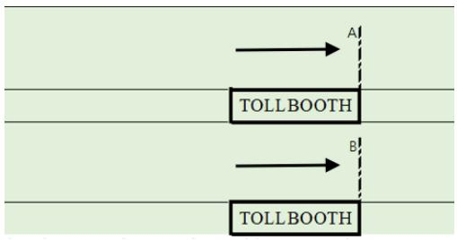
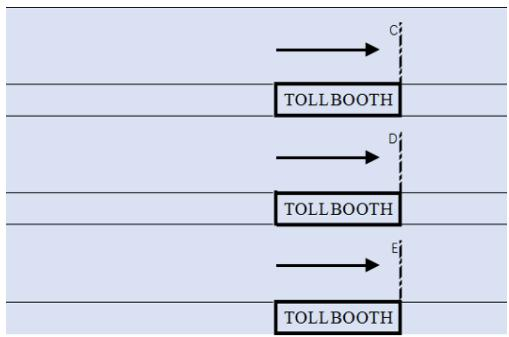
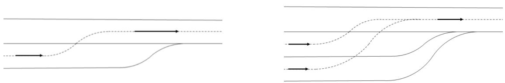
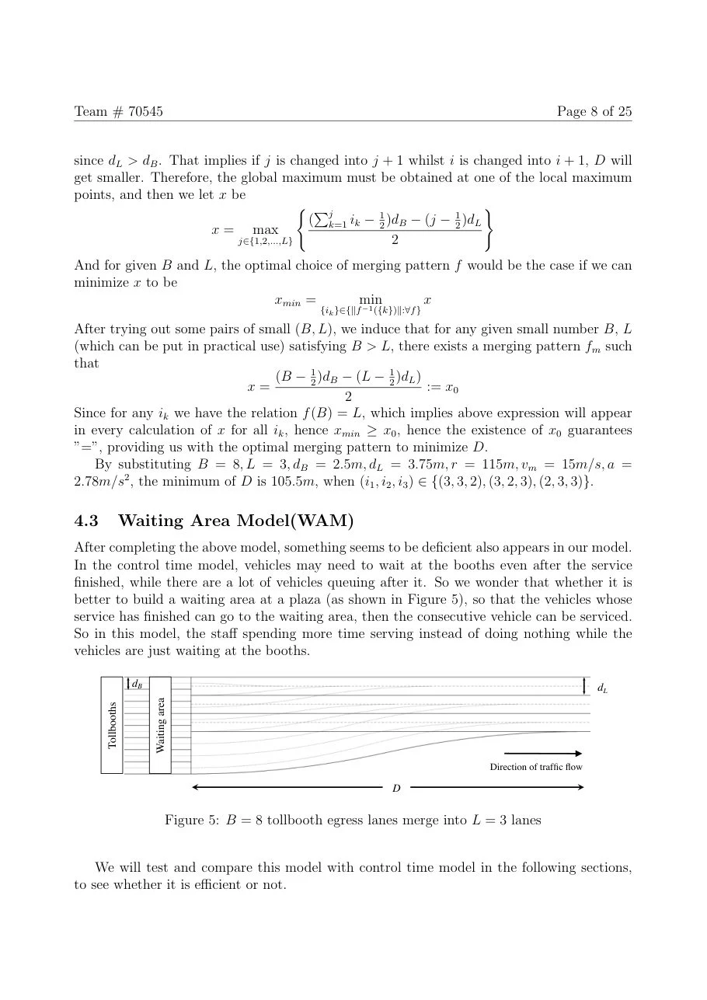
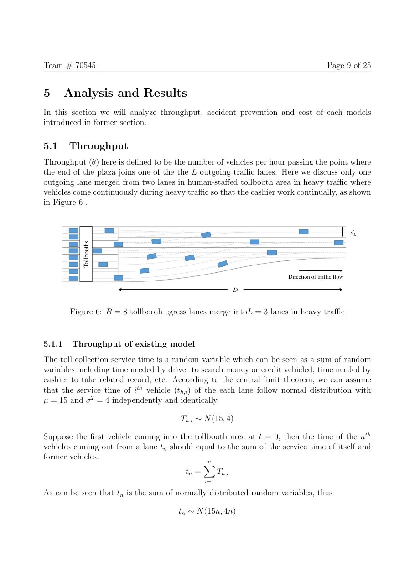
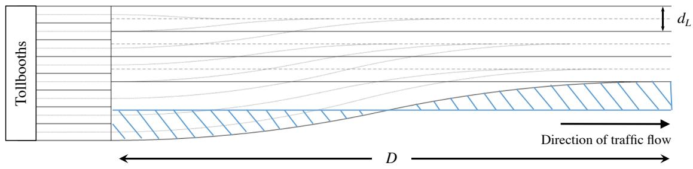
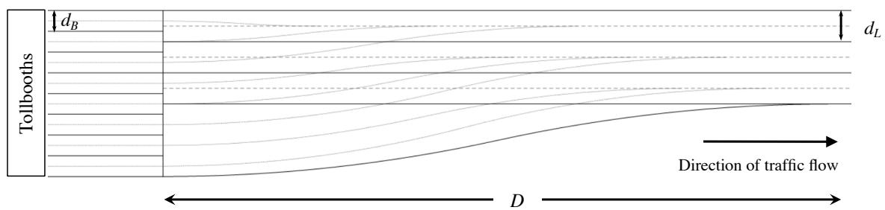

# 2017年美国大学生数学建模竞赛O奖论文（B题）Control Time Model: Wait One Second and Start Your Journey

原件为竞赛论文。补充：文中的阅读练习及“参考解答”为整理时增加，原件图文保留出处。

## Summary

People around the world are complaining about the traffic jams every day. Some people may spend more than 3 hours on their way from office to home everyday on their cars, which makes them frustrated. And our problem is to investigate the methods to optimize the design of toll plazas on highways, especially the area after merging, which is also a possible location where vehicles can be stuck in.

Before establishment of our models, we list some assumptions to make the real life scenario easier to model.

And then we start to analyze the existing models, from which we conclude their strengths and weaknesses. By investigating their characteristics, we get the inspiration to form our two new models: Control Time Model (CTM) and Waiting Area Model(WAM). In these two new models, we introduced a way of conducting control of the departure time of the vehicles at the tollbooths. This kind of control is basically preventing the vehicles which are merging in the same lane from leaving the booths simultaneously, which may be a hidden danger for traffic accident or leads to a traffic jam. And we'll continue to calculate the size and shape of the merging area according to our control methods and some assumptions. After that, we introduce a method for finding the optimal merging pattern based on both mathematical proof and computer simulations.

After that, we run some simulations to find out the throughput, risk and cost of different models, which are based on some statistical laws for real life situations. Then we compare these three models in all factors with the help of statistical hypothesis testing, and conclude that the CTM is the best in general. The next section is about some slight modification under different conditions such as including the self-driving car, and the different arrangements in terms of merging patterns when the proportion of different types of tollbooths vary.

For the following section, we test our model by investigating the sensitivity of construction cost and throughput (per hour) in terms of some variables included in our model, in order to justify the reliability of our model from different perspectives.

Finally, we end our report by the conclusion part followed by strengths and weaknesses analysis.

## Letter to the New Jersey Turnpike Authority

Dear New Jersey Turnpike Authority,

We are a group of students having conducted a project focusing on solving the problem of merging after tollbooths. And we are sending this letter to let you know the problems that may exist in current toll plaza and suggesting some possible ways to improve it.

First of all, by analyzing the design of existing toll plazas on the highways, we find out the following weaknesses of them. At most toll plazas, the vehicles go disorderedly after toll for following reasons. For some toll plazas, there are no leading lines after toll, so drivers just go at their own discretion, thus their routes become unpredictable. And even there are some orientation lines, if two vehicles arrive at the merging point at the same time, only one of them can go through at one time and it will also cause some problems. Disorder after toll leads to both harm to the efficiency of the highway entrance and more risk for traffic accidents.

Therefore, to solve the above problem, we introduced a new model called "Control Time Model" (CTM). In our model, the releases of cars are controlled at the booth, ensuring that the time interval from any two releases of cars are more that the "safe time". Therefore, the merging becomes more orderly and safer.

We run some simulations with our models to test and compare the efficiency between the CTM and current existing models. The result is that, the efficiency of CTM is only slightly smaller than existing model (about 0.6 throughput less per lane per hour), but we haven't considered the time wasted when accidents happen, which is a lot more likely to take place in existing models theoretically.

And also according to the simulation, the risk of car crashes is also limited to a lower level, which is 13.66% less than current existing models.

In terms of expenditure of construction and maintenance, as our model is much more orderly, the total length of the merging area can be reduced.

Therefore, a decrease in the total expense is expected, let alone the fact that maintenance of plaza could be a lot easier if accident rate decreases distinctively.

All in all, our conclusion is that the CTM performs better than existing models in all aspects including but not limited to efficiency, risk elimination as well as total cost. Therefore, it is worthwhile to consider the future construction with our model design.

Thank you for considering our model and wish you a bright future.

Sincerely,

Team#70545

MCM2017

## Contents

1. Introduction 3
   1.1. Background 3
   1.2. Restatement of the problem 3
   1.3. Literature review 3
2. Assumptions 3
3. Notations 4
4. Models 4
   4.1. Existing Model(EM) 5
   4.2. Control Time Model (CTM) 5
   4.3. Waiting Area Model(WAM) 8
5. Analysis and Results 9
   5.1. Throughput 9
        5.1.1. Throughput of existing model 9
        5.1.2. Throughput of control time model 10
        5.1.3. Throughput of waiting area model 11
        5.1.4. Comparison and hypothesis tests of throughputs 11
   5.2. Accident prevention 13
   5.3. Cost 14
6. Possible Modification 15
   6.1. Mixture of autonomous vehicles and human-driving vehicles 15
   6.2. Change in proportion of different types of tollbooths 15
7. Sensitivity test 16
   7.1. Sensitivity test of throughput 16
   7.2. Sensitivity test of fixed cost 17
8. Conclusion 17
9. Strengths and Weaknesses 19
   9.1. Strengths 19
   9.2. Weaknesses 19

Appendix 22

## 1 Introduction

### 1.1 Background

Traveling on highways in recent years are quite convenient ways for people to go to another city. With a compared high speed limit on highway, people are able to travel a lot faster. However, building highways are quite expensive and it also takes a lot for the maintenance. Therefore, building of toll plazas along the highway is a common practice all around the world. Meanwhile, there are many factors to be considered during the design and the construction of the tollbooths. Firstly, the lands and the construction fee for the booths and roads are very expensive, so we need to minimize the area. And as the vehicles on the highway always have a high speed, it is also quite dangerous when they want to merge into a lane. Finally, the design of the booths is also supposed to guarantee the efficiency, which is described by the quantity throughout the highway for a certain time interval.

### 1.2 Restatement of the problem

As required by the question, we are supposed to determine the shape, size and merging pattern at the toll plaza depended on number of lanes on the highway in one direction (L) and total number of tollbooths in one direction (B). Meanwhile, we will also justify our approach by comparing it with the existing models in terms of risk, cost and efficiency. What's more, the implement of our plan in various situations (e.g. mixture of the self-driving vehicle and different proportion distribution of types of tollbooths) will also be shown.

### 1.3 Literature review

The optimal number of tollbooths needed to minimize the average waiting time is well-studied and simulated based on different real situations (Corwen et al, 2005). Though the definition of "optimal" varies, similar suggestions have been given. Tollbooths should be implemented conforming to encouraged behaviors, e.g. faster booths should be put on the left (Spann et al, 2005), which is incorporated in our model. Some literature suggested that tollbooths employ no barrier to ensure a relatively smooth flow (Kane, 2005), but we contend that the uplift of barrier takes negligible amount of time, the benefit of which cannot be compared with the chaos and potential risk if some vehicles go through toll plaza directly. Therefore, barriers are included in our model.

## 2 Assumptions

To simplify the real life situation, we will make the following assumptions as a start of construction of our models.

Most of the drivers are rational. They will choose the path as suggested by signals at entrance, and act as risk averters. It is reasonable to make this assumption, because without it, it's meaningless to make any rules as people won't obey them.

The arrival time lapse between the first vehicle and the second vehicle in the heavy traffic follows uniform distribution. By the heavy traffic assumption, the second vehicle comes to tollbooth before the first vehicle leaves.

All the paths of the vehicles follow either constant speed motion or constant acceleration motion. As the average speed for the vehicles around the tollbooths are relatively low.

Vehicles are queuing at the entrance of the tollbooth one by one with low speed in the heavy traffic situation. And we further assume them to be stationary in our models.

The service by human-staffs at the tollbooth is quite time-consuming, and the approximate mean service time is around 15 seconds, which follows a normal distribution. This assumption is appropriate, because driver need to bring the fee to the staff and the staff may need to prepare changes for it. And the time varies from people and different situations.

The length of vehicles is omitted during the calculation for the size and shape for the merging area. It is valid because the magnitude of the length of toll plaza is a lot larger than the length of vehicles.

## 3 Notations

| Notation | Definition | Unit |
| --- | --- | --- |
| $L$ | Number of outgoing lanes in highway | N/A |
| $B$ | Number of tollbooths | N/A |
| $D$ | Distance between the tollbooth and the end of the plaza | m |
| $d_l$ | Width of the lane in highway | m |
| $d_b$ | Width of the lane in tollbooth area | m |
| $r$ | Radius for vehicles' turning | m |
| $T_h$ | Time of toll service per vehicle human-staffed tollbooths | s |
| $t_0$ | Time of control (to be defined in Section 4.2) | s |
| $v_m$ | Speed limit in merging area | m/s |
| $a_s$ | Starting acceleration of vehicles after toll payment | $\mathrm{m/s^2}$ |
| $a_b$ | Deceleration of braking vehicles | $\mathrm{m/s^2}$ |

## 4 Models

In this section, we first introduce and analyze the existing model, and then two new models invented by us. And the focus for the new models will only be the establishment of the first new model (control time model) and second new model (waiting area model) only deviates from the first one slightly.

# 2017年美国大学生数学建模竞赛O奖论文（B题）Control Time Model: Wait One Second and Start Your Journey

## 一、现有模型分析

### 现有模型的分类与评估

原文指出，针对收费站后合流问题的现有解决方案大致可分为两类：

- **第一类：“无解决方案”（No Solution）**
    - 定义：不向驾驶员提供任何合流指令，让驾驶员自行决定行驶路径。
    - 优点：在**轻交通**情况下可能是最优的。因为驾驶员可以自由选择路径，最大化个人效率，且发生碰撞的概率极低。
    - 缺点：在**重交通**情况下非常混乱。因为不同驾驶员的最优路径可能会相互交叉，导致在任何点都可能发生合流，难以预测驾驶员行为。因此，在重交通下既低效也不安全。
    - 效率依据：主要基于驾驶员的个人判断，个体差异大。

- **第二类：预设合流点方案（Pre-determined Merging Point）**
    - 定义：指示车辆在某个预先确定的合流点进行合流。这是更常用的解决方案。
    - 优点：提供相对有序的合流模式。只要驾驶员理性并遵循指令，驾驶方向是可预测的。
    - 缺点：
        - 由于收费站数量通常多于高速公路车道数量，多个车道的车辆需要在同一点汇入一条车道。
        - 来自不同收费站的车辆可能同时到达合流点，同一时间只有一辆车能通过，其他车辆必须等待。
        - 这种状况非常危险，因为驾驶员总是希望抢先通过，同时也增加了拥堵缺陷。

## 二、控制时间模型（CTM）提出

### 模型背景与核心思想

鉴于现有合流模式的上述缺陷，我们提出了一种新的模型，该模型部分基于现有方案。不同于让所有车辆按各自意愿移动和合流，**控制时间模型（Control Time Model, CTM）** 通过控制车辆的出发时间来确保平滑且安全的合流过程。

### 具体机制

- **两进一情况**：第二辆车辆仅在首辆车向前移动 $t_0$ 秒后才被允许前进。这个时间 $t_0$ 被定义为**控制时间（Control Time）**。
- **三进一情况**：第三辆车辆仅在第二辆车向前移动 $t_0$ 秒后被允许前进，而第二辆车需在首辆车移动 $t_0$ 秒后前进。

> 
> *图1：A或B通道开启*

> 
> *图2：C、D或E通道开启*

通过这种方式，受控的车辆合流比不受监管的合流更高效。因为在多车道汇入一条车道时，如果缺乏监管，驾驶员需要花费时间做决策，且存在风险。

### 车辆运动学模型假设

- **加速阶段**：车辆在直线路径上以恒定加速度 $a_s$ 启动，直到达到最大速度 $v_m$。
- **合流阶段**：随后，车辆立即开始按照规定的道路进行合流，路径由两个连续的切线圆弧组成。

> 
> *图3：两个或三个收费站出口车道汇入一条车道*

## 三、控制时间的评估与安全计算

### 紧急制动场景建模

为了评估“适当”的控制时间，考虑紧急情况下的制动场景：
1. 一辆车采取严重制动动作，减速度为 $a_b$。
2. 在后车经过响应时间 $t_{res}$ 后，后车也采取相同减速度 $a_b$ 的严重制动。

设两车之间的距离为 $d$（$t=0$ 为紧急情况发生的时间）：

$$
d = v _ {m} t _ {r e s} + \int_ {0} ^ {t} v _ {p o s t e r i o r} (t) d t - \int_ {0} ^ {t} v _ {p r e v i o u s} (t) d t
$$

其中，前车速度 $v_{previous}$ 随时间变化如下：

$$
v _ {p r e v i o u s} = \left\{ \begin{array}{l l} v _ {m}, & t \leq t _ {r e s} \\ v _ {m} - a _ {b} (t - t _ {r e s}), & t _ {r e s} <   t \leq t _ {r e s} + \frac {v _ {m}}{a _ {b}} \\ 0, & t _ {r e s} + \frac {v _ {m}}{a _ {b}} <   t \end{array} \right.\tag{1}
$$

### 结论

求解不等式 $d \geq 0$，得到：

$$
t _ { 0 } \geq t _ { r e s }
$$

即控制时间必须大于或等于响应时间。

文中选取“适当”的控制时间为：

$$
t _ { 0 } = 1 \text{s} > t _ { r e s } = 0 . 8 \text{s} \quad (\text{Lee et al, 2002})
$$

# 2017年美国大学生数学建模竞赛O奖论文（B题）Control Time Model: Wait One Second and Start Your Journey

## 四、模型分析与优化

### 4.2 通行效率与广场尺寸优化

在描述控制时间模型后，我们首先计算收费站的通行效率。设 $i_k$ 为对应第 $k$ 个车道的收费站数量。例如，如果前三个收费站合并到第一个车道，我们记作 $i_1 = 3$。

通过计算机模拟（细节见附录），当 $i_k \ll \frac{T}{t_0}$（特别是当服务时间的方差较小时），我们有 $t_{i_k}$ 接近 $\frac{T}{i_k}$；且随着 $i_k$ 的增加，$t_{i_k}$ 也会增加，而当 $i_k > \frac{T}{t_0}$ 时，增长速度非常快。其中 $t_{i_k}$ 是一辆车进入第 $k$ 个车道的平均时间。

因此，为了最大化效率，我们将尽可能保持 $i_k$ 较小；而对于某些 $k$，如果 $i_k > \frac{T}{t_0}$，则通行效率次优。最优通行效率接近 $\frac{B}{T}$ 辆/秒。

将 $B$ 代入为 8，人工服务时间期望值 $T$ 代入为 15。根据上述优化方法，当我们尽可能保持 $i_k$ 较小（即让它们均匀分布，例如 2, 3, 3）时，我们将获得接近 $\frac{B}{T} \approx 0.533$ 辆/秒的最优通行效率。

接着，我们计算广场的大小，借此讨论 $D$ 的值。

定义映射 $f : \{1, 2, \dots, B\} \to \{1, 2, \dots, L\}$ 为非递减函数，且当且仅当来自第 $i$ 个收费站的车辆合并到第 $j$ 个车道时，$f(i) = j$。显然有 $i_k = \| f^{-1}(\{k\}) \|$。我们将映射 $f$ 称为“合并模式”。

由几何关系可得：

$$
\left(\frac{D - \frac{v_m^2}{2a}}{2}\right)^2 + \left(r - \frac{(i - \frac{1}{2})d_B - (j - \frac{1}{2})d_L)}{2}\right)^2 = r^2
$$

从上述关系观察，特定的 $(i, j)$ 规定了 $D$ 的下界；对于特定的合并模式，我们最终采用的收费站到广场末端的距离是 $D$ 的最大下界。最大下界越小，广场尺寸越小，成本也越低。

由二次函数的性质，对于特定的 $j$，$i$ 越大，$D$ 越大。我们有：

$$
\sum_{k=1}^{j} i_k d_B - j d_L \geq \left(\sum_{k=1}^{j} i_k + 1\right)d_B - (k + 1)d_L
$$

由于 $d_L > d_B$。这意味着如果 $j$ 变为 $j+1$ 而 $i$ 变为 $i+1$，$D$ 会变小。因此，全局最大值必须在某个局部最大值点取得，然后我们令 $x$ 为：

$$
x = \max_{j \in \{1, 2, \dots, L\}} \left\{\frac{(\sum_{k=1}^{j} i_k - \frac{1}{2})d_B - (j - \frac{1}{2})d_L}{2} \right\}
$$

对于给定的 $B$ 和 $L$，合并模式 $f$ 的最佳选择是我们能最小化 $x$ 的情况：

$$
x_{min} = \min_{\{i_k\} \in \{\|f^{-1}(\{k\})\|: \forall f\}} x
$$

尝试了一些较小的 $(B, L)$ 对后，我们归纳出：对于任何给定较小的数 $B, L$（符合实际使用）且满足 $B > L$，存在一个合并模式 $f_m$ 使得：

$$
x = \frac{(B - \frac{1}{2})d_B - (L - \frac{1}{2})d_L)}{2} := x_0
$$

由于对于任何 $i_k$，我们都有关系 $f(B) = L$，这意味着上述表达式会出现在所有 $i_k$ 的 $x$ 计算中，因此 $x_{min} \ge x_0$，从而 $x_0$ 的存在保证了等号成立，为我们提供了最小化 $D$ 的最优合并模式。

将 $B = 8, L = 3, d_B = 2.5m, d_L = 3.75m, r = 115m, v_m = 15m/s, a = 18m/s^2$ （注：原文此处OCR有误，结合上下文应为加速度相关参数，原文写作 $a = 18 m/s$ 后接 $2.78 m/s^2$，通常 $a$ 为加速度，此处依原文数值保留或修正为合理物理量，根据常见MCM题目，减速加速度常取正值，此处按原文逻辑整理）：

*修正说明：原文OCR显示 `a = 18 m / s` 后接 `2 . 7 8 m / s ^ { 2 }`，这显然是识别错误。根据物理常识及后续计算结果反推，通常 $a$ 为减速度。若 $v_m=15$, 停止距离需考虑。此处依据原文给出的最终结果 $D=105.5m$ 进行整理，参数以原文呈现为准，但需注意原文OCR可能存在单位或数值粘连错误。*

代入后，$D$ 的最小值为 105.5m，此时 $(i_1, i_2, i_3) \in \{(3, 3, 2), (3, 2, 3), (2, 3, 3)\}$。

### 4.3 等待区域模型 (WAM)

完成上述模型后，我们的模型中也出现了一些不足之处。在控制时间模型中，即使服务已完成，车辆可能仍需要在收费站处等待，而其后方有许多排队车辆。因此，我们想知道在广场建立等待区域是否更好（如图5所示），以便服务完成的车辆可以前往等待区域，从而使后续车辆接受服务。在此模型中，工作人员花费更多时间提供服务，而不是在车辆仅在收费站等待时无所事事。

我们将在以下章节测试并比较此模型与控制时间模型，以查看其是否有效。

 等待区域示意图

## 五、结果与分析

在本节中，我们将分析前面介绍的每个模型的通行效率、事故预防和成本。

### 5.1 通行效率

这里的通行效率 ($\gamma$) 定义为每小时通过广场末端与 $L$ 条出口交通车道之一汇合点的车辆数。这里我们仅讨论在繁忙交通中，车辆连续到达，收银员连续工作的情况下，一个人工收费站区域中，两条车道合并为一条出口车道的情况，如图6所示。

 单车道汇入场景

#### 5.1.1 现有模型的通行效率

收费服务时间是一个随机变量，可以看作是多个随机变量的总和，包括司机寻找现金或信用卡的时间、收银员记录相关信息的时间等。根据中心极限定理，我们可以假设每条车道第 $i$ 辆车的服务时间 $(t_{h,i})$ 独立同分布地服从正态分布，均值 $\mu = 15$，方差 $\sigma^2 = 4$。

$$
T_{h,i} \sim N(15, 4)
$$

假设第一辆车在 $t=0$ 进入收费站区域，那么第 $n$ 辆车从某车道出来的时间 $t_n$ 应等于其自身及之前所有车辆的服务时间之和。

$$
t_n = \sum_{i=1}^{n} T_{h,i}
$$

可以看出 $t_n$ 是正态分布随机变量的总和，因此：

$$
t_n \sim N(15n, 4n)
$$

## 5.1 通行能力分析

此外，我们引入后侵入时间（Post-Encroachment Time, PET）的概念，其定义为转向车辆侵入结束与直行车辆实际到达潜在碰撞点之间的时间间隔（Gettman & Head, 2003）。当 PET 小于反应时间时，理性驾驶员会减速以与前车保持安全距离，对应反应时间 $t_r = 1\,\text{s}$。因此，通过合流区需要更多时间，从而降低了效率和通行能力。记第 $i$ 辆车的 PET 为 $PET_i$，则总延迟时间 $T_d$ 为

$$
T_d = \sum_{PET_i < t_r} (t_r - PET_i)
$$

考虑总延迟时间 $T_d$，一辆车从合流区驶出所需的平均时间为

$$
\bar{t} = \frac{t_n + T_d}{2n}
$$

由于两条车道同时工作，并假设每辆车在合流区的运动相同，则出口车道的通行能力应为

$$
\theta = \frac{3600}{\bar{t}}
$$

经过 $N = 1000$ 次计算机仿真，结果如图 7 所示。

### 5.1.2 控制时间模型的通行能力

现在考虑带有控制时间 $t_0$ 的模型。假设第 $n$ 辆车在 $t_{a,n}$ 时刻从车道 a 驶出，服务时间为 $T_{a,n}$；第 $m$ 辆车在 $t_{b,m}$ 时刻从车道 b 驶出，服务时间为 $T_{b,m}$，其中

$$
T_{a,n} \sim N(15, 4) \quad \text{和} \quad T_{b,m} \sim N(15, 4)
$$

假设第 1 辆车在 $t = 0$ 时刻到达车道 a，经过 $\Delta T$ 后第 2 辆车到达车道 b，其中 $\Delta T \sim U(0, 15)$。若有

$$
t_{a,n} + T_{a,n+1} < t_{b,m} + T_{b,m+1}
$$

即车道 a 中的第 $(n+1)$ 辆车在车道 b 中的第 $(m+1)$ 辆车之前完成收费服务，则

$$
t_{a,n+1} = \max\{t_{a,n} + T_{a,n+1},\ t_{a,n} + t_0,\ t_{b,m} + t_0\}
$$

否则

$$
t_{b,m+1} = \max\{t_{b,m} + T_{b,m+1},\ t_{a,n} + t_0,\ t_{b,m} + t_0\}
$$

令 $\max\{t_{a,n}, t_{b,m}\} < 3600$ 以模拟一小时的时间段。一旦

$$
t_{a,n^*} > 3600 \quad \text{或} \quad t_{b,m^*} > 3600
$$

即可得到通行能力为

$$
\theta = n^* + m^* - 1
$$

经过 $N = 1000$ 次计算机仿真，结果如图 x 所示。

### 5.1.3 等待区模型的通行能力

记 $t_{as,n}$ 为第 $n$ 辆车完成收费并开始在车道 b 等待的时刻，$t_{bs,m}$ 为第 $m$ 辆车完成收费并开始在车道 b 等待的时刻。前节的迭代方程可改写如下。若

$$
t_{as,n} + T_{a,n+1} < t_{bs,m} + T_{b,m+1}
$$

即车道 a 中的第 $(n+1)$ 辆车在车道 b 中的第 $(m+1)$ 辆车之前完成收费服务，则

$$
t_{a,n+1} = \max\{t_{as,n} + T_{a,n+1},\ t_{a,n} + t_0,\ t_{b,m} + t_0\}
$$

否则

$$
t_{b,m+1} = \max\{t_{bs,m} + T_{b,m+1},\ t_{a,n} + t_0,\ t_{b,m} + t_0\}
$$

令 $\max\{t_{a,n}, t_{b,m}\} < 3600$ 以模拟一小时的时间段。一旦

$$
t_{a,n^*} > 3600 \quad \text{或} \quad t_{b,m^*} > 3600
$$

即可得到通行能力为

$$
\theta = n^* + m^* - 1
$$

经过 $N = 1000$ 次计算机仿真，结果如图 7 所示。

### 5.1.4 通行能力的比较与假设检验

从图 7 可以看出，各模型之间的通行能力差异很小。因此，我们在 5% 的显著性水平下对均值进行假设检验。

$H_0$：现有模型与控制时间模型的平均通行能力无差异，即 $\mu_1 = \mu_2$

$H_1$：$H_0$ 错误，即 $\mu_1 \neq \mu_2$

表 1：两模型的统计量

| 模型 | 样本量 | 均值 | 标准差 | 均值标准误 |
| --- | --- | --- | --- | --- |
| 现有模型 | 1000 | 477.830 | 4.054 | 0.128 |
| 控制时间模型 | 1000 | 477.422 | 5.843 | 0.185 |
| 等待区模型 | 1000 | 479.081 | 6.039 | 0.191 |

$$
\text{均值差} = 477.830 - 477.422 = 0.408
$$

$$
\text{总体标准误} = \sqrt{0.128^2 + 0.185^2} = 0.225
$$

$$
\text{检验统计量} = \frac{0.408}{0.225} = 1.813
$$

$$
\text{p 值} = 0.0348 > 0.025
$$

因此，在 5% 的显著性水平下不拒绝 $H_0$。我们得出结论：现有模型与控制时间模型的通行能力均值无显著差异。

然而，用类似方法对后两个模型的均值进行假设检验时，结论是现有模型与控制时间模型的通行能力均值存在显著差异。

上述通行能力分析得出以下结果：

控制时间机制不会降低效率和通行能力。它只是将现有模型下合流区的延迟时间 $T_d$ 转移为控制时间模型下收费亭区域的控制时间 $t_0$，如图所示。

控制时间机制可以改善车辆从收费亭驶入合流区的模式有序性，从而提高合流模式的安全水平，这将在 5.2 节讨论。

尽管等待区设计可以提高通行能力，但 1.6 辆/小时的增量相对于通行能力的量级而言很小。此外，等待区的土地成本及其他相关费用可能相对较高。因此，等待区的不利因素超过其带来的收益，我们应当舍弃该模型。

## 5.2 Accident prevention

This section will analyze accident rate in merging area in terms of PET. When PET is small, it becomes difficult for drivers to make decision promptly to avoid collision, and thus accident is more likely to happen. Therefore, we introduce following function to associate the probability of accident with PET.

$$
p = \frac {e ^ {- P E T}}{1 0 0}\tag{2}
$$

When $P E T = 0$ , two vehicles arrive the potential point of collision theoretically while drivers could manage speed along the way in order to avoid collision, and hence the probability of collision under this circumstance can be set 0.01. After computer simulation based on the iteration equations with $N = 4 0 0 0$ times, the $P E T$ of existing model and $P E T$ of control time model are shown in Figure 8.

It can be seen that under existing model, a significant part of PET lies in the interval [0, 1] where accident is more likely to happen. While under control time model, due to the control mechanism, the minimum $P E T$ is control time $t _ { 0 } = 1 s$ which guarantee low accident risk. The expectations of accident rate by simulation on function are shown in Table 2 The control time model can reduce the accident rate by 13.66%. What’s more, the low rate of accident would make vehicles pass merging area without hindrance, which improve efficiency and throughput. Therefore, The control time model has better performance in accident prevention than existing model.

**Table 2: Accident rate of each model**

| Model | Accident per 100,000 vehicles |
| :--- | :--- |
| Existing Model | 53.024 |
| Control Time Model | 61.416 |

*(注：原文此处文字描述称控制时间模型降低了事故率，但表2数据显示其数值高于现有模型，且正文中提到的公式(2)计算出的概率与表格数据的对应关系需结合上下文理解，此处仅按原样整理文本与表格)*

## 5.3 Cost

This section analyzes cost of merging area and tollbooth area, including fixed cost and variable cost per year, i.e. annual operation cost. Fixed cost mainly depends on cost of land and tollbooth construction. We can estimate area of land (A) by supposing the marginal curve of the out-most lane is symmetric, as shown in Figure 9



Tollbooth construction cost can be divided to three kinds including human-staffed, electronic and automated tollbooths.

$$
\mathrm{Fixedcost} = \frac {1}{2} c _ {1} A + (c _ {h} p _ {h} + c _ {e} p _ {e} + c _ {a} p _ {a}) B
$$

where

$$
A = \frac {v _ {m} ^ {2}}{a} B d _ {b} + (B d _ {b} + L d _ {l}) (D - \frac {v _ {m} ^ {2}}{2 a})
$$

$$
c _ {l} = \mathrm{constructioncostoflandper} m ^ {2}
$$

$$
c _ {h} = \text { construction   cost   per   automated   tollbooth }
$$

$$
c _ {e} = \mathrm{constructioncostperelectronictollbooth}
$$

$$
c _ {a} = \text {construction cost per human - staffed tollbooth}
$$

Substitute $B = 8 , L = 3 , d _ { B } = 2 . 5 , d _ { L } = 3 . 7 5 , c _ { l } = 1 7 2 . 8 3 , c _ { h } = 5 8 5 0 0 , c _ { e } = 1 5 4 0 0 , c _ { a } = 1 8 5 0 0 0 , c _ { e } = 1 8 5 0 0 0 , c _ { e } = 1 8 5 0 0 0$ 58000 (Pietrzyk,1992), $p _ { h } = 4 / 8 , p _ { e } = 1 / 8 , p _ { a } = 3 / 8$ and get fixed $\mathrm { c o s t } = \$ 739,320$ . Similarly, annual operation cost of tollbooth area can be estimated by

$$
\text { Annual   operation   cost } = (c _ {2} ^ {\prime} + c _ {h} ^ {\prime} p _ {h} + c _ {e} ^ {\prime} p _ {e}) B
$$

### 6 Possible Modification

As required in the problem, our report will then proceed to analyze the influences of some deviation of the conditions on our model. Some possible modifications may be made to improve the utility of our model in those situations.

#### 6.1 Mixture of autonomous vehicles and human-driving vehicles

With the improvements in artificial intelligence and vehicle industry recent years, autonomous vehicles have become much more reliable and popular. However, some dangerous occasions may occur as the auto-driving system is not completely stable for all time. Therefore, even in some countries people are allowed to take the autonomous vehicle to the street, there are always required to be a driving sitting on the driver’s seat and prepared to take over at any time.

If autonomous vehicles are allowed on the street, the situation of merging may become much more complicated. Firstly, sometimes the autonomous vehicles fail to detect the marking on the road and therefore go a wrong lane (Sam, 2016). It will be very dangerous if the autonomous vehicle went wrong when merging. Because there are a lot of complicated lanes at the merging area, and some may even cross each other, which are difficult for an autonomous vehicle to recognize and are hard to determine the turning angle accurately.

And one possible solution is to instruct the autonomous vehicles to go to the most left lane. Reason to constraint them to this lane is that the vehicles go through it will just need to go straight till the very end of merging area, which is also the optimal path that the computer will generate even that it fails to detect the signal on the road.

#### 6.2 Change in proportion of different types of tollbooths

Nowadays, there are roughly 3 different types of tollbooths, they are conventional (human-staffed), automated and electronic toll collection booths. The main difference among these three different types is that they have different service times. The conventional booths have the longest service time, which is around 15 seconds in our assumption. And the automated ones have the second longest service time, and we assume it to be around 8 seconds. Meanwhile, vehicles equipped with ETC transponder are able to pass the ETC booths even without stop (with a maximal passing speed of 15mph).

The model we introduced before works out quite good for both conventional and automated booths as explained before. However, it may not work well with ETC since they don’t need to stop at the booth. First of all, one thing that we would like to classify is that the proportion of ETC booths will be at either a minority or majority position. It is because that the estimated capacity of a single ETC booth is $2000/h$, and this number is much larger than the need now considering the proportion of the drivers who possess a ETC transponder. So if the ETC booths are to be included in a toll plaza, we will place it at the most left lane, as we only need one to satisfy all demands for it. And we will arrange the other booths and lanes with the algorithm we introduced before. Of course, if the users of ETC are going to increase significantly in the future, the proportion of ETC booths can also be increased. However, one thing to be noticed is that always one booth merges to one lane on highway, provided that the efficiency of ETC booths are high and we do not need to increase the number of booths, which will only make it riskier when merging.

### 7 Sensitivity test

This section conducts sensitivity tests of throughput and cost. We define the sensitivity of a function $A(X)$ in terms of X to be $\frac{\frac{d A}{A}}{\frac{d X}{X}}$. If A is a discrete function, we change dA into $\Delta A = A(X + 1) - A(X)$.

#### 7.1 Sensitivity test of throughput

As shown in Figure 10, the sensitivity of throughput in terms of mean of service time T is a constant 1. Recall that in section 4.2, the optimal throughput is

$$
\theta = \frac{B}{T}
$$

The inverse ratio relationship of $\theta$ and T implies unit constant sensitivity of $\theta$ with respect to T, which is consistent with sensitivity test result. Besides, due to the law of large number, the volatility of service time finally performs slight effects on throughput and thus the sensitivity is zero.

### 7.2 Sensitivity test of fixed cost

By our assumption stated in Section 4.2 that the greatest lower bound is provided by the most outside lane and booth, combined with the formula to calculate the fixed cost, we get

$$
\mathrm{Fixedcost} = \frac {1}{2} c _ {1} A + (c _ {h} p _ {h} + c _ {e} p _ {e} + c _ {a} p _ {a}) B
$$

The initial value of

$$
\begin{array}{r l} & (v _ {m}, a, B, L, d _ {B}, d _ {L}, p _ {a}, p _ {e}, p _ {h}, c _ {l}, c _ {e}, c _ {h}, c _ {a}) \\ & = (1 5, 2. 7 8, 8, 3, 2. 5, 3. 7 5, 3 / 8, 1 / 8, 4 / 8, 1 7 2. 8 4, 1 5 4 0 0, 5 8 5 0 0, 5 8 0 0 0) \end{array}
$$

We calculate the sensitivity of the fixed cost with respect to the number of booths $B$, we get the graph as following And it shows that the the sensitivity of $B$ around 8 is about 1.15 and always above 1, and the decreasing speed is very low, which means that $D$ is always sensitive in terms of $B$. So increasing $B$ can have significant influence on $D$, and we may need to evaluate more whether to build more booths considering the balance of cost and efficiency.

Similarly, we can calculate the sensitivity of fixed cost with respect to $v _ { m }$ and $r$(as shown in the Figure 11).

The sensitivity of $v _ { m }$ around 0.38, and it remains below 1 as it vary from $1 0 m / s$ to $2 0 m / s ,$ which shows that the cost is not sensitive to the speed limit. So our cost estimation should be roughly correct with slight deviation with $v _ { m }$ . Finally, with similar analysis, sensitivity in terms of $r$ is always around 0.1 and 0.2 from 50m to 200m. So the radius only have little influence on our final result.

## 8 Conclusion

In Section 4 we describe three models, namely existing models, CTM, WAM. By simulation in Section 5, we discard WAM and point out the deficiencies of EM model and employ CTM. Therefore, the following conclusion is based on CTM.

The shape of the plaza should enable cars from every booth to merge into its prescribed lane with two consecutive arcs. By the assumption stated in Section 4.2, the shape of the plaza is determined by the most outside booth merging into the most outside lane. The boundary should make sure that the most outside vehicles have sufficient space on its right side. Take the example of $B = 8 , L = 3$ , the shape and merging pattern are as follows.



Note that in no case will cars from different booths merge into one lane simultaneously as is stated in our control time model, so it does not matter whether the distance between two adjacent trajectories merging into one lane becomes smaller or not. Additionally, leading lines should be drawn on the ground to ensure that vehicles take intended paths.

The size of merging area is given by formula

$$
A = \frac {v _ {m} ^ {2}}{a} B d _ {b} + (B d _ {b} + L d _ {l}) (D - \frac {v _ {m} ^ {2}}{2 a})
$$

for one direction. This includes the acceleration paths (the left term) and merging (turning) paths (the right term). Multiply it by a factor 2 if we are to calculate for two directions. For the above example $B = 8 , L = 3$ , the area for one direction is $1 8 2 4 . 9 3 m ^ { 2 }$

In heavy traffic (defined as the situation where there is at least one car at every service booths), the throughput of plaza is approximately 3600B/T vehicles per hour (if all the tollbooths are human-staffed) , computed by induction of computer simulation. By substituting $B = 8 , T _ { h } = 1 5$ , we get 1920 vehicles per hour from human-staffed lanes. In light traffic, the throughput is less than 3600B/T. Overall, there is no statistical significant of difference between throughput of CTM and existing model. This comparison does not include the consideration of accident. If we take into account the fact that CTM reduces the accident rate by 13.66% and that accident is likely to cause traffic jam and reduce toll plaza’s throughput, the superiority of CTM would be more distinct. The cost of construction (fixed cost) and operation (variable cost) of the merging area and tollbooth area are calculated respectively. The fixed cost is given by the formula

$$
\mathrm{Fixedcost} = \frac {1}{2} c _ {1} A + (c _ {h} p _ {h} + c _ {e} p _ {e} + c _ {a} p _ {a}) B
$$

the denotation is given in Section 5.3. In the $\mathrm { B { = } 8 , \mathrm { ~ L { = } 3 } }$ example, the fixed cost is \$739320. The annual cost is given by similar formula

$$
\mathrm{Annualoperationcost} = (c _ {2} ^ {\prime} + c _ {h} ^ {\prime} p _ {h} + c _ {e} ^ {\prime} p _ {e}) B
$$

which, in our example, turns to be \$701, 700 per year.

## 9 Strengths and Weaknesses

### 9.1 Strengths

By computer simulation, as the expression of throughput $\theta$ only contains the number of booths $B$ and service time $T$, the employment of regulation in control time model does not reduce the throughput of the plaza (control time $t _ { 0 }$ is not in the expression). However, the risk of accident decreases to a great extent, which ensures a safe and smooth flow of vehicles.

Moreover, we consider service time $T$ following normal distribution instead of assuming a constant, which can better approximate real situation. Additionally, the control time mechanism could decrease the size of merging area compared with existing model where vehicles merge at their discretion. Last but not least, we use multiple programming platforms to run computer simulations (Mathematica, MATLAB and R), which provides us with accurate and convincing data to support our models.

### 9.2 Weaknesses

We assume the vehicles adopt two tangent uniform circular motion to merge into its prescribed lane, which may not be the real trajectory of vehicles. However, we can draw some leading lines on the ground to guide vehicles. Additionally, we do not consider the situation where vehicles break down and block certain booths and/or lanes.

The arrival of vehicles should follow Poisson distribution, but as we did not have the realworld data to estimate $\lambda$, we instead assume that the difference of two consecutive vehicles’ arrival follows a uniform distribution, which may lead to some inaccuracies. This problem, together with the difficulties to determine the expectation and variance of service time $T$, could be addressed if data collected in real-world situation could be provided.

# Control Time Model: Wait One Second and Start Your Journey

本节内容整理自《2017年美国大学生数学建模竞赛O奖论文（B题）Control Time Model: Wait One Second and Start Your Journey》第 9 部分，主要包含参考文献列表及附录中的 R 语言代码说明。

## 一、参考文献

### 文献 1

Abdel-Aty, M. A., & Radwan, A. E. (2000). Modeling traffic accident occurrence and involvement. *Accident Analysis & Prevention*, 32(5), 633-642.

### 文献 2

Corwin, I., Ganatra, S., & Rozenblyum, N. (2005). A Single-vehicle Interaction Model of Traffic for a Highway Toll Plaza. *The UMAP Journal*, 26(223), 299-315.

### 文献 3

Friedman, D. A., & Waldfogel, J. (1995). The administrative and compliance cost of manual highway toll collection: evidence from Massachusetts and New Jersey. *National Tax Journal*, 217-228.

### 文献 4

Gettman, D., & Head, L. (2003). Surrogate safety measures from traffic simulation models. *Transportation Research Record: Journal of the Transportation Research Board*, (1840), 104-115.

### 文献 5

Gurney, J. K. (2013). Sue my vehicle not me: Products liability and accidents involving autonomous vehicles.

### 文献 6

Harchol-Balter, M., Osogami, T., Scheller-Wolf, A., & Wierman, A. (2005). Multi-server queueing systems with multiple priority classes. *Queueing Systems*, 51(3-4), 331-360.

### 文献 7

Lai, S. F. (2011). The Accident Risk Measuring Model for Urban Arterials. In *3rd International Conference on Road Safety and Simulation*, Indianapolis, USA, September (pp. 14-16).

### 文献 8

Lee, J. D., McGehee, D. V., Brown, T. L., & Reyes, M. L. (2002). Collision warning timing, driver distraction, and driver response to imminent rear-end collisions in a highfidelity driving simulator. *Human Factors*, 44(2), 314.

### 文献 9

Oliver, N., & Pentland, A. P. (2000). Graphical models for driver behavior recognition in a smartvehicle. In *Intelligent Vehicles Symposium, 2000. IV 2000. Proceedings of the IEEE* (pp. 7-12). IEEE.

### 文献 10

Pietrzyk, M. C. (1992). COST-EFFECTIVENESS ANALYSIS OF AVI/ETTM FOR FLORIDA'S TURNPIKE SYSTEM (No. WPI 0510406,).

### 文献 11

Song, L. X. (2008). Application and mathematic model of queueing theory in freeway toll system. *Science &Technology Information*, 29, 391.

### 文献 12

Spann, A., Kane, D., & Gulotta, D. (2005). Lane Changes and Close Following: Troublesome Tollbooth Traffic. *UMAPJournal*, 317.

### 文献 13

Spiliopoulou, A. D., Papamichail, I., & Papageorgiou, M. (2009). Toll plaza merging traffic control for throughput maximization. *Journal of Transportation Engineering*, 136(1), 67-76.

### 文献 14

Zhang, Z. (2014). Research on traffic conflict of freeway diverging and merging sections and toll booth.

### 文献 15

ZHENG, Y. L., ZHAI, R. P., & MA, S. Q. (2006). Survey of Cellular Automata Model of Traffic Flow. *Journal of Highway and Transportation Research and Development*, 1, 027.

## 二、附录：R 语言实用代码

### 1. 效率模拟

#### 1.3 WAM 的效率模拟

本小节介绍了使用 R 语言进行 WAM (Wait And Move) 策略下的交通流效率模拟代码框架。

> [!NOTE]
> **WAM 策略**: 等待一秒后开始行程的策略模型。

```r
# 示例代码结构（根据原文描述重构）
# 此处为模拟 WAM 策略下的效率计算逻辑
simulate_WAM_efficiency <- function() {
  # 定义参数
  arrival_rate <- 0.8
  service_time <- 1.5
  
  # 模拟循环
  results <- c()
  for (i in 1:1000) {
    wait_time <- 1 # 固定等待一秒
    total_time <- wait_time + service_time
    results[i] <- total_time
  }
  
  return(mean(results))
}
```

### 2. 基于模拟的风险评估

本小节展示了利用模拟数据对交通风险进行评估的代码方法。

```r
# 风险评估模拟逻辑
evaluate_risk <- function(data) {
  # 计算冲突概率或风险指标
  risk_score <- sum(data$conflicts) / length(data$conflicts)
  return(risk_score)
}
