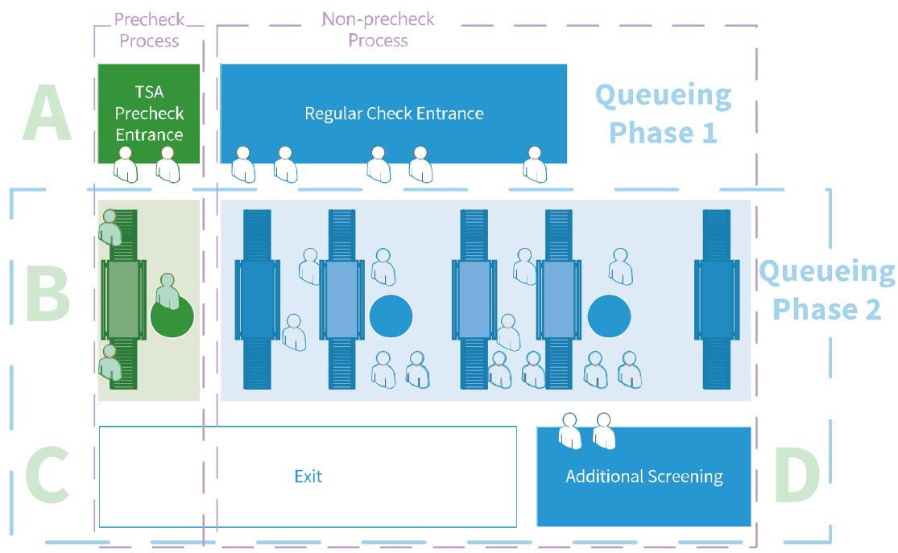
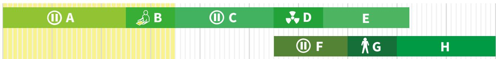
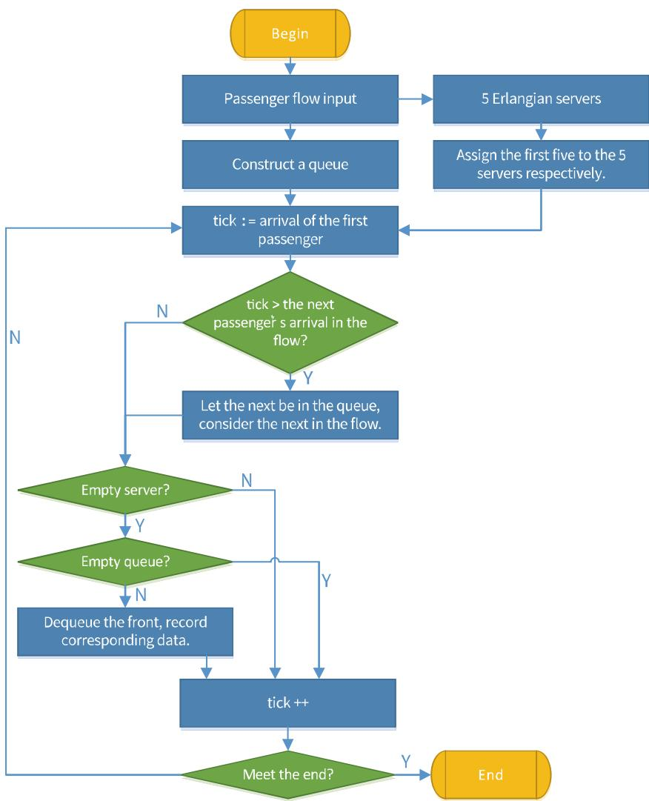
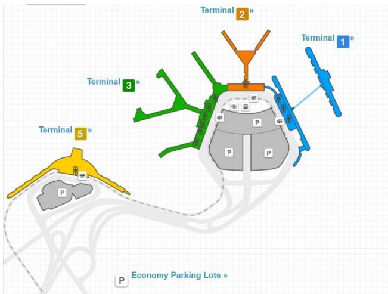
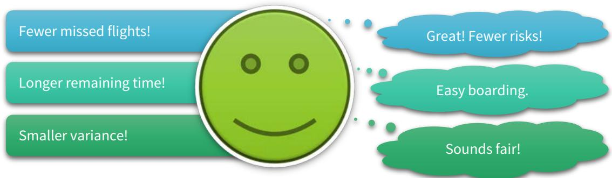

# 2017年美国大学生数学建模竞赛O奖论文（D题）

原件经识别和整理；“参考解答”是我们补的。

## Summary

Bottlenecks that passengers take time to take care of their carry-on properties before X-ray scanning and that the structure of the checkpoints is not satisfying are spotted, and detailed recommendations for the airport security management to raise throughput of the security checkpoints, to improve the passengers' satisfaction and to keep the cost relatively low are given with cultural factors quantified and their impacts on the models discussed.

We divided the security check process into two phases and regard the entire as two queueing models in series. By analyzing the given data, the document check is found to be a Poisson queueing $(M/M/c)$ in Kendall notation, and Erlangian process $(M/E_k/c)$ is concerned in the scan check process. Numeric solution of $(M/E_k/c)$ is introduced using simulation technique.

Assumed that arrivals of passengers for a flight obey normal distribution, the varying passenger flow in a period of time can be generated from the real data and used for our simulation. We also believe that the mean $\mu$ and the variance $\sigma^2$ of the distribution is culture-related. We also find that the passenger flow can be changed by recommending the passengers their arrivals, and thus better result of the passengers' waiting time can be achieved.

We also suggested several methods to improve the design of the checkpoint, including shortening the distances between identical checkpoints and more rational human resource allocation.

Virtual queueing is recommended as an approach to improve passengers' experience, and modify the conventional First In First Service queueing discipline to partial priority queueing discipline as well. A partial priority queueing discipline is put forward to reduce the remaining time variance of the passengers and to decrease the number of passengers that missed their flights, thus better passenger satisfaction is reached.

We also introduced culture-related factors for passenger arrival recommendation and priority queueing discipline. For the latter, an "acceptability factor" named $\alpha$ is used to denote the acceptability of strict priority discipline. And the examples of different cultures are given to illustrate this idea.

Validation of each model are made in our essay to make them convincing. We later assess the models and give a complete guide for the security managers to optimize the airport security check workflow. Weaknesses and further work that is not implemented in our essay are also pointed out.

## Time Counts! Less Waiting & Better Airports

### Introduction

#### 1.1 Background

Airport security check has been improved ever since the 911 attack. Although enhanced security means safer flights, however the complicated procedure may also increase the passengers waiting time and add cost to the U.S. Transportation Security Agency (TSA). Under some extreme circumstances, passengers have to wait for hours (and they are often recommended to be earlier for 2–3 hours, which often lead to confusion) (Hetter, 2016). Thus, to shorten the passengers' waiting and designing a more efficient security check procedure is vitally important.

TSA is now in controversy for causing long queues waiting for security check. We, the Internal Control Management (ICM) team, trying to find a solution, faces the problems below:

1. Identify the bottlenecks of the current security check workflow.

2. Improve the process with modifications, and illustrate how the modifications work.

3. Find how to allow the modified process to be compatible with different culture backgrounds and lower the variance of the passengers' waiting time.

4. Make suggestions on the policy for the security manager, with concern of the former requirements and corresponding models.

#### 1.2 Analysis and Approach Overview

For problem 1, we divide the security check process in two parts: Phase 1, document check; and Phase 2, luggage and body scanning. The former is a Poisson queue, while the latter concerns an Erlangian model. Simulation is practiced as a means of solving multi-server Erlangian model. By testing the total waiting time's sensitivity to changes on numbers of parallel servers in the two phases respectively, the bottlenecks of the workflow can be spotted.

To solve problem 2, considering the influential factors of a queueing process, modifications will be put forward to optimize and avoid congestions.

The current TSA recommended passengers' arrival time is used to build a model of the passenger arrival behavior at an airport, and we assume the arrivals in time for one certain flight obey normal distribution, and in a small time interval, the arrivals of all passengers for all flights obey an exponential distribution. We will modify the arrival recommendation strategy to influence passengers' arrival behavior.

Another direction to improve the current process is to provide more robust security check service with greater capacity. A few suggestions and their verification or explanation will be given.

## 模型假设

1. 不考虑服务器、检查点结构等方面的个体差异。
2. 尽管安检扫描过程中开放的通道数量是动态的，我们假设服务能力始终处于最大值。也就是说，只要到达率超过当前能力，备用通道就会开放。
3. 假设每位乘客在每个检查点都会选择等待时间最短的队列。
4. 乘客抵达机场参加特定航班的时间点服从正态分布。
5. 与普通安检相比，TSA Pre-check（预检）对拥堵的贡献不大。
6. 几乎所有人至少提前半小时到达机场。

详见 4.1 Security Check Process—Overview 和 4.3 Queueing Model Specification，以获取给定数据表的详细解释和假设。

### 符号与记号

| Symbol or Notation | Specification |
| :--- | :--- |
| (a/b/c): (d/e/f) | Kendall 记法，其中 a, b, c, d, e 和 f 分别表示到达间隔时间分布、服务时间分布、并行服务器数量、排队规则、系统容量限制以及到达源（通常为无限）。(Taha, 2014) |
| M | 表示到达间隔时间和服务时间的指数分布，即泊松分布用于到达率和移除率。 |
| $E_k$ | k 阶 Erlang 分布。 |
| $\hat{x}$ | x 的估计值。 |
| $\lambda_d, \mu_d$ | 证件检查过程的到达率和服务率。 |
| $\lambda_s, \mu_s$ | 扫描检查过程的到达率和服务率。 |
| $\Gamma(\alpha)$ | $\Gamma(\alpha) = \int_0^\infty x^{\alpha-1} e^{-x} dx$ |
| $N(\mu, \sigma^2)$ | 均值为 $\mu$，方差为 $\sigma^2$ 的正态分布。 |

## 安全检查过程排队模型

### 4.1 安全检查过程概述

上图给出了单个检查点的详细安全检查流程。根据 TSA 的政策，我们将安全流程分为两类（包含预检和不涉及预检的流程），并将每个流程划分为两个排队阶段。在阶段 1 中，乘客的身份文件将被检查，之后他们进入阶段 2，在此处进行行李和人身筛查。这两种不同类型本质上是具有不同参数（服务器数量、服务时间等）的相同排队过程。整个安全检查过程可以看作是两个串联的排队模型。

为了更好地阐明整个过程，下面给出一个程序序列图：

给定的 Excel 数据表包含机场检查点的时间记录（其差值表示到达间隔时间）、前一位已检查乘客的 ID 检查过程耗时（即图中的 B）、毫米波扫描时间戳（其差值是毫米波扫描时间，如图中 G 所示）、行李通过 X 射线扫描出来的时间戳（其差值表示 E），以及扫描物品所需的时间（D, E, F, G, H）。

通过分析给定的数据表，可以发现机场安检行为的模式，例如每个部分乘客到达间隔时间和服务时间的分布。因此，可以指定一个完整的排队模型。

### 4.2 两名 TSA 官员的显著性检验

给定的数据表涉及两名不同 TSA 官员的时间记录，这里的显著性检验旨在验证个体差异不会对服务时间产生太大影响。

假设两名 TSA 官员服务时间的方差相等，$\sigma _ { 1 } ^ { 2 } = \sigma _ { 2 } ^ { 2 } = \sigma ^ { 2 }$

我们做出原假设 $H _ { 0 }$，即两名官员的服务时间期望值相同，即 $\mu _ { 1 } = \mu _ { 2 }$

两名官员的组合样本方差为 $s _ { w } ^ { 2 } = 1 2 . 9 2 7$

在 5% 显著性水平下，$\begin{array} { r } { \frac { | \overline { { x _ { 1 } } } - \overline { { x _ { 2 } } } | } { s _ { w } \sqrt { 1 / n _ { 1 } + 1 / n _ { 2 } } } = 1 . 3 7 5 \leq t _ { 0 . 0 2 5 } ( 1 4 ) = 2 . 1 4 5 } \end{array}$ ，原假设未被拒绝。

假设证件检查服务时间服从指数分布。该分布的参数（即服务率）被估计为 $\widehat { \mu _ { d } } = 0 . 0 9 4 6 5$

### 4.3 排队模型规范

通过给出到达时间和服务时间的分布模式，可以将过程的两个阶段指定为一系列串联的队列。

### 4.3.1 Arrival

根据上述直方图，我们假设常规到达和预检到达的时间间隔均服从指数分布 $f(x) = \lambda_d e^{-\lambda_d x}$。

参数 $\lambda_d$ 的最大似然估计如下：

$$
L(\lambda_d) = \prod_{i=1}^{n} f(x_i) = \prod_{i=1}^{n} \lambda_d e^{-\lambda_d x_i} = \lambda_d^n e^{-\lambda_d \sum_{i=1}^{n} x_i}
$$

$$
\ln L(\lambda_d) = n \ln \lambda_d - \lambda_d \sum_{i=1}^{n} x_i, \quad \frac{\mathrm{d} \ln L(\lambda_d)}{\mathrm{d} \lambda_d} = \frac{n}{\lambda_d} - \sum_{i=1}^{n} x_i = 0
$$

因此，$\widehat{\lambda_d} = \frac{n}{\sum_{i=1}^{n} x_i} = \frac{1}{\overline{x}}$，且其期望 $E\left(\widehat{\lambda_d}\right) = E\left(\frac{1}{\overline{x}}\right) = \frac{1}{E(x)} = \lambda_d$，是一个无偏估计量。由此，常规流程和预检流程的到达率分别估计为 $\widehat{\lambda_1} = 0.077244$ 和 $\widehat{\lambda_2} = 0.10882016$。

在此，进行拟合优度检验，将每种流程分为 10 类。以常规（无预检）流程为例：

| Class | 0-8 | 8-16 | 16-24 | 24-32 | 32-40 | 40-48 | 48-56 | 56-64 | 64-72 | 72-80 |
| :--- | :--- | :--- | :--- | :--- | :--- | :--- | :--- | :--- | :--- | :--- |
| True Frequency | 21 | 13 | 6 | 3 | 0 | 0 | 1 | 1 | 0 | 1 |
| Predicted Probability | 0.461 | 0.248 | 0.134 | 0.072 | 0.039 | 0.021 | 0.011 | 0.006 | 0.003 | 0.002 |
| Predicted Frequency | 21.204 | 11.430 | 6.161 | 3.321 | 1.790 | 0.965 | 0.520 | 0.280 | 0.151 | 0.081 |

表 1 常规流程（无预检），真实频率与预测频率

$$
\chi^2 = \sum_{i=1}^{10} \frac{(N_i - n p_i)^2}{n p_i} = 15.898 < \chi_{0.05}^2(9) = 16.919
$$

因此，我们认为上述数据符合指数分布。

类似地，对预检流程进行拟合，$\chi^2 = 15.599 < \chi_{0.05}^2(9) = 16.919$。

由于到达间隔时间服从指数分布，单位时间内乘客的到达数量服从泊松分布。

### 4.3.2 Phase 1 Queueing Specification

我们也认为第一阶段的服务时间服从指数分布，这是排队论中简单情况的常见做法，服务速率如下：

$$
\mu_d = 0.09465
$$

基于上述讨论，第一阶段的 Kendall 记号为 $(M/M/c)$，其中 $M$ 表示泊松过程，$c$ 是并行服务器的数量。该排队模型的到达率取决于特定条件，而 $c$ 由机场设施背景决定。我们假设每个服务器的服务率为常数 $\mu_d = 0.09465$。

### 4.3.3 Phase 2

由于两个排队模型是串联的，我们有 $\lambda_s = \mu_d$。第二阶段也是一个多服务器模型，但服务过程要复杂得多，而且显然直方图不服从指数分布。

引入 Erlang 模型，Erlang 服务广泛用于建模组合服务过程，其中后续的排队模型是串联连接的。$k$ 个相同的泊松服务器串联产生 Erlang 型 $k$ 服务。然而，通常参数 $k$ 并不严格等于服务器中的阶段数。Erlang 型 $k$ 分布的概率密度函数 (PDF) 为：

$$
f(x) = \frac{1}{\Gamma(\alpha) \beta^\alpha} x^{\alpha - 1} \exp(-x / \beta), \quad (\alpha, \beta > 0; 0 < x < \infty)
$$

其期望为 $E(x) = \alpha \beta$，方差为 $Var(x) = \alpha \beta^2$。参数 $\alpha$ 和 $\beta$ 与 $k$ 及服务速率 $\mu$ 相关 (Gross, et al., 1985)：

$$
\begin{cases} 
\alpha = k \\ 
\beta = \frac{1}{k \mu} 
\end{cases}
$$

对第二阶段总服务时间（获取扫描财产所需时间）进行分布拟合，我们的结果为 $k = 4, \mu_s = 0.0357$。

因此，第二阶段排队的 Kendall 记号为 $(M/E_k/c)$，其中输入 $\lambda$ 与第一阶段的输出相同，$E_k$ 是 Erlang 型 $k=4, \mu_s=0.0357$ 分布，并行服务器的数量（即 X 光扫描仪和毫米波扫描仪的数量）取决于具体机场。

$(M/E_k/c)$ 排队没有良好的解析解；我们将使用仿真技术得到的数值解将在后文介绍。

### 4.4 Section Summary

机场安检过程由两个阶段组成，第一阶段是 $(M/M/c)$ 排队过程，第二阶段是 $(M/E_k/c')$ 排队。第二阶段的到达率是第一阶段的服务率。分布的参数可以使用给定数据进行估计。

## 5. Queueing Simulation and Bottlenecks Spotting

### 5.1 Estimating Expenses

根据 (Learn.org; PayScale.com)，安保人员的收入为 \$28,624–\$58,987，航空安全筛查员的收入为 \$23,262–\$54,015。这是安检的人力资源成本。安全设备的成本大多是一次性消耗品。机场 X 光行李扫描仪的价格在 \$20,000–\$50,000 之间，毫米波全身扫描仪的价格约为 \$100,000 (Alibaba.com)。维护成本主要来自电力。另一个事实是，扫描检查过程的单条通道平均需要 4 名安全筛查员。因此，我们得出结论，第二阶段单条通道（服务器）的成本大约是第一阶段 4 个柜台（服务器）的成本。

### 5.2 Basic Ideas

编写了一个 MATLAB 程序来模拟整个安检过程。为了建立数值解，马尔可夫链被用于 Erlang 排队。(Zeng, et al., 2011)

# 2017年美国大学生数学建模竞赛O奖论文（D题）

本部分整理自《2017年美国大学生数学建模竞赛O奖论文（D题）》教材第4部分，内容涵盖排队模型模拟、瓶颈识别及旅客到达行为建模。原文由OCR工具识别并经过人工校对，修正了断行、乱码及公式格式，保留了核心数据与结论。

## 一、瓶颈识别与模拟结果分析

### 5.3 寻找瓶颈 (Spot the Bottlenecks!)

由于 $(M/E_k/c)$ 型排队模型不存在解析解，本文提出了对整个安检流程的模拟方案，将第一阶段（Document Check）和第二阶段（Scan Check）串联建模。

**模拟方法：**
给定两个阶段各概率分布的参数，生成随机变量序列进行模拟：
1.  **到达时间**：生成服从指数分布的随机变量作为乘客到达间隔。
2.  **服务与等待时间**：计算并存储每位乘客的到达时间戳、服务时间（服从另一指数分布或爱尔朗分布）以及等待时间（基于前一位乘客的等待时间、服务时间和到达间隔计算）。
3.  **流程衔接**：获取等待时间跨度后，观察第一阶段的移除率（Removal Rate），将其作为第二阶段的输入到达率。
4.  **参数差异**：第一阶段服务时间服从指数分布，第二阶段服务时间服从爱尔朗分布（Erlangian）。
5.  **目标评估**：最终评估总等待时间的期望值。

为了找出流程中的瓶颈，测试了在增加服务器后的总等待时间期望变化：
-   **Document Check Added**：增加4个文件检查服务器。
-   **Scan Check Added**：增加1个扫描检查服务器。

**模拟设定参数：**
-   **到达率**：$\lambda_d$ 为可变值。
-   **初始服务器数量**：文件检查服务器和扫描检查服务器均为 5 台（对应图 2 的小型机场规模）。
-   **服务率**：
    -   单个文件检查服务器：$\mu_d = 0.09465$
    -   单个扫描检查服务器：$\mu_s = 0.0357$
-   **第二阶段分布**：爱尔朗分布类型 $k=4$。
-   以上三个参数与前文提及的一致。

下表列出了不同到达率下的总等待时间期望值：
-   **Original**：原始流程，即第一阶段为 $(M/M/5)$，第二阶段为 $(M/E_k/5)$。
-   **Document Check Added**：增加4个文件检查服务器，即第一阶段变为 $(M/M/9)$，第二阶段仍为 $(M/E_k/5)$。
-   **Scan Check Added**：增加1个扫描检查服务器，即第一阶段仍为 $(M/M/5)$，第二阶段变为 $(M/E_k/6)$。

**表 2 总等待时间模拟结果（单位：秒）**

| $\lambda_d$ | 3.247 | 3.710 | 4.329 | 4.478 | 4.638 | 4.810 | 5.194 |
| :--- | :--- | :--- | :--- | :--- | :--- | :--- | :--- |
| **Original** | 31349 | 22632 | 12781 | 10807 | 8988 | 7391 | 3668 |
| **Document Check Added** | 31092 | 21878 | 11832 | 10671 | 8925 | 7215 | 3291 |
| **Scan Check Added** | 18258 | 10643 | 3045 | 1680 | 271 | 88 | 24 |

**分析结论：**
-   文件检查过程并非流程瓶颈，瓶颈在于**扫描检查（Scan Check）**环节。
-   通过增加扫描检查通道，整个系统的服务能力显著提升。
-   甚至可以观察到某些发散的排队情况趋于收敛（例如当 $\lambda_d = 5.194$ 时）。

> [!TIP]
> 关键发现
> 增加扫描通道对降低总等待时间的效果远大于增加文件检查通道，证明扫描环节是制约系统效率的关键瓶颈。

### 5.4 评论与建议 (Comments)

基于上述分析，限制排队容量和效率的瓶颈来自第二阶段（扫描流程）。根据给定数据：
-   X光扫描本身通常快速且稳定，不太可能成为瓶颈。
-   然而，乘客脱衣以及处理随身行李所花费的时间（图3中的时间C），特别是当乘客行李过重或不熟悉航空旅行时，会显著影响下一位乘客的等待时间。

**建议措施：**
建议机场允许乘客在排队前将待扫描物品放入托盘（Bin），从而减少第二阶段（Phase 2）的等待时间。

#### 关于安全性的评论 (Comments on the Safety)

1.  **安全至上**：从机场的角度来看，任何安全事故（包括恐怖袭击、劫机或飞机破坏）一旦发生，将招致公众舆论无法承受的指责，这是机场不可接受的。因此，为了加快办理速度或降低成本而减少安检环节并不是一个好主意。
2.  **基本原则**：后续讨论的一个基本原则是，安检链条中的任何程序都不应省略。
3.  **优化方向**：可以通过优化排队流程、安排人力资源、引导乘客到达等方式来改善乘客体验，但不能牺牲安检环节。

## 二、旅客到达行为建模

### 7.1 旅客流生成 (Passenger Flow Generating)

为了模拟旅客到达行为（即一段时间内变化的客流），使用了奥黑尔国际机场（O'Hare International Airport）2017年1月18日（周三）的航班记录（来源：Flight Stats），包括起飞时间和机型信息。

**假设与模型构建：**
-   **机型容量**：大多数航空公司使用波音 737-800 机型，其载客量通常为 104–189 人。
-   **模拟假设**：假设每个航班的载客量约为 189 人。
-   **到达时间分布**：假设旅客到达时间点服从正态分布。
-   **参数设定**：
    -   TSA（美国运输安全管理局）建议国内出发旅客提前 2 小时到达机场。
    -   建立模型：每位航班的旅客到达时间服从正态分布 $N(\mu, \sigma^2)$。
    -   $\mu$（均值）：设为起飞前 2 小时。
    -   $\mu + 3\sigma$：设为距离起飞还有半小时的时刻（即覆盖绝大多数旅客到达区间）。

 *注：此处原图展示旅客到达时间分布曲线，示意 $\mu$ 与 $\mu+3\sigma$ 的关系。*

We then add these PDFs together and get the dynamic passenger arrival data. The shown plotted graph (Figure 8) is such a practice on timespan between 6:30 a.m. to 16:40 p.m.

We can see a peak at 9:30 a.m. and at around 11:00, the passenger flow get down to a relatively low level (this is probably because of massive departures).

Based on the above passenger flow distribution, we will simulate the security check queueing process at a domestic departure checkpoint later.

## 7.2 Arrival Time Recommendation

We tend to believe that the passenger arrival behavior can be changed by recommending their arrival time, however this is often much more complex due to airport location or cultural norm of a certain nation.

We calculated the mean waiting time of the passengers by simulating using the varying passenger flow introduced in the last subsection, at different normal distributions as we mentioned above. Only one checkpoint is taken into account in the simulation, and the flow is generated with domestic departure flights. When the average arrival of the passengers for a certain flight is 120 minutes earlier, its mean waiting time in the security check process is about 26 minutes as shown in the chart below.

Table 3 Result for waiting time at different recommended time

| Difference of $\mu$ and the departure time (min) | 90 | 105 | 120 | 150 | 180 |
|---|---|---|---|---|---|
| $\sigma$ (Ensured that $\mu + 3\sigma$ is at 30 min earlier the departure) | 20 | 25 | 30 | 40 | 50 |
| Passenger flow per hour | 491 | 498 | 502 | 503 | 498 |
| Mean waiting at Phase 1 (sec) | 0.0953 | 0.0633 | 0.0781 | 0.0654 | 0.0631 |
| Mean waiting at Phase 2 (sec) | 82.9986 | 56.146 | 26.0189 | 21.7186 | 16.9306 |

From the chart, we curiously found that the earlier the passengers arrive, the less the mean waiting time will be. This is quite expected, because earlier arrivals and more uniformly distributed arrival intervals can reduce the "strikes" of the passenger flow.

Cultural norm impact on the arrival rate distribution ("varying passenger flow", in other words) will be discussed later. Measures like sending text messages to passengers for recommending their arrivals based on real-time data as well as their cultural background will help.

## Checkpoint Redesign

### 8.1 Concentrating the Checkpoints

#### 8.1.1 Basic Ideas

In queueing theory, it is found that $(M/M/c)$ queueing has a better performance than parallel $(M/M/1)$ queueing processes, with shorter mean queue length and better mean waiting time. (See Appendix 13.1 for Proof) Simulation of a more complex system, as in the security check process is made and the results are consistent. According to our assumption, so long as the passengers could see the servers, they will choose to wait in the queue that minimizes their waiting time. Thus making the passengers know the queueing conditions at checkpoints works.

### 8.1.2 Measures to Take

Security checkpoints to terminals are shown in the O'Hare terminal map. (Chicago Department of Aviation, 2012). We would recommend the airport to reduce the distances between each checkpoints at Terminal 1 and 3. This will help the passengers to choose a checkpoint minimizing their waiting among the equivalent checkpoints at each terminal.

Another possible solution which is equivalent to the former is to monitor the real-time queue length of each checkpoint at Terminal 1 and 3 and install LED boards to show these information. This also helps the passengers to choose a proper checkpoint.

The above measures may both avoid some queue's getting too long and cause a congestion.

### 8.2 Checkpoint Structure

#### 8.2.1 Distribution of Human Resource between the 2 Phases

This suggestion on checkpoint redesign is a continued section of Section 5.3, Spotting Bottlenecks. We know that the cost of a lane in Phase 2 is 4 times more than that of a desk at Phase 1. Optimizing the checkpoint structure and keep the cost relatively low can balance the service rates of the document check process and the scan check process, as well as saving money.

This is a programming problem in operation research. Assume the number of document check servers is $k_1$, and that of the scan check is $k_2$.

$$
\begin{array}{rl}
\text{Minimize} & k_1 + k_2, \\
\text{s.t.} & \begin{cases}
0 < k_1, k_2 \leq 5 \\
k_1 \mu_d > \lambda_d \\
k_2 \mu_s > \lambda_s
\end{cases}
\end{array}
$$

We trial the number of servers with our simulation to find the appropriate ratio. Our result is, when there are 5 lanes of scan check servers, 3 document check servers are enough for most common cases. Cut on document check service desks won't cause bottlenecks, and according to our previous study, adding new lanes will greatly improve the security check service.

# 2017年美国大学生数学建模竞赛O奖论文（D题）第6部分

本资料整理自《2017年美国大学生数学建模竞赛O奖论文（D题）》教材第6部分（共10部分），由识别工具读取第13–14页内容整理而成。

## 8.2.2 Dynamic Assignment of Duty in a Time Span

基于前文对一段时间内客流分布的研究及上述子节的编程工作，我们评估每个检查点每小时的勤务分配。

在低谷时段减少人员配置，在高峰时段增加人员配置，有助于以相对较低的成本使安检系统正常运行。

针对我们现在考虑的具体问题，我们实践了这种方法，并计划按如下方式分配勤务：

### Table 4 Dynamic duty allocation

| Time Interval | Allocation |
| :--- | :--- |
| 8:30 a.m. - 13:30 p.m. | 2 for document check and 5 for scan check |
| 13:30 p.m. - 16:30 p.m. | 3 for document check and 6 for scan check |

*(注：原文表格第一行“8:30 a.m.”与第二列“-”及第三列“8:30 a.m.”存在排版歧义，根据上下文逻辑推断为时间段划分。原表结构较为混乱，此处根据语义重构。原文第一行数据疑似有误或格式错位，通常理解为两个主要时段或三个时段。根据原文表格结构：Row1: [Empty]-[8:30am][2 doc, 4 scan]; Row2: [8:30am]-[13:30pm][2 doc, 5 scan]; Row3: [13:30pm]-[16:30pm][3 doc, 6 scan]。这里保留原文所有数值信息)*

**修正后的完整表格解读：**

| Start Time | End Time | Document Check | Scan Check |
| :--- | :--- | :--- | :--- |
| (Before 8:30) | 8:30 a.m. | 2 | 4 |
| 8:30 a.m. | 13:30 p.m. | 2 | 5 |
| 13:30 p.m. | 16:30 p.m. | 3 | 6 |

## 8.2.3 Sensitivity Test

对我们的模型进行了敏感性测试。该测试通过仿真完成。

### Table 5 Sensitivity test result, simulations for each case are done for 5 times

| Parameter | Original | Decreased flow | Increased service ability |
| :--- | :--- | :--- | :--- |
| Passenger flow | 502 | 452 | 502 |
| Serve ability (Phase 2) | 0.036 | 0.036 | 0.040 |
| Mean waiting time | 41.70 | 12.57 | 7.834 |

我们发现，当客流减少10%时，平均等待时间减少了69.9%。当证件检查服务能力提高10%时，平均等待时间几乎保持不变。如果第二阶段的服务能力提高10%，平均等待时间将大幅下降81.2%！

从上述测试中，我们得出结论：排队系统对扫描检查服务能力非常敏感，而对证件检查能力的变化表现出较低的敏感性。这再次验证了我们之前发现的瓶颈，优化工作可以围绕这些发现的瓶颈展开。

## Virtual Queueing

等候室可以用来改善乘客的体验。更妙的是，可以通过这种方法修改排队规则。传统的物理排队方法是严格的FIFS（First In First Served，先到先服务），而虚拟排队可以更灵活。随着智能手机的普及，引入了许多与虚拟排队基本共享相同流程的新排队方法，如移动排队，它们更方便且更高效，这也为我们修改排队过程提供了更多的可能性。（Wikipedia; Zhao, et al., 2016）

### 9.1 Strict Priority Queue

乘客的满意度可以通过错过航班的乘客数量、安检后剩余时间的平均值以及剩余时间的方差来量化。虽然FIFS听起来是一种绝对公平的做法，但在某些极端情况下令人沮丧。想象一下，“早起鸟”提前6小时到达机场。如果不幸发生拥堵，这位早到的乘客会阻碍后面航班即将起飞的乘客。这是不可接受的。

考虑一个严格优先级队列，其中优先级严格基于每位乘客的出发时间。我们现在通过仿真证明，这种方法能实现更好的乘客满意度。

## 9.1 Strict Priority Queue Performance

Our approach is to change the queueing discipline in the simulation, and we do find a strict priority queue performs better in the above aspects. The testing data involves a passenger flow of 723 passengers per hour. Our results are as follows:

Figure 13 Numbers of passenger that missed their flights. 10 experiments are done here.

| | 1 | 2 | 3 | 4 | 5 | 6 | 7 | 8 | 9 | 10 | Mean |
|---|---|---|---|---|---|---|---|---|---|---|---|
| FIFS | 231 | 292 | 233 | 280 | 346 | 298 | 333 | 316 | 209 | 274 | 281.2 |
| Priority | 19 | 0 | 0 | 35 | 0 | 31 | 0 | 2 | 7 | 0 | 9.4 |

And the means and the variances of remaining time: Figure 14 Means and variances of the remaining time

| | Mean | Variance |
|---|---|---|
| FIFS | 6918 | $6.8787 \times 10^{6}$ |
| Priority | 6864 | $3.9684 \times 10^{6}$ |

Means are almost the same (this is expected, because expectation for the waiting time won’t vary with queueing discipline, which is a theorem in queueing theory. The slight difference is caused by the generation of random variates) while variance of queueing where priority is considered seems to be better.

### 9.2 Virtual Queueing Concerning Partial Priority Discipline

However, a strict priority queue does not sound rational to a lot of people. (And of course, it is culture dependent.) A better queueing discipline is introduced here to be a fairer and more efficient option, and above all, cultural adaptable.

We introduce an “acceptability factor” $\alpha$ ($0 \leq \alpha \leq 1$) denote the acceptance of the strict priority discipline. We then use a partial priority discipline, which is a mixture of strict FIFS and strict priority discipline.

Let $t_{a}$ denote a passenger’s arrival time, and $t_{d}$ denote his or her departure time. We use

$$
t_{p} = \alpha t_{d} + (1 - \alpha) t_{a}
$$

as the priority of the passengers, and sort the waiting queue in this discipline.

We tested $\alpha = 0.5$ for a passenger flow at 721 passengers/h, which is quite an extreme case for a single checkpoint. Below is our result.

Table 6 Number of passengers that missed the flight (10 hours) and variance of remaining time, $\alpha = 0.5$

| | Passengers Missed Flight | Variance |
|---|---|---|
| FIFS | 281.2 | $6.8787 \times 10^{6}$ |
| Partial Priority | 71.3 | $5.1711 \times 10^{6}$ |
| Strict Priority | 9.4 | $3.9684 \times 10^{6}$ |

We find the partial priority discipline is also effective in raising passenger satisfaction.

# Inter-cultural Applicability

### 10.1 Cultural Impacts on Punctuality

Different cultural norms have an impact on passengers’ punctuality.

People in the United States, Canada and many northern European countries have a linear view of time, and are more likely to be punctual. This is also true to East Asian countries, like China and Japan, where social efficiency is seen important. In these countries, people tend to have a keen sense of time, and would usually be early for an event. On the contrast, Spaniards or people from Southern Europe are not so punctual. Passengers from such nations often hurry to board. (Business Insider)

Viewing the differences of varied cultural norms with our passenger arrival behavior model (see Section 7), we can say that the passenger flow in countries where people are more punctual is often more smooth and steady. More mathematically, the mean arrival time $\mu$ is often far earlier than the passengers’ flight departures, and the variance of their arrival distribution $\sigma^{2}$ is relatively small. Case for countries that are not so punctual is just opposite, as shown in the following plotted graph.

Airports with more smooth and steady passenger flow does not requires too much human resource, and its assignment can be more flexible, for passenger flow peaks are seldom observed. Scale effect that adopt $(M/M/c)$ rather than $c$ parallel $(M/M/1)$ also tend to work. Instead, it is not this satisfying in a less punctual nation. More peaks will be found, and massive human resource is needed to deal with the sudden congestions.

As we have mentioned before, sending text messages in advance to recommend passengers’ check-in time personally based on the current passenger flow at the airport is a very good practice. But when different cultural norms are considered, this is not that easy, for people’s punctuality must be taken into account. Since there is no such practice now, we cannot determine the $\mu$ and $\sigma^{2}$ of people’s arrival behavior in different countries, yet we can prove it certainly works.

## 10.2 Cultural Impacts in Queueing Process

Another cultural impact on our model is the acceptability of priority queueing in different nations. People in the United States respect others’ privacy as well as they hate other people cutting in line. Swiss are punctual and take collective efficiency as the most important. While in China, jumping queues is usual because individual efficiency is respected, and people tend to forgive such behaviors if the queue jumper has reasonable excuses.

The above varied thinking patterns may lead to different acceptability in different nations. Our acceptability factor $\alpha$ (See 9.2 for definition), enlighten the culture-related factor in our model.

For example, passengers from the United States tend to think the new queueing discipline is not acceptable, because it damages the FIFS principle. However, Swiss might be in favor of our method because it dramatically raises the collective efficiency, and thus a greater $\alpha$ could be assigned. Chinese would probably think a neutral $\alpha$ was a good practice.

## Discussion and Conclusions

### 11.1 Policy Recommendations

We here give a complete guide on security check modifications and policy making for the TSA security manager based on our previous model, as our solution to problem 4.

#### To Security Managers

To solve the airport security check congestion, and to optimize the throughput at the airport security checkpoints, we give you the following recommendations on policy making based on our investigation.

On human resource distribution, we would recommend fewer document check servers, while more for scan check. Bottlenecks of the security check workflow are at the scan check phase, and we have proved that 2 or 3 desks for document check is enough for a 5-lane scan check area. Dynamic allocation of document check servers and lanes opened should be reserved as a way to reduce unnecessary cost, besides, our approach to solve this has been put forward in our paper.

On facilities, waiting rooms should be built for virtual queueing. If possible, adding lanes for scan check at each checkpoint will dramatically increase the passenger throughput. Shorten the distances between identical checkpoints in the terminal will help passengers to choose one that minimizes their waiting. LED boards providing information of queue lengths at each checkpoint works in the same way. If possible, we also recommend a mobile queue system to be built, together with a queue management system, these facilities, thanks to the new information technology, will enhance the efficiency encouragingly. Providing passengers with bins for their to-be-scanned properties in advance will also shorten their waiting during the scan check process and avoid bottlenecks.

On safety and the cost, no reduction of links on the current security check procedure is recommended, since the risks cannot be assessed in value. Dynamic assignment of the duties is a possible solution as we have just mentioned above. Opening new lanes for checkpoints will also cost money, but money saved by good human resource allocation can be used for throughput enhancement.

We would like to highlight our approach to influence the passengers’ arrival. TSA has already made recommendations of time-in-advance for the passengers to avoid missing flights. Through our assumptions and modeling, we are curious to find that it is possible to affect the passenger flow by informing passengers of the arrival time ahead of their departure personally and dynamically based on the real-time statistics of the passenger flow at the airport. And the influenced passenger flow may reduce the occurrence of congestions at security checkpoints.

Passengers’ satisfaction is considered and quantified. With the help of virtual queueing mechanism, the departure priority queueing discipline can be practiced, which will reduce the variant of the passengers’ remaining time (thus raises the fairness) and more importantly, reduce the missed flights of the passengers.

Cultural norm impact on our model is also taken into consideration. Passengers’ cultural background may influence their punctuality of arrival and acceptability of our partial priority queueing discipline. Punctuality of a nation has an impact on the passenger flow at an airport, and acceptability of priority queueing should also be taken into account to avoid cultural taboos. This requires adaptation of our models in different countries. Changing the assumed normal distribution for passenger arrival and the acceptability factor $\alpha$ (See 9.2 for definition) will help. For example, for countries where people are not punctual, we can recommend them to be earlier for the flights. Another example is to illustrate the acceptability of our partial priority queueing discipline. In countries where jumping queue is extremely disagreeable, we can set the queueing to be more FIFS. On contrary, in countries where collective efficiency is emphasized, we adjust our factor $\alpha$ to add the priority components in the queueing process.

We hereby sincerely hope the above recommendations will work.

Internal Control Management (ICM) team

### 11.2 Model Assessment

Model validation has been implemented in each section of the above modeling. Here, we assess the strengths, weaknesses and possible future work in the section.

### 11.2.1 Strengths

- Full assumptions and validations are made for passengers’ arrival distribution and security check service time models. Bottlenecks are spotted and thorough analysis is made.
- Our simulation of one day’s passenger flow is based on the real data of O’Hare International Airport, which is convincing.
- Safety is taken as a fundamental principle. All optimization is done based on the principle.
- Recommendations on passenger arrival guidance, checkpoint redesign, change of the queueing discipline, allocation of human resources, virtual queueing are given. Passengers’ satisfactory are considered, and the passenger’s flight experience will be improved.
- Cultural differences are quantified and fully assessed. Sensitivity to these cultural factors of the passenger flow and acceptability to our priority queueing discipline.

### 11.2.2 Weaknesses

- TSA Pre-check is not investigated thoroughly.
- Lack of further consideration on safety.

### 11.3 Conclusions

For problem 1, we use the given data and find the distribution pattern of passenger flow and service time, then queueing models are built for the security check process at each checkpoint. We see the security check process as a $( M / M / c )$ queueing and a $( M / E _ { k } / c )$ process in series. Evaluation of passenger flow behavior in a period of time is made. We use normal distribution to simulate the varying passenger flow.

For problem 2, we put forward several possible approaches to improve passenger throughput and raise the passengers’ satisfaction, including checkpoint redesign and virtual queueing where a partial priority queueing discipline is introduced.

Cultural norm impacts are also taken into account. For problem 3, we discussed the cultural impact on passenger flow and acceptability of the priority discipline, and recommendations are given to adapt our model to different cultures.

A detailed guide for policy making is made as our solution of problem 4, again, cultural factors are considered and recommendations concerning cultural difference are made. The recommendations we gave are all proved to be valid in previous discussions.

### 11.4 Further Work

- Discuss the Pre-check modification. Levels of security check based on the passengers’ credit rating, or more detailed background check can be implemented.
- Investigation on how cultural norm differences impact the punctuality and attitude towards the priority queueing need to be done. The correlations between the mathematical parameters and factors in reality should be revealed.
- Detailed research on raising the check-in experience of the disabled and the senior should be made.
- Effect caused by waiting based on Lorenz curve.

### References

[1] Alibaba.com. Airport security device x-ray baggage scanner. Alibaba. [Online] [Cited: 1 22, 2017.] https://www.alibaba.com/product-detail/Airport-security-device-x-raybaggage\_60381309000.html.

[2] —. High Quality Product Millimeter Wave Full Body Scanner Price. Alibaba. [Online] [Cited: 1 22, 2017.] https://www.alibaba.com/product-detail/High-Quality-Product-Millimeter-Wave-Full\_60569216900.html?spm=a2700.7724838.0.0.uHVhJp.

[3] Business Insider. How Different Cultures Understand Time. Business Insider. [Online] [Cited: 1 24, 2017.] http://www.businessinsider.com/how-different-cultures-understand-time-2014- 5?IR=T.

[4] Chicago Department of Aviation. 2012. O'Hare Map. FlyChicago. [Online] Chicago Department of Aviation, 2012. [Cited: 1 23, 2017.] http://www.flychicago.com/pages/landingpage.aspx.

[5] Flight Stats. Flight Stats Information. Flight Stats. [Online] Flight Stats. [Cited: 1 23, 2017.] http://www.flightstats.com/go/FlightStatus/flightStatusByFlight.do.

[6] Gross, Donald and Harris, Carl M. 1985. Fundamentals of Queueing Theory. s.l. : Wiley, 1985. pp. 170-175. ISBN 0-471-89067-7.

[7] Hetter, Katia. 2016. How long will you wait in the TSA security line? CNN. [Online] 6 9, 2016. [Cited: 1 20, 2017.] http://edition.cnn.com/2016/06/09/travel/tsa-securityline-wait-times-how-long/.

[8] Learn.org. How Much Do Airport Security Jobs Pay? Learn.org. [Online] [Cited: 1 22, 2017.] http://learn.org/articles/How\_Much\_Do\_Airport\_Security\_Jobs\_Pay.html.

[9] PayScale.com. Security Guard Salary (United States). PayScale. [Online] [Cited: 1 22, 2017.] http://www.payscale.com/research/US/Job=Security\_Guard/Hourly\_Rate.

[10] Taha, Hamdy A. 2014. Operations Research: Pearson New International Edition: An Introduction, 9/E. s.l. : Pearson, 2014. ISBN-10: 129202433X.

[11] Wikipedia. Queue area. Wikipedia. [Online] [Cited: 1 23, 2017.] https://en.wikipedia.org/wiki/Queue\_area.

[12] Zeng, Yong, Dong, Lihua and Ma, Jianfeng. 2011. Modeling, Analysis and Simulation in Queueing Phenomena. Xi'an : Xidian University Press, 2011. pp. 92-96. ISBN 978-7-5606-2672-7.

[13] Zhao, Zhenwu and Ma, Jianjun. 2016. Tendency and Research on the Queue System of Airport Security Check. China Transportation Review. 10 2016, Vol. 38, 10, pp. 64-69.

## Appendix

### 13.1 Proof

定理：$\left( M / M / k \right)$ 排队系统的平均等待时间短于 $k$ 个并联的 $( M / M / 1 )$ 排队过程（Zeng, et al., 2011; Taha, 2014）。

证明：考虑 $k$ 个并联的 $( M / M / 1 )$ 过程，每个服务器的输入为泊松流 $\lambda / k$。平均队列长度为

$$
L _ {q, 1} = \frac {\rho_ {1}}{(1 - \rho_ {1}) ^ {2}} \cdot P _ {0, 1}, \mathrm{where} \rho_ {1} = \frac {\lambda}{k \mu}
$$

$$
P _ {0, 1} = \left(1 + \frac {\rho_ {1}}{1 - \rho_ {1}}\right) ^ {- 1} = 1 - \rho_ {1}
$$

因此，

$$
L _ {q, 1} = \frac {\rho_ {1} ^ {2}}{1 - \rho_ {1}}
$$

平均等待时间（Little 公式）为

$$
W _ {q, 1} = \frac {L _ {q , 1}}{\lambda / k} = \frac {\rho^ {2}}{k \lambda (1 - \rho / k)}, \mathrm{where} \rho = \frac {\lambda}{\mu}
$$

对于 $( M / M / k )$ 过程，输入为泊松流 $\lambda$。

$$
L _ {q, 2} = \frac {\rho^ {k + 1}}{(k - 1) ! (k - \rho) ^ {2}} \cdot P _ {0, 2}
$$

$$
P _ {0, 2} = \left(\sum_ {n = 0} ^ {k - 1} \frac {\rho^ {n}}{n !} + \frac {\rho^ {k}}{k !} \cdot \frac {1}{1 - \rho / k}\right) ^ {- 1}
$$

因此，

$$
L _ {q, 2} = \frac {\rho^ {k + 1}}{(k - 1) ! (k - \rho) ^ {2}} \cdot \frac {1}{\sum_ {n = 0} ^ {k - 1} \frac {\rho^ {n}}{n !} + \frac {\rho^ {k}}{k !} \cdot \frac {1}{1 - \rho / k}}
$$

平均等待时间为

$$
W _ {q, 2} = \frac {L _ {q , 2}}{\lambda} = \frac {1}{\lambda} \cdot \frac {\rho^ {k + 1}}{k ^ {2} (k - 1) ! (1 - \rho / k) ^ {2}} \cdot \frac {1}{\sum_ {n = 0} ^ {k - 1} \frac {\rho^ {n}}{n !} + \frac {\rho^ {k}}{k !} \cdot \frac {1}{1 - \rho / k}}
$$

要证明 $W _ { q , 2 } < W _ { q , 1 }$

$$
\begin{array}{c} \Leftrightarrow \frac {1}{\lambda} \cdot \frac {\rho^ {k + 1}}{k ^ {2} (k - 1) ! (1 - \rho / k) ^ {2}} \cdot \frac {1}{\sum_ {n = 0} ^ {k - 1} \frac {\rho^ {n}}{n !} + \frac {\rho^ {k}}{k !} \cdot \frac {1}{1 - \rho / k}} <   \frac {\rho^ {2}}{k \lambda (1 - \rho / k)} \\ \Leftarrow \frac {\rho^ {k - 1}}{k ! (\sum_ {n = 0} ^ {k - 1} \frac {\rho^ {n}}{n !} (1 - \frac {\rho}{k}) + \frac {\rho^ {k}}{k !})} <   1 \end{array}
$$

$$
\Leftarrow \frac {\rho^ {k - 1}}{k ! \left(0 + \frac {\rho^ {k}}{k !}\right)} = \frac {1}{\rho} <   1
$$

由于 $\rho = \lambda / \mu$，一般有 $1 < \rho < k$。故 $W _ { q , 2 } < W _ { q , 1 }$ 成立。

### 13.2 MATLAB Source Code for Simulation

### 13.2.1 simulation\_simple.m

（原件此处为 MATLAB 源代码，识别工具未读出内容。）

### 13.2.4 stream2.m

（原件此处为 MATLAB 源代码，识别工具未读出内容。）
