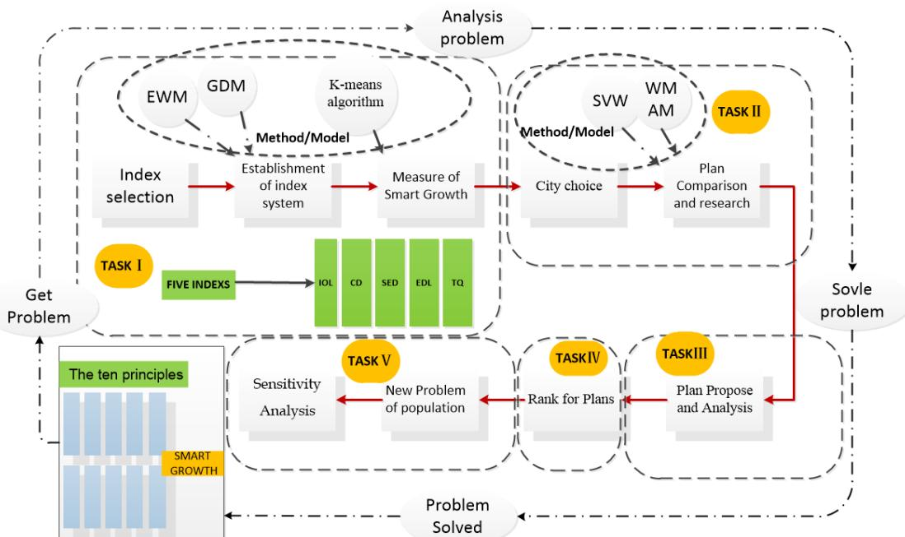
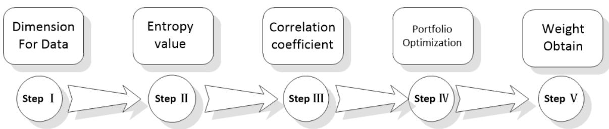
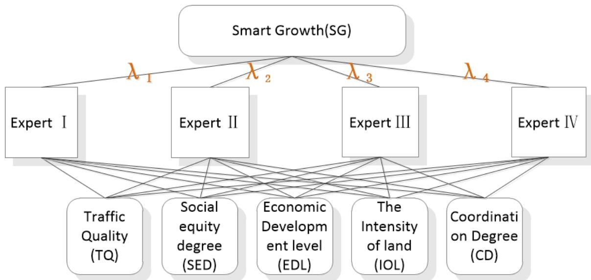
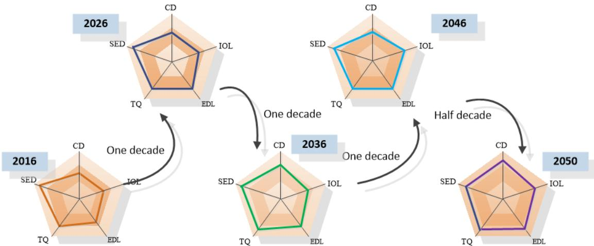
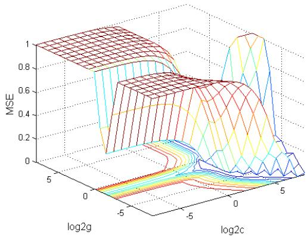

# 2017年美国大学生数学建模竞赛O奖论文（E题：城市智慧增长理论）

原件为竞赛论文。补充：文中的阅读练习及“参考解答”为整理时增加，原件图文保留出处。

## Smart Growth Theories in City Design

### Summary

With the development of global urbanization, urban planning has been a hot spot of most concern. Since the traditional urban sprawl plan has been gradually unable to meet the development needs of the city, smart growth is proposed in 1990’s. In this paper, a series of methods are developed to help to implement smart growth theories into city design.

In task 1, based on the gathered abundant data about smart growth of city, 25 indicators are selected by principal component analysis. Then we construct a new three-level indicator system, where the first level has 1 indicator, the second level has 5 indicators and the third level has 25 indicators to evaluate the success degree of the smart growth. Moreover, we use the entropy weight method (EWM) to get weight vector of the indicators in the third level and the group decision making method (GDM) to get the weight vector of indicators in the second-class. Meanwhile, the standard of the success of the smart growth is obtained through K-means algorithm. A metric system which include the intensity of land, social equity degree, traffic quality, coordination degree and economic development level, is eventually built to measure the success of smart growth of a city.

In task2, Pittsburgh and Ningguo are selected to research their current growth plan. Through the metric proposed in Task 1, the strengths and weaknesses of the current growth plan of selected cities is measured.

In task3, our smart growth plan is developed based on the index value of the cities. Then the support vector machine (SVM) and weighted moving average method(WMAM) are adopted to predict the change of indicators. The combined prediction model is subsequently adopted to minimize the prediction error. Eventually, by comparing the indicator between current city plan and our smart growth plan, we can see the success of our smart growth plan.

In task4, the single effect of the individual initiatives is evaluated by our metric to rank the potential. The result shows that the most potential to the success degree of the smart growth is the initiative of the economic development in Ningguo, while in Pittsburgh is the initiative of improving land intensive rate.

In task5, since the population structure between the two cites is different, two different population growth models(PGM) are adopted to predict the change of the population. The growth rate calculated by PGM demonstrates that our plan can adjust adaptively to satisfied the increasing need of population.

Finally, we analyze the strengths and weaknesses of the methods we proposed in this paper. The research can also satisfy the need of the ICM and make reasonable growth theories into city design.

更多数学建模资料请关注微店店铺“数学建模学习交流” https://k.weidian.com/RHO6PSpA

知识点：[可持续发展指数 SDI 的构建与指标体系结构](../../../topics/数学建模/kechixu_zhibiao.md)、[Summary Sheet（摘要页）的撰写规范](../../../topics/数学建模/zhaiyao_xiezuo.md)、[模型优缺点分析（Strengths and Weaknesses）](../../../topics/数学建模/youque_dian.md)

### Contents

1 Introduction .... 3
1.1 Background.... 3
1.2 Problem Statement and Analysis.... 3

2. Assumption and Symbol Explanation .... 4
2.1 Assumption.... 4
2.2 Symbol Explanation.... 4

3.Task 1 .... 4
3.1 Data Pre-processing.... 4
3.2 Primary Indicator System.... 5
3.3 Weighting Models of Evaluation Indicators.... 7
3.4 Comprehensive Evaluation Index.... 10
3.5 Metric of Smart Growth.... 12

4 Task 2 .... 13
4.1 Growth Plan of Selected Cities.... 13
4.2 City Index Evaluation.... 14
4.3 Analysis of Current Growth Plan.... 14

5 Task 3 .... 14
5.1 Our Smart Growth Plan(SGP).... 14
5.2 The Prediction Models for Evaluation.... 15
5.3 The Evaluation of Our Smart Growth Plan.... 16

6 Task 4 .... 17
6.1 Ranking the Individual Initiatives.... 17
6.2 Comparing the Initiatives of Two Cities.... 18

7 Task 5 .... 18
7.1 The Adaptable Plan For Pittsburgh.... 19
7.2 The Adaptable Plan For Ningguo.... 19

8. Sensitivity Analysis .... 20
9. Strengths and Weaknesses .... 21
9.1 Strengths.... 21
9.2 Weaknesses.... 21

References .... 21
Appendix .... 22

知识点：[数学建模的基本步骤（问题分析、模型假设、建立、求解、检验、推广）](../../../topics/数学建模/jianmo_buzhou.md)、[模型优缺点分析（Strengths and Weaknesses）](../../../topics/数学建模/youque_dian.md)

### 1 Introduction

知识点：[数学建模的基本步骤（问题分析、模型假设、建立、求解、检验、推广）](../../../topics/数学建模/jianmo_buzhou.md)、[文献综述与研究背景撰写方法](../../../topics/数学建模/wenxian_zongshu.md)、[一般假设及其合理性说明（Assumptions and Justifications）](../../../topics/数学建模/jiaben_shezhi.md)

### 1.1 Background

In recent years, urbanization has become an inevitable trend. It has been predicted that by 2050, about 66 percent of the world's population will be added to the city. [1] Consequently, formulating suitable urban plans have become a concern of governments. At an earlier time, some cities chose ‘urban sprawl’ strategy, namely, just like standing pancake. Urban sprawl is a special form of suburbanization. It includes the marginal expansion of the existing urbanization areas with very low population density, occupying land that has never been developed. Gradually, many problems were exposed when urban sprawl was carried out, such as environmental pollution, the land in excess consumption, High-cost infrastructure construction, etc.

In view of those problems, the concept of smart growth was proposed by Geoff Allderson. Ten principles for smart growth are proposed subsequently in [2]. SG is a means to curb continued urban sprawl and reduce the loss of farmland surrounding ur ban centers. It will make the town or city approach a more economically prosperous, socially equitable, and environmentally sustainable place.

知识点：[文献综述与研究背景撰写方法](../../../topics/数学建模/wenxian_zongshu.md)、[一般假设及其合理性说明（Assumptions and Justifications）](../../../topics/数学建模/jiaben_shezhi.md)、[可持续发展指数 SDI 的构建与指标体系结构](../../../topics/数学建模/kechixu_zhibiao.md)

### 1.2 Problem Statement and Analysis

Since smart growth is essential to urban construction, it is significant to propose an efficient method to give plans to meet the principle for smart growth in this problem. Therefore, index system is needed to evaluate the success of smart growth of a city firstly. Two specific cities are selected to evaluate the effect of their growth plans through index system. Then we have to propose feasible plans to help the growth of our selected cities. To measure the success of our plans, the index system is needed in a second time. Moreover, the potential of the individual initiatives should be ranked in this problem. Eventually, we need to explain in what ways our plan supports this level of growth if the population will increase by an additional 50% by 2050.

Through the above analysis, the flow chart of this paper is shown in fig.1 as fellows.

## 2. Assumption and Symbol Explanation

知识点：[问题重述与分析（Problem Restatement and Analysis）](../../../topics/数学建模/wenti_chongshu.md)、[一般假设及其合理性说明（Assumptions and Justifications）](../../../topics/数学建模/jiaben_shezhi.md)、[符号说明与术语定义（Nomenclature / Symbols and Definitions）](../../../topics/数学建模/fuhao_shuoming.md)

### 2.1 Assumption

- The government policy will not change in the short term.
- The data source is actual and reliable.
- Neglect the explosive changes when forecasting over the few decades.
- Score matrix given by experts is not affected by subjective factors.

知识点：[一般假设及其合理性说明（Assumptions and Justifications）](../../../topics/数学建模/jiaben_shezhi.md)、[文献综述与研究背景撰写方法](../../../topics/数学建模/wenxian_zongshu.md)、[Summary Sheet（摘要页）的撰写规范](../../../topics/数学建模/zhaiyao_xiezuo.md)

### 2.2 Symbol Explanation

| Symbol | Definition |
| :--- | :--- |
| $SDSG$ | the success degree of smart growth of a city |
| $IOL$ | The intensity of land |
| $SED$ | The social equity degree |
| $EDL$ | The economic development level |
| $TQ$ | The traffic quality |
| $CD$ | The coordination degree |
| $J(c_k)$ | the sum of squares of the distances from the sort center |
| $w_i$ | The weight of the i-th secondary indicator |

## 3. Task 1

知识点：[符号说明与术语定义（Nomenclature / Symbols and Definitions）](../../../topics/数学建模/fuhao_shuoming.md)

### 3.1 Data Pre-processing

#### 3.1.1 Data Collection

Collecting sufficient data is the basis of developing a complete index system. We searched the database and found 88 indicators of two cities firstly. The data of Pittsburgh in Pa is from city data [1] and the data of Ningguo which is located in Anhui, China are from National Bureau of Statistics of the People's Republic of China [2]. Then we searched the data of the ten cities which is used to set standards by clustering.

#### 3.1.2 Data Filling

The availability of data is an essential issue. No measures, regardless of its value, can provide efficient assessments if based on unreliable or untruthful data. Consequently, it is essential to ensure the continuity and authenticity of the research data. Nevertheless, some data is missing because not all data is provided in the website.

To ameliorate this situation, four methods are proposed to complete the data, which are as follows:

- If the indicator values are smooth, previous data can be adopted to replace it.
- If the data before and after can be obtained, the average value can be taken as the missing.
- If two groups are similar, then the missing data in one group can be replaced by the value of the same location in the other group.
- The interpolation method is used in data fitting.

知识点：[数学建模的基本步骤（问题分析、模型假设、建立、求解、检验、推广）](../../../topics/数学建模/jianmo_buzhou.md)、[模型参数的确定（基于数据拟合或实验选择）](../../../topics/数学建模/canshu_queding.md)

### 3.2 Primary Indicator System

#### 3.2.1 Select primary indicators by PCA

88 initial indicators are selected firstly to represent the smart growth of cities. Because there are a great deal of indicators related to smart growth, the method of PCA (Principal Component Analysis) is adopted to reduce the number of primary indicators. The selection of the initial 88 indicators for smart growth is based on 3E’s principles and 10 principles.

3E’s principles refers to Economically prosperous(EP), socially Equitable(SEQ), and Environmentally sustainable(ESU). Namely, keep economy sustained and steady, guarantee the right to fair and ensure environmental protection if the government adopt smart growth strategy.

Since the smart growth was presented in 1990’s, the ten principles for smart growth (SGP) have been proposed [2]. The SGP is also adopted as reference principles in our index selection. The SGP is mainly as follows:

1. Mix land uses.
2. Take advantage of compact building design.
3. Create a range of housing opportunities and choices.
4. Create walkable neighborhoods.
5. Foster distinctive, attractive communities with a strong sense of place.
6. Keep open space, farmland, natural beauty, and critical environmental areas.
7. Strengthen and direct development towards existing communities.
8. Provide a variety of transportation choices.
9. Make development decisions predictable, fair, and cost effective.
10. Encourage community and stakeholder collaboration in development decisions.

From the aforementioned selections, the initial selection of the primary indicators is selected. Then the method of PCA is adopted to reduce the number of the indicator. Eventually, 25 indicators are obtained as our primary indicators. Primary indicators are shown as in Tab. 1.

**Tab.1 Framework of sustainability indicators**

| Indicator | Unit | Explanation | Type |
| :--- | :--- | :--- | :--- |
| Diversity of land use: $x_{1}$ | - | It represents the structure of the land use. | 1,6 |
| Floor area ratio: $x_{2}$ | Percent | Building density is appeared in this indicate. | 2 |
| Land-use ratio: $x_{3}$ | Percent | It reflects the quantity of land use degree. | 2 |
| Urban Characteristics: $x_{4}$ | - | It represents the characteristics of the city in culture, nature, and history etc. | 5 |
| Public green space: $x_{5}$ | Sq. M | It denotes the groups of green belt such as residential area, parks etc. | 6 |
| Land occupation: $x_{6}$ | Sq. M | It denotes the actual control of the land area of the city. | ESU |
| Per capita water consumption: $x_{7}$ | Ton | It refers to the average daily water consumption of each people. | ESU |
| Industrial waste gas emissions | ppm | It presents the gas emissions from the factory. | ESU |

## 3.2 数据预处理

知识点：[可持续发展指数 SDI 的构建与指标体系结构](../../../topics/数学建模/kechixu_zhibiao.md)、[影响因素评估指标体系构建（温度、湿度、经济、教育等）](../../../topics/数学建模/yingxiang_zhibiao.md)

### 3.2.1 指标体系定义

| 指标名称 | 单位 | 描述 | 类型/来源 |
| :--- | :--- | :--- | :--- |
| Industrial solid waste emission: $x_{8}$ | Kilo-tons | It presents the solid emissions from the factory. | ESU |
| Wastewater discharge: $x_{10}$ | Ton/day | It is defined as an indicator to evaluate the quantity of wastewater. | ESU |
| Collaboration in development: CID | - | It reflects the collaboration in developing decisions. | 7,10 |
| Gini Coefficient: G | - | It represents the degree of fairness in the income distribution. | SEQ |
| Employment rate of male and female: $x_{11}$ | Percent | It reflects the different employment opportunities that result from gender | SEQ |
| School attendance Rate: $x_{12}$ | Percent | Education equity is represented by this indicator. | SEQ |
| Housing subsidy: $x_{13}$ | Dollar | It denotes the amount of housing grants for low-income people. | SEQ ,3 |
| Crimes rate: $x_{14}$ | Percent | It represents the ratio of the perpetrators to the total population. | SEQ, 5 |
| Economic efficient index: EEI | - | It reflects the effectiveness of urban economic development | EP |
| Economic structure index: ESI | - | The economic structure of city is presented in this indicator. | EP |
| Economic cost index: ECI | - | It reflects the cost of economic development in cities. | EP |
| Gross Domestic Product: GDP | Dollar | It is the core indicator of city economic accounting. | EP |
| Per capita fiscal expenditure: $x_{15}$ | Dollar | Assessing government administration cost | EP 9 |
| Pedestrian street area: $x_{16}$ | Sq. M | It indicates whether people have the suitable footpath. | 4 |
| Per capita amount of cars: $x_{17}$ | unit | It refers to the average level of ownership of vehicles in cities. | 8 |
| Transportation diversity: $x_{18}$ | - | It represents the diversity of urban transport. | 8 |
| Density of road network: $x_{19}$ | $km^{-1}$ | It reflects the development level of urban transportation. | 8 |

In this table, the Type value between 1-10 represents this indicator which reflects SGP. EP reflects the economically prosperous in 3E’s principle, while SEQ means socially Equitable. And ESU means environmentally sustainable.

知识点：[影响因素评估指标体系构建（温度、湿度、经济、教育等）](../../../topics/数学建模/yingxiang_zhibiao.md)、[可持续发展指数 SDI 的构建与指标体系结构](../../../topics/数学建模/kechixu_zhibiao.md)、[符号说明与术语定义（Nomenclature / Symbols and Definitions）](../../../topics/数学建模/fuhao_shuoming.md)

### 3.2.2 Data normalization

Since the dimensions of the 25 indicators are different, the data can’t be directly compared. To normalized the data, all the data is converted to number between 0 and 1.

Comparing these 25 indicators, the indexes can be classified as three types, cost-type index, benefit-type index and moderate-type index. Among the three classes of indexes, the smaller the cost-type index is, the better the success degree of smart growth is. The benefit-type index is opposite. Moderate-type index is better when it closer to a specific value. Due to the different contribution of the indexes, the three types of data are normalized in different ways as follows.

**$Q_j \in$ cost-type index**

Let $x_{ij}$ denote the $j-th$ index of the city, it can be expressed as [3]

$$
x_{ij} = \frac{x_j^{\max} - x_{ij}}{x_j^{\max} - x_j^{\min}}, i = 1, \dots , 25; j = 1, 2
$$

where

$$
\begin{array}{l} x_j^{\max} = \max \left\{x_1, x_2 \right\} \\ x_j^{\min} = \min \left\{x_1, x_2 \right\} \end{array}
$$

and $x_j^{\max}$ is the largest value of $Q_j$, $x_j^{\min}$ is the smallest value of $Q_j$.

**$Q_j \in$ benefit-type index**

$$
x_{ij} = \frac{x_{ij} - x_j^{\min}}{x_j^{\max} - x_j^{\min}}, i = 1, 2, \dots 23; j = 1, 2
$$

**$Q_j$ Moderate-type index**

$$
x_{ij} = \left\{ \begin{array}{c c} 1 - \frac{s_1 - d_{ij}}{\max \left\{s_1 - d_j^{\min}, d_j^{\max} - s_2 \right\}} & d_{ij} < s_1 \\ 1 & d_{ij} = s_1 \\ 1 - \frac{d_{ij} - s_2}{\max \left\{s_2 - d_j^{\min}, d_j^{\min} - s_2 \right\}} & d_{ij} > s_1 \end{array} \right.
$$

where $s_1$ is the best value of the indicator $Q$.

知识点：[影响因素评估指标体系构建（温度、湿度、经济、教育等）](../../../topics/数学建模/yingxiang_zhibiao.md)、[TOPSIS 模型构建步骤（逼近理想解排序法）](../../../topics/数学建模/topsis_moxing.md)、[模型参数的确定（基于数据拟合或实验选择）](../../../topics/数学建模/canshu_queding.md)

### 3.2.3 Quantification of qualitative indicators

Some qualitative indicators are used in our primarily indicators. Therefore, it is essential to propose a suitable metric to quantify indicators. Fuzzy evaluation [4] is adopted to solve this problem. In this model, we let $V$ denote evaluation set. And $A$ is weight set, which is obtained by AHP. $C$ is a set of comments made up of comments such as good, worse and etc. The relationship between $V$ and $C$ is described by fuzzy evaluation matrix $R$. The comprehensive evaluation model is given by

$$
P = A \circ R = \left(p_1, p_2, p_3 \dots p_n\right)
$$

Note that $p_n = \bigvee \left( a_i \wedge r_{ij} \right) \quad j = 1, 2, \cdots n$. $r_{ij}$ is calculated by $W$. $\wedge$ represents the minimum between $a_{ij}$ and $r_{ij}$. And $\bigvee$ represents the maximum in $\left( a_{ij} \wedge r_{ij} \right)$

Let $F$ denote the set of score, the evaluation score $Z$ is calculated ultimately by the following formula.

$$
Z = P \cdot F
$$

## 3.3 Weighting Models of Evaluation Indicators

Weighting models is essential to evaluate the different contribution of the indicators. Consequently, two weighting models are adopted to calculated the weight vector in thi section.

知识点：[层次分析法 AHP（Analytic Hierarchy Process）用于综合评价](../../../topics/数学建模/ahp_fangfa.md)

### 3.3.1 Weighting Model Based on Entropy Weight Method(EWM)

# 2017年美国大学生数学建模竞赛O奖论文（E题：城市智慧增长理论）

## 3.3.1 Entropy Weight Method Based on Correlation Coefficient

知识点：[模型参数的确定（基于数据拟合或实验选择）](../../../topics/数学建模/canshu_queding.md)、[影响因素评估指标体系构建（温度、湿度、经济、教育等）](../../../topics/数学建模/yingxiang_zhibiao.md)、[可持续发展指数 SDI 的构建与指标体系结构](../../../topics/数学建模/kechixu_zhibiao.md)

### 计算权重流程说明

由于现有指标不统一，目标处理需要首先降低指标的维度。本文采用基于相关系数的熵权法来解决这一问题。详细的算法流程如图 2 所示。

对于表中涉及的指标数据，我们首先得到如下矩阵：

$$
X _ {i j} = \begin{array}{c} \text {index} I _ {1} \\ \vdots \\ \text {index} I _ {m} \end{array} \left[ \begin{array}{c c c c} X _ {1 1} & X _ {1 2} & & X _ {1 n} \\ X _ {2 1} & X _ {2 2} & & X _ {2 n} \\ \vdots & \vdots & \vdots \\ X _ {m 1} & X _ {m 2} & & X _ {m n} \end{array} \right]
$$

#### Step Ⅰ：数据归一化

参与评价的指标包括 $\mathrm { LB } \cdot \mathrm { type } ^ { 3 }$（越大越好）和 SB-type（越小越好）。针对不同类型的指标值，使用以下两个公式进行归一化处理：

$$
X _ {i j} ^ {*} = \left\{ \begin{array}{l l} X _ {i j} / \max X _ {i j} & \text { for   LB } \\ \min X _ {i j} / X _ {i j} & \text { for   SB } \end{array} \right.
$$

> **注**：LB: the larger the better, SB: the smaller the better.

#### Step Ⅱ：计算熵值

令 $P _ { i j }$ 表示每个指标的比例，可通过以下公式计算：

$$
P _ {i j} = \frac {X _ {i j}}{\sum_ {j = 1} ^ {m} x _ {i j}}
$$

其中，熵值 $e _ { i }$ 由以下公式获得：

$$
e _ {i} = - k \sum_ {j = 1} ^ {m} p _ {i j} \ln p _ {i j}
$$

#### Step Ⅲ：计算相关系数

相关系数计算如下：

$$
r (E, S) = \frac {\sum_ {i = 1} ^ {n} \left(e _ {i} - \bar {e}\right) \left(s _ {i} - \bar {s}\right)}{\sqrt {\sum_ {i = 1} ^ {n} \left(e _ {i} - \bar {e}\right) ^ {2}} \sqrt {\sum_ {i = 1} ^ {n} \left(s _ {i} - \bar {s}\right) ^ {2}}}
$$

其中 $S$ 表示通过对大量数据进行聚类获得的标准指标熵。

#### Step Ⅳ：构建优化模型确定权重

通过这一步，使用如下所示的优化模型来确定熵权：

$$
\max = \sum_ {k = 1} ^ {m} r _ {k} W _ {k}
$$

$$
s. t. \left\{ \begin{array}{l} \sum_ {k = 1} ^ {m} W _ {k} = 1 \\ W _ {k} \geq 0, k = 1.. m \end{array} \right.
$$

根据上述优化模型，我们可以得到最终权重 $W _ { \boldsymbol { k } }$。由于相关熵与权重成正比，最终确定的权重在修正后的优化模型中与熵具有良好的正相关性。

具体的基于数据的指标权重将在第 4.1 节中呈现。

## 3.3.2 Weighting Model Based on Group Decision Making Method

为了完成指标的综合，我们对每个主要指标使用一致判断矩阵（GDM）进行加权。我们获取了上文中的指标，并给出了用于此评估的 GDM（参见图 3）：

对于每位专家，我们获得一个一致的互补判断矩阵，该矩阵根据专家对指标的经验和评分表进行打分。矩阵如下所示：

| | C1 | C2 | C3 | C4 | C5 |
|---|---|---|---|---|---|
| $E^{(I)} = C3$ | 0.5 | 0.1 | 0.2 | 0.7 | 0.3 |
| | 0.9 | 0.5 | 0.4 | 0.6 | 0.2 |
| | 0.8 | 0.6 | 0.5 | 0.3 | 0.1 |
| | 0.3 | 0.4 | 0.7 | 0.5 | 0.2 |
| | 0.7 | 0.8 | 0.9 | 0.8 | 0.5 |

We can obtain the weights by solving the eigenvectors of the above matrix.

| | C1 | C2 | C3 | C4 | C5 | | C1 | C2 | C3 | C4 | C5 |
| :---: | :---: | :---: | :---: | :---: | :---: | :---: | :---: | :---: | :---: | :---: | :---: |
| **C1** | 0.5 | 0.6 | 0.4 | 0.2 | 0.4 | **C1** | 0.5 | 0.2 | 0.4 | 0.6 | |
| **C2** | 0.4 | 0.5 | 0.1 | 0.3 | 0.1 | **C2** | 0.8 | 0.5 | 0.1 | 0.3 | |
| $E^{(III)}$ = **C3** | 0.6 | 0.9 | 0.5 | 0.4 | 0.2 | $E^{(IV)}$ = **C3** | 0.6 | 0.9 | 0.5 | 0.3 | |
| **C4** | 0.8 | 0.7 | 0.6 | 0.5 | 0.2 | **C4** | 0.4 | 0.7 | 0.7 | 0.5 | |
| **C5** | 0.6 | 0.9 | 0.8 | 0.8 | 0.5 | **C5** | 0.8 | 0.6 | 0.9 | 0.8 | |

According to the group decision-making method, the final weight can be obtained by combining the weight of experts and the weight of judgment matrix using the following equation：

$$
W ^ {*} = \sum_ {i = 1.. 4} \lambda_ {i} W ^ {(i)}
$$

where the result of the can be seen in the fellows.

$$
W ^ {(1)} = (0. 1 0 4 9 , 0. 1 5 0 2 , 0. 2 1 3 7 , 0. 2 6 7 5 , 0. 2 6 3 5) ^ {T}, \quad W ^ {(I I)} = (0. 1 3 7 0 , 0. 2 6 3 8 , 0. 1 3 8 1 , 0. 1 9 4 4 , 0. 2 6 6 7) ^ {T},
$$

$$
W ^ {(\mathrm{III})} = (0. 1 0 0 0 , 0. 1 4 8 1 , 0. 1 4 9 6 , 0. 2 8 8 5 , 0. 3 1 3 7) ^ {T}, \quad W ^ {(\mathrm{IV})} = (0. 1 2 6 0 , 0. 2 3 4 6 , 0. 2 2 8 3 , 0. 2 0 1 7 , 0. 2 0 9 4) ^ {T}
$$

The reliability of the weight is checked by the following method：

*   Through the consistency test, the consistency index value which should tend to zero is $C I = \left( \lambda _ { \operatorname* { m a x } } - n \right) / \left( n - 1 \right)$
*   We calculated the consistency ratio $C R = C I / R I$ , When $n = 1 , . . . , 2 0$ ,the value of RI is given as ,where the numbers in brackets indicate .

Through the method aforementioned, the weight vector of second-class indicator is eventually calculated. The specific value of the weight vector is shown in section 3.4.2.

知识点：[层次分析法 AHP（Analytic Hierarchy Process）用于综合评价](../../../topics/数学建模/ahp_fangfa.md)、[模型参数的确定（基于数据拟合或实验选择）](../../../topics/数学建模/canshu_queding.md)、[TOPSIS 模型构建步骤（逼近理想解排序法）](../../../topics/数学建模/topsis_moxing.md)

### 3.4 Comprehensive Evaluation Index

知识点：[可持续发展指数 SDI 的构建与指标体系结构](../../../topics/数学建模/kechixu_zhibiao.md)、[人类发展指数 HDI 的局限性与社会经济调整指数的构建](../../../topics/数学建模/hdi_zhibiao.md)

### 3.4.1 Determination of Second-class index

Five second-class indicators are identified after selecting a set of comprehensive and effective primary indicators and determining the reasonable weights, including The Intensity of land (IOL), Coordination degree(CD), Social equity degree (SED), Economic development level (EDL) and Traffic Quality (TQ). Especially, these five second-class indicators will be used to evaluate five dimensions of the smart growth city.

The Intensity of land (IOL), is the most important index of smart growth. IOL mainly contains five primary indicators. It’s mainly used to reflect the efficiency of land using, the diversity of land using and the rationality of land planning, etc.

Coordination degree(CD)is consisted of resource coordination degree, ecological coordination degree, cooperation and coordination degree. On the one hand, it reflects the resources and ecological carrying capacity. On the other hand, it mirrors communication and cooperation between governments and stakeholders.

Social equity degree (SED) considers the gap between the rich and poor, protection of socially vulnerable groups (e.g. women, children, the poor). Moreover, it also takes the safety into account.

Economic development level (EDL) is related to the quality of and the number of economic development. What’s more, per capita fiscal expenditure also is considered.it can measure cost effective degree.

Traffic Quality (TQ) expresses the regional level of patency. At the same time, TQ contains streets that People can walk freely.

The composition of the second-class indicators and the weight composition are shown as below.

Tab.2 The weight of second-class indicator

| Second-class indicator | Primary indicator and weight | Second-class indicator | Primary indicator and weight |
| :--- | :--- | :--- | :--- |
| **The Intensity Of land (IOL)** (26.7%) | Diversity of land use (10%) | **Traffic Quality (TQ)** (10.5%) | Pedestrian street area (23%) |
| | Floor area ratio (15%) | | Per capita amount of cars (24%) |
| | Land-use ratio (15%) | | Transportation diversity (27%) |
| | Urban Characteristics (29%) | | Density of road network (26%) |
| | Public green space (31%) | **Coordination Degree (CD)** (26.4%) | Land occupation (10%) |
| **Social equity degree (SED)** (15.0%) | Gini Coefficient (13%) | | Per capita water consumption (15%) |
| | Employment rate of male and female (23%) | | Industrial waste gas emission (18%) |
| | School attendance Rate (23%) | | Industrial solid waste emission (13%) |
| | Housing subsidy (20%) | | Wastewater discharge (16%) |
| | Crimes rate (21%) | | Collaboration in development (28%) |
| **Economic Development level (EDL)** (21.4%) | Economic efficient index (14%) | | Gross Domestic Product (19%) |
| | Economic structure index (26%) | | |
| | Economic cost index (14%) | | Per capita fiscal expenditure (27%) |

知识点：[影响因素评估指标体系构建（温度、湿度、经济、教育等）](../../../topics/数学建模/yingxiang_zhibiao.md)、[层次分析法 AHP（Analytic Hierarchy Process）用于综合评价](../../../topics/数学建模/ahp_fangfa.md)

### 3.4.2 Determination of First-Class Index

Based on the indicator system and weight method aforementioned, a comprehensive index is proposed to measure the success degree of smart growth (SDSG) of a city. The indicator system is used to provide the essential second-class indicators, while the weight method is adopted to evaluate the weights of the SGSD. Let SGSD denote the success degree of smart growth. The function of SGSD can be represented by

$$
S D S G = w _ {1} * I O L + w _ {2} * S E D + w _ {3} * T Q + w _ {4} * C D + w _ {5} * E D L
$$

where $w _ { i }$ is the weight of th second-class indicator. The specific weights are as follows.

$$
w = \left[ \begin{array}{l l l l l} 0. 2 6 7 & 0. 1 5 0 & 0. 1 0 5 & 0. 2 6 4 & 0. 2 1 4 \end{array} \right]
$$

Through the above analysis, a three-level comprehensive evaluation system is established. The three levels of evaluation indicators are shown in Fig.4

## 3.5 Metric of Smart Growth

知识点：[层次分析法 AHP（Analytic Hierarchy Process）用于综合评价](../../../topics/数学建模/ahp_fangfa.md)、[影响因素评估指标体系构建（温度、湿度、经济、教育等）](../../../topics/数学建模/yingxiang_zhibiao.md)、[可持续发展指数 SDI 的构建与指标体系结构](../../../topics/数学建模/kechixu_zhibiao.md)

### 3.5.1 Standard Setting Based on K-means Algorithm (KA)

Although three-levels of evaluation has been established aforementioned, a suitable standard is still needed to assess the success degree of smart growth in cites. Consequently, KA (K-means Clustering Algorithm) is adopted to make a reasonable standard. In this algorithm, the data set includes 25 second-class indicators. And denotes the number of the data subset, which is 3 in our method. The data objects are organized into 3 parti tions by KA. Let $\mu _ { k }$ denote the sort center of the partitions, the sum of squares of the distances from the sort center is represented by

$$
J \left(c _ {k}\right) = \sum_ {x _ {i} \in C _ {k}} \left\| x _ {i} - \mu_ {k} \right\| ^ {2}
$$

where $\boldsymbol { J } \left( \boldsymbol { c } _ { k } \right)$ denotes the sum of squares of the distances from the sort center. The goal of the PCA is to solve the following optimization problem.

$$
\begin{array}{l} \min = \sum_ {k = 1} ^ {3} \sum_ {i = 1} ^ {1 0} d _ {k i} \left\| x _ {i} - \mu_ {k} \right\| ^ {2} \\ s. t. d _ {k i} = \left\{ \begin{array}{l l} 1 & x _ {i} \in c _ {i} \\ 0 & x _ {i} \notin c _ {i} \end{array} \right. \end{array}
$$

知识点：[一般假设及其合理性说明（Assumptions and Justifications）](../../../topics/数学建模/jiaben_shezhi.md)、[确定模型的定点与稳定性分析](../../../topics/数学建模/dingdian_wending.md)、[文献综述与研究背景撰写方法](../../../topics/数学建模/wenxian_zongshu.md)

### 3.5.2 The Standard of Smart Growth (SG)

According to the KA aforementioned, the standard of SG is obtained eventually in this section. For each index, two class centers are calculated by clustering ten cities data firstly. Then the mean of the indicator centers is used as the standard boundary. The standard of smart growth is shown in fig.4.

The standard of each index is described in bar chart, which can evaluate the secondclass indicator qualitatively through interval. We use qualitative descriptions such as normal, good and excellent to measure the success of the city in an indicator. Normal means that the city has not realized smart growth in this area. And good means that the city has some success of SG in this area. Excellent is used to describe when city has great success of SG. Combining five second-class indexes, the radar diagram is adopted to describe the overall success of city in smart growth. The standard line is also shown in the fig.5.

## 4 Task 2

知识点：[模糊 C-均值聚类算法（目标函数、约束条件与迭代步骤）](../../../topics/数学建模/mohu_c_junzhi.md)、[影响因素评估指标体系构建（温度、湿度、经济、教育等）](../../../topics/数学建模/yingxiang_zhibiao.md)、[可持续发展指数 SDI 的构建与指标体系结构](../../../topics/数学建模/kechixu_zhibiao.md)

### 4.1 Growth Plan of Selected Cities

In this paper, Pittsburgh in Pa, US and Ningguo in Anhui, China are selected as examples to analyze the smart growth problem. There are about 322,450 people living in Pittsburgh. It is known as both "the Steel City" for its more than 300 steel-related businesses, and as the "City of Bridges" for its 446 bridges. The total population of Ningguo are 383,800 people. The area is 2487 square kilometers. As shown in fig.6, the left is Pittsburgh and Ningguo is on the right.

*   Promote agricultural industrialization, specialization.
*   Strengthen the construction of transport facilities.
*   Make every citizen has the right to equal access to education.
*   Enhance the city characteristics.

And the below is the plan of Pittsburgh.

*   Let people live in renovated homes and enjoy its parks, shops, and churches.
*   Protect and restore the ecological environment.
*   Reduce air pollution, water pollution, solid pollution.
*   Maintain economic prosperity and development.

知识点：[文献综述与研究背景撰写方法](../../../topics/数学建模/wenxian_zongshu.md)、[问题重述与分析（Problem Restatement and Analysis）](../../../topics/数学建模/wenti_chongshu.md)、[任务分解与目标明确](../../../topics/数学建模/renwu_fenjie.md)

### 4.2 City Index Evaluation

Based on the index system in section3.4 and the proposed standards in section3.5, the indexes which can reflect five dimensions of the city is calculated. The result is shown in fig.7 as fellows.

The specific analysis associated with the diagram is described in section4.3. The brown line in radar means the second-level indicator of Pittsburgh, while the blue line means the second-level indicator of Ningguo. Moreover, the bottom line means the pass line of the indicator, while the super line means the excellent line of the indicators.

知识点：[可持续发展指数 SDI 的构建与指标体系结构](../../../topics/数学建模/kechixu_zhibiao.md)、[影响因素评估指标体系构建（温度、湿度、经济、教育等）](../../../topics/数学建模/yingxiang_zhibiao.md)、[层次分析法 AHP（Analytic Hierarchy Process）用于综合评价](../../../topics/数学建模/ahp_fangfa.md)

### 4.3 Analysis of Current Growth Plan

After grasping the plan we searched in section4.1 and the result in section4.2, we can have a detailed analysis about our selected cities.

Firstly, as we can see from fig.7. In general, the indicator values of Pitts-burgh are larger than the Ningguo. The reason is that Pittsburgh is more developed than Ningguo. It’s economy and Society is more prosperous and equitable. Apart from this, the environment and Transport of Pittsburgh are more sustainable and convenient.

Specifically speaking, the values of five indicators of Ningguo are generally small, especially in coordination degree and economic development level. Its social equity degree (SED) and traffic quality (TQ) is at an average level. The intensity of land is just on the bottom line. Although the government of Ningguo developed a growth plan, it is not very perfect. It’s growth plan includes developing industry, agriculture, tertiary industry, ensuring fairness, keeping the city characteristics. It not involve with environmental protection, intensive use of urban land, infrastructure construction and so on. All these lead to the low level of smart growth of Ningguo.

Pittsburgh 's indicator values are relatively high. Social equity degree (SED)and traffic quality (TQ) are outstanding. This is largely related to its growth policy. Pittsburgh pays more attention to human, the ecological environment and economy. scientific plan makes Pittsburgh meet the smart growth principles relatively successfully.

## 5 Task 3

知识点：[可持续发展指数 SDI 的构建与指标体系结构](../../../topics/数学建模/kechixu_zhibiao.md)、[人口密度修正系数与新公式](../../../topics/数学建模/renkou_midu.md)

### 5.1 Our Smart Growth Plan (SGP)

知识点：[任务分解与目标明确](../../../topics/数学建模/renwu_fenjie.md)、[可持续发展指数 SDI 的构建与指标体系结构](../../../topics/数学建模/kechixu_zhibiao.md)、[长期预测模型（如20年可持续发展计划预测）](../../../topics/数学建模/nian_yuce.md)

### 5.2 The Prediction Models for Evaluation

知识点：[长期预测模型（如20年可持续发展计划预测）](../../../topics/数学建模/nian_yuce.md)、[可持续发展指数 SDI 的构建与指标体系结构](../../../topics/数学建模/kechixu_zhibiao.md)、[模型验证方法概述（随机模型与确定性模型验证）](../../../topics/数学建模/moxing_yanzheng.md)

### 5.2.1 Prediction Model Based On Support Vector Machine(SVM)

SVM is a new machine learning algorithm proposed by V.Vapnik et.al. of AT&TBell Lab. This method is used to estimate the relationship between input and output of a system according to a given sample, which can be used to forecast the change time of the index.

There are many subprograms in SVM. And SVR learning method is adopted to find the mapping function between time and indicator firstly, for this problem is a prediction problem. Similarly, there are multiple SVR methods in machine learning algorithm. Since epsilon-SVR has remarkable performance, it is selected to predict the change of indicators. The procedure of our epsilon-SVR is as follows.

Firstly, let time set $\mathbf { \xi } _ { t _ { i } }$ denote the time of the $i$ th year, then let $x _ { i }$ denote the index value for the $i$ th year. SVR is designed to find a function $x _ { i } ^ { ' } { = } \mathbf { f } \left( t _ { i } \right)$ that gives reasonable prediction index value. The error between $x _ { i }$ and $x _ { i } ^ { \ ' }$ is in an acceptable threshold through SVR algorithm. The function to be determined is as follows:

$$
x _ {i} ^ {\prime} = f (t) = w ^ {T} \psi (t) + \gamma
$$

In this formula, $\psi \left( x \right)$ is a kernel function of the feature vector, $w$ is a weighting vector and $\gamma$ means the bias term. In our method, Radial Basis Function(RBF) is adopted as our kernel, for it has outstanding performances in the vast majority of occasions. Year information data of two cities is inputted as train data in SVR, while the indicator value is used as train label. Then the SVR system is employed to predict $\psi$ and $\gamma$ in the formula above. The cross-validation will be adopted to validate the effect of our train model.

There are many parameters in SVR system, which can affect the performance of the prediction. The cost parameter C, which default value is 1, is used in C-SVC, epsilon-SVR, and nu-SVR. And the gamma parameter g set gamma in kernel function. The RBF kernel is determined as fellows

$$
\psi (x) = e ^ {- g | u - v | ^ {2}}
$$

Grid search algorithm is adopted to find the best parameters in predict model. After determined the ranges and the steps of the grid search, the best parameters will be tested to find the best combination. In our method, the search ranges are $\left[ 2 ^ { - 8 }, 2 ^ { 8 } \right]$ in steps of $2 ^ { 0 . 8 }$ for both parameter C and parameter g. In our method, Libsvm[5] is used to realize the algorithm of the SVM. The result of grid search is shown in fig.8.

From the fig.8, we can see that the train model has outstanding performance when the parameter $c = 2 ^ { 4 }$ and $\mathrm { g } = 2 ^ { - 3 }$.

知识点：[文献综述与研究背景撰写方法](../../../topics/数学建模/wenxian_zongshu.md)、[任务分解与目标明确](../../../topics/数学建模/renwu_fenjie.md)、[模型参数的确定（基于数据拟合或实验选择）](../../../topics/数学建模/canshu_queding.md)

### 5.2.2 Prediction Model Based On Time Series Forecasting

Owing to most of data we selected is aged, and future data is unknown. It is necessary to establish a suitable forecasting model. In there, time series forecasting model is selected. It is based on weighted moving average method (WMAM). The function of WMAM can be represented by

$$
\begin{array}{l} \hat {x} _ {t + 1} = \lambda_ {0} x _ {t} + \lambda_ {1} x _ {t - 1} + \dots + \lambda_ {N - 1} x _ {t - N + 1} \\ s. t \left\{ \begin{array}{c} \sum_ {i = 0} ^ {N - 1} \lambda_ {i} = 1 \\ \lambda_ {0} \geq \lambda_ {1} \geq \dots \geq \lambda_ {N - 1} \geq 0, i = 0, 1, \dots N - 1 \end{array} \right. \end{array}
$$

where $\lambda _ { i }$ is the weight of statistical data $x _ { t - i }$.

知识点：[模型参数的确定（基于数据拟合或实验选择）](../../../topics/数学建模/canshu_queding.md)、[长期预测模型（如20年可持续发展计划预测）](../../../topics/数学建模/nian_yuce.md)、[数学建模的基本步骤（问题分析、模型假设、建立、求解、检验、推广）](../../../topics/数学建模/jianmo_buzhou.md)

### 5.2.3 Combination of Prediction Model(CPM)

To combine the advantage of SVM and WMAM in prediction, CPM is adopted to predict the future index value. Let $l _ { i }$ denote the weighting factor of the $i$-th predict model. The value of $l _ { i }$ can be estimated by solving the following optimization

$$
\begin{array}{l} \min J = \sum_ {t = 1} ^ {N} \sum_ {i = 1} ^ {m} \sum_ {j = 1} ^ {m} l _ {i} l _ {j} e _ {i t} e _ {j t}, \\ s. t. \sum_ {i = 1} ^ {m} l _ {i} = 1. \end{array}
$$

where $J$ denotes the combining quadratic sum of predict of error, $e _ { i t }$ denotes the predict error of the $i$-th predict model.

知识点：[模型参数的确定（基于数据拟合或实验选择）](../../../topics/数学建模/canshu_queding.md)、[多目标优化模型（药物相对充足阶段的配送策略）](../../../topics/数学建模/duo_mubiao_youhua.md)、[参数合理性验证](../../../topics/数学建模/canshu_heli_xing.md)

### 5.3 The Evaluation of Our Smart Growth Plan

According to our combined prediction model, we can predict the success degree of smart growth the future of the two cities under the current and our plan. The results are shown below.

# 2017年美国大学生数学建模竞赛O奖论文（E题：城市智慧增长理论）（习题）第8部分

本部分为2017年美赛E题O奖论文的第8部分（对应原稿第17-19页），主要包含对两个城市（匹兹堡和宁国）智慧增长计划效果的对比分析、个体倡议的排名以及针对不同人口增长模式的适应性计划调整。

## 一、图表分析与计划效果评估

知识点：[模型优缺点分析（Strengths and Weaknesses）](../../../topics/数学建模/youque_dian.md)、[敏感性分析方法（Sensitivity Analysis，单参数与多参数变动）](../../../topics/数学建模/minganxing_fenxi.md)

### 综合计划效果对比分析

原文通过图9（Fig.9）展示了新计划与当前计划在城市智慧增长程度（SDSG）随时间变化的趋势。

- **横轴**：时间（Time）。
- **纵轴**：智慧增长程度（Degree of Smart Growth）。
- **线条说明**：
    - 黄色实线：匹兹堡的新计划（New plan for Pittsburgh）。
    - 黑色实线：匹兹堡的当前计划（Current plan for Pittsburgh）。
    - 黄色虚线：宁国的新计划（New plan for Ningguo）。
    - 黑色虚线：宁国的当前计划（Current plan for Ningguo）。

**分析结论**：
1.  **总体成功性**：从图9可以看出，我们的计划在总体上更成功地实现了智慧增长。
2.  **匹兹堡（Pittsburgh）**：
    -   由于匹兹堡的智慧增长程度（SDSG）已经非常高，因此很难有更高的增长率。
    -   我们的计划比其当前计划更好，但效果并不那么明显。
3.  **宁国（Ningguo）**：
    -   我们的计划效果显著。虽然起始的智慧增长程度不高，但其上升速度非常快。
    -   这反映了我们对宁国的计划非常有效。
4.  **早期增长特征**：在前几年，匹兹堡处于快速增长期，智慧增长程度（SGDG）增加非常迅速，这是因为第一年的投资强度较大。

## 二、Task 4：个体倡议排名

知识点：[模型优缺点分析（Strengths and Weaknesses）](../../../topics/数学建模/youque_dian.md)、[模型验证方法概述（随机模型与确定性模型验证）](../../../topics/数学建模/moxing_yanzheng.md)

### 选择 1 个体倡议的排名依据与方法

由于两个城市的多个方面都需要改善，且政府资金有限，无法实施所有倡议。因此，必须在我们重新设计的智慧增长计划中，对个体倡议按潜力从大到小进行排名。

-   **方法**：继续使用组合预测模型（Combined Forecasting Model）来评估每个城市个体倡议的成功率。
-   **结果展示**：预测结果如图10（Fig.10）和图11（Fig.11）所示。

知识点：[TOPSIS 模型构建步骤（逼近理想解排序法）](../../../topics/数学建模/topsis_moxing.md)、[任务分解与目标明确](../../../topics/数学建模/renwu_fenjie.md)

### 选择 2 匹兹堡个体倡议排名分析

基于图10的结果：
-   **横轴**：时间。
-   **纵轴**：智慧增长程度（SDSG）。
-   **柱状图含义**：表示每个个体倡议与当前计划之间的差异值。
-   **评价标准**：考虑每一个体倡议单独作用时，如果每个个体倡议的SDSG差异越大，则计划的改进越好，意味着该计划有效。

**具体排名**：
1.  **最有潜力（Most Potential）**：第3项倡议（提高土地利用集约率，Improve the land intensive rate）。
2.  **次有潜力**：第1项倡议。
3.  **潜力最小（Least Potential）**：第2项倡议（优化经济发展结构，Optimize the economic development structure）。

知识点：[影响因素评估指标体系构建（温度、湿度、经济、教育等）](../../../topics/数学建模/yingxiang_zhibiao.md)、[可持续发展指数 SDI 的构建与指标体系结构](../../../topics/数学建模/kechixu_zhibiao.md)、[TOPSIS 模型构建步骤（逼近理想解排序法）](../../../topics/数学建模/topsis_moxing.md)

### 选择 3 宁国个体倡议排名分析

基于图11的结果：
1.  **最有潜力**：第3项倡议（推动经济发展，Push on the economic development）。
2.  **第二有潜力**：第2项倡议（加强工厂控制并培养居民环保意识，Strengthen the control of the factory and cultivate environmental awareness of residents）。
3.  **第三有潜力**：第1项倡议（提高容积率并提高空间利用效率，Increase the floor area ratio and Improve space utilization efficiency）。
4.  **第四有潜力**：第4项倡议（保护弱势群体，如增加儿童福利，Protect vulnerable groups, such as increase child welfare）。
5.  **第五有潜力**：第5项倡议（适当提高路网密度并确保道路畅通，Improve road network density appropriately and ensure the smooth flow of roads）。

知识点：[TOPSIS 模型构建步骤（逼近理想解排序法）](../../../topics/数学建模/topsis_moxing.md)、[影响因素评估指标体系构建（温度、湿度、经济、教育等）](../../../topics/数学建模/yingxiang_zhibiao.md)、[多目标优化模型（药物相对充足阶段的配送策略）](../../../topics/数学建模/duo_mubiao_youhua.md)

### 选择 4 两城市倡议对比

不同城市有不同的环境背景，因此匹兹堡和宁国的计划及排名均不相同。

-   **宁国**：将经济发展放在首位（First place）。
-   **匹兹堡**：提高土地利用集约率是最有潜力的（Most potential）。
-   **潜力最小的对比**：
    -   宁国潜力最小的是：适当提高路网密度并确保道路畅通。
    -   匹兹堡潜力最小的是：优化经济发展结构。

## 三、Task 5：适应性计划

考虑到不同城市具有不同的人口增长模式，针对匹兹堡和宁国等城市制定了不同的人口增长模型。当人口增长率增加时，采取不同的措施来改进我们的计划。人口增长的预测如图12所示。

知识点：[文献综述与研究背景撰写方法](../../../topics/数学建模/wenxian_zongshu.md)

### 选择 5 匹兹堡的适应性计划

**背景**：
匹兹堡是一个拥有智慧增长计划的城市，具有合适的人口增长模式。人口增长率是城市智慧增长的关键因素。

**人口增长模型公式**：
预测人口增长模型的函数如下：

$$
P(t) = P(0)(1 + r)^t
$$

其中：
-   $P(t)$ 表示第 $t$ 年该市的人口。
-   $r$ 是人口增长率。

**参数设定**：
对于匹兹堡，假设到2050年人口增加到50%，即匹兹堡的人口达到450,000人。

**计划调整策略**：
通过计算获得我们方案的执行结果，并通过自适应规划规则，使SDSG保持像图13所示的良好增长趋势。提出的具体计划如下：

-   限制城市建筑的扩张。并在原有基础上使协调度（CD）增加标量 0.3%。
-   改善经济结构，在原有基础上增加 1%。
-   严格控制土地占用率，使其年增长率值为 1.2%。

**结论**：
根据图中数据可以看出，在未来几十年内，人口增长对匹兹堡市各项指标的影响不显著。我们断言我们的计划非常适合像匹兹堡这样的城市类型。

知识点：[数学建模的基本步骤（问题分析、模型假设、建立、求解、检验、推广）](../../../topics/数学建模/jianmo_buzhou.md)、[模型参数的确定（基于数据拟合或实验选择）](../../../topics/数学建模/canshu_queding.md)、[参数合理性验证](../../../topics/数学建模/canshu_heli_xing.md)

### 选择 6 宁国的适应性计划

**背景**：
宁国是一个人口众多且人口增长迅速的城市（见图8）。

**模型提出**：
考虑到宁国的实际情况，提出了一个人口增长模型（PGM, Population Growth Model）。

*(注：原文此处结束于第19页，后续内容未提供)*

# 2017年美国大学生数学建模竞赛O奖论文（E题：城市智慧增长理论）

本部分为第 9 部分，包含灵敏度分析、优缺点总结及参考文献附录。

## 一、灵敏度分析

知识点：[数学建模的基本步骤（问题分析、模型假设、建立、求解、检验、推广）](../../../topics/数学建模/jianmo_buzhou.md)、[敏感性分析方法（Sensitivity Analysis，单参数与多参数变动）](../../../topics/数学建模/minganxing_fenxi.md)

### 8. Sensitivity Analysis

在本节中，我们对参数 $g$ 进行了灵敏度分析，该分析基于支持向量机（SVM）预测模型。SVM 的灵敏度分析如图 15 所示。

其中，MSE 表示均方误差，反映了训练模型的准确性；$\log_2 g$ 表示参数 $g$ 的对数；$\log_2 c$ 表示参数 $c$ 的对数。如图所示，训练模型的准确性随 $c$ 和 $g$ 的变化而变化。

## 二、优缺点总结

知识点：[敏感性分析方法（Sensitivity Analysis，单参数与多参数变动）](../../../topics/数学建模/minganxing_fenxi.md)、[模型优缺点分析（Strengths and Weaknesses）](../../../topics/数学建模/youque_dian.md)

### 9. Strengths and Weaknesses

#### 9.1 Strengths

- 采用客观权重法（熵权法）与主观权重法（群体决策法），获得了更有效的权重。
- 采用组合预测模型，结合两种预测模型的优势，在一定程度上消除了缺点，提高了预测精度。
- 使用雷达图反映城市在发展过程中的优势与劣势，结果展示更加生动。

#### 9.2 Weaknesses

- 尽管我们已尽力而为，但时间有限，部分数据缺失。因此，缺失的数据仍可能带来评估误差。
- 由于可用数据较少，部分参数基于常识确定。

## 三、参考文献

[1] COMAP. (2017). ICM Problems.zip. http://www.comap.com/undergraduate/contests/mcm/contests/2017/problems/2017_MCM-ICM_Problems.zip

[2] EPA, “Smart Growth: A Guide to Developing and Implementing Greenhouse Gas Reductions Programs.” 2011. http://www.sustainablecitiesinstitute.org/Documents/SCI/Report_Guide/Guide_EPA_SmartGrowth GHGReduction_2011.pdf

[3] Wei-Xiang XU, Quan-shou ZHANG. An Algorithm of Meta-Synthesis Based on the Grey Theory and Fuzzy Mathematics [J]. Systems engineering theory and practice, 2001,(4): 114-119

[4] Zhang Lingying. A Fuzzy Evaluation method for Subjective Index Appraisal[J]. Systems Engineering Theory & Practice.

[5] Libsvm: the code of SVR from http://www.csie.ntu.edu.tw/~cjlin/libsvm/ for machine learning.

[6] Chuanglin Fang, Deli Wang. The Comprehensive Measurement and Promotion Path of Urbanization Development Quality in China[J]. Institute of Geographic Sciences and Natural Resources Research, Chinese Academy of Sciences. Geographical Research. 2011.11:1931-1946.

[7] Altas, Nur Esin., & Ozsoy, A. (1998). Spatial Adaptability and Flexibility as Parameters of User Satisfaction for Quality Housing. Building and Environment, 33, 315-323.

[8] Angelidou, Margarita . (2014). Smart city policies: A spatial approach. Cities, 41, S3–S11.

[9] Belanche, Daniel., Casaló, Luis V., & Orús, Carlos .(2016). City attachment and use of urban services: Benefits for smart cities. Cities, 50, 75–81.

[10] Budde.P., Rassia, S.Th., & Pardalos., P.M. (eds.). (2014). Cities for Smart Environmental and Energy Futures. Energy Systems. Heildeberg: Springer

[11] Heng, Chye Kiang., & Malone-Lee, L.C. (2010) Density and Urban Sustainability: An Exploration of Critical Issues. In Ng, Edward. Designing High-Density Cities for Social and Environmental Sustainability (pp.41-52). UK and USA: Earthscan.

[12] Smith, Carl., Clayden, A., & Dunnet, N. (2008). Residential Landscape Sustainability. Oxford UK: Blackwell Publishing.

[13] Song, Yan.(2005). Smart Growth and Urban Development Pattern: A Comparative Study. International Regional Science Review, 28, 239.

[14] Spreiregen, Paul D, 1965, Urban Design: The Architecture of Towns and Cities, Mc-Graw,Hill, New York.

[15] Thomas, Randall, 2003, Sustainable Urban Design- an Environmental Approach, Spon Press,New York

[16] Turner, Matthew A.,(2007). A simple theory of smart growth and sprawl. Journal of Urban Economics, 61, 21–44.

[17] Udy, John, 2004, Man Makes the City, Urban Development and Planning, Trafford Publishing, Canada.

[18] Zahnd, Markus, 1999, Perancangan Kota Secara Terpadu, Penerbit Kanisius, Yogyakarta.

[19] Hodgkinson, Steve. (2011). Is Your City Smart Enough?. Reference Code: OI00130-007., Ovum.

[20] Johnson, Matthew, 1993, Housing Culture, Traditional Architecture in an English Landscape, UCL Press, London

[21] Jucevicius, Robertas., Patašiene, I., & Patašius, M. (2014).Digital dimension of smart city: critical analysis. Procedia - Social and Behavioral Sciences, 156, 146–150.

[22] Kostof, Spiro. (1991). The City Shaped, Urban Patterns and Meanings Through History.London: Thames and Hudson.

[23] Lawson, Bryan. (2010). The Social and Psychological Issues of High-Density City Space. In Ng, Edward.Designing High-Density Cities for Social and Environmental Sustainability (pp.282- 292). UK and USA: Earthscan.

## 四、附录

知识点：[模型优缺点分析（Strengths and Weaknesses）](../../../topics/数学建模/youque_dian.md)、[模型参数的确定（基于数据拟合或实验选择）](../../../topics/数学建模/canshu_queding.md)、[文献综述与研究背景撰写方法](../../../topics/数学建模/wenxian_zongshu.md)

### Appendix

The code of the grid search in SVM

知识点：[符号说明与术语定义（Nomenclature / Symbols and Definitions）](../../../topics/数学建模/fuhao_shuoming.md)
