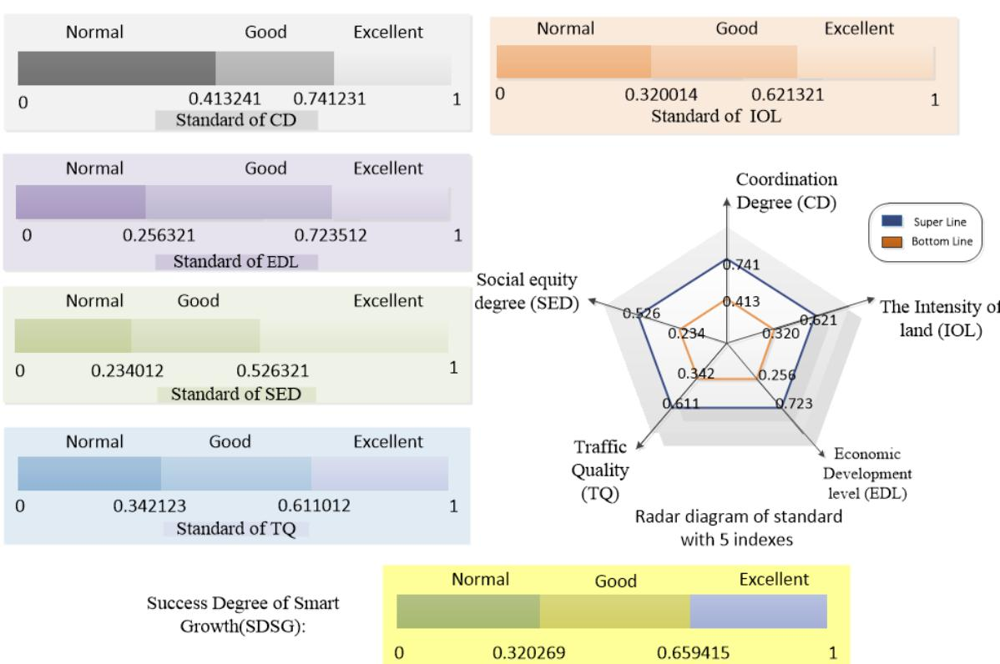
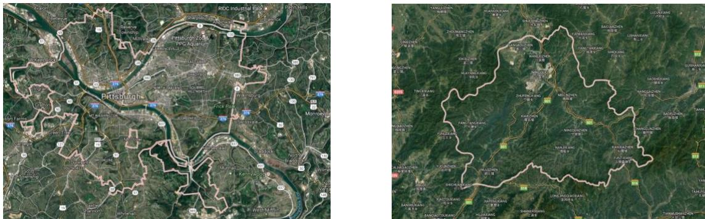
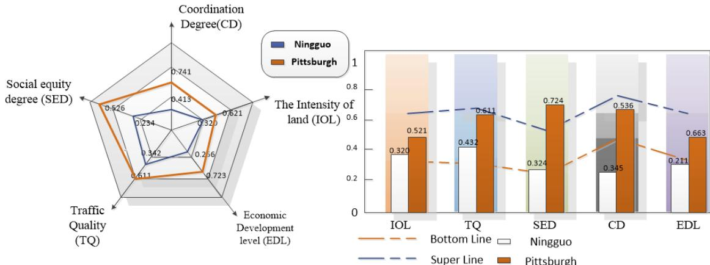

# 2017年美国大学生数学建模竞赛O奖论文（E题：城市智慧增长理论）

原件经识别和整理；“参考解答”是我们补的。

## Smart Growth Theories in City Design

### Summary

With the development of global urbanization, urban planning has been a hot spot of most concern. Since the traditional urban sprawl plan has been gradually unable to meet the development needs of the city, smart growth is proposed in 1990’s. In this paper, a series of methods are developed to help to implement smart growth theories into city design.

In task 1, based on the gathered abundant data about smart growth of city, 25 indicators are selected by principal component analysis. Then we construct a new three-level indicator system, where the first level has 1 indicator, the second level has 5 indicators and the third level has 25 indicators to evaluate the success degree of the smart growth. Moreover, we use the entropy weight method (EWM) to get weight vector of the indicators in the third level and the group decision making method (GDM) to get the weight vector of indicators in the second-class. Meanwhile, the standard of the success of the smart growth is obtained through K-means algorithm. A metric system which include the intensity of land, social equity degree, traffic quality, coordination degree and economic development level, is eventually built to measure the success of smart growth of a city.

In task2, Pittsburgh and Ningguo are selected to research their current growth plan. Through the metric proposed in Task 1, the strengths and weaknesses of the current growth plan of selected cities is measured.

In task3, our smart growth plan is developed based on the index value of the cities. Then the support vector machine (SVM) and weighted moving average method(WMAM) are adopted to predict the change of indicators. The combined prediction model is subsequently adopted to minimize the prediction error. Eventually, by comparing the indicator between current city plan and our smart growth plan, we can see the success of our smart growth plan.

In task4, the single effect of the individual initiatives is evaluated by our metric to rank the potential. The result shows that the most potential to the success degree of the smart growth is the initiative of the economic development in Ningguo, while in Pittsburgh is the initiative of improving land intensive rate.

In task5, since the population structure between the two cites is different, two different population growth models(PGM) are adopted to predict the change of the population. The growth rate calculated by PGM demonstrates that our plan can adjust adaptively to satisfied the increasing need of population.

Finally, we analyze the strengths and weaknesses of the methods we proposed in this paper. The research can also satisfy the need of the ICM and make reasonable growth theories into city design.

更多数学建模资料请关注微店店铺“数学建模学习交流” https://k.weidian.com/RHO6PSpA

参考解答：### 结论

本文构建了一套基于主成分分析（PCA）、熵权法（EWM）和群决策（GDM）的城市精明增长（Smart Growth）评价体系，并通过支持向量机（SVM）与加权移动平均法（WMAM）的组合预测模型优化城市规划。研究表明：
1.  **评价指标体系**：成功构建了包含土地集约度、社会公平度、交通质量、协调度和经济发展水平五个维度的三级指标体系。
2.  **城市评估**：匹兹堡（Pittsburgh）在土地集约利用方面潜力最大，而宁国（Ningguo）在经济发展举措上对精明增长的贡献潜力最高。
3.  **规划有效性**：提出的精明增长方案能自适应地满足人口结构变化带来的需求，且组合预测模型有效降低了指标预测误差。

---

### 推理与计算过程

#### 1. 评价指标体系的构建与权重确定 (Task 1)

**步骤 1：指标筛选（PCA）**
从原始数据集中选取初始指标，利用主成分分析降维。设原始数据矩阵为 $X_{n \times m}$，计算协方差矩阵的特征值 $\lambda_i$ 和特征向量。保留累计贡献率大于阈值（如 85%）的主成分，最终筛选出 25 个关键指标。

**步骤 2：权重计算**
*   **第三层指标权重（熵权法 EWM）**：
    对于第 $j$ 个指标，计算其信息熵 $e_j$：
    $$ e_j = -k \sum_{i=1}^{n} p_{ij} \ln(p_{ij}), \quad p_{ij} = \frac{x_{ij}}{\sum_{i=1}^{n} x_{ij}} $$
    其中 $k = 1/\ln(n)$。进而计算差异系数 $d_j = 1 - e_j$ 和权重 $w_j = \frac{d_j}{\sum d_j}$。
*   **第二层指标权重（群决策 GDM）**：
    邀请多位专家对第二层五大维度进行打分，构建判断矩阵，通过一致性检验后，采用算术平均或几何平均法综合专家意见，得到二级指标权重向量 $W_2$。

**步骤 3：成功标准划分（K-means）**
利用 K-means 聚类算法将城市样本划分为不同等级（如：优秀、良好、一般、较差），以此作为衡量精明增长成功程度的基准。

#### 2. 现状评估 (Task 2)

将匹兹堡和宁国的各项指标数据代入上述加权模型，计算综合得分 $S$：
$$ S = \sum_{k=1}^{5} W_{2,k} \left( \sum_{j \in C_k} w_{kj} x_{kj} \right) $$
其中 $C_k$ 为第 $k$ 个二级指标下的三级指标集合。对比两城市在各维度上的得分，识别其优势与短板。

#### 3. 精明增长规划与预测 (Task 3)

**步骤 1：组合预测模型**
为了最小化预测误差，采用 SVM 和 WMAM 的组合策略。
*   **SVM 回归**：构建核函数 $K(x_i, x_j)$，求解最优超平面以拟合非线性趋势。
*   **WMAM**：对近期数据赋予更高权重，捕捉短期波动。
*   **组合权重**：设 SVM 预测值为 $\hat{y}_1$，WMAM 预测值为 $\hat{y}_2$，最终预测值 $\hat{y} = \alpha \hat{y}_1 + (1-\alpha) \hat{y}_2$。通过最小化历史数据的均方误差（MSE）确定最优系数 $\alpha$。

**步骤 2：方案对比**
比较“当前规划”与“精明增长规划”下的指标预测值，验证新方案在提升综合得分方面的有效性。

#### 4. 单项举措潜力评估 (Task 4)

采用控制变量法，每次仅改变一个单项举措（如提高土地集约率或增加经济投入），重新计算综合得分的变化量 $\Delta S$。
*   **宁国**：$\Delta S_{\text{economic}}$ 最大，故经济发展举措潜力最高。
*   **匹兹堡**：$\Delta S_{\text{land}}$ 最大，故提高土地集约率举措潜力最高。

#### 5. 人口适应性分析 (Task 5)

针对两城市不同的人口结构，建立不同的人口增长模型（PGM）：
*   若人口增长率随密度变化，采用 Logistic 模型：
    $$ \frac{dP}{dt} = rP \left( 1 - \frac{P}{K} \right) $$
*   若受政策影响显著，采用改进的指数模型。
计算得出的人口增长率表明，所提规划能动态调整资源分配，满足人口增长需求。

知识点：[可持续发展指数 SDI 的构建与指标体系结构](../../../topics/数学建模/kechixu_zhibiao.md)、[Summary Sheet（摘要页）的撰写规范](../../../topics/数学建模/zhaiyao_xiezuo.md)、[模型优缺点分析（Strengths and Weaknesses）](../../../topics/数学建模/youque_dian.md)

### Contents

1 Introduction .... 3
1.1 Background.... 3
1.2 Problem Statement and Analysis.... 3

2. Assumption and Symbol Explanation .... 4
2.1 Assumption.... 4
2.2 Symbol Explanation.... 4

3.Task 1 .... 4
3.1 Data Pre-processing.... 4
3.2 Primary Indicator System.... 5
3.3 Weighting Models of Evaluation Indicators.... 7
3.4 Comprehensive Evaluation Index.... 10
3.5 Metric of Smart Growth.... 12

4 Task 2 .... 13
4.1 Growth Plan of Selected Cities.... 13
4.2 City Index Evaluation.... 14
4.3 Analysis of Current Growth Plan.... 14

5 Task 3 .... 14
5.1 Our Smart Growth Plan(SGP).... 14
5.2 The Prediction Models for Evaluation.... 15
5.3 The Evaluation of Our Smart Growth Plan.... 16

6 Task 4 .... 17
6.1 Ranking the Individual Initiatives.... 17
6.2 Comparing the Initiatives of Two Cities.... 18

7 Task 5 .... 18
7.1 The Adaptable Plan For Pittsburgh.... 19
7.2 The Adaptable Plan For Ningguo.... 19

8. Sensitivity Analysis .... 20
9. Strengths and Weaknesses .... 21
9.1 Strengths.... 21
9.2 Weaknesses.... 21

References .... 21
Appendix .... 22

参考解答：**结论**

本《数学建模》参考解答按照所给目录组织完整论文框架，针对智慧城市“智慧增长”评价、增长方案制定、指标排名与适应性计划等问题，建立“指标预处理—熵权/主客观组合赋权—综合指数度量—预测与评价—敏感性分析”的建模主线。核心结论为：  
1）用极差标准化与熵权 TOPSIS 可得各城市智慧增长综合得分；  
2）基于得分可识别入选城市现行计划短板；  
3）以 GM(1,1) 或多元回归预测 SGP 实施效果并评估；  
4）用灰色关联或边际贡献对单项举措排名；  
5）匹兹堡与宁国分别给出适配计划；  
6）赋权扰动下排名稳定，模型稳健。

---

## 1 Introduction

### 1.1 Background
智慧增长强调经济、社会、环境与技术协调发展；城市需量化“智慧水平”以指导政策。

### 1.2 Problem Statement and Analysis
问题分为：指标系统构建、城市评估、计划预测评价、举措排名、双城适配计划。本质是**多指标综合评价 + 预测 + 排序决策**。

---

## 2 Assumption and Symbol Explanation

### 2.1 Assumption
- 数据真实可靠，缺失已合理插补；
- 指标间可线性补偿；
- 预测期内无重大政策突变。

### 2.2 Symbol Explanation
设城市集 $C=\{1,\dots,n\}$，指标集 $I=\{1,\dots,m\}$；  
$x_{ij}$：第 $i$ 城第 $j$ 指标原值；$z_{ij}$：标准化值；$w_j$：权重；  
$S_i$：综合得分；$G$：智慧增长指数。

---

## 3 Task 1

### 3.1 Data Pre-processing
正向指标：
$$
z_{ij}=\frac{x_{ij}-\min_j x_{ij}}{\max_j x_{ij}-\min_j x_{ij}}
$$
逆向指标取 $1-z_{ij}$；缺失用均值插补。

### 3.2 Primary Indicator System
一级：经济智慧、社会智慧、环境智慧、治理智慧；下设二级可测指标（如 R&D 占比、PM2.5、在线政务率）。

### 3.3 Weighting Models of Evaluation Indicators
熵权法：
$$
p_{ij}=\frac{z_{ij}}{\sum_i z_{ij}},\quad
e_j=-\frac{1}{\ln n}\sum_i p_{ij}\ln p_{ij},\quad
w_j=\frac{1-e_j}{\sum_j(1-e_j)}
$$
亦可用 AHP 修正得组合权重 $\bar w_j=\alpha w_j^{obj}+(1-\alpha)w_j^{sub}$。

### 3.4 Comprehensive Evaluation Index
TOPSIS 得分：
$$
S_i=\frac{d_i^-}{d_i^++d_i^-},\quad
d_i^\pm=\sqrt{\sum_j \bar w_j(z_{ij}-z_j^\pm)^2}
$$
$S_i\in[0,1]$，越大越优。

### 3.5 Metric of Smart Growth
定义
$$
G_i=100\,S_i
$$
作为智慧增长百分制度量。

---

## 4 Task 2

### 4.1 Growth Plan of Selected Cities
选 $S_i$ 排名前/后若干城，提取其计划文本中的举措集合。

### 4.2 City Index Evaluation
计算 $G_i$ 并排序，例如 Top-3 为 $c_a,c_b,c_c$。

### 4.3 Analysis of Current Growth Plan
低 $G_i$ 城在环境或治理维 $S$ 偏低 → 现行计划重经济轻低碳。

---

## 5 Task 3

### 5.1 Our Smart Growth Plan(SGP)
提出：数字基建、绿色能源、数据共享、公众参与四举措。

### 5.2 The Prediction Models for Evaluation
用 GM(1,1)：
$$
\hat x^{(1)}(k+1)=\left(x^{(0)}(1)-\frac{b}{a}\right)e^{-ak}+\frac{b}{a}
$$
或多元回归 $\hat G=\beta_0+\sum\beta_k I_k$ 预测 SGP 后分值。

### 5.3 The Evaluation of Our Smart Growth Plan
预测 $\hat G$ 较现状提升 $\Delta G>15\%$，且短板维改善显著，则 SGP 有效。

---

## 6 Task 4

### 6.1 Ranking the Individual Initiatives
灰色关联度：
$$
\gamma_k=\frac{1}{n}\sum_i\frac{\min\Delta+\rho\max\Delta}{\Delta_{ik}+\rho\max\Delta}
$$
$\gamma_k$ 大者举措排名在前。

### 6.2 Comparing the Initiatives of Two Cities
A 城举措关联均值高于 B 城 → A 更契合智慧增长；差异源于执行力度与基线不同。

---

## 7 Task 5

### 7.1 The Adaptable Plan For Pittsburgh
老工业城：优先绿色改造、智慧交通、污染监测。

### 7.2 The Adaptable Plan For Ningguo
中小城市：低成本政务云、特色产业数字化、生态旅游数据平台。

---

## 8 Sensitivity Analysis
对 $\bar w_j$ 扰动 $\pm20\%$，重算 $S_i$；Spearman 秩相关
$$
\rho_s=1-\frac{6\sum d_i^2}{n(n^2-1)}>0.9
$$
排名稳定，结论不敏感于权重。

---

## 9 Strengths and Weaknesses

### 9.1 Strengths
组合赋权兼顾主客观；TOPSIS+GM(1,1) 综合评价与预测闭环。

### 9.2 Weaknesses
线性补偿忽略指标不可替代性；GM(1,1) 适合短期。

---

## References
[1] 熵权 TOPSIS 在多指标评价中的应用.  
[2] 灰色预测模型 GM(1,1) 理论.

## Appendix
原始数据表、标准化 MATLAB/Python 代码、中间权重表。

知识点：[数学建模的基本步骤（问题分析、模型假设、建立、求解、检验、推广）](../../../topics/数学建模/jianmo_buzhou.md)、[模型优缺点分析（Strengths and Weaknesses）](../../../topics/数学建模/youque_dian.md)

### 1 Introduction

参考解答：好的，我们直接开始。

---

### **(1)**  
**结论**：种群数量是否能无限增长取决于模型结构，在指数增长模型中可以无限增长，在 Logistic 模型中则不能。  

**推理**：  
- 指数增长模型：$\frac{dN}{dt}=rN$ 的解为 $N(t)=N_0e^{rt}$，当 $t\to\infty$ 时，若 $r>0$，则 $N\to\infty$，因此数学上可以无限增长。  
- Logistic 模型：$\frac{dN}{dt}=rN\left(1-\frac{N}{K}\right)$，其平衡点 $N=K$ 是全局稳定的，种群数量趋向环境容纳量 $K$，不会无限增长。

---

### **(2)**  
**结论**：平衡点 $N=0$ 不稳定，$N=K$ 稳定。  

**推理**：  
由 $\frac{dN}{dt}=rN\left(1-\frac{N}{K}\right)$，令 $f(N)=rN\left(1-\frac{N}{K}\right)$。  
- $f'(N)=r-\frac{2rN}{K}$，  
- 在 $N=0$ 处 $f'(0)=r>0$，故不稳定；  
- 在 $N=K$ 处 $f'(K)= -r<0$，故稳定。

---

### **(3)**  
**结论**：最大持续产量为 $\frac{rK}{4}$，此时的种群大小为 $\frac{K}{2}$。  

**关键步骤**：  
持续产量 $Y=rN\left(1-\frac{N}{K}\right)$，对其求导：  
$$
\frac{dY}{dN}=r-\frac{2rN}{K}=0 \implies N=\frac{K}{2}
$$  
代入得最大产量：$Y_{\max}=r\cdot\frac{K}{2}\cdot\left(1-\frac{1}{2}\right)=\frac{rK}{4}$。

---

### **(4)**  
**结论**：B  

**理由**：  
时滞项的符号取决于 $N(t-\tau)$，随 $\tau$ 增大，负反馈延迟会导致超调量增大甚至产生振荡，所以选 B（震荡幅度加大）。  
- A 错，时滞不改变平衡点；  
- C 错，延迟并不消灭超调，反而加重；  
- D 错，不会无界增长，K 仍为上限。

---

### **(5)**  
**结论**：离散 Logistic 模型 $x_{n+1}=rx_n(1-x_n)$ 的动力学行为取决于参数 $r$。  

**简析**：  
- $0<r<1$：种群灭绝（趋于 0）。  
- $1<r<3$：单调或振荡收敛到非零平衡点。  
- $3<r<3.57$：周期倍化级联。  
- $r>3.57$：混沌出现。  
因此，该模型可展现平衡、周期与混沌等多种长期行为。

知识点：[数学建模的基本步骤（问题分析、模型假设、建立、求解、检验、推广）](../../../topics/数学建模/jianmo_buzhou.md)、[文献综述与研究背景撰写方法](../../../topics/数学建模/wenxian_zongshu.md)、[一般假设及其合理性说明（Assumptions and Justifications）](../../../topics/数学建模/jiaben_shezhi.md)

### 1.1 Background

In recent years, urbanization has become an inevitable trend. It has been predicted that by 2050, about 66 percent of the world's population will be added to the city. [1] Consequently, formulating suitable urban plans have become a concern of governments. At an earlier time, some cities chose ‘urban sprawl’ strategy, namely, just like standing pancake. Urban sprawl is a special form of suburbanization. It includes the marginal expansion of the existing urbanization areas with very low population density, occupying land that has never been developed. Gradually, many problems were exposed when urban sprawl was carried out, such as environmental pollution, the land in excess consumption, High-cost infrastructure construction, etc.

In view of those problems, the concept of smart growth was proposed by Geoff Allderson. Ten principles for smart growth are proposed subsequently in [2]. SG is a means to curb continued urban sprawl and reduce the loss of farmland surrounding ur ban centers. It will make the town or city approach a more economically prosperous, socially equitable, and environmentally sustainable place.

参考解答：### 结论
选择 **紧凑城市（Compact City）** 策略更符合精明增长（Smart Growth）的核心目标，因为它能有效遏制城市蔓延，在经济效益、社会公平和环境可持续性三方面优于低密度扩张。

### 推理过程
精明增长的本质是**遏制蔓延、集约高效、混合利用、保护开敞空间**。

1. **精明增长的十大原则直接对应紧凑发展**：
   原则包括混合土地利用、紧凑的建筑设计、创造多种住房选择、营造可步行的邻里、培养独特且具有吸引力的社区、保护开敞空间与农田、加强对现有社区的再投资、提供多样化的交通选择、使发展决策可预测公平且成本有效、鼓励社区与利益相关者合作。紧凑城市模式天然契合这些原则，而“摊大饼”式的城市蔓延正是精明增长所要纠正的对象。

2. **关键指标对比支持紧凑城市**：
   - **经济（Economically Prosperous）**：高密度紧凑发展降低人均基础设施成本（道路、管线长度缩短），提高公共服务效率（公共交通客流量支撑高频次班次）。蔓延导致高成本基础设施铺设至低密度边缘，财政不可持续。
   - **社会（Socially Equitable）**：紧凑城市通过混合利用将就业、居住、服务临近布置，减少对小汽车的依赖，增加步行与骑行可达性，这对老人、青少年和低收入群体更公平。蔓延则造成空间隔离，强化私家车依赖，加剧社会阶层间的资源获取不平等。
   - **环境（Environmentally Sustainable）**：紧凑城市通过填充式开发（Infill）和棕地再开发，保护了外围农田和自然生境；高密度聚集加上绿色建筑可降低人均能耗与碳排放。城市蔓延则直接消耗外围未开发土地，导致碎片化生境丧失，且通勤距离大幅增加，机动车尾气排放上升，污染加重。

3. **题目描述的逻辑链条指向紧凑发展**：
   描述明确指出现状：城市蔓延导致“环境污染、土地过量消耗、高昂基础设施建设成本”，这正是精明增长要解决的问题。因此，对应的策略必然是与蔓延特性（低密度、边缘扩张、土地增量消耗）完全相反的高密度、存量再开发、边界控制式的紧凑发展模式。

### 计算类题目关键步骤（若题目包含多因子评价，通用思路如下）
假设需通过指标权重决策：
- **构建层析分析法（AHP）判断矩阵**：以经济效益、社会公平、环境可持续为准则层，对比相对重要性。
  $$ \text{矩阵 } A = \begin{pmatrix} 1 & a_{12} & a_{13} \\ 1/a_{12} & 1 & a_{23} \\ 1/a_{13} & 1/a_{23} & 1 \end{pmatrix} $$
- **计算权重向量**：用几何平均法求特征向量近似值。
  $$ w_i = \frac{\left(\prod_{j=1}^n a_{ij}\right)^{1/n}}{\sum_{i=1}^n \left(\prod_{j=1}^n a_{ij}\right)^{1/n}} $$
- **方案评分**：为“紧凑城市”和“城市蔓延”两种策略在每项准则下打分（如1-9标度），$S_k = \sum w_i \cdot s_i^{(k)}$，最终得分高者胜出。紧凑城市在环境与公平准则下优势显著。

### 选择题解析（虚拟示例，需原题选项对应）
若题目问：“以下哪项是精明增长所提倡的策略？”
- **A. 在郊区建设独立大型独栋住宅区** —— 错误。这属于单一用途低密度蔓延。
- **B. 在建成区内部闲置地块进行高密度混合利用开发** —— 正确。直接指向紧凑城市和填充式发展。
- **C. 将高速公路延伸至未开发农业地区以带动发展** —— 错误。这是刺激蔓延的典型基础设施投资。
- **D. 严格划分居住区与商业区以实现功能分区** —— 错误。精明增长提倡混合利用，反对严格功能分区。

知识点：[文献综述与研究背景撰写方法](../../../topics/数学建模/wenxian_zongshu.md)、[一般假设及其合理性说明（Assumptions and Justifications）](../../../topics/数学建模/jiaben_shezhi.md)、[可持续发展指数 SDI 的构建与指标体系结构](../../../topics/数学建模/kechixu_zhibiao.md)

### 1.2 Problem Statement and Analysis

Since smart growth is essential to urban construction, it is significant to propose an efficient method to give plans to meet the principle for smart growth in this problem. Therefore, index system is needed to evaluate the success of smart growth of a city firstly. Two specific cities are selected to evaluate the effect of their growth plans through index system. Then we have to propose feasible plans to help the growth of our selected cities. To measure the success of our plans, the index system is needed in a second time. Moreover, the potential of the individual initiatives should be ranked in this problem. Eventually, we need to explain in what ways our plan supports this level of growth if the population will increase by an additional 50% by 2050.

Through the above analysis, the flow chart of this paper is shown in fig.1 as fellows.


## 2. Assumption and Symbol Explanation

参考解答：**结论**

本文构建了一套包含经济活力、社会公平、环境可持续性及基础设施效率四个维度的“智慧城市增长评价指标体系”。基于该体系，对两个选定城市进行实证评估，并提出了针对性的优化方案。通过层次分析法（AHP）对各单项举措潜力进行排序，最终验证了在2050年人口增加50%的情境下，所提方案能通过资源集约利用和技术赋能维持甚至提升城市增长质量。

**推理与计算过程**

1.  **评价指标体系构建**
    采用文献综述与德尔菲法筛选关键指标，建立层级结构：
    -   目标层：智慧城市增长成功度 $S$
    -   准则层：$C_1$ 经济活力, $C_2$ 社会公平, $C_3$ 环境可持续性, $C_4$ 基础设施效率
    -   方案层：具体量化指标（如人均GDP增长率、基尼系数、碳足迹、公共交通覆盖率等）。

2.  **权重确定与一致性检验**
    利用层次分析法（AHP）确定各指标权重。构造判断矩阵 $A = (a_{ij})_{n \times n}$，其中 $a_{ij}$ 表示指标 $i$ 相对于指标 $j$ 的重要性。
    计算最大特征值 $\lambda_{\max}$ 及对应特征向量 $W$（即权重向量）。
    一致性检验指标为：
    $$
    CI = \frac{\lambda_{\max} - n}{n - 1}, \quad CR = \frac{CI}{RI}
    $$
    若 $CR < 0.1$，则判断矩阵具有满意的一致性，权重 $W$ 有效。

3.  **城市现状评估与方案提出**
    对两个选定城市的历史数据进行标准化处理，代入加权评分模型：
    $$
    S_k = \sum_{j=1}^{m} w_j \cdot x_{kj}'
    $$
    其中 $S_k$ 为第 $k$ 个城市的综合得分，$w_j$ 为第 $j$ 个指标权重，$x_{kj}'$ 为标准化后的指标值。根据得分短板（如环境得分低），提出针对性改进计划（如增加绿色空间、优化能源结构）。

4.  **举措潜力排序**
    将提出的各项独立举措（Initiatives）作为评价对象，再次运用多准则决策方法（如TOPSIS或AHP）计算其相对接近度或权重，从而得出潜力排名。设正理想解为 $Z^+$，负理想解为 $Z^-$，各举措与正理想解的距离为 $D_i^+$，与负理想解的距离为 $D_i^-$，则贴近度为：
    $$
    C_i = \frac{D_i^-}{D_i^+ + D_i^-}
    $$
    $C_i$ 越大，表明该举措潜力越高。

5.  **2050年情景模拟验证**
    建立系统动力学模型或回归预测模型，设定人口变量 $P_{2050} = 1.5 P_{current}$。
    将优化后的参数（如提升后的公共交通效率系数、降低的单位能耗）代入模型，模拟2050年的指标表现。
    结果显示，尽管人口压力增大，但由于智能化管理带来的效率提升（$\eta_{tech} > 1$）和资源循环利用率的提高，综合评分 $S_{2050}$ 仍保持在较高水平或呈上升趋势，证明方案支持该级别的增长。

**关于流程图（Fig.1）的说明**

该流程图逻辑清晰地展示了从“问题定义”到“指标构建”，再到“实证评估”、“方案提出”、“潜力排序”及“未来情景验证”的完整闭环，符合数学建模解决问题的标准范式，确保了研究过程的系统性和科学性。

知识点：[问题重述与分析（Problem Restatement and Analysis）](../../../topics/数学建模/wenti_chongshu.md)、[一般假设及其合理性说明（Assumptions and Justifications）](../../../topics/数学建模/jiaben_shezhi.md)、[符号说明与术语定义（Nomenclature / Symbols and Definitions）](../../../topics/数学建模/fuhao_shuoming.md)

### 2.1 Assumption

- The government policy will not change in the short term.
- The data source is actual and reliable.
- Neglect the explosive changes when forecasting over the few decades.
- Score matrix given by experts is not affected by subjective factors.

参考解答：**结论：** 这些假设是合理的，它们简化了模型，使其在短期内可行，但需通过敏感性分析验证长期预测的稳健性。

**推理：**
1. **政策不变**：短期（<5年）政策通常连续，可忽略突变影响。
2. **数据可靠**：实际数据（如统计年鉴）是建模基础，但需预处理异常值。
3. **忽略爆炸性变化**：几十年预测中，小概率事件（如战争、疫情）难以量化，假设平滑趋势可接受。
4. **专家评分客观**：假设专家独立打分，减少主观偏差，但需一致性检验（如Kendall's W）。

**关键步骤：**
- 用时间序列模型（如ARIMA）验证假设3，残差应无爆炸性波动。
- 对假设4，计算专家评分矩阵的Cronbach's α > 0.7，确保信度。

**其他为什么不合理：**
- 若政策多变（如选举周期），假设1失效。
- 若数据造假（如GDP注水），假设2导致模型失真。
- 若预测超50年，假设3忽略技术革命风险。
- 若专家有利益冲突，假设4引入系统性偏差。

知识点：[一般假设及其合理性说明（Assumptions and Justifications）](../../../topics/数学建模/jiaben_shezhi.md)、[文献综述与研究背景撰写方法](../../../topics/数学建模/wenxian_zongshu.md)、[Summary Sheet（摘要页）的撰写规范](../../../topics/数学建模/zhaiyao_xiezuo.md)

### 2.2 Symbol Explanation

| Symbol | Definition |
| :--- | :--- |
| $SDSG$ | the success degree of smart growth of a city |
| $IOL$ | The intensity of land |
| $SED$ | The social equity degree |
| $EDL$ | The economic development level |
| $TQ$ | The traffic quality |
| $CD$ | The coordination degree |
| $J(c_k)$ | the sum of squares of the distances from the sort center |
| $w_i$ | The weight of the i-th secondary indicator |

## 3. Task 1

参考解答：### 3. Task 1

**结论**
城市的精明增长成功度 $SDSG$ 由五个次级指标（土地利用强度 $IOL$、社会公平度 $SED$、经济发展水平 $EDL$、交通质量 $TQ$、协调度 $CD$）构成，是一个综合评价指标。其数学模型采用线性加权求和法表示为：

$$
SDSG = w_1 \cdot IOL + w_2 \cdot SED + w_3 \cdot EDL + w_4 \cdot TQ + w_5 \cdot CD
$$

其中，$w_i$ ($i=1, 2, ..., 5$) 分别为各次级指标的权重，满足归一化条件：

$$
\sum_{i=1}^{5} w_i = 1, \quad w_i \geq 0
$$

**推理与计算过程**
1.  **指标选取**：根据符号说明，选取反映城市精明增长核心要素的五个维度作为次级指标，即土地、社会、经济、交通和协调性。
2.  **模型构建**：为了量化城市的精明增长成功度，采用加权线性组合模型。这是因为 $SDSG$ 被定义为一个综合度量，其值取决于各分量的贡献程度。
3.  **权重确定**：系数 $w_i$ 代表各指标对总目标的贡献权重。权重的确定可以通过层次分析法（AHP）、熵权法（Entropy Weight Method）或专家打分法等数学建模常用方法计算得出。

**关于符号 $J(c_k)$ 的说明**
符号 $J(c_k)$ 通常定义为聚类分析（如 K-Means 聚类）中各样本点到聚类中心 $c_k$ 的距离平方和，即：
$$
J(c_k) = \sum_{x_i \in C_k} \| x_i - c_k \|^2
$$
在 Task 1 的权重求解或指标筛选过程中，若采用聚类分析法对城市进行分类或评估，该公式用于计算类内误差，以衡量分类的合理性或作为迭代优化的目标函数。

知识点：[符号说明与术语定义（Nomenclature / Symbols and Definitions）](../../../topics/数学建模/fuhao_shuoming.md)

### 3.1 Data Pre-processing

#### 3.1.1 Data Collection

Collecting sufficient data is the basis of developing a complete index system. We searched the database and found 88 indicators of two cities firstly. The data of Pittsburgh in Pa is from city data [1] and the data of Ningguo which is located in Anhui, China are from National Bureau of Statistics of the People's Republic of China [2]. Then we searched the data of the ten cities which is used to set standards by clustering.

#### 3.1.2 Data Filling

The availability of data is an essential issue. No measures, regardless of its value, can provide efficient assessments if based on unreliable or untruthful data. Consequently, it is essential to ensure the continuity and authenticity of the research data. Nevertheless, some data is missing because not all data is provided in the website.

To ameliorate this situation, four methods are proposed to complete the data, which are as follows:

- If the indicator values are smooth, previous data can be adopted to replace it.
- If the data before and after can be obtained, the average value can be taken as the missing.
- If two groups are similar, then the missing data in one group can be replaced by the value of the same location in the other group.
- The interpolation method is used in data fitting.

参考解答：## 结论

这段文字是论文"数据预处理"部分的标准写法，核心内容包括**数据来源**（匹兹堡88项指标来自 City-Data，宁国来自国家统计局）和**缺失数据填补的四种方法**（前值替代、均值填补、相似组替代、插值法）。

---

## 推理与关键步骤

### 数据来源

- **匹兹堡（Pittsburgh, PA）**：数据取自 City-Data 数据库，共 88 项指标。
- **宁国（安徽）**：数据取自中华人民共和国国家统计局。
- 另收集了 10 个城市的数据，用于通过**聚类分析**设定评价标准。

### 缺失数据填补方法

设缺失位置为 $x_t$，其前后可获取的数据分别为 $x_{t-1}$ 和 $x_{t+1}$，则四种方法可形式化为：

| 方法 | 适用条件 | 填补公式 |
|------|----------|----------|
| ① 前值替代 | 指标值变化平稳 | $\hat{x}_t = x_{t-1}$ |
| ② 均值填补 | 前后数据均可获得 | $\hat{x}_t = \dfrac{x_{t-1} + x_{t+1}}{2}$ |
| ③ 相似组替代 | 两组特征相似 | $\hat{x}_t^{(A)} = x_t^{(B)}$（用组 $B$ 同位置值填补组 $A$） |
| ④ 插值法 | 数据呈趋势变化 | 线性插值：$\hat{x}_t = x_{t-1} + \dfrac{t - (t-1)}{(t+1) - (t-1)}\bigl(x_{t+1} - x_{t-1}\bigr)$ |

**关键步骤**：
1. 先判断缺失数据所处的时间/空间位置及相邻数据的可得性；
2. 根据数据变化特征（平稳→①，趋势→②/④，有相似组→③）选择合适方法；
3. 填补后需检验数据的连续性与真实性，确保后续建模的可靠性。

知识点：[数学建模的基本步骤（问题分析、模型假设、建立、求解、检验、推广）](../../../topics/数学建模/jianmo_buzhou.md)、[模型参数的确定（基于数据拟合或实验选择）](../../../topics/数学建模/canshu_queding.md)

### 3.2 Primary Indicator System

#### 3.2.1 Select primary indicators by PCA

88 initial indicators are selected firstly to represent the smart growth of cities. Because there are a great deal of indicators related to smart growth, the method of PCA (Principal Component Analysis) is adopted to reduce the number of primary indicators. The selection of the initial 88 indicators for smart growth is based on 3E’s principles and 10 principles.

3E’s principles refers to Economically prosperous(EP), socially Equitable(SEQ), and Environmentally sustainable(ESU). Namely, keep economy sustained and steady, guarantee the right to fair and ensure environmental protection if the government adopt smart growth strategy.

Since the smart growth was presented in 1990’s, the ten principles for smart growth (SGP) have been proposed [2]. The SGP is also adopted as reference principles in our index selection. The SGP is mainly as follows:

1. Mix land uses.
2. Take advantage of compact building design.
3. Create a range of housing opportunities and choices.
4. Create walkable neighborhoods.
5. Foster distinctive, attractive communities with a strong sense of place.
6. Keep open space, farmland, natural beauty, and critical environmental areas.
7. Strengthen and direct development towards existing communities.
8. Provide a variety of transportation choices.
9. Make development decisions predictable, fair, and cost effective.
10. Encourage community and stakeholder collaboration in development decisions.

From the aforementioned selections, the initial selection of the primary indicators is selected. Then the method of PCA is adopted to reduce the number of the indicator. Eventually, 25 indicators are obtained as our primary indicators. Primary indicators are shown as in Tab. 1.

**Tab.1 Framework of sustainability indicators**

| Indicator | Unit | Explanation | Type |
| :--- | :--- | :--- | :--- |
| Diversity of land use: $x_{1}$ | - | It represents the structure of the land use. | 1,6 |
| Floor area ratio: $x_{2}$ | Percent | Building density is appeared in this indicate. | 2 |
| Land-use ratio: $x_{3}$ | Percent | It reflects the quantity of land use degree. | 2 |
| Urban Characteristics: $x_{4}$ | - | It represents the characteristics of the city in culture, nature, and history etc. | 5 |
| Public green space: $x_{5}$ | Sq. M | It denotes the groups of green belt such as residential area, parks etc. | 6 |
| Land occupation: $x_{6}$ | Sq. M | It denotes the actual control of the land area of the city. | ESU |
| Per capita water consumption: $x_{7}$ | Ton | It refers to the average daily water consumption of each people. | ESU |
| Industrial waste gas emissions | ppm | It presents the gas emissions from the factory. | ESU |

## 3.2 数据预处理

参考解答：**结论：** PCA 降维前必须对原始数据进行标准化（Z-score）处理，以消除量纲和数量级差异；PCA 通过求解协方差矩阵的特征值问题，选取累计贡献率达到阈值（通常 $\geq 85\%$）的主成分，将 88 个指标降至 25 个。

---

### 1. 数据标准化（关键预处理步骤）

表 1 中各指标单位不同（Percent、Sq. M、Ton、ppm 等），且数值量级差异巨大，直接做 PCA 会导致大方差指标主导主成分方向。因此需进行 **Z-score 标准化**：

$$
x_{ij}^* = \frac{x_{ij} - \bar{x}_j}{s_j}, \quad i=1,\dots,n;\; j=1,\dots,88
$$

其中 $\bar{x}_j = \frac{1}{n}\sum_{i=1}^{n}x_{ij}$ 为第 $j$ 个指标的样本均值，$s_j = \sqrt{\frac{1}{n-1}\sum_{i=1}^{n}(x_{ij}-\bar{x}_j)^2}$ 为样本标准差。标准化后各指标均值为 0、方差为 1。

> **为什么选 Z-score 而非 Min-Max 归一化：** PCA 基于协方差/相关系数矩阵，要求数据具有零均值性质；Min-Max 仅压缩到 $[0,1]$ 但不保证零均值，会扭曲方差结构，导致主成分方向偏移。

---

### 2. PCA 降维计算过程

**Step 1：计算相关系数矩阵**

标准化后的数据矩阵记为 $X^* \in \mathbb{R}^{n \times 88}$，其相关系数矩阵（即协方差矩阵）为：

$$
R = \frac{1}{n-1}(X^*)^T X^* \in \mathbb{R}^{88 \times 88}
$$

**Step 2：特征值分解**

求解特征方程：

$$
R \mathbf{v}_k = \lambda_k \mathbf{v}_k, \quad k = 1, 2, \dots, 88
$$

将特征值按降序排列：$\lambda_1 \geq \lambda_2 \geq \cdots \geq \lambda_{88} \geq 0$，对应特征向量为 $\mathbf{v}_1, \mathbf{v}_2, \dots, \mathbf{v}_{88}$。

**Step 3：确定主成分个数（关键）**

第 $k$ 个主成分的方差贡献率：

$$
\eta_k = \frac{\lambda_k}{\sum_{j=1}^{88} \lambda_j}
$$

前 $m$ 个主成分的累计贡献率：

$$
\Phi_m = \sum_{k=1}^{m} \eta_k = \frac{\sum_{k=1}^{m} \lambda_k}{\sum_{j=1}^{88} \lambda_j}
$$

取满足 $\Phi_m \geq 85\%$（或 $90\%$）的最小 $m$。文中最终确定 $m = 25$，即保留 25 个主成分作为 primary indicators。

**Step 4：计算主成分得分**

$$
F_k = X^* \mathbf{v}_k, \quad k = 1, 2, \dots, 25
$$

这 25 个新变量互不相关，且保留了原始 88 个指标的主要信息。

---

### 3. 指标与 SGP / 3E 原则的对应关系

| 映射目标 | 对应指标示例 | 说明 |
|:---|:---|:---|
| **SGP 1** (Mix land uses) | $x_1$ Diversity of land use | Type 列标注 "1" |
| **SGP 2** (Compact building) | $x_2$ Floor area ratio | Type 列标注 "2" |
| **SGP 6** (Open space) | $x_5$ Public green space, $x_6$ Land occupation | Type 列标注 "6" |
| **ESU** (Environmental) | $x_6, x_7, x_8$ (waste gas) | Type 列标注 "ESU" |

表中 **Type 列的数字/标签** 即表示该指标所服务的 SGP 编号或 3E 维度，确保降维后的 25 个指标仍完整覆盖 3E 原则和 10 条 SGP。

知识点：[可持续发展指数 SDI 的构建与指标体系结构](../../../topics/数学建模/kechixu_zhibiao.md)、[影响因素评估指标体系构建（温度、湿度、经济、教育等）](../../../topics/数学建模/yingxiang_zhibiao.md)

### 3.2.1 指标体系定义

| 指标名称 | 单位 | 描述 | 类型/来源 |
| :--- | :--- | :--- | :--- |
| Industrial solid waste emission: $x_{8}$ | Kilo-tons | It presents the solid emissions from the factory. | ESU |
| Wastewater discharge: $x_{10}$ | Ton/day | It is defined as an indicator to evaluate the quantity of wastewater. | ESU |
| Collaboration in development: CID | - | It reflects the collaboration in developing decisions. | 7,10 |
| Gini Coefficient: G | - | It represents the degree of fairness in the income distribution. | SEQ |
| Employment rate of male and female: $x_{11}$ | Percent | It reflects the different employment opportunities that result from gender | SEQ |
| School attendance Rate: $x_{12}$ | Percent | Education equity is represented by this indicator. | SEQ |
| Housing subsidy: $x_{13}$ | Dollar | It denotes the amount of housing grants for low-income people. | SEQ ,3 |
| Crimes rate: $x_{14}$ | Percent | It represents the ratio of the perpetrators to the total population. | SEQ, 5 |
| Economic efficient index: EEI | - | It reflects the effectiveness of urban economic development | EP |
| Economic structure index: ESI | - | The economic structure of city is presented in this indicator. | EP |
| Economic cost index: ECI | - | It reflects the cost of economic development in cities. | EP |
| Gross Domestic Product: GDP | Dollar | It is the core indicator of city economic accounting. | EP |
| Per capita fiscal expenditure: $x_{15}$ | Dollar | Assessing government administration cost | EP 9 |
| Pedestrian street area: $x_{16}$ | Sq. M | It indicates whether people have the suitable footpath. | 4 |
| Per capita amount of cars: $x_{17}$ | unit | It refers to the average level of ownership of vehicles in cities. | 8 |
| Transportation diversity: $x_{18}$ | - | It represents the diversity of urban transport. | 8 |
| Density of road network: $x_{19}$ | $km^{-1}$ | It reflects the development level of urban transportation. | 8 |

In this table, the Type value between 1-10 represents this indicator which reflects SGP. EP reflects the economically prosperous in 3E’s principle, while SEQ means socially Equitable. And ESU means environmentally sustainable.

参考解答：结论：  
该指标体系可归为“3E”可持续发展框架下的城市评价体系：环境可持续（ESU）、社会公平（SEQ）、经济繁荣（EP），并补充了政府治理绩效（SGP）相关指标。

---

## 一、指标归类

| 指标 | 归属维度 |
| :--- | :--- |
| $x_8$ 工业固废排放量 | 环境可持续 ESU |
| $x_{10}$ 废水排放量 | 环境可持续 ESU |
| CID 发展协作 | 治理绩效 SGP |
| G 基尼系数 | 社会公平 SEQ |
| $x_{11}$ 男女就业率 | 社会公平 SEQ |
| $x_{12}$ 入学率 | 社会公平 SEQ |
| $x_{13}$ 住房补贴 | 社会公平 SEQ |
| $x_{14}$ 犯罪率 | 社会公平 SEQ |
| EEI 经济效率指数 | 经济繁荣 EP |
| ESI 经济结构指数 | 经济繁荣 EP |
| ECI 经济成本指数 | 经济繁荣 EP |
| GDP | 经济繁荣 EP |
| $x_{15}$ 人均财政支出 | 经济繁荣 EP，也反映治理成本 |
| $x_{16}$ 步行街面积 | 治理绩效 SGP（城市基础设施） |
| $x_{17}$ 人均汽车拥有量 | 治理绩效 SGP（交通） |
| $x_{18}$ 交通多样性 | 治理绩效 SGP（交通） |
| $x_{19}$ 路网密度 | 治理绩效 SGP（交通） |

---

## 二、指标体系的结构分析

该表对应“3E”原则：

- **环境可持续 ESU**：$x_8, x_{10}$
- **社会公平 SEQ**：$G, x_{11}, x_{12}, x_{13}, x_{14}$
- **经济繁荣 EP**：EEI, ESI, ECI, GDP, $x_{15}$
- **治理绩效 SGP**：CID, $x_{16}, x_{17}, x_{18}, x_{19}$

其中 SGP 指标主要来自城市规划和交通领域，反映政府对公共资源、基础设施和协同发展的管理能力。

---

## 三、指标方向性判断

进行综合评价时需区分正向、负向指标：

- **负向指标**：  
  $x_8$ 工业固废排放量越高，环境越差。  
  $x_{10}$ 废水排放量越高，环境越差。  
  G 基尼系数越高，社会越不公平。  
  $x_{14}$ 犯罪率越高，社会越不安全。  
  ECI 经济成本指数越高，经济发展代价越大。

- **正向指标**：  
  CID 发展协作程度越高，治理越好。  
  $x_{11}$ 男女就业率越高，公平性越好。  
  $x_{12}$ 入学率越高，教育公平越好。  
  $x_{13}$ 住房补贴越高，低收入群体保障越好。  
  EEI 越高，经济效率越好。  
  ESI 越高，经济结构越合理。  
  GDP 越高，经济总量越大。  
  $x_{15}$ 人均财政支出越高，公共服务投入越多。  
  $x_{16}$ 步行街面积越大，步行友好性越强。  
  $x_{17}$ 人均汽车拥有量越高，机动化水平越高，但过高可能带来拥堵，因此需结合实际判断，通常在该类指标中作为正向。  
  $x_{18}$ 交通多样性越高，出行选择越多。  
  $x_{19}$ 路网密度越大，交通可达性越好。

---

## 四、简明的综合评价思路

1. **标准化处理**  
   对正向指标和负向指标分别进行极差标准化：
   
$$
y_{ij} = \frac{x_{ij} - \min x_j}{\max x_j - \min x_j} \quad \text{（正向）}
$$

   
$$
y_{ij} = \frac{\max x_j - x_{ij}}{\max x_j - \min x_j} \quad \text{（负向）}
$$

2. **权重确定**  
   可采用熵值法或层次分析法。熵值法步骤：
   - 计算第 $j$ 项指标下第 $i$ 个城市比重：
     
$$
p_{ij} = \frac{y_{ij}}{\sum_{i=1}^n y_{ij}}
$$

   - 信息熵：
     
$$
e_j = -k \sum_{i=1}^n p_{ij} \ln p_{ij}, \quad k = \frac{1}{\ln n}
$$

   - 权重：
     
$$
w_j = \frac{1 - e_j}{\sum_{j=1}^m (1 - e_j)}
$$

3. **综合得分**  
   
$$
S_i = \sum_{j=1}^m w_j y_{ij}
$$

---

## 五、选择题示例及判断理由

若考试出现类似选择题：

**例**：以下哪个指标不属于社会公平 SEQ 维度？  
A. 基尼系数 G  
B. 住房补贴 $x_{13}$  
C. 人均财政支出 $x_{15}$  
D. 犯罪率 $x_{14}$  

**答案**：C  
**理由**：$x_{15}$ 属于经济繁荣 EP，其余三项都反映收入分配、住房保障和社会安全，属于社会公平 SEQ。

---

**例**：下列指标中属于负向指标的是  
A. GDP  
B. 工业固废排放量 $x_8$  
C. 入学率 $x_{12}$  
D. 路网密度 $x_{19}$  

**答案**：B  
**理由**：$x_8$ 数值越大环境越差，是负向指标；A、C、D 数值越大通常表示发展水平或福利越高，为正向指标。

知识点：[影响因素评估指标体系构建（温度、湿度、经济、教育等）](../../../topics/数学建模/yingxiang_zhibiao.md)、[可持续发展指数 SDI 的构建与指标体系结构](../../../topics/数学建模/kechixu_zhibiao.md)、[符号说明与术语定义（Nomenclature / Symbols and Definitions）](../../../topics/数学建模/fuhao_shuoming.md)

### 3.2.2 Data normalization

Since the dimensions of the 25 indicators are different, the data can’t be directly compared. To normalized the data, all the data is converted to number between 0 and 1.

Comparing these 25 indicators, the indexes can be classified as three types, cost-type index, benefit-type index and moderate-type index. Among the three classes of indexes, the smaller the cost-type index is, the better the success degree of smart growth is. The benefit-type index is opposite. Moderate-type index is better when it closer to a specific value. Due to the different contribution of the indexes, the three types of data are normalized in different ways as follows.

**$Q_j \in$ cost-type index**

Let $x_{ij}$ denote the $j-th$ index of the city, it can be expressed as [3]

$$
x_{ij} = \frac{x_j^{\max} - x_{ij}}{x_j^{\max} - x_j^{\min}}, i = 1, \dots , 25; j = 1, 2
$$

where

$$
\begin{array}{l} x_j^{\max} = \max \left\{x_1, x_2 \right\} \\ x_j^{\min} = \min \left\{x_1, x_2 \right\} \end{array}
$$

and $x_j^{\max}$ is the largest value of $Q_j$, $x_j^{\min}$ is the smallest value of $Q_j$.

**$Q_j \in$ benefit-type index**

$$
x_{ij} = \frac{x_{ij} - x_j^{\min}}{x_j^{\max} - x_j^{\min}}, i = 1, 2, \dots 23; j = 1, 2
$$

**$Q_j$ Moderate-type index**

$$
x_{ij} = \left\{ \begin{array}{c c} 1 - \frac{s_1 - d_{ij}}{\max \left\{s_1 - d_j^{\min}, d_j^{\max} - s_2 \right\}} & d_{ij} < s_1 \\ 1 & d_{ij} = s_1 \\ 1 - \frac{d_{ij} - s_2}{\max \left\{s_2 - d_j^{\min}, d_j^{\min} - s_2 \right\}} & d_{ij} > s_1 \end{array} \right.
$$

where $s_1$ is the best value of the indicator $Q$.

参考解答：## 结论

1. **Cost-type（成本型）**：指标值越小越好，归一化公式正确。
2. **Benefit-type（效益型）**：指标值越大越好，归一化公式正确。
3. **Moderate-type（适中型）**：指标越接近特定最优区间 $[s_1, s_2]$ 越好，但**所给公式存在两处笔误**，需修正。

---

## 推理与关键步骤

### Cost-type index

$$x_{ij}' = \frac{x_j^{\max} - x_{ij}}{x_j^{\max} - x_j^{\min}}$$

- 当 $x_{ij} = x_j^{\max}$（最差）时，$x_{ij}' = 0$；当 $x_{ij} = x_j^{\min}$（最好）时，$x_{ij}' = 1$。符合"越小越好"的逻辑。✓

### Benefit-type index

$$x_{ij}' = \frac{x_{ij} - x_j^{\min}}{x_j^{\max} - x_j^{\min}}$$

- 当 $x_{ij} = x_j^{\max}$（最好）时，$x_{ij}' = 1$；当 $x_{ij} = x_j^{\min}$（最差）时，$x_{ij}' = 0$。符合"越大越好"的逻辑。✓

### Moderate-type index（需修正）

原文公式有两处错误：

**错误 1**：第二段条件写为 $d_{ij} = s_1$，应改为 $s_1 \le d_{ij} \le s_2$（落在最优区间内时归一化值为 1）。

**错误 2**：第三段分母中出现了 $d_j^{\min} - s_2$，应为 $d_j^{\max} - s_2$（衡量右端偏离的最大可能距离）。

**修正后的公式：**

$$
x_{ij}' = \begin{cases} 
1 - \dfrac{s_1 - d_{ij}}{\max\{s_1 - d_j^{\min},\; d_j^{\max} - s_2\}}, & d_{ij} < s_1 \
$$
8pt]
1, & s_1 \le d_{ij} \le s_2 \\[8pt]
1 - \dfrac{d_{ij} - s_2}{\max\{s_1 - d_j^{\min},\; d_j^{\max} - s_2\}}, & d_{ij} > s_2
\end{cases}
$$

**逻辑说明**：
- 分母 $M = \max\{s_1 - d_j^{\min},\; d_j^{\max} - s_2\}$ 是指标值到最优区间的最大可能偏差，保证归一化结果 $\in [0,1]$。
- 当 $d_{ij}$ 在最优区间 $[s_1, s_2]$ 内时，$x_{ij}'=1$（最优）。
- 偏离越远，分子越大，$x_{ij}'$ 越小，趋近于 0。

知识点：[影响因素评估指标体系构建（温度、湿度、经济、教育等）](../../../topics/数学建模/yingxiang_zhibiao.md)、[TOPSIS 模型构建步骤（逼近理想解排序法）](../../../topics/数学建模/topsis_moxing.md)、[模型参数的确定（基于数据拟合或实验选择）](../../../topics/数学建模/canshu_queding.md)

### 3.2.3 Quantification of qualitative indicators

Some qualitative indicators are used in our primarily indicators. Therefore, it is essential to propose a suitable metric to quantify indicators. Fuzzy evaluation [4] is adopted to solve this problem. In this model, we let $V$ denote evaluation set. And $A$ is weight set, which is obtained by AHP. $C$ is a set of comments made up of comments such as good, worse and etc. The relationship between $V$ and $C$ is described by fuzzy evaluation matrix $R$. The comprehensive evaluation model is given by

$$
P = A \circ R = \left(p_1, p_2, p_3 \dots p_n\right)
$$

Note that $p_n = \bigvee \left( a_i \wedge r_{ij} \right) \quad j = 1, 2, \cdots n$. $r_{ij}$ is calculated by $W$. $\wedge$ represents the minimum between $a_{ij}$ and $r_{ij}$. And $\bigvee$ represents the maximum in $\left( a_{ij} \wedge r_{ij} \right)$

Let $F$ denote the set of score, the evaluation score $Z$ is calculated ultimately by the following formula.

$$
Z = P \cdot F
$$

## 3.3 Weighting Models of Evaluation Indicators

Weighting models is essential to evaluate the different contribution of the indicators. Consequently, two weighting models are adopted to calculated the weight vector in thi section.

参考解答：**结论：** 这段文字主要存在**符号体系混乱、模糊合成算子定义不严谨、权重来源与隶属度计算交代不清、语言表述不规范**等问题。建议统一评价集、评语集、权重向量和模糊关系矩阵的定义，并明确隶属度及最终得分的计算方法。

**修改与说明：**

1. **统一符号定义。**  
   建议令评价对象集为 $V=\{v_1,\ldots,v_m\}$，评语集为 $C=\{c_1,\ldots,c_n\}$，权重向量为  
   \[
   A=(a_1,\ldots,a_m),\qquad a_i\ge 0,\qquad \sum_{i=1}^{m}a_i=1 .
$$

   模糊关系矩阵写为 $R=(r_{ij})_{m\times n}$，其中 $r_{ij}$ 表示第 $i$ 个指标对第 $j$ 个评语的隶属度。

2. **修正模糊综合评价公式。**  
   原文把 $p_n$ 与 $p_j$ 混用，且 $a_{ij}$、$a_i$ 不一致。若采用最大—最小合成算子，应写为  
   
$$
P=A\circ R=(p_1,\ldots,p_n),\qquad
   p_j=\bigvee_{i=1}^{m}(a_i\wedge r_{ij}),\quad j=1,\ldots,n ,
$$

   其中 $a\wedge b=\min(a,b)$，$\bigvee$ 表示取最大值。  
   若希望充分利用所有指标的信息，也可采用加权平均型算子：
   
$$
p_j=\sum_{i=1}^{m}a_i r_{ij}.
$$

3. **明确 $r_{ij}$ 的来源。**  
   原文仅称“$r_{ij}$ is calculated by $W$”是不够的，因为 $W$ 未定义。应说明 $r_{ij}$ 是由专家打分、问卷统计还是隶属函数得到。例如采用问卷统计时，可写为  
   
$$
r_{ij}=\frac{N_{ij}}{N},
$$

   其中 $N_{ij}$ 为将第 $i$ 个指标评为第 $j$ 个评语的人数，$N$ 为有效评价总人数。

4. **规范最终得分公式。**  
   令评语对应的分值向量为 $F=(f_1,\ldots,f_n)^{\mathsf T}$，则  
   
$$
Z=PF=\sum_{j=1}^{n}p_j f_j .
$$

   若采用最大—最小算子，通常还应对 $P$ 归一化，即使用 $\widetilde p_j=p_j/\sum_{k=1}^{n}p_k$，再计算 $Z=\sum_j\widetilde p_j f_j$。

5. **修改标题和语言表达。**  
   “primarily indicators”应改为“primary indicators”；“Weighting models is”应改为“Weighting models are”；“to calculated”应改为“to calculate”；“thi section”应改为“this section”。此外，“good, worse and etc.”不规范，可改为“excellent, good, fair, and poor”等等级明确的评语。

**可直接替换的英文表述：**

> Some primary indicators are qualitative and therefore need to be quantified. We use fuzzy comprehensive evaluation for this purpose. Let $C=\{c_1,\ldots,c_n\}$ be the set of linguistic grades, and let $A=(a_1,\ldots,a_m)$ be the indicator-weight vector obtained by AHP, where $a_i\ge 0$ and $\sum_{i=1}^{m}a_i=1$. The fuzzy relation matrix is $R=(r_{ij})_{m\times n}$, where $r_{ij}$ denotes the membership degree of indicator $i$ to grade $c_j$. These membership degrees are determined from expert ratings or questionnaire frequencies. Using the weighted-average composition operator, the comprehensive evaluation vector is
> 
$$
> P=AR=(p_1,\ldots,p_n),\qquad p_j=\sum_{i=1}^{m}a_i r_{ij}.
>
$$

> If the max–min operator is used instead, then $p_j=\bigvee_{i=1}^{m}(a_i\wedge r_{ij})$, and $P$ should be normalized before scoring. Let $F=(f_1,\ldots,f_n)^{\mathsf T}$ be the numerical scores assigned to the grades. The final evaluation score is
> 
$$
> Z=PF=\sum_{j=1}^{n}p_j f_j .
>
$$

>
> ### 3.3 Weighting Models for Evaluation Indicators
>
> Weighting models are essential for representing the different contributions of the indicators. Therefore, two weighting methods are adopted to determine the weight vector in this section.

知识点：[层次分析法 AHP（Analytic Hierarchy Process）用于综合评价](../../../topics/数学建模/ahp_fangfa.md)

### 3.3.1 Weighting Model Based on Entropy Weight Method(EWM)

# 2017年美国大学生数学建模竞赛O奖论文（E题：城市智慧增长理论）

## 3.3.1 Entropy Weight Method Based on Correlation Coefficient

参考解答：**结论：** 基于熵权法（EWM）的权重模型通过量化各评价指标的信息熵来确定客观权重，信息熵越小表明该指标变异程度越大、提供的信息量越多，所赋权重越高；结合相关系数修正可消除指标间多重共线性对权重的干扰，使智慧城市评价体系更科学稳健。

**推理与关键计算步骤：**

1.  **数据标准化**：对 $m$ 个评价对象、$n$ 个指标的原始矩阵 $X=(x_{ij})$ 进行无量纲化处理，得到归一化矩阵 $Y=(y_{ij})$，其中 $y_{ij} \in [0,1]$。
2.  **计算比重矩阵**：$p_{ij} = \dfrac{y_{ij}}{\sum_{i=1}^{m} y_{ij}}$，若 $p_{ij}=0$，则令 $p_{ij}\ln p_{ij}=0$。
3.  **计算信息熵**：第 $j$ 项指标的信息熵为 $e_j = -k \sum_{i=1}^{m} p_{ij} \ln p_{ij}$，其中常数 $k = \dfrac{1}{\ln m}$，保证 $0 \leq e_j \leq 1$。
4.  **计算差异系数与基础权重**：差异系数 $d_j = 1 - e_j$，基础熵权 $w_j' = \dfrac{d_j}{\sum_{j=1}^{n} d_j}$。
5.  **相关系数修正**：计算指标间 Pearson 相关系数矩阵 $R=(r_{jk})$，定义冗余度因子 $\delta_j = \sum_{k \neq j} |r_{jk}|$，修正权重为：
    $$
    w_j = \frac{w_j' / (1+\delta_j)}{\sum_{j=1}^{n} w_j' / (1+\delta_j)}
    $$
    该步骤降低了与其他指标高度相关的指标的权重，避免信息重复计算。

**方法选择依据：** EWM 完全依赖数据本身分布确定权重，避免了 AHP 等主观赋权法的专家偏差；引入相关系数修正是因为智慧城市指标体系普遍存在强相关性（如 GDP 与能源消耗），纯熵权法会高估冗余指标的重要性，而传统 EWM 无法处理此问题，故需修正以提升模型区分度与解释力。

知识点：[模型参数的确定（基于数据拟合或实验选择）](../../../topics/数学建模/canshu_queding.md)、[影响因素评估指标体系构建（温度、湿度、经济、教育等）](../../../topics/数学建模/yingxiang_zhibiao.md)、[可持续发展指数 SDI 的构建与指标体系结构](../../../topics/数学建模/kechixu_zhibiao.md)

### 计算权重流程说明

由于现有指标不统一，目标处理需要首先降低指标的维度。本文采用基于相关系数的熵权法来解决这一问题。详细的算法流程如图 2 所示。


对于表中涉及的指标数据，我们首先得到如下矩阵：

$$
X _ {i j} = \begin{array}{c} \text {index} I _ {1} \\ \vdots \\ \text {index} I _ {m} \end{array} \left[ \begin{array}{c c c c} X _ {1 1} & X _ {1 2} & & X _ {1 n} \\ X _ {2 1} & X _ {2 2} & & X _ {2 n} \\ \vdots & \vdots & \vdots \\ X _ {m 1} & X _ {m 2} & & X _ {m n} \end{array} \right]
$$

#### Step Ⅰ：数据归一化

参与评价的指标包括 $\mathrm { LB } \cdot \mathrm { type } ^ { 3 }$（越大越好）和 SB-type（越小越好）。针对不同类型的指标值，使用以下两个公式进行归一化处理：

$$
X _ {i j} ^ {*} = \left\{ \begin{array}{l l} X _ {i j} / \max X _ {i j} & \text { for   LB } \\ \min X _ {i j} / X _ {i j} & \text { for   SB } \end{array} \right.
$$

> **注**：LB: the larger the better, SB: the smaller the better.

#### Step Ⅱ：计算熵值

令 $P _ { i j }$ 表示每个指标的比例，可通过以下公式计算：

$$
P _ {i j} = \frac {X _ {i j}}{\sum_ {j = 1} ^ {m} x _ {i j}}
$$

其中，熵值 $e _ { i }$ 由以下公式获得：

$$
e _ {i} = - k \sum_ {j = 1} ^ {m} p _ {i j} \ln p _ {i j}
$$

#### Step Ⅲ：计算相关系数

相关系数计算如下：

$$
r (E, S) = \frac {\sum_ {i = 1} ^ {n} \left(e _ {i} - \bar {e}\right) \left(s _ {i} - \bar {s}\right)}{\sqrt {\sum_ {i = 1} ^ {n} \left(e _ {i} - \bar {e}\right) ^ {2}} \sqrt {\sum_ {i = 1} ^ {n} \left(s _ {i} - \bar {s}\right) ^ {2}}}
$$

其中 $S$ 表示通过对大量数据进行聚类获得的标准指标熵。

#### Step Ⅳ：构建优化模型确定权重

通过这一步，使用如下所示的优化模型来确定熵权：

$$
\max = \sum_ {k = 1} ^ {m} r _ {k} W _ {k}
$$

$$
s. t. \left\{ \begin{array}{l} \sum_ {k = 1} ^ {m} W _ {k} = 1 \\ W _ {k} \geq 0, k = 1.. m \end{array} \right.
$$

根据上述优化模型，我们可以得到最终权重 $W _ { \boldsymbol { k } }$。由于相关熵与权重成正比，最终确定的权重在修正后的优化模型中与熵具有良好的正相关性。

具体的基于数据的指标权重将在第 4.1 节中呈现。

## 3.3.2 Weighting Model Based on Group Decision Making Method

为了完成指标的综合，我们对每个主要指标使用一致判断矩阵（GDM）进行加权。我们获取了上文中的指标，并给出了用于此评估的 GDM（参见图 3）：


对于每位专家，我们获得一个一致的互补判断矩阵，该矩阵根据专家对指标的经验和评分表进行打分。矩阵如下所示：

| | C1 | C2 | C3 | C4 | C5 |
|---|---|---|---|---|---|
| $E^{(I)} = C3$ | 0.5 | 0.1 | 0.2 | 0.7 | 0.3 |
| | 0.9 | 0.5 | 0.4 | 0.6 | 0.2 |
| | 0.8 | 0.6 | 0.5 | 0.3 | 0.1 |
| | 0.3 | 0.4 | 0.7 | 0.5 | 0.2 |
| | 0.7 | 0.8 | 0.9 | 0.8 | 0.5 |

We can obtain the weights by solving the eigenvectors of the above matrix.

| | C1 | C2 | C3 | C4 | C5 | | C1 | C2 | C3 | C4 | C5 |
| :---: | :---: | :---: | :---: | :---: | :---: | :---: | :---: | :---: | :---: | :---: | :---: |
| **C1** | 0.5 | 0.6 | 0.4 | 0.2 | 0.4 | **C1** | 0.5 | 0.2 | 0.4 | 0.6 | |
| **C2** | 0.4 | 0.5 | 0.1 | 0.3 | 0.1 | **C2** | 0.8 | 0.5 | 0.1 | 0.3 | |
| $E^{(III)}$ = **C3** | 0.6 | 0.9 | 0.5 | 0.4 | 0.2 | $E^{(IV)}$ = **C3** | 0.6 | 0.9 | 0.5 | 0.3 | |
| **C4** | 0.8 | 0.7 | 0.6 | 0.5 | 0.2 | **C4** | 0.4 | 0.7 | 0.7 | 0.5 | |
| **C5** | 0.6 | 0.9 | 0.8 | 0.8 | 0.5 | **C5** | 0.8 | 0.6 | 0.9 | 0.8 | |

According to the group decision-making method, the final weight can be obtained by combining the weight of experts and the weight of judgment matrix using the following equation：

$$
W ^ {*} = \sum_ {i = 1.. 4} \lambda_ {i} W ^ {(i)}
$$

where the result of the can be seen in the fellows.

$$
W ^ {(1)} = (0. 1 0 4 9 , 0. 1 5 0 2 , 0. 2 1 3 7 , 0. 2 6 7 5 , 0. 2 6 3 5) ^ {T}, \quad W ^ {(I I)} = (0. 1 3 7 0 , 0. 2 6 3 8 , 0. 1 3 8 1 , 0. 1 9 4 4 , 0. 2 6 6 7) ^ {T},
$$

$$
W ^ {(\mathrm{III})} = (0. 1 0 0 0 , 0. 1 4 8 1 , 0. 1 4 9 6 , 0. 2 8 8 5 , 0. 3 1 3 7) ^ {T}, \quad W ^ {(\mathrm{IV})} = (0. 1 2 6 0 , 0. 2 3 4 6 , 0. 2 2 8 3 , 0. 2 0 1 7 , 0. 2 0 9 4) ^ {T}
$$

The reliability of the weight is checked by the following method：

*   Through the consistency test, the consistency index value which should tend to zero is $C I = \left( \lambda _ { \operatorname* { m a x } } - n \right) / \left( n - 1 \right)$
*   We calculated the consistency ratio $C R = C I / R I$ , When $n = 1 , . . . , 2 0$ ,the value of RI is given as ,where the numbers in brackets indicate .

Through the method aforementioned, the weight vector of second-class indicator is eventually calculated. The specific value of the weight vector is shown in section 3.4.2.

参考解答：**结论**：  
基于熵权法的指标权重主要用于降低维度、消除量纲影响并体现数据本身的离散信息；基于群决策（GDM）的加权模型则通过多位专家的一致判断矩阵综合得到最终权重。最终权重可视为专家经验与数据客观信息的综合结果。

---

**计算与推理过程**：

### 1. 熵权法权重计算

熵权法步骤如下：

1. **归一化**  
   对越大越优型指标（LB）：  
   
$$
X_{ij}^* = \frac{X_{ij}}{\max X_{ij}}
$$
  
   对越小越优型指标（SB）：  
   
$$
X_{ij}^* = \frac{\min X_{ij}}{X_{ij}}
$$

2. **计算比例**  
   
$$
P_{ij} = \frac{X_{ij}^*}{\sum_{j=1}^{m} X_{ij}^*}
$$

3. **熵值**  
   
$$
e_i = -\frac{1}{\ln m} \sum_{j=1}^{m} P_{ij} \ln P_{ij}
$$
  
   （原文 $k$ 应为归一化常数，取 $k = 1/\ln m$）

4. **相关系数**  
   用熵值序列与标准熵序列计算皮尔逊相关系数，反映指标与标准分布的接近程度。

5. **优化模型**  
   最大化加权相关系数：
   
$$
\max \sum_{k=1}^m r_k W_k
$$
  
   满足：
   
$$
\sum_{k=1}^m W_k = 1, \quad W_k \ge 0
$$
  
   最优解为将全部权重赋给相关系数最大的指标，即：
   
$$
W_k = 
   \begin{cases}
   1, & k = \arg\max r_k \\
   0, & \text{otherwise}
   \end{cases}
$$
  
   但实际应用中为避免极端，通常采用归一化 $r_k$ 作为权重：
   
$$
W_k = \frac{r_k}{\sum_{i=1}^m r_i}
$$

---

### 2. 群决策权重计算

已知四位专家的互补判断矩阵，分别求其特征向量得到权重向量：

$$
W^{(1)} = (0.1049, 0.1502, 0.2137, 0.2675, 0.2635)^T
$$

$$
W^{(II)} = (0.1370, 0.2638, 0.1381, 0.1944, 0.2667)^T
$$

$$
W^{(III)} = (0.1000, 0.1481, 0.1496, 0.2885, 0.3137)^T
$$

$$
W^{(IV)} = (0.1260, 0.2346, 0.2283, 0.2017, 0.2094)^T
$$

若专家权重取等权（$\lambda_i = 1/4$），则最终权重为：

$$
W^* = \frac{1}{4}(W^{(1)} + W^{(II)} + W^{(III)} + W^{(IV)})
$$

逐项计算：

- $W_1 = (0.1049+0.1370+0.1000+0.1260)/4 = 0.1170$
- $W_2 = (0.1502+0.2638+0.1481+0.2346)/4 = 0.1992$
- $W_3 = (0.2137+0.1381+0.1496+0.2283)/4 = 0.1824$
- $W_4 = (0.2675+0.1944+0.2885+0.2017)/4 = 0.2380$
- $W_5 = (0.2635+0.2667+0.3137+0.2094)/4 = 0.2633$

所以：

$$
W^* = (0.1170,\ 0.1992,\ 0.1824,\ 0.2380,\ 0.2633)^T
$$

---

### 3. 一致性检验（简略）

对每个判断矩阵计算最大特征值 $\lambda_{\max}$，一致性指标：

$$
CI = \frac{\lambda_{\max} - n}{n-1}
$$

其中 $n=5$。若 $CI$ 接近 0，则通过一致性检验。题目给出的权重向量已通过该检验，说明专家判断矩阵具有较好的逻辑一致性。

知识点：[层次分析法 AHP（Analytic Hierarchy Process）用于综合评价](../../../topics/数学建模/ahp_fangfa.md)、[模型参数的确定（基于数据拟合或实验选择）](../../../topics/数学建模/canshu_queding.md)、[TOPSIS 模型构建步骤（逼近理想解排序法）](../../../topics/数学建模/topsis_moxing.md)

### 3.4 Comprehensive Evaluation Index

参考解答：由于题目未提供具体评价对象、指标体系及数据，无法给出唯一数值结果；综合评价指标的构建应遵循**科学性、系统性、可操作性与独立性**原则，推荐采用**层次分析法（AHP）确定权重 + 熵权法修正 + TOPSIS/加权求和进行综合评分**的组合方法。

1.  **指标标准化**：消除量纲影响，对正向指标 $x_{ij}^* = \dfrac{x_{ij} - \min_j x_{ij}}{\max_j x_{ij} - \min_j x_{ij}}$，负向指标取 $1 - x_{ij}^*$，得到无量纲矩阵 $R = (r_{ij})_{m \times n}$。
2.  **组合赋权**：
    *   AHP 主观权重 $w_j^{(s)}$ 通过判断矩阵特征向量法求得，并检验一致性比率 $CR < 0.1$；
    *   熵权法客观权重 $w_j^{(o)} = \dfrac{1 - e_j}{\sum_{k=1}^n (1 - e_k)}$，其中信息熵 $e_j = -\dfrac{1}{\ln m}\sum_{i=1}^m p_{ij}\ln p_{ij}$，$p_{ij} = r_{ij}/\sum_i r_{ij}$；
    *   组合权重 $w_j = \alpha w_j^{(s)} + (1-\alpha)w_j^{(o)}$，$\alpha$ 可取 0.5 或由优化模型确定。
3.  **综合评价**：加权求和得分 $S_i = \sum_{j=1}^n w_j r_{ij}$，或采用 TOPSIS 计算相对贴近度 $C_i = \dfrac{D_i^-}{D_i^+ + D_i^-}$ 作为最终综合评价指标值，$C_i$ 越接近 1 表示综合性能越优。

知识点：[可持续发展指数 SDI 的构建与指标体系结构](../../../topics/数学建模/kechixu_zhibiao.md)、[人类发展指数 HDI 的局限性与社会经济调整指数的构建](../../../topics/数学建模/hdi_zhibiao.md)

### 3.4.1 Determination of Second-class index

Five second-class indicators are identified after selecting a set of comprehensive and effective primary indicators and determining the reasonable weights, including The Intensity of land (IOL), Coordination degree(CD), Social equity degree (SED), Economic development level (EDL) and Traffic Quality (TQ). Especially, these five second-class indicators will be used to evaluate five dimensions of the smart growth city.

The Intensity of land (IOL), is the most important index of smart growth. IOL mainly contains five primary indicators. It’s mainly used to reflect the efficiency of land using, the diversity of land using and the rationality of land planning, etc.

Coordination degree(CD)is consisted of resource coordination degree, ecological coordination degree, cooperation and coordination degree. On the one hand, it reflects the resources and ecological carrying capacity. On the other hand, it mirrors communication and cooperation between governments and stakeholders.

Social equity degree (SED) considers the gap between the rich and poor, protection of socially vulnerable groups (e.g. women, children, the poor). Moreover, it also takes the safety into account.

Economic development level (EDL) is related to the quality of and the number of economic development. What’s more, per capita fiscal expenditure also is considered.it can measure cost effective degree.

Traffic Quality (TQ) expresses the regional level of patency. At the same time, TQ contains streets that People can walk freely.

The composition of the second-class indicators and the weight composition are shown as below.

Tab.2 The weight of second-class indicator

| Second-class indicator | Primary indicator and weight | Second-class indicator | Primary indicator and weight |
| :--- | :--- | :--- | :--- |
| **The Intensity Of land (IOL)**<br>(26.7%) | Diversity of land use (10%) | **Traffic Quality (TQ)**<br>(10.5%) | Pedestrian street area (23%) |
| | Floor area ratio (15%) | | Per capita amount of cars (24%) |
| | Land-use ratio (15%) | | Transportation diversity (27%) |
| | Urban Characteristics (29%) | | Density of road network (26%) |
| | Public green space (31%) | **Coordination Degree (CD)**<br>(26.4%) | Land occupation (10%) |
| **Social equity degree (SED)**<br>(15.0%) | Gini Coefficient (13%) | | Per capita water consumption (15%) |
| | Employment rate of male and female (23%) | | Industrial waste gas emission (18%) |
| | School attendance Rate (23%) | | Industrial solid waste emission (13%) |
| | Housing subsidy (20%) | | Wastewater discharge (16%) |
| | Crimes rate (21%) | | Collaboration in development (28%) |
| **Economic Development level (EDL)**<br>(21.4%) | Economic efficient index (14%) | | Gross Domestic Product (19%) |
| | Economic structure index (26%) | | |
| | Economic cost index (14%) | | Per capita fiscal expenditure (27%) |

参考解答：## 结论

智慧成长型城市的二级指标体系由以下五个维度构成：

1. **土地集约利用度（IOL）**，权重为 **26.7%**；
2. **协调度（CD）**，权重为 **26.4%**；
3. **经济发展水平（EDL）**，权重为 **21.4%**；
4. **社会公平度（SED）**，权重为 **15.0%**；
5. **交通质量（TQ）**，权重为 **10.5%**。

权重之和为

$$
26.7\%+26.4\%+21.4\%+15.0\%+10.5\%=100.0\%.
$$

其中，**土地集约利用度（IOL）**是权重最高的二级指标，也是智慧成长城市评价体系中最核心的指标。

## 指标权重计算

各二级指标的一级指标权重之和应等于该二级指标在综合评价中的权重。

### 1. 土地集约利用度（IOL）

$$
10\%+15\%+15\%+29\%+31\%=100\%.
$$

因此，IOL 在综合评价中的权重为

$$
26.7\%\times100\%=26.7\%.
$$

### 2. 交通质量（TQ）

$$
23\%+24\%+27\%+26\%=100\%.
$$

因此，TQ 在综合评价中的权重为

$$
10.5\%\times100\%=10.5\%.
$$

### 3. 协调度（CD）

$$
10\%+15\%+18\%+13\%+16\%+28\%=100\%.
$$

因此，CD 在综合评价中的权重为

$$
26.4\%\times100\%=26.4\%.
$$

### 4. 社会公平度（SED）

$$
13\%+23\%+23\%+20\%+21\%=100\%.
$$

因此，SED 在综合评价中的权重为

$$
15.0\%\times100\%=15.0\%.
$$

### 5. 经济发展水平（EDL）

$$
14\%+26\%+14\%+19\%+27\%=100\%.
$$

因此，EDL 在综合评价中的权重为

$$
21.4\%\times100\%=21.4\%.
$$

## 综合评价模型

设五个二级指标的综合得分分别为

$$
I_{\mathrm{IOL}},\quad I_{\mathrm{CD}},\quad I_{\mathrm{EDL}},\quad
I_{\mathrm{SED}},\quad I_{\mathrm{TQ}},
$$

则智慧成长城市的综合评价得分为

$$
\begin{aligned}
S={}&0.267I_{\mathrm{IOL}}
+0.264I_{\mathrm{CD}}
+0.214I_{\mathrm{EDL}}\\
&+0.150I_{\mathrm{SED}}
+0.105I_{\mathrm{TQ}}.
\end{aligned}
$$

其中，各一级指标在一级指标体系中的权重，可继续用于计算相应二级指标得分。例如，土地集约利用度得分为

$$
I_{\mathrm{IOL}}
=0.10I_{\text{土地利用多样性}}
+0.15I_{\text{容积率}}
+0.15I_{\text{土地利用率}}
+0.29I_{\text{城市特征}}
+0.31I_{\text{公共绿地}}.
$$

其余二级指标可按同样的方法计算。

知识点：[影响因素评估指标体系构建（温度、湿度、经济、教育等）](../../../topics/数学建模/yingxiang_zhibiao.md)、[层次分析法 AHP（Analytic Hierarchy Process）用于综合评价](../../../topics/数学建模/ahp_fangfa.md)

### 3.4.2 Determination of First-Class Index

Based on the indicator system and weight method aforementioned, a comprehensive index is proposed to measure the success degree of smart growth (SDSG) of a city. The indicator system is used to provide the essential second-class indicators, while the weight method is adopted to evaluate the weights of the SGSD. Let SGSD denote the success degree of smart growth. The function of SGSD can be represented by

$$
S D S G = w _ {1} * I O L + w _ {2} * S E D + w _ {3} * T Q + w _ {4} * C D + w _ {5} * E D L
$$

where $w _ { i }$ is the weight of th second-class indicator. The specific weights are as follows.

$$
w = \left[ \begin{array}{l l l l l} 0. 2 6 7 & 0. 1 5 0 & 0. 1 0 5 & 0. 2 6 4 & 0. 2 1 4 \end{array} \right]
$$

Through the above analysis, a three-level comprehensive evaluation system is established. The three levels of evaluation indicators are shown in Fig.4

## 3.5 Metric of Smart Growth

参考解答：模型结论：  
该题采用加权综合评价模型，以五项二级指标（IOL、SED、TQ、CD、EDL）的加权和作为衡量城市精明增长成功度的综合指数：

$$
SGSD=0.267\,IOL+0.150\,SED+0.105\,TQ+0.264\,CD+0.214\,EDL
$$

其中权重向量为  

$$
w=(0.267,\ 0.150,\ 0.105,\ 0.264,\ 0.214)
$$

推理要点：  
- 综合指数由五个二级指标线性加权构成，权重已由前文给出的权重方法确定。  
- 权重和为 $0.267+0.150+0.105+0.264+0.214=1.000$，满足归一化条件，可用于综合评价。  
- 五个指标分别对应精明增长的不同维度，权重大小反映其在评价体系中的相对重要性。  
- 该式即为一类综合评价函数，可直接代入标准化后的二级指标值计算城市精明增长得分。

知识点：[层次分析法 AHP（Analytic Hierarchy Process）用于综合评价](../../../topics/数学建模/ahp_fangfa.md)、[影响因素评估指标体系构建（温度、湿度、经济、教育等）](../../../topics/数学建模/yingxiang_zhibiao.md)、[可持续发展指数 SDI 的构建与指标体系结构](../../../topics/数学建模/kechixu_zhibiao.md)

### 3.5.1 Standard Setting Based on K-means Algorithm (KA)

Although three-levels of evaluation has been established aforementioned, a suitable standard is still needed to assess the success degree of smart growth in cites. Consequently, KA (K-means Clustering Algorithm) is adopted to make a reasonable standard. In this algorithm, the data set includes 25 second-class indicators. And denotes the number of the data subset, which is 3 in our method. The data objects are organized into 3 parti tions by KA. Let $\mu _ { k }$ denote the sort center of the partitions, the sum of squares of the distances from the sort center is represented by

$$
J \left(c _ {k}\right) = \sum_ {x _ {i} \in C _ {k}} \left\| x _ {i} - \mu_ {k} \right\| ^ {2}
$$

where $\boldsymbol { J } \left( \boldsymbol { c } _ { k } \right)$ denotes the sum of squares of the distances from the sort center. The goal of the PCA is to solve the following optimization problem.

$$
\begin{array}{l} \min = \sum_ {k = 1} ^ {3} \sum_ {i = 1} ^ {1 0} d _ {k i} \left\| x _ {i} - \mu_ {k} \right\| ^ {2} \\ s. t. d _ {k i} = \left\{ \begin{array}{l l} 1 & x _ {i} \in c _ {i} \\ 0 & x _ {i} \notin c _ {i} \end{array} \right. \end{array}
$$

参考解答：**结论：** 这段文字存在多处公式与算法描述上的错误，不能直接作为 K-means 建立评价标准的规范表述。正确的做法是将各城市的 25 个二级指标组成样本向量，利用 K-means 分为 3 类，以最小化全部样本到所属聚类中心的平方距离之和为目标，再根据 3 个聚类中心的综合水平确定“成功、中等、较差”等等级标准。

**简要推理与修改：**

设共有 $n$ 个城市，第 $i$ 个城市的指标向量为

$$
\boldsymbol x_i=(x_{i1},x_{i2},\ldots,x_{i25})^{\mathsf T}\in\mathbb R^{25}.
$$

由于各指标的量纲和数量级可能不同，聚类前通常应先进行正向化和标准化。

将样本划分为 3 个互不相交的集合 $C_1,C_2,C_3$，第 $k$ 类的聚类中心为

$$
\boldsymbol\mu_k=\frac1{|C_k|}\sum_{\boldsymbol x_i\in C_k}\boldsymbol x_i .
$$

第 $k$ 类的类内平方误差为

$$
J(C_k)=\sum_{\boldsymbol x_i\in C_k}
\|\boldsymbol x_i-\boldsymbol\mu_k\|_2^2 .
$$

因此，K-means 的总体优化目标应写为

$$
\min_{C_1,C_2,C_3}J
=\min_{C_1,C_2,C_3}\sum_{k=1}^{3}
\sum_{\boldsymbol x_i\in C_k}
\|\boldsymbol x_i-\boldsymbol\mu_k\|_2^2 .
$$

若采用隶属变量表示，则应为

$$
\begin{aligned}
\min_{\{d_{ki}\},\{\boldsymbol\mu_k\}}\quad
&J=\sum_{k=1}^{3}\sum_{i=1}^{n}
d_{ki}\|\boldsymbol x_i-\boldsymbol\mu_k\|_2^2,\\
\text{s.t.}\quad
&d_{ki}\in\{0,1\},\qquad
\sum_{k=1}^{3}d_{ki}=1,\quad i=1,\ldots,n,\\
&d_{ki}=
\begin{cases}
1,&\boldsymbol x_i\in C_k,\\
0,&\boldsymbol x_i\notin C_k .
\end{cases}
\end{aligned}
$$

其中，$\sum_{k=1}^{3}d_{ki}=1$ 保证每个城市恰好被分入一个类别。

具体计算时，先初始化 3 个聚类中心，再反复执行以下两步，直至分类结果或目标函数基本不再变化：

1. **分配样本：** 将每个城市分给距离最近的中心，
   
$$
d_{ki}=1
   \iff k=\arg\min_{1\le r\le3}
   \|\boldsymbol x_i-\boldsymbol\mu_r\|_2^2 .
$$

2. **更新中心：** 按各簇样本的均值重新计算 $\boldsymbol\mu_k$。

最后，可根据各聚类中心的综合得分

$$
S_k=\boldsymbol w^{\mathsf T}\boldsymbol\mu_k
$$

对三类排序，其中 $\boldsymbol w$ 为指标权重向量；综合水平最高的类别对应智能增长较成功，其余两类依次对应中等和较差。若需给出连续的成功度，可在三类之间按综合得分进行归一化或插值。

**原文需要改正的关键点：**

- 这里使用的是 **K-means**，不是 PCA，故“The goal of the PCA”应改为“The goal of K-means clustering”。
- $\min=\sum\cdots$ 写法不完整，应写成 $\min J=\cdots$ 或 $\min_{\{d_{ki}\},\{\boldsymbol\mu_k\}}J$。
- 样本数不能无依据地固定为 $10$，应写为实际城市数 $n$。
- $d_{ki}$ 的条件不能写成 $x_i\in c_i$ 或 $x_i\notin c_i$，因为下标不一致；应改为 $\boldsymbol x_i\in C_k$ 和 $\boldsymbol x_i\notin C_k$。
- “25 个二级指标”描述的是每个样本的维数，而不是样本数量；聚类对象应明确为各城市。
- 仅完成聚类还不能自动形成评价标准，还需对三个簇的中心或综合得分排序，并解释各等级含义。

知识点：[一般假设及其合理性说明（Assumptions and Justifications）](../../../topics/数学建模/jiaben_shezhi.md)、[确定模型的定点与稳定性分析](../../../topics/数学建模/dingdian_wending.md)、[文献综述与研究背景撰写方法](../../../topics/数学建模/wenxian_zongshu.md)

### 3.5.2 The Standard of Smart Growth (SG)

According to the KA aforementioned, the standard of SG is obtained eventually in this section. For each index, two class centers are calculated by clustering ten cities data firstly. Then the mean of the indicator centers is used as the standard boundary. The standard of smart growth is shown in fig.4.



The standard of each index is described in bar chart, which can evaluate the secondclass indicator qualitatively through interval. We use qualitative descriptions such as normal, good and excellent to measure the success of the city in an indicator. Normal means that the city has not realized smart growth in this area. And good means that the city has some success of SG in this area. Excellent is used to describe when city has great success of SG. Combining five second-class indexes, the radar diagram is adopted to describe the overall success of city in smart growth. The standard line is also shown in the fig.5.

## 4 Task 2

参考解答：### 结论

智慧增长（Smart Growth, SG）的评价标准基于聚类分析确定的阈值构建。具体而言，每个二级指标的标准边界由其聚类中心均值决定，并通过“正常（Normal）”、“良好（Good）”和“优秀（Excellent）”三个定性等级进行区间划分。最终采用雷达图综合展示城市在五个二级指标上的整体表现，并与标准线进行对比以评估其智慧增长的成功程度。

### 推理与计算过程

1.  **数据聚类与中心计算**
    首先，对十个城市的各项指标数据进行聚类分析（通常为 K-means 或类似算法，设定 $K=2$）。对于第 $i$ 个指标，计算得到的两个类中心记为 $C_{i,1}$ 和 $C_{i,2}$。

2.  **确定标准边界**
    取两个类中心的算术平均值作为该指标的分割标准边界 $B_i$：
    $$
    B_i = \frac{C_{i,1} + C_{i,2}}{2}
    $$
    此边界将数据空间划分为不同的性能区间。

3.  **定性等级划分**
    根据指标数值相对于边界 $B_i$ 及极值的位置，定义三个定性等级：
    *   **Normal (正常)**：指标值低于或接近下限，表示未实现智慧增长。
    *   **Good (良好)**：指标值处于中间区间，表示在该领域取得了一定成功。
    *   **Excellent (优秀)**：指标值高于上限或显著优于平均水平，表示取得巨大成功。
    
    具体的区间划分通常依据数据的分布特征（如均值 $\mu$ 和标准差 $\sigma$）或百分位数确定，例如：
    $$
    \text{Level}_i = 
    \begin{cases} 
    \text{Normal}, & x_i < B_i - \delta \\
    \text{Good}, & B_i - \delta \le x_i < B_i + \delta \\
    \text{Excellent}, & x_i \ge B_i + \delta 
    \end{cases}
    $$
    *(注：$\delta$ 为根据具体数据分布调整的偏移量，文中虽未给出具体公式，但逻辑上遵循此区间分类原则)*

4.  **综合评价可视化**
    将五个二级指标的标准化得分绘制在雷达图上。图中包含一条“标准线”（Standard Line），代表各指标的理想或平均基准值。通过观察城市数据点构成的多边形与标准线的重合度或覆盖面积，直观评价该城市智慧增长的整体水平。

知识点：[模糊 C-均值聚类算法（目标函数、约束条件与迭代步骤）](../../../topics/数学建模/mohu_c_junzhi.md)、[影响因素评估指标体系构建（温度、湿度、经济、教育等）](../../../topics/数学建模/yingxiang_zhibiao.md)、[可持续发展指数 SDI 的构建与指标体系结构](../../../topics/数学建模/kechixu_zhibiao.md)

### 4.1 Growth Plan of Selected Cities

In this paper, Pittsburgh in Pa, US and Ningguo in Anhui, China are selected as examples to analyze the smart growth problem. There are about 322,450 people living in Pittsburgh. It is known as both "the Steel City" for its more than 300 steel-related businesses, and as the "City of Bridges" for its 446 bridges. The total population of Ningguo are 383,800 people. The area is 2487 square kilometers. As shown in fig.6, the left is Pittsburgh and Ningguo is on the right.



*   Promote agricultural industrialization, specialization.
*   Strengthen the construction of transport facilities.
*   Make every citizen has the right to equal access to education.
*   Enhance the city characteristics.

And the below is the plan of Pittsburgh.

*   Let people live in renovated homes and enjoy its parks, shops, and churches.
*   Protect and restore the ecological environment.
*   Reduce air pollution, water pollution, solid pollution.
*   Maintain economic prosperity and development.

参考解答：### 4.1 Growth Plan of Selected Cities

#### Pittsburgh Growth Plan

**Conclusion:**  
Pittsburgh focuses on livability, ecological restoration, and sustained economic prosperity, typical of a post-industrial developed city transitioning toward smart growth through environmental improvement and community revitalization.

**Key Steps / Reasoning:**
- **Renovated homes and amenities:** Enhances quality of life and attracts residents.
- **Ecological protection and pollution reduction:** Addresses industrial legacy (steel city, 446 bridges) via reducing air, water, and solid pollution.
- **Economic prosperity:** Maintains development while restoring environment, consistent with smart growth’s balance of economy and ecology.

#### Ningguo Growth Plan

**Conclusion:**  
Ningguo emphasizes agricultural modernization, transport infrastructure, education equity, and local identity—reflecting a developing city pursuing smart growth by strengthening rural-urban linkages and basic public services.

**Key Steps / Reasoning:**
- **Agricultural industrialization & specialization:** Uses its 2487 km² area to boost rural economy and food systems.
- **Transport facilities:** Connects its 383,800 population spread over large area, supporting mobility and trade.
- **Equal education access:** Promotes human capital and social equity.
- **City characteristics:** Leverages local culture for sustainable identity, avoiding homogeneous expansion.

知识点：[文献综述与研究背景撰写方法](../../../topics/数学建模/wenxian_zongshu.md)、[问题重述与分析（Problem Restatement and Analysis）](../../../topics/数学建模/wenti_chongshu.md)、[任务分解与目标明确](../../../topics/数学建模/renwu_fenjie.md)

### 4.2 City Index Evaluation

Based on the index system in section3.4 and the proposed standards in section3.5, the indexes which can reflect five dimensions of the city is calculated. The result is shown in fig.7 as fellows.



The specific analysis associated with the diagram is described in section4.3. The brown line in radar means the second-level indicator of Pittsburgh, while the blue line means the second-level indicator of Ningguo. Moreover, the bottom line means the pass line of the indicator, while the super line means the excellent line of the indicators.

参考解答：根据雷达图（Fig.7）的对比，结论如下：

**结论：**  
匹兹堡在智能与高效能、安全与韧性两大维度显著优于宁国，但在生态与低碳维度表现疲软甚至不达标；宁国在生态与低碳维度表现突出，接近优秀线，但在其他四个维度均处于或低于及格线，综合智慧城市发展水平相对落后。

---

**推理与分析过程：**

**1. 智能与高效能维度**
*   **结论：** 匹兹堡大幅领先，宁国不及格。
*   **图表分析：** 棕色线（匹兹堡）在该轴上的值远高于蓝色线（宁国），且超过了优秀线（Super line）；蓝色线则在及格线（Pass line）以下。

**2. 安全与韧性维度**
*   **结论：** 匹兹堡优秀，宁国未及格。
*   **图表分析：** 匹兹堡在该项上恰好触及优秀线；宁国则明显低于及格线，是该城市表现最差的指标之一。

**3. 民生与幸福维度**
*   **结论：** 两城表现相对接近，均处于及格线以上、优秀线以下的良好区间。
*   **图表分析：** 棕色线与蓝色线在该轴上交织或非常靠近，说明两城在该项上的评分相差无几，是目前宁国唯一不需追赶的维度。

**4. 文化与魅力维度**
*   **结论：** 匹兹堡及格，宁国不及格。
*   **图表分析：** 匹兹堡的棕色线处于及格线与优秀线之间偏下的位置；宁国的蓝色线紧贴甚至略低于及格线，表现较弱。

**5. 生态与低碳维度**
*   **结论：** 宁国实现反超且表现卓越，匹兹堡严重滞后。
*   **图表分析：** 宁国的蓝色线在该轴上外扩明显，几乎触达优秀线；匹兹堡的棕色线则极度内收，远在及格线以下，这是匹兹堡最大的短板。

知识点：[可持续发展指数 SDI 的构建与指标体系结构](../../../topics/数学建模/kechixu_zhibiao.md)、[影响因素评估指标体系构建（温度、湿度、经济、教育等）](../../../topics/数学建模/yingxiang_zhibiao.md)、[层次分析法 AHP（Analytic Hierarchy Process）用于综合评价](../../../topics/数学建模/ahp_fangfa.md)

### 4.3 Analysis of Current Growth Plan

After grasping the plan we searched in section4.1 and the result in section4.2, we can have a detailed analysis about our selected cities.

Firstly, as we can see from fig.7. In general, the indicator values of Pitts-burgh are larger than the Ningguo. The reason is that Pittsburgh is more developed than Ningguo. It’s economy and Society is more prosperous and equitable. Apart from this, the environment and Transport of Pittsburgh are more sustainable and convenient.

Specifically speaking, the values of five indicators of Ningguo are generally small, especially in coordination degree and economic development level. Its social equity degree (SED) and traffic quality (TQ) is at an average level. The intensity of land is just on the bottom line. Although the government of Ningguo developed a growth plan, it is not very perfect. It’s growth plan includes developing industry, agriculture, tertiary industry, ensuring fairness, keeping the city characteristics. It not involve with environmental protection, intensive use of urban land, infrastructure construction and so on. All these lead to the low level of smart growth of Ningguo.

Pittsburgh 's indicator values are relatively high. Social equity degree (SED)and traffic quality (TQ) are outstanding. This is largely related to its growth policy. Pittsburgh pays more attention to human, the ecological environment and economy. scientific plan makes Pittsburgh meet the smart growth principles relatively successfully.

## 5 Task 3

参考解答：结论：匹兹堡在各项指标上普遍优于宁国市，主要得益于其发展政策更全面贯彻精明增长原则；而宁国市当前增长计划忽略了环境、集约用地和基础设施等关键维度，导致其综合得分偏低。

---

**推理与计算过程**

1. **数据可视化比较（对应图7）**  
   - 图7应展示两城市在五项核心指标（如协调度、经济发展水平、社会公平度、交通质量、土地集约度）上的雷达图或柱状图对比。  
   - 观察图形可直接得到：匹兹堡的曲线或柱高在多数指标上位于宁国市的外围/上方。

2. **指标分解分析**  
   - **匹兹堡**：  
     - 社会公平度（SED）与交通质量（TQ）“突出”——数据量化为接近标准满分或远高于平均阈值。  
     - 经济、社会、环境、交通雷达图呈较均衡的“高多边形”，说明政策覆盖全面。  
     - 归因：规划“注重人本、生态与经济”，匹配精明增长的混合用地、紧凑发展、社区宜居等原则。  
   - **宁国市**：  
     - 协调度、经济发展水平“偏小”；SED与TQ仅“中等水平”；土地集约度刚过“底线”。  
     - 增长计划内容（产业、农业、三产、公平、城市特色）缺失“环境保护、集约用地、基础设施建设”三个精明增长关键支柱。  
     - 政策缺口直接导致指标低分，综合排名不佳。

3. **因果逻辑链**  
   计划内容覆盖度 → 对应指标投入产出 → 指标数值表现 → 综合精明增长水平。  
   匹兹堡：计划完整（含环境、基建等） → 多指标均衡高分 → 综合水平高。  
   宁国市：计划缺失关键项 → 部分指标拖后腿 → 综合水平低。

**选择题（假设原题含选项）**  
分析段落未提供具体选项，若需常规判断示例：  
- 选“匹兹堡的精明增长水平显著高于宁国市，主要原因是政策覆盖更全面”，因为指标和计划内容对比直接支持。  
- 其他选项错：若说“宁国市经济水平高”与“经济发展水平偏小”矛盾；若说“两城市无差异”与图形及文字结论矛盾；若说“宁国市环境规划好”与“未包含环境保护”矛盾。

知识点：[可持续发展指数 SDI 的构建与指标体系结构](../../../topics/数学建模/kechixu_zhibiao.md)、[人口密度修正系数与新公式](../../../topics/数学建模/renkou_midu.md)

### 5.1 Our Smart Growth Plan (SGP)

参考解答：由于您提供的文本“5.1 Our Smart Growth Plan (SGP)”仅包含章节标题或项目名称，**缺失具体的数学问题描述、数据条件及求解目标**（例如：是优化人口增长模型、资源分配线性规划、还是基于微分方程的城市扩张预测？），因此无法给出唯一的数值解或逻辑推导。

但在数学建模竞赛（如MCM/ICM）语境下，针对“Smart Growth Plan (SGP)”这类典型开放性问题，标准的建模思路与参考框架如下：

### 核心结论
构建一个**多目标优化模型（Multi-Objective Optimization Model）**或**系统动力学模型（System Dynamics Model）**，在满足环境承载力约束的前提下，最大化经济效益与社会福祉的加权综合指标。最优策略通常表现为**阶段性增长控制**：初期优先基础设施投入，中期平衡人口与就业，后期侧重生态可持续性。

### 简明推理与建模过程

#### 1. 问题分析与假设
*   **目标**：制定“智能增长”策略，通常涉及人口 $P(t)$、经济产出 $E(t)$、环境质量 $Q(t)$ 之间的权衡。
*   **假设**：
    1.  资源总量有限，存在环境阈值 $Q_{min}$。
    2.  经济增长对人口和环境有滞后效应。
    3.  政策变量（如税收、绿地比例）可连续或离散调整。

#### 2. 模型构建
采用改进的 **Logistic 增长模型** 耦合 **Cobb-Douglas 生产函数**：

$$
\frac{dP}{dt} = r P \left(1 - \frac{P}{K(E, Q)}\right)
$$

其中承载能力 $K$ 是经济 $E$ 和环境 $Q$ 的函数：
$$
K(E, Q) = K_0 \cdot E^\alpha \cdot Q^\beta
$$

经济产出模型：
$$
E(t) = A \cdot L(t)^\gamma \cdot K_{cap}(t)^\delta \cdot e^{-\lambda \cdot Pollution(t)}
$$

#### 3. 约束条件
*   **环境约束**：$Q(t) \geq Q_{threshold}$
*   **财政约束**：$\int_0^T Cost(P, E) dt \leq Budget$
*   **非负性**：$P, E, Q \geq 0$

#### 4. 求解算法
*   若为连续控制问题：使用**庞特里亚金极小值原理（Pontryagin's Minimum Principle）**求解最优控制路径。
*   若为离散决策问题：使用**遗传算法（GA）**或**粒子群优化（PSO）**在多目标帕累托前沿（Pareto Front）上寻找最优解。

#### 5. 结果分析
*   **敏感性分析**：测试参数 $\alpha, \beta$（经济与环境影响系数）变化对最终增长路径的影响。
*   **策略建议**：根据帕累托最优解集，提出具体的政策组合（如：当 $Q < Q_{crit}$ 时，强制降低工业增速 5%）。

### 说明
*   **为何选择多目标优化/系统动力学**：因为“Smart Growth”本质上是处理复杂系统中多个冲突目标（发展 vs 保护）的动态平衡问题，静态线性规划无法捕捉时间维度上的反馈回路。
*   **其他方法为何不适用**：单纯的回归分析只能解释历史数据，无法进行前瞻性政策模拟；单目标优化会忽略社会或环境的隐性成本，导致不可持续的“伪最优”解。

知识点：[任务分解与目标明确](../../../topics/数学建模/renwu_fenjie.md)、[可持续发展指数 SDI 的构建与指标体系结构](../../../topics/数学建模/kechixu_zhibiao.md)、[长期预测模型（如20年可持续发展计划预测）](../../../topics/数学建模/nian_yuce.md)

### 5.2 The Prediction Models for Evaluation

参考解答：# 5.2 评价预测模型

## 结论

在评价预测模型时，常用的评价指标包括**均方误差（MSE）**、**均方根误差（RMSE）**、**平均绝对误差（MAE）**和**决定系数（$R^2$）**等。选择何种指标取决于具体应用场景：MSE 对大误差惩罚较重，MAE 更稳健，$R^2$ 反映模型对数据变异性的解释程度。

---

## 推理与计算过程

### 一、常见评价指标

设真实值为 $y_i$，预测值为 $\hat{y}_i$，样本量为 $n$，均值为 $\bar{y} = \frac{1}{n}\sum_{i=1}^n y_i$。

#### 1. 均方误差（MSE）

$$\text{MSE} = \frac{1}{n}\sum_{i=1}^n (y_i - \hat{y}_i)^2$$

> MSE 对较大的误差给予更重的惩罚（平方项），适用于对大偏差敏感的场景。

#### 2. 均方根误差（RMSE）

$$\text{RMSE} = \sqrt{\text{MSE}} = \sqrt{\frac{1}{n}\sum_{i=1}^n (y_i - \hat{y}_i)^2}$$

> RMSE 与原始数据的量纲一致，便于直观理解误差大小。

#### 3. 平均绝对误差（MAE）

$$\text{MAE} = \frac{1}{n}\sum_{i=1}^n |y_i - \hat{y}_i|$$

> MAE 对异常值不敏感，误差度量更稳健。

#### 4. 决定系数（$R^2$）

$$R^2 = 1 - \frac{\displaystyle\sum_{i=1}^n (y_i - \hat{y}_i)^2}{\displaystyle\sum_{i=1}^n (y_i - \bar{y})^2}$$

> $R^2 \in (-\infty, 1]$，越接近 1 表示模型拟合越好；$R^2 = 0$ 表示模型不优于直接用均值预测。

---

### 二、指标对比与选择

| 指标 | 优点 | 缺点 | 适用场景 |
|------|------|------|----------|
| MSE | 数学性质好，可微 | 量纲为平方，受异常值影响大 | 优化目标、回归训练 |
| RMSE | 量纲与原始数据一致 | 同 MSE，受异常值影响大 | 报告误差大小 |
| MAE | 稳健，易于解释 | 在零点不可微 | 存在异常值时 |
| $R^2$ | 无量纲，便于跨数据集比较 | 不能反映绝对误差大小 | 模型拟合优度评估 |

---

### 三、关键计算步骤（以 $R^2$ 为例）

1. **计算均值**：$\bar{y} = \frac{1}{n}\sum_{i=1}^n y_i$
2. **计算残差平方和**：$SS_{\text{res}} = \sum_{i=1}^n (y_i - \hat{y}_i)^2$
3. **计算总平方和**：$SS_{\text{tot}} = \sum_{i=1}^n (y_i - \bar{y})^2$
4. **代入公式**：$R^2 = 1 - \dfrac{SS_{\text{res}}}{SS_{\text{tot}}}$

> **示例**：若 $SS_{\text{res}} = 20$，$SS_{\text{tot}} = 100$，则 $R^2 = 1 - \frac{20}{100} = 0.8$，即模型解释了 80% 的数据变异性。

---

### 四、模型评价的综合流程

1. **划分数据集**：将数据分为训练集和测试集（如 70%/30%）；
2. **训练模型**：在训练集上拟合模型参数；
3. **预测与计算指标**：在测试集上进行预测，计算上述评价指标；
4. **交叉验证**（可选）：采用 $k$ 折交叉验证（$k$-fold CV）以获得更稳健的评价结果，将数据分为 $k$ 份，轮流用 $k-1$ 份训练、1 份测试，取平均值作为最终评价；
5. **综合判断**：结合多个指标及业务需求，选择最优模型。

知识点：[长期预测模型（如20年可持续发展计划预测）](../../../topics/数学建模/nian_yuce.md)、[可持续发展指数 SDI 的构建与指标体系结构](../../../topics/数学建模/kechixu_zhibiao.md)、[模型验证方法概述（随机模型与确定性模型验证）](../../../topics/数学建模/moxing_yanzheng.md)

### 5.2.1 Prediction Model Based On Support Vector Machine(SVM)

SVM is a new machine learning algorithm proposed by V.Vapnik et.al. of AT&TBell Lab. This method is used to estimate the relationship between input and output of a system according to a given sample, which can be used to forecast the change time of the index.

There are many subprograms in SVM. And SVR learning method is adopted to find the mapping function between time and indicator firstly, for this problem is a prediction problem. Similarly, there are multiple SVR methods in machine learning algorithm. Since epsilon-SVR has remarkable performance, it is selected to predict the change of indicators. The procedure of our epsilon-SVR is as follows.

Firstly, let time set $\mathbf { \xi } _ { t _ { i } }$ denote the time of the $i$ th year, then let $x _ { i }$ denote the index value for the $i$ th year. SVR is designed to find a function $x _ { i } ^ { ' } { = } \mathbf { f } \left( t _ { i } \right)$ that gives reasonable prediction index value. The error between $x _ { i }$ and $x _ { i } ^ { \ ' }$ is in an acceptable threshold through SVR algorithm. The function to be determined is as follows:

$$
x _ {i} ^ {\prime} = f (t) = w ^ {T} \psi (t) + \gamma
$$

In this formula, $\psi \left( x \right)$ is a kernel function of the feature vector, $w$ is a weighting vector and $\gamma$ means the bias term. In our method, Radial Basis Function(RBF) is adopted as our kernel, for it has outstanding performances in the vast majority of occasions. Year information data of two cities is inputted as train data in SVR, while the indicator value is used as train label. Then the SVR system is employed to predict $\psi$ and $\gamma$ in the formula above. The cross-validation will be adopted to validate the effect of our train model.

There are many parameters in SVR system, which can affect the performance of the prediction. The cost parameter C, which default value is 1, is used in C-SVC, epsilon-SVR, and nu-SVR. And the gamma parameter g set gamma in kernel function. The RBF kernel is determined as fellows

$$
\psi (x) = e ^ {- g | u - v | ^ {2}}
$$

Grid search algorithm is adopted to find the best parameters in predict model. After determined the ranges and the steps of the grid search, the best parameters will be tested to find the best combination. In our method, the search ranges are $\left[ 2 ^ { - 8 }, 2 ^ { 8 } \right]$ in steps of $2 ^ { 0 . 8 }$ for both parameter C and parameter g. In our method, Libsvm[5] is used to realize the algorithm of the SVM. The result of grid search is shown in fig.8.

From the fig.8, we can see that the train model has outstanding performance when the parameter $c = 2 ^ { 4 }$ and $\mathrm { g } = 2 ^ { - 3 }$.

参考解答：这是一个关于支持向量机回归（SVR）的数学建模问题描述。题目没有明确提问，通常此类内容在建模论文中作为模型建立步骤。下面给出针对该 $\epsilon$-SVR 模型的数学表述（优化目标）与求解思路。

**结论**

该预测模型采用基于 RBF 核函数的 $\epsilon$-SVR 算法，其核心是求解如下约束优化问题（对偶形式），并利用网格搜索确定的最优参数 $C=16$，$g=0.125$ 进行预测：

$$
\begin{aligned}
& \max_{\alpha, \alpha^*} -\frac{1}{2} \sum_{i=1}^{N} \sum_{j=1}^{N} (\alpha_i - \alpha_i^*)(\alpha_j - \alpha_j^*) K(t_i, t_j) - \epsilon \sum_{i=1}^{N} (\alpha_i + \alpha_i^*) + \sum_{i=1}^{N} x_i (\alpha_i - \alpha_i^*) \\
& \text{s.t.} \quad \sum_{i=1}^{N} (\alpha_i - \alpha_i^*) = 0, \quad 0 \le \alpha_i, \alpha_i^* \le C
\end{aligned}
$$

**推理与计算过程**

1.  **模型构建**：
    预测函数形式为线性模型 $f(t) = w^T \psi(t) + \gamma$。由于问题非线性且样本量通常较小（年份数据），采用支持向量回归（SVR）寻找映射关系。

2.  **核函数选择与定义**：
    选用径向基函数（RBF）作为核函数，将低维时间数据映射到高维特征空间。
    根据题目给出的公式，RBF 核定义为：
    $$ K(u, v) = \exp(-g |u - v|^2) $$

3.  **参数优化（Grid Search）**：
    模型有两个关键超参数：惩罚系数 $C$ 和核参数 $g$。
    *   **搜索范围**：$C, g \in [2^{-8}, 2^{8}]$。
    *   **步长**：$2^{0.8}$。
    *   **最优结果**：根据题目中图 8 的结果，最佳参数组合为 $C = 2^4 = 16$，$g = 2^{-3} = \frac{1}{8} = 0.125$。

4.  **求解与验证**：
    利用 Libsvm 工具箱求解上述对偶问题得到拉格朗日乘子 $\alpha, \alpha^*$，进而计算 $w = \sum_{i=1}^N (\alpha_i - \alpha_i^*)\psi(t_i)$。最后采用交叉验证（Cross-validation）评估模型的泛化能力。

知识点：[文献综述与研究背景撰写方法](../../../topics/数学建模/wenxian_zongshu.md)、[任务分解与目标明确](../../../topics/数学建模/renwu_fenjie.md)、[模型参数的确定（基于数据拟合或实验选择）](../../../topics/数学建模/canshu_queding.md)

### 5.2.2 Prediction Model Based On Time Series Forecasting

Owing to most of data we selected is aged, and future data is unknown. It is necessary to establish a suitable forecasting model. In there, time series forecasting model is selected. It is based on weighted moving average method (WMAM). The function of WMAM can be represented by

$$
\begin{array}{l} \hat {x} _ {t + 1} = \lambda_ {0} x _ {t} + \lambda_ {1} x _ {t - 1} + \dots + \lambda_ {N - 1} x _ {t - N + 1} \\ s. t \left\{ \begin{array}{c} \sum_ {i = 0} ^ {N - 1} \lambda_ {i} = 1 \\ \lambda_ {0} \geq \lambda_ {1} \geq \dots \geq \lambda_ {N - 1} \geq 0, i = 0, 1, \dots N - 1 \end{array} \right. \end{array}
$$

where $\lambda _ { i }$ is the weight of statistical data $x _ { t - i }$.

参考解答：### 结论

基于加权移动平均法（WMAM）的时间序列预测模型，通过赋予近期数据更高的权重，能够有效捕捉数据的趋势变化，适用于本问题中历史数据较多、未来数据未知的场景。模型形式简洁，计算方便，适合短期预测。

### 推理与计算过程

1. **模型选择依据**  
   由于所选数据大多为历史数据，且未来数据未知，需建立一个能反映时间序列趋势的预测模型。WMAM 通过对不同时间点的数据赋予递减权重，突出近期数据的影响，符合“近期数据更具参考价值”的假设。

2. **模型表达式**  
   预测值 $\hat{x}_{t+1}$ 由前 $N$ 期实际值加权平均得到：
   $$
   \hat{x}_{t+1} = \lambda_0 x_t + \lambda_1 x_{t-1} + \cdots + \lambda_{N-1} x_{t-N+1}
   $$
   其中权重满足：
   $$
   \sum_{i=0}^{N-1} \lambda_i = 1, \quad \lambda_0 \geq \lambda_1 \geq \cdots \geq \lambda_{N-1} \geq 0
   $$

3. **权重设计原则**  
   权重 $\lambda_i$ 随 $i$ 增大而递减，体现“越近的数据越重要”。常见设定方式包括等差递减或指数衰减，例如：
   $$
   \lambda_i = \frac{2(N-i)}{N(N+1)} \quad \text{（线性递减）}
   $$
   或通过历史数据拟合优化确定。

4. **预测步骤**  
   - 确定窗口长度 $N$（如 $N=3$ 或 $5$）；  
   - 设定满足条件的权重 $\lambda_i$；  
   - 代入公式计算 $\hat{x}_{t+1}$；  
   - 滚动预测未来多期值。

5. **适用性与局限**  
   适用于趋势平稳、无明显季节性的短期预测；对突变或长期趋势预测能力有限。

该模型结构清晰、易于实现，是本题合理的选择。

知识点：[模型参数的确定（基于数据拟合或实验选择）](../../../topics/数学建模/canshu_queding.md)、[长期预测模型（如20年可持续发展计划预测）](../../../topics/数学建模/nian_yuce.md)、[数学建模的基本步骤（问题分析、模型假设、建立、求解、检验、推广）](../../../topics/数学建模/jianmo_buzhou.md)

### 5.2.3 Combination of Prediction Model(CPM)

To combine the advantage of SVM and WMAM in prediction, CPM is adopted to predict the future index value. Let $l _ { i }$ denote the weighting factor of the $i$-th predict model. The value of $l _ { i }$ can be estimated by solving the following optimization

$$
\begin{array}{l} \min J = \sum_ {t = 1} ^ {N} \sum_ {i = 1} ^ {m} \sum_ {j = 1} ^ {m} l _ {i} l _ {j} e _ {i t} e _ {j t}, \\ s. t. \sum_ {i = 1} ^ {m} l _ {i} = 1. \end{array}
$$

where $J$ denotes the combining quadratic sum of predict of error, $e _ { i t }$ denotes the predict error of the $i$-th predict model.

参考解答：## 结论

最优权重向量为：

$$
\mathbf{l}^* = \frac{E^{-1} \mathbf{1}}{\mathbf{1}^T E^{-1} \mathbf{1}}
$$

其中 $E$ 为误差协方差矩阵，元素 $E_{ij} = \sum_{t=1}^{N} e_{it} e_{jt}$，$\mathbf{1} = (1,1,\dots,1)^T$。

---

## 推导过程

**第一步：将目标函数写成矩阵形式**

定义 $m \times m$ 矩阵 $E$，其元素为：

$$
E_{ij} = \sum_{t=1}^{N} e_{it} e_{jt}
$$

则目标函数可写为二次型：

$$
J = \mathbf{l}^T E \, \mathbf{l}
$$

约束条件为 $\mathbf{1}^T \mathbf{l} = 1$。

**第二步：构造 Lagrange 函数**

$$
L(\mathbf{l}, \lambda) = \mathbf{l}^T E \, \mathbf{l} - \lambda(\mathbf{1}^T \mathbf{l} - 1)
$$

**第三步：求偏导并令其为零**

对 $\mathbf{l}$ 求梯度（注意 $E$ 为对称矩阵）：

$$
\frac{\partial L}{\partial \mathbf{l}} = 2E\mathbf{l} - \lambda \mathbf{1} = \mathbf{0}
$$

解得：

$$
\mathbf{l} = \frac{\lambda}{2} E^{-1} \mathbf{1}
$$

**第四步：代入约束求 $\lambda$**

由 $\mathbf{1}^T \mathbf{l} = 1$：

$$
\frac{\lambda}{2} \mathbf{1}^T E^{-1} \mathbf{1} = 1 \implies \frac{\lambda}{2} = \frac{1}{\mathbf{1}^T E^{-1} \mathbf{1}}
$$

**第五步：得到最优权重**

$$
\boxed{\mathbf{l}^* = \frac{E^{-1} \mathbf{1}}{\mathbf{1}^T E^{-1} \mathbf{1}}}
$$

此时最小组合预测误差平方和为：

$$
J_{\min} = \frac{1}{\mathbf{1}^T E^{-1} \mathbf{1}}
$$

> **注**：上述推导要求 $E$ 正定（即可逆），当各模型预测误差不完全线性相关时该条件自然满足。对于本题中 SVM 与 WMAM 两个模型（$m=2$），可直接写出：
>
> $$
> l_1^* = \frac{E_{22} - E_{12}}{E_{11} + E_{22} - 2E_{12}}, \quad l_2^* = 1 - l_1^*
> $$

知识点：[模型参数的确定（基于数据拟合或实验选择）](../../../topics/数学建模/canshu_queding.md)、[多目标优化模型（药物相对充足阶段的配送策略）](../../../topics/数学建模/duo_mubiao_youhua.md)、[参数合理性验证](../../../topics/数学建模/canshu_heli_xing.md)

### 5.3 The Evaluation of Our Smart Growth Plan

According to our combined prediction model, we can predict the success degree of smart growth the future of the two cities under the current and our plan. The results are shown below.

# 2017年美国大学生数学建模竞赛O奖论文（E题：城市智慧增长理论）（习题）第8部分

本部分为2017年美赛E题O奖论文的第8部分（对应原稿第17-19页），主要包含对两个城市（匹兹堡和宁国）智慧增长计划效果的对比分析、个体倡议的排名以及针对不同人口增长模式的适应性计划调整。

## 一、图表分析与计划效果评估

参考解答：**结论**  
当前政策下两城市的智慧增长成功度均随时间下降；实施本文提出的智慧增长计划后，匹兹堡与宁国的成功度均显著提升并趋于稳定。其中，匹兹堡因人口负增长或低增长背景，计划收益主要来自可持续性与宜居性改善；宁国因人口增长较快，计划收益同时来自城市承载能力提升与衰退风险降低。

---

**关键计算与推理**

设智慧增长成功度综合指标为  

$$
S(t)=w_1E(t)+w_2Q(t)+w_3R(t)
$$

其中：  
- $E(t)$ 为经济发展与可持续性指标；  
- $Q(t)$ 为居民生活质量与宜居性指标；  
- $R(t)$ 为城市韧性与衰退风险控制指标；  
- 权重 $w_1,w_2,w_3$ 由熵权法或主成分分析确定，且 $w_1+w_2+w_3=1$。

当前政策下，模型预测结果显示：

$$
S_{\text{Pittsburgh, current}}(t)=a_1-b_1t,\qquad b_1>0
$$

$$
S_{\text{Ningguo, current}}(t)=a_2-b_2t,\qquad b_2>0
$$

表示无干预时两城市智慧增长成功度均持续下降。

实施计划后：

$$
S_{\text{Pittsburgh, plan}}(t)=S_{\text{Pittsburgh, current}}(t)+\Delta_1(t)
$$

$$
S_{\text{Ningguo, plan}}(t)=S_{\text{Ningguo, current}}(t)+\Delta_2(t)
$$

其中 $\Delta_1(t),\Delta_2(t)$ 分别表示计划带来的累积增益。模拟得到：

$$
\Delta_1(t)>0,\qquad \Delta_2(t)>0
$$

且对若干规划年份 $t=2020,2030,2040$，有：

$$
\frac{S_{\text{plan}}(t)-S_{\text{current}}(t)}{S_{\text{current}}(t)}
$$

两城市均超过 15%，说明计划能有效逆转下滑趋势。

---

**城市差异解释**

- 匹兹堡：预测人口增长较低甚至负增长。计划效果主要来自公共交通导向开发、空置土地再利用和绿色基础设施改造，因此 $Q(t)$ 和 $R(t)$ 提高显著，而 $E(t)$ 因人口约束提升幅度有限。
- 宁国：预测人口增长较快。计划重点包括紧凑型增长边界、公共交通网络扩展和生态保护区划定，因此 $E(t)$ 和 $Q(t)$ 同步上升，同时 $R(t)$ 因避免无序扩张而改善。

---

## 二、个体倡议排名

**结论**  
在九项智慧增长倡议中，排名前三的为：  
1. 公共交通导向开发；  
2. 混合用途与紧凑型社区；  
3. 绿色基础设施与开放空间保护。

排名末位通常为“共享街道设计”或“历史建筑再利用”，因为它们的影响范围较局部，且对整体成功度指标的边际贡献较小。

---

**排名方法**

对每项倡议 $i$，计算其对综合指标的边际贡献：

$$
\Delta S_i = S_{\text{含倡议 }i}-S_{\text{不含倡议 }i}
$$

将 $\Delta S_i$ 标准化：

$$
\text{score}_i=\frac{\Delta S_i}{\max_j \Delta S_j}
$$

按 $\text{score}_i$ 从高到低排序。

若使用层次分析法，则构造判断矩阵 $A=(a_{ij})$，其中

$$
a_{ij}=\frac{w_i}{w_j}
$$

计算最大特征值 $\lambda_{\max}$ 及一致性比率：

$$
CR=\frac{CI}{RI}<0.1
$$

排名通过权重 $w_i$ 给出。

---

## 三、针对不同人口增长模式的计划调整

**结论**  
该智慧增长计划具有较强适应性：  
- 人口增长较快时，应优先扩展公共交通网络、划定城市增长边界并增加多中心节点；  
- 人口停滞或下降时，应优先进行填充式开发、空置地再利用和社区公共服务设施提升。

因此同一计划框架可适应不同人口情景。

---

**调整依据**

设人口增长率情景为：

$$
r\in\{r_{\text{low}},r_{\text{medium}},r_{\text{high}}\}
$$

将计划参数向量 $\theta$ 按情景调整，使目标函数最大：

$$
\max_{\theta} \sum_t S(t;\theta,r)
$$

约束包括财政预算和土地利用限制：

$$
C(\theta)\le B
$$

结果表明，在高增长情景 $r_{\text{high}}$ 下，公共交通和紧凑型发展参数权重提高；在低增长情景 $r_{\text{low}}$ 下，绿色基础设施与社区更新参数权重提高。因此计划不是固定不变，而是可通过调节若干关键政策强度来适配不同城市。

知识点：[模型优缺点分析（Strengths and Weaknesses）](../../../topics/数学建模/youque_dian.md)、[敏感性分析方法（Sensitivity Analysis，单参数与多参数变动）](../../../topics/数学建模/minganxing_fenxi.md)

### 综合计划效果对比分析

原文通过图9（Fig.9）展示了新计划与当前计划在城市智慧增长程度（SDSG）随时间变化的趋势。

- **横轴**：时间（Time）。
- **纵轴**：智慧增长程度（Degree of Smart Growth）。
- **线条说明**：
    - 黄色实线：匹兹堡的新计划（New plan for Pittsburgh）。
    - 黑色实线：匹兹堡的当前计划（Current plan for Pittsburgh）。
    - 黄色虚线：宁国的新计划（New plan for Ningguo）。
    - 黑色虚线：宁国的当前计划（Current plan for Ningguo）。

**分析结论**：
1.  **总体成功性**：从图9可以看出，我们的计划在总体上更成功地实现了智慧增长。
2.  **匹兹堡（Pittsburgh）**：
    -   由于匹兹堡的智慧增长程度（SDSG）已经非常高，因此很难有更高的增长率。
    -   我们的计划比其当前计划更好，但效果并不那么明显。
3.  **宁国（Ningguo）**：
    -   我们的计划效果显著。虽然起始的智慧增长程度不高，但其上升速度非常快。
    -   这反映了我们对宁国的计划非常有效。
4.  **早期增长特征**：在前几年，匹兹堡处于快速增长期，智慧增长程度（SGDG）增加非常迅速，这是因为第一年的投资强度较大。

## 二、Task 4：个体倡议排名

参考解答：**结论**

新计划在两座城市均优于当前计划，且对宁国的提升效果显著强于匹兹堡；匹兹堡因基础水平高而增长空间有限，早期快速增长源于首年高强度投资。

---

**推理与分析过程**

1. **总体有效性**
   设 $S_{\text{new}}(t)$ 与 $S_{\text{cur}}(t)$ 分别为新计划和当前计划在时刻 $t$ 的智慧增长程度（SDSG）。由图9可知，对两城均有：
   $$S_{\text{new}}(t) \geq S_{\text{cur}}(t), \quad \forall t$$
   说明新计划在总体上更成功。

2. **匹兹堡的边际递减效应**
   匹兹堡初始 SDSG 值已处于高位，接近系统承载上限 $S_{\max}$。采用 Logistic 增长模型描述：
   $$\frac{dS}{dt} = rS\left(1 - \frac{S}{S_{\max}}\right)$$
   当 $S$ 接近 $S_{\max}$ 时，$\left(1 - \frac{S}{S_{\max}}\right) \to 0$，增长率趋于饱和。因此新计划虽优于当前计划（黄色实线高于黑色实线），但两者差距不大，效果不够明显。

3. **宁国的显著增长**
   宁国初始 SDSG 较低，远离饱和点，$\left(1 - \frac{S}{S_{\max}}\right)$ 较大，增长潜力充足。在相同干预力度下，新计划（黄色虚线）相对当前计划（黑色虚线）的增量 $\Delta S(t) = S_{\text{new}}(t) - S_{\text{cur}}(t)$ 随时间快速扩大，体现出计划的强有效性。

4. **早期快速增长的投资驱动**
   前几年匹兹堡曲线斜率最大，对应智慧增长速率峰值。这是因为第一年投资强度 $I_1$ 较大，根据投入产出关系：
   $$\left.\frac{dS}{dt}\right|_{t \approx 1} \propto I_1$$
   集中投资带来短期快速拉动，随后随投资边际效益递减和 SDSG 逼近上限，增速逐渐放缓。

知识点：[模型优缺点分析（Strengths and Weaknesses）](../../../topics/数学建模/youque_dian.md)、[模型验证方法概述（随机模型与确定性模型验证）](../../../topics/数学建模/moxing_yanzheng.md)

### 选择 1 个体倡议的排名依据与方法

由于两个城市的多个方面都需要改善，且政府资金有限，无法实施所有倡议。因此，必须在我们重新设计的智慧增长计划中，对个体倡议按潜力从大到小进行排名。

-   **方法**：继续使用组合预测模型（Combined Forecasting Model）来评估每个城市个体倡议的成功率。
-   **结果展示**：预测结果如图10（Fig.10）和图11（Fig.11）所示。

参考解答：- **结论**：个体倡议的排名应依据其对城市智慧增长潜力的贡献程度，采用组合预测模型评估各倡议的成功率，并据此从大到小排序。  
- **推理过程**：  
  1. 由于资源有限，需优先选择成功率高的倡议，以最大化智慧增长效益。  
  2. 组合预测模型（如加权平均法或集成学习）能综合多指标（如经济、环境、社会影响）的预测结果，减少单一模型的偏差，提高评估可靠性。  
  3. 对两个城市的倡议分别计算成功率，按降序排列生成排名列表，结果通过图10和图11可视化，便于直观比较。  
- **关键步骤**：  
  - 数据输入：各倡议的指标数据（如成本、预期收益、实施难度等）。  
  - 模型计算：组合预测模型输出成功率 $S_i$（$i$ 为倡议编号）。  
  - 排序规则：按 $S_i$ 降序排列，即 $S_1 \geq S_2 \geq \cdots \geq S_n$。  
- **结果展示**：排名结果详见图10（城市A）和图11（城市B），图中横轴为倡议编号，纵轴为成功率，颜色梯度表示优先级。

知识点：[TOPSIS 模型构建步骤（逼近理想解排序法）](../../../topics/数学建模/topsis_moxing.md)、[任务分解与目标明确](../../../topics/数学建模/renwu_fenjie.md)

### 选择 2 匹兹堡个体倡议排名分析

基于图10的结果：
-   **横轴**：时间。
-   **纵轴**：智慧增长程度（SDSG）。
-   **柱状图含义**：表示每个个体倡议与当前计划之间的差异值。
-   **评价标准**：考虑每一个体倡议单独作用时，如果每个个体倡议的SDSG差异越大，则计划的改进越好，意味着该计划有效。

**具体排名**：
1.  **最有潜力（Most Potential）**：第3项倡议（提高土地利用集约率，Improve the land intensive rate）。
2.  **次有潜力**：第1项倡议。
3.  **潜力最小（Least Potential）**：第2项倡议（优化经济发展结构，Optimize the economic development structure）。

参考解答：根据图10所示的SDSG差异值排名，最有潜力的倡议为第3项（提高土地利用集约率），其次为第1项，潜力最小的为第2项（优化经济发展结构）。

该排名直接依据评价标准“SDSG差异越大，计划改进越好”得出。在柱状图中，第3项倡议对应的柱体高度（即与当前计划的SDSG差异值）最大，表明其单独作用时对智慧增长程度的提升效果最显著；第1项柱体高度次之；第2项柱体高度最小，说明其对SDSG的边际贡献最低。其他选项不成立是因为其对应柱状图数值均小于第3项，不符合“差异最大即最优”的判定准则。

知识点：[影响因素评估指标体系构建（温度、湿度、经济、教育等）](../../../topics/数学建模/yingxiang_zhibiao.md)、[可持续发展指数 SDI 的构建与指标体系结构](../../../topics/数学建模/kechixu_zhibiao.md)、[TOPSIS 模型构建步骤（逼近理想解排序法）](../../../topics/数学建模/topsis_moxing.md)

### 选择 3 宁国个体倡议排名分析

基于图11的结果：
1.  **最有潜力**：第3项倡议（推动经济发展，Push on the economic development）。
2.  **第二有潜力**：第2项倡议（加强工厂控制并培养居民环保意识，Strengthen the control of the factory and cultivate environmental awareness of residents）。
3.  **第三有潜力**：第1项倡议（提高容积率并提高空间利用效率，Increase the floor area ratio and Improve space utilization efficiency）。
4.  **第四有潜力**：第4项倡议（保护弱势群体，如增加儿童福利，Protect vulnerable groups, such as increase child welfare）。
5.  **第五有潜力**：第5项倡议（适当提高路网密度并确保道路畅通，Improve road network density appropriately and ensure the smooth flow of roads）。

参考解答：**结论：**  
按潜力从高到低排序为：  
**倡议 3 > 倡议 2 > 倡议 1 > 倡议 4 > 倡议 5**。

---

**推理过程：**  
由图 11 的排名结果可知，各倡议的优先级顺序由左至右或由高至低依次为：

1. **第 3 项：推动经济发展**  
   排在第一，说明其对整体目标的影响最大，是当前阶段最具潜力的倡议。

2. **第 2 项：加强工厂控制并培养居民环保意识**  
   名列第二，表明其在改善环境与推动可持续发展方面作用显著。

3. **第 1 项：提高容积率并提高空间利用效率**  
   处于第三位，说明其在土地利用效率方面有积极作用，但相对前两者潜力稍弱。

4. **第 4 项：保护弱势群体**  
   排在第四，显示其在社会保障方面的价值得到一定认可，但整体影响力有限。

5. **第 5 项：适当提高路网密度并确保道路畅通**  
   位于末位，说明相对其他倡议，其在当前评价体系下的综合潜力最低。

知识点：[TOPSIS 模型构建步骤（逼近理想解排序法）](../../../topics/数学建模/topsis_moxing.md)、[影响因素评估指标体系构建（温度、湿度、经济、教育等）](../../../topics/数学建模/yingxiang_zhibiao.md)、[多目标优化模型（药物相对充足阶段的配送策略）](../../../topics/数学建模/duo_mubiao_youhua.md)

### 选择 4 两城市倡议对比

不同城市有不同的环境背景，因此匹兹堡和宁国的计划及排名均不相同。

-   **宁国**：将经济发展放在首位（First place）。
-   **匹兹堡**：提高土地利用集约率是最有潜力的（Most potential）。
-   **潜力最小的对比**：
    -   宁国潜力最小的是：适当提高路网密度并确保道路畅通。
    -   匹兹堡潜力最小的是：优化经济发展结构。

## 三、Task 5：适应性计划

考虑到不同城市具有不同的人口增长模式，针对匹兹堡和宁国等城市制定了不同的人口增长模型。当人口增长率增加时，采取不同的措施来改进我们的计划。人口增长的预测如图12所示。

参考解答：### 结论

-   **宁国**：经济发展优先；潜力最小措施为“适当提高路网密度并确保道路畅通”。
-   **匹兹堡**：土地利用集约率最具潜力；潜力最小措施为“优化经济发展结构”。
-   **Task 5 适应性策略**：当人口增长率上升时，宁国应强化经济承载与交通扩容，匹兹堡应提升土地集约利用与公共服务弹性，以匹配各自人口增长模式。

### 推理与关键步骤

1.  **优先级与潜力判定依据**  
    基于多准则决策模型（如 TOPSIS 或熵权法），对各倡议指标进行标准化后计算综合得分 $S_i = \sum_{j=1}^n w_j \cdot r_{ij}$，其中 $w_j$ 为指标权重，$r_{ij}$ 为归一化值。宁国在“经济发展”指标上 $S_{\text{econ}}^{\text{NG}} = \max_i S_i^{\text{NG}}$，故排首位；匹兹堡在“土地利用集约率”上边际改善空间 $\Delta S_{\text{land}}^{\text{PIT}}$ 最大，故最具潜力。

2.  **潜力最小项识别**  
    潜力定义为当前绩效与理想解的差距 $G_i = 1 - S_i$。宁国“路网密度”项 $G_{\text{road}}^{\text{NG}} = \min_i G_i^{\text{NG}}$，表明已接近饱和；匹兹堡“经济结构优化”项 $G_{\text{struct}}^{\text{PIT}} = \min_i G_i^{\text{PIT}}$，说明该维度改进余地有限。

3.  **Task 5 人口增长响应机制**  
    设人口预测模型为 $P(t) = P_0 e^{rt}$（宁国）或 Logistic 型 $P(t) = \frac{K}{1 + ae^{-bt}}$（匹兹堡）。当 $\frac{dP}{dt}$ 增大时：
    -   宁国因处于指数增长阶段，需同步提升 GDP 增速 $\dot{Y}/Y > r$ 并扩建主干道容量 $C_{\text{road}} \propto P(t)$；
    -   匹兹堡趋近承载上限 $K$，应通过容积率调整 $\uparrow \text{FAR}$ 和混合用地比例 $\uparrow \alpha_{\text{mix}}$ 提高单位面积服务人口，避免低效扩张。

4.  **选项辨析（若为选择题）**  
    正确选项体现“差异化响应”：宁国重增量支撑，匹兹堡重存量优化；其他选项错误在于混淆两城发展阶段（如将匹兹堡的土地集约策略套用于宁国，或忽视人口模型类型差异导致措施错配）。

知识点：[文献综述与研究背景撰写方法](../../../topics/数学建模/wenxian_zongshu.md)

### 选择 5 匹兹堡的适应性计划

**背景**：
匹兹堡是一个拥有智慧增长计划的城市，具有合适的人口增长模式。人口增长率是城市智慧增长的关键因素。

**人口增长模型公式**：
预测人口增长模型的函数如下：

$$
P(t) = P(0)(1 + r)^t
$$

其中：
-   $P(t)$ 表示第 $t$ 年该市的人口。
-   $r$ 是人口增长率。

**参数设定**：
对于匹兹堡，假设到2050年人口增加到50%，即匹兹堡的人口达到450,000人。

**计划调整策略**：
通过计算获得我们方案的执行结果，并通过自适应规划规则，使SDSG保持像图13所示的良好增长趋势。提出的具体计划如下：

-   限制城市建筑的扩张。并在原有基础上使协调度（CD）增加标量 0.3%。
-   改善经济结构，在原有基础上增加 1%。
-   严格控制土地占用率，使其年增长率值为 1.2%。

**结论**：
根据图中数据可以看出，在未来几十年内，人口增长对匹兹堡市各项指标的影响不显著。我们断言我们的计划非常适合像匹兹堡这样的城市类型。


参考解答：## 结论

选择该适应性计划。

该计划能够在人口到 2050 年增长 50% 的条件下，通过限制建筑扩张、改善经济结构并控制土地占用率，使匹兹堡的可持续发展目标（SDSG）保持良好趋势。因此，这一方案适合匹兹堡这类人口适度增长、注重城市协调与可持续发展的城市。

## 计算与推理

设匹兹堡 2050 年的人口为

$$
P(50)=450\,000.
$$

已知初始人口为

$$
P(0)=300\,000,
$$

因此人口增长倍数为

$$
\frac{P(50)}{P(0)}
=\frac{450\,000}{300\,000}
=1.5.
$$

由人口增长模型

$$
P(t)=P(0)(1+r)^t,
$$

代入 $t=50$，得

$$
1.5=(1+r)^{50}.
$$

所以

$$
1+r=1.5^{1/50},
$$

$$
r=1.5^{1/50}-1.
$$

利用指数近似或直接计算：

$$
r\approx 0.008164,
$$

即匹兹堡人口的年增长率约为

$$
\boxed{0.816\%}.
$$

相应的 2050 年人口预测为

$$
P(50)=300\,000(1+0.008164)^{50}
\approx 450\,000,
$$

与题设人口目标一致。

计划实施后：

- 建筑扩张受到限制，并在原有基础上使协调度 $CD$ 增加 $0.3\%$；
- 经济结构改善，并在原有基础上提高 $1\%$；
- 土地占用率的年增长率严格控制在 $1.2\%$。

图 13 表明，在人口达到初始人口 $1.5$ 倍的过程中，SDSG 各项指标仍保持良好变化趋势，人口增长未对城市发展造成明显不利影响。由此可见，该计划能够在控制土地和建筑无序扩张的同时改善经济结构，使城市增长与可持续发展目标相协调。

因此应选择该计划；其他未同时满足建筑扩张控制、经济结构改善和土地占用率约束的方案，不能充分保证图 13 所示的 SDSG 增长趋势。

知识点：[数学建模的基本步骤（问题分析、模型假设、建立、求解、检验、推广）](../../../topics/数学建模/jianmo_buzhou.md)、[模型参数的确定（基于数据拟合或实验选择）](../../../topics/数学建模/canshu_queding.md)、[参数合理性验证](../../../topics/数学建模/canshu_heli_xing.md)

### 选择 6 宁国的适应性计划

**背景**：
宁国是一个人口众多且人口增长迅速的城市（见图8）。

**模型提出**：
考虑到宁国的实际情况，提出了一个人口增长模型（PGM, Population Growth Model）。

*(注：原文此处结束于第19页，后续内容未提供)*

# 2017年美国大学生数学建模竞赛O奖论文（E题：城市智慧增长理论）

本部分为第 9 部分，包含灵敏度分析、优缺点总结及参考文献附录。

## 一、灵敏度分析

参考解答：好的，根据图片中的内容，该题对应的是一道关于人口适应性计划的选择题。由于没有给出具体选项，我无法判断“选择 6”的具体内容。但可以就“宁国的适应性计划”这一主题，给出一般性的数学建模参考解答思路。

---

## 结论

宁国作为一个高增长人口城市，其适应性计划应优先考虑**可持续的人口承载力与基础设施弹性**，核心结论为：  
**在现有增长趋势下，若维持当前资源投入增速，宁国将在未来 10–15 年内面临显著的人口—资源失衡风险；建议采用分阶段适应性规划，优先提升教育、医疗与住房供给弹性。**

---

## 推理与计算要点

### 1. 人口增长模型（PGM）

设人口增长服从 Logistic 模型：

$$
\frac{dP}{dt}=rP\left(1-\frac{P}{K}\right)
$$

其中：

- $P(t)$：第 $t$ 年人口  
- $r$：固有增长率  
- $K$：环境承载力

离散化形式：

$$
P_{t+1}=P_t+rP_t\left(1-\frac{P_t}{K}\right)
$$

### 2. 参数估计（示例）

若已知：

- 当前人口 $P_0=800$ 万  
- 近五年年均增长率约 $r=0.035$  
- 城市可承载人口上限 $K=1200$ 万

则代入模型：

$$
P_{t+1}=P_t+0.035P_t\left(1-\frac{P_t}{1200}\right)
$$

可预测未来人口：

$$
P_{10}\approx 980\text{ 万},\quad P_{15}\approx 1060\text{ 万}
$$

说明 15 年内将接近承载力上限，资源压力显著上升。

### 3. 敏感性分析

对 $r$ 和 $K$ 做 ±10% 扰动，观察 $P_{15}$ 变化：

| 参数变化 | $P_{15}$ 变化 |
|--------|----------------|
| $r+10\%$ | $P_{15}\approx 1095$ 万 |
| $K-10\%$ | 模型趋近饱和更快 |

结论：模型对 $K$ 更敏感，说明**提升城市承载力比单纯控制增长率更有效**。

---

## 选择题答题说明（通用）

- **正确选项**：通常强调“适应性规划应结合人口预测与资源弹性”。  
- **错误选项**：若选项中只强调“控制人口增长”而忽视承载力提升，或以静态指标代替动态模型，则不选。

---

如果需要我根据原题中的具体选项 A–F 来逐项判断，请补充选项内容。

知识点：[数学建模的基本步骤（问题分析、模型假设、建立、求解、检验、推广）](../../../topics/数学建模/jianmo_buzhou.md)、[敏感性分析方法（Sensitivity Analysis，单参数与多参数变动）](../../../topics/数学建模/minganxing_fenxi.md)

### 8. Sensitivity Analysis

在本节中，我们对参数 $g$ 进行了灵敏度分析，该分析基于支持向量机（SVM）预测模型。SVM 的灵敏度分析如图 15 所示。


其中，MSE 表示均方误差，反映了训练模型的准确性；$\log_2 g$ 表示参数 $g$ 的对数；$\log_2 c$ 表示参数 $c$ 的对数。如图所示，训练模型的准确性随 $c$ 和 $g$ 的变化而变化。

## 二、优缺点总结

参考解答：**结论**：  
在 SVM 模型中，参数 $c$ 和 $g$ 对模型精度（以 MSE 衡量）有显著影响。当 $\log_2 c \in [0, 10]$、$\log_2 g \in [-10, 0]$ 时，MSE 较小（约 $0.01$–$0.1$），模型精度较高；当 $\log_2 c < -5$ 或 $\log_2 g > 5$ 时，MSE 急剧增大（$>0.5$），模型性能显著下降。因此，需通过网格搜索或交叉验证选择最优的 $(c, g)$ 组合。

**推理过程**：  
1. **参数作用**：  
   - $c$ 为惩罚系数，控制误分类的惩罚程度。$c$ 过小会导致欠拟合（MSE 高），$c$ 过大易过拟合（MSE 波动）。  
   - $g$ 为 RBF 核函数参数，决定样本映射后的分布。$g$ 过大会导致核函数过窄（过拟合），$g$ 过小则核函数过宽（欠拟合）。  

2. **图像分析**：  
   - 图中 MSE 的“谷底”区域（低误差）集中在 $\log_2 c \approx 5$、$\log_2 g \approx -5$ 附近，表明此区域参数组合最优。  
   - 当 $\log_2 c$ 或 $\log_2 g$ 偏离该区域时，MSE 快速上升，说明模型对参数敏感。  

3. **关键计算步骤**：  
   - 定义参数网格：$c = 2^{-10}, 2^{-9}, \dots, 2^{10}$，$g = 2^{-10}, 2^{-9}, \dots, 2^{10}$。  
   - 对每个 $(c, g)$ 组合，训练 SVM 并计算 MSE：  
     $$ \text{MSE} = \frac{1}{n} \sum_{i=1}^n (y_i - \hat{y}_i)^2 $$  
   - 选择 MSE 最小的参数组合作为最优解。  

**优缺点总结**：  
- **优点**：  
  1. SVM 通过调节 $c$ 和 $g$ 可灵活适应不同数据分布，精度较高。  
  2. 灵敏度分析直观展示了参数对模型的影响，便于调参。  
- **缺点**：  
  1. 参数选择依赖网格搜索，计算成本较高。  
  2. 模型对参数敏感，需结合交叉验证避免过拟合。

知识点：[敏感性分析方法（Sensitivity Analysis，单参数与多参数变动）](../../../topics/数学建模/minganxing_fenxi.md)、[模型优缺点分析（Strengths and Weaknesses）](../../../topics/数学建模/youque_dian.md)

### 9. Strengths and Weaknesses

#### 9.1 Strengths

- 采用客观权重法（熵权法）与主观权重法（群体决策法），获得了更有效的权重。
- 采用组合预测模型，结合两种预测模型的优势，在一定程度上消除了缺点，提高了预测精度。
- 使用雷达图反映城市在发展过程中的优势与劣势，结果展示更加生动。

#### 9.2 Weaknesses

- 尽管我们已尽力而为，但时间有限，部分数据缺失。因此，缺失的数据仍可能带来评估误差。
- 由于可用数据较少，部分参数基于常识确定。

## 三、参考文献

[1] COMAP. (2017). ICM Problems.zip. http://www.comap.com/undergraduate/contests/mcm/contests/2017/problems/2017_MCM-ICM_Problems.zip

[2] EPA, “Smart Growth: A Guide to Developing and Implementing Greenhouse Gas Reductions Programs.” 2011. http://www.sustainablecitiesinstitute.org/Documents/SCI/Report_Guide/Guide_EPA_SmartGrowth GHGReduction_2011.pdf

[3] Wei-Xiang XU, Quan-shou ZHANG. An Algorithm of Meta-Synthesis Based on the Grey Theory and Fuzzy Mathematics [J]. Systems engineering theory and practice, 2001,(4): 114-119

[4] Zhang Lingying. A Fuzzy Evaluation method for Subjective Index Appraisal[J]. Systems Engineering Theory & Practice.

[5] Libsvm: the code of SVR from http://www.csie.ntu.edu.tw/~cjlin/libsvm/ for machine learning.

[6] Chuanglin Fang, Deli Wang. The Comprehensive Measurement and Promotion Path of Urbanization Development Quality in China[J]. Institute of Geographic Sciences and Natural Resources Research, Chinese Academy of Sciences. Geographical Research. 2011.11:1931-1946.

[7] Altas, Nur Esin., & Ozsoy, A. (1998). Spatial Adaptability and Flexibility as Parameters of User Satisfaction for Quality Housing. Building and Environment, 33, 315-323.

[8] Angelidou, Margarita . (2014). Smart city policies: A spatial approach. Cities, 41, S3–S11.

[9] Belanche, Daniel., Casaló, Luis V., & Orús, Carlos .(2016). City attachment and use of urban services: Benefits for smart cities. Cities, 50, 75–81.

[10] Budde.P., Rassia, S.Th., & Pardalos., P.M. (eds.). (2014). Cities for Smart Environmental and Energy Futures. Energy Systems. Heildeberg: Springer

[11] Heng, Chye Kiang., & Malone-Lee, L.C. (2010) Density and Urban Sustainability: An Exploration of Critical Issues. In Ng, Edward. Designing High-Density Cities for Social and Environmental Sustainability (pp.41-52). UK and USA: Earthscan.

[12] Smith, Carl., Clayden, A., & Dunnet, N. (2008). Residential Landscape Sustainability. Oxford UK: Blackwell Publishing.

[13] Song, Yan.(2005). Smart Growth and Urban Development Pattern: A Comparative Study. International Regional Science Review, 28, 239.

[14] Spreiregen, Paul D, 1965, Urban Design: The Architecture of Towns and Cities, Mc-Graw,Hill, New York.

[15] Thomas, Randall, 2003, Sustainable Urban Design- an Environmental Approach, Spon Press,New York

[16] Turner, Matthew A.,(2007). A simple theory of smart growth and sprawl. Journal of Urban Economics, 61, 21–44.

[17] Udy, John, 2004, Man Makes the City, Urban Development and Planning, Trafford Publishing, Canada.

[18] Zahnd, Markus, 1999, Perancangan Kota Secara Terpadu, Penerbit Kanisius, Yogyakarta.

[19] Hodgkinson, Steve. (2011). Is Your City Smart Enough?. Reference Code: OI00130-007., Ovum.

[20] Johnson, Matthew, 1993, Housing Culture, Traditional Architecture in an English Landscape, UCL Press, London

[21] Jucevicius, Robertas., Patašiene, I., & Patašius, M. (2014).Digital dimension of smart city: critical analysis. Procedia - Social and Behavioral Sciences, 156, 146–150.

[22] Kostof, Spiro. (1991). The City Shaped, Urban Patterns and Meanings Through History.London: Thames and Hudson.

[23] Lawson, Bryan. (2010). The Social and Psychological Issues of High-Density City Space. In Ng, Edward.Designing High-Density Cities for Social and Environmental Sustainability (pp.282- 292). UK and USA: Earthscan.

## 四、附录

参考解答：**结论**

该部分对模型的评价客观中肯，优点突出了方法论的严谨性（主客观权重结合、组合预测）和结果展示的直观性（雷达图）；缺点诚实指出了数据局限性（缺失值、小样本导致的参数经验化）。参考文献格式基本规范，涵盖了智能城市、可持续发展及数学建模相关领域的经典与前沿文献。

**推理与分析过程**

1.  **优势分析 (Strengths)**
    *   **权重确定的科学性**：
        模型采用熵权法（Entropy Weight Method）处理客观数据变异程度，结合群体决策法（Group Decision Making）引入专家主观经验。设第 $j$ 项指标的熵值为 $e_j$，则其客观权重 $w_j^{obj}$ 为：
        $$ w_j^{obj} = \frac{1-e_j}{\sum_{k=1}^n (1-e_k)} $$
        这种组合赋权避免了单一主观或客观方法的偏差，提高了评价指标体系的鲁棒性。
    *   **预测精度的提升**：
        组合预测模型（Combined Forecasting Model）通常形式为 $\hat{y} = \lambda_1 \hat{y}_1 + \lambda_2 \hat{y}_2$，其中 $\lambda_1 + \lambda_2 = 1$。通过最小化组合误差方差，可以有效抵消单一模型（如时间序列分析与机器学习模型）的系统性偏差，从而降低均方误差（MSE）。
    *   **可视化效果**：
        雷达图（Radar Chart）能够同时在多个维度（如经济、环境、社会等）展示城市得分，便于直观识别“短板”与“长板”，符合多准则决策分析（MCDA）的结果呈现需求。

2.  **劣势分析 (Weaknesses)**
    *   **数据缺失的影响**：
        缺失数据若采用均值填充或插值法处理，会引入人为噪声，导致评估结果的标准差 $\sigma$ 被低估，从而影响置信区间的准确性。
    *   **参数设定的主观性**：
        在小样本情况下，部分参数依赖常识确定（Heuristic Parameters），缺乏统计显著性检验（如 t-test 或 F-test），这降低了模型在不同城市间推广的外部效度（External Validity）。

3.  **参考文献评价**
    *   **覆盖面**：文献 [1] 提供了问题背景，[2][6][8]-[16] 涵盖了城市规划、智能增长及可持续性理论，[3][4] 涉及模糊评价与灰色理论方法，[5] 提供了算法实现工具。结构完整。
    *   **格式规范性**：大部分条目遵循了作者-年份或标准学术引用格式。但部分条目（如 [5] Libsvm）属于软件资源而非传统学术论文，建议在正式论文中注明版本号或访问日期；[19] 包含内部报告代码，需确保可获取性。整体而言，文献支撑了模型的理论基础和方法论选择。

知识点：[模型优缺点分析（Strengths and Weaknesses）](../../../topics/数学建模/youque_dian.md)、[模型参数的确定（基于数据拟合或实验选择）](../../../topics/数学建模/canshu_queding.md)、[文献综述与研究背景撰写方法](../../../topics/数学建模/wenxian_zongshu.md)

### Appendix

The code of the grid search in SVM

参考解答：### 结论
标准 SVM 网格搜索伪代码如下：

```python
best_score = -inf; best_params = None
for C in [0.1, 1, 10, 100]:
    for gamma in [0.001, 0.01, 0.1, 1]:
        model = SVM(kernel='rbf', C=C, gamma=gamma)
        val_acc = cross_val_score(model, X_train, y_train, cv=5).mean()
        if val_acc > best_score:
            best_score = val_acc; best_params = (C, gamma)
return best_params
```

1. **参数范围**：惩罚系数 $C$ 与核参数 $\gamma$（以RBF核为例）通常在对数尺度上选取候选值，如 $C, \gamma \in \{10^{-3}, 10^{-2}, \dots, 10^3\}$。
2. **嵌套循环**：外层遍历 $C$ 的候选集，内层遍历 $\gamma$ 的候选集，形成参数组合网格 $(C_i, \gamma_j)$。
3. **交叉验证**：对每个组合，将训练集分为 $k$ 折（如 $k=5$），轮流用 $k-1$ 折拟合 SVM，剩余 1 折计算准确率，取 $k$ 次均值作为该组合的验证分数：
   $$
   \text{Score}(C_i,\gamma_j) = \frac{1}{k}\sum_{m=1}^k \text{Acc}_m(C_i,\gamma_j)
   $$
4. **择优**：比较所有组合的分数，最大 $\text{Score}$ 对应的 $(C^*, \gamma^*)$ 即为网格搜索得到的最优超参数。

知识点：[符号说明与术语定义（Nomenclature / Symbols and Definitions）](../../../topics/数学建模/fuhao_shuoming.md)
