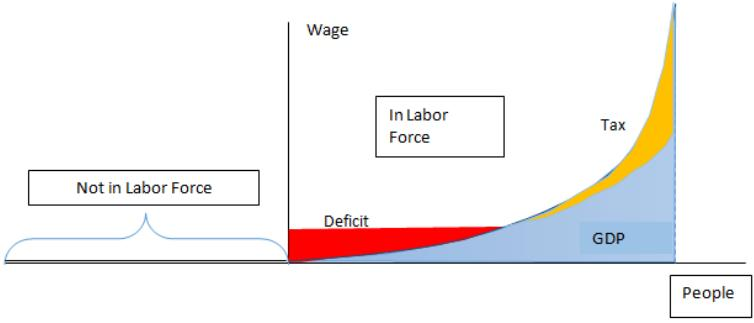

# 2017年美国大学生数学建模竞赛O奖论文（F题）

原件经识别和整理；“参考解答”是我们补的。

# 2017年美国大学生数学建模竞赛O奖论文（F题）摘要与政策建议

本文整理自2017年美国大学生数学建模竞赛（MCM/ICM）O奖论文（Team 72197），针对F题（社会问题建模）的摘要页及给LIFE（星际金融与探索政策实验室）的政策建议书部分。内容涉及收入不平等、教育低效及性别歧视三大问题的火星乌托邦构建方案。

## 一、摘要（Summary Sheet）

### 选择 1

**背景与目标**
人类文明正日益受到收入不平等、低效教育体系及基于性别的歧视困扰。在美国，大部分财富集中在最富有的个人手中，公共教育资金不足且效率低下，女性在特定行业代表性不足。这些社会失败导致大多数人的机会被抑制。然而，随着技术进步，火星可能近在咫尺；人类现在有机会从零开始构建一个理想社会，一个允许人们在收入和福祉方面实现公平的乌托邦。

- **收入模型目标**：通过实施北欧模式来减少收入不平等。
- **教育模型方法**：使用加权决策矩阵，根据各学科对社会价值观和经济应用的贡献进行排名。
- **社会平等模型**：利用机会成本分析，模拟男性和女性劳动力的保留率，基于育儿成本和其他人口统计数据。
- **综合验证**：将教育和社交平等模型与收入和税收模型结合，验证政策的经济可行性。

**主要发现**
在建立模型后，生成了代表性人口以研究其人口构成对火星长期动态的影响，发现：
1. 人力资本最初会因“零号人口”（Population Zero）的死亡而减少，但由于教育系统的回报，长期来看会增加。
2. “零号人口”及后续移民的人口统计特征极大地影响理想乌托邦社会的稳定性，因为不期望的分布可能会抵消政策所寻求的公平性。
3. 由于从地球到火星的定期移民性质，人口年龄分布存在振荡。

**局限性与假设**
在试图建立乌托邦社会时，我们也考虑了模型的局限性。火星殖民地是前所未有的，可能表现出与我们在地球上所知的社会不同的特征。特别是，由于其与其他文明的主要隔离状态，维持经济的真正平衡可能被证明是困难甚至不可能的。在选择移民时，我们假设人们能够放下地球上的刻板印象，并按照保存乌托邦理想的最佳长远利益行事。

**结论**
最终，我们不仅是在探索一个新的星际前沿；我们也在探索一种理想社会的新模型。

---

## 二、政策建议书（Societal Policy Recommendations）

### 简答 1

**致信对象**：星际金融与探索政策实验室（LIFE）主任
**主题**：社会政策建议
**日期**：2017年1月23日
**背景**：我们的政策建模团队建立了包含的报告，为LIFE提供理由，使其能够向火星国际联盟提出一个理想的2100年殖民地经济 - 劳动力 - 教育系统设计。通过数学和计算模型，我们可以就如何在“零号人口”中实施在整个持续居住的火星殖民地生命周期中都有效的政策提出建议。

**政策主张的三个特点**：
a) 可扩展性：适应人口的一致增长（每26个月增加10,000名移民）。
b) 代表性：涵盖广泛的概念和数学社会经济模型。
c) 持久性：只要移民没有大的干扰，政策将持续到22世纪末。

#### 关于收入的策略

我们强调国家生产力和劳动力幸福感的重要性。这促使我们选择某些极端的政策措施，以实现火星人口的可持续福利。

**1. 政府 - 公司模式 (Gov-Corp)**
- **提案**：我们提出一种政府也是经济中唯一企业的模型。
- **优势**：这种 Gov-Corp 能够在自由市场经济中无法实现的乌托邦政策。
- **演变**：然而，随着时间的推移，许多 Gov-Corps 将出现，形成一个行为方式不同的企业网络。

**2. 或有最低工资 (Contingent Minimum Wage)**
- **规定**：Gov-Corp 应向其所有工作公民提供最低月薪 **\$20,000**，即使他们对经济的贡献较少。
- **含义**：这意味着从事低端工作的公民以及参与“工读计划”的人员都将获得保障的工资，足以让他们过上基本必需品和舒适的生活。

**3. 累进所得税 (Progressive Income Tax)**
- **目的**：为了促进福利国家的公平性。
- **机制**：Gov-Corp 将对其公民实行累进税制。
- **效果**：该税收（在我们的提案中有详细说明）仍允许高贡献者成功，但财富积累的速度比我们在地球上看到的更合理。

#### 关于教育的策略

虽然我们要建立一个理想的“零号人口”，但我们认识到先驱者最终会去世。因此，教育对于在本世纪延续文明至关重要。

**终身学习要求 (Lifelong Learning Requirement)**
- **措施**：Gov-Corps 将为成年公民提供免费教育，资金来自累进税收的收入。
- **前提条件**：公民必须参与以下三种生产选项之一：
    1. 边工作边兼职学习
    2. 边学习边兼职工作
    3. 边研究边学习

---

## 三、补充说明

*   **数据来源**：本资料直接摘录自2017 MCM/ICM O奖论文（Team 72197）的摘要页（Summary Sheet）及给LIFE的政策建议书正文。
*   **关键数据点**：
    *   基尼系数降低：从 0.58 降至 0.33（接近北欧水平）。
    *   最低工资设定：\$20,000。
    *   最高税率上限：50%。
    *   标准育儿成本：\$7,500。
    *   产假与陪产假：长度相等。
    *   移民周期：每26个月增加10,000人。
*   **识别修正**：原文中的 "decease" 已根据上下文语境理解为 "decrease"（减少）；"upmost" 修正为 "utmost"（最重要的）；"idea society" 修正为 "ideal society"（理想社会）；"espoused values" 译为“所倡导的价值观”。
*   **无关信息剔除**：已去除原稿中的页眉、页脚、装订线提示、控制编号（Team Control Number）、微店推广链接等非实质性内容。

## A. Harnessing Complexity: 10 Year Vision

Despite presenting massive technical and sociological challenges, the colonization of Mars also provides the possibility to redesign economic and societal incentive structures to achieve heights of civilization not possible on Earth. As such, the UTOPIA: 2100 project hopes to rise to this opportunity and create a new Martian society founded on egalitarian principles. Such a society would be driven by a smart city concept, in which every citizen is a node in an immensely connected network and government can cater to the needs of its populace like never before. However, rather than study the technological aspects of this utopian vision, we have been tasked to study the sociological, demographic and economic systems necessary to sustainably maintain both a high productivity and increase citizens' wellbeing.

Taking inspiration from the ancient Greek concept of a polis (a term which describes not only the city-state but also the cohesive population that makes up its citizenry), we envision the initial colonization of Mars as the establishment of an ideal city government and community with Population Zero. To the ancient Greeks, the polis was not only the center of political life as the primary means of governance, but also a central social concept (a source of pride, identity and belonging) and an economic forum (a market for goods and resources to be pooled for the benefit of the citizenry) [1]. This design would feature each having an administration that essentially interacts as a government-firm, which will infrequently be referred to as a Gov-Corp. Although radical, this structure allows for employers that are not profit-driven and capable of supporting massive welfare and education efforts, which we will discuss in later sections.

## B. Defining Utopia: Metrics of Success and Key Parameters

Curriculum: The educational system will consist of a well-managed program of integrative sciences as well as applied humanities. This will provide technological advancement as well as intellectual progression for members of society.

With regard to equality and equity, we distinguish important differences between the two. We define equality as equal outcomes for everyone in society; we define equity as fair outcomes based on equal treatment of everyone in society.

Occupational Sectors: We propose that Population Zero represent men and women equally in various occupational sectors. This will allow women to be represented in fields they have been discriminated against. The establishment of equal gender distributions early on will allow for the elimination of traditional gender roles in the workforce.

Childcare: We recommend in our proposal that Gov-Corp set a \$7,500 childcare cost and equal length and full pay for maternity and paternity leave. From our calculations, this will result in 5–6% of the population in the childcare sector. If the cost of childcare is greater than an individual's opportunity cost, then a parent will leave the standard workforce and enter the childcare services sector of the economy for the contingent minimum wage. This equalizes opportunity costs for men and women and would eliminate divergence in male and female retention rates.

Note that our recommendations are sensitive to the composition of Population Zero, but not as much to the size. For example, a population that is not equally representative in each sector for men and women will result in unequal income distributions and gender disparity. Additionally, if we do not choose a fairly progressive initial population, then the voyagers will bring with them existing stereotypes and contaminate future Martian generations with Earthly biases. Based on our simulation and analysis, we expect to achieve a balanced budget that supports the economic success of citizens and society, an effective educational system that contributes to human capital development, and a socially equal workforce that provides an equitable opportunity for advancement.

## C. Population Zero: Demographics for Sustainability

（本节正文见后续部分。）

## D. Addressing Income Inequality

（本节正文见后续部分。）

## E. Education: Living and Learning on Mars

（本节正文见后续部分。）

## F. Social Equity: An Economic Model

（本节正文见后续部分。）

## G. Modeling Subgroups

（本节正文见后续部分。）

## H. In the Long Run: 100 Year Vision

（本节正文见后续部分。）

## I. External Shock: Earth Evacuation

（本节正文见后续部分。）

## J. Conclusions

（本节正文见后续部分。）

## 参考文献

（见后续部分。）

# 2017年美国大学生数学建模竞赛O奖论文（F题）

本文整理自《2017年美国大学生数学建模竞赛O奖论文（F题）》教材第3部分，内容涵盖火星殖民地模型中的复杂性定义、乌托邦成功指标、人口零期设定及人力资本计算等核心章节。

## 一、复杂性与模型设计

### 选择 1

**题干：**
关于火星城邦设计与建模方法中“复杂性”（Complexity）的描述，下列哪项理解最准确？

- A. 复杂性是指可以用单一变量定义的简单问题。
- B. 复杂性通常由大量变量、网络模型捕捉的显著相互依赖性、随机与确定性元素的相互作用，以及随机性和规律性的主要成分（类似分形现象）所表征。
- C. 为了处理问题的全部复杂性，作者采用了完全捕获研究变量的简化模型。
- D. 复杂性仅指社会系统中的经济因素，不包括教育政策或性别平等。

答案：B。
参考解答：原文指出 "complex problems are typically characterized by a large number of variables, significant interdependencies best captured through network models, the interplay of stochastic and deterministic elements, and major components of randomness and regularity (similar to fractal phenomenon)"。同时，原文明确说明为了避免简化模型，作者选择了多种多模态、相互依赖的模型。

---

## 二、乌托邦的定义：成功指标与关键参数

### 简答 1

**题干：**
在平衡社会公平与经济生产率方面，本研究针对收入分配使用了什么指标？请简述该指标的计算原理。

**回答：**
本研究使用 **基尼指数（Gini Index）** 来分析收入不平等。

基尼指数的计算原理如下：
1. 比较实际累积收入曲线（称为洛伦兹曲线，Lorenz curve）与一个完美平等社会的累积收入曲线。
2. 完美平等社会的曲线是一条从 GDP 的 0% 到 100% 的直线，即所有 earners 获得相等的百分比。
3. 基尼指数本身即为这条理想曲线与洛伦兹曲线之间百分面积差。

> [!NOTE]
> **核心概念**：基尼系数越接近 0，表示收入分配越平等；越接近 1，表示越不平等。

### 简答 2

**题干：**
在研究性别平等方面，模型关注了哪两个关于女性劳动力保留的因素？并指出导致女性面临经济不平等的两个根源是什么？

**回答：**
模型关注的两个因素是：
1. 全职休产假和陪产假的母亲和父亲的数量。
2. 在拥有多个孩子后离开劳动力市场的男性和女性数量。

导致女性面临经济不平等的两个根源：
1. **育儿政策不平等**：这是导致工作中经济不平等的主要原因。
2. **历史低参与率**：在某些领域，历史上女性的参与率较低。

*注：第二个根源将通过我们在“人口零期”（Population Zero）中的初始人口选择来解决。*

### 简答 3

**题干：**
为什么终身学习（Life-Long Learning, LLL）项目被视为乌托邦劳动力愿景的主要基础组成部分？

**回答：**
根据文献和未来教育趋势，LLL 项目成为基础组成部分的原因包括：
1. **技术更新需求**：从一次性的高前期教育收益（如大学体系）转向连续教育模式，对于让工人跟上现代技术和实践至关重要。
2. **多重效益**：LLL 不仅是提高生产率的手段，也是增加满意度、个人福祉和社会凝聚力的手段。

因此，LLL 项目是构建乌托邦劳动力愿景的关键基石。

### 简答 4

**题干：**
什么是人力资本（Human Capital, H）？在模型中，人们通过哪些途径积累人力资本？学术研究与工作积累有何区别？

**回答：**
**定义**：人力资本（H）是指个人拥有的技能、知识和智力水平，使其能够做出超出标准工人的重大贡献。

**积累途径**：
模型假设人们通过**工作**和**传统学校教育**两种途径积累人力资本。

**区别**：
- **学术研究**：初期建立人力资本的速度更快，但存在**边际收益递减**（decreasing marginal returns）。
- **工作**：带来的收益相对更静态（more static）。

---

## 三、人口零期：可持续性的人口统计

### 选择 1

**题干：**
关于“人口零期”（Population Zero）的模拟方法，下列说法错误的是？

- A. 采用选择性蒙特卡洛模拟（selective Monte Carlo simulations）基于理想的人口分布。
- B. 模拟技术提供了变异性（variability），用于测试稳健性并尽可能基于现实世界数据生成人口。
- C. 模拟技术提供了控制力（control），允许操纵分布和变量以创造尽可能公平的条件。
- D. 为了确保模型的复杂性，人口零期的经济生产力分布完全基于理想化假设，未使用任何现实世界数据。

答案：D。
订正：原文指出在经济生产力和收入分配方面，使用的是来自美国人口普查局（US Census Bureau）的**现实世界数据**，以避免过度理想化的假设降低人口模型的复杂现实性。

### 计算 1

**题干：**
根据模型设定，火星殖民地的理想教育水平分布如下：10% 博士（PhD equivalent）、30% 硕士（MS equivalent）、40% 学士（BS equivalent）、20% 副学士（AS equivalent）。
若一个人力资本阈值设定为：10岁儿童 30单位，政府强制 AS 项目毕业生 70单位，BS 等效 100单位，MS 等效 125单位，PhD 等效 145单位。且个人在 25 岁后每工作一年赚取 1H。
请简述如何计算最终的人力资本分布，并说明该设定体现了什么经济学原理？

**回答：**
**计算逻辑**：
1. 将教育水平和工作年限转化为人力资本 $H$。
2. 基础值：根据学位等级赋予固定的人资本阈值（AS: 70, BS: 100, MS: 125, PhD: 145）。
3. 增量值：个人在 25 岁后，每工作一年增加 1 单位人力资本。
4. 总人力资本 = 学位基础阈值 + (当前年龄 - 25) $\times$ 1 （假设年龄 > 25）。

**体现原理**：
这一设定有效捕捉了人力资本发展中正式学位设计的**边际收益递减**（diminishing marginal returns）思想。即随着学历等级的提升，单纯依靠学历带来的额外人力资本增量相对于其获取成本或时间投入，其回报率呈现递减趋势，而工作经验则提供了一种线性的补充积累方式。

> [!TIP]
> **注意**：这种混合模型避免了单一维度（仅看学历或仅看工龄）的偏差，更符合真实世界的复杂性。

*(图 1：人力资本分布图，展示了上述计算后的分布情况)*

### 简答 5

**题干：**
在性别和种族分布的选择上，模型做出了什么基本假设？为什么要做这样的假设？

**回答：**
**基本假设**：
假设每种职业中都存在公平的分布（equitable distribution）。具体而言，假设男性和女性的收入分布曲线是相同的（identical）。

**原因**：
1. **纠正机制失效**：不平等的条件不能通过平等的政策来纠正。
2. **避免社会紧张**：正如地球上的经验所示，即使政策旨在纠正不平等状况，如果政策本身是不平等的，也会导致社会紧张。
3. **长期可行性**：这些假设的长期可行性将在论文稍后讨论。

---

## 四、总结与展望

### 综合 1

**题干：**
结合全文，简述本模型在处理火星殖民地“乌托邦”愿景时，是如何平衡“复杂性”与“可操作性的”？

**回答：**
1. **承认复杂性**：模型没有试图用一个简单的公式完全捕获所有变量，而是承认火星殖民地是一个复杂的系统，包含随机性、规律性以及多变量间的相互依赖。
2. **多模态建模**：采用了三种相互关联的动态人口统计网络模型，分别聚焦于收入分配、教育政策和性别平等。
3. **数据与假设的结合**：
   - 在经济生产力方面，使用现实世界数据（美国人口普查局）以保证现实性和可持续性。
   - 在教育和社会分布方面，基于对乌托邦社会发展需求的讨论和直觉，设定了理想化的分布（如特定比例的学位持有者）。
4. **动态调整**：通过“人口零期”的模拟，利用蒙特卡洛方法引入变异性进行测试，同时保持对关键变量的控制，从而在理想目标与现实约束之间寻找平衡点。

> [!IMPORTANT]
> **核心启示**：成功的火星殖民地设计必须建立在深刻理解复杂系统的基础上，既要尊重现实数据的约束，又要敢于在关键社会结构上进行理想化的重构。

## D. Addressing Income Inequality

The income distribution is a crucial aspect of a utopian society which balance productivity and wellbeing. Before we introduce our model of income and policies to promote equality, we must make a few assumptions:

1. Wages are paid based on the productivity of a worker, and he/she only earns as much output as he put in the economy. Since Gov Corps is the sole firm in the economy (for now), it should be able to give workers the wages they deserve, wage laws notwithstanding.
2. People are rational agents in the economy, which means they will strive to produce as much output as they can to earn the highest wages. In addition, they will only spend as much as they earn, and will not fail financially and become bankrupt.
3. Minors under the age of 15 will be members of the Martian Academy or in childcare, during which they do not directly work and contribute to the output of Marsopolis.
4. The only labor source in our economy is the GovCorp, which manages all industries. Any income from other sources is ignored.

Such assumptions led us to create the model of GDP shown above: the minors, elderly, students, etc. people not in the labor force receive welfare from the government. This may take the form of free elementary education, support for research in our Lifetime Learning Program, free healthcare for the sick and elderly, free child support for newborns and infants, etc. For people earning below our minimum wage, we provide bonuses to match the minimum wage, so that these people can support their families and maintain a sufficiently high quality of life. Lastly, the people earning above minimum wage will bear the tax burden incurred from the previous two groups, with a progressive tax implemented so that the richer people contribute a higher proportion to government welfare. (This is conceptually visualized in Figure 1.)

With these guidelines in mind, we set off to collect data concerning the specific parameters in our model. For data on the percentage of people in the labor force, we looked at the Nordic model, Norway specifically. We found that labor force participation rate was 71.2% for people over 16, and 18.1% of people were under 16 [4]. To simplify the data in our model, we deemed the labor force participation rate 70% for Population Zero and that 20% were under 16. This meant that the labor force was $70\%(1-20\%)=56\%$ of our total population, and 44% were not working or earning a salary. Given that Population Zero has 10,000 people, this translates to 5,600 workers.

We gathered our work force data using a representative sample collected from the working population of Connecticut. We used this set of data because it was reasonably balanced and was small enough (27,000 people) to work with [5]. We determined that an inverse model fitted the actual wage-over-person curve best, and used a solver in Excel to generate an equation. After scaling down this curve to 5,600 people, we determined the equation:

$$
W(x) = \frac{62205676}{5670 - x} - 970 \qquad \text{for } 0 \leq x \leq 5600
$$

Where $x$ is the ranking of a person income, 0 being poorest and 5600 being the richest, and $W(x)$ is the wage of that person, pre-tax. (Curve of Actual wages, modeled wages, model-fit analysis in appendix).

Next, we generated a minimum wage and calculated the welfare required to sustain such a baseline. For this, we again turned to the Nordic model to determine how much this should be. Though Norway has no legal minimum wage, trade unions and conventions mean wages are usually above USD \$15/hour [6]. Translating to yearly wages, this is around \$24,000. Since Norway has higher prices than average, we decided our colony to have a minimum wage of \$20,000. Given our calculations from the equation, we found that approximately \$16.4 million had to be paid to ensure this population earned minimum wage and could [maintain] their standard of living.

In addition, we calculated total public education and government operation costs (healthcare was excluded from this analysis, so its burden on the public was ignored). Yet again we looked at the Nordic model, which gave an average of \$20,000 for postsecondary education [7]. Given our Martian Academy curriculum is so advanced, we assumed it had similar costs per pupil. Since we assumed 20%, or 2,000 of our residents were minors in school, this brings education costs to $2000\times\$20000=\$40$ mil. In addition, the government must have money to fund infrastructure, research, etc. public operations in order to maintain a high standard of living for all citizens. To estimate these costs, we again turned to the Nordic model [8]. The operational costs of the Norwegian government for fiscal year

## E. EDUCATION: LIVING AND LEARNING ON MARS

As part of training highly skilled workers for the utopian economy, gov-corp has a responsibility to provide a free, consistent, and highly dynamic education to all children in the polis. This means constantly staffing a workforce of highly qualified educators for the government mandated school system as well as advanced education options for all citizens willing to participate. We leverage two separate models of education in order to determine the aspects of an ideal education policy for Martian colonization: the first is a weighted decision matrix to determine which academic disciplines will be weighted most heavily in the curriculum, and second a human capital model to assess how well the educational system replenishes the distribution of critical skills following the decline of Population Zero.

For curriculum design and prioritzation we began by looking at academic disciplines and ideal societal outcomes. Whereas the academic disciplines were derived from the standard breakdown readily available on Wikipedia, educational outcomes were given much consideration. We ultimately decided to analyze the ability of disciplines to both create skills directly applicable to the economic sectors of a Martian colony as well as inculcate values that would promote innovation, problem solving and societal cohesion. A breakdown can be seen in the Appendices.

Applying a comparative approach, we determined the relative weight of values to 30% and economic applications to be 70%. Within each of these outcome classes, we rank ordered them in importance for the next 10 years and weighted them accordingly. Following this, we evaluated each academic discipline’s ability to support the various objectives and gave them points for supporting highly weighted goals. (A full version of this matrix and model can be seen in the Appendices.) We determined the six most important educational priorities to be: Computer Science, Systems Engineering, Chemical Engineering, Biology, Chemistry, and Hydrology.

In addition to curriculum development, we used a discrete dynamical system to model the accumulation of $H$ over time. within our lifelong learning program, citizens have three production options after they graduate from the school system at age 20: working while learning part-time (W/PL), working part-time while learning (PW/L), and researching while learning (R/L). Each of the production options corresponds to a certain distribution of working and learning: 80% to 20%, 30% to 70%, and 5% to 95%, respectively. As we continue to model the citizenry over the long run based on 5 year time steps, we can calculate the addition to a citizens human capital based on which production option they choose over any period.

The following human capital model was derived from experimentation with the marginal returns on work and learning. After said experimentation, we concluded that human capital accumulation can be approximated by the following marginal returns: 1 additional unit of human capital per year of work and 5 additional units of human capital per year of learning. Therefore, based on our stated distributions above, the marginal benefits on human capital of the three production options are as follows: 9 units for W/PL, 19 units for PW/L, and 24 for R/L. Running these distributions through the simulated Population Zero through the year 2110, we found a distribution of human capital as displayed in Figure 5. A full analysis of the long run changes in the human capital distribution will be discussed with the 100 year plan.

## F. SOCIAL EQUITY: AN ECONOMIC MODEL

If the workforce is the primary driver of progress in our Martian utopia, we must emphasize the importance of retention rate in the labor market. Turnover between occupations and excessive absences from the workforce result in diminished human capital. Therefore, it is in societys best interest to provide incentives for parents of newly born children to retain their positions while parenting pre-school children. This leads us to choose the retention rate as the metric we will use to evaluate a societys equity efficacy, as Earth is marked by historically large spreads between men and women in that regard.

In order to equalize the retention rate gap, the government must provide for, and mandate, equal length of maternity and paternity leave, defined now as parental leave. Parental leave would allow parents to remain in the workforce as their job would await them after the leave ended. The point of ensuring every parent takes the same amount of leave stems from the estimation that human capital depreciates by around 1% for each month of parental leave, while human capital accrues via on-the-job experience at a rate of only 0.2%. [3]

# 2017年美国大学生数学建模竞赛O奖论文（F题）第6部分：育儿与劳动力留存模型

本部分整理自《2017年美国大学生数学建模竞赛O奖论文（F题）》教材第14–15页，内容涉及基于育儿成本的劳动力退出策略、蒙特卡洛模拟分析及不同社会子群体的建模。

## 一、育儿成本与劳动力退出决策模型

### 模型背景与假设

在确立了职场性别平等的带薪休假策略后，主要的留存问题转变为儿童保育（childcare）。如果儿童保育服务的财务成本超过了工作的机会成本，那么让一位父母退出劳动力市场直到孩子进入5岁的教育体系是合理的。

**核心假设：**
- **非同时退出**：假设在任何条件下，夫妻双方不会同时决定退出劳动力市场，因为只要有一方退出，即可消除对付费儿童保育服务的需求。
- **公共部门就业**：退出劳动力市场的父母将进入政府/企业赞助的公共儿童保育部门，并获得最低工资。

**决策参数：**
个人家庭的退出决策取决于以下参数，并结合政策常数进行整合分析：
1. 子女数量
2. 母亲的薪资
3. 父亲的薪资

> [!NOTE]
> **关键逻辑**：只有当儿童保育总成本大于或等于工作机会成本时，家庭才会选择只保留一名在职父母。

### 数学模型构建

#### 1. 决策不等式
当满足以下条件时，构成父母退出劳动力市场的判定依据：

$$
Cost_{childcare} \geq Cost_{opportunity}
$$

#### 2. 儿童保育成本公式
$$
Cost_{childcare} = Children \times Cost_{services} \times Age_{School} - MAX(Leave_{maternity}, Leave_{paternity}) + Salary_{min}
$$

*说明：该公式计算了抚养孩子的总费用，其中包含了服务费乘以学龄年限，减去产假或陪产假带来的收入损失，并加上退出后从事公共保育工作的最低工资收入。*

#### 3. 机会成本公式
$$
Cost_{opportunity} = MIN(Salary_{mother}, Salary_{father}) \times Age_{School} - Leave_{MinSalary} \times (1 - Fraction_{PaidLeave})
$$

*说明：机会成本主要指家庭中较低收入一方因照顾孩子而损失的潜在工资，需扣除带薪休假期间的最低薪资补偿。*

> [!TIP]
> **变量含义**：
> - $Age_{School}$: 孩子需要保育的年龄阶段（通常至5岁入学）。
> - $Fraction_{PaidLeave}$: 带薪休假占总时间的比例。
> - $MIN(Salary)$: 代表家庭为了最大化收益，通常会由收入较低的一方承担育儿责任。

## 二、蒙特卡洛模拟与人口整体分析

### 模拟设置
为了分析整个人口层面的情况，模型引入了更多的人口统计常数，并使用蒙特卡洛模拟生成了 **5,000个随机家庭**。

**模拟细节：**
- **样本构成**：包含有子女和无子女的家庭。无子女家庭可能包括“已婚无子女”或“从未相遇的两个单身人士”。
- **输入关注点**：模型仅关注作为退出决策输入的“子女”因素。
- **收入生成**：基于前一个收入模型提供的逆分布曲线（inverse distribution curve）生成随机收入。

### 模拟结果分析
通过运行模拟，生成了样本人口数据，分析了以下比率：
1. 因子女原因退出劳动力市场的总人口比率。
2. 男性和女性退出劳动力市场的各自比率。

**敏感性分析结论：**
模型对以下因素最为敏感：
- 儿童保育的成本
- 选择生育的女性数量及每位女性的生育数量
- 最低工资标准

**时间趋势观察：**
- **前五年增长**：由于2100年人口基数中缺乏0-5岁的儿童，退出劳动力市场的比率在前五年呈上升趋势。
- **后期稳定**：随后几年（直至2110年）该比率趋于稳定。
- **性别差异**：男女退出比率基本相同。这是因为之前的模型设计了公平的分配机制，不存在基于性别的歧视。

> [!WARNING]
> **局限性提示**：虽然模型预测了性别比率一致，但这高度依赖于预设的公平收入分配策略。若初始条件改变，结果可能会发生显著偏移。

## 三、政策建议

根据分析，儿童保育服务的成本是影响家庭退出决策的最关键因素。因此，平等政策的重点应放在制定国家运营儿童保育的最佳成本上。

**具体建议：**
- **定价策略**：建议将每名儿童的保育成本设定为 **$7,500**。
- **预期效果**：这将导致约 **5%-6%** 的人口成为儿童保育提供者。
- **社会效益**：
    - 激励所有成年人留在劳动力市场。
    - 唯一例外是寻求进一步教育的兼职人员以及退休老年人。
    - 退出工作的父母将在儿童保育领域以额外身份继续工作，从而重新回到直接劳动力市场中。
    - 最终形成一个更具生产力且密切关注儿童早期发展的社会。

## 四、子群体建模（Modeling Subgroups）

### 分组标准
尽管全局模型优化了最低工资、薪资分布、年龄分布等多个因素以创造高效平衡的社会，但不同阶级和子群体依然存在。为确保社会整体进步且不落下任何群体，必须对这些子群体进行考察。

**分组方法：**
使用两个客观标准将人口划分为子群体：
1. **薪资水平**
2. **婚姻/子女状况**

**薪资区间定义：**
1. **低收入**：低于或等于最低工资。
2. **中等收入**：高于最低工资，适用可变税率。
3. **高收入**：工资征收50%的税。

结合“是否有子女”（是/否），共形成 **6个子群体**。研究将检查每个群体的特定优先需求，并观察这些需求如何与其他群体的价值观相吻合或冲突。

### 子群体案例分析：贫困且无子女的成年人

**群体特征：**
该群体实际上包含两类人：
1. 工作在最低工资以下的群体。
2. 完全失业的群体。

**行为分析与对策：**
- **在职者**：最有可能寻求更高薪的工作，这需要通过工作或继续教育来积累更多的人力资本。
- **失业者**：最有可能优先考虑获得工作，无论技能要求或薪资高低，目的是获得最低工资保障。

> [!IMPORTANT]
> **终身学习的作用**：虽然这一群体在现实生活中常被忽视，但我们的终身学习计划确保了他们拥有持续的职业发展机会，从而提高生产力和工资水平。

 *注：原文提及样本发现见附录UL1中的图1，此处保留占位符。*

This group constitutes poor couples that have at least one child. They are confronted by two objectives they most likely wish to achieve: the care, education, and healthy growth of their child or children, and the financial pressure to return to the workforce after mandatory maternity and paternity leave following the child. Our social model aims to keep both career paths open: while people can still choose to stay at home and take care of their children, they can still pursue a career, and their children will still be taken care of. With our mandatory maternity and paternity leave policies, we guarantee that couples do not lose their productivity after childbirth. Our childcare compensations take significant financial pressure off the couples shoulders, also allowing couples to adopt the stay-home mother/father model is they so wish too, without financial worries.

For the middle class, childless workers in our colony, their primary goal we are concerned with is the advancement of their careers. Unlike the lower-earning workers, these people incur a significant opportunity cost by attending further education after being in the workforce for a significant duration. Therefore, the goal of our society is to allow these workers to retain their human capital while absorbing new knowledge through our LLL program. Our program achieves this by spacing out learning, so workers have a chance to apply their acquired knowledge before further advancing their academic paths. The middle class couples, in addition to individual career ambitions mentioned above, would most likely be concerned with the quality of education their children are receiving. They want to ensure their children are prepared for the future workforce, and have the opportunities to pursue a career of their choice. Our Martian Academy accomplishes this by exposing students to work at an early age, so children learn to apply their knowledge, gain new information, and understand their career paths.

The high-salary single workers, we presume, will not be motivated to work or learn more for higher wages. After all, a steep 50% income tax necessitates that people would not be so keen to earn more. Therefore, these workers may have the true intellectual curiosity to conduct research full-time, regardless of its effect on human capital. The government supports this by providing research grants, funding these highly technical and creative projects which will (hopefully) lead to technological breakthrough. Though this incurs a burden on the government, the benefits of technology can be said to outweigh the drawbacks.

Finally, the high-salary families, in addition to the activities mentioned above, would presumably want to transfer their wealth and knowledge to their children (since this is what well-off families in real life typically do). Unfortunately, this is rather difficult in Marsopolis. Since all jobs are organized by GovCorps, human capital will become the most influential factor for hiring; since the only school in the colony is the Martian Academy, there is no guarantee that these privileged children will end up having the most desirable jobs. Although this is desirable for the equality of the colony, this is clearly not favorable to the rich families who want to escort their children to success.

As can be seen, different subgroups of society value different aspects of it. The poorer value welfare, whereas the richer value economic freedom and educational growth. The poorer value education as a means towards achieving greater human capital and wages, whereas the richer value education more inherently. The childless pursue more ambitious career paths with job training, part-time work-research programs, whereas the families desire more time off, parental leave, and less intensive jobs. Overall, the Marsopolis we designed attempts to favor the socioeconomically disadvantaged, at the expense of high tax rates and decreased privileges for the wealthy.

## H. IN THE LONG RUN: 100 YEAR VISION

We found in general that our 10-year plan was well-developed and robust in the face of scalability and long run trends. This may because of our design preference towards sustainability which was incorporated from the beginning. Our overall dynamic demographic model, which began with the procedurally generated Population Zero, was continued into subsequent generations using the reasonable death rate distribution discussed earlier and a distributed birth rate based on current census data [5]. The resulting age distributions of 2150 and 2200 are shown below in figure6 and 7.

Though the population was sustained into the long run, complex oscillation emerged as time progressed. We believe that this behavior may be a result of the initial practicality limitation placed on the age distribution of Population Zero. We do not this will present significant challenges to the holistic functioning of society. However, some significant changes must be made to the recommended policies.

When considering gender equality, subsequent populations would not be as evenly distributed across occupations. Our primary colonization efforts entail finding an equal ratio of men to women within each occupation, in order to curb traditional gender biases. However, the de facto population on Earth does not match our ideal population; after several migrations it would become increasingly hard to find highly qualified females in STEM sectors such as mechanical engineering, physics and astronomy, and electrical and computer hardware engineering, as well as all others. Currently, women make up half of the workforce with a college education in the United States, but only comprise 29% of science and engineering sectors, with only the following workforce shares for the previously mentioned specialties: 7.9%, 11.1%, and 10.7%, respectively [14]. We see similar patterns with ethnic and racial minority groups as well as low-income populations. Therefore, the 46 migrations that will occur over the next 100 years may exhaust the populations we are trying to tap for the ideal workforce of Mars. In the example of mechanical engineering, there were 277,500 jobs in 2014 according to the Bureau of Labor Statistics and 32,727 degrees in the field were awarded in the same year [15][16]. While 7.9% of this occupation on Earth would be enough to sustain subsequent migrations to Mars, the probability of getting similarly skilled mechanical engineers between men and women is low.

# 2017年美国大学生数学建模竞赛O奖论文（F题）

## 一、人口模拟与性别差异

### 段落 1

Using the previously developed equity model, we can simulate some subsequent populations based on changing demographics. Although the income distributions for men and women were originally equal, we can now handicap the female salary distribution by a realistic amount. A simple way to illustrate this point will be to multiple the randomized female distribution by a ratio of the female median annual earnings in the United States ($39,621 in 2014) and the male median annual earnings ($50,383 in 2014). Using this simple handicap, although it does not account for decreasing wage gap over time for the twenty-second century, we can generate new populations that represent more Earthly gender inequality in terms of differently weighted workforce sectors and unfair pay. Though this modified simulation, we see that Earthly income inequality greatly affects the equity of the workforce on Mars (see Figure), as significantly more women quit their jobs to become childcare providers, almost double the percentage of men.

Over time, as each migration creates a new polis, there will emerge interaction between poleis that mimic those between firms. Though we do not predict or design for a market economy, as each individual gov-corp is still primarily interaction with its citizens rather than trying to make significant profits on the citizens of other poleis, some special ization will naturally occur. Our goal is not to have incredible powerful and significant poleis that will dominate the colony, even though an earlier polis will naturally have more time in development that newer poleis. Thus, we propose citizen migration from old poleis to new poleis in order to offset unequal distributions, as their initial populations will have had more consistent distributions across sectors and their new Martian generations will have eventually passed through our improved educational system (which churns our high human capital graduates, with even distribution with regard to gender and other diversity demographics).

### 段落 2

With regards to educational curriculum, we modified our weighted decision matrix in order to reflect the greater importance of innovation, cohesive values, and managing greater complexities across society. Prompting significant changes to our recommended curriculum, the highest valued academic disciplines in the long run are: Systems Engineering, Computer Science, Sociology, Art, Literature, and Mathematics. Thus, while the 10 year educational vision is set mostly on technical development and sustaining the human population in a complex new environment, the 100 year long-term vision is more focused on humanities and higher-level systems thinking. This is outcome makes sense due to the fact that as technology becomes more developed, humans will be able to rely less and less on production and more on culture. A content populace over the long-run is one that finds purpose in existence and continues to develop intellectually rather than simply increasing its technical knowledge.

Tracking human capital overtime results in more alarming trends. As time goes on, the average human capital throughout society increases until the well-educated Population Zero dies off in which a period of decline follows. However as the Martian LLL program comes into effect, the trend reverses and H begins to rise again. This suggests that the program will be reach an equilibrium near Population Zero rates. Another point of note is the increasing inequality of human capital as the simulation continues as seen in Figure 10. Though this may seem problematic, it is likely beneficial for society as a whole given that individuals with extremely high H will likely function as Mars’s innovator class, propelling another century of societal and technological revolutions.

### 段落 3

### I. EXTERNAL SHOCK: EARTH EVACUATION

So far, we have seen Marsopolis adapt well when it is slowly expanding. When our polis expands rapidly, though, the situation is very different. For instance, if there was a massive migration to Mars in our model, even if it only doubles the population, the results would be catastrophic. For example, welfare provided by government would plummet, and standards of living would drastically decrease, if not plummet.

Several factors explain this incompatibility. First, the stability of our demographics would be compromised by the sudden influx of people. Our economys tax rates are built considering a specific proportion of people would be in school, a specific proportion of people would be in the work force, and a specific progressive tax scheme set so that government revenue equals expenditures. A sudden influx of people could unbalance any of these factors and force welfare levels down. The equations below illustrate this point [17]:

$$
G = T
$$

## 一、经济可持续性分析

$$
C \cdot n = k \cdot Y
$$

$$
C \cdot n = k \cdot F(L, K, H, N)
$$

$$
G \propto n, \quad T \propto A
$$

Here, Line 1 states that government expenditures (G) should equal government revenue in taxes (T), as they always should. Line 2 assumes that expenditures are proportional to number of people (n) and cost per head (C), and assumes that taxes are proportional to average tax rate (k) and total output (Y). Line 3 further breaks down output into its factors of production: technology (A), labor (L), physical capital (K), human capital (H), and natural resources (N).

This is where the inequality is shown: though maintenance costs in our colony are proportional to its population, total output is most likely not. It is unlikely that some revolutionary technology which doubles our productivity, is given to us as mass migration onto Mars occurs. It is possible that the labor available will grow proportionally with migration, yet the physical capital in our colony simply cannot accommodate all additional labor. There exists neither the resources nor the time to double our factories and carrying capacity among colonies to prepare for sudden migration. Most likely, our new migrants will not have the same skills as our graduates of the Martian Academy do, therefore they will possess less human capital and will not be able to work many jobs in the colony. Finally, the amount of land and natural resources will most likely not change: it is highly unlikely that Mars will double in size as our colony swells.

All these factors combined, mean that to prevent GovCorp from exhausting its funds, it must choose one of two choices: either increase tax rate K or reduce gov. spending per head (C). However, we quickly realize that the former choice is unrealistic as well: our maximum tax rate is already 50%, so must we increase it to 100% if the population doubles? What would incentive people to work, then? This means in the face of rapid migration, our only realistic option is to slash welfare, either by reducing spending as a whole or only providing extensive benefits (educational, medical, scientific) to our original inhabitants, giving our refugees only basic housing and food. Either way, the vision or Marsopolis as a utopia would quickly break down.

This economic unsustainability also gives way to the educational unsustainability in the event of a mass migration. Since there is no guarantee for continued funding in the education sectors, there will likely be less educators available, and therefore less pupils in the Martian Academy.

## 二、结论

### 简答 1（优势）

优势：在对我们的火星殖民地模型进行深入处理与评估之后，我们认为我们的方法有几个优点。第一，通过分别处理收入分配、教育和平等问题，我们能够优化每个部门，从而对我们的社会有更全面的认识。例如，我们能够在努力实现平等时确定育儿假政策，在分析收入时确定税收和最低工资政策，在解决教育问题时制定教育课程，而这些互不损害。第二，我们的模型相对可扩展，并且设计为随时间发展。我们设计人口结构，使得数十年后可以达到稳定的人口；同样，收入和公平模型与更大的人口规模兼容。

### 简答 2（不足）

不足：尽管我们进行了研究，我们的模型仍存在一些潜在的改进空间。一个缺陷是缺乏一个连接我们三个模型的统一变量：我们在收入模型中使用以美元计的工资，在建模平等时使用人力资本，在创建教育课程时使用殖民地的感知需求。例如，我们本可以将收入建模为人力资本的结果，将教育建模为生产人力资本的工厂，将平等建模为基于它的函数；然而，我们觉得其中一些关系过于随意，难以建模。

另一个不足是这个问题本身固有的数据缺乏。我们使用具有代表性的美国人口作为模型的基础，并利用北欧模式作为我们的目标。在一个孤立的行星殖民地中，两者都可能与现实不太相符。长期以来，一直缺乏关于孤立社会（即乌托邦）的数据，因为它们往往不会长久存在。因此，鉴于问题的本质，我们可能永远无法为火星的异星环境生成真正准确的模型。

### 简答 3（总结与未来研究）

最终总结与未来研究：我们试图模拟一个利用收入、教育和工作政策促进平等和总体福祉的火星殖民地。尽管使用普通的初始人口，我们仍能够设计出一个稳定并产生理想结果的模型。对于未来的研究，我们可以尝试建立一个具有一个关键变量的统一模型，例如上述的人力资本模型。此外，我们可以使用我们生成的人口分布作为模型的输入。最后，我们可以为诸如来自地球的大规模移民等情景设计应急计划。

# 2017年美国大学生数学建模竞赛O奖论文（F题）第10部分

## 参考文献

### 参考 1

- Guisepi, Robert. ”Economic and Society in Classical Greece,” A History of Ancient Greece, 1998. Accessed January 22, 2017. http://history-world.org/greece

### 参考 2

- Cosma Shalizi, ”Complexity Measures,” Notebooks, 10 Jan 2016. Accessed 23 January, 2017. http://bactra.org/notebooks/complexity-measures.html

### 参考 3

- Dechter, Evgenia. ”Maternity Leave, Effort Allocation and Post-Motherhood Earnings. American Economic Association,” AEA 2012 Annual Meeting Papers. January 08, 2012. Accessed January 22, 2017.

### 参考 4

- OECD (2017), Labour force participation rate (indicator).Accessed on 22 January 2017. doi: 10.1787/8a801325-en

### 参考 5

- United States Census Bureau, ”PUMS - Index of Programs and Surveys,” US Department of Commerce. October 3, 2016. Accessed January 22, 2017. http://www2.census.gov/programs-surveys/acs/data/pums/2015/1-Year/

### 参考 6

- ”Minimum Wage - General Application of Collective Agreements,” Arbeidstilsynet (Norwegian Labor Union). Accessed January 22, 2017. http://www.arbeidstilsynet.no/fakta.html?tid=240096/

### 参考 7

- National Center for Education Statistics, ”Education Expenditure by Country,” The Condition fo Education., may 2016. Accessed January 22, 2017. https://nces.ed.gov/programs/coe/indicator cmd.asp

### 参考 8

- ”National Budget 2017,” Ministry of Finance, Norway, October 2016. Accessed January 22, 2017. http://www.statsbudsjettet.no/Statsbudsjettet-2017/English/

### 参考 9

- Central Intelligence Agency, ”Rank Order by Gini Index,” The World Factbook. Accessed January 22, 2017. https://www.cia.gov/library/publications/the-worldfactbook/rankorder/2172rank.html

### 参考 10

- ”Calculation,” The Gini Coefficient, Accessed January 22, 2017. www3.nccu.edu.tw/ jthuang/Gini.pdf

### 参考 11

- ”Special Report: Lifelong Education,” The Economist, January 14, 2017. Accessed January 21, 2017. http://www.economist.com/news/special-report/21714169- technological-change-demands-stronger-and-more-continuous-connectionsbetween-education

### 参考 12

- Cardenas, Mauricio ”Education and Life Satisfaction: Perception or Reality?” March 2008. Accessed January 23, 2017. http://www.iadb.org/res/laresnetwork/files/pr315finaldraft.pdf

### 参考 13

- ”Mars Opposition.” NASA Mars Exploration. Accessed January 23, 2017.

### 参考 14

- ”Statistics: State of Girls and Women in STEM.” National Girls Collaborative Project. Accessed January 23, 2017.

### 参考 15

- ”Occupational Outlook Handbook.” Bureau of Labor Statistics. December 17, 2015. Accessed January 23, 2017.

### 参考 16

- ”Mechanical Engineering.” Data USA. Accessed January 23, 2017.

### 参考 17

- ”Factors of Production - the Economic Lowdown,” St. Louis Fed. Accessed January 23, 2017. https://www.stlouisfed.org/education/economic-lowdown-podcastseries/episode-2-factors-of-production

### 参考 18

- Gatta, Mary, and Geri Scott, ”Pink to Green,” Transforming Workforce Development Policies. Accessed anuary 21, 2017

### 参考 19

- Chad Stone, ”No Kids, No Help”,” US News Opinion Column, July 10, 2015. Accessed january 23, 2017. http://www.usnews.com/opinion/economicintelligence/2015/07/10/poor-childless-adults-left-out-of-the-social-safety-net

# 2017年美国大学生数学建模竞赛O奖论文（F题）第11部分

本节整理自《2017年美国大学生数学建模竞赛O奖论文（F题）》教材第11部分（共13部分），由识别工具读取后按规范整理。内容主要涉及应用领域的权重矩阵、学科分类矩阵、加权决策矩阵模型及相关数据表。

## 应用领域权重矩阵

### 应用领域权重分配

根据原文提供的表格，不同应用场景在创新性（Innovative）、生产力（Productive）、整合性（Integrative）和伦理（Ethical四个维度上的权重分配如下：

| 场景 | Innovative | Productive | Integrative | Ethical |
| :--- | :---: | :---: | :---: | :---: |
| 0.3 | 0.3 | 0.4 | 0.2 | 0.1 |
| 0.4 | 0.4 | 0.1 | 0.2 | 0.3 |

> 注：原文标题为 "Applications"，左侧列标头为数值（0.3, 0.4），推测代表不同应用场景或类别的优先级/权重基准。

## 学术领域与四维能力关联矩阵

### 学术领域分布情况

以下表格展示了各学术领域（Academic Disciplines）在创新性（Innovative）、生产力（Productive）、整合性（Integrative）和伦理（Ethical）四个维度的属性分布（1表示具备该属性，0表示不具备）：

| Academic Discipline | Innovative | Productive | Integrative | Ethical |
| :--- | :---: | :---: | :---: | :---: |
| Art | 1 | 0 | 1 | 1 |
| Geography | 0 | 1 | 0 | 0 |
| History | 0 | 0 | 1 | 1 |
| Literature | 1 | 0 | 1 | 1 |
| Philosophy | 0 | 0 | 1 | 1 |
| Economics | 0 | 1 | 0 | 0 |
| Law | 0 | 1 | 0 | 1 |
| Political Science | 0 | 1 | 0 | 0 |
| Sociology | 0 | 0 | 1 | 1 |
| Psychology | 0 | 0 | 0 | 1 |
| Biology | 1 | 0 | 1 | 0 |
| Chemistry | 1 | 0 | 1 | 0 |
| Geology | 1 | 0 | 1 | 0 |
| Physics | 1 | 0 | 1 | 0 |
| Mathematics | 1 | 0 | 1 | 0 |
| Botany | 0 | 1 | 1 | 0 |
| Hydrology | 0 | 1 | 1 | 0 |
| Computer Science | 0 | 1 | 0 | 0 |
| Chemical Engineering | 0 | 1 | 0 | 0 |
| Civil Engineering | 0 | 1 | 0 | 0 |
| Mechanical Engineering | 0 | 1 | 0 | 0 |
| Electrical Engineering | 0 | 1 | 0 | 0 |
| Systems Engineering | 1 | 1 | 1 | 0 |
| Medical Sciences | 0 | 1 | 1 | 1 |
| Management Theory | 0 | 1 | 0 | 0 |

## 加权决策矩阵模型数据

### 应用领域细分权重

下表展示了在不同子领域（Agriculture, Colonial Expansion, Health, Entertainment, Education, Research, Manufacturing, Administration）下的具体权重值。第一行基准值为0.7，第二行为0.6：

| Weight Base | Agriculture | Colonial Expansion | Health | Entertainment | Education | Research | Manufacturing | Administration |
| :--- | :---: | :---: | :---: | :---: | :---: | :---: | :---: | :---: |
| 0.7 | 0.16666667 | 0.027777778 | 0.2222 | 0.111111111 | 0.0833333 | 0.055556 | 0.138888889 | 0.194444444 |
| 0.6 | 0.02777778 | 0.194444444 | 0.1389 | 0.111111111 | 0.2222222 | 0.083333 | 0.055555556 | 0.166666667 |

### 加权决策模型属性矩阵

以下矩阵展示了25个样本（或项目）在八个应用领域（Agriculture, Colonial Expansion, Health, Entertainment, Education, Research, Manufacturing, Administration）中的属性覆盖情况（1表示涉及，0表示不涉及）。表头对应上述“应用领域细分权重”中的八个领域：

| Sample Index | Agriculture | Colonial Expansion | Health | Entertainment | Education | Research | Manufacturing | Administration |
| :--- | :---: | :---: | :---: | :---: | :---: | :---: | :---: | :---: |
| 1 | 0 | 0 | 0 | 1 | 1 | 0 | 0 | 0 |
| 2 | 0 | 1 | 0 | 0 | 1 | 0 | 0 | 1 |
| 3 | 0 | 0 | 0 | 1 | 1 | 0 | 0 | 1 |
| 4 | 0 | 0 | 0 | 1 | 1 | 0 | 0 | 0 |
| 5 | 0 | 0 | 0 | 1 | 1 | 1 | 0 | 0 |
| 6 | 0 | 0 | 0 | 0 | 1 | 1 | 1 | 1 |
| 7 | 0 | 0 | 0 | 0 | 1 | 0 | 0 | 1 |
| 8 | 0 | 1 | 0 | 0 | 1 | 0 | 0 | 1 |
| 9 | 0 | 1 | 1 | 0 | 1 | 0 | 0 | 1 |
| 10 | 0 | 0 | 1 | 0 | 1 | 1 | 0 | 1 |
| 11 | 1 | 0 | 1 | 0 | 1 | 1 | 0 | 0 |
| 12 | 1 | 0 | 1 | 0 | 1 | 1 | 0 | 0 |
| 13 | 1 | 0 | 0 | 0 | 1 | 1 | 0 | 0 |
| 14 | 0 | 0 | 0 | 0 | 1 | 1 | 1 | 0 |
| 15 | 0 | 0 | 0 | 0 | 1 | 1 | 1 | 1 |
| 16 | 1 | 1 | 0 | 1 | 1 | 0 | 0 | 0 |
| 17 | 1 | 1 | 0 | 0 | 1 | 0 | 0 | 1 |
| 18 | 1 | 1 | 1 | 1 | 1 | 1 | 1 | 1 |
| 19 | 1 | 1 | 1 | 0 | 1 | 0 | 1 | 0 |
| 20 | 1 | 1 | 0 | 0 | 1 | 1 | 0 | 1 |
| 21 | 0 | 1 | 0 | 0 | 1 | 1 | 1 | 0 |
| 22 | 0 | 1 | 0 | 0 | 1 | 1 | 1 | 0 |
| 23 | 0 | 1 | 1 | 0 | 1 | 1 | 1 | 1 |
| 24 | 0 | 0 | 1 | 0 | 1 | 1 | 0 | 0 |
| 25 | 0 | 1 | 0 | 0 | 1 | 0 | 0 | 1 |

## 模型输出结果对比

### SR 与 LR 指标对照

下表展示了短跑（SR, Short Run? 或特定缩写）与长跑（LR, Long Run? 或特定缩写）两种模式下的计算结果对比：

| SR | LR |
| :--- | :---: |
| 0.316111 | 0.56 |
| 0.333889 | 0.39 |
| 0.362222 | 0.5 |
| 0.316111 | 0.56 |
| 0.265 | 0.45 |
| 0.450556 | 0.356667 |
| 0.344444 | 0.393333 |
| 0.333889 | 0.39 |
| 0.459444 | 0.633333 |
| 0.418889 | 0.486667 |
| 0.519444 | 0.523333 |
| 0.519444 | 0.523333 |
| 0.363889 | 0.44 |
| 0.344444 | 0.456667 |
| 0.480556 | 0.556667 |
| 0.452222 | 0.453333 |
| 0.510556 | 0.486667 |
| 0.82 | 0.64 |
| 0.567222 | 0.423333 |
| 0.489444 | 0.456667 |
| 0.333889 | 0.373333 |
| 0.333889 | 0.373333 |
| 0.775556 | 0.796667 |
| 0.462778 | 0.506667 |
| 0.333889 | 0.39 |

# Appendix – Discussion of Variables in the Equity/Childcare Model

本部分整理了2017年美国大学生数学建模竞赛O奖论文（F题）第12部分关于股权/育儿模型中变量讨论的内容，包括输入参数表格及个体模型政策因素的详细说明。

## 一、模型仪表盘示例

### 图 1：样本股权模型仪表盘

**INPUTS:**

| 变量 | 数值 |
| :--- | :--- |
| births per population rate | 0.0086 |
| length of paid maternity leave, months | 12 |
| length of paid paternity leave, months | 12 |
| fraction of salary for leave | 1 |
| cost of childcare | 7500 |
| minimum wage | 20000 |
| start age for primary schooling | 60 |
| population size of males | 5000 |
| population size of females | 5000 |
| fraction of females at childbearing age | 0.465 |
| fraction of women without children | 0.71263 |
| fraction of women with 1 child | 0.172 |
| fraction of women with 2 children | 0.231 |
| fraction of women with 3 children | 0.185 |
| fraction of women with 4+ children | 0.03 |

**RESULTS:**

| Year | 2100 | 2101 | 2102 | 2103 | 2104 | 2105 | 2106 | 2107 | 2108 | 2109 | 2110 |
| :--- | :--- | :--- | :--- | :--- | :--- | :--- | :--- | :--- | :--- | :--- | :--- |
| Ratio of population out of workforce | 0.0521 | 0.0531 | 0.0542 | 0.0554 | 0.0564 | 0.0583 | 0.0589 | 0.0591 | 0.059 | 0.0583 | 0.0581 |
| Ratio of females out of workforce | 0.0536 | 0.0546 | 0.0556 | 0.0566 | 0.0578 | 0.0602 | 0.0606 | 0.0608 | 0.061 | 0.0602 | 0.0594 |
| Ratio of males out of workforce | 0.0506 | 0.0516 | 0.0528 | 0.0542 | 0.055 | 0.0564 | 0.0572 | 0.0574 | 0.057 | 0.0564 | 0.0568 |
| Net new children in system | N/A | 82 | 78 | 81 | 79 | 82 | 4 | 6 | -7 | -10 | 0 |

## 二、个体模型（政策因素）

### 变量说明

- **Cost of childcare（育儿成本）**
  政府提供的每儿童育儿服务的法定成本，以美元为单位；这是我们要调整以影响政策决策的最重要值。选择 $7,500 是因为它使得 5-6% 的父母从事育儿服务行业，从而将大部分人口保留在工作队伍中。

- **Start age for primary schooling（小学入学起始年龄）**
  儿童进入公立小学系统的年龄，以月为单位；选择 60 个月。

- **Length of paid maternity leave（带薪产假长度）**
  母亲在生育孩子时离开工作岗位而不失去就业的时间，以月为单位；选择 12 个月，因为平等的休假时间有助于实现跨性别的更大收入平等。

- **Length of paid paternity leave（带薪陪产假长度）**
  父亲在帮助生育孩子时离开工作岗位而不失去就业的时间，以月为单位；选择 12 个月，因为平等的休假时间有助于实现跨性别的更大收入平等。

- **Fraction of salary for leave（休假期间薪资比例）**
  母亲或父亲在休育儿假时有资格获得的全额就业工资部分；对于此模型选择 1（即全额），因为它减少了针对强制休假的敌意。

- **Minimum wage（最低工资）**
  社会中任何工作成员获得的最低金额，以美元为单位；任何赚取更少的人将在福利补助方面获得差额。选择 $20,000，如收入模型公式中所述。

Figure 2: Sample Individual Model Execution:

| | INDIVIDUAL MODEL: | | | | | | | |
| :--- | :--- | :--- | :--- | :--- | :--- | :--- | :--- | :--- |
| Inputs: | | | | | | | | |
| children | 2 | | | | | | | |
| female salary | 32000 | | | | | | | |
| male salary | 43000 | | | | | | | |
| | Cost of Childcare: | | | | | | | |
| | Care cost | | Opportunity | | | | | |
| If | 720000 | >= | 1940000 | then one parent will exit workforce | | | | |
| Else | | | both parents stay in workforce | | | | | |
| Output: | | | | | | | | |
| Exit? | 0 | | | | | | | |

### Aggregate Model (Demographic Factors):

*   Births per population rate – the number of births per year over the whole population; 0.0086 was chosen based on analysis of population demographics
*   Fraction of females at childbearing age – the portion of women between 15 and 49 that are capable of healthily bearing children; 0.465 was selected based on U.S. census datai
*   Distribution of women with 0-4 number of children: the portion of women that at any point in time have 0 through 4 children; 0.713, 0.172, 0.231, 0.185, and 0.03 were chosen to represented those respective categories; we determined these numbers based on U.S. census data, extrapolating slightly to get one additional category for 4+ childrenii

Figure 3: Sample Aggregate Model Execution (partial):

| | rand | children | female | male | exit? | f-exit? | m-exit? | rand2 | children | female | male | exit? | f-exit? | m-exit? |
| :--- | :--- | :--- | :--- | :--- | :--- | :--- | :--- | :--- | :--- | :--- | :--- | :--- | :--- | :--- |
| **MONTE CARLO:** | | | | | | | | **YEAR 2100** | **AVGS:** | 0.1056 | 0.0506 | 0.055 | | | |
| | | | | | | | | **YEAR 2101** | **AVGS:** | 0.1084 | 0.052 | 0.0564 | | | |
| 1 | 0.490525095 | 0 | 38389.01 | 13113.57 | 0 | 0 | 0 | 0.917442 | 0 | 38389.01 | 13113.57 | 0 | 0 | 0 |
| 2 | 0.640113452 | 0 | 500048.3 | 27982.12 | 0 | 0 | 0 | 0.699195 | 0 | 500048.3 | 27982.12 | 0 | 0 | 0 |
| 3 | 0.011296523 | 0 | 15812.01 | 18155.67 | 0 | 0 | 0 | 0.178788 | 0 | 15812.01 | 18155.67 | 0 | 0 | 0 |
| 4 | 0.779384808 | 1 | 28205.31 | 11921.87 | 0 | 0 | 0 | 0.229907 | 1 | 28205.31 | 11921.87 | 0 | 0 | 0 |
| 5 | 0.608527773 | 0 | 10937.18 | 11062.37 | 0 | 0 | 0 | 0.690093 | 0 | 10937.18 | 11062.37 | 0 | 0 | 0 |
| 6 | 0.713449368 | 1 | 11590.05 | 30060.98 | 0 | 0 | 0 | 0.829924 | 1 | 11590.05 | 30060.98 | 0 | 0 | 0 |
| 7 | 0.812224228 | 2 | 89134.19 | 20845.49 | 0 | 0 | 0 | 0.007377 | 3 | 89134.19 | 20845.49 | 0 | 0 | 0 |
| 8 | 0.952569358 | 3 | 40841.11 | 339950.8 | 0 | 0 | 0 | 0.673303 | 3 | 40841.11 | 339950.8 | 0 | 0 | 0 |
| 9 | 0.828582225 | 2 | 28986.03 | 10247.77 | 1 | 0 | 1 | 0.527396 | 2 | 28986.03 | 10247.77 | 1 | 0 | 1 |
| 10 | 0.467046067 | 0 | 12136.59 | 13326.21 | 0 | 0 | 0 | 0.337508 | 0 | 12136.59 | 13326.21 | 0 | 0 | 0 |
| 11 | 0.996058546 | 4 | 11069.36 | 33061.88 | 1 | 1 | 0 | 0.761438 | 4 | 11069.36 | 33061.88 | 1 | 1 | 0 |
| 12 | 0.24177474 | 0 | 11026.5 | 33602.72 | 0 | 0 | 0 | 0.385541 | 0 | 11026.5 | 33602.72 | 0 | 0 | 0 |
| 13 | 0.808745792 | 2 | 52774.09 | 12544.84 | 0 | 0 | 0 | 0.569919 | 2 | 52774.09 | 12544.84 | 0 | 0 | 0 |
| 14 | 0.218208294 | 0 | 12195.53 | 19253.37 | 0 | 0 | 0 | 0.642798 | 0 | 12195.53 | 19253.37 | 0 | 0 | 0 |
| 15 | 0.346919167 | 0 | 370858.3 | 12889.6 | 0 | 0 | 0 | 0.987244 | 0 | 370858.3 | 12889.6 | 0 | 0 | 0 |

-full simulation spans 5000 couples and years 2100-2110

i United States. Census Bureau. Population by Age and Sex: 2012. Current Population Survey, Annual Social and Economic Supplement, 2012. Accessed January 22, 2017.

ii United States. Census Bureau. Fertility of Women in the United States: 2012. By Lindsay M. Monte and Renee R. Ellis. Population Characteristics. 20-575.

$$
\text { Integrate } [ 2 0 0 0 0 - 6 2 2 0 5 6 7 6 / (5 6 7 0 - x) + 9 7 0, \{x, 0, 2 7 0 3 \} ] / / N
$$

$$
1. 6 3 9 5 2 \times 1 0 ^ {7}
$$

$$
\text { Integrate } [ 6 2 2 0 5 6 7 6 / (5 6 7 0 - x) - 2 0 9 7 0, \{x, 2 7 0 3, 5 6 0 0 \} ] / / N
$$

$$
\left(" 1. 6 3 9 5 2" \times 1 0 ^ {" 7"} + 6 \times 1 0 ^ {7}\right) / " 1. 7 2 3 2 3" \times 1 0 ^ {" 8"}
$$

1

2

$$
1 / 5 6 0 0 * \left(5 6 0 1 - 2 * \frac {\sum_ {i = 1} ^ {5 6 0 0} ((5 6 0 1 - i) * (f [ i ]))}{\sum_ {i = 1} ^ {5 6 0 0} (f [ i ])}\right) / / N
$$

0.581979

3
