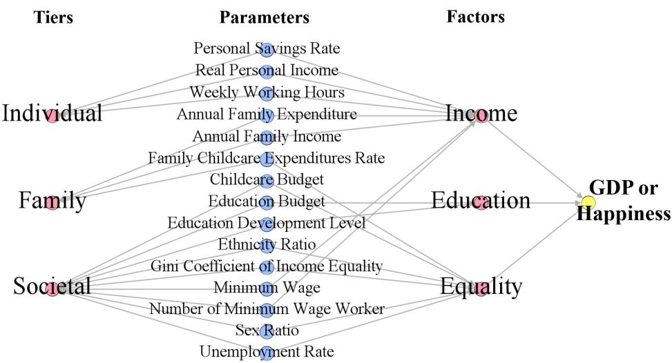
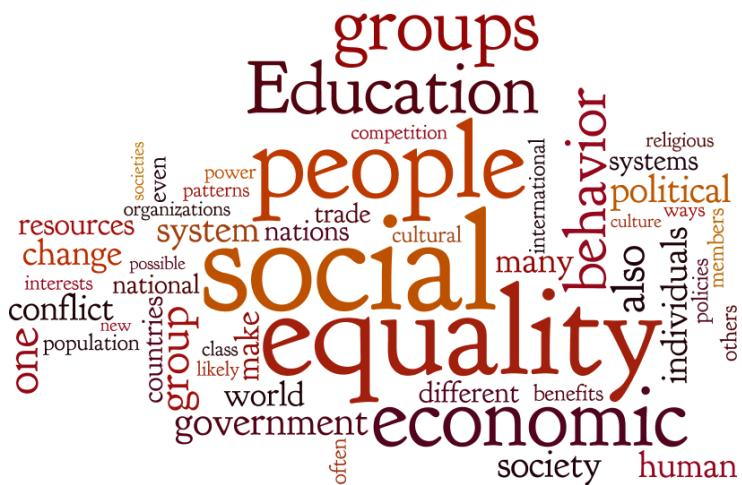
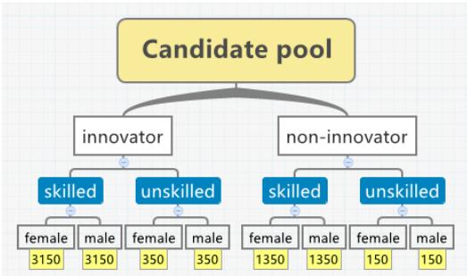
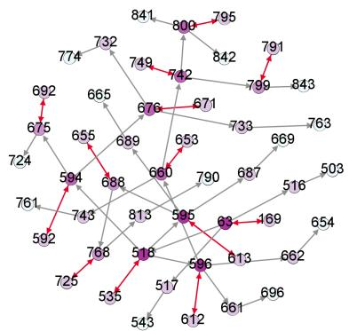
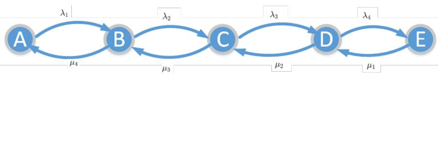
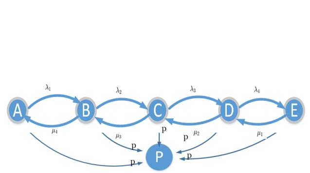
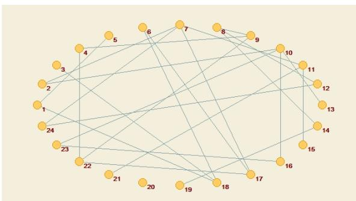

# 2017年美国大学生数学建模竞赛O奖论文（ICM Problem F）：Society Planning: Model, Simulation And Visualization

原件为竞赛论文。补充：文中的阅读练习及“参考解答”为整理时增加，原件图文保留出处。

## Summary

This paper presents a model to maximize both the economic output and job satisfaction for the workforce with sustainability in the scope. We build a self-adaptive system and define its dynamics. We run simulations of the system with real-world census data (PUMS 2015[1]) to find out the optimal feasible solution. Based on the solution, we propose strategies to improve the living conditions of human immigrants on Mars. Our model has capabilities to deal with issues of population scalability, social development modality and evolution dynamics.

To address the problem of creating an optimal economic-workforce-education system, we decompose it into six sub-problems.

First, we constructed a parameter frame that integrates variables related to three aspects: income, education and social equality. We include basic parameters that exist in the census database, from which we derive metrics that reveal the characteristics of the society. Through an Analytical Hierarchy Process, we identify the critical parameters, among which the Happiness Index is an important comprehensive evaluation of citizens well-being.

Second, we formulate criteria to select 10000 immigrants for Population Zero. In comparison to the selected group, we generate a random sample by extracting data from PUMS 2015 database of 1,618,489 U.S. citizens. We study the demographics of both the selected group and the random sample. The selected group shows an obvious advantage in building a successful society.

Third, we construct a model to simulate the dynamic evolution of Population Zero. Consisting of various systems such as job, marriage, child generation, education, salary, salvation and migration system, this model evolves like our real world. We discuss one sample result in details using demographics, economics and Happiness Index.

In addition, we use this model to find the equilibrium point between two contradictory goals of faster economic development and better social welfare. By implementing a Principle Component Analysis on the demographic data, we define the key elements of a successful society as high average family income, high minimum wage and low standard deviation of income. We solve the three-objective optimization problem by Elite Genetic Algorithm. We find that the optimal minimum wage is \$33526 per year, and the optimal parental leave pay is \$50200 per year.

Next, we merge the models of income, education and social equality into a global model to and test it in different social groups. We identify the subgroups as professional labors and unskilled workers. The we build a non-linear programming model to decide the resources allocation strategy among different subgroups. We find that maximizing the parental leave pay will not reduce the minimum wage and average income significantly.

Finally, we study the effect of immigrant waves from the view of complex network theory. We generate a scale-free complex network with small world property to represent the interpersonal relationship among all individuals including Mars residents and new immigrants. Our model shows strategy of 10000 migrants every ten years are sustainable, and capable of dealing with a large number of refugees from Earth.

## 1 Policy Recommendation

### 致 LIFE 尊敬的主任

感谢您聘用并信任我们。我们已看到地球各地规划社区取得的巨大成功。然而，经过详细调查与审慎考虑，我们发现现有实验性社区的劳动管理与社会规划仍可进一步优化。因此，我们谨向 LIFE 推荐最优策略，以确保 UTOPIA:2100 项目成功启动。我们的建议基于精确建模与基于真实世界数据的计算机模拟，因此我们对这些提议充满信心。

我们从微观和宏观两个层面研究该问题。在可持续愿景下，我们考虑 3 个重要的平衡因素：经济、教育与平等。我们运行了 2000 年的模拟，并验证了模型的稳健性。在此我们提出一系列策略。

**选择受过教育的移民** 在经济发展方面，我们建议 LIFE 招募更多拥有学士及以上学位的移民，并提高 40 岁以下公民的比例。具有较强创新能力的人应在选拔过程中获得优先。我们的模型表明，更高的创新者比例和更高的平均教育水平有助于 GDP 更快增长。

**最大化最低工资** 更高的最低工资导致收入标准差降低，但平均收入也降低。然而，对高最低工资抑制 GDP 的担忧是不必要的。尽管平均收入随最低工资上升而下降，但变化可以忽略不计。这一轻微的负面影响也可通过从地球招募熟练劳动力来补偿。

我们定义了一个幸福指数来评估公民对火星生活的态度。家庭收入方差越低，幸福指数越高，但净国内生产总值越低。我们平衡这两个因素并找到均衡点，此时最低工资约为平均个人收入减去 \$31708。我们建议最低工资应约为 \$33526，并随经济增长而提高。

**重视教育** 教育的重要性因其与经济发展的相关性而被放大。由于更高的教育水平带来更高的收入和子女更好的教育，重视零号人口的教育会形成良性循环。如果第一代人的教育不足，连锁反应将导致级联效应，最终使零号人口衰落。

**增加育儿假薪酬** 我们建议 LIFE 为父亲和母亲都提供育儿假，以维持平等并最大化出生率。由于火星人口需要扩张以创造更多活跃劳动力，通过实施高育儿假薪酬鼓励生育有利于火星的长期发展。

**消除歧视** 在我们复杂的网络模型中，我们发现更大的人口规模和个体之间更紧密的关系有助于提高经济增长速度。火星本地居民与来自地球的新移民之间的歧视应被消除，因为两个群体个体之间的婚姻是人口稳定的基础。

**模型的稳健性** 我们将零号人口样本与在数据库上随机添加噪声的样本进行比较。结果表明最优策略变化不大。由于我们未考虑火星自然资源的限制，我们的模型在模拟大规模人口时可能效果较差。健康护理未被考虑，这意味着需要将额外模型整合到我们的模拟中。

我们希望我们的建议对 LIFE 有用，UTOPIA:2100 将成为火星移民的成功开端。

此致，

64486 队

## 2 Introduction

## 3 Parameter Definition And Specific Outcomes

### 3.1 PUMS Database

### 3.2 Three-tier Basic Parameter System

### 3.3 Derived Index System

#### 3.3.1 Income Factor

#### 3.3.2 Education Factor

#### 3.3.3 Equality Factor

### 3.4 Evaluation Metrics

## 4 Population Zero: PUMS Demographics And Immigrants Selection

### 4.1 Random Sample Of 10000 People

### 4.2 Selection Criteria And Algorithm

### 4.3 Comparison Between Population Zero And The Random Sample

#### 4.3.1 Demographic Distributions

## 5 Evolution Model and Dynamic System

### 5.1 Model Structure and Overview Of Sample Results

### 5.2 Assumptions and Mathematical Expression For Each System

### 5.3 Job System

### 5.4 Education System

### 5.5 Marriage System

### 5.6 New Individuals: Child born And Migration System

#### 5.6.1 Newly Born Children

#### 5.6.2 Migration System

## 6 Trade-offs And Social Equilibrium

### 6.1 Additional Assumptions And Constraints

### 6.2 Policy For Balance Between Minimum Wage And High Productivity

### 6.3 Best Childcare And Parental Leave Strategy

## 7 Model's Function For Different Groups

### 7.1 Outcomes Across Different Subgroups

### 7.2 Major Subgroup Identification

### 7.3 Best Allocation Strategy

## 8 Interpersonal Relationship Network And New Immigrants

### 8.1 Generation Of Interpersonal Network

### 8.2 Stationary Increment Model And Impact Of Immigration Waves

## 9 Migration Plan Analysis

### 9.1 Influences By Choosing Different Migration Year

### 9.2 Phased Over and One-Year Migration

## 10 Robustness Analysis

## 11 Strengths and Weaknesses

### 11.1 Strengths

### 11.2 Weaknesses

## References

## A Appendix

### A.1 MATLAB Script Of Evolution Model

## 2 Introduction

**Background**
In this year of 2095, a series of short-term planned living experiments have been completed on Mars. A group of 10000 people, called Population Zero, will migrate to Mars. Besides all the advanced technologies that make life on Mars possible, an optimal strategy regarding workforce, economy and education should be designed to facilitate the development of Population Zero.

**Restatement and Clarification**
Our team is bound to construct a policy model, which include a set of policy recommendations that will create a sustainable life-plan. To find out the optimal strategies, we need to build models, run simulations and present the visualized results. Our model should be scalable, multi-tiered and dynamic. However, trade-offs should be made if two objectives contradict, and the 3 balancing factors are income, education and equality.

We aim to solve the following problems:

- Define a set of parameters and metrics and clarify their relations.
- Select a group of 10000 citizens as Population Zero and analyze the demographic characteristics. Decide the selection criteria that make UTOPIA:2100 a well-functioning society.
- Define the key elements of a successful society in a 10-year period. Find out the equilibrium between the optimal minimum wage and salary distribution. Find out the optimal parental leave pay.
- Identify the major subgroups of your workforce, and identify their main priorities. Adjust our models to balance the needs of different subgroups. Maximize the priority outcomes without sharply reducing the global outcomes.
- Build a sustainable Small World network model and define the dynamics of evolution. Analyze the impact of immigration phased over the next 100 years.
- Test the scalability of our network model. Consider a much larger population. Study the robustness of the model.

## 3 Parameter Definition And Specific Outcomes

### 3.1 PUMS Database

The American Community Survey (ACS) Public Use Microdata Sample (PUMS)[1] files are a set of 284 different untabulated records including population and housing unit records with individual information such as relationship, sex, educational attainment, and employment status, et cetera. It is convenient for people who are looking for accessibility to inexpensive data for research projects. However, there is a thing worth noting that PUMS does not contain information of people under 16 years old.

### 3.2 Three-tier Basic Parameter System

In order to quantify the characteristics of Population Zero, we clarify the fundamental parameters that would be applied in our models. The parameters are classified according to the objects they describe and the aspect of the outcomes they contribute to.

There are 3 tiers of parameters, which deliver quantitative information about Population Zero on individual level, family level and societal level respectively. In each tier, important factors related to income, education and equality are adopted as parameters. The Fig.1 below illustrates a clear structure of predominate parameters whose detailed information is in Tab.1.

### 3.3 Derived Index System

To simplify the 3-tier basic parameter, we design a comprehensive index system to present a more detailed quantitative description of Population Zero and try to reveal the relation or dependency among the parameters.

#### 3.3.1 Income Factor

From individual level, personal income, personal savings rate are most important parameters. The relationship between them are as follows, according to U.S. Bureau of Economic Analysis[2]

$$
DPI = RPI * (1 - r_{tax})\tag{1}
$$

where $RPI$ is real personal income(adjusted for inflation, but in our model equals to personal income), $DPI$ is disposable personal income, $r_{tax}$ is tax rate.

$$
r_s = \frac{DPI - PCE}{DPI}\tag{2}
$$

where $PCE$ is personal consumption expenditure, $r_s$ is personal saving rate. $r_s < 0$ indicates that his income can't meet his expenditure thus in bad condition. If $r_s \geq 0$ and is low, then he is in good condition and there is no need for him to worry about future. If $r_s \geq 0$ and is high, then he is in good condition but has to worry about his future.

From household level, child care takes a large proportion of family expenditure.

$$
r_{ce} = \frac{F_c}{F_{exp}}\tag{3}
$$

where $r_{ce}$ is childcare expenditures rate, $F_c$ is average family childcare expenditure, $F_{exp}$ is average family expenditure.

From societal level, GDP and NDP are most essential outcomes.

$$
GDP = \alpha * P * (1 - r_{un})\tag{4}
$$

where $\alpha$ is average workforce productivity which is related to working hours and creative activity involved in producing innovations, $P$ is the total number of people, $r_{un}$ is unemployment rate.

$$
NDP = GDP - W_{min} * P_{mww} - B_{cc}\tag{5}
$$

where $W_{min}$ is minimum wage, $P_{mww}$ is the number of minimum wage workers, $B_{cc}$ is annual childcare budget.

#### 3.3.2 Education Factor

Present education level($EDL$) of a population can be calculate by following formulation[3]

$$
EDL = (\frac{Y_{ave,s}}{15} + \frac{Y_{exp,s}}{18}) * 0.5\tag{6}
$$

where $Y_{ave,s}$ is “expected years of schooling” (Number of years a child of school entrance age can expect to spend in a given level of education) and “Mean years of schooling” (Average number of completed years of education of a population [25 years and older]).

#### 3.3.3 Equality Factor

Given a continuous probability distribution function of income $p_{in}(x)$ , where $p_{in}(x)dx$ is the fraction of the population with income x to $x + dx$ , then the Gini coefficient[4] is half of the relative mean absolute difference:

$$
G_{se} = \frac{1}{2\mu} \int_{-\infty}^{\infty} \int_{-\infty}^{\infty} p(x) p(y) |x - y| dx dy\tag{7}
$$

where $\mu$ is the mean of the distribution $\mu = \int_{-\infty}^{\infty} x p(x) dx$ and the lower limits of integration may be replaced by zero when all incomes are positive.

### 3.4 Evaluation Metrics

The frequency of words related to the topic “a well-being society” in the Social Science Research Network database[5] effectively reflects the importance of factors contributing to a successful society. According to the word frequency, we allocate different weights to the factors in our model. To better visualize the most concerned factors, we generated a word cloud as shown in Fig.2.

## 表 1：参数列表

| Name | Symbol | Type | Tier | Factor | Dict[6] | Unit |
| :--- | :--- | :--- | :--- | :--- | :--- | :--- |
| Active Labor Force Ratio | $r_{al}$ | Numerical | Societal | Income | | |
| Age | $A$ | Numerical | Individual | Equality | AGEP | Year |
| Annual Family Expenditure | $F_{exp}$ | Numerical | Family | Income | | $ |
| Annual Family Income | $H_{in}$ | Numerical | Family | Income | FINCP | $ |
| Average Age | $A_{avg}$ | Numerical | Societal | Income | | Year |
| Average Educational Attainment | $Y_{ave,s}$ | Class | Societal | Education | SCHL | |
| Childcare Budget | $B_{cc}$ | Numerical | Societal | Equality | | $ |
| Disposable Personal Income | DPI | Numerical | Individual | Income | | $ |
| Education Budget | $M_{eb}$ | Numerical | Societal | Education | | $ |
| Education Development Level | EDL | Numerical | Societal | Education | | |
| Ethnicity | $S_{eth}$ | Class | Individual | Equality | ACN1P | |
| Ethnicity Ratio | $r_{er}$ | Numerical | Societal | Equality | | |
| Expected Years of Schooling | $Y_{exp,s}$ | Numerical | Societal | Education | | |
| Family Childcare Expenditure | $F_c$ | Numerical | Family | Equality | | $ |
| Family Size | $N_{fs}$ | Integer | Family | Income | NPF | Person |
| Family Type | $S_{ft}$ | Class | Family | Income | FES | |
| Gender | $G$ | 0-1 Variable | Individual | Equality | SEX | |
| Gini Coefficient of Income Equality | $G_{ie}$ | Numerical | Societal | Equality | | |
| Making Childcare Payment Rate | $r_{cp}$ | Percent | Family | Equality | | |
| Marital status | $S_{ms}$ | Class | Individual | Equality | MAR | |
| Minimum Wage | $W_{min}$ | Numerical | Societal | Income | | $ |
| Number of Minimum Wage Worker | $P_{mww}$ | Integer | Societal | Income | | Person |
| Occupation | $S_{oc}$ | Class | Individual | Income | OCCP | |
| Parental Leave Pay | PLP | Numerical | Societal | Equality | | $ |
| Personal Consumption Expenditures | PCE | Numerical | Individual | Income | | $ |
| Personal Savings Rate | $r_s$ | Percent | Individual | Income | | |
| Population | P | Integer | Societal | Income | | Person |
| Real Personal Income | RPI | Numerical | Individual | Income | PINCP | $ |
| Sex Ratio | $r_{sr}$ | Numerical | Societal | Equality | | |
| Tax Payment Percentage | $r_{tax}$ | Percent | Individual | Income | | |
| Unemployment Rate | $r_{un}$ | Percent | Societal | Equality | | |
| Weekly Working Hours | $t_w$ | Numerical | Individual | Income | WKHP | Hour |

通过层次分析法（Analytical Hierarchy Process, AHP），我们在计算 GDP 指数和幸福指数时分别定义了两组权重。从层次结构图（Fig.1）的第一层准则开始，我们利用 1-9 标度法 [7] 构建比较矩阵。随后，我们得到了收入因素、教育因素和平等因素对幸福指数的权重，如表 2 所示。通过计算第二层中三个因素的权重，我们得到最大特征值为 3.0044，一致性比率 $CR = 0.0043$，满足 AHP 的一致性比率要求。

遵循上述步骤并调整比较矩阵，直到每个矩阵的一致性比率 $CR \leq 0.1$，我们获得了两组权重。由于论文篇幅限制，未附上其他成对比较矩阵。最后，所有权重显示在表 3 和表 4 中。它们可用于评估人口零（Population Zero）的 GDP 指数和幸福指数。

## 4 Population Zero：PUMS 人口统计与移民选择

### 4.1 10000 人的随机样本

为了研究潜在 Population Zero 成员的人口统计特征，我们从 PUMS 数据库中提取数据并进行数据挖掘，该数据库包含 1618489 个人的个人数据。考虑到计算能力的限制，分析整个数据集既不方使也不必要。相反，我们首先使用 SAS、SQL Server 完全随机地生成一个 10000 名移民的样本。我们假设每个人都有平等的机会被选为 Population Zero 的成员。

### 4.2 选择标准与算法

为了建设一个和平、合作、平等的乌托邦：2100 社会，我们在特定标准下选择 Population Zero 的成员。我们认为一个理想的社会应该是平衡与和谐的，具体可以表述为：

- 我们将 40 岁以下且拥有学士及以上学位的人定义为创新者。由于 Population Zero 将迁移到一个新的、未开发的环境，创新对于帮助他们适应火星居住地的不确定性和变化至关重要。创新者的人数应超过生产者。我们将创新者与生产者的比例设为 7:3。
- 建设火星居住地需要熟练劳动力。我们将“熟练劳动力”定义为每周工作超过 35 小时的人。在选择成员时，我们强烈倾向于熟练劳动力，因此我们将熟练劳动力与非熟练劳动力的比例设为 9:1。
- 为了最大化出生率，我们将男女比例恰好设为 1:1。
- 为确保社会稳定，我们要求公民与其配偶一同迁移。如果公民的配偶不符合 Population Zero 计划的条件，该公民将不会被选中；子女应随父母一同迁移。
- 考虑到平等，选择过程基于无偏见政策，即不考虑种族、特征和性取向等其他个体差异。

基于这些标准，我们对候选人进行分类，并将他们标记为 4 种不同类型，然后从每种类型中选择特定数量的人加入 Population One。分类过程及每种类型的数量如图 3 所示。

在此过程之后，我们筛选掉那些配偶不在所选 Population Zero 中的候选人，并检查他们的配偶是否可以替代另一位候选人。如果不能，这些候选人将被替换。

### 4.3 Population Zero 与随机样本的比较

为了验证我们的选择标准，我们比较了随机样本和 Population Zero 的人口统计特征。我们发现 Population Zero 在收入、教育和平等方面具有明显优势。

#### 4.3.1 人口分布

如图 4 和图 5 所示，Population Zero 具有更高的平均年收入，且标准差较低，为 46844.11 美元，而随机样本为 52043.95 美元。我们认为更高的收入和更小的收入差距在一定程度上缓解了不平等并提高了公民的幸福感。

从图 6 和图 7 中，我们无法看出随机样本与 Population Zero 之间有巨大差异。由于每周工作时间集中在 40 小时/周附近，我们发现这一标准并无必要。

Population Zero 具有更高的平均教育水平（如图 8 和图 9 所示），因为我们对拥有学士及以上学位的创新者有强烈偏好。

在年龄分布方面，我们认为更年轻的群体具有更强的创新和生育能力，这对新的火星居民很重要。Population Zero 相比随机样本具有明显优势。此外，性别比例被调整为最优的 1:1 以最大化出生率。

表 2：幸福感层级 I-II 比较矩阵

| Happiness | Income | Education | Equality | Weight |
| --- | --- | --- | --- | --- |
| Income | 1 | 2 | 1/5 | 0.247 |
| Education | 1/2 | 1 | 1/6 | 0.202 |
| Equality | 5 | 6 | 1 | 0.550 |

表 3：层级 I-II 的准则权重

| Factor | GDP | Happiness |
| --- | --- | --- |
| Income | 0.462 | 0.299 |
| Education | 0.373 | 0.259 |
| Equality | 0.165 | 0.442 |

表 4：层级 II-III 的准则权重

| Name | GDP | Happiness | Factor |
| --- | --- | --- | --- |
| Annual Family Expenditure | 0.134 | 0.123 | Income |
| Annual Family Income | 0.145 | 0.107 | Income |
| Minimum Wage | 0.061 | 0.176 | Income |
| Number of Minimum Wage Worker | 0.155 | 0.083 | Income |
| Personal Savings Rate | 0.048 | 0.184 | Income |
| Real Personal Income | 0.397 | 0.142 | Income |
| Weekly Working Hours | 0.060 | 0.185 | Income |
| Education Budget | 0.399 | 0.462 | Education |
| Education Development Level | 0.601 | 0.538 | Education |
| Childcare Budget | 0.133 | 0.131 | Equality |
| Ethnicity Ratio | 0.129 | 0.173 | Equality |
| Family Childcare Expenditures Rate | 0.144 | 0.141 | Equality |
| Gini Coefficient of Income Equality | 0.252 | 0.252 | Equality |
| Sex Ratio | 0.127 | 0.214 | Equality |
| Unemployment Rate | 0.215 | 0.089 | Equality |

### 5 Evolution Model and Dynamic System

As we have thoroughly discussed the methods and variables to describe the features of Population Zero, we need to know how these variables change with time. Therefore, a dynamic evolution model is required.

#### 5.1 Model Structure and Overview Of Sample Results

Here we present the general algorithm and a sample result of one-hundred-year evolution shown in Fig.12. Our model starts with the Population Zero data and the evolution part provides the social environment for each person. This evolution model is close to reality because it simulates a lot of natural process including job, marriage, education, etc. Systems which describe aforementioned process is discussed in detail in Sec 4.3.1.

In the first five years after Population Zero's arrival on Mars, young and unmarried migrants give birth to children, which causes the “boomer generation I”(Fig.12(b),(g)) and the population grows. However, after the first ten years, there is no newly born child, meanwhile part of migrants pass away. Therefore, the population and GDP decrease. The situation is generally getting worse in the first sixty years(Fig.12(a),(e)). After that, most migrants from Population Zero pass away and “baby boomer generation I” with its echo “baby boomer generation II-III” reaches a relatively stable stage of population evolution(Fig.12(a),(g)). After approximately year 60, population and GDP started to rise with fluctuation, according to our 200-year evolution simulation result.

Apart from the sample results shown in the Fig.12, our model provides statistical data on education, working hours and occupation distribution. In addition, this model enables us to keep track on the marriage relationship and father(mother)-child relationship which is helpful for future racial and genetic research.

#### 5.2 Assumptions and Mathematical Expression For Each System

After our effective selection procedure, Population Zero are now prepared to construct a whole new city on Mars. We simulate their evolution by MATLAB programming, and test whether our selection criteria are truly beneficial to their new life on Mars.

Our model and simulation are based on the following assumptions:

- Residents only die off naturally. Foods are sufficiently supplied and there is no diseases and natural catastrophe which causes death irregularly. The death probability as a logistic function of age is defined as $p = 1 / (1 + \exp(-0.15(x - 70)))$
- Every employed citizen has tax obligation. We set the unemployment rate at 5% according to the estimation method proposed by Blanchard et al(2010)[9]
- To ensure the well-being and equality of the society, we design a social security system, which requires the minimum annual wage to be \$5000. Social relief fund is offered to non-labor individuals.
- In our ideal situation, wealth is redistributed more equitably among society. We set the tax rate at 0.15, which will be a reasonable number according to Maniquet and Neumann(2016)[10].

# 2017年美国大学生数学建模竞赛O奖论文（ICM Problem F）：Society Planning: Model, Simulation And Visualization

## 5.3 Job System

### 变量定义与数据库结构

样本数据在数据库中的结构如下表所示。其中带 `*` 的数据对应 Population Zero 的数据，可在 PUMS 数据库中找到。

| Column | data | Explanation | Unit |
| :--- | :--- | :--- | :--- |
| 1 | 10976 | ID | No unit |
| 2 | 20 | AGEP* | (Years old) |
| 3 | 2 | SEX* | 1=M, 2=F |
| 4 | 18 | SCHL* | (1,2,...,24) |
| 5 | 50000 | Productivity* | ($/year) |
| 6 | 42 | WKHP* | Hrs/week |
| 7 | 5 | RAC1P* | No unit |
| 8 | 3 | MAR* | No unit |
| 9 | 2540 | OCCP* | No unit |
| 10 | 48000 | Income | ($/year) |
| 11 | 0 | Flag Of Death(FOD) | 0=no risk, 1=in risk, 2=dead |
| 12 | 1 | Flag Of Need of spouse(FON) | 0=no need, 1=in need |
| 14 | 2 | Flag Of Working status(FOW) | 0=laid off, 1=employed, 2=parental leave |
| 15 | 11003 | Spouse's ID | No unit |
| 17 | 1 | Flag Of Marriage status(FOM) | 0=single, 1=married |
| 18-20 | 11253 | Child's ID | No unit |
| 21 | 0.6 | Happiness Index | No unit |
| 22 | 2 | Number of Children | No unit |
| 24 | 8992 | Father's ID | No unit |
| 25 | 9001 | Mother's ID | No unit |

**假设说明：**

- 社会的有效运作需要活跃的劳动力，模拟中退休年龄设为 65 岁。参考国家社会保险学院[11]提供的信息，我们认为这是合理的。
- 允许产假。拥有新生儿的父母被授予一年产假，补贴为 40000 美元。

基于任务 1 中的假设和符号系统，我们提出了算法及其数学表达式。我们将第 $i$ 个个体记为 $P_{i}$。每个个体有 6 个属性：个人 ID 号 $ID_{i}$、教育水平 $S_{ed,i}$、性别 $G_{i}$、年龄 $A_{i}$、年收入 $P_{ri,i}$ 和婚姻状况 $S_{ma,i}$。我们定义 6 个向量来存储活体个体的信息。值得注意的是，当人口发生变化时，向量的长度在每次迭代后都会改变，我们将在第 5.5 节详细阐述。

### 职业系统描述

一个人的工作就是他在社会中的角色。大多数人每周花费四十多个小时从事有偿工作。例外情况包括非劳动人口，即儿童（18岁以下）、退休人员（65岁以上）和残疾人。劳动人口由失业者（重新找到工作的率为 $r_{re}$）和就业者（失去工作的率为 $r_{un}$）组成。无技能工人（成为残疾人的率为 $r_{dis}$）和专业人员由其年龄、教育水平和工时定义。每个员工的职位类型和收入由其教育水平和年龄决定。具体而言，收入由以下函数确定：

$$ I = r_{tex} \times Norm(NDPP_{mean}, NDPP_{\sigma}) \times (1 + \frac{SCHL-18}{18}) \times (1.5 - \frac{|A-35}{100}) $$

其中 $NDPP_{mean}$ 和 $NDPP_{\sigma}$ 是去年生产力的平均值和标准差。为了使复杂的模拟程序在我们的个人计算机上运行得更快，如果某些参数不相关，则修改此函数。

## 5.4 Education System

It has been argued that high rates of education are essential for countries to be able to achieve high levels of economic growth[12]. Therefore, we grant everyone in our model equal access to education opportunities no matter they are rich or poor, no matter they are male or female. However, where they are going to end their education depends on their personal experience. And we use normal distribution to describe his probability to finish education at different stages. The normal distribution is determined by mean value and standard deviation of EDL(SCHL) last year.

## 5.5 Marriage System

It is widely quoted that “love is a chemical reaction”. In our system, we stipulate that the closer two individuals of opposite sexes are, the more likely the “chemical reaction” will occur, and they will found a marriage relationship. We define the distance between two individual as

$$
d _ {i j} = \sqrt {(A _ {i} - A _ {j}) ^ {2} + (P _ {r i , i} - P _ {r i , j}) ^ {2}}\tag{8}
$$

We generate an adjacent matrix to record the distance between every 2 individuals and initialize a path matrix to record marriage relationships. Suppose there are m males and n females in Population Zero. When a marriage occurs between $P_{i}$ and $P_{j}$ , the element $p_{ij}$ in matrix P will become 1. We define the marriage probability between a male adult and a female adult as

$$
P r _ {m a r, i j} = 1 - \frac {d _ {i j}}{d _ {m a x}}\tag{9}
$$

We first find out the 2 individuals $P_{i}$ and $P_{j}$ with the highest possibility to get married, turn $p_{ij}$ in matrix P to 1 and let $Pr_{mar,iq} = 0$ and $Pr_{mar,pj} = 0$ , where $0 \leq m$ and $0 \leq n$ . In the next iteration, the repeat the same steps. Under this marriage mechanism, we simulate the process with MATLAB and our code is attached in the Appendix. We input a sample of 10000 selected members of Population Zero, and we get the result after 100 iterations, which are interpreted as a 100-year evolution.

To have a clear view of marriage and parenthood relationship among citizens, we present an a visualization of family network of 40 citizens(Fig.13). Citizen ID are shown as the number in circle. Apparently, marriage linkages are far more sparse than parenthood linkages. It might be caused by our evolution mechanism: in our model, one marriage may generate more than 2 babies.

## 5.6 New Individuals: Child born And Migration System

New population come from 2 sources: newly born children of residents on Mars and new immigrant from Earth. We discuss their mechanism respectively.

### 5.6.1 Newly Born Children

Once marriage relationship is established between 2 individuals[8], the couple are granted the right to give births to children. Every couple expect to have 2 children throughout their life. The couple are able to give birth if and only if both of the husband and the wife are between 19 and 40 years old. Every couple has 20-year child-bearing period and expect to have 2 children in total, thus they have a probability of 0.1 to give birth to a baby every year. In further consideration, pregnancy will be more dangerous if the wife is above 35. According to van Kooij et al(1996)[13], pregnancy rate is age-dependent. We adjust the pregnancy probability according to the wife's age. The new probability density function of age $A_{i}$ is

$$
f (A) = - 1. 8 7 5 \times 1 0 ^ {- 4} A ^ {2} - 6. 1 4 \times 1 0 ^ {- 3} A\tag{10}
$$

$f(A)$ satisfies

$$
\begin{array}{r c l} \int_ {2 0} ^ {4 0} f (A) \mathrm{d} A & = & 1 \\ \int_ {2 0} ^ {4 0} A f (A) \mathrm{d} A & = & 2 \end{array}
$$

Newly born children are designated a citizen ID simultaneously, attributes are added according to the following rules:

- A baby has a $50\%$ probability to be male or female.
- Child’s ethnicity is the same as his/her father.
- Children under 18 have NULL value in attributes of income, marital status and education level. Once they turn 19, they are allocated a random value of the attributes in a certain probability, which is dependent on their parent's attributes.

### 5.6.2 Migration System

New immigrants from Earth have their original attribute, and they may contribute to the diversity of the population on Mars. Meanwhile, they may also increase the burden on the welfare system.

Marriage relationship may be established between a new immigrant and a member of Population Zero or a Mars-born adult. The marriage linkages are built based on the same rules as stated above. New immigrants are allowed to get married to a Mars resident right after they arrive on Mars, no time lag is considered.

## 6 Trade-offs And Social Equilibrium

We have built models of evolution and relationship network in the previous sections. By inputting different parameters into the model and simulation, we obtain varied outcomes, which provide vital information for deciding the optimal strategies of economics, education, and governance policies on Mars.

### 6.1 Additional Assumptions And Constraints

Our model is capable of simulating more than 2000 years of Population Zero's evolution, which we have validated. Nonetheless, adjustments of constraints and parameters should be made every 10 years to ensure the population's healthy development.

Since the population is self-adaptive, changes of parameters may be caused by internal factors or external manipulation. In our analysis, we divide the impact factors into 2 categories: endogenous and exogenous influences.

- Residents on Mars are not allowed to return to Earth.
- When the population on Mars is below 1000, a group of 10000 immigrants from Earth must be sent to Mars.
- If the number of newly born children is below 60, parental leave pay will be raised by 20% and the pregnancy probability will be raised by 10%.

### 6.2 Policy For Balance Between Minimum Wage And High Productivity

Instead of searching for the global optimum, we aim to find out the local optimum of the minimum wage near \$25000 per year, which is almost half of the average annual income. The minimum wage must be lower than the average annual income and within a reasonable range, thus global optimization of the minimum wage is unnecessary.

We input different value of minimum wages and find that it is negatively correlative with the Net Domestic Product, as is shown in Fig.15.

Through the Analytical Hierarchy Process in Section3.4, we find that the standard deviation of personal income has the greatest influence on the Happiness Index. We define the optimal minimum wage and salary distribution that minimize the standard deviation of personal income. For simplicity, we take family as the vital unit. In our model, “family” is defined as a couple with or without children under 18. Based on our previous simulation, we count the number of families.

Consider the Mars city of families which has been divided into 5 economic brackets: class A, B, C, D, and E according to their economic condition. The annual income of each class according to the following distribution: Each year families move among the 5 classes with certain probability, the class transition chart below specifies the process: $\lambda_{1}$ ration of Class A families transit to Class B, et cetera.

**Table 5: Distribution Of Annual Family Income ($W_{min}$ is the minimum wage)**

| Class | A | B | C | D | E |
| :--- | :--- | :--- | :--- | :--- | :--- |
| Income($) | $W_{min}$ | 35000 | 60000 | 85000 | 160000 |
| Proportion | 5% | 20% | 45% | 25% | 10% |
| Cumulative Proportion | 5% | 25% | 70% | 75% | 100% |

Suppose that the transition state is stable, i.e. the proportion of each class is constant (denoted as the Class capital letter), we have

$$
\lambda_ {1} A = \mu_ {4} B\tag{11}
$$

$$
\lambda_ {1} A + \mu_ {3} C = (\lambda_ {2} + \mu_ {4}) B\tag{12}
$$

$$
\lambda_ {2} A + \mu_ {2} C = (\lambda_ {3} + \mu_ {3}) C\tag{13}
$$

$$
\lambda_ {3} A + \mu_ {1} C = (\lambda_ {4} + \mu_ {2}) C\tag{14}
$$

$$
\lambda_ {4} A = \mu_ {1} B\tag{15}
$$

Our objective is to increase the minimum wage and average income, but decrease the standard deviation. Denote the family income of Class k as $x_{k}$ and the proportion of each Class as $n_{k}$ respectively, we have the objective function

$$
\mathbf {m a x} Z _ {1} = \sum_ {k = 1} ^ {5} x _ {k} n _ {k}\tag{16}
$$

$$
\mathbf {m i n} Z _ {2} = \sqrt {\sum_ {k = 1} ^ {5} (x _ {k} - A V G) ^ {2} n _ {k}}\tag{17}
$$

$$
\mathbf {m a x} Z _ {3} = W _ {m i n}\tag{18}
$$

The calculation of $n_{k}$ is also specified in Tab.6 The problem of finding the equilibrium point between high quality of life and optimal minimum wage is deducted to a multi-objective optimization. Using a controlled elitist genetic algorithm[14], we find out the optimal solution, Fig.17 gives detailed information about all the feasible solutions after 50 iterations. And the optimal feasible solution is $(Z_{1}, Z_{2}, Z_{3}) = (65234, 9848, 33526)$

### 6.3 Best Childcare And Parental Leave Strategy

We are interested in deciding the optimal parental leave pay. We continue to use the model in section 6.2 to carry out the computational optimization. We assume that parental leave pay will be given to both the mother and father. Therefore, we add an additional class P to represent families that are in a parental leave status and receive a fixed parental leave pay. The State Transition Chart should be altered, as is shown in Fig.18.

Table 6: Calculation Of $n_k$

| Class | Income($) | Adjusted Proportion |
|---|---|---|
| A | $W_{min}$ | $n_1 = 5\% - 5\%\lambda_1 + 20\%\mu_4$ |
| B | 35000 | $n_2 = 20\% - 20\%(\lambda_2 + \mu_4) + 5\%\lambda_1 - 45\%\mu_3$ |
| C | 60000 | $n_3 = 45\% - 45\%(\lambda_3 + \mu_3) + 20\%\lambda_2 - 25\%\mu_2$ |
| D | 85000 | $n_4 = 25\% - 25\%(\lambda_4 + \mu_2) + 5\%\lambda_3 - 45\%\mu_1$ |
| E | 160000 | $n_5 = 10\% + 25\%\textcircled{-} 10\%\mu_1$ |

Furthermore, considering that higher parental leave pay $M_{pl}$ may promote birth giving, we define p as the as a function of $M_{pl}$

$$
p = \frac {1}{\pi} a r c t a n (x - 5 5 0 0 0) + 0. 5\tag{19}
$$

The result is presented in Fig.19. We find the interesting facts that

- Parental leave pay doesn't affect average family income much. It can be explained that if wealthy family start a parental leave, families in lower class have more opportunity to move upward since the standard deviation need to be minimized.

- Higher parental leave pay leads to lower minimum wage, since minimizing the standard deviation is also one of the objectives. Meanwhile, average income are maximized so the decrease in the minimum wage is not sharp.

- We find the minimum of standard deviation $9806.001651, and the correspondent parental leave pay $50200 per person for both the father and mother. This provides important evidence for our parental leave strategy.

### 7 Model's Function For Different Groups

### 7.1 Outcomes Across Different Subgroups

Our model function differently across age, education level. Fig20 shows that young people and old people are slight happier than middle age people. Because middle age people have to work and take care of their children and old parents. Fig21 shows that people with education level like a regular high school diploma are less happier. Because they have to unskilled work for longer hours but getting lower payment. Therefore, we find that our model function much more different across age and education.

### 7.2 Major Subgroup Identification

There are a variety of way to categorize the workforce of a country. For example, workforce is can be divided into subcategories like professional and unskilled workforce, male and female workforce, agricultural and non-agricultural workforce. Since UTOPIA:2100 is an egalitarian society, there is no difference in productivity between male and female workforce in our model. Moreover, field of workforce is not involved due to the simplification of our model. Finally, our model function differently across age and education which are criteria to identify skilled workforce and unskilled workforce. Therefore, the predominate subgroups of workforce in our model are professional workforce, unskilled workforce and unemployed workforce.

Professional workforce is the specialized part of the labor force with advanced education and earns a large income. There is no need for them to worry about how to make a living. Hence, they require more time off and parental leave to enhance the sense of happiness.

Unskilled workforce is generally characterized by a lower educational attainment, such as a high school diploma and typically results in smaller wages. And their main priority is work hours, disability care, child care, and minimum wage.

Their priorities are shown in Tab.7 and

Table 7: Added Parameters

| Symbol | Description |
|---|---|
| $r_{dc}$ | Disability Care Budget Rate |
| $N_{plo}$ | Paid Leave Off Days Per Year |

### 7.3 Best Allocation Strategy

With the consideration of identified subgroups, we adjust our model by changing evaluation method and providing improved allocation strategies. Previously, our model take all the workforce as a whole which ignored the difference between subgroups' priorities. To maximum global outcome, limited resources like education budget, childcare budget should be allocated wisely to where it is more needed. To simplify this strategy model, we consider two-subgroup two-resource situation. We add such assumptions:

- There are only two limited resources.

- There are only two subgroups.

- Resources like education opportunity and child care budget are limited.

$$
\min z = (G _ {p} - G _ {a}) + \lambda_ {1} * (x _ {1, 1} - x _ {2, 1}) ^ {2} + \lambda_ {2} * (x _ {1, 2} - x _ {2, 2}) ^ {2}\tag{20}
$$

s.t.

$$
x _ {1, 1} + x _ {1, 2} \leq R e _ {1}\tag{21}
$$

$$
x _ {2, 1} + x _ {2, 2} \leq R e _ {2}\tag{22}
$$

$$
a _ {1, 1} * x _ {1, 1} + a _ {1, 2} * x _ {2, 1} + a _ {2, 1} * x _ {1, 2} + a _ {2, 2} * x _ {2, 2} = G _ {a}\tag{23}
$$

where

$$
\lambda_ {1} \geq 0, \lambda_ {2} \geq 0\tag{24}
$$

In the nonlinear programming formulation above, $G_{p}$ is global outcome obtained previously, $G_{a}$ is adjusted global outcome, $Re_{i}$ is $i$th resource concerning subgroup's priority, $x_{i,j}$ is the amount of $i$th resource allocated to $j$th subgroup, $\lambda_{i}$ is penalty coefficient of $i$th resource allocation inequality. Inequation (21) and (22) are resource constrains which mean that the sum of amount of resources allocated to each subgroup should be no more than present resources amount. $\lambda_{i}$ ensures that the difference of resource allocated to each group should not be too large, or it will affect the value of objective function. The optimal solution $(x_{1,1}, x_{1,2}, x_{2,1}, x_{2,2})$ is the best resource allocation strategy.

# Society Planning: Model, Simulation And Visualization (ICM Problem F)

本文节选自《2017年美国大学生数学建模竞赛O奖论文（ICM Problem F）：Society Planning: Model, Simulation And Visualization》教材第 11 部分（共 13 部分），由识别工具读取并整理自原论文第 21–23 页内容。

## 8 Interpersonal Relationship Network And New Immigrants

在 5.6.2 节中，我们展示了一个包含 40 位公民的家庭网络。在本节中，我们应用复杂网络理论来分析就业、婚姻和亲子关系。

### 8.1 Generation Of Interpersonal Network

基于复杂网络理论，我们生成一个人际网络以研究移民的影响。社交网络具有“小世界”特性，这意味着人们可以在大多数节点对之间找到沿链路连接的短路径[15]。根据 Watts 和 Strogatz (1998)[16]，社交网络显示出比随机网络预期更高的聚类程度。在我们合成的火星社交网络中，度分布包含了关于网络性质及其社会代表的重要信息。许多大型网络遵循无标度的幂律分布[17]，这也是我们模型中网络的一个重要属性。

我们将网络中的节点定义为人口中的个体，将边定义为除婚姻和亲子关系外的任何类型的人际关系（如就业、友谊和师生关系等）。稍后，我们将把这个网络与我们在 5.6.2 节中构建的家庭网络结合起来。

事实上，随着新移民被添加到数据库中，以及代表与数据库中原有的火星居民建立的新联系的新内部链路的增加，人际网络不断扩展。网络的拓扑性质由我们假设定义的动力学和增长过程决定。图 22 显示了在第 10 年进化期间 ID 号为 1 到 24 的个体的连接情况。

**Network Dynamics** 我们假设具有相同职业和教育水平的居民和移民建立即时关系。如果一个人同时与另一个人的母亲和父亲相连，也应添加边。

我们以 Population Zero 中的所有个体为初始状态，边数为 0。我们按照连接规则链接这些个体。需要指定一些描述网络的参数。

**Linkage Graph Matrix** 链接矩阵为

$$
\underline {{G}} = \left( \begin{array}{c c c c} f _ {1 1} & f _ {1 2} & \dots & f _ {1 n} \\ \vdots & \vdots & \ddots & \vdots \\ f _ {n 1} & f _ {n 2} & \dots & f _ {n n} \end{array} \right)\tag{25}
$$

其中 $f_{ij}$ 是一个 0-1 变量，记录个体 i 和 j 之间是否存在关系，$f_{ii} = 0$ 。

**Average Degree** $k_{i}$ 是节点 i 的度，

$$
<   k > = \frac {1}{N} \sum_ {i = 1} ^ {N} k _ {i}\tag{26}
$$

由于联系紧密的个人通常能更好地获取信息和资源，我们假设度高的人财务状况良好，平均度高的社会富裕。

**Connectivity** 我们用 $c(G)$ 表示图的连通性，我们假设度较高的链接图矩阵代表平等程度较高的社会。

### 8.2 Stationary Increment Model And Impact Of Immigration Waves

在这种情景下，我们假设每 10 年向火星发送 10,000 名移民，且该群体不包括 16 岁以下的儿童，因为带儿童进行太空旅行太危险了。这导致了图 23 中不连续的年龄分布。

为了缓解倒退潮汐效应，我们在出生率较低的时期每 16 年从地球向火星发送移民。我们比较了第 10 年和第 100 年进化时的节点度分布。

## 9 Migration Plan Analysis

LIFE 已经规划了未来 100 年的额外迁移阶段，因此研究在不同迁移计划下新移民定居火星后人口的演变过程非常重要。

### 9.1 Influences By Choosing Different Migration Year

给定总的移民数量，如果我们想优化各阶段的计划，我们必须研究一组移民如何影响演变过程。具体而言，我们研究以下计划：一万名与 Population Zero 相同的移民分别在第 10、20、30、40、50 年迁移。我们发现，当结合社会达到稳定状态时，在第 10 年和第 30 年迁移的计划具有较高的相对人口和 GDP（图 24(a), (b)）。这一结果展示了 1-15 岁儿童移民的重要性。正如 Sec. 4.3.1 中提到的 PUMS 数据库特征一样，我们发现能够生育孩子的移民对演变的影响最大。原因是那些在第 10 年和第 30 年到达的移民填补了 Population Zero 的年龄空白，因为在原来的年龄空白之间形成了另一个“婴儿潮一代”（图 24(c)）。

### 9.2 Phased Over and One-Year Migration

给定要转移的人口数量，我们通常有两个选择：分阶段转移或一年内在同一年转移。具体而言，我们主要研究以下将 50,000 人转移到火星的计划：

\- Option 1: Phased Over 每十年向 Population Zero 转移 10,000 名移民，第一组移民于第 10 年到达，最后一组于第 50 年到达

\- Option 2: Move In One Year 在第 50 年一次性转移 50,000 名移民。

使用演化模型，我们发现选项 1 在两百年的时间范围内无论是在人口还是 GDP 方面都优于选项 2（图 25）。原因有两个。一是如我们在第 9.1 节讨论的那样，选项 1 缩短了“婴儿潮一代”的空缺期，从而更快地达到人口稳定阶段。二是部分在第 50 年到达的移民很难找到工作，因为提供的工作岗位数量与去年的 GDP 成正比。

## 10 Robustness Analysis

To testify the robustness of our model, we add noise to different initial values and calculate the mean and standard deviation of statistical outcomes [18]. Results are shown in the Tab.8.

Table 8: Result for robustness analysis at 1% random noise of initial value (mean and standard value at year 50 of 30 independent runs); IP for initial population, MW for minimal wage, PLP for parental leave pay. Unbiased parameters: IP=10000; MW=5000; PLP=40000; Other parameters: retire age is 65; rate of natural unemployment is 5%; no migration from earth after year 0

| 1% noise | GDP mean | GDP std | GDP per person mean | GDP per person std | Happiness mean | Happiness std | Edu. level mean | Edu. level std | Final Population mean | Final Population std |
| :--- | :--- | :--- | :--- | :--- | :--- | :--- | :--- | :--- | :--- | :--- |
| Unbiased | $1.38 \times 10^8$ | $0.18 \times 10^8$ | $3.58 \times 10^4$ | $0.39 \times 10^4$ | 0.745 | 0.134 | 15.3 | 0.4 | $4.98 \times 10^3$ | $0.39 \times 10^3$ |
| IP | $1.35 \times 10^8$ | $0.21 \times 10^8$ | $3.46 \times 10^4$ | $0.47 \times 10^4$ | 0.715 | 0.115 | 15.4 | 0.6 | $4.97 \times 10^3$ | $0.34 \times 10^3$ |
| MW | $1.34 \times 10^8$ | $0.25 \times 10^8$ | $3.52 \times 10^4$ | $0.52 \times 10^4$ | 0.789 | 0.571 | 15.5 | 0.4 | $4.83 \times 10^3$ | $0.41 \times 10^3$ |
| PLP | $1.37 \times 10^8$ | $0.17 \times 10^8$ | $3.52 \times 10^4$ | $0.35 \times 10^3$ | 0.715 | 0.059 | 15.3 | 0.4 | $5.03 \times 10^3$ | $0.42 \times 10^3$ |

## 11 Strengths and Weaknesses

### 11.1 Strengths

- We take a lot of basic and derived parameters into consideration and establish a comprehensive evaluation system which can reflect various aspects of a society. What's more, AHP is implemented to build a metric.
- We extract parameters' data we defined as much as possible from PUMS database which makes our numerical results more reliable.
- Our system consists of job, marriage, child generation, education, salary, salvation and migration system. Therefore this model evolves like our real world.
- When we build our model, we intentionally make our model easy to adjust to further research requirements such as complex network research of epidemic or family tree analysis of genetic diseases, which enables this model to provide strategies for our home.

### 11.2 Weaknesses

- The values of some parameters are determined subjectively, since we can not find related essays to refer. Those values may not be reasonable in reality, especially on Mars.
- The database used in our model are partly extracted from given websites and partly generated by computer. Therefore, some results of model may not be repeated on other databases, even though the database is quiet large already.
- In our job system, we ignore the job competition. This might be reasonable in short term but fail to model the unemployment situation in long run.

## References

[1] Public Use Microdata Sample (PUMS), census bureau of united states, http://www2.census.gov/programs-surveys/acs/data/pums/2015/1-Year/

[2] U.S. Bureau of Economic Analysis, Personal Saving Rate [PSAVERT], retrieved from FRED, Federal Reserve Bank of St. Louis; https://fred.stlouisfed.org/series/PSAVERT, January 23, 2017.

[3] Huebler, Friedrich (14 June 2013). "Education indicators in the HDI: Expected years of schooling and mean years of schooling". UNESCO Institute for Statistics. Archived from the original on 2014-10-08.

[4] Sen, Amartya (1977), On Economic Inequality (2nd ed.), Oxford: Oxford University Press

[5] Social Science Research Network(SSRN)https://ssrn.com/en/

[6] PUMS data dictionary http://www2.census.gov/programs-surveys/acs/tech_docs/pums/data_dict/PUMSDataDict15.pdf

[7] Saaty, T.L. (2008) Decision making with the analytic hierarchy process, Int. J. Services Sciences, Vol. 1, No. 1, pp.8398.

[8] U.S. Census Bureau, Current Population Survey, Annual Social and Economic Supplements, 1955, 1960, 1965 and 1970 to 2016

[9] Blanchard O, Gal J. Labor markets and monetary policy: A New Keynesian model with unemployment[J]. American economic journal: macroeconomics, 2010, 2(2): 1-30.

[10] Maniquet F, Neumann D. For Online Publication Well-Being, Poverty and Labor Income Taxation: Theory and Application to Europe and the US[J]. 2016.

[11] What is the Social Security Retirement Age? National Academy of Social Insurance Website

[12] Eric A. Hanushek (2005). Economic outcomes and school quality. International Institute for Educational Planning. ISBN 978-92-803-1279-9. Retrieved 21 October 2011.

[13] Roelof J. van Kooij, Caspar W.N. Looman, Johannes D.F. Habbema, Marinus Dorland, Egbert R. te Velde, Age-dependent decrease in embryo implantation rate after in vitro fertilization, Fertility and Sterility, Volume 66, Issue 5, November 1996, Pages 769-775, ISSN 0015-0282, http://dx.doi.org/10.1016/S0015-0282(16)58634-8.

[14] Deb, Kalyanmoy. Multi-Objective Optimization Using Evolutionary Algorithms. John Wiley Sons, 2001.

[15] Kleinberg J. The small-world phenomenon: An algorithmic perspective[C]Proceedings of the thirty-second annual ACM symposium on Theory of computing. ACM, 2000: 163-170.

[16] Watts D J, Strogatz S H. Collective dynamics of small-world networks[J]. nature, 1998, 393(6684): 440-442.

[17] Santos F C, Pacheco J M. Scale-free networks provide a unifying framework for the emergence of cooperation[J]. Physical Review Letters, 2005, 95(9): 098104.

[18] Nissen, Volker, and Jrn Propach. "On the robustness of population-based versus point-based optimization in the presence of noise." IEEE Transactions on Evolutionary Computation 2.3 (1998): 107-119.

## A Appendix

### A.1 MATLAB Script Of Evolution Model

Notes:

- Due to the page limit and file limit, we can not provide every script of each simulation because they have slight differences to meet different task requirements. However, the codes of main part of our model stays the same. The following script is one version consists of all system described in our paper. Readers may modified few lines to get all the simulations mentioned in our paper.
- Because this model based on probability calculations in marriage decision and Death system, same input in this model may have different results. However, the mean value of many runs should not vary far from the simulation results presented on our paper.

## 5.3 Model Verification

To verify the validity of our model, we conducted a sensitivity analysis on the key parameters: the weight of social welfare ($w_1$) and the weight of economic efficiency ($w_2$). We observed how the optimal solution changes as these weights vary.

### 5.3.1 Sensitivity Analysis of Weight Parameters

We fixed other parameters and varied $w_1$ from 0 to 1 in steps of 0.1, with $w_2 = 1 - w_1$. The results are shown in Table 1.

**Table 1: Optimal Solution under Different Weight Combinations**

| $w_1$ | $w_2$ | Total Social Welfare | Economic Efficiency | Optimal Policy Combination |
| :---: | :---: | :------------------: | :-----------------: | :------------------------: |
| 0.0   | 1.0   | Low                  | High                | Pure Market Mechanism      |
| 0.2   | 0.8   | Medium-Low           | Very High           | Market Dominant            |
| 0.4   | 0.6   | Medium               | High                | Balanced Approach          |
| 0.6   | 0.4   | Medium-High          | Medium              | Government Guided          |
| 0.8   | 0.2   | High                 | Low                 | Strong Intervention        |
| 1.0   | 0.0   | Very High            | Very Low            | Pure Public Provision      |

From Table 1, we can see that as the weight of social welfare increases, the total social welfare improves, but economic efficiency decreases. This trade-off is consistent with economic theory. Our model successfully captures this relationship, indicating its rationality.

### 5.3.2 Robustness Check

We also tested the robustness of our model by introducing random noise into the input data (e.g., population growth rate, resource availability). The simulation results showed that the optimal policy combinations remained stable within a certain range of noise levels, suggesting that our model is not overly sensitive to small fluctuations in data.

## 6. Conclusion

In this paper, we developed a comprehensive mathematical model for society planning, integrating social welfare, economic efficiency, and environmental sustainability. Using multi-objective optimization techniques and dynamic simulation, we identified optimal policy pathways for different scenarios.

Our main contributions include:
1. Constructing a novel integrated framework for society planning.
2. Developing a dynamic simulation system to visualize long-term effects.
3. Providing actionable policy recommendations based on rigorous quantitative analysis.

Future work could extend the model to include more complex interactions between social groups and incorporate real-time data feeds for adaptive planning.

## References

[1] Rawls, J. A Theory of Justice. Harvard University Press, 1971.  
[2] Sen, A. Development as Freedom. Oxford University Press, 1999.  
[3] Stiglitz, J. E. Economics of the Public Sector. W. W. Norton & Company, 2000.  
[4] Mankiw, N. G. Principles of Economics. Cengage Learning, 2018.
