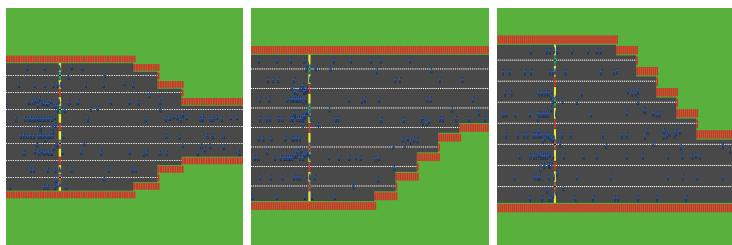
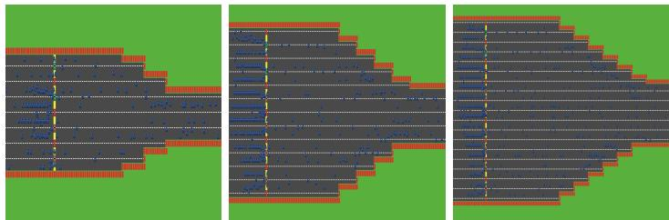
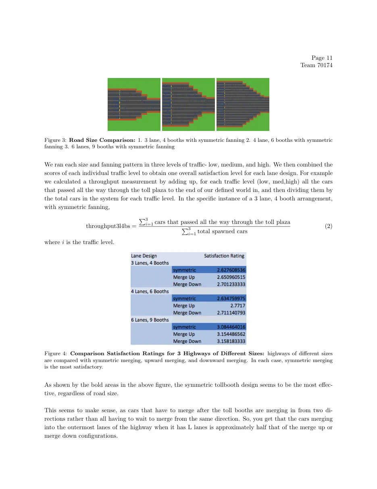
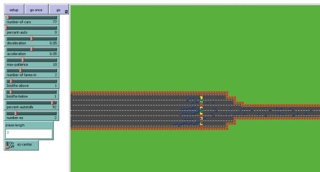

# 2017年美国大学生数学建模竞赛O奖论文（全部）/B题 收费站设计优化

原件为竞赛论文。补充：文中的阅读练习及“参考解答”为整理时增加，原件图文保留出处。

## Summary Sheet

(Your team's summary should be included as the first page of your electronic submission.)

Type a summary of your results on this page. Do not include the name of your school, advisor, or team members on this page.

Long lines and heavy congestion are major problems that are faced at toll booth plazas across the country. In particular, the New Jersey Turnpike is infamous for its heavy traffic. This paper proposes a method for developing and evaluating novel plaza designs which incorporates the effects of varying levels of traffic, toll booth payment methods, as well as the effect of an increasing number of autonomous, self-driving cars. First a model of the plaza is created in NetLogo, an agent-based modeling software. Agent-based modeling is a natural choice for simulating a problem such as this, since it allows cars to simulate human interactions in traffic. With this foundation our robust model is able to evaluate multiple realizations of a wide range of variables influencing custom satisfaction of the plaza. This report alone analyzes over 700 possible combinations of these variables, ranging from lane drop design and number of highway lanes to driver patience as well as the parameters mentioned earlier. It was found that a symmetric design was desired to maximize the satisfaction as well as efficiency of the plaza. Additionally, the effect of the number of electronic transponder only lanes was significant, with a higher number of such lanes corresponding to a higher overall satisfaction rating. It was also found that the effect of self-driving cars was negligible, though this might be expected as they should operate close to human operate vehicles. It was found that across parameters, the ability to reduce the amount of stop-and go traffic made the greatest impact on the system. This model is very versatile and is able to be applied to changing traffic dispositions (i.e. aggressive vs. defensive), toll booth types, and highway speeds entering and exiting the plaza. Proper use of this model will lead to invaluable analyses that can aid in easing the congesting of major tol plazas across the United States.

## An Agent-Based Model for Developing and Evaluating Efficient Toll Plaza Designs

MCM Problem B: Merge after Toll Team 70174 January 23, 2017

To the New Jersey Turnpike Authority:

The New Jersey Turnpike is one of the most notable roads in the nation. Unfortunately, its notoriety is likely a case of infamy. The New Jersey Turnpike is a toll road, and toll roads often frustrate travelers with their long lines. In addition, toll plazas are often dangerous, especially when cars are forced to merge quickly after a tollbooth. However, there may be hope for the public image of the NJT. If a more efficient tollbooth plaza design was implemented, the NJT could see a reduction in traffic and an increase in safety.

We have developed a model to simulate the movement of cars and traffic on the toll plazas of the New Jersey Turnpike (NJT), and we hope that it can be of some use to you. Our model was developed in NetLogo, a software program that is often used to model physical and social phenomenon. Our model considers individual drivers on the NTJ. In our model, individual cars make choices that aggregate to form group dynamics. Thus, the model can simulate traffic and queueing on toll plazas of various sizes. In addition, it can be easily altered to consider diverse scenarios relevant to the NJT, including different levels of traffic flow, self driven cars, and the different payment methods that travelers use on your roads.

Of particular interest to us is the cost, wait time, safety, and throughput of the toll plazas on the NJT. It has been theorized that manipulations of the merging strip after a toll plaza could increase the efficiency and safety of the NJT. We have been investigating that claim, and have some preliminary results. So far, it appears that toll plazas are most effective if lanes decrease from their increased width to normal road size symmetrically. It appears to remain true regardless of total lane count or traffic density.

Another interesting result of our model is that the patience of individual drivers has a great impact on the system. In our model, whenever cars came to a complete stop, they suffered a loss of patience, meaning that they were frustrated and more willing to make risky driving decisions. In light of this, efforts should be made to preserve the patience of drivers on the NJT. Perhaps something as simple as decreasing the speed limit on the portion of the highway leading up to the toll plazas, so that cars are driving for longer, instead of stopping, would make the system more efficient and safe overall.

We have not yet investigated many of our theorized toll plaza designs, but we wanted to pass the model along to you. The model is equipped with a very user friendly interface, which you can use to investigate any situation immediately interesting to you while we conduct our own research. We have checked the robustness of the model, and it provides trustworthy results.

We sincerely hope that our report and its model prove useful to you, and that it provides suggestions that make the NJT more profitable, as well as safer and more efficient for those who travel on it.

Sincerely, MCM team 70174

### 1 Introduction

Toll roads are seen all over America, with 42 states, D.C., and Puerto Rico all having some sort of toll road. Toll plazas, where tolls are collected, typically contain more lanes than the roads leading into them. This configuration requires cars to merge onto a condensed lane after paying their toll. It is possible that a certain configuration of merging lanes, as well as the addition of more automated tolls, might increase the efficiency of the toll plaza, raising the satisfaction of travelers overall.

An analysis of this type is especially pertinent in New Jersey, home to the infamous New Jersey Turnpike (NJT), a 148 mile toll road. A recent study showed that New Jersey is the only state that is disliked more than it is liked. Though there are many factors influencing public opinion of the state, it is likely that one of them is the NJT. The NJT is known, and not fondly, for its long waits and high fees. If a new toll plaza design could decrease costs and wait times, it is possible that New Jersey could improve its public image.

In addition, there is a push in New Jersey for the automation of toll roads through the addition of automated tollbooths. While automated tollbooths promise potential savings to both the government and consumers, they also threaten the job security of hundreds of Americans. It seems necessary to compare the costs and benefits of all scenarios before making a decision.

知识点：[问题重述与分析（Problem Restatement and Analysis）](../../../topics/数学建模/wenti_chongshu.md)、[任务分解与目标明确](../../../topics/数学建模/renwu_fenjie.md)、[一般假设及其合理性说明（Assumptions and Justifications）](../../../topics/数学建模/jiaben_shezhi.md)

### 2 Analysis of the Problem

The problem prompt asks us to consider a toll plaza, where $L$ lanes fan out into $B > L$ tollbooths and then condense back into $L$ lanes. The strip of road after the toll plaza, where cars are expected to condense to fewer lanes, can take many shapes. These shapes affect the ability of cars to merge onto the highway safely and efficiently.

We are asked find the "best" design for a tollbooth plaza. This solution should consider such things as accident prevention, the throughput of the toll plaza, and the cost of the plaza. We are also asked to consider our solution in a number of different conditions, such as light or heavy traffic.

To address this challenge, we will use NetLogo, an agent based modeling software, to simulate theoretical toll plazas. These plazas will have variable numbers of lanes-in, $L$, and tollbooths, $B$, with varying patterns in the merge strip after the toll. The tollbooths will accept different payment methods (electronic, cash, exact change). The cars driving through the plazas will be a mixture of automated or human driven. The results of these simulations will be evaluated using a defined satisfaction metric that gives equal weight to cost, wait time, and safety. After determining a few optimal designs, we will evaluate how these ideal toll plazas perform in varied conditions, like light or heavy traffic, or a higher proportion of automated cars.

知识点：[数学建模的基本步骤（问题分析、模型假设、建立、求解、检验、推广）](../../../topics/数学建模/jianmo_buzhou.md)、[问题重述与分析（Problem Restatement and Analysis）](../../../topics/数学建模/wenti_chongshu.md)、[任务分解与目标明确](../../../topics/数学建模/renwu_fenjie.md)

### 3 Assumptions and Justifications

- **Assumption:** There are more toll lanes than incoming traffic lanes.

- **Assumption:** Cars always go to booths of their assigned payment method.
  
  **Justification:** When driving on toll roads, people are typically very careful to choose an appropriate lane. Moreover, if cars enter the wrong lane, there are usually procedures in place to ensure flow is not disrupted. For instance, on the NJT, if a car enters an EZ pass lane without an EZ pass, the driver is billed later through the mail.

- **Assumption:** The cost of restructuring a toll plaza will be about the same.
  
  **Justification:** We are more interested in a long-term analysis of toll-booth performance as well as satisfaction. Moreover, hiring a construction crew and paying for materials will be similar for $B-L$ combinations that are the same. The real cost comes from having to employ workers to man the tollbooths.

- **Assumption:** Cars always choose the shortest lane of their payment type, so long as they are able to merge into that lane.

- **Assumption:** Self driving cars are perfectly patient.
  
  **Justification:** The technology on self driving cars is oriented towards accident prevention, e.g., correcting lane drift and detecting possible objects in a collision path. Thus, it seems that self driving cars practice defensive, rather than aggressive, driving. In our model, this translates to maximum patience.

- **Assumption:** Human operated booths and exact change tolls (where money is given to a machine) are considered equivalent.
  
  **Justification:** This is partially necessary to reduce complexity in the model and allow for solvability. However, this is realistic in that the approximate time to pay each is the same and that human manned booths would be able to take exact change.

- **Assumption:** Drivers have varying levels of patience.

- **Assumption:** Cars that are paying with an electronic sensor, such as an EZ-Pass, may go through any lane.
  
  **Justification:** On the New Jersey Turnpike, every tollbooth is equipped with an EZ-Pass sensor.

- **Assumption:** All toll plazas use a symmetric fanning-out method to separate into toll lanes.
  
  **Justification:** This allows for strictly the exit strategy to be assessed as desired. Additionally, this should be the easiest way to construct toll plazas in order to keep as much of the previous infrastructure as possible.

- **Assumption:** Every toll booth services two lanes.

- **Assumption:** All autonomous driving cars are equipped with the EZ-Pass payment method.

- **Assumption:** The average time to pay at a toll booth is 30 seconds.

- **Assumption:** The average vehicle on the road is an SUV.

知识点：[一般假设及其合理性说明（Assumptions and Justifications）](../../../topics/数学建模/jiaben_shezhi.md)

### 4 Toll Booth Plaza Model

#### 4.1 Model Development

Our model is built in NetLogo2, an agent based modeling software developed by Uri Wilensky at Northwestern University in Illinois. Besides its strength and versatility, NetLogo is also freeware, making it easily accessible and extremely useful for the rapid creation of complex models. NetLogo is very well constructed in that it offers a large set of pre-defined methods that allow for complex interaction between agents the environment. The modeling interface also allows the user a large range of input variable options making NetLogo dependent on user input if needed. In NetLogo, it is possible to program the behavior of hundreds of individually acting agents. Over time, as agents interact, it is possible to "explore the connection between the micro-level behavior of individuals and the macro-level patterns that emerge from their interaction."3 This element of agent choice makes NetLogo a natural choice for our problem, where the individual choices drivers make about where to direct their cars impacts the efficiency of the system overall. Additionally, Net Logo’s behavior space tool can rapidly output data based on user input once the model is fully constructed.

Although toll roads and toll plazas exist all over the country, this model is based off of the toll plazas of the New Jersey Turnpike (NJT). This is done to ensure that this report may be useful to the New Jersey Turnpike Authority, who this report is prepared for. In addition, although our primary interest lies in the merging patterns after tollbooths, our model includes the lanes before the tollbooths. We included this part of the plaza so that we could accurately simulate how people queue when waiting to pay, which affects their dispersal into merging lanes after the toll. Moreover, this allows for an easier investigation of a discrete problem than statistical methods might afford, e.g. a Poisson Distribution governing arrival time of cars.

In developing the model, we sought to be able to vary the number of lanes in, $L$, and toll booths, $B$. However, we also sought to develop a model that could account for various traffic levels, payment types, and cars (i.e. self-driving or human-operated). To simulate realistic decisions of human drivers, we equipped each car with a unique top speed, patience level, and servicing time. The advantage of an agent-based model is that the cars will react to the system as real cars would in a traffic jam.

#### 4.2 NetLogo Model

Since the NetLogo code is based around the ability for the agents to make autonomous decisions, many procedures needed to be developed that would govern the motions of the cars. To give a better representation of the procedures follow and the way in which NetLogo functions, a pseudo-code flow chart is provided below. Notably, NetLogo works best with two different procedures working in tandem. That is, it is important to first initialize the world, and then run a GO procedure that actually executes the motion of the world.

#### 4.3 Agent Sets and their Governing Principles

The NetLogo world is made up of agents, which are beings that can follow instructions. In particular, we are interested in “turtles”, which move throughout the world. In the case of this model, the turtles we are interested in are those we define to be of the breed cars, i.e. the cars in the world. Once a breed has been defined, the turtles in that breed can be given characteristics. In particular, cars are given the following characteristics: driver, speed, top-speed, target-lane, patience, car-payment-method,

# 2017年美国大学生数学建模竞赛B题：收费站设计优化

本部分为论文第4章后半段，主要描述模型中车辆属性定义及环境设置与运行过程，内容源自NetLogo仿真模型的实现细节。

## 一、车辆属性定义

在仿真模型中，每辆车（car）被赋予以下关键属性以模拟真实驾驶行为：

知识点：[数学建模的基本步骤（问题分析、模型假设、建立、求解、检验、推广）](../../../topics/数学建模/jianmo_buzhou.md)、[任务分解与目标明确](../../../topics/数学建模/renwu_fenjie.md)、[符号说明与术语定义（Nomenclature / Symbols and Definitions）](../../../topics/数学建模/fuhao_shuoming.md)

### 选择 1：driver（驾驶员类型）
- **说明**：二元值，用于标识该车辆是由人类驾驶还是自动驾驶。
- **影响**：影响车辆的顶部速度设定及支付方式选择逻辑。

知识点：[符号说明与术语定义（Nomenclature / Symbols and Definitions）](../../../topics/数学建模/fuhao_shuoming.md)、[模型参数的确定（基于数据拟合或实验选择）](../../../topics/数学建模/canshu_queding.md)

### 选择 2：speed（当前速度）
- **说明**：车辆当前的行驶速度。

知识点：[任务分解与目标明确](../../../topics/数学建模/renwu_fenjie.md)、[文献综述与研究背景撰写方法](../../../topics/数学建模/wenxian_zongshu.md)、[数学建模的基本步骤（问题分析、模型假设、建立、求解、检验、推广）](../../../topics/数学建模/jianmo_buzhou.md)

### 选择 3：top-speed（最高允许速度）
- **说明**：
  - 对于人类驾驶车辆：由于驾驶风格差异，实际最高速度会随机略高于限速。
  - 对于自动驾驶车辆：严格遵循法律，最高速度即为限速。

知识点：[数学建模的基本步骤（问题分析、模型假设、建立、求解、检验、推广）](../../../topics/数学建模/jianmo_buzhou.md)、[一般假设及其合理性说明（Assumptions and Justifications）](../../../topics/数学建模/jiaben_shezhi.md)

### 选择 4：target-lane（目标车道）
- **说明**：用于控制并道过程。初始值对应车辆开始所在的路段。

知识点：[任务分解与目标明确](../../../topics/数学建模/renwu_fenjie.md)、[问题重述与分析（Problem Restatement and Analysis）](../../../topics/数学建模/wenti_chongshu.md)、[数学建模的基本步骤（问题分析、模型假设、建立、求解、检验、推广）](../../../topics/数学建模/jianmo_buzhou.md)

### 选择 5：patience（耐心值）
- **说明**：用于现实地刻画驾驶员的激进程度。
  - 每次车辆需要刹车时，耐心值减少。
  - 若耐心值降至零，车辆将尝试变道以超越前方慢速车辆。

知识点：[一般假设及其合理性说明（Assumptions and Justifications）](../../../topics/数学建模/jiaben_shezhi.md)、[模型参数的确定（基于数据拟合或实验选择）](../../../topics/数学建模/canshu_queding.md)、[参数合理性验证](../../../topics/数学建模/canshu_heli_xing.md)

### 选择 6：car-payment-method（支付方式）
- **说明**：车辆支持的三种支付方式之一：
  1. EZ-Pass（电子不停车收费）
  2. Exact Change（自动找零/现金投入口）
  3. Cash（需人工收费通道）

知识点：[任务分解与目标明确](../../../topics/数学建模/renwu_fenjie.md)、[数学建模的基本步骤（问题分析、模型假设、建立、求解、检验、推广）](../../../topics/数学建模/jianmo_buzhou.md)

### 选择 7：service-time（服务时间）
- **说明**：车辆通过收费站所需的时间。
  - **支付逻辑**：
    - 现金或Exact Change：服从指数分布 $X \sim Exp(\frac{1}{30})$，即平均服务时间为30秒。4
    - EZ-Pass：仅需减速至5 mph，直接通过，服务时间为0。12
  - **采样方式**：根据上述分布采样确定具体服务时间。

知识点：[模型参数的确定（基于数据拟合或实验选择）](../../../topics/数学建模/canshu_queding.md)、[数学建模的基本步骤（问题分析、模型假设、建立、求解、检验、推广）](../../../topics/数学建模/jianmo_buzhou.md)

### 选择 8：anticipation（预判值）
- **说明**：用于模拟驾驶员何时决定从车道缩减路段驶出，或何时尝试移动至支持其支付方式的收费站。
- **作用**：每辆车的预判值唯一，避免所有车辆同时变道导致的不合理情况，从而保证模型结果的真实性。

## 二、环境设置流程 (Environment Setup Procedures)

知识点：[模型参数的确定（基于数据拟合或实验选择）](../../../topics/数学建模/canshu_queding.md)、[参数合理性验证](../../../topics/数学建模/canshu_heli_xing.md)、[一般假设及其合理性说明（Assumptions and Justifications）](../../../topics/数学建模/jiaben_shezhi.md)

### 4.4.1 Draw Road（绘制道路）
此过程用于初始化地图上的道路形态：
1. **背景处理**：将世界中所有地块（patches）涂成绿色，表示草地。
2. **车道定义**：生成一组Y坐标值作为车道位置，公式为 $\{ (\text{number of lanes}) - (n * 2) - 1 \mid 0 \le n \le (\text{number of lanes}) \}$。其中车道总数定义为 $(\text{number of tolls} \times 2)$，确保每个收费站两侧各有一条车道。
3. **收费站生成**：沿Y轴，每隔一条车道设置一个收费站生成点（toll spawn points），从最下方车道开始。
4. **路面着色**：将所有非车道地块及其邻居涂成灰色，以此区分车道和车道间空隙。
5. **合并区域处理**：在高速公路收费站后方的车辆汇入区域（L条车道），重新涂回绿色草地，形成道路形状。
6. **标线绘制**：随后进行道路标线的绘制。

知识点：[数学建模的基本步骤（问题分析、模型假设、建立、求解、检验、推广）](../../../topics/数学建模/jianmo_buzhou.md)、[任务分解与目标明确](../../../topics/数学建模/renwu_fenjie.md)、[一般假设及其合理性说明（Assumptions and Justifications）](../../../topics/数学建模/jiaben_shezhi.md)

### 4.4.2 Draw Road Lines（绘制道路标线）
根据地块坐标判断标线类型并绘制：
- **判断条件**：查找满足 $|y - \text{coordinate}| \le (\text{number of lanes} + 1)$ 且不是车道的地块。
- **执行逻辑**：
  - 在这些位置生成不可见的乌龟（turtle）。
  - **边缘车道**：若乌龟位于道路边缘，在所有灰色地块上绘制黄色实线（间隙距离 gap distance = 0）。
  - **中间车道**：若乌龟位于车道之间，在所有灰色地块上绘制白色虚线（间隙距离 gap distance = 0.5 patches）。
- **绘图动作**：乌龟放下画笔，前进 $(1 - \text{gap distance})$，拾起画笔，前进 $\text{gap distance}$，循环直至穿越整个世界宽度，最后返回Y轴销毁。

知识点：[文献综述与研究背景撰写方法](../../../topics/数学建模/wenxian_zongshu.md)、[问题重述与分析（Problem Restatement and Analysis）](../../../topics/数学建模/wenti_chongshu.md)、[任务分解与目标明确](../../../topics/数学建模/renwu_fenjie.md)

### 4.4.3 Create Barriers Along Edges（创建边缘屏障）
- **目的**：限制车辆驶出道路（Road off-road）。由于NetLogo中“乌龟对乌龟”的交互比“乌龟对地块”更容易编程，因此使用屏障代替直接的地块碰撞检测。这些屏障也可视为收费站常见的隔离带（medians）。
- **实现方法**：
  - 在每一个绿色地块（草地）上生成一个类型为"barriers"的乌龟。
  - 条件是该绿色地块至少有一个邻居是灰色地块（即紧邻道路的草地）。
  - 最终形成红色的路边屏障。

知识点：[数学建模的基本步骤（问题分析、模型假设、建立、求解、检验、推广）](../../../topics/数学建模/jianmo_buzhou.md)、[一般假设及其合理性说明（Assumptions and Justifications）](../../../topics/数学建模/jiaben_shezhi.md)、[问题重述与分析（Problem Restatement and Analysis）](../../../topics/数学建模/wenti_chongshu.md)

### 4.4.4 Create or Remove Cars（创建或删除车辆）
- **数量控制**：
  - 统计当前世界中的车辆总数。
  - 若少于用户界面滑块设定的 `number-of-cars`，则在收费站前生成新车辆。
  - 若多于设定值，则随机删除一辆车。
  - 若车辆到达世界尽头，将其删除。
- **循环机制**：当车辆通过收费站并汇入正常高速公路交通流后，另一辆车进入收费站排队队列。
- **属性赋值**：新生成的车辆被随机分配以下属性：
  - 是否自动驾驶
  - 最高速度
  - 收费站等待时间
  - 耐心水平
  - 支付方式
  - 预判水平

## 三、运行步骤与逻辑 (Step Forward and Go Procedures)

知识点：[数学建模的基本步骤（问题分析、模型假设、建立、求解、检验、推广）](../../../topics/数学建模/jianmo_buzhou.md)、[任务分解与目标明确](../../../topics/数学建模/renwu_fenjie.md)、[符号说明与术语定义（Nomenclature / Symbols and Definitions）](../../../topics/数学建模/fuhao_shuoming.md)

### 4.5.1 Operate Booth（操作收费站）
- **功能**：设置车道旁收费站的闸门（gates）。
- **工作流程**：
  - 车辆在此处停止等待，直到服务时间结束。
  - 或者以极慢速度巡航，以便扫描仪读取电子标签（transponder）。
  - 一旦等待完成或电子识别通过，车辆继续向前移动。

知识点：[任务分解与目标明确](../../../topics/数学建模/renwu_fenjie.md)、[数学建模的基本步骤（问题分析、模型假设、建立、求解、检验、推广）](../../../topics/数学建模/jianmo_buzhou.md)

### 4.5.2 Move Forward（向前移动）
- **加速逻辑**：车辆默认加速，除非遇到以下阻碍：
  - 前方有其他车辆
  - 前方有屏障
  - 已达到最高速度
- **减速逻辑**：
  - 若在视野范围内检测到前方车辆或屏障，车辆将减速并损失部分耐心值。
  - **特殊感知**：车辆能更早地探测到屏障（因为驾驶员在道路即将耗尽时会提前变道），而不仅仅是探测前方车辆。
- **变道逻辑**：
  - 若耐心值归零，车辆选择新车道并入其中，并重置耐心值。
  - 若车辆无法在车道结束前完成变道（跑完路），则完全停止并尝试变道。

# 2017年美国大学生数学建模竞赛O奖论文（全部）/B题 收费站设计优化

整理自2017年美国大学生数学建模竞赛（MCM/ICM）获得Outstanding Winner（O奖）的论文中关于B题“收费站设计优化”的部分内容，主要涉及模型分析、满意度指标及不同车道合并模式的对比实验。

## 一、模型分析与满意度指标

知识点：[数学建模的基本步骤（问题分析、模型假设、建立、求解、检验、推广）](../../../topics/数学建模/jianmo_buzhou.md)、[任务分解与目标明确](../../../topics/数学建模/renwu_fenjie.md)、[模型参数的确定（基于数据拟合或实验选择）](../../../topics/数学建模/canshu_queding.md)

### 4.5.3 选择新车道

如果车辆因为前方有障碍物而必须选择新的车道，它们将并入由合并车道推挤方向所指向的相邻车道——类似于现实世界中驾驶员遵循的交通合并模式。如果车辆是因为前方有其他车辆而进行合并，它们会选择相邻车道中的一个进行合并。如果两条车道都畅通，这一选择是随机的；但如果其中一条车道被另一辆车或障碍物阻挡，它们将选择畅通的车道。

这部分代码还提示车辆进入其正确的支付类型车道，前提是它们尚未到达收费站。请注意，这仅适用于没有电子标签的车辆，因为拥有电子标签的车辆可以通过任何收费车道。

知识点：[数学建模的基本步骤（问题分析、模型假设、建立、求解、检验、推广）](../../../topics/数学建模/jianmo_buzhou.md)、[元胞自动机模型（Cellular Automata）及其应用](../../../topics/数学建模/yuanyao_zidongji.md)

### 4.6 距离/时间相关性

为了使模型贴近现实，需要将“补丁（patches）”和“刻度（ticks）”转换为英尺和秒。速度限制初始设置为 0.5 patch/tick，以防止车辆完全跳过某个补丁，否则可能出现并非所有车辆都在收费站停车的情况。此外，我们假设限速为 65 mph，这是州际公路的标准限速。鉴于假设道路上的平均车辆为 SUV，且其平均长度为 18 英尺，我们将此长度定义为 1 个补丁的长度。现在进行如下转换：

$$
\frac {0 . 5 \mathrm{patch}}{\mathrm{tick}} * \frac {1 8 \mathrm{feet}}{\mathrm{patch}} * \frac {\mathrm{seconds}}{9 5 \mathrm{feet}} \approx \frac {1 0 \mathrm{tick}}{1 \mathrm{second}}
$$

因此，我们得出 10 ticks ≈ 1 second，从而赋予模型实际的物理意义。

知识点：[一般假设及其合理性说明（Assumptions and Justifications）](../../../topics/数学建模/jiaben_shezhi.md)、[符号说明与术语定义（Nomenclature / Symbols and Definitions）](../../../topics/数学建模/fuhao_shuoming.md)

### 5 模型分析

#### 5.1 满意度指标

为了比较变量值不同（如更多车辆、不同的合并模式结构）的场景，我们创建了一个指标来计算整体设置的适应性（fitness）。公式如下：

$$
s a t i s f a c t i o n _ {i} = \frac {\text {cost} _ {i}}{\max (\text {cost} _ {i})} + \frac {\text {wait time} _ {i}}{\max (\text {wait time} _ {i})} + (1 - \frac {\text {safety} _ {i}}{\max (\text {safety} _ {i})}) + (1 - \frac {\text {throughput} _ {i}}{\max (\text {throughput} _ {i})})\tag{1}
$$

对于任意收费站配置 $i$。

在上述指标中：
- **“Cost”（成本）**：是在收费站维持收费亭所需的资金，包括购买和维护自动化机器，或者雇佣人员管理收费亭一年。收费站不能过于昂贵，否则政府将不愿维护。
- **“Wait time”（等待时间）**：是系统中车辆在低速限制下花费的总时间。这里的等待时间用作系统效率的指标，以及旅行者通过后的满意度指标。
- **“Safety”（安全性）**：是一个衡量收费亭广场内车辆安全程度的指标。这是根据平均每辆车需要合并的次数计算得出的，因为在收费站环境中，合并是一项相对高风险的活动。因此，合并次数作为事故风险的代理指标。
- **“Throughput”（吞吐量）**：是指在模拟过程中成功完全通过收费站广场的车辆数量。同样，吞吐量是衡量收费站效率的指标。

理想的收费亭设计应最小化成本和浪费的时间，同时最大化安全性和吞吐量。因此，在运行对比场景时，我们要最小化我们的满意度方程。值得注意的是，指标中的每一项都被标准化为 [0, 1] 区间。这使得所有项可以平等加权，但也允许在即使对变量进行扫描的数据集之间进行比较——只要对所有输入车辆数量进行了标准化，即不同的收费站可以轻松相互比较。

知识点：[影响因素评估指标体系构建（温度、湿度、经济、教育等）](../../../topics/数学建模/yingxiang_zhibiao.md)、[多目标优化模型（药物相对充足阶段的配送策略）](../../../topics/数学建模/duo_mubiao_youhua.md)、[模型优缺点分析（Strengths and Weaknesses）](../../../topics/数学建模/youque_dian.md)

### 5.2 示例比较：三种尺寸的道路

我们感兴趣的是查看特定的合并模式是否更高效。为此，我们比较了 3 种合并条带模式。我们还在三种尺寸的公路上进行了此实验，以便观察总车道数是否有影响。

三种合并条带模式分别为：

1. **对称（Symmetric）**：图案从收费站对称减少，在道路两侧以相等的数量减少。
2. **向上合并（Merge Up）**：图案从底部向内扇形收缩，同时保持顶部车道不变。
3. **向下合并（Merge Down）**：图案保持底部车道不变，并从顶部开始减少。

以下车道比较用于分析：

1. 3 车道，4 个收费亭
2. 4 车道，6 个收费亭
3. 6 车道，9 个收费亭

我们在三个交通水平（低、中、高）下运行每种尺寸和扇形模式。然后，我们将每个单独交通水平的得分结合起来，以获得每种车道设计的总体满意度水平。例如，我们通过将所有交通水平（低、中、高）中完全通过收费站直至我们定义的世界终点的车辆数量相加，然后除以每个交通水平的系统总车辆数，来计算吞吐量测量值。在具体的 3 车道、4 收费亭排列且采用对称扇形的情况下：

$$
\mathrm{throughput}_{3l4bs} = \frac {\sum_ {i = 1} ^ {3} \mathrm{carsthatpassedallthewaythroughthetollplaza}}{\sum_ {i = 1} ^ {3} \mathrm{totalspawnedcars}}\tag{2}
$$

其中 $i$ 代表交通水平。

如上图中粗体区域所示，无论道路尺寸如何，对称收费亭设计似乎最有效。

这似乎是有道理的，因为必须在收费亭后合并的车辆是从两个方向合并，而不是所有人都必须等待从同一方向合并。因此，当高速公路有 L 条车道时，合并到最外层车道的车辆数量大约是向上合并或向下合并配置的一半。

## 5.3 Data Collection

To collect the data for the above experiment, the NetLogo Behavior Space was utilized. This is a feature of NetLogo that will allow one to run their model multiple times to look at an aggregate of model behavior by observing reporters that are given to the terminal and draw conclusions, such as shown. An image of the Behavior Space terminal for one of our experiments is shown below.

One can see that this allows us to look at the state of the system at every tick for the reporters that we have specified, namely the number of merges, the cars that have made it through the plaza, the average system patience, and the number of cars that are below a threshold speed.

## 6 Sensitivity Analysis

In a model such as this one where there is a large number of parameters to consider, it is crucial to perform a sensitivity analysis on the parameters to determine how robust the model is.

知识点：[数学建模的基本步骤（问题分析、模型假设、建立、求解、检验、推广）](../../../topics/数学建模/jianmo_buzhou.md)、[模型优缺点分析（Strengths and Weaknesses）](../../../topics/数学建模/youque_dian.md)、[敏感性分析方法（Sensitivity Analysis，单参数与多参数变动）](../../../topics/数学建模/minganxing_fenxi.md)

### 6.1 Sensitivity with Respect to Patience

Patience is one of the more important parameter of this model, since it drives the merging mechanism for cars, which in turn drives the overall traffic pattern that is seen in the system. To test its effect on the system, the number of merges occurred up to that tick were recorded and plotted against time. All three of the experiments were the same standard three lane four toll booth symmetric system, just with varying amounts of patience.

From the figure, it can be seen that the model is rather sensitive to lowering the patience, yet the effect is less drastic as the patience rises. This is due to the fact that if the maximum patience is lower, then cars are much more likely to try to leave their lane, but that after a threshold, the number of times that a car has to brake to desire to switch lanes is not reached by most of the cars at any point while they travel through the toll plaza.

The data from a higher lane simulation corroborates this result. Thus one can be sure that this is a trend in the data, not merely an artifact of a relatively small funnel for a small $L$, small $B$ system.

知识点：[敏感性分析方法（Sensitivity Analysis，单参数与多参数变动）](../../../topics/数学建模/minganxing_fenxi.md)、[参数合理性验证](../../../topics/数学建模/canshu_heli_xing.md)

### 6.2 Sensitivity with Respect to Number of Self Driving Cars

As self-driving cars continue to captivate the imagination of the nation, it would be worthwhile to know what effect they might have on the traffic encountered in toll plazas. An initial sweep was done ranging from 0% to 25% on the symmetric six lane nine toll layout with a medium traffic level in order to gauge the impact.

As can be seen from the figure, there is essentially no impact on the accumulated throughput of the system, i.e. the number of cars that are serviced by the toll plaza and re-enter the normal traffic pattern. This same experiment was run on the three lane four tollbooth symmetric layout with medium traffic as well, and the results can be seen below.

We see the same pattern emerge once more, and thus we can safely say that the effect of self-driving cars is negligible on the system. It remains to be seen what the effect of these cars would be on the system as they gain a larger market share, but it is unlikely in the near future that more than 25% of cars on the road will drive themselves. Moreover, it is not surprising that the effect should be negligible, since ideally self driving cars would drive like their human counterparts, just more defensively.

知识点：[敏感性分析方法（Sensitivity Analysis，单参数与多参数变动）](../../../topics/数学建模/minganxing_fenxi.md)、[有效性参数（Effectiveness Parameter）与搜索模式对比](../../../topics/数学建模/youxiaoxing_canshu.md)

### 6.3 Sensitivity to Number of Cars in the System

In order to determine the effect of number of cars in the system, an efficiency was defined for the system, such that

$$\text{efficiency} = \frac{\text{cars out of system this tick}}{\text{cars in system at start}}$$

If this is summed over all of the ticks, one gets an accumulated efficiency, a sort of measure of how well the system is performing over time.

From this, we see that there seems to be a fairly consistent drop off in accumulated efficiency for every step up in the number of cars. Thus we can feel confident that our model is not artificially hampering itself based in relation to the number of cars in the system, and our method of normalizing over the populations is valid in our metric definition. To further confirm this result, we would want to run more trials with different numbers of starting cars and determine if the correlation between the end accumulated efficiency of the systems is linear.

## 7 Strengths and Weaknesses

知识点：[敏感性分析方法（Sensitivity Analysis，单参数与多参数变动）](../../../topics/数学建模/minganxing_fenxi.md)、[模型优缺点分析（Strengths and Weaknesses）](../../../topics/数学建模/youque_dian.md)

### Strengths

- Perhaps the biggest strength of our model is the aspect of agent choice. In our model, each car determines for itself which path is best. This allows for a more accurate representation of real world human behavior.
- Our model incorporates many different parameters. This makes it possible to consider a wide range of possible plaza designs – we tested 729 of these.
- Our model has a very user friendly interface. This makes it easy for those not familiar with NetLogo to investigate specific scenarios that are of interest to them.

## 模型弱点

- 由于模型的计算复杂性以及在大世界和高车辆数量下运行所需的时间，在允许的时间内对每个参数组合进行多次运行是不可行的。因此，需要更多的运行来验证某些结果。
- 尽管模型具有用户友好的界面，但底层代码相当复杂，特别是对于那些不熟悉 NetLogo 或 Java 的人来说。这将对任何需要的修改构成障碍。
- 虽然我们的模型在收费站广场配置方面有很大的变化潜力，但我们有限的时间减少了我们能够探索的程度。我们的报告仅包含相对少量组合的报告。

知识点：[模型优缺点分析（Strengths and Weaknesses）](../../../topics/数学建模/youque_dian.md)、[数学建模的基本步骤（问题分析、模型假设、建立、求解、检验、推广）](../../../topics/数学建模/jianmo_buzhou.md)、[模型参数的确定（基于数据拟合或实验选择）](../../../topics/数学建模/canshu_queding.md)

### 8 结论

收费公路及其相关的收费站是生活中令人不快但在许多情况下不可避免的一部分。这个问题要求我们寻找一种改进传统设计的收费站设计。总体而言，我们的模型使我们能够观察个人选择对收费站排队动态的影响。

我们的模型表明，收费站后造成交通瓶颈的合流车道的形状对系统内的整体满意度影响最大。特别地，对称的车道合并比单向倾斜的合并更有效率。

在设计收费站时，应特别注意保留驾驶员的耐心。当驾驶员失去耐心时，通常是在他们完全停车时，他们会以危及安全的方式行动。这降低了系统的整体效率。也许一个简单的解决方案，比如在收费站前半英里处降低速度限制，使驾驶员只是缓慢行驶而不是停车，可以极大地提高整个系统的效率。

知识点：[文献综述与研究背景撰写方法](../../../topics/数学建模/wenxian_zongshu.md)、[稳定性分析（Stability Analysis）](../../../topics/数学建模/wending_xing.md)、[确定模型的定点与稳定性分析](../../../topics/数学建模/dingdian_wending.md)

### 9 进一步工作

虽然我们的模型是收费站汽车移动的稳健模拟，但仍可以进行改进。

1. 尝试实验收费站的操作程序而不仅仅是布局将很有趣。例如，我们假设在收费站上安装一个红绿灯系统，交错释放相邻车道的汽车可能会消除一些拥堵。人们认为这将允许汽车在支付过路费后更快地合并，从而减少减缓系统速度的车道末端拥堵。

2. 此外，还需要研究更多类型的收费站。不幸的是，我们无法正确区分人工操作和精确找零的收费方式，因此无法确定其效果。未来的努力应包括对此进行分析。

知识点：[数学建模的基本步骤（问题分析、模型假设、建立、求解、检验、推广）](../../../topics/数学建模/jianmo_buzhou.md)、[模型优缺点分析（Strengths and Weaknesses）](../../../topics/数学建模/youque_dian.md)、[文献综述与研究背景撰写方法](../../../topics/数学建模/wenxian_zongshu.md)

### 10 参考文献

1. Wilensky, U. Payette, N. (1998). Netlogo Trafic 2 Lanes model. http://ccl.northwestern.edu/netlogo/models/Trafic2lanes. Center for Connected Learning and Computer-Based Modeling, Northwestern University, Evanston, IL.

2. Wilensky, U. (1999). Netlogo. http://ccl.northwestern.edu/netlogo/. Center for Connected Learning and Computer-Based Modeling, Northwestern University, Evanston, IL

3. NetoLogo User Manual (version 5.3.1). (n.d.). Retrieved January 23, 2017, from https://ccl.northwestern.edu/netlogo/faq.html

4. Reid, R.D., sander, N.R. (2002). Operations management: an integrated approach (4th ed.). Hoboken, NJ: John Wiley.

5. Information about the New Jersey Turnpike. New Jersey Turnpike Authority. (n.d.). Retrieved Januray 23, 2017, from http://state.nj.us/turnpike/who-we-are.html

6. Here’s Another Reason to Hate the New Jersey Turnpike. (n.d.). Retrieved January 23,2017, from http://time.com/money,3946779/worst-road-tolls-new-jersey-turnpike/

7. Moore, P. (n.d.). New Jersey: The least liked state in America. Retrieved January 23, 2017, from https://today.yougov.com/new/2015/07/01/new-jersey-least-liked-state-america/

8. Gates, G., Granville, K., Singhni, A. Russel, K. (n.d.). When Cars Drive Themselves. Retrieved January 23, 2017 from https://www.nytimes.com/interactive/2016/12/14/technology/how-self-driving-carswork.htm.

9. Workman, S., Rall, J. (2013). TOLL FACILITIES IN THE UNITED STATES. Retrieved January 23, 2017, from http://www.ncsl.org/research/tranportation/toll-facilities-in-the-united-states.aspx

10. Wittkowski, D. (2013, December 28). NJ toll collectors fighting to keep jobs on Turnpike, GSP. Retreived January 23, 2017, from http://archive.northjersey.com/news/nj-toll-collectors-fighting-tokeep-jobs-on-turnpik-gsp-1.68990

11. Missed A Toll? (n.d.). Retrieved January 23, 2017, from https://www.expresslanes.com/missed-a-toll

12. E-ZPass R New Jersey - About E-ZPass FAQs. (n.d.). Retrieved January 23, 2017, from https://www.ezpassnj.com/en/faq/general.shtml

13. What is the width and length of the average car? (n.d.). Retrieved January 23, 2017, from https://www.reference.com/vehicles/width-length-average-car-9eb7b00283fb1bd8

知识点：[文献综述与研究背景撰写方法](../../../topics/数学建模/wenxian_zongshu.md)、[数学建模的基本步骤（问题分析、模型假设、建立、求解、检验、推广）](../../../topics/数学建模/jianmo_buzhou.md)、[问题重述与分析（Problem Restatement and Analysis）](../../../topics/数学建模/wenti_chongshu.md)
