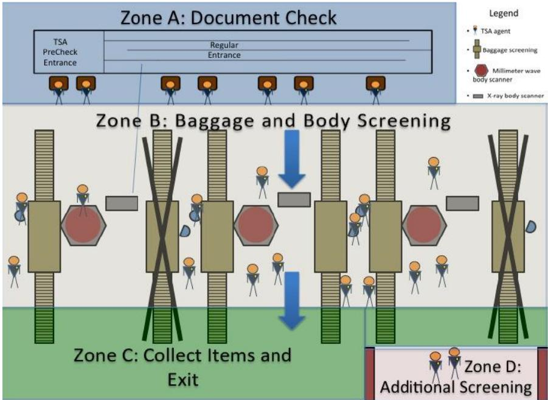
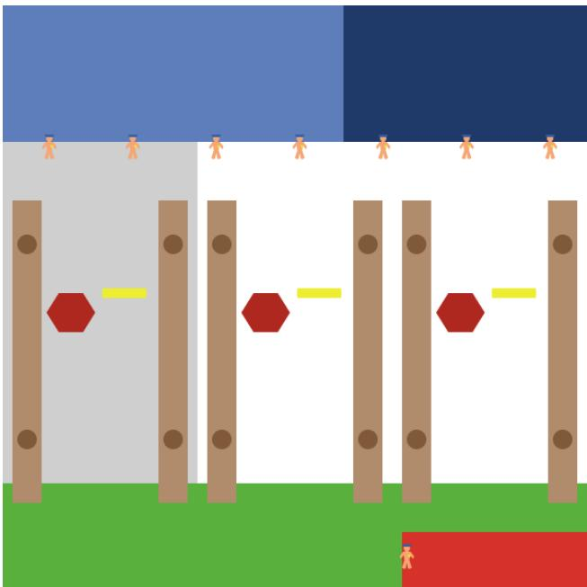
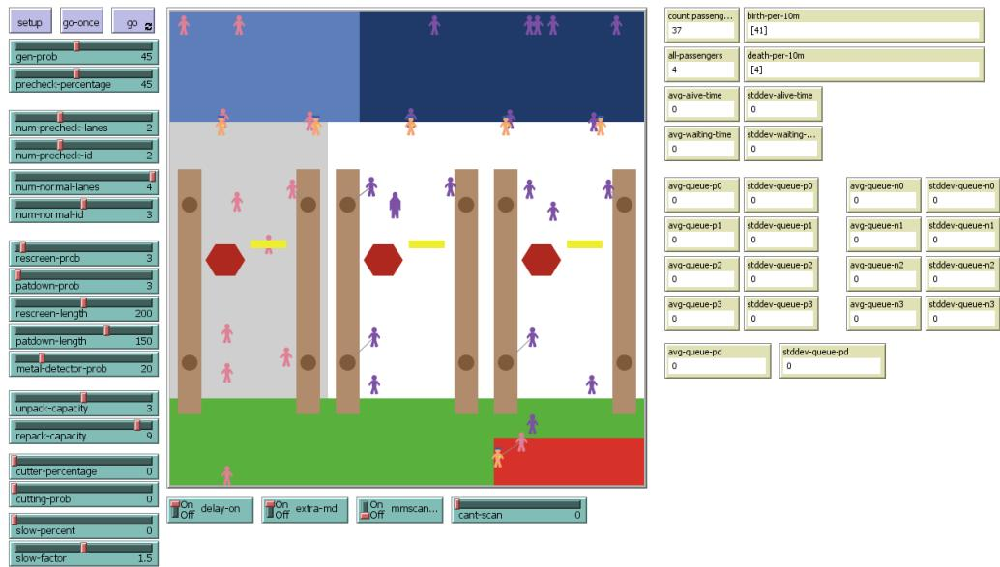

# 2017年美国大学生数学建模竞赛O奖论文（全部）-D题：机场安检点乘客吞吐量优化研究

原件为竞赛论文。补充：文中的阅读练习及“参考解答”为整理时增加，原件图文保留出处。

Print This Page

Close This Window

For office use only T1 T2 T3 T4

Team Control Number

68942

Problem Chosen

D

For office use only F1 F2 F3 F4

(Your team's summary should be included as the first page of your electronic submission.)

Type a summary of your results on this page. Do not include the name of your school, advisor, or team members on this page.

The objective of our Internal Control Management (ICM) team was to investigate the flow of passengers through American airport checkpoints in light of various airport security controversies. The TSA asked our team to determine bottlenecks in the current security process that impacted passenger throughput and variance in wait times, and to develop modifications that might expedite throughput and decrease variance. We developed an agent-based model using NetLogo to study how passengers move through a typical security checkpoint. Our model divided the current screening process into individual components (processes like document-checking and lines for those processes) to precisely locate potential bottlenecks and included separate components for passengers enrolled in PreCheck, a program that expedites screening for trusted travellers. Travelers and their speeds through certain components of the process were generated probabilistically to most accurately represent real-world unpredictability

We ran the model with different checkpoint configurations and varying traffic volumes. Our model found that for low traffic volumes, overall wait times and variance were low. More importantly, at higher volumes (approx. 3 or less seconds per passenger) there were three significant bottlenecks: the lines for PreCheck and regular document-checking at the start of the checkpoint, and for the body scanners that most regular passengers must pass through. These three components caused over 99% of the variance and length of total wait times, with standard deviation of wait times topping 30 minutes during peak hours.

Using the NetLogo model, we studied how certain modifications would impact passenger flow. At higher traffic volumes, throughput was increased by up to 16% by more metal detector use, better officer training for pat-downs, or the addition of a single metal detector or body scanner and the extra body scanner reduced variance by 33%. The model also investigated how throughput and wait times were influenced by passenger behaviors. We found that cutting, opting for pat-downs, and slower walking all impacted the checkpoint negatively, but with less severity than expected.

Our model allowed us to closely analyze the efficiency of airport security checkpoints and shed light on how to resolve one of travelling's biggest issues.

更多数学建模资料请关注微店店铺“数学建模学习交流” https://k.weidian.com/RHO6PSpA

1/20/2017

MCM 2017 Summary Sheet for Team 68942

x

https://www.comap.com/undergraduate/contests/mcm/team-summary-sheet.php

1/1

## Optimizing Passenger Throughput at an Airport Security Checkpoint

### 1 Introduction

On the morning of September 11, 2001, a series of four coordinated terrorists attacks in New York, Pennsylvania, and Virginia killed nearly 3000 people and injured over 6000 others. The insuficient airport security methods at the time allowed terrorists to board and subsequently hijack four passenger airliners. In the aftermath of the attacks, Congress and former President George W. Bush passed the Aviation and Trans portation Security Act which established the Transportation Security Agency (TSA) as method to prevent similar attacks in the future. The TSA’s mission is to “protect the nation’s transportation systems to ensure freedom of movement for people and commerce” and desires to “provide the most efective transportation security in the most eficient way as a high performing counter-terrorism organization” [11].

Since its inception, the TSA has evolved to combat the various threats that terrorists pose to ordinary travelers. The addition of baggage screening, liquids limitations, and millimeter wave body scanners are just some examples of the increased security measures the TSA has implemented over the past decade. However, in 2016, the TSA came under sharp criticism when extremely long lines, particularly at large airports, caused travelers to miss their flights. Furthermore, there have been incidents where travelers experienced unexpected and unpredicted long wait times. This high variance has lead to travelers making the tough choice between arriving at the airport unnecessarily early or potentially missing their flight. As a result, the TSA is facing a tension between maximizing security and minimizing inconvenience travelers. Although the TSA’s PreCheck program, which allows travelers expedite the screening process, has become more popular, the exact efect on traveler throughput is not known.



Team 68942

Page 1 of 36

Our team has been tasked by the TSA with optimizing the traveler throughput at an airport security checkpoint. Our solution identifies the problems with the current airport security checkpoint, shown above in Figure 4, and proposes a model that improves the checkpoint throughput and reduces variance in wait time while maintaining current safety and security standards.

## 2 Screening Process

Airport security checkpoints can be divided into four major zones, as demonstrated in Figure 4.

In Zone A, passengers arrive to the checkpoint and wait in a queue until a security officer can inspect their documents. In Zone B, passengers walk to an available screening lane. There, they unload their belongings for x-ray screening and pass through a millimeter wave body scanner or a walk-through metal detector (WTMD). In Zone C, the passengers collect their belongings from the x-ray conveyor belt and leave the checkpoint. In Zone D, passengers who require additional screening undergo pat-downs and/or baggage searches.

We model the checkpoint as a sequence of processes (e.g., passing through a body scanner) and queues (e.g., the line before a body scanner). The amount of time each process takes is set in our model, which queue times depend on the length and nature of the queue. Airports and the TSA wish to minimize the amount of time that passengers spend in any queue. In our model, there are a total of four queues and ten processes in the screening process, not including Zone D. They are, in chronological order:

**Table 1: Breakdown of the screening process**

| Zone | Queue | Process |
| :--- | :--- | :--- |
| A | Document check line ($q_0$) | |
| | | Walk to document check |
| | | Document check |
| B | | Walk to screening lane |
| | X-ray screening line ($q_1$) | |
| | | Unload belongings for screening |
| | | Walk to line |
| | Body scanner or WTMD line ($q_2$) | |
| | | Walk to scanner or WTMD |
| | | Body scanning or WTMD |
| | | Walk to collection line |
| C | Collection line ($q_3$) | |
| | | Collect belongings |
| | | Exit |

If a passenger undergoes additional screening in Zone D, he or she walks to Zone D, waits in a queue for an available security officer, and then undergoes the screening. In the case of a baggage search, the passenger exits the checkpoint from Zone D. Otherwise, the passenger walks to Zone C to retrieve baggage and then exits.

## 3 Assumptions

Real-world It was necessary to make several assumptions in our model:

1. Each passenger travels alone. We assume that passengers do not travel in pairs, as families, or in groups; each makes decisions that are dependent on his or her own needs and not the needs of others.

2. The given data set is representative of how passengers proceed through the screening process. It is difficult to accurately predict how long each traveler will spend in each zone of the screening process. We assume that the given data closely approximates the movements of most travelers through security checkpoints.

3. Arrivals are uniformly random. According to the given data, the arrival times of travelers do not follow any clear pattern within short time periods (Figure 3). Thus, the best way to model arrivals is to generate travelers with a constant probability. The probability itself may vary between regular and Pre-Check arrivals, as well as with total traffic volumes.

4. Travelers choose the screening lane with the least amount of people. When passing from the document check to the baggage and body screening, people will choose what they perceive to be the most efficient route: the lane with the least number of people.

5. The general layout of any US security checkpoint is the same as presented in Figure 4. The TSA sets strict guidelines for the layout, equipment, and dimensions of any airport security checkpoint [12]. Because it is difficult and costly to expand the total space of security checkpoints, we limit the total number of lanes to six, though lanes may be closed during periods of lower traffic. Similarly, the number of document-checking security officers is limited by physical space availability. A typical checkpoint, as depicted in [12], has one document-checking officer for each body scanner.

6. For every two screening lines, there is one metal detector and one millimeter wave body scanner. According to the TSA’s Security Checkpoint Layout Design/Reconfiguration Guide, the optimal layout for Zone B is two screening lines per metal detector and one metal detector per body scanner whenever possible [12].

7. Queues have no limit. At a real-world security checkpoint, bottlenecks in Zones B and C would translate to longer queue times in Zone A because of physical limits to the lengths of lines. However, we allow all queues to extend indefinitely in order to discover precisely where bottlenecks exist in the screening process. Long queue lengths and wait times indicate which parts of the process are causing delays.

8. At most one passenger arrives to the checkpoint every second. Most airport security queues are designed so that only one person can join at a time. It is reasonable to assume that passengers allow for a one-second gap to the next person.

9. Walking from the checkpoint entrance to the document-checking queue requires no time. When lines are short, security officers will frequently reroute the queue to shorten the distance from the checkpoint entrance. As a result, it usually takes little time to walk to the end of the document-checking queue in Zone A.

10. An average American passenger’s personal space is a $3' \times 3'$ square. [12]

11. All passengers eventually complete the screening process. We assume that all passengers successfully exit the security checkpoint; none are arrested, detained, or leave the airport.

12. All travelers enrolled in the PreCheck program pass through WTMDs. [10]

13. Every passenger brings at least one piece of luggage. The TSA screens more than 1.7 billion carry-on bags a year, more than double the number of passengers. It is reasonable to assume that every traveler carries at least one bag, if only to store his or her documents, wallet, and other important possessions.

### 3.1 Normality

We used the Shapiro-Wilk normality test [4] and quantile-quantile (Q-Q) plots to determine the distributions of datasets from the given passenger data. We found two that could be approximated by normal distributions: document check process times and millimeter wave body scanner times, as determined by subtracting successive timestamps in the given data. For both, normality was not rejected at the $p = 0.01$ significance level and the Q-Q plots showed linear trends with fairly random deviations (Figure 2). This allowed us to design our program to generate probabilistic times based on a normal distribution.

### 3.2 Process Times

Many of the process times were determined from the given data. However, for some processes it was necessary to make certain assumptions regarding the TSA screening process and traveler speeds. We based many of these values on personal investigation and real-world footage of travelers in airport checkpoints.

Table 2: Process times for regular passengers

| Zone | Process | Time (s) |
| :--- | :--- | :--- |
| A | Walk to document check | 2 |
| A | Document check | 11.2 |
| B | Walk to screening lane | 3 [1] |
| B | Unload belongings for screening | 15 [1] |
| B | Walk to scanner or WMTD line | 3 |
| B | Walk to scanner or WMTD | 2 |
| B | Body scan | 10.5 |
| B | WTMD | 1 |
| B | Walk to collection line | 3 |
| C | Collect belongings | 15 [1] |
| C | Exit | 5-7 |
| D | Walk to Zone D | 3 |
| D | Pat-down | 150 [8] |
| D | Baggage Search | 200 |

Some passengers enroll in PreCheck, a TSA program that expedites the screening process. Passengers in PreCheck do not need to remove jackets, belts, shoes, or laptops, shortening the time for unloading and retrieving belongings at the scanner (in our model, to 10 seconds). In addition, PreCheck passengers pass through WTMDs instead of the body scanners, which speeds the process further. However, the other times are largely the same.

### 3.3 Rates and Probabilities

Certain processes, like pat-downs and baggage searches, do not occur for every passenger. Instead, we assigned each process a certain probability.

- Each person has a 3% chance of being given a pat-down, including the approximate 1% of passengers who opt for a pat-down instead of a body scan [3]. Other reasons for pat-downs include failing a body scan or metal detector.
- The probability of having a baggage search is equal to that of receiving a pat-down.
- Travelers not enrolled in the PreCheck program have a 20% probability of being sent through the WTMD instead of the millimeter wave body scanner. The majority of non-PreCheck passengers sent through the WTMD are under 12, over 65, or have severe disabilities.

## 4 Definitions and Testing Parameters

The TSA wishes to evaluate and improve its airport security checkpoints. In particular, it is concerned with two statistics:

**Definition 1.** The throughput of a checkpoint at any time is the rate of passengers exiting the checkpoint.

The unit of throughput used in this paper is passengers per minute (PAX/min).

**Definition 2.** The wait time of a passenger is the total amount of time that he or she spent in queues during the checkpoint.

Our goal was to investigate possible bottlenecks in the security screening process that might cause decreases in throughput, increases in wait time, and increases in wait time variance. We measured variance of wait time by calculating the standard deviation of the wait times of all passengers.

### 4.1 Arrivals

To simulate the randomness of the real-world passenger arrivals, passengers in our model are generated probabilistically every second rather than at a constant rate. Each arrival is then categorized as PreCheck or regular and sent to the corresponding queue.

**Definition 3.** The generation probability is the probability at each second that a passenger enters the checkpoint.

From the given data, the generation probability is 0.19, the average “rate” of passengers per second from the given data (Figure 3). This was determined by counting the number of total passenger arrival timestamps, both PreCheck and regular, that occurred within nine minutes. After arriving, each new passenger has a 0.45 probability of joining the PreCheck queue, since approximately 45% of passengers are currently enrolled in PreCheck.

### 4.2 Lanes and Officers

The checkpoint tested in our model contains six screening lanes. PreCheck lanes usually make up a third of total lanes, so when the checkpoint is fully running there are two PreCheck lanes and four regular lanes. The number of available officers in Zone D is equal to the number of active lanes: six. However, during times of less traffic airports will decrease the number of active screening lanes and document-checking officers in order to save money.

Therefore, we tested two different configurations of active lanes and officers: one with all six lanes open for higher traffic, and one with only three lanes open for lower traffic.

Each configuration is denoted by a four-digit number. For example, the number 1234 denotes the configuration with 1 PreCheck document-checking officer, 2 active PreCheck screening lanes, 3 regular document-checking officers, and 4 active regular screening lanes.

**Definition 4.** The configuration number is the four-digit number that denotes the numbers of lanes and officers active in the configuration.

### 4.3 Testing

In our model, we tested different volumes of traffic by increasing or decreasing the generation probability. We tested five generation probabilities: 0.09 (low traffic), 0.18 (normal traffic), 0.36 (busy traffic), 0.54 (high traffic), and 0.72 (peak traffic).

We tested configuration 1221 for lower traffic (generation probabilities of 0.09, 0.18, 0.36, 0.54) and configuration 2243 for higher traffic (generation probabilities of 0.18, 0.36, 0.54, 0.72). Each configuration was run at least three times in our model, collecting data after each run and averaging across all runs to obtain our results. Each run generated passengers for one hour (3600 seconds) and then ran until the all passengers exited. To measure throughput, we counted the number of exiting passengers every ten minutes and divided by ten to obtain throughput passengers per minute.

We also tested the effect of increasing or decreasing the number of PreCheck document-checking officers on throughput and wait time, varying the number of officers from 1 to 3 for the 1221 configuration and the

# 2017年美国大学生数学建模竞赛O奖论文（全部）-D题：机场安检点乘客吞吐量优化研究

本部分为原论文第5节“NetLogo模型”和第6节“结果”的内容整理，主要介绍基于NetLogo的代理建模方法、仿真设置及不同生成概率下的吞吐量与等待时间数据分析。

## 五、NetLogo模型

### 5.1 乘客（Passengers）

我们的模型基础是作为“海龟”（turtles）表示的乘客。它们是网格中的图标，具有属性和执行操作的能力。每位乘客都有几个属性，包括描述乘客本身的属性（如 `is-precheck` 和 `speed-factor`），以及描述乘客在模型中位置的属性（如 `queue-pos` 和 `stage`）。乘客以粉色（PreCheck人员）或紫色（非PreCheck人员）的人形图标表示。

每位乘客的属性由全局值概率决定。例如，`is-precheck` 由 `precheck-percentage` 决定，`is-cutter` 由 `cutting-percentage` 决定。乘客还记录关键数据，包括 `time-waiting` 用于追踪总等待时间，以及针对每个队列的 `wait-queue` 值。

### 5.2 其他智能体（Other turtles）



我们的乘客不仅受自身属性影响，还受到官员（officers）、扫描仪（scanners）和“打包站”（pack stations）的影响。

*   **官员**：占据两个区域之一：证件检查车道（Zone A）或重新检查/拍身检查车道（Zone D）。
    *   在 Zone A，他们被分配给 PreCheck 或非 PreCheck，在其各自队列的开头呼叫乘客。他们由戴着蓝色帽子和徽章的橙色人形图标表示。
    *   在 Zone D，他们由单个官员图标表示，可以对多名乘客进行拍身检查/重新检查。
*   **扫描仪**：有两种形式——毫米波扫描仪或通过式金属探测器（WTMD）。每对扫描仪作为两个车道的一部分运行，并拥有自己的队列。
    *   毫米波扫描仪由红色六边形表示。
    *   WTMDs 由黄色矩形表示。
*   **打包站**：用于表示乘客在筛查前或筛查后脱下或穿上外套、包和其他物品的区域。每个车道有一个“卸载站”和一个“重装站”。它们由浅色棕色X光机上的深棕色圆圈表示。

### 5.3 运行仿真

当调用 `setup` 时，世界会创建官员、扫描仪、打包站，并为地块着色以视觉引导乘客通过车道的进展。当模型设置为 `go` 时，模型在每个 tick（相当于一秒）以一定的概率 `gen-prob` 生成一名乘客。乘客根据我们概述的流程分几个阶段通过安全检查。我们的仿真仅在前 3600 个 ticks 内生成乘客，以仅模拟现实世界中的一小时。当安检点不再有乘客时，仿真停止。在运行结束时，我们使用均值和标准差计算用于分析的数值。



对于单次可见的运行，我们使用左侧的绿色滑块调整参数，使用紫色按钮进行 setup 和 go，并在仿真结束时查看右侧框中的输出。对于批量运行，我们使用 NetLogo 的 “BehaviorSpace” 运行3次仿真试验，参数各不相同。

## 六、结果

Table 3: Wait time data for the 1221 configuration

| Generation Probability | Total Average Wait Time (sec) | Total Standard Deviation (sec) |
| :--- | :--- | :--- |
| 0.09 | 20.51 | 41.68 |
| 0.18 | 232.39 | 286.88 |

Table 4: Wait times (sec) by queue for the 1221 configuration

| Generation Probability | Queue | Average (PreCheck) | Standard Deviation (PreCheck) | Average (Regular) | Standard Deviation (Regular) |
| :--- | :--- | :--- | :--- | :--- | :--- |
| rowspan="5">0.09 | q0 | 0.69 | 2.25 | 9.58 | 17.46 |
| | q1 | 0.00 | 0.00 | 0.00 | 0.00 |
| | q2 | 0.28 | 0.85 | 0.14 | 0.92 |
| | q3 | 23.17 | 50.30 | 7.72 | 27.29 |
| | Total | 24.14 | 53.40 | 17.45 | 45.67 |
| rowspan="5">0.18 | q0 | 1.75 | 4.08 | 372.53 | 297.88 |
| | q1 | 0.00 | 0.00 | 0.00 | 0.00 |
| | q2 | 0.51 | 1.15 | 0.40 | 1.72 |
| | q3 | 36.68 | 64.89 | 15.00 | 42.05 |
| | Total | 38.94 | 70.12 | 387.93 | 341.65 |

对于配置 1221，平均吞吐量在生成概率为 0.36 和 0.54 时达到约 14 名乘客/分钟的峰值，表明这对于较高的交通流量来说并不是最佳配置（图6）。然而，对于 0.09 和 0.18 的情况，该配置的容量绰绰有余。这似乎意味着吞吐量的瓶颈主要是活跃车道和官员的数量；一旦到达率超过某个点，到达率的增加不再显著影响吞吐量。

从表4可以看出，除了生成概率为 0.18 时的常规乘客外，PreCheck 和常规流程的主要瓶颈都是线路 $\mathrm{q3}$（从X光传送带取回物品）。在生成概率为 0.18 时，常规乘客的瓶颈是 $\mathrm{q0}$（证件检查线）。对于生成概率为 0.09 的情况，等待时间的方差是平均等待时间的两倍以上。这也可能是由于如此低的生成概率所导致的自然方差，因为到达率高方差很容易转化为等待时间和吞吐量的方差。

# 机场安检点乘客吞吐量优化研究

本文整理了2017年美国大学生数学建模竞赛O奖论文（Team 68942）D题关于机场安检点乘客吞吐量优化研究的第5部分内容，主要涉及不同配置下的等待时间数据分析、PreCheck检查人员数量对通过率的影响以及流程改进建议。

## 等待时间数据分析（配置 2243）

### 总体等待时间分析

对于配置 2243，除了生成概率为 0.18 的常规乘客案例外，等待时间的标准偏差并未立即引起担忧。在这三个案例中，最高的总标准偏差为 70 秒，即刚刚超过一分钟。这意味着旅客等待时间比预期多五分钟以上的情况极不可能发生。然而，在生成概率为 0.18 的常规乘客案例中，情况则大不相同，其等待时间标准偏差接近六分钟。

**表 5：配置 2243 的等待时间数据**

| Generation Probability | Total Average Wait Time (sec) | Total Standard Deviation (sec) |
| :--- | :--- | :--- |
| 0.18 | 3.95 | 6.89 |
| 0.36 | 221.27 | 351.47 |
| 0.54 | 1088.93 | 867.74 |
| 0.72 | 2012.31 | 1409.13 |

### PreCheck 队列等待时间分析

**表 6：配置 2243 下各队列的 PreCheck 等待时间（秒）**

| Generation Probability | Queue | Average (PAX) | Standard Deviation (PAX) |
| :--- | :--- | :--- | :--- |
| 0.18 | q0 | 1.97 | 4.67 |
| 0.18 | q1 | 0.00 | 0.00 |
| 0.18 | q2 | 0.39 | 0.96 |
| 0.18 | q3 | 0.00 | 0.00 |
| 0.18 | Total | 2.36 | 5.63 |
| 0.36 | q0 | 162.31 | 322.88 |
| 0.36 | q1 | 0.00 | 0.00 |
| 0.36 | q2 | 0.66 | 1.15 |
| 0.36 | q3 | 0.00 | 0.00 |
| 0.36 | Total | 162.98 | 324.03 |
| 0.54 | q0 | 914.88 | 545.95 |
| 0.54 | q1 | 0.00 | 0.00 |
| 0.54 | q2 | 0.80 | 1.31 |
| 0.54 | q3 | 0.00 | 0.00 |
| 0.54 | Total | 915.69 | 547.26 |
| 0.72 | q0 | 1817.71 | 1060.32 |
| 0.72 | q1 | 0.00 | 0.00 |
| 0.72 | q2 | 0.76 | 1.27 |
| 0.72 | q3 | 0.00 | 0.00 |
| 0.72 | Total | 1818.47 | 1061.59 |
| 0.18* | q0 | 0.49 | 1.80 |
| 0.18* | q1 | 0.00 | 0.00 |
| 0.18* | q2 | 4.83 | 7.43 |
| 0.18* | q3 | 0.00 | 0.00 |
| 0.18* | Total | 5.31 | 9.24 |
| 0.36* | q0 | 7.94 | 17.12 |
| 0.36* | q1 | 0.00 | 0.00 |
| 0.36* | q2 | 262.35 | 345.87 |
| 0.36* | q3 | 0.00 | 0.00 |
| 0.36* | Total | 270.29 | 363.00 |
| 0.54* | q0 | 484.27 | 275.54 |
| 0.54* | q1 | 0.00 | 0.00 |
| 0.54* | q2 | 744.30 | 871.23 |
| 0.54* | q3 | 0.00 | 0.00 |
| 0.54* | Total | 1228.57 | 1146.77 |
| 0.72* | q0 | 1219.21 | 714.21 |
| 0.72* | q1 | 0.00 | 0.00 |
| 0.72* | q2 | 945.64 | 1154.63 |
| 0.72* | q3 | 0.00 | 0.00 |
| 0.72* | Total | 2164.86 | 1868.85 |

*> 注：表格下半部分对应原文 Table 7 的数据结构，但标题行显示为 Table 7 Regular wait times，此处根据上下文逻辑整理为常规乘客数据以区分上半部分的 PreCheck 数据。*

### 常规队列等待时间分析

对于配置 2243，当生成概率为 0.36、0.54 和 0.72 时，平均吞吐量峰值约为 21 名乘客/分钟，表明该配置在这些较高的交通量下并非最佳选择（见图 7）。然而，对于生成概率为 0.09 的情况，该配置的容量绰绰有余。

从表 7（常规乘客）可以看出，文档检查队列 $(q_0)$ 和扫描仪队列 $(q_2)$ 均存在瓶颈。我们的 PreCheck 乘客（表 6）在扫描仪队列中没有瓶颈，但在文档检查队列中仍有较高的等待时间。

我们观察到 $q_0$ 的等待时间方差在生成概率为 0.18 和 0.36 时，是常规乘客和 PreCheck 乘客平均值的两倍以上，这可能是由于极少数极高的等待时间造成的。在生成概率为 0.18 的情况下，标准偏差较低，两种情况下均小于 10 秒。当生成概率为 0.36 时，标准偏差增加到约 5.5 分钟（PreCheck）和 6 分钟（非 PreCheck 乘客）。当生成概率为 0.54 和 0.72 时，标准偏差变得过高，PreCheck 乘客几乎达到 10 和 20 分钟，非 PreCheck 乘客达到 20 和 30 分钟。我们在高密度人群中使用此配置时，看到了不可接受的极高等待时间标准偏差。

## 调整 PreCheck 文件检查官员数量

### 不同数量的 PreCheck 官员吞吐量与等待时间

**表 8：不同数量的 PreCheck 官员的吞吐量和等待时间**

| Number of PreCheck Officers | Average Wait Time (sec) | Standard Deviation (sec) | Avg. Throughput (PAX/min) |
| :--- | :--- | :--- | :--- |
| 1 | 2216.70 | 1276.84 | 4.82 |
| 2 | 309.62 | 252.01 | 9.23 |
| 3 | 59.26 | 101.28 | 10.49 |

随着文件检查官员数量的增加，平均等待时间和等待时间标准偏差都显著下降，其中从一名官员增加到两名官员时下降幅度最大。然而，虽然从一名官员增加到两名官员时平均吞吐量增加了近 100%，但从两名增加到三名时的增幅则小得多。因此，考虑到成本因素，当有一个活跃的 PreCheck 通道且交通量较低时，两名官员似乎是最佳数量。

## 当前流程的改进措施

从第 6 节的结果中可以明显看出，当前的安全检查流程有很大的改进空间。我们提出了四种修改方案，并使用 NetLogo 模型调查了这些变化如何影响吞吐量和等待时间。这些修改包括：

## 7.1 Throughput Data

Table 9 shows the change in average throughput from each of the modifications.

**Table 9: Ratio of new to original throughputs**

| Generation Probability | Extra Metal Detector | More WTMD Use (30) | More WTMD Use (40) | More WTMD Use (50) | Extra Scanner | Shorter Pat-downs |
| :--- | :--- | :--- | :--- | :--- | :--- | :--- |
| 9 | - | 0.97 | 1.77 | 1.59 | 0.93 | 1.02 |
| 18 | - | 0.60 | 0.71 | 1.01 | 1.03 | 1.01 |
| 36 | 1.00 | 1.01 | 1.14 | 1.16 | 1.08 | 0.99 |
| 54 | 1.22 | 1.04 | 1.05 | 1.08 | 1.11 | 0.99 |
| 72 | 1.43 | 1.05 | 1.08 | 1.13 | 1.13 | 1.00 |

## 7.2 Extra Metal Detector

By adding another metal detector to our PreCheck lanes, we can alleviate queue wait times and decrease variance in the queue before scanning ($q_2$).

**Table 10: Average Wait Times and Standard Deviations of the Screening Process with and without an extra metal detector**

| Generation Probability | Wait Time w/o Extra PreCheck Lane (sec) | Standard Deviation w/o Extra PreCheck Lane (sec) | Wait Time w/ Extra PreCheck Lane (sec) | Standard Deviation w/ Extra PreCheck Lane (sec) |
| :--- | :--- | :--- | :--- | :--- |
| 0.36 | 221.27 | 351.47 | 337.27 | 329.46 |
| 0.54 | 1088.93 | 867.74 | 711.87 | 940.49 |
| 0.72 | 2012.31 | 1409.13 | 1344.34 | 1607.91 |

From Table 10 we can see that adding an extra metal detector when the generation probability is 0.54 and 0.72 significantly decreases the average wait time of the screening process. We do not see the same effect with a generation possibility of 0.36. However, the metal detector does increase throughput at all three generation probabilities. Thus, we can conclude that adding an extra metal detector is strictly beneficial.

The increases in standard deviation are likely due to the fact that PreCheck passengers already experience shorter wait times than regular passengers do. Decreasing PreCheck times further will increase overall standard deviation. Based on Table 9, adding an extra metal detector increases throughput from 28% to 82% varying based on generation probability.

## 7.3 Increasing WTMD Usage

Travelers pass through the WTMD almost without stopping, while travelers that use the millimeter wave body scanner spend about 11 seconds being scanned. If we increase the probability that any traveler proceeds through the WTMD instead of the millimeter wave body scanner, we should be able to increase the rate at which travelers pass through Zone B. To modify our current model, which has 20% of travelers being selected for the WTMD, we increased that probability to 30%, 40%, and 50%. Figure 11 shows the results.

From Figure 11, we can see that increasing the probability of travelers proceeding through the WTMD instead of the millimeter wave body scanners does indeed decrease the average wait time of travelers during the screening process. Looking at the generation probabilities of 0.36, 0.54, and 0.72, there is a clear downward trend as the probability increases. The same is true for standard deviations of wait times; while the change that they show is less, there is a noticeable decrease in standard deviations from the original 20% WTMD usage for higher generational probabilities (0.36, 0.54, and 0.72). Based on Table 9, increasing WTMD usage correlates to increasing throughput, anywhere from a decrease of 40% to an increase of 113% based on generation probability. The benefits of increasing WTMD usage are most pronounced with a 50% usage rate, presenting a benefit to all generation probabilities.

## 7.4 Extra Millimeter Wave Scanner

By adding an additional millimeter wave scanner, the security checkpoint should see an increase in throughput as more passengers are able to be scanned. We see a greatly decreased wait time and standard deviation for most passenger arrival densities, but an increased wait time and standard deviation when the generation probability is 0.18. The differences are significant; for higher traffic volumes (generation probabilities of 0.36

# 机场安检点乘客吞吐量优化研究（第 7-8 部分）

本资料为 2017 年美国大学生数学建模竞赛 O 奖论文 D 题的部分内容整理，主要涵盖增加扫描仪、加快搜身检查、优化 PreCheck 流程以及旅客行为变化对安检吞吐量的影响分析。

## 一、增加额外扫描仪的影响

### 7.4 Adding an Extra Scanner

通过增加一台成本约为 250,000 美元的全身扫描仪（body scanner），可以显著降低标准差（当样本量增加时，标准差减少超过三分之一）。这一结果可能足以证明增加设备的额外成本是合理的。

**表 11：有无额外扫描仪时的平均等待时间及标准差**

| Generation Probability | Wait Time (sec) | Standard Deviation (sec) | Wait Time w/ Extra Scanner (sec) | Standard Deviation w/ Extra Scanner (sec) |
| :--- | :--- | :--- | :--- | :--- |
| 0.09 | 20.51 | 41.68 | 16.91 | 36.35 |
| 0.18 | 232.39 | 286.88 | 314.69 | 376.13 |
| 0.36 | 221.27 | 351.47 | 111.61 | 104.23 |
| 0.54 | 1088.93 | 867.74 | 526.05 | 530.25 |
| 0.72 | 2012.31 | 1409.13 | 989.71 | 992.35 |

基于表 9 的数据，增加额外扫描仪对吞吐量（throughput）的影响呈现混合结果：
- 在生成概率（generation probability）为 18% 至 72% 时，吞吐量增加了 3% 到 99%。
- 然而，在低生成概率（9%）下，检查点的吞吐量反而下降了 7%。

## 二、缩短搜身时间

### 7.5 Decreasing Pat-down Times

我们考虑对负责进行搜身（pat-downs）和行李重检的 TSA 官员进行改进培训，以优化这些流程。这将导致吞吐量增加，因为更快的搜身和重检能让受影响的乘客更快地通过安检。

结果显示，对于较低的生成概率（9% 和 18%），等待时间和标准差略有下降。然而，对于较高的交通流量，这种变化几乎可以忽略不计，甚至在生成概率为 0.72 时，标准差反而有所增加。

**表 12：常规搜身与快速搜身下的平均等待时间及标准差**

| Generation Probability | Wait Time w/ Regular Pat-downs (sec) | Standard Deviation w/ Regular Pat-downs (sec) | Wait Time w/ Faster Pat-downs (sec) | Standard Deviation w/ Faster Pat-downs (sec) |
| :--- | :--- | :--- | :--- | :--- |
| 0.09 | 20.51 | 41.68 | 13.13 | 27.23 |
| 0.18 | 232.39 | 286.88 | 190.30 | 249.36 |
| 0.36 | 221.27 | 351.47 | 199.50 | 314.69 |
| 0.54 | 1088.93 | 867.74 | 1089.12 | 838.24 |
| 0.72 | 2012.31 | 1409.13 | 2095.55 | 1489.29 |

根据表 9 的数据，缩短搜身时间对平均吞吐量的影响非常微小（±5%），唯一的例外是生成概率为 36% 时，吞吐量增加了 82%。

## 三、提高 PreCheck 乘客比例

### 7.6 Increasing percentage of PreCheck passengers

TSA PreCheck 允许乘客在不脱下轻便夹克、鞋子、笔记本电脑和皮带的情况下通过安检。此外，它允许乘客使用无线金属探测器（WTMD）代替毫米波全身扫描仪，从而更快速地通过安检。增加拥有此加速流程权限的乘客比例，可能会提高安检点的吞吐量并减少扫描队列的等待方差。

然而，虽然增加比例在低流量时带来了改善，但在概率高于 0.18 时，增加 PreCheck 乘客比例却是有害的。这很可能是由于 PreCheck 乘客仅有两个通道和两名文件检查官员的限制所致。

### 7.7 Increasing the number of PreCheck percentage and document-checkers

鉴于在高流量下 PreCheck 乘客的文件检查队列存在瓶颈，我们增加了两名文件检查官员，将配置从 2243 改为 2443。

随着 PreCheck 注册比例的增加，我们观察到等待时间和等待时间方差整体呈下降趋势，在 55% 时达到最低点。在此急剧下降之后，平均等待时间稳步上升。这一现象在所有生成概率下均被观察到，且在 0.36 之后尤为明显。总体而言，小幅增加 PreCheck 注册人数是非常有益的。

## 四、旅客行为的变化

### 8 Variation in Traveler Behavior

在我们的模型中，我们假设乘客遵循大致相同的行为模式，仅在时间上有微小差异。然而，在现实世界中，乘客表现出广泛不同的行为。这一点在国际大型机场尤为明显，乘客之间除了年龄、行动能力和个人偏好外，还存在文化差异。我们通过在模型中添加新的旅客风格来测试我们的模型，以调查不同的社会互动如何影响吞吐量和等待时间。特别是，我们研究了以下行为：

1. 插队（Cutting in line）
2. 排斥全身扫描仪（人们可以选择接受搜身代替全身扫描）
3. 移动缓慢（Slower movement）

### 8.1 Throughput Data

表 13 显示了每种新旅客行为导致的平均吞吐量变化。

**表 13：新旧吞吐量比率**

| Generation Probability | Cutting | More Pat-downs (1%) | More Pat-downs (2%) | Slow Travelers |
| :--- | :--- | :--- | :--- | :--- |
| 0.09 | 1.04 | 0.98 | 0.98 | 0.94 |
| 0.18 | 1.05 | 1.00 | 1.00 | 0.99 |
| 0.36 | 1.00 | 0.99 | 0.98 | 1.00 |
| 0.54 | 0.99 | 0.99 | 0.99 | 0.99 |
| 0.72 | 1.00 | 1.01 | 1.02 | 0.98 |

### 8.2 Cutting

出于个人效率的考虑，一些乘客可能比队列的整体顺序更看重自己在队列中的位置。我们将这类乘客称为“插队者”（cutters），他们试图跳过队列前排并成功约一半的时间。在修改我们的模型时，我们设定 20% 的旅客为插队者。

比较不同到达密度下的数据（见表 14），我们发现插队行为导致平均等待时间和标准差均有所增加。这可能是由于插队者导致其他乘客等待时间更长，从而增加了平均等待时间和标准差；正如预期，插队行为仅有利于那些插队的人。然而，通过在所有队列中严格执行“禁止插队”政策，可以减轻插队的负面影响。

# 2017年美国大学生数学建模竞赛O奖论文（全部）-D题：机场安检点乘客吞吐量优化研究

本节整理了MCM O奖论文中关于不同变量对安检过程等待时间影响的模拟结果，以及基于观察提出的政策与程序建议。

## 一、模型参数敏感性分析

### 选择 1：乘客插队行为的影响

当引入乘客插队（Cutting in line）的概率时，模拟了不同生成概率下的平均等待时间和标准差。

**表 14：有/无插队行为的安检过程平均等待时间及标准差**

| Generation Probability | Wait Time w/o Cutting (sec) | Standard Deviation w/o Cutting (sec) | Wait Time w/ Cutting (sec) | Standard Deviation w/ Cutting (sec) |
| :--- | :--- | :--- | :--- | :--- |
| 0.09 | 20.51 | 41.68 | 18.49 | 39.65 |
| 0.18 | 232.39 | 286.88 | 329.34 | 385.85 |
| 0.36 | 221.27 | 351.47 | 266.60 | 634.58 |
| 0.54 | 1088.93 | 867.74 | 1143.61 | 1183.92 |
| 0.72 | 2012.31 | 1409.13 | 2075.03 | 1697.81 |

### 选择 2：更高搜身概率的影响

自2010年TSA在安检流程中加入新型毫米波人体扫描仪以来，许多旅客表达了对这些机器隐私性的担忧。作为回应，TSA允许人们拒绝毫米波扫描并接受拍身检查（pat-down）。因此，我们测试了旅客拒绝毫米波扫描并选择拍身的不同概率，以观察其对安检过程等待时间的影响。根据TSA的数据，只有约1%的旅客选择拍身而非毫米波扫描，因此我们测试了1%和2%的概率 [8]。

从图12可以看出，1%或2%的旅客拒绝毫米波扫描并不会显著影响等待时间的标准差。虽然对于更高的概率情况可能不再成立，但在低概率下，这种影响并不显著。

### 选择 3：较慢旅客的影响

并非所有旅客的移动速度都相同。虽然年轻人移动相对较快，但老年旅客和儿童可能比他们慢。因此，为了体现速度的多样性，我们在模型中加入了“较慢旅客”。这些旅客的移动速度是普通旅客的一半，且出现的概率为20%。

**表 15：有/无较慢旅客的安检过程平均等待时间及标准差**

| Generation Probability | Wait Time w/o Slow Travelers (sec) | Standard Deviation w/o Slow Travelers (sec) | Wait Time w/ Slow Travelers (sec) | Standard Deviation w/ Travelers (sec) |
| :--- | :--- | :--- | :--- | :--- |
| 0.09 | 20.51 | 41.68 | 13.27 | 31.75 |
| 0.18 | 232.39 | 286.88 | 268.67 | 312.06 |
| 0.36 | 221.27 | 351.47 | 314.23 | 386.51 |
| 0.54 | 1088.93 | 867.74 | 1126.22 | 812.25 |
| 0.72 | 2012.31 | 1409.13 | 2101.90 | 1399.51 |

从图15可以看出，较慢旅客的加入增加了等待时间，但降低了安检过程的标准差。这似乎是合乎逻辑的，因为较慢的旅客不仅会减慢整体进程，还会减慢周围旅客的速度，从而导致更小的标准差。

## 二、政策与程序建议

基于我们的观察，我们认识到当前TSA安检点的几个问题领域：PreCheck乘客受限于文件检查的TSA官员数量，特别是在交通量高时；非PreCheck乘客受限于文件检查队列和扫描仪队列。这些高等待时间也导致了不可接受的大等待时间和等待时间方差，在高流量场景下高达30分钟。为了提高安检口的效率，我们鼓励TSA做出以下一项或多项改变：

*   增加金属探测器，以缓解PreCheck车道中长且多变的队列长度。
*   在非PreCheck车道增加毫米波扫描仪，以减少队列的方差和长度。
*   增加文件检查的TSA官员数量。

为了解决未来PreCheck注册比例增加的问题，我们还建议：

*   为PreCheck队列增加文件检查的TSA官员。
*   增加更多的PreCheck车道。

单独将更多资源投入到PreCheck上效果有限。只有通过增加PreCheck注册人数，这些改变才能有效发挥作用。

其他观察到的行为，包括较慢的乘客和插队的乘客，可以具体解决：

## 10 Strengths and Weaknesses

In future work, we would like to address the weaknesses of our model and improve on the computational efficiency of our simulations. This model had a number of strengths and weaknesses:

*   **Strength:** Our model is based on real data released by the TSA.
    By generating values based on real-world data directly from the TSA and other reputable sources, our model more effectively represents real-world scenarios.

*   **Strength:** Our model uses probabilistic methods to generate data.
    Because we use previous data but add random variance, we are able to simulate scenarios with realistic randomness. A deterministic model would not be able to factor the significant unpredictability that is present in the real world.

*   **Strength:** Our model is flexible and readily adaptable.
    By using NetLogo, we can very quickly and easily change settings to investigate effects of each parameter. The experimentation capabilities of NetLogo allow us to automatically compile large quantities of data in spreadsheets. Our many inputs allow a wide variety of configurations to be fine-tuned.

*   **Strength:** Our model tests a large variety of modifications and different behaviors.
    We were able to simulate changes in both the checkpoint itself and in human behavior, and find some modifications that improved overall efficiency of the checkpoint.

*   **Weakness:** Our model cannot assess all potential combinations of parameters and configurations.
    The ideal solution would test each of the thousands of possible security configurations, varying the numbers of lanes, document-checking officers, and equipment to find the optimal configuration. However, this is a vastly unreasonable task. Instead, our model compares a large set of configurations to determine the best one.

*   **Weakness:** Our model does not include a quantification of security.
    Each simulation, though representative of throughput and queue times, does not quantify security. It is difficult to analyze how “secure” a checkpoint without extensive data and studies on each component of the screening process.

*   **Weakness:** Our model cannot portray the complete complexity of human behaviors.
    Though we consider a number of the most common behaviors, including differing perceptions of personal space and propensity for cutting in line, there are many more to be found among real-world passengers. Analyzing and implementing more behaviors into our model is a strong avenue for future work.

*   **Weakness:** Our model has a limited number of trials for each combination of factors.
    Though we are able to analyze data with 3 trials each, due to the probabilistic nature of the model, these trials may not accurately reflect the real-world system. More trials would allow us to more accurately analyze our model.

### References

[1] “Airport Security Footage - September 2006. Minneapolis International Airport.” YouTube. YouTube, 14 Oct. 2010. Web. 20 Jan. 2017.

[2] Burns, Bob. “TSA 2015 Year in Review.” The TSA Blog. Transportation Security Administration, 21 Jan. 2016. Web. 20 Jan. 2017.

[3] Burns, Bob. “TSA Myth or Fact: Leaked Images, Handcuffed Hosts, Religious Garb, and More!” The TSA Blog. Transportation Security Administration, 18 Nov. 2010. Web. 21 Jan. 2017.

[4] Dittami, Simon. “Shapiro-Wilk Normality Test.” Shapiro Wilk Test (Web Version). N.p., 2009. Web. 20 Jan. 2017.

[5] Duarte, Lourdes. “Long Lines Reported at Chicago Midway Airport’s TSA Checkpoint.” WGN-TV. WGN-TV, 13 July 2016. Web. 20 Jan. 2017.

[6] Gildor, Omri A. “Security of Airports: Full Body Scanners and Walk Through Metal Detectors – CSCI 1951E S01: Computer Systems Security: Principles and Practice.” CSCI 1951E S01 Computer Systems Security Principles and Practice. Brown University, 3 Feb. 2015. Web. 20 Jan. 2017.

[7] Hetter, Katia. “How Long Will I Wait in the TSA Line?” CNN. Cable News Network, 9 June 2016. Web. 20 Jan. 2017.

[8] Jansen, Bart. “TSA Defends Full-body Scanners at Airport Checkpoints.” USA Today. Gannett Satellite Information Network, 02 Mar. 2016. Web. 20 Jan. 2017.

[9] McCoy, William. ”How Many Carry-on Items Can a Person Bring on an Airplane?” USA Today. Gannett Satellite Information Network, n.d. Web. 21 Jan. 2017.

[10] Michaels, Allison. “The Pros and Cons of TSA PreCheck.” U.S. News World Report. U.S. News World Report, 22 Apr. 2014. Web. 20 Jan. 2017.

[11] “Mission.” Transportation Security Administration. The Department of Homeland Security, 09 Dec. 2016. Web. 20 Jan. 2017.

[12] ”Security Checkpoint Layout Design/Reconfiguration Guide.” Transportation Security Administration. The Department of Homeland Security, 7 Nov. 2006. Web. 20 Jan. 2017.

[13] Schuppe, John. “Airline Slams TSA over Long Delays, Missed Flights.” CNBC. CNBC, 14 Apr. 2016. Web. 20 Jan. 2017.

[14] “Transportation Security Timeline.” Transportation Security Administration. The Department of Homeland Security, n.d. Web. 20 Jan. 2017.

[15] “Travel Tips: Advanced Imaging Technology.” Transportation Security Administration. The Department of Homeland Security, 12 May 2016. Web. 20 Jan. 2017.

[16] “TSA Releases 2015 Statistics.” Transportation Security Administration. The Department of Homeland Security, 21 Jan. 2016. Web. 20 Jan. 2017.

[17] Wilensky, U. (1999). NetLogo. http://ccl.northwestern.edu/netlogo/. Center for Connected Learning and Computer-Based Modeling, Northwestern University, Evanston, IL.

[18] Wisniewski, Mary. “At Chicago Airports, Wait times in TSA Lines Are 10 Minutes or Less.” Chicagotribune.com. Chicago Tribune, 23 Aug. 2016. Web. 20 Jan. 2017.

## 表 16 WTMD 30%

| Generation Probability | Queue | Average (PAX) | Standard Deviation (PAX) |
|---|---|---|---|
| 0.09 | q0 | 0.26 | 1.30 |
| 0.09 | q1 | 0.00 | 0.00 |
| 0.09 | q2 | 0.28 | 0.87 |
| 0.09 | q3 | 13.14 | 32.70 |
| 0.09 | Total | 13.68 | 34.87 |
| 0.18 | q0 | 1.94 | 4.38 |
| 0.18 | q1 | 0.00 | 0.00 |
| 0.18 | q2 | 0.58 | 1.20 |
| 0.18 | q3 | 46.84 | 69.45 |
| 0.18 | Total | 49.36 | 75.03 |
| 0.36 | q0 | 136.01 | 238.85 |
| 0.36 | q1 | 0.00 | 0.00 |
| 0.36 | q2 | 0.73 | 1.23 |
| 0.36 | q3 | 35.53 | 70.90 |
| 0.36 | Total | 172.27 | 310.98 |
| 0.54 | q0 | 892.67 | 491.70 |
| 0.54 | q1 | 0.00 | 0.00 |
| 0.54 | q2 | 0.71 | 1.20 |
| 0.54 | q3 | 67.50 | 121.87 |
| 0.54 | Total | 960.85 | 614.77 |
| 0.72 | q0 | 2024.50 | 1192.34 |
| 0.72 | q1 | 0.69 | 0.00 |
| 0.72 | q2 | 34.07 | 1.19 |
| 0.72 | q3 | 67.10 | 67.10 |
| 0.72 | Total | 2126.36 | 1260.63 |

## 表 17 WTM 40%

| Generation Probability | Queue | Average (PAX) | Standard Deviation (PAX) |
|---|---|---|---|
| 0.09 | q0 | 0.55 | 2.03 |
| 0.09 | q1 | 0.00 | 0.00 |
| 0.09 | q2 | 0.44 | 1.07 |
| 0.09 | q3 | 12.36 | 32.56 |
| 0.09 | Total | 13.35 | 35.66 |
| 0.18 | q0 | 3.17 | 7.74 |
| 0.18 | q1 | 0.00 | 0.00 |
| 0.18 | q2 | 0.67 | 1.28 |
| 0.18 | q3 | 42.51 | 70.06 |
| 0.18 | Total | 46.35 | 79.08 |
| 0.36 | q0 | 83.75 | 154.49 |
| 0.36 | q1 | 0.00 | 0.00 |
| 0.36 | q2 | 0.70 | 1.22 |
| 0.36 | q3 | 48.75 | 76.08 |
| 0.36 | Total | 133.20 | 231.79 |
| 0.54 | q0 | 972.72 | 565.84 |
| 0.54 | q1 | 0.00 | 0.00 |
| 0.54 | q2 | 0.70 | 1.22 |
| 0.54 | q3 | 29.51 | 57.71 |
| 0.54 | Total | 1002.93 | 624.77 |
| 0.72 | q0 | 1998.51 | 1158.93 |
| 0.72 | q1 | 0.00 | 0.00 |
| 0.72 | q2 | 0.72 | 1.24 |
| 0.72 | q3 | 38.87 | 82.61 |
| 0.72 | Total | 2038.1 | 1242.78 |

## A 代码

以下是本文所用 NetLogo 模型的代码：

```netlogo
which-queue active
] xrays-own[ which-queue active ]
mmscanners-own[ which-queue active capacity ]
passengers-own[
  is-precheck baggage personal-space is-cutter waiting-time scan-time
  which-queue queue-pos walking is-waiting fd-speed next-passenger
  p-length id-check-length unpack-length scan-length pack-length
  walking-time id-check-time unpack-time pack-time patdown-time stage
  md-prob total-wait-time wait-queue-0 wait-queue-1 wait-queue-2 wait-queue-3
  wait-queue-pd alive-time delayer speed-factor
]
to setup
  clear-all
  reset-ticks
```

```netlogo
set avg-queue-p0 mean total-wait-queue-p0
set avg-queue-p1 mean total-wait-queue-p1
set avg-queue-p2 mean total-wait-queue-p2
set avg-queue-p3 mean total-wait-queue-p3
set avg-queue-n0 mean total-wait-queue-n0
set avg-queue-n1 mean total-wait-queue-n1
set avg-queue-n2 mean total-wait-queue-n2
set avg-queue-n3 mean total-wait-queue-n3
set avg-queue-pd mean total-wait-queue-pd
set stddev-queue-p0 standard-deviation total-wait-queue-p0
set stddev-queue-p1 standard-deviation total-wait-queue-p1
set stddev-queue-p2 standard-deviation total-wait-queue-p2
set stddev-queue-p3 standard-deviation total-wait-queue-p3
set stddev-queue-n0 standard-deviation total-wait-queue-n0
set stddev-queue-n1 standard-deviation total-wait-queue-n1
set stddev-queue-n2 standard-deviation total-wait-queue-n2
set stddev-queue-n3 standard-deviation total-wait-queue-n3
set stddev-queue-pd standard-deviation total-wait-queue-pd
end
