# 2017年美国大学生数学建模竞赛O奖论文：A New Type of Toll Plaza Based on Bionics-Honeycomb

原件经识别和整理；“参考解答”是我们补的。

## Summary

In this paper, we analyze the performance of commonly used toll plaza based on our proposed mathematical model. A new improved toll plaza is proposed to reduce the cost, decrease the probability of collision at the merging point and increase the throughput.

The distribution of our proposed tollbooths resembles the honeycomb. At the center of each regular hexagonal honeycomb, there are two tollbooths, which serve two separated vehicle streams. The vehicles in these two separated streams are merged in advance before they continue their journey on the highway. Due to the specific pattern of the new toll plaza, the total area can be reduced significantly. Meanwhile, the average wasted time caused by queuing can be diminished, which means that the throughput will be raised. Additionally, by splitting the merging procedure into two stages, the possibility of accidents can also be decreased.

The main contributions of this paper are as follows:

(1) The new designed cellular architecture can greatly reduce the construction area compared with traditional linear distributed toll gates.

(2) We analyze the throughput of toll plazas by means of the queuing theory. To verify our theory, we simulate the behavior of the large number of vehicles passing the toll plaza with the help of PTV-VISSIM. Simulation results show that the ideal cellular distributed toll booths have better results compared with traditional toll stations, especially when the traffic flow is heavy, the average travel time reduced by about 55% and the average delay time of each lane is reduced by about 70%.

(3) We analyze the influence of the proportions of different types of tollbooths to our design. According to relevant documents, the impact of exact-change tollbooths is similar to manual tollbooths, so we only consider two kinds of tollbooths: human-staffed tollbooths and E-ZPass tollbooths. PTV-VISSIM simulation results show that full ETC tollbooth is 8 times faster than full MTC tollbooth.

(4) We simulate the performance of the cellular toll plaza under different traffic throughput. Simulation results show that the average transit time remains at about 11 seconds under different throughputs from 0 to 2000 (Unit: veh / h). We can infer that this model is not sensitive to traffic flow variations and has strong robustness which is suitable for practical construction.

(5) To further reduce the possibility of accident, we improve the cellular tollbooth concept model: make the transition zone more smooth and arrange different kinds of tollbooths more equitable.

(6) For self-driving vehicles, in the center of the toll plaza, we reserve special E-ZPass tollbooths, which match the characteristics of autonomous vehicles: safer and faster.

Electronic toll collection and autonomous vehicles are the trends of modern transportation, our new designed model can improve the performance of toll plaza in the aspects of cost, throughput and accident prevention.

## I. Introduction

### 1.1 Problem Background

With the number of vehicles increasing, expressway is confronted with great traffic pressure, especially at the toll plaza. The congestion problem at the toll station becomes more and more serious due to the outdated design. Related research found that 36% of the total travel time in China is delay time caused by tolling [1]. In addition, as a vehicle-intensive place, toll plaza has become an accident-prone section because of the drivers' improper operation [2].

With the widespread use of Electronic Toll Collection (ETC) and E-ZPass, the efficiency of toll collection has been improved significantly and further the congestion at the toll plaza is released. However, due to the high speed of the vehicles passing through the toll plaza, the probability of collision in the merging zone is increased. Moreover, the construction of future toll plaza is very expensive. Considering above factors, it is necessary to design new toll plaza to improve its throughput, reduce the cost of construction and decrease the possibility of collision in the merging zone.

In this paper, we design a toll station model based on bionics-honeycomb as shown in Figure 1.1. The hexagonal tiling creates a partition with equal-sized cells, while minimizing the total perimeter of the cells. Known in geometry as the honeycomb conjecture, this was given by Jan Brożek and proved much later by Thomas Hales [3]. Cellular Structure is widely used in many aspects of life. For example, the base stations of mobile communications are distributed like the honeycomb. In our new designed toll plaza model, the tollbooths are located in the center of each regular hexagonal.

### 1.2 Notations Description

Total time cost: The average time interval for a vehicle from the beginning point of the detection area to the ending point of the detection area is the total time cost.

Theoretical time cost: If there is only one vehicle in the system and that vehicle is not limited by the control signal, the time interval for that vehicle from the beginning point of the detection area to the ending point of the detection area is the theoretical time cost.

Time delayed: The difference between the total time cost and the theoretical time cost is the Time delayed.

L: the number of lanes in each direction of the highway.

B: the total number of tollbooths in each direction.

### 1.3 Our Work

With the popularization of ETC equipment and autonomous vehicles, the MTC lanes will be totally replaced by the ETC lanes in the next 20 years, which will increase the road capacity and decrease the time cost by each car passing through the toll station.

At present the traditional design of toll stations covers a large area, and the cost of construction is high. With the raise of the vehicles' speed, there will be congestions at the merging point, which may increase the possibility of accident.

① We designed a cellular toll booth model, designed its shape, size and merge. In order to make the cellular toll booth more adaptable to practical application, we escalated from the aspects of the area, the throughput, the accident prevention, the hybrid lane and the only ETC lane, self-driving vehicle and so on.

## 二、研究目标

② Through the analysis of the toll station area model, we quantified how much we could reduce the toll station area.

③ We use the VISSIM to simulate whether the cellular toll station can gather and distribute traffic in batches, and reduce the average travel time and average delay time of vehicle merging.

④ We use the VISSIM to analyze the traffic capacity of the cellular toll station in the mixed (artificial charge, ETC, change) lane, pure ETC-type toll lane, both for heavy traffic flow and light flow.

⑤ We improved our design from 3 different aspects.

⑥ We analyzed the influence of the traffic flow to the capacity of the toll station.

⑦ We analyzed whether the toll station can meet the need of the autonomous vehicles.

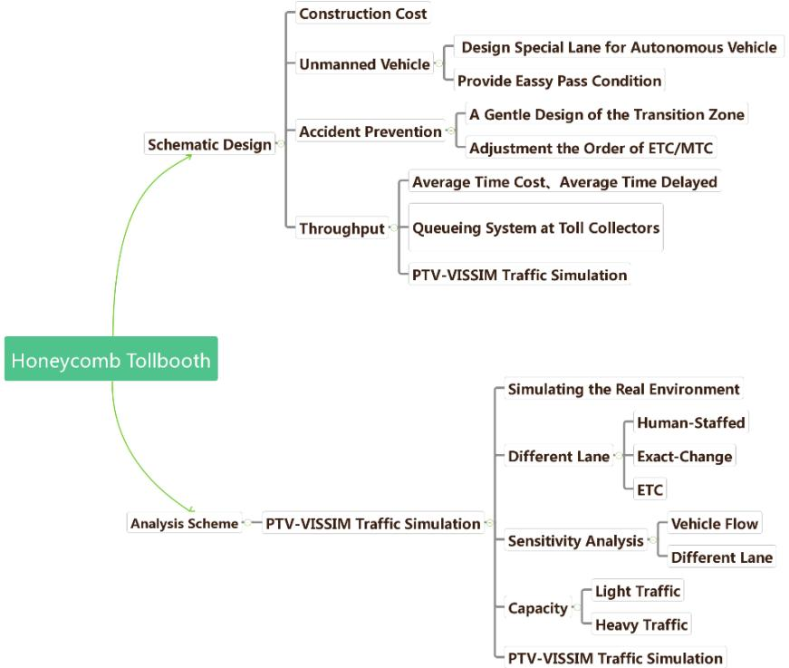

## 三、一般假设

- The arrival of vehicles obeys the Poisson distribution;
- In general, the traffic of ETC toll stations should be much heavier than the traffic of other types of toll station.
- All toll stations are ETC or E-ZPass unless otherwise specified.
- There is no ramp or other exits near the tollbooth. We do not consider the possibility of additional vehicle access, only consider the vehicles already on the main road.
- The service procedure of the toll stations and the merging procedure of the vehicles after the tollbooths are both queuing system. They follow the principle of first come first served.

## 四、蜂窝状收费站设计方案

In traditional toll plazas, there are always more tollbooths than the incoming lanes of traffic. A toll plaza consists of the fan-out area before the barrier toll, the toll barrier itself, and the fan-in area after the toll barrier. The toll barriers are often constructed in a straight line placed across the highway, perpendicular to the direction of traffic flow. So the area of toll plaza is pretty large. To reduce the area of the toll plaza and further save the construction cost, we design a new toll plaza based on the structure of the honeycomb. In addition, by splitting the merging procedure into two stages, our new designed toll plaza can reduce the probability of collision, in contrast with the traditional emerging procedure, where large number of vehicles concentrate into the highway simultaneously. The evolution of our design is shown in Figure 3.1, where we smooth the transition zone to avoid sharp turn and add some reserved tollbooths in the middle for autonomous vehicles.

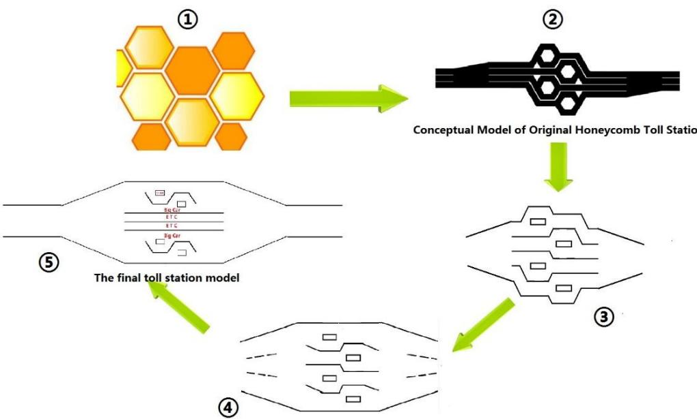

## 五、模型设计

### 4.1 收费站成本估算

The cost of building a toll station mainly includes the construction cost of the road surface and the construction cost of the toll booth. We assess its area and try to minimize it. Toll booths total area $S$ can be divided into the area of the transition zone and the area of toll gates.

We assume that the number of the toll gates is $n_t$, the number of the lanes of the highway is $n_l$, the width of the lane is $w_l$, the tangential offset width is $w_0$, the design speed is $V$, the length of the transition zone is $l_t$, the width of the toll gates is $w_t$, the area of the traditional toll station are $S_{T1}$ and $S_{C1}$, respectively, the area of the transition zone are $S_{T2}$ and $S_{C2}$ respectively.

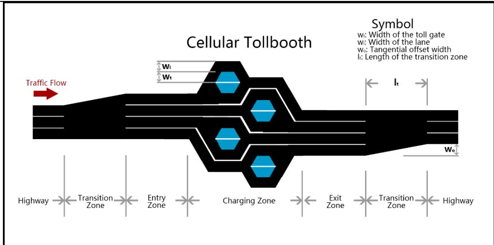

#### 4.1.1 收费区面积对比

The area of the traditional toll station:

$$
S_{T1} = 2 l_t n_l (w_t + w_l)
$$

The area of the cellular toll station:

$$
S_{C1} = \frac{n_l}{2} (l_t (w_t + 2 w_l) + w_l l_t)
$$

The difference in the area of the charging zone:

$$
\Delta S_1 = S_{T1} - S_{C1} = \frac{1}{2} w_t l_t n_l + \frac{3}{2} w_l l_t n_l > 0
$$

#### 4.1.2 过渡区面积对比

The area of the traditional toll station:

$$
\begin{aligned}
w_o &= n_t (w_l + w_t) - n_l w_l \\
l_t &= \frac{w_o v^2}{60} = \frac{v^2}{60} (n_t w_l + n_t w_t - n_l w_l) \\
S_{T2} &= \frac{1}{2} (n_t (w_l + w_t) + n_l w_l) l_t = \frac{v^2}{120} (n_t^2 w_l^2 + n_t^2 w_t^2 + 2 n_t^2 w_l w_t - n_l^2 w_l^2)
\end{aligned}
$$

The area of the cellular toll station:

$$
\begin{aligned}
w_o &= \left(\frac{n_t}{2} - n_l\right) \cdot \frac{w_l}{2} \\
l_t &= \frac{w_o v^2}{60} = \frac{1}{60} w_l v^2 \left(\frac{n_t}{2} - n_l\right) \\
S_{C2} &= \frac{1}{2} \left(\frac{n_t}{2} + n_l\right) w_l l_t = \frac{1}{120} \left(\frac{n_t^2}{4} - n_l^2\right) w_l^2 v^2
\end{aligned}
$$

The difference in the transition zone:

$$
\Delta S_2 = S_{T2} - S_{C2} = \frac{v^2}{120} \Bigl (\frac{3}{4} n_t^2 w_l^2 + n_t^2 w_t^2 + 2 n_t^2 w_l w_t \Bigr) > 0
$$

#### 4.1.3 总面积对比

From the equations above, we can learn that the cellular toll station can significantly save space compared with traditional toll station. The effect can be seen in Figure 4.2 intuitively.

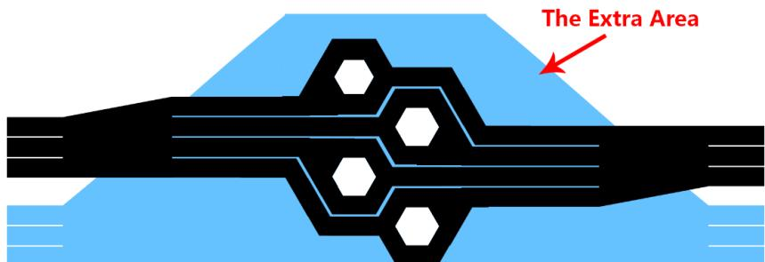

## 4.2 收费站通行能力的分析

在我们的模型中，我们将整个收费过程视为两个串联排队系统的运行。首先，车辆通过收费亭并在收费亭前排队的过程被视为一个排队系统；其次，车辆通过收费站出口处合流点的过程被视为第二个排队系统。接下来，我们将从排队论的简要介绍开始。

### 4.2.1 排队模型简介

排队论是对等待队列（或称队列）的数学研究。在排队论中，构建模型以预测队列长度和等待时间。排队论通常被认为是运筹学的一个分支，因为其结果常用于制定关于提供服务所需资源的商业决策[4]。

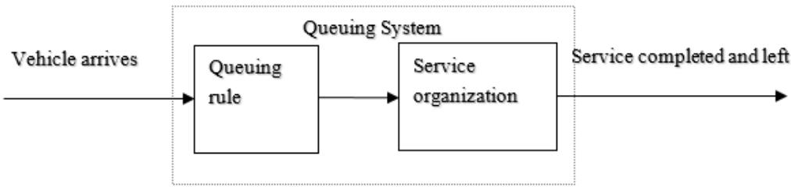

### 4.2.2 收费亭处的排队系统

现实中，当车辆进入收费站时，驾驶员会根据某些原则驶向某个收费闸口，例如到各收费闸口的距离、队列中等待的车辆数。但在我们的模型中，车辆到达每个收费闸口的间隔时间服从指数分布。同时，每辆车在收费闸口所花费的时间也服从指数分布。此外，显然每个收费闸口在每个时刻只能处理一条车道，因此尽管收费站有多个收费亭，但每个收费闸口仍然只有一套收费设施。虽然在我们的模型中每个收费岛上设有两个收费闸口，但这与上述原则并不矛盾。

综上所述，我们认为每个收费闸口可以视为一个 M/M/1 排队系统。

### 4.2.3 合流点处的排队系统

根据 Burke 定理，若 M/M/1 排队模型的到达时间和服务时间均为参数为 λ 的泊松过程，则该排队模型的离开过程也是泊松过程[5]。收费亭的输出为泊松过程；因此，合流点的到达间隔也是泊松过程。

现有道路设计规范规定，车道合流只能从车辆行驶方向的右侧开始，且一次只能合流一条车道[6]。根据这一规定，同时也为了简化模型，我们将车道分为两种类型。I 型不经过任何合流点，而 II 型经过合流点。I 型的数量等于 L-1，因为存在一条车道，即使它直接连接到高速公路，也需要与其右侧的所有车道合流，例如图 4.4 中的车道 4。

对于 I 型车道，车辆可以直接驶过，我们认为时间成本等于合流点数量乘以通过每个合流点的时间成本，即 $( B - L ) \times ( 1 / \mu _ { 0 } ) = ( B - L ) / \mu _ { 0 }$ 和 $( B / 2 - L ) \times ( 1 / \mu _ { 0 } ) = ( B - 2 L ) / 2 \mu _ { 0 }$，其中 B 为收费闸口数量，L 为高速公路车道数，$\mu _ { 0 }$ 为不发生合流冲突时合流点的服务率。这些车道的总概率，对于传统收费站为 $( L \mathrm { - } I ) / B$，对于我们的蜂窝式收费站为 $( L { - } I ) / ( B / 2 )$。

对于 II 型车道，车辆行驶在这些道路上的概率分别为 $( B { - } L { + } I ) / B$ 和 $( B - 2 L + 2 ) / B$。此外，对于第 k 个合流点，到达概率为一条车道的概率加上第 (k-1) 个合流点的概率，即分别为 $( k { + } l ) / B$ 和 $2 ( k { + } l ) / B _ { \mathrm { : } }$。以图 4.4 所示的合流模式为例，合流点 1 的概率等于车道 1 加车道 2，即 $I / B + I / B { = } 2 / B$，合流点 2 等于车道 3 加合流点 1，即 1/B+2/B=3/B。对于交通流量，我们同样可以得到第 k 个合流点的值，等于 $( k { + } l ) \phi / B$，其中 Φ 为总交通流量。

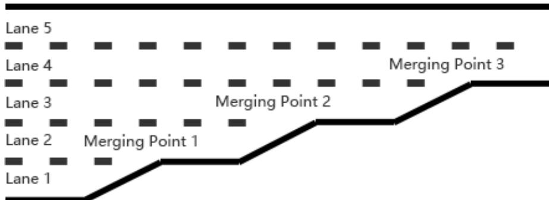

为简化模型，我们不区分在同一合流点合流的两条车道，即车辆通过单个合流点的时间与其所在车道无关，只与另一条车道的状态有关。若另一条车道上无车辆，或另一条车道上有车辆但该车辆停车以避免合流冲突，则该车辆无需减速即可完成合流过程，我们将此过程的时间成本定义为 $1 / \mu _ { 0 }$。否则，该车辆需要停车等待，时间成本定义为 $1 / \mu _ { 1 }$。

综上所述，合流点处排队系统的到达率服从指数分布（即泊松过程），但服务率是一般函数，因此这是一个 M/G/1 排队模型。

### 4.3 计算

由上一节，我们已得到与我们的设计相对应的排队模型。接下来，我们将把具体参数代入这些公式，计算通过传统收费站或蜂窝式收费站的平均时间成本，并比较它们的通行能力。

### 4.3.1 参数赋值

### B：收费亭数量

现实中，收费闸口的数量取决于交通流量、车辆类型等。然而，为简化模型，我们令其等于 8。我们需要注意，即使一个收费岛上设有两个收费闸口，且我们采取预合流策略在进入收费站后将车道减半，这些都不会影响收费闸口的数量，即收费站同时能服务的最大车辆数。

# 4.3.2 Time Cost at Toll Gates

本部分基于前文给出的各车道到达率公式，计算车辆通过收费站的平均耗时。针对传统收费站和蜂窝式收费站（Cellular Toll Station），分别建立了时间成本模型。

### 4.3.2.1 传统收费站与蜂窝收费站模型

对于传统收费站，以下方程显而易见；对于蜂窝收费站，由于在进入收费站前有分流，因此每个收费站面对的交通流量相当于传统收费站的一条车道。公式如下：

$$
W_{T} = \frac{1}{\mu_{T} - \frac{\Phi}{B}}
$$

其中：

- $W_{T}$：通过收费站的耗时（Time cost passing through the toll gate）。
- $\mu_{T}$：收费站的服務率（Service rate of toll gates）。
- $\Phi$：交通流量（Traffic flow）。
- $B$：收费站数量（Number of toll gates）。

---

# 4.3.3 Time Cost at Merging Points

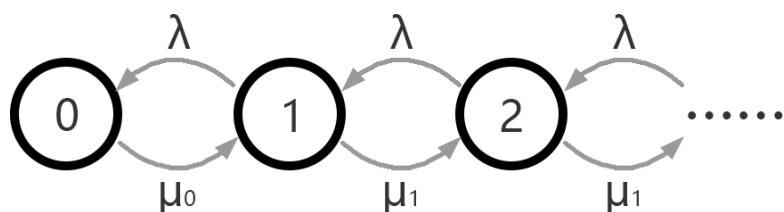

每个汇合点（Merging Point）的汇合过程本质上是一个**生灭过程**（Birth-Death Process）。图 4.5 以马尔可夫链的形式描述了该过程的状态转移。在此过程中，每个状态遵循“流入概率之和等于流出概率之和”的规则 [5]，且所有事件的概率总和为 1。因此，我们得到以下方程组：

$$
\left\{ 
\begin{array}{l} 
\lambda P_{0} = \mu_{0} P_{1} \\ 
\lambda P_{1} + \mu_{0} P_{1} = \lambda P_{0} + \mu_{1} P_{2} \\ 
\lambda P_{n} + \mu_{1} P_{n} = \lambda P_{n - 1} + \mu_{1} P_{n + 1}, \quad n \geq 2 \\ 
\sum_{i = 0}^{\infty} P_{i} = 1 
\end{array} 
\right.
$$

其中：

- $P_{n}, n \in N$：系统中车辆数为 $n$ 的概率（Possibility of $n$ vehicles in the system）。
- $\lambda$：汇合点的到达率（Arrival rate of a merging point）。
- $\mu_{0}$：未发生汇合冲突时的服务率（Service rate when conflict doesn't occur）。
- $\mu_{1}$：发生汇合冲突时的服务率（Service rate when conflict occurs）。

求解上述方程，可得以下解集：

$$
\left\{ 
\begin{array}{l} 
P_{0} = \left(1 + \frac{\lambda}{\mu_{0}} + \frac{2 \lambda \mu_{1}}{\mu_{0}^{2} \mu_{1} - \lambda \mu_{0}^{2} + \lambda \mu_{0} \mu_{1} - \lambda^{2} \mu_{0}}\right)^{-1} \\ 
P_{1} = \frac{\lambda}{\mu_{0}} P_{0} \\ 
P_{n} = \frac{2 \lambda^{2}}{\mu_{0}^{2} + \lambda \mu_{0}} \left(\frac{\lambda}{\mu_{1}}\right)^{n - 2} P_{0}, \quad n \geq 2 
\end{array} 
\right.
$$

根据上述概率，可计算整个排队系统中的期望车辆数：

$$
L_{s}(\lambda) = \sum_{i = 1}^{\infty} i P_{i} = \frac{\lambda}{\mu_{1} - \lambda} + \frac{\lambda \mu_{1} - \lambda \mu_{0}}{\lambda \mu_{1} - \lambda \mu_{0} + \mu_{0} \mu_{1}}
$$

其中：

- $L_{s}(\lambda)$：系统中车辆的期望值，也称为平均队列长度（Average queue length）。

根据利特尔定律（Little's Law）[5]，我们得到以下公式：

$$
L_{s} = \lambda W_{s}
$$

由此可得每辆车在排队系统中的平均停留时间：

$$
W_{s}(\lambda) = \frac{L_{s}}{\lambda} = \frac{1}{\mu_{1} - \lambda} + \frac{\mu_{1} - \mu_{0}}{\lambda \mu_{1} - \lambda \mu_{0} + \mu_{0} \mu_{1}}
$$

其中：

- $W_{s}(\lambda)$：车辆在汇合点处于系统中的平均等待时间（Average waiting time for vehicles in the system）。

---

# 4.3.4 Total Time Cost

根据上述假设，传统收费站第 $k$ 个汇合点的交通流量为：

*(注：原文此处内容中断，后续推导需参考完整文档)*

# 2017年美国大学生数学建模竞赛O奖论文：A New Type of Toll Plaza Based on Bionics-Honeycomb

本节内容源自《2017年美国大学生数学建模竞赛O奖论文：A New Type of Toll Plaza Based on Bionics-Honeycomb》第5部分（共10部分），由识别工具读出并整理。主要涉及传统收费站与蜂窝式收费站的时间成本模型对比，以及事故预防能力和ETC技术适配性的改进设计。

## 4.3 时间成本模型对比

### 传统收费站的时间成本计算

根据上述公式，合并点的总时间成本为：

$$
W _ { M T } = \frac {L - 1}{B} \cdot \frac {B - L}{\mu_ {0}} + \frac {B - L + 1}{B} \sum_ {k = 1} ^ {B - L} \frac {k + 1}{B} W _ {s} \left(\frac {k + 1}{B} \Phi\right)
$$

其中：

- $W _ { \mathrm { M T } }$ 是传统收费站每个车辆在合并点花费的平均时间；
- $L$ 是高速公路的车道数。

加上前面获得的通过每个收费通道的耗时 ${ \sf W } _ { \mathrm { T } }$，我们可以计算出通过整个收费站的平均时间成本 $\mathsf { W } _ { \mathrm { A T } }$：

$$
W _ {\mathrm{AT}} = W _ {T} + W _ {M T} = \frac {1}{\mu_ {T} - \frac {\Phi}{B}} + \frac {L - 1}{B} \cdot \frac {B - L}{\mu_ {0}} + \frac {B - L + 1}{B} \sum_ {k = 1} ^ {B - L} \frac {k + 1}{B} W _ {s} \left(\frac {k + 1}{B} \Phi\right)
$$

其中：

- $\mathsf { W } _ { \mathrm { A T } }$ 是每个车辆通过收费亭的平均时间成本。

### 蜂窝式收费站的时间成本计算

但在我们的设计中，由于交通流提前汇合，每条车道的交通流变为前一条车道的两倍，车道数减半。为了简化计算，我们假设 $B$ 始终为偶数，因此第 $k$ 个合并点的交通流为：

$$
\frac {2 (k + 1) \Phi}{B}, k = 1, 2, \ldots , \frac {B}{2} - L + 1
$$

相应第 $k$ 个合并点到达的概率为：

$$
\frac {2 (k + 1)}{B}, k = 1, 2, \ldots , \frac {B}{2} - L + 1
$$

总时间为：

$$
W _ {M I} = \frac {2 L - 2}{B} \cdot \frac {B - 2 L}{2 \mu_ {0}} + \frac {B - 2 L + 2}{B} \sum_ {k = 1} ^ {\frac {B}{2} - L} \frac {2 (k + 1)}{B} W _ {s} \left(\frac {2 (k + 1)}{B} \varPhi\right)
$$

其中：

- $\sf { W _ { M I } }$ 是蜂窝式收费亭在合并点每个车辆花费的平均时间。

对于蜂窝式收费亭，所有车道将提前汇合，我们需要计算预汇合过程中额外增加的时间成本 $\mathtt { W _ { E x } }$：

$$
W _ {E x} = W \left(\frac {2 \Phi}{B}\right)
$$

同样地，结合上述时间成本，我们得到每个车辆通过收费站的平均时间成本 $\mathsf { W } _ { \mathrm { A I } }$：

$$
W _ {\mathrm{AI}} = W _ {T} + W _ {M I} + W _ {E x}
$$

即：

$$
W _ {\mathrm{AI}} = \frac {1}{\mu_ {T} - \frac {\Phi}{B}} + \frac {2 \mathrm{L} - 2}{\mathrm{B}} \cdot \frac {B - 2 L}{2 \mu_ {0}} + \frac {\mathrm{B} - 2 \mathrm{L} + 2}{\mathrm{B}} \sum_ {k = 1} ^ {\frac {B}{2} - L} \frac {2 (k + 1)}{B} W _ {s} \left(\frac {2 (k + 1)}{B} \Phi\right) + W _ {s} \left(\frac {2 \Phi}{B}\right)
$$

将具体参数代入 $\mathsf { W } _ { \mathrm { M I } }$ 和 $\mathsf { W } _ { \mathrm { A I } }$ 进行计算并绘图，比较结果如图 4.5 所示。

## 4.4 提高事故预防能力

### 4.4.1 分层汇合模式

传统收费站仅在过渡区末端有一个汇合点，增加了拥堵的可能性。但对于我们的蜂窝式收费站，蜂窝内部有弯道，可将车速保持在安全范围内。因此，我们可以降低以下两类事故的发生可能性：

(1) 因超速引起的交通事故；

(2) 因过度拥挤引起的交通拥堵。

下图描述了我们的预汇合模式与传统单一汇合模式。

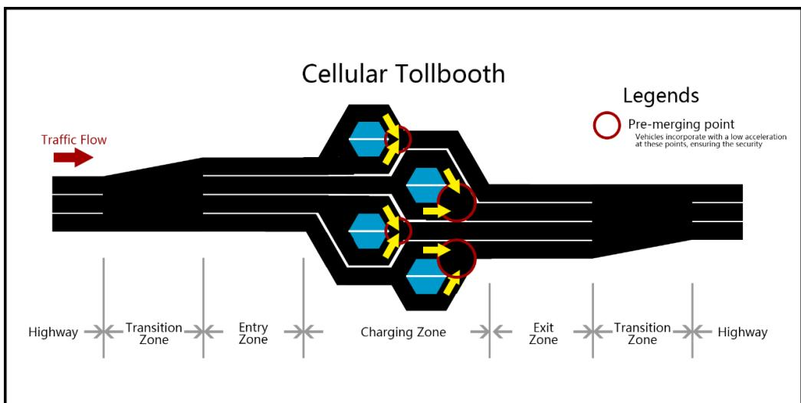

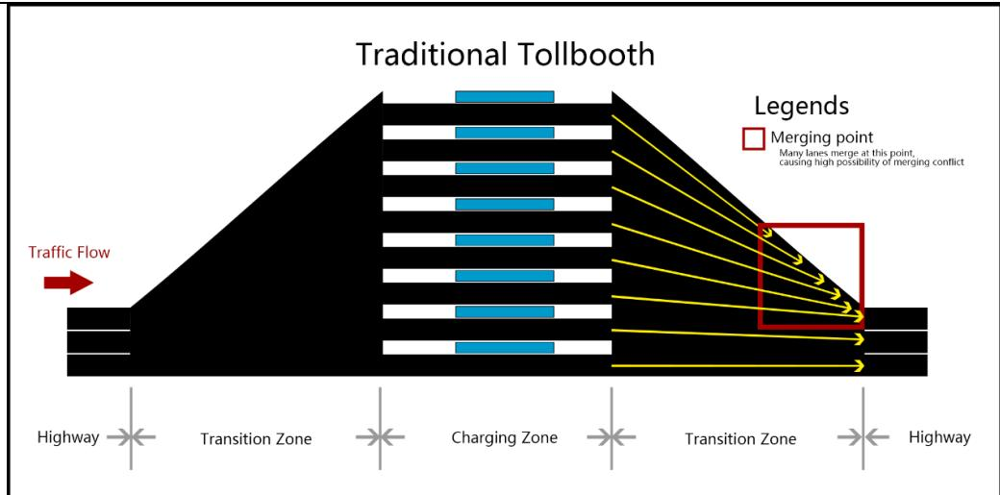

### 4.4.2 过渡区的温和设计

过渡区的坡度率根据设计速度和切向偏移宽度设定，不同国家有不同的标准，美国标准的最大比率为 1:20，最小为 1:8 [9]。

因此，我们通过改变收费站的横截面比率来进一步改进模型以提高安全性，改进后的模型如下：

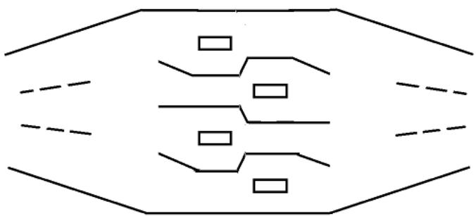

### 4.4.3 更适合 ETC 技术

收费站通常包含不同的收费模式集合：传统（人工值守）收费亭、找零（自动化）收费亭和电子收费（ETC）亭。靠近收费站入口的车辆常因选择不同通道而发生交通事故，不同类型收费亭的位置对安全性至关重要。

由于 ETC 技术的大规模推广，车辆进出收费站的方式以及通过收费站的方式与传统收费模式不同，这增加了事故的可能性。计算实验表明，与高风险交通流相关的闸门（例如通往 ETC 的交通流，或以显著高于平均速度的速度接近收费站的车辆），应位于其他类型闸门的中心位置 [10]。因此，我们在新的收费站中间增加了两个 ETC 车道。

# 2017年美国大学生数学建模竞赛O奖论文：A New Type of Toll Plaza Based on Bionics-Honeycomb

本部分为原论文第 6 部分（共 10 部分）中关于自动驾驶车辆影响、解决方案及 VISSIM 仿真分析的内容整理。

## 4.5 The influence of autonomous vehicles

As smart cars are non-cash payment, when compared to the traditional toll station, the cellular toll stations can better meet the needs of smart car. In this section, we first analyze the principle and characteristics of autonomous vehicles, then, according to the principle and characteristics of them, we optimized the cellular toll station model.

### 4.5.1 The Characteristics of Autonomous Vehicles

#### （1）Automatic Payment System
Since the autonomous car are uncontrolled, they need to be equipped with automatic payment system, that is, ETC equipment. Therefore, they can pass through the toll station quickly.

#### （2）Road Safety Improvement
Self-driving vehicles can improve road safety in one way or another. autonomous vehicles are equipped with sensing systems, which helps sensing the environment, based on the information about the road, vehicle location, and obstacles, the vehicle can steer and control the speed automatically. Therefore, they have a better control of the vehicle distance, brake, etc. which can reduce possibility of the occurrence of traffic accidents at the toll station. Besides, the driver's own factors (such as bad mood, disputes with the toll station service staff, etc.) will not affect the vehicle's safety [11].

#### （3）Orderly Traffic Flow
Vehicles at the junction of the toll station convergence can be more orderly，which avoids the occurrence of congestion and maximize the efficiency of cellular toll stations.

### 4.5.2 Our Solution

#### （1）Lane Configuration Optimization
In the future, there are more autonomous vehicles, since these vehicles are all equipped with ETC equipment, the cellular toll booths must increase the number of automatic toll lanes, reducing the number of manual toll lanes to maximize the efficiency. Our design can provide perfect service for those cars. As shown in the figure 4.10, the MTC lanes will be located at the sides of the toll station, and the straight lanes for Large vehicles are in the middle，reducing the inconvenient for the large vehicles. Meanwhile, as the autonomous vehicles are easy to steer, the rest lanes are all ETC lanes. When the autonomous vehicles enter the global market, the proportion of vehicles equipped with ETC will increase greatly.

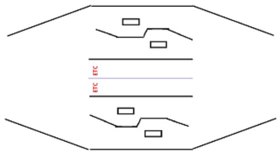

#### （2）Throughput Analysis
According to the queueing model and the simulation result from VISSIM, the throughput of the toll station increases accompany with the increase of the number of the ETC lanes. As the autonomous vehicles are all non-cash payment, when compared with the traditional toll station, the cellular design is more suitable.

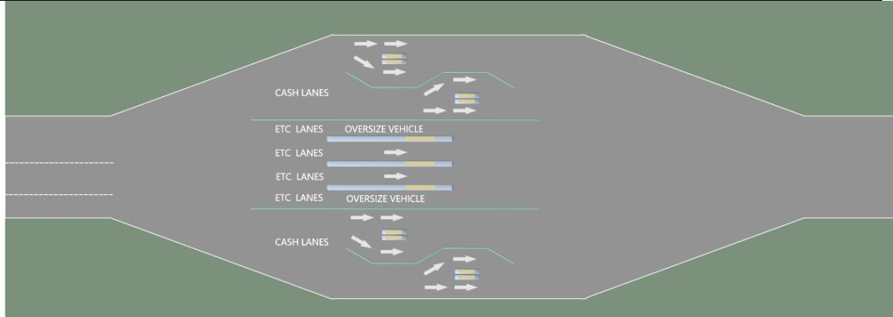

## V. Analysis of our Design

### 5.1 Using VISSIM Simulation to Find the Difference of These Two Tollbooths.

### 5.1.1 Basic Data for Simulation

We use PTV-VISSIM 4.3 to do this simulation. Because there is no special configuration for other traffic simulation design(such as road connections, car route selection , deceleration belt and the design of tollbooths), so there are no more other detailed explanation about the parameter, and you can find more information at [12]. We set the speed of the vehicle through the ETC deceleration belt is $24 \text{km/h}$ and deceleration speed is $2 m / s ^ { 2 }$ .We refer to “The vehicles’ speed reduces to 24km/h when passing ETC lane” at literature[13].

#### （1）Establish VISSIM backplane

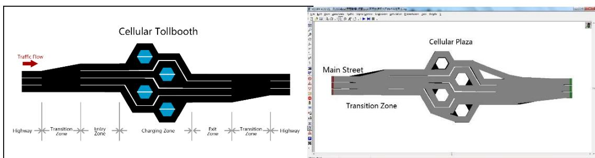

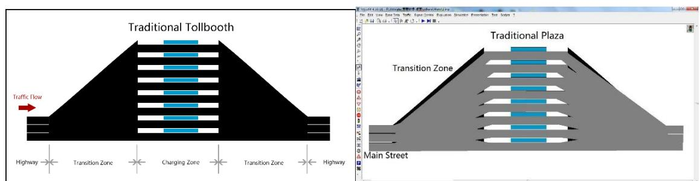

## （2）Design traffic composition and proportion

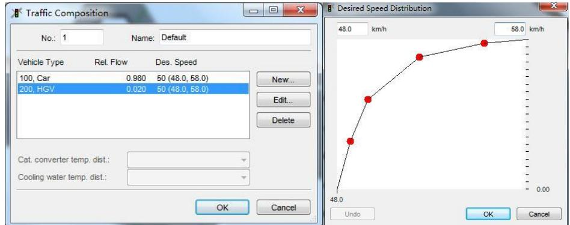

## （3）Other important description

We totally did two simulations, and you can find details in the table below:

Table 5.1 Simulation content

| Simulation times | The first simulation |  | The second simulation |  |
|---|---|---|---|---|
| Tollbooth pattern | Traditional Tollbooth | Honeycomb Tollbooths | Traditional Tollbooth | Honeycomb Tollbooths |
| Main street | 3 | 3 | 3 | 3 |
| Toll lane | 8 | 8 | 8 | 8 |
| ETC | 2 | 2 | 0 | 0 |
| ETC lane position | Bottom Road | The center two lanes | 0 | 0 |

Q: Why only consider ETC and artificial charges in the simulation, but do not consider the exact-change toll pattern?

A: According to the literature [17], the capacity of tollbooths in the United States, MTC (Only pre-sale tickets) 500 veh/h, exact-change toll (Collect some coins) 500 veh/h. This time only to simulate the above situation, if we consider all the charge pattern, our model will be too complicated. You can find section 5.2 for details.

Q: Why not consider autonomous vehicles?

A: Because autonomous vehicles don't need driver. The main solution is to install an ETC device on an automatic car. Ignoring the difference in this simulation, the specific impact of autonomous vehicles on the tollbooth is described in section 4.5.

Q: How to explain the great difference between the result of the queueing model and the result of the VISSIM simulation?

A: VISSIM software has taken a lot of factors into consideration. Therefore, compared with the pure theoretical derivation, VISSIM is more practical.

Q: How to explain the great change at the traffic flow 2000 veh/h.

A: Both two kinds of toll station have their maximum capacity. Therefore, there will be a great change for the total time cost and the time delayed. We can't eliminate the error between VISSIM and the reality, however, this won't affect our analysis.

### 5.1.2 Simulation Conclusion

#### （1）Sensitivity Analysis of Traffic Flow in Honeycomb Tollbooths

According to Fig. 1, compared with the traditional tollbooth, honeycomb tollbooth is not sensitive to the traffic flow and has strong robustness. It is suitable for practical construction.

Simulation results show that the average transit time remains at about 11 seconds under different throughputs from 0 to 2000 (Unit: veh/h). We can infer that this model is not sensitive to traffic flow variations and has strong robustness which is suitable for practical construction.

Table 5.2 Honeycomb Tollbooths (All ETC)

| Traffic flow (veh/h) | Average time (s) | Car number (veh) | Delay time (s) | Stop time (s) | Stop number |
|---|---|---|---|---|---|
| 500 | 10.778 | 42.778 | 0.056 | 0.000 | 0.000 |
| 1000 | 10.900 | 88.222 | 0.144 | 0.000 | 0.000 |
| 2000 | 11.500 | 180.111 | 0.633 | 0.000 | 0.006 |
| 2100 | 11.567 | 189.556 | 0.667 | 0.000 | 0.001 |
| 2200 | 20.133 | 173.778 | 9.256 | 2.700 | 0.541 |
| 2500 | 22.878 | 184.556 | 12.033 | 3.933 | 0.621 |
| 3000 | 23.444 | 177.000 | 12.578 | 4.522 | 0.723 |

Table 5.3 Traditional tollbooth (All ETC)

| Traffic flow (veh/h) | Average time (s) | Car number (veh) | Delay time (s) | Stop time (s) | Stop number |
|---|---|---|---|---|---|
| 500 | 10.078 | 43.000 | 0.056 | 0.000 | 0.000 |
| 1000 | 10.200 | 88.444 | 0.100 | 0.000 | 0.000 |
| 2000 | 12.078 | 174.556 | 1.911 | 0.767 | 0.173 |
| 2100 | 13.267 | 179.667 | 3.078 | 1.378 | 0.283 |
| 2200 | 47.178 | 146.889 | 36.422 | 22.567 | 1.944 |
| 2500 | 51.222 | 145.000 | 40.444 | 24.367 | 2.331 |
| 3000 | 57.100 | 151.333 | 46.933 | 30.878 | 2.201 |

#### （2）When the toll station is all configured ETC, we can get:

① The throughput of the two toll stations is almost the same in light traffic.

② Honeycomb tollbooth is better than traditional tollbooth in heavy traffic, when traffic flow is 2500 veh/h. The VISSIM simulation results show that the honeycomb tollbooth is 55% larger than the traditional tollbooth on total time cost, and about 70% on time delay.

③ The simulation results are in good agreement with the results of queuing theory.

It is shown that the queuing theory model is very reasonable to measure the throughput of the honeycomb tollbooth.

#### （2）Two ETC and six MTC, we can get:

① The throughput of the two toll stations is almost the same in light traffic (<400 veh/h).

② The traffic capacity of honeycomb tollbooths will decrease in heavy traffic (>900 veh/h).

③ The traffic flow between 400 veh/h and 900 veh/h honeycomb tollbooths is stronger than the traditional tollbooth.

## 5.1.3 Simulation example

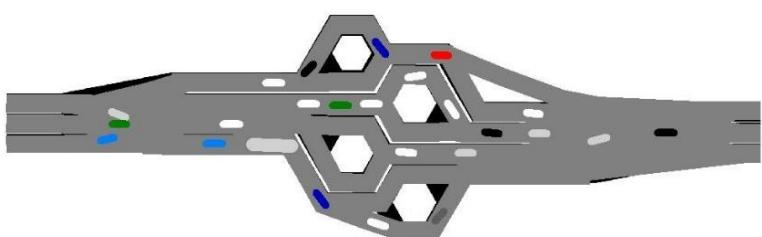

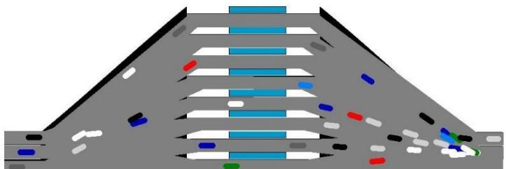

## 5.2 The influence of different proportions tollbooth

### 5.2.1 Model Simplify

According to the data in [14], there is no great difference between the influence of MTC tollbooths and the influence of exact-change tollbooths, thus we can omit that difference and only take MTC into consideration. In the rest part of the paper, we combine the MTC method and the exact-change method into cash method.

**Table 5.6 Throughput of each lane in the US[14]**

| Charging type | Throughput per lane (veh/h) |
| :--- | :--- |
| MTC system | 425 |
| Exact-change | 500 |
| Low speed ETC system | 1200 |
| High speed ETC system | 1800 |

### 5.2.2 Result Analysis

#### （1）Sensitivity Analysis of Impact of Cellular Toll Station on Capacity

The capacity of cellular toll stations is more sensitive to the proportion of ETC lanes. There is a possible scenario that when decreasing the number of ETC lanes, the total time cost increases rapidly.

**Table 5.7 Comparison under different number of ETC lanes**

| ETC/MTC | Total time cost (sec) | Number of vehicle per lane (veh) | Time delayed (sec) | Time cost on parking (sec) | Number of parking (sec) |
| :--- | :--- | :--- | :--- | :--- | :--- |
| 0\8 | 80.689 | 276.111 | 19.078 | 4.089 | 0.712 |
| 1\7 | 76.111 | 283.556 | 16.500 | 4.622 | 0.744 |
| 2\6 | 66.378 | 286.667 | 11.922 | 3.344 | 0.586 |
| 3\5 | 57.167 | 288.889 | 8.311 | 2.011 | 0.386 |
| 4\4 | 49.633 | 289.333 | 6.478 | 1.544 | 0.308 |
| 5\3 | 42.611 | 290.111 | 5.578 | 1.278 | 0.259 |
| 6\2 | 34.722 | 290.667 | 4.844 | 0.633 | 0.111 |
| 7\1 | 18.778 | 292.111 | 1.456 | 0.467 | 0.071 |
| 8\0 | 10.822 | 292.667 | 0.111 | 0.000 | 0.000 |

#### （2）The lower the proportion of cash charges, the smaller average transit time and average delay.

#### （3）With the increase in the number of ETC lanes, the average number of vehicles per lane increased at the same time, improve the road utilization.

### 5.3 Strengths and Weaknesses

#### 5.3.1 Strengths

(1) Cellular toll stations greatly save land area and reduce construction costs.

(2) Cellular toll stations adopt the pre-merging strategy, preventing the overcrowding.

(3) Cellular toll stations can force deceleration, preventing the accident caused by the speed difference between the ETC lanes and MTC lanes.

(4) Through a large number of VISSIM traffic simulation data, we successfully obtained the simulation result, and the result is identical to the result of the queueing model. Simulation results show that the ideal cellular distributed toll booths have better results compared with traditional toll stations, especially when the traffic flow is heavy, the average travel time reduced by about 55% and the average delay time of each lane is reduced by about 70%.

(5) Through the VISSIM simulation, we obtained the results can't directly obtain from the queueing model, which is toll station with both ETC and MTC lanes, making up for the shortcomings of the model can't be applied to reality.

#### 5.3.2 Weakness

(1) The length of the vehicles must be taken into the consideration for the reason that some long vehicle can't pass through the cellular.

(2) Because there is no toll station model in VISSIM4.3, we refer to a large number of references to determine the average speed of the vehicle through the toll station, and simulate the process through the deceleration zone model.

(3) Because the actual traffic composition ratio of the actual data and speed acceleration is not easy to obtain, resulting in traffic simulation is not close to reality.

(4) In the simulation, the difference between the exact-change lane and the manual lane is neglected.

## VI. Conclusion

With the popularization of ETC equipment and autonomous vehicles, the MTC lanes will be totally replaced by the ETC lanes in the next 20 years, which will increase the road capacity and decrease the time cost by each car passing through the toll station.

At present the traditional design of toll stations covers a large area, and the cost of construction is high. With the raise of the vehicles' speed, there will be congestions at the merging point, which may increase the possibility of accident.

In order to solve these problems, we put forward a new design of cellular toll stations. This design is inspired by the honeycomb. The tollbooths are located at the center of each regular hexagon. Thanks to this special structure, the cost of construction can be significantly reduced. Meanwhile, by pre-merging the traffic flow inside the toll station, the expected time cost by vehicles in the merging procedure can be diminished extraordinarily. In addition, by appropriate design, the probability of collision at the emerging points can be decreased.

## Letter

Dear New Jersey Turnpike Administration:

It is my pleasure to give policy recommendation to New Jersey Turnpike Authority. We have developed a new design of toll station system，This kind of design can solve many problems caused by the increase of ETC service and autonomous car,

According to our information, New Jersey's freeway mileage is more than 321 kilometers, ranked fifth among the US. Meanwhile, the ETC utilization rate of toll stations of New Jersey has exceeded 80%. In the future, with the popularity of ETC equipment, the use of ETC in the toll station may further increase. While the commercial layout of autonomous vehicles is accelerating, in the next 20 years there may be a large number of autonomous vehicles on the road, which increases the speed passing through the toll station. Therefore, your problem might be: “How to guarantee the road capacity of toll station?”,” How to lead the traffic flow to converge at the exit?”,” How to ensure the safety of vehicles?”.

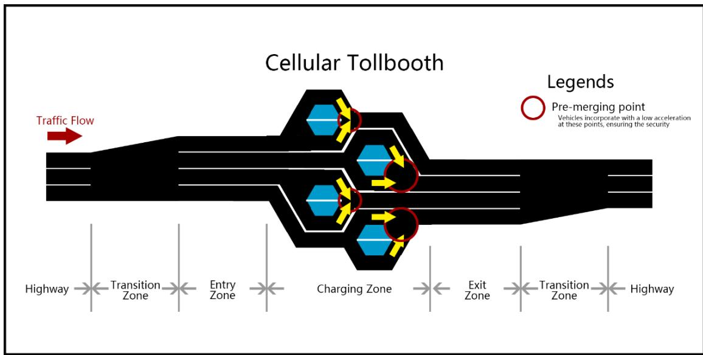

We come up with a cellular toll booth design, whose conceptual model is shown above. This design has four main advantages：

(1) Through the analyzation of the toll station area, we can know that cellular architecture can reduce the construction area about 50% compared with... with the same number of tollbooths (8 as an example).

(2) We simulate a large number of actual situation with the use of PTV-VISSIM. Simulation results show that the ideal cellular distributed tollbooths have better performances compared with traditional toll stations, especially when the traffic flow is heavy. That is the average travel time reduced by about 55% and the average delay time of each lane was reduced by about 70%.

(3) According to PTV-VISSIM simulation: full ETC tollbooth is 8 times faster than full MTC tollbooth.

(4) We simulate the performance of the cellular toll plaza under different traffic throughput. Simulation results show that the average transit time remains at about 11 seconds under different throughputs from 0 to 2000 (Unit: Veh / h). We can infer that this model is not sensitive to traffic flow variations and has strong robustness which is suitable for practical construction.

In order to give you a more intuitive view of the advantages of our cellular toll station, we make a comparison diagram for you，The black part shown below is our design with 8 toll gates, while the blue par is the traditional design.

Best Regards, Sincerely

# VII. References

[1] Wang Dianhai. Traffic flow theory [M]. Beijing: China Communications Press, 2002.

[2] Wu Xiaowu. Study on Traffic Safety of Toll Station of Expressway [D]. Chang'an University, 2004.

[3] Honeycomb. https://en.wikipedia.org/wiki/Honeycomb.

[4] Queueing theory. https://en.wikipedia.org/wiki/Queueing_theory.

[5] Gross D. Fundamentals of queueing theory [M]. John Wiley & Sons, 2008.

[6] The Washington State Department of Transportation design manual, chapter 1210, Geometric Plan Elements.

[7] Manual H C. Highway capacity manual [J]. Washington, DC, 2000.

[8] Hock, Ng Chee. Queueing Modeling Fundamentals. Wiley, New York, 1996.

[9] Cheng J, Jiang P. Design of Toll Collection Station for Quanzhou to Xiamen Freeway [J]. Journal of Highway & Transportation Research and Development, 1995.

[10] Pratelli A, Schoen F. Multi-Toll-Type Motorway Stations Optimal Layout [C]// Urban Transport XII. Urban Transport and the Environment in the 21st Century, 2006.

[11] Sivak M, Schoettle B. Road safety with self-driving vehicles: General limitations and road sharing with conventional vehicles [J], 2015.

[12] PTV Vissim. http://vision-traffic.ptvgroup.com/en-us/products/ptv-vissim/.

[13] Liu L, Weng J, Rong J. Simulation Based Mixed ETC/MTC Freeway Toll Station Capacity [C]// 19th ITS World Congress, 2012.

[14] Ding Chuangxin. Study on Capacity of High-grade Highway Toll Station [D]. Kunming University of Science and Technology, 2005.

# VIII. Appendix

## 8.1 Figure

We have designed a 3D model of our honeycomb tollbooths.

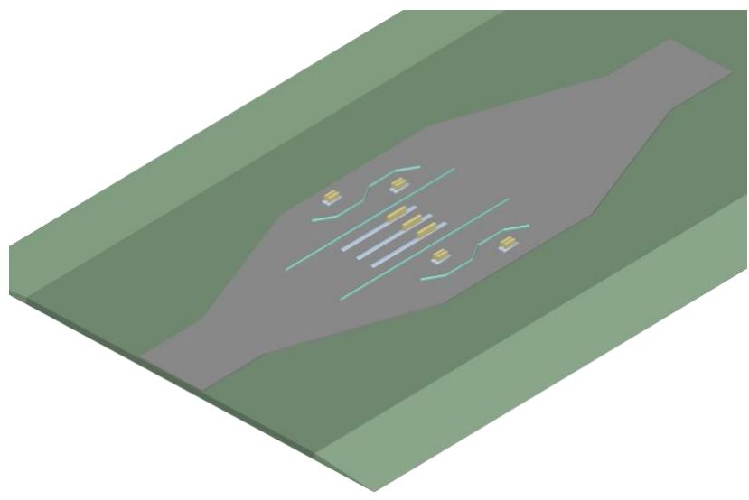

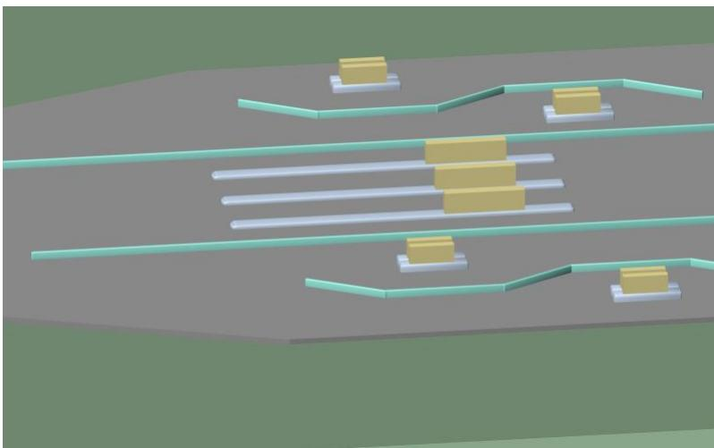
