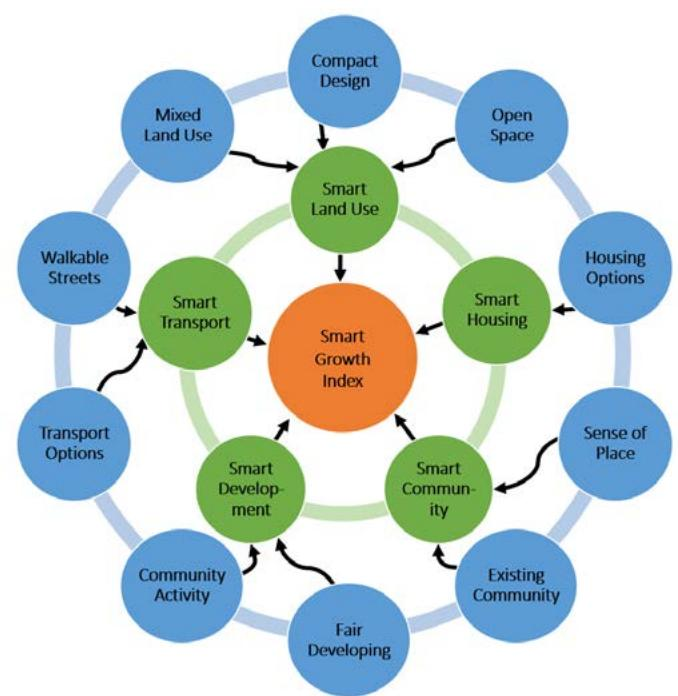
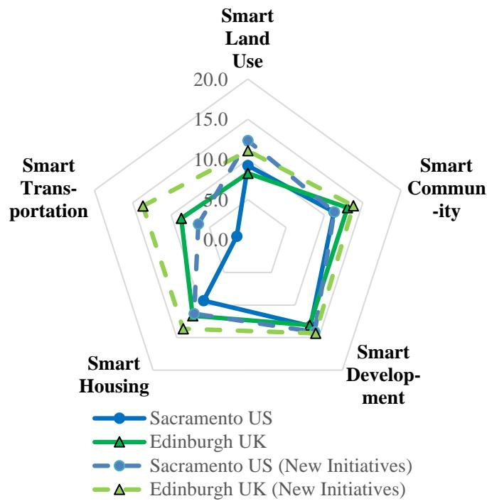

# 2017年美国大学生数学建模竞赛O奖论文：A Tale of Two Smart Cities: Development of a Smart Growth Index

原件为竞赛论文。补充：文中的阅读练习及“参考解答”为整理时增加，原件图文保留出处。

本文基于 2017 年美国大学生数学建模竞赛（MCM）O 奖论文整理。内容涵盖摘要、引言及智能增长原则，旨在构建一个基于可持续性原则的城市智能增长指数（Smart Growth Index, SGI）。

## 摘要

### 研究目标

本模型的目标是设计一个易于使用的指数，能够根据可持续性的基本原则对城市的“智能增长”进行评分。由于智能增长的十项原则旨在包含可持续性的三个 E（环境可持续性、经济繁荣和社会公平），本模型将这十项原则整合为五个独特的指标，这些指标基于核心思想的交叉性（见右上角图示）。

这些指标分析城市的以下方面：土地利用、住房、社区、发展规划和交通。这些指标本身是通过广泛可用数据的简单度量确定的。所有这些指标的总和被报告为任何发达城市的智能增长指数（SGI）。

### 案例分析与结果

加利福尼亚州萨克拉门托市（美国）和苏格兰爱丁堡市（英国）被选为本模型的区域基准进行分析。选择这两个城市是因为它们目前都在其城市增长计划中融入了智能增长原则。在对这两个城市进行初步分析后，制定了新的智能增长举措，并预测了新的模型输入。这些举措专门针对每个城市，旨在提高其总体 SGI 分数（见右下角图示）。

两个城市在初始阶段的得分均较好，SGI 分数分别为 44.7 和 54.9。在实施拟议的举措后，SGI 分数分别增加到了 55.5 和 66.5。此外，还分析了人口增长 50% 的情况；假设每个城市都遵循新举措，预计每个 SGI 指标都会增加。

### 模型假设

为了提供广泛的潜在城市范围，本模型做出了一些简化假设：

- 所选指标及其度量方式是量化相互关联的问题和变量复杂系统的最接近方式。
- 相比于需要难以获得的特定城市数据的细节导向模型，更倾向于使用简单、广泛且稳健的模型。
- 个人/城市输入的数据被视为无偏见的，且输入时没有操纵模型结果的目的。

## 1.0 引言

随着城市化和人口的增长，制定可持续增长计划变得至关重要。智能增长是一种发展理念，旨在提高增长城市的环境可持续性，同时改善其经济繁荣和社会公平（也称为可持续性的三个 E）。然而，由于人口、增长和地理的差异，必须为每个城市推导定制的智能增长计划。这些独特的计划使得衡量一系列智能增长计划的成功变得困难，因为目前尚无索引模型。理想情况下，任何用于排名城市智能增长的建模指数都应基于简单的原则和易于获取的数据。

## 智能增长原则

如上所述，智能增长发展基于十个基本原则（Smart Growth Network, 2006）：

1. 混合土地利用
2. 利用紧凑设计
3. 创造多样化的住房机会和选择
4. 创造可步行的社区
5. 培养具有强烈场所感的独特、有吸引力的社区
6. 保护开放空间、农田、自然美景和关键环境区域
7. 将开发导向现有社区
8. 提供多种交通选择
9. 使开发决策具有可预测性、公平性和成本效益
10. 鼓励社区和利益相关者在开发决策中进行协作

分析上述原则揭示了核心思想之间存在一定程度的交叉性。通过将原则分组，可以创建五个指标：智能土地利用、可得住房、替代交通、强烈的社区感和社区参与。在本报告的其余部分，这些指标将被称为：智能土地利用（Smart Land Use）、智能住房（Smart Housing）、智能交通（Smart Transport）、智能社区（Smart Community）和智能发展（Smart Development）。由于这些原则是智能增长的基础，将它们以某种形式用作任何给定智能增长计划的排名/索引工具是合乎逻辑的。

### 1.1 目标

本模型的目标是设计一个易于使用的指数，能够根据智能增长的创立原则和易于获取的数据对城市的智能增长进行评分。对于本报告，分析了来自不同大陆的两个城市：美国加利福尼亚州萨克拉门托市和英国苏格兰爱丁堡市。该模型旨在作为发达城市之间的比较工具。模型的结果应是定量测量；然而，其主要目的应作为定性指南，以识别社区可以在哪些方面改进可持续性。因此，该模型将作为衡量政策变化和其他政府实施效果的指标。这一目标将通过校准所创建的模型到两个试图以智能方式增长的中大城市来实现。

# 2017年美国大学生数学建模竞赛O奖论文：A Tale of Two Smart Cities: Development of a Smart Growth Index

## 2.0 Methodology

The distinguishing mark of this report's model comes from its derivation. Because smart growth is characterized by its ten principles, this model incorporated each of these ten principles to measure the success of smart growth. The ten principles of smart growth were categorized into five metrics which were used to determine how smart a city was growing (Figure 2.1).

This model outputs a cumulative Smart Growth Index (SGI) value that ranges across a traditional grading system of 0-100 (where 100 is the highest possible level of Smart Growth). This SGI value is the sum of scores from the five metrics mentioned previously:

$$
\begin{array}{c} S G I = S m a r t L a n d U s e + S m a r t C o m m u n i t y + S m a r t D e v e l o p m e n t \\ + S m a r t H o u s i n g + S m a r t T r a n s p o r t a t i o n \end{array}
$$

Each of the metrics were assumed to have the same importance, so each is weighed evenly in the above equation. Each metric can have an output between the range of 0-20, meaning the highest possible smart growth rating would have a rating of 20 for each metric, which then sums to 100.

To better understand the model as a whole, a greater knowledge of each metric and its derivation is required.

### 2.1 City Smart Growth Index

As Figure 2.1 shows, this report’s model combines similar smart growth principles into metrics. This was accomplished with an intersectionality matrix (Appendix Table A-1), which was created by analyzing the definitions of each principle and checking for similarities between them. Once the matrix was built, principles could be grouped together based on their definitions and the interpretation of how they could be implemented within communities. This method led to the following principles being grouped into the following metrics in Table 2.1:

Table 2.1- Separation of pillars into five metrics of smart growth.

| Metric | Smart Land Use | Smart Community | Smart Development | Smart Housing | Smart Transportation |
| :--- | :--- | :--- | :--- | :--- | :--- |
| Smart Growth Principle(s) | 1, 2, 6 | 5, 7 | 9, 10 | 3 | 4, 8 |

Data for each metric, and subsequent measures, was obtained from different public/governmental agencies so when multiple sources were required for a sentence, the in-text citation will follow ASCE’s citation format: (Author1, Year1; Author2, Year2;...).

#### 2.1.1 Smart Land Use Development Metric

The Smart Land Use metric accounts for a city’s plan to integrate mixed land use to better allow for vertical building and preservation of open space. To quantify this metric, this report focused on one population related measure and one land related measure: population density and area of parkland per 1000 residents.

The main measure that accounts for mixed land use and compact building design is population density (US Census Bureau, 2012; City of Edinburgh Council, 2013). This model assumes that, in regards to smart growth, a greater population density indicates more people in vertical buildings. Also, this report assumes that population density will be its greatest near central hubs of commercial and business zones. To normalize this measure, the city of interest should be compared to the maximum population density found in the region. In this case, the city of Los Angeles was used to normalize Sacramento’s value while Glasgow, Scotland, United Kingdom was used to normalize Edinburgh’s value (US Census Bureau, 2012; Office for National Statistics, 2014). A current issue with this measure is that the closer a residential zone is to a business or commercial zone the more expensive the property (Palm, 2014). As a result, an immediate connection between Smart Housing and Smart Land Use can be seen.

To account for the preservation of open space, the SGI model uses the measure of park area per 1000 residents (Trust for Public Land, 2016; City of Edinburgh Council, 2010). The greater this value the greater physical emphasis a city has for its open space. Similar to population density these values were normalized. However, they were normalized in relation to one location:

## 2.1.1 Smart Land Use Metric

Honolulu, Hawaii. Honolulu was chosen due to available data and its position as the highest amount of open area for a similar population density (Trust for Public Land, 2016).

$$
SmartLandUse = \frac {\frac {\rho_ {city}}{\rho_ {regionmax}} + \frac {A _ {park}}{A _ {regionmax}}}{2}
$$

Where:

$\rho_{city}$ = population density of city, population/mi²

$\rho _ { regionmax }$ = maximum population density for region, population/mi²

$A _ { park } = \mathrm { area }$ of park within the city, acres of park/1000 people

$A _ { regionmax }$ = median area of park for region, acres of park/1000 people

### 2.1.2 Smart Community Metric

The Smart Community metric accounts for the sense of pride and place that a community has. Due to the qualitative nature of these aspects, the largest challenge for this metric was determining what data would be capable of expressing a community's sense of self. Sources were scarce for determining if a city was developing properly or creating good communities. However, this model ultimately decided to use the following measures: crime rate and percent of annual budget that it applied to restoration and city maintenance projects (rather than construction of new properties).

As mentioned, quantifying values such as a community's sense of place is difficult and subjective, but this model attempt to account for pride by the crime rate (Numbeo, 2017). This measure is used because it is the closest indication of whether or not the community was safe and if people felt safe using other community amenities such as public transportation. This measure is being used in a very simple way for a very complex issue. Crimes are not always indicative of pride, and are sometimes a matter of necessity/survival. However, given the time constraints placed on this model, crime is the selected measure.

The city budgets were also inspected to determine if city officials were developing existing communities rather than new projects (City of Sacramento, 2017; City of Edinburgh Council, 2017). The budget details were analyzed from city reports and manually gone through to determine which listed projects were for restoration and maintenance. Any city projects regarding city upgrades, utility maintenance or repair, cultural developments, and environmental resources were determined to be positively influencing the community.

$$
CommunityMetric = \frac {Ci + Bd}{2}
$$

Where:

$Ci$ = city's crime index

$$
Bd = \text { percent   of   city's   budget   spent   on   remediation } = \frac {\text { Remediation   Budget }}{\text { Overall   Budget }}
$$

### 2.1.3 Smart Development Metric

The Smart Development metric accounts for level of engagement in a community, the fairness of decision making, and the push for renewable energy sources. As a result, three measures were used for this metric: voter turnout, government corruption, poverty, and projected percentage for renewable energy sources.

Voter turnout for each city was measured to relate the percent of population who are involved with city planning and development (Sacramento County, 2016; UKPolitical, 2015). High voter turnout translates to more involved community members who are capable of influencing the growth of their city to best suit themselves.

Countrywide corruptness was found to determine if developers in an area were prone to conducting policies and projects in the best interest of communities (Transparency International, 2017). For this measure, higher scores translated to less corruption, which is assumed to lead to more conducive city planning. This is the only measure for this model that does not utilize individual city data. Instead data was found on a country basis as an existing transparency index. This however, is not expected to influence the model because country governments are still responsible for major policies which can have direct effects on individual cities.

The last measure that incorporates the ten principles for smart development was the poverty index of each city (City-Data, 2013; City of Edinburgh Council, 2013). If a city maintained a low level of poverty, the community was thriving and indicated proper development practices.

Outside of the ten principles of smart growth, this model factored in a measure of renewable energy (SMUD, 2010; City of Edinburgh Council, 2017). A sustainable city should be capable of implementing renewable energy sources from the local environment. If renewable energy was projected to increase, then the city developers were assumed to have good intentions in regards to the environment and their citizens.

$$
DevelopmentMetric = \frac {Cr + V + Re + (1 - P)}{4}
$$

Where:

$Cr$ = government transparency by country

$V$ = percent voter turnout of city

$Re$ = use of renewables

$P$ = percent poverty of city

### 2.1.4 Smart Housing Metric

The smart housing metric is the simplest of the five, as it only incorporates one principle of smart growth (range of housing options). However, this model still finds this metric to be equally important as the other four. This importance is based on the idea that people of all working groups are required to build a sustainable and thriving city. To quantify this metric, the following two measures were used: percentage of residents who own their home and percentage of the homeless population compared to the city population.

This metric assumes that the greater the percent of home ownership the more housing options a city has (US Census Bureau, 2015; The City of Edinburgh Council, 2014). The larger percentage of home ownership within a city was related to more opportunities for a varying population to afford housing. This is a large simplifying assumption, similar to the crime rate earlier, that has the potential to lead to negative impacts if used incorrectly or if Smart Development is not a high graded metric. While this report does not deal with the issue, gentrification of low-income neighborhood is a serious threat to sustainable cities. It is important to remember the egalitarian mindset when developing cities, and that all types of people are needed to make a truly great community.

### 2.1.5 Smart Transportation Metric

The Transportation Metric rates the quality of transportation choices offered in each city. Percentages of different transportation methods were examined for each city to quantify the various transportation choices. Examining the use of alternative forms of transportation rather than alternative forms offered illustrates the success of a city to promote alternative forms of transportation. The metric takes into account a public transportation measure and a walking measure.

Cities are able to achieve a higher score as they stray away from individual vehicular transportation. The metric excludes other forms of sustainable transportation (bicycling, carpooling, etc.) due to availability of data. Census data provided percentage values for commuting of ages 16 and up (US Census Bureau, 2015; The City of Edinburgh Council, 2013).

$$
Transportation\ Metric = \frac{Pt + W}{2}
$$

Where:

$Pt$ = commute using public transportation
$W$ = commute by walking

### 2.2 Model Tests, Validation, Details

Due to the time limitation of this report, only a brief testing of the model was completed. Only two metrics were tested in two cities within the United States. Both Smart Housing and Smart Transportation were tested in Los Angeles, California and New York City, New York. Los Angeles was chosen as a test city because of its poor transportation system and low housing options (US Census Bureau, 2015). New York city was chosen because it has similar housing options but a much greater public transportation system (US Census Bureau, 2015). The homeless measurement is assumed negligible in these due to the magnitude of their total populations. The results of this testing showed that at least two of our metrics conform to expected values (Figure A-1).

If this model were to be used in anyway other than as a qualitative comparison, a more complete and thorough model validation technique would be required. Also, the overall detail of this model can be significantly increased with the addition of more metric measures and data. Each metric has the potential to be broken down and analyzed at a much deeper level, however the basic inputs allow the model to be used over a wider range of potential cities which increases the overall robustness. This report and model favors robustness over detail.

Lastly, it is very important to note the level of interconnection between each metric. Because the principles show intersectionality, the metrics do as well. This means that if one metric can be improved, others will increase naturally as well. This degree of inter-model connection was too difficult to incorporate so it is important that individual data being input is reviewed in regards to the rest of the data set. This should be a focus when analyzing any city with this model. For this report, recommended initiatives will be ranked in order of importance based on their potential impact to the overall model.

### 3.0 Current Growth Plans

The following section will discuss the current growth plans for each city and how they compare to the ten pillars of smart growth. Each city will be evaluated in terms of smart growth and model results will be used to interpreted the success of each city.

### 3.1 Sacramento, US

The development plan for Sacramento is stated in the 2035 General Plan (City of Sacramento, 2017). Sacramento is a very progressive city in California, US. As such, the general plan highlights several smart city growth techniques for future development. The 2035 plan has now been in effect for almost 10 years, so while the city is not expected to have reached all of their goals, their current data should show how well the plan is performing.

After inspection, the growth plan for the City of Sacramento has several noticeable smart growth techniques proposed. The city recognizes that public transportation is lacking, and its plan outlines measures to improve infrastructure to support public transportation growth. The city plan also aims to develop the renewable energy portfolio in order to reduce greenhouse gas emissions. Park restoration is also inspected in the plans, the Sacramento River runs through the town and has many riverfront park projects to be developed in the future, as well as existing parks to be maintained. Housing development is also highlighted in the report, and the city planners have recognized that mixed use space is extremely valuable, due to the inability to expand into neighboring agricultural lands. Three stages of residential area have been identified as, light, medium and highly dense neighborhoods. The highest density neighborhoods are to be configured with mixed commercial property as well as residential. In the interest of having walkable streets, the city planners have decided to remove obstructions to paths such as road barriers. Sacramento also takes pride in historic buildings within the city, and plan to renovate and reuse existing structures. The city plan mentions outreach to the community which will build community ties and interest in the city’s development, which is crucial to smart city growth.

Based on the above information and available data, inputs for the SGI model were created and tabularized (Table A-2). Results for Sacramento’s current growth plan are shown in section 3.3.

## 3.2 Edinburgh, UK

Edinburgh’s current development plan is explained in the Strategic Development Plan approved in 2013 and covers up to 2032 (The Strategic Development Planning Authority, 2013). Edinburgh is a known smart city in Europe, however some studies report that this appointment is based on limited smart growth principles (Zygiaris, 2012). Similar to Sacramento, Edinburgh’s plan has been in effect for more than five years, so while the city is not expected to have reached all of their goals, their current data should show how well the plan is performing.

Edinburgh’s main focus is to promote economic growth and achieve an urban village concept. The urban village concept focuses on mixed land use with sustainable developments. There is not much discussion involving how this will be accomplished given their population density. As the city continues to grow, increases in land for housing and employment have been set aside and in an attempt to develop previously used land. These areas will be in close vicinity to each other to shorten commute and promote alternative methods of transportation. Congested transportation infrastructure is to be remedied by increasing the frequency and area of operation of public transportation. This includes extending tram routes, increasing bus schedule hours, and increasing walking and cycling paths. Improvements are planned for the wastewater treatment facility as well as implementing renewable energy infrastructure in forms of eco-parks.

Based on the above information and available data, inputs for the SGI model were created and tabularized (Table A-2). Results for Edinburgh’s current growth plan are shown in Section 3.3.

## 3.3 Success of Current Strategies

Using model results, the success of the current city strategies will be analyzed in this section. The developmental plans for both cities are currently in effect and values were used within the index to determine each of the city’s progress. Sacramento achieved an overall score of 44.7, while Edinburgh achieved 54.9, both scored out of 100. The cities had comparable scores within each matrix, with the exception being transportation. Due to Sacramento’s large use of cars, public transportation was not relied upon as heavily as it is in Europe. However, future plans for the city will attempt to improve the use of public transportation for city residents. The following Figure 3.1 displays the results for the Smart Growth Index.

### 3.3.1 Sacramento Model Evaluation

The following section will evaluate Sacramento’s score with the Smart City Index. Sacramento achieved a 9.2 for smart land use when factoring in population density and park area. Compared to the region’s largest population density (Los Angeles, California, US), Sacramento scored fairly high and was assumed to have a greater mixture of land use due to the population density. The land use metric was decreased due to having a small amount of park area per population. The city achieved a community metric score of 11.2. The city’s overall budget utilized 67% of funds towards projects classified as developing current communities. Sacramento’s large crime rate negatively affected the score and shifted the average down. Sacramento’s highest score of 13.2 was in smart developing. The city’s high score was heavily influenced by the large amount of government transparency and a large voter turnout population. The addition of implementing renewable energy allowed for Sacramento to increase its average but was brought down by a substantial amount of the population being below the poverty line. A value of 9.3 for the housing opportunities was calculated. Less than 50% of the population owned homes, representing a need for a larger range of affordable housing. Homelessness affected the score only minimally due to the low homeless population in Sacramento. Sacramento’s lowest score was 1.4 for the transportation metric. Only 7.2% of the population used public transportation or walked; this displays a great need for improvement in access and availability in public transportation.

### 3.3.2 Edinburgh Model Evaluation

This section evaluates the strengths and weaknesses of Edinburgh, UK, with respect to the Smart Growth Index. The first metric evaluates smart land use for the city. Edinburgh scored 8.3 in this measure due to its low available park space for citizens. The population density scored at roughly half of the maximum observed in the region, showing that land use can be improved through taller structures of mixed use, however the city is not overly crowded currently. The second metric refers to the sense of community the city encourages. A score of 13.0 was calculated, and was mostly influenced by the city’s low rate of crime. The City Budget reflected that 60% of the funds were spent on community development which aided in smart growth. In the metric for smart development, Edinburgh scored 13.1. The city had a high rate of transparency in the government and voter turnout which led to higher scores. The poverty rate was almost identical to Sacramento’s at 22% and the renewable energy goals were very similar as well. In terms of smart housing opportunities, Edinburgh scored 11.6, two points higher than Sacramento. This score is higher due to a 10% increase of homeowners in Edinburgh, which relates to the range of housing options for citizens. Both cities had similar homeless populations, which totaled be less than 1% of their population. Analyzing the performance of the final metric, Smart Transportation, Edinburgh is the clear winner with almost 30% of the population using public transportation and a much larger walking population. Europe is known to have better public transportation than the US, therefore the traveling culture is very different, and leads to smarter communities when compared with the SGI.

## 4.0 Proposed Smart Growth Strategy

The following section will describe the smart growth initiatives for each city, divided into Smart Growth metrics developed in this model.

### 4.1 City of Sacramento Initiatives

Sacramento scored well in the SGI for a US city, however obvious shortfalls can be addressed to improve the score. Primarily, smart transportation is a key factor which needs improvement. However, due to a culture dominated by driving, this will be difficult to implement and will need years of community outreach to address. Initiatives have been organized in the following sections, and are aimed at improving the SGI scores for Sacramento.

# 2017年美国大学生数学建模竞赛O奖论文：A Tale of Two Smart Cities: Development of a Smart Growth Index

本节内容源自《2017年美国大学生数学建模竞赛O奖论文：A Tale of Two Smart Cities: Development of a Smart Growth Index》第6部分（共9部分），由识别工具读取并整理。主要阐述了萨克拉门托（Sacramento）和爱丁堡（Edinburgh）两座城市在智慧增长指数（SGI）各维度下的具体改进倡议，以及基于新计划对模型输入的预估结果。

## 一、萨克拉门托市智慧增长倡议 (Smart Land Use Initiatives)

### 4.1.1 Smart Land Use Initiatives

萨克拉门托市具备提高人口密度的能力，但必须通过混合土地利用开发来实现，否则城市将面临过度拥挤的风险。此外，该市可通过恢复河岸房产来增加公园空间。这将使市民拥有更多可用空间，并在城市各街区之间建立更多的步行道。如果萨克拉门托通过智慧发展实践（如街道层面设置商业区、上层设置住宅区）增加混合土地利用，人口密度将安全增长，且由于步行人口增加，汽车使用量将减少。

### 4.1.2 Smart Community Initiatives

萨克拉门托拥有适当的预算，旨在用于城市发展和正常的运营维护成本。预算应反映对更多公共交通选项以及其他智慧发展选项的需求。随着人口增加，社区可能会看到犯罪率略有上升，因此像所有大城市一样，应宣传邻里守望和其他安全措施。开发商还应针对废弃建筑进行改造，将其转变为提供商业和住房机会的混合用途结构。

### 4.1.3 Smart Development Initiatives

为了提高智慧发展评分，萨克拉门托可以专注于增加其可再生能源组合，包括通过激励计划鼓励开发商在其建筑上安装光伏面板以产生更多太阳能。提高发展评分的关键问题是警惕“士绅化”（gentrification）的风险，这可能会将社会经济地位较低的家庭挤出社区。开发商应侧重于提供多样化的住房选择，以满足不同家庭的需求。针对多样化住房发展的激励措施可以鼓励城市以智慧的方式增长。

### 4.1.4 Smart Housing Initiatives

萨克拉门托可以通过提供广泛的住房选择来提高智慧住房评分。商业与住宅混合用途的建筑也将允许在其他指标中获得更高的评分。在同一公寓楼内分层级的住房选择不仅能为多样化的家庭提供住房，还能增强社区感。

### 4.1.5 Smart Transportation Initiatives

萨克拉门托的交通指标是对SGI评分最不利的一项。这是由于公共交通工具使用者数量少以及可用的安全步行空间不足所致。模型表明，需要在萨克拉门托投入大量努力来解决这一问题。该指标的改善将通过开发混合土地利用社区以及彻底 overhaul（ overhaul 指全面改革/翻新）交通系统来实现。建议该市进行交通研究，以减少单人单车的使用并鼓励使用公共交通。如果交通系统对用户更加便捷和便利，公众可能会减少汽车使用，这也能减少城市的温室气体排放。

## 二、爱丁堡市智慧增长倡议 (City of Edinburgh Initiatives)

爱丁堡市目前在五个指标上的得分分布较为均匀。为了继续向智慧城市发展，在所有指标上的改进将有助于提高其整体评分。

### 4.2.1 Smart Land Use Initiatives

随着爱丁堡的发展，它将需要更多的住房和就业机会。增加混合土地利用将允许更大的人口密度并减少对汽车的依赖。开发应侧重于现有的基础设施，新建项目应针对以前已使用的土地（应用填充式开发理念）。棕地（brownfield land，即废弃工业用地）或破败工业财产的使用可能需要采取修复措施后才能进行开发。

### 4.2.2 Smart Community Initiatives

爱丁堡用于现有基础设施的预算还有增长空间。资金应投入到交通、城市整体运营和维护、潜在住房/就业用地的修复以及可持续性方面。犯罪率应保持在同一水平，但随着人口密度的增加，犯罪率可能会上升。鼓励公众保持警惕以促进社区安全。生态公园（Eco-Park）景点可以为有兴趣学习可持续生活习惯和措施的市民提供推广服务，这也将提高智慧社区指标评分。

### 4.2.3 Smart Development Initiatives

爱丁堡的政府透明度和选民投票率相对较高，应致力于保持或高于当前水平。爱丁堡位于沿海地区，可以利用风能和波浪能等可再生能源。目前，五分之一的人口处于贫困线以下，因此，旨在容纳不同收入群体并提供商业机会的混合土地利用开发，可以提高智慧发展评分以及其他指标（Scottish Government, 2016）。

### 4.2.4 Smart Housing Initiatives

在同一区域内提供多种住房选择可以增加房屋所有权。混合土地利用将使社区更具投资吸引力。全市范围内的学生住房机会将促进更多样化的社区形成，并因季节性人口变化而减少影响。

### 4.2.5 Smart Transportation Initiatives

爱丁堡目前有较大比例的人口使用公共交通或其他形式的替代交通。为了鼓励增加智慧交通方式，公交和火车路线需要增长和增加运营。增加自行车道和步行道将使城市更加便利。实施混合土地利用开发也应减少对汽车的依赖。

## 三、新智慧增长计划的预估结果 (Estimated Results of New Smart Growth Plans)

将新的智慧增长倡议应用于两个城市后，估算了新的模型输入（见表 4.1）。每个输入变化的简要理由已包含在内。

*表 4.1：新智慧增长计划下的模型输入估算及理由说明*

# A Tale of Two Smart Cities: Development of a Smart Growth Index

## 一、模型输入与结果分析

### 表格 4.1- 萨克拉门托和爱丁堡在应用新的智慧增长倡议前后的模型输入

| Metric and measures | Sacramento Current | Sacramento New Growth Plan | Edinburgh Current | Edinburgh New Growth Plan | Justification |
| :--- | :--- | :--- | :--- | :--- | :--- |
| **Smart Land Use** | | | | | |
| City Density (Population/mi²) | 4764 | 7146 | 4688 | 7032 | Increased population by 50%, original max population densities remain constant |
| Park Area (acres) | 11.50 | 12.08 | 10.25 | 10.76 | Increased parkland by 5%, park space is limited in cities |
| **Smart Community** | | | | | |
| Crime Index | 45.1% | 42.9% | 71.3% | 67.7% | Increase in crime rates due to population growth lead to the decrease of the crime index by 5% |
| Smart Budget | 67.3% | 70.0% | 58.8% | 70.0% | Both cities pushed to spend 70% of budget on smart development on existing infrastructure |
| **Smart Development** | | | | | |
| Transparency | 76.0% | 76.0% | 81.0% | 81.0% | Constant due to acceptable levels found currently |
| Voter Turnout | 74.5% | 74.5% | 72.9% | 72.9% | Voter turnout is outstanding therefore no change |
| Renewable Energy | 37.0% | 50.0% | 30.0% | 50.0% | Renewable goals pushed to optimistic levels for the future of 50% |
| Poverty Percentage | 22.8% | 17.8% | 22.0% | 17.0% | Decreased by 5% in both cities due to smart growth measures |
| **Smart Housing** | | | | | |
| Ownership | 47.2% | 57.2% | 59.0% | 69.0% | Increased homeownership by 10% in both cities due to increased range of home availability |
| Homelessness | 0.6% | 0.6% | 0.8% | 0.8% | Cannot completely mitigate due to individual circumstances, already very low percentages |
| **Smart Transportation** | | | | | |
| Public Transportation Use | 4.0% | 14.0% | 27.2% | 37.2% | Increase by 10% for both cities due to focus on public transportation outreach and improvements. Sacramento cannot expect similar levels of usage due to cultural differences |
| Walking Population | 3.2% | 18.2% | 16.2% | 31.2% | Increased by 15% for both cities due to mix land use options allowing for convenience for walking |

根据上述新输入，模型结果显示两个城市的分数均有显著增加（图 4.1）。萨克拉门托的新总分为 55.5，爱丁堡为 66.5，满分均为 100 分。

## 二、倡议排名

本节将根据对未来增长计划的潜力大小，按指标对倡议进行排名。

### 选择 1 萨克拉门托的倡议排名

1. **Smart Transportation**: 具有巨大的增长潜力，但由于个人使用汽车的文化偏见，实施起来很困难。
2. **Smart Housing**: 难以影响无家可归者人口。可以通过提供多种住房选择来改变拥有率。
3. **Smart Community**: 很难实现向智慧增长分配更多的预算。犯罪指数可以变化最大，但可能保持恒定。
4. **Smart Land Use**: 由于空间有限，难以获得更多公园用地。人口密度容易受到过度拥挤的影响，可以通过适当的发展来缓解。
5. **Smart Development**: 在未来增长计划中受影响最小。专注于可再生能源组合，并通过智慧城市发展减少贫困。

### 选择 2 爱丁堡的倡议排名

1. **Smart Land Use**: 土地利用具有最大的变化潜力，但由于可用于公园的土地空间减少，实现起来可能很困难。得分严重依赖城市密度。
2. **Smart Housing**: 由于存在大量学生人口，难以提高房屋拥有率。仍有改进空间，但无法影响无家可归者人口。
3. **Smart Transportation**: 公共交通运输系统完善，通过延长运营时间和增加城市路线来提高使用率。混合用途土地开发将增加步行社区。
4. **Smart Community**: 无法将城市预算提高到一定阈值以上。犯罪率与人口相关且具有不确定性。
5. **Smart Development**: 增长潜力最小。改善可再生能源组合。

### 选择 3 两城对比分析

两个城市之间最大的差异在于土地利用和交通指标。萨克拉门托在驾驶员方面有不同的文化，市民通常不愿意使用公共交通，除非它非常方便。因此，交通倡议在萨克拉门托获得了最高优先级。如图 4.1 所示，任何交通增加都会大幅提高萨克拉门托的智慧增长指数（SGI）分数。而且，由于所有指标之间的相互联系，一个领域的变化自然会带来其他领域的提升。

爱丁堡的土地利用得分最低，但由于缺乏新的潜在公园用地，两个城市提高该得分都可能很困难。因此，应积极应用涉及“填充”和棕地修复的倡议。

这两个城市在住房、社区和发展方面非常相似。两个城市都发展良好，并已实施智慧增长倡议以促进社区发展。两个城市都有住房可用，但对广泛住房需求的可达性有限，因此两个城市都需要改善住房多样性。

最后，这些倡议排名不应该是静态的。随着城市的发展，新的需求出现并占据优先地位。因此，社区必须不断沟通并保持灵活。

# 2017年美国大学生数学建模竞赛O奖论文：A Tale of Two Smart Cities: Development of a Smart Growth Index

## 一、模型讨论与展望

### 章节 6.0 Population Model 2050

为了支持人口增长 50% 的需求，举措重点在于开发市民设施。公共交通将随人口增长而扩大，从而减少交通拥堵和温室气体排放。土地利用和住房设计旨在提高智慧城市的增长水平，并为市民提供广泛的可达性。关注混合土地利用开发将为商业提供机会并满足住房需求，同时提供步行友好的社区。萨克拉门托在提高公共交通使用率方面将面临困难，但该市仍应努力在这一指标上提高分数。爱丁堡是一个全面的智慧社区，但在 SGI 方面仍有增长空间。总体而言，只要城市实施并遵循推荐的智慧增长举措，该模型预计有利于两个城市的人口增长。

### 章节 7.0 Strength and Weaknesses of Model

本报告提出的智慧增长指数（Smart Growth Index, SGI）旨在作为城市发展的一种测量工具。分析了两个试图实施智慧增长规划的城市，以期为其他城市提供基准。任何使用此模型的城市都应aim to score an equal or greater SGI value than the presented cities（aim to score an equal or greater SGI value than the presented cities）。

#### 主要优势

该模型的主要优势在于，任何拥有基本人口数据和增长计划的城市都可以测量其 SGI。参数归一化为区域值也使模型更加稳健和适应性强。此外，所需数据由发达或发展中城市可以获得的简单测量组成。

#### 局限性

虽然该模型的简单易用性和稳健性是其优点，但其假设阻止了模型对城市的智慧增长计划进行详细分析。目前仅使用五个指标来计算 SGI，这意味着城市只需改善其增长计划的一个方面即可提高整体 SGI。这种操纵可能导致误用或对智慧增长的虚假感觉。然而，如前所述，这是该模型设计所做出的权衡。

#### 未来发展方向

该模型持续发展的目标旨在保持整体稳健性的同时提高结果的细节。可以增加额外的参数以更准确地描述每个指标。此外，进一步的研究和模型运行将揭示各个指标和措施的平等排名是否合适。

#### 敏感性分析

对五个指标进行了敏感性分析。每个指标内的所有措施均改变了 10% 和 20%，并获得了每个指标的新分数。改变措施说明了它们与其指标分数之间的线性关系。除智慧发展（Smart Development）外，所有指标对措施变化的响应同样成比例。智慧发展措施的变化对总指标分数的影响较小，这可能是由于它比其他指标拥有更多的因素。

## 二、参考文献

### 参考文献列表

- Anderson, D. (2010). “Edinburgh City Local Plan”. City of Edinburgh Council, Edinburgh.
- Caragliu, A., Bo, C. D., and Nijkamp, P. (2011). “Smart Cities in Europe.” Journal of Urban Technology, 18(2), 65–82.
- Chourabi, H., Nam, T., Walker, S., Gil-Garcia, J. R., Mellouli, S., Nahon, K., Pardo, T. A., and Scholl, H. J. (2012). “Understanding Smart Cities: An Integrative Framework.” 2012 45th Hawaii International Conference on System Sciences.
- City-data. (2013). “Sacramento, California (CA) Poverty Rate DataInformation about poor and low income residents.” Sacramento, California (CA) poverty rate <http://www.city-data.com/poverty/poverty-Sacramento-California.html> (Jan. 23, 2017).
- City of Edinburgh Council. (2011). “Census 2011.” <http://www.edinburgh.gov.uk/info/20247/edinburgh_by_numbers/1002/census_2011> (Jan. 23, 2017).
- City of Edinburgh Council. (2011). “Open Space Strategy” <http://www.edinburgh.gov.uk/> (Jan. 23, 2017).
- City of Edinburgh Council. (2010). “Parks and Green Spaces”, <http://www.edinburgh.gov.uk/info/20064/parks_and_green_spaces> (Jan. 23, 2017).
- City of Edinburgh Council. (2013). “Poverty & Inequality - City of Edinburgh Council”, <http://www.edinburghopendata.info/pages/poverty-inequality> (Jan. 23, 2017).
- City of Edinburgh Council. (2014). “2011 Census: Housing”, <http://www.edinburgh.gov.uk/> (Jan. 23, 2017).
- City of Edinburgh Council. (2017). “Sustainable economy.” Sustainable Energy Action Plan,
- City of Sacramento. (2016). "Land Use Amendment". City of Sacramento, <http://www.cityofsacramento.org/> (Jan. 23, 2017).
- City of Sacramento. (2017). "City General Plan". City of Sacramento, <http://www.cityofsacramento.org/> (Jan. 23, 2017).
- Excel. (2013). “Microsoft Excel for Windows.” Computer Software. (Jan. 23, 2017).
- Focus Strategies. (2015). “Sacramento County and Incorporated Cities Homeless Count and Survey Report”. Sacramento Steps Forward.
- Infogram. (2017). Charts and Maps Creator. <https://infogr.am/> (Jan. 23, 2017).

## 参考文献

Numbeo. (2017). “Crime and Poverty Rates.” (n.d.). Numbeo. <https://www.numbeo.com/> (Jan. 23, 2017).

Office of National Statistics (2014). “Home - Office for National Statistics”, <https://www.ons.gov.uk/> (Jan. 23, 2017).

Palm, M., Gregor, B., Wang, H., and Mcmullen, B. S. (2014). “The trade-offs between population density and households׳ transportation-housing costs.” Transport Policy, 36, 160–172.

SMUD (2010). Renewable Energy Portfolio. <https://www.smud.org/en/about-smud/environment/renewable-energy/renewable-energyportfolio.htm> (Jan. 23, 2017).

Sacramento County (2016). Voter Turnout. <http://sacresults.e-cers.com/resultsVoterTurnout.aspx> (Jan. 23, 2017).

Scotland Shelter (2016). “Local Area Statistics.” Shelter Scotland, <http://scotland.shelter.org.uk/housing_policy/key_statistics/local_authority_statistics> (Jan. 23, 2017).

Scottish Government. (2013). Recorded Crime in Scotland, 2012-13. <http://www.gov.scot/News/Releases/2013/06/recorded-crime-in-scotland18062013> (Jan. 23, 2017).

Smart-Cities. (2014). “European smart cities.” european smart cities. <http://www.smart-cities.eu/> (Jan. 23, 2017).

Smart Growth Network. (2006). "This is Smart Growth" EPA.

Strategic Development Planning Authority. (2013). “Strategic Development Plan 2013”. (Jan. 23, 2017).

Transparency International. (2017). Table of Results Corruptions Perceptions Index 2015. Transparency International - The Global Anti-Corruption Coalition, <http://www.transparency.org/cpi2015#results-table> (Jan. 23, 2017).

The Trust for Public Land “2016 City Park Facts. (2016). The Trust for Public Land, <http://www.tpl.org/2016-city-park-facts> (Jan. 23, 2017).

UK Political (2015). “UK Political Info | easy access to political and electoral data”, <http://www.ukpolitical.info/> (Jan. 23, 2017).

US Census Bureau. (2010). “US Census Bureau 2010 Census.” California 2010, <https://www.census.gov/2010census/> (Jan. 23, 2017).

US Census Bureau. (2015). “2015 Data Profiles.” American Community Survey Office, <http://www.census.gov/acs/www/data/data-tables-and-tools/data-profiles/2015/> (Jan. 23, 2017).

Zygiaris, S. (2012). “Smart City Reference Model: Assisting Planners to Conceptualize the Building of Smart City Innovation Ecosystems.” Journal of the Knowledge Economy, 4(2), 217–231.

## A. 附录

### 表 A-1 智慧增长十项原则的交叉性矩阵

表 A-1 智慧增长十项原则的交叉性矩阵。

| 原则 | 1 | 2 | 3 | 4 | 5 | 6 | 7 | 8 | 9 | 10 |
|---|---|---|---|---|---|---|---|---|---|---|
| 1 | X | X | X | X | X | X |  |  | X | X |
| 2 | X | X | X |  |  | X |  |  | X | X |
| 3 |  | X | X |  |  |  |  |  | X |  |
| 4 | X | X | X | X |  |  |  | X |  |  |
| 5 | X |  |  |  | X |  | X |  |  | X |
| 6 | X | X |  |  | X | X | X | X |  | X |
| 7 |  |  | X | X | X | X | X | X |  | X |
| 8 |  |  |  | X |  |  |  | X | X | X |
| 9 |  |  | X |  |  |  |  |  | X | X |
| 10 |  |  |  |  |  |  |  |  | X | X |

### 表 A-2 模型原始数据输入

表 A-2 模型原始数据输入。

| 智慧土地利用 | 单位 | Sacramento | Edinburgh |
|---|---|---|---|
| 城市密度 | 人/平方英里 | 4764 | 4688 |
| 最大区域密度 |  | 8092 | 8844 |
| 公园面积 | 英亩公园/千人 | 11.5 | 10.25 |
| 中位面积（常数） |  | 34.3 | 34.3 |
| SLUD 指数 |  | 46% | 41% |
| 加权值 |  | 9.2 | 8.3 |

| 智慧社区 | Sacramento | Edinburgh |
|---|---|---|
| 犯罪指数 | 45% | 71% |
| 智慧预算占比 | 67% | 59% |
| SC 指数 | 56.% | 65.% |
| 加权值 | 11.2 | 13.0 |

| 智慧发展 | Sacramento | Edinburgh |
|---|---|---|
| 透明度 | 76% | 81% |
| 选民投票率 | 75% | 73% |
| 可再生能源 | 37% | 30% |
| 贫困率 | 22.80% | 22% |
| SD 指数 | 66.18% | 65.49% |
| 加权值 | 13.2 | 13.1 |

| 智慧住房 | Sacramento | Edinburgh |
|---|---|---|
| 自有住房率 | 47.20% | 59.00% |
| 无家可归率 | 0.5543% | 0.8156% |
| SH 指数 | 46.64% | 58.18% |
| 加权值 | 9.3 | 11.6 |

| 智慧交通 | Sacramento | Edinburgh |
|---|---|---|
| 公共交通使用率 | 4.00% | 27.20% |
| 步行人口 | 3.20% | 16.20% |
| ST 指数 | 7.20% | 43.40% |
| 加权值 | 1.4 | 8.7 |

| 总计 | 44.5 | 54.7 |
|---|---|---|
