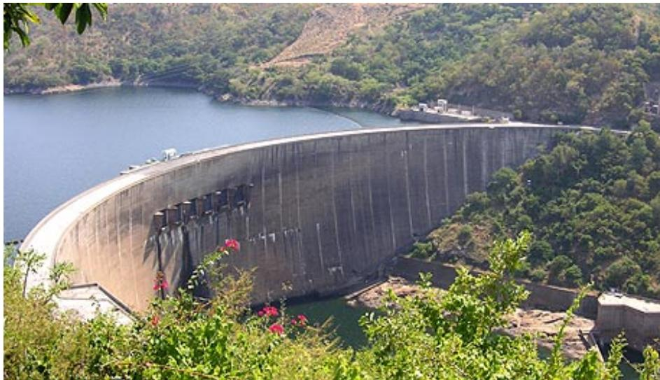
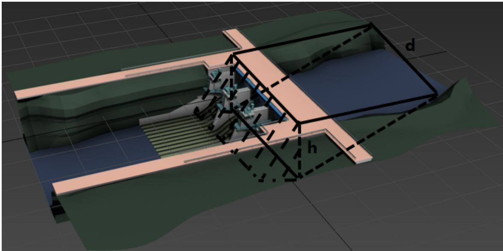
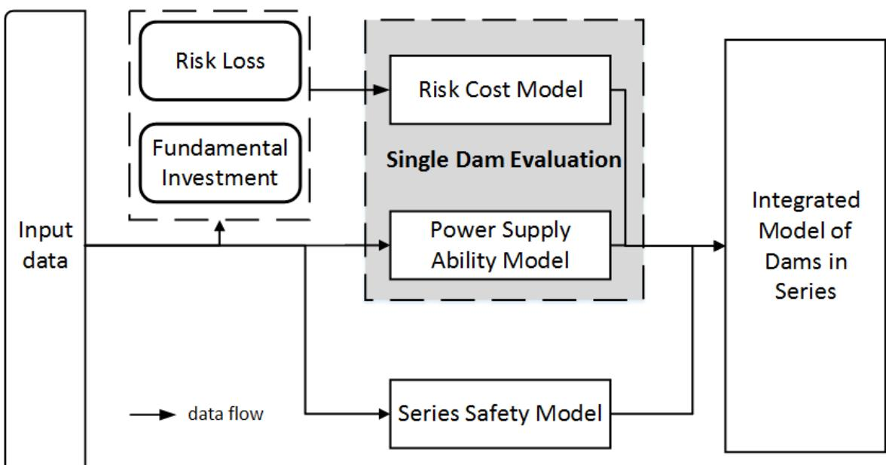
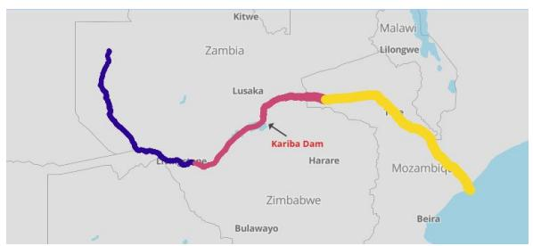
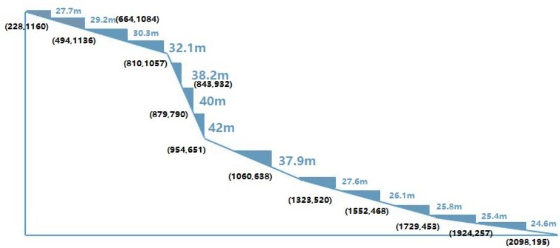

# 2017年美国大学生数学建模竞赛O奖论文：iMoDs——卡里巴大坝的处理方案

原件为竞赛论文。补充：文中的阅读练习及“参考解答”为整理时增加，原件图文保留出处。

本资料整理自2017年MCM/ICM O奖论文《iMoDs: A Treatment to the Kariba Dam》的第1至4页内容，包括摘要、目录、引言及背景介绍。原文为英文，此处保留原文结构并修正识别错误。

## 一、摘要 (Summary)

### 选择 1

**摘要内容：**

位于赞比西河上的卡里巴大坝（Kariba Dam）蓄积了世界上最大的水库。经过多年努力尽管试图减缓其结构性问题，但卡里巴大坝仍处于巨大危险之中。

为解决这一局势，我们的论文详细分析了其中一种方案：拆除卡里巴大坝，并在河流沿线用十到二十座较小的水坝取而代之。我们提出了一个模型 iMoDS（Integrated Model of Dams in Series，串联水坝集成模型），以全面分析新水坝的数量、位置和高度等不同方面。同时，我们将总的水管理能力设定为与现有大坝相同，从而为卡里巴湖提供保护和水利管理选项。

我们首先使用曼宁公式（Manning formula）分析水流，这有助于我们分析单个水坝。随后，我们在3ds MAX中模拟现实生活中的水坝，展示简化后的水坝模型，并推导其储水能力和建设成本。

iMoDS 模型由三个主要子模型组成：风险成本模型（Risk Cost Model）、供电能力模型（Power Supply Ability Model）和串联安全模型（Series Safety Model）。为了解释说明，有一张图连接了所有相关部分。

- **风险成本模型**针对每一个单独的水坝。它实施风险分析，使用可接受的风险比率 $P$。因此，它可以在成本和安全性之间取得良好的平衡。
- **供电能力模型**也针对每一个单独的水坝，它们的总和衡量了我们的水坝系统可以产生的效益。
- **串联安全模型**基于沿河流的理想水坝分布，衡量整个系统的安全性。

然后，我们使用层次分析法（AHP）分析这三个子模型并提出 iMoDS。

为了获得足够的数据，我们调查了文献和其他来源。利用遗传算法确定数量 and 位置，我们进一步求解每个水坝的高度。

论文的另一个部分讨论了应对几种情况的策略，包括安全性与成本的平衡、对卡里巴湖的保护、紧急情况下水流的指导以及极端水流的指导。

最后，我们进行了敏感性分析并讨论了优缺点。

**关键词：** dam series; water flow; risk analysis; integrated model; dam control strategy

更多数学建模资料请关注微店店铺“数学建模学习交流” https://k.weidian.com/RHO6PSpA

## 二、标题页信息

### 选择 1

**论文标题：** iMoDs: A Treatment to the Kariba Dam
**日期：** January 23, 2017
**团队编号：** 55280
**页码：** Page 1 of 25

## 三、目录 (Contents)

### 选择 1

1. Introduction
    1.1 Problem Background
    1.2 Our Work
2. Assumptions
3. Nomenclature
4. Statement of our Model
    4.1 Behavior of Water Flow
    4.2 Analysis of A Single Dam
    4.3 iMoDS: Integrated Model of Dams in Series
        4.3.1 Prerequisites
        4.3.2 Risk Cost Model
        4.3.3 Series Safety Model
        4.3.4 Power Supply Ability Model
        4.3.5 Integration
        4.3.6 Ranking Submodels with AHP
5. Implementation
    5.1 Data
    5.2 Number and placement of the new dams
        5.2.1 Whole Procedures
        5.2.2 Determining the number and placement by genetic algorithm
        5.2.3 Determining the height of each dam
6. Strategies
    6.1 A Balance Between Safety and Costs
    6.2 Protection for Lake Kariba
    6.3 Guidance for Emergency Water Flow Situations
    6.4 Guidance for Extreme Water Flows
7. Model Analysis
    7.1 Sensitivity Analysis
        7.1.1 Impact of Planned Working Years $N$ for a Dam
        7.1.2 Impact of Extreme Condition ratio $\alpha$
    7.2 Strengths and Weaknesses
        7.2.1 Strengths
        7.2.2 Weaknesses
8. Conclusion
Brief Assessment Report
    Option 1: Repairing the existing Kariba Dam
    Option 2: Rebuilding the existing Kariba Dam
    Option 3: Removing the Kariba Dam and replacing it with a series of ten to twenty smaller dams along the Zambezi River
Appendices
    Appendix A Implemented Genetic Algorithm
    Appendix B Fitness Function

## 四、引言 (Introduction)

### 1.1 问题背景 (Problem Background)

五十多年前，在津巴布韦和赞比亚边境的赞比西河上诞生了一个巨人。它为两国提供了大量的水电。世界上最大的水库是由它蓄积的。这个巨人被命名为卡里巴大坝（Kariba Dam）。

卡里巴大坝是一座双曲率混凝土拱坝，高 128 米（420 英尺），长 579 米（1,900 英尺）。设计有六个泄洪闸门，泄洪能力为 $9500 m^3/s$。总库容或总体水资源管理能力高达 $180.6 km^3$ [1]。

卡里巴最初被设计为一个单一目的的水电项目，但事实证明渔业和旅游业也成为重要的收益 [1]。自建成以来，这座大坝对于游客来说更像是一个地标，而不是实际的水坝。该区域为他们提供了水上运动和充足的野生动物资源。更不用说卡里巴的水帮助发展了农业和渔业工业。凡事都有两面性。尽管有这些经济效益，还有其他巨大的环境影响，如人口迁移和重新安置，以及淹没的植被 [2]。

然而，如此伟大的建筑正处于巨大危险中，急需维护。卡里巴受到严重干旱的威胁，这使得水库体积降低到容量的百分之十二。使情况变得更加复杂的是，如果我们重新填充水库，大坝很可能崩溃。由于意外的洪水 and 气候变化，大坝似乎非常危险。

### 1.2 我们的工作 (Our Work)

为解决这一局势，我们有三种不同的选择：修复、重建，或者拆除现有的卡里巴大坝，并在赞比西河沿线用十到二十座较小的

Team # 55280

Page 3 of 25

# 2017年美国大学生数学建模竞赛O奖论文：iMoDs——卡里巴大坝的处理方案（第2部分）

本资料整理自2017年MCM/ICM O奖论文《iMoDs》的第2至第4页内容，主要涵盖模型假设、符号说明及水流行为与单坝分析。

## 二、假设

### 假设 1

在建模阶段，我们不考虑河流上的极端条件，如瀑布、断流季节等。因为这些条件需要极其庞大的数据支持，且在现实生活中，大坝有动态策略来处理这些情况。我们将在另一节中讨论紧急水流情况。

### 假设 2

忽略其他现有大坝。它们不如卡里巴大坝大。关于河流上其他大坝的数据很少可获取，特别是它们对河流径流和水力坡度线坡度的影响。这个假设是灵活的，因为它只影响河流的输入数据，而不影响我们的模型。

### 假设 3

我们将水流简化为明渠流。明渠流具有自由表面。基于此假设，我们能够估算河流水流的平均速度。

## 三、符号说明

本文使用表1中的符号来描述我们的模型。其他仅使用一次的符号将在后面描述。

### 表 1：符号说明

| Symbol | Definition |
| :--- | :--- |
| $i$ | 一系列小大坝中的第 $i$ 个大坝 |
| $X_i$ | 从河流起点到大坝 $i$ 的距离 |
| $\text{Series}(X)$ | 一系列大坝下的安全评估值 |
| $\text{Supply}(X_i)$ | 大坝 $i$ 处的供电能力值 |
| $\text{Risk}(X_i)$ | 大坝 $i$ 的风险成本 |
| $P_f$ | 可接受的风险比率 |
| $Q(X_i;t)$ | 时间 $t$ 时大坝 $i$ 的体积流量 |
| $k(X_i)$ | 大坝 $i$ 处水力坡度线的斜率 |
| $N$ | 大坝的计划使用年限 |
| $n$ | 小大坝的数量 |
| $M$ | 总体水资源管理 |
| $L$ | 赞比西河的长度 |
| $d$ | 赞比西河的宽度 |
| $\alpha$ | 极端条件比率 |
| $h(X_i)$ | 大坝 $i$ 的高度 |

## 四、模型陈述

在本节中，我们将讨论我们模型的细节。该模型考虑了多个领域，从液体流动理论到经济学。首先，我们研究水流的行为。然后，我们提供串联大坝的综合模型。该模型在安全性和成本之间取得了很好的平衡。

### 4.1 水流行为

在我们的模型中，我们需要计算每个大坝的供电能力。其中一个关键变量是水到达大坝时的平均流速。我们假设赞比西河的水流是渠道流。因此，我们可以使用经验公式——曼宁公式（Manning formula）来估算这一速度 [3]。

$$
v = \frac {k}{n} R _ {h} ^ {2 / 3} S ^ {1 / 2}\tag{1}
$$

其中：

- $v$ 是断面平均流速；
- $n$ 是盖克勒-曼宁系数（Gauckler-Manning coefficient）；
- $R_h$ 是水力半径 $(L; ft, m)$；
- $S$ 是水力坡度线的斜率或线性水力头损失 $(L/L)$；
- $k$ 是 SI 单位和英制单位之间的转换因子。

该公式可以通过量纲分析获得。利用该公式，很容易发现当水流到达大坝时，其平均速度仅取决于渠道坡度 $S$ 和水力半径 $R_h$。

### 4.2 单个大坝的分析

图2是大坝在实际生活中的模拟。我们根据此模型确定水库的蓄水量。在文献中，锥体法（Cone method）[4] 是一种常用方法。其公式为：

$$
C A (X _ {i}) = \sum_ {i = 0} ^ {n} \frac {1}{3} (A _ {i} + A _ {i + 1} + \sqrt {A _ {i} \times A _ {i + 1}}) \times \triangle L _ {i}
$$

其中：

- $V$ 是水库容量；
- $A_i$ 是第 $i$ 个横截面的面积；
- $\triangle L_i$ 是第 $i$ 个和第 $i+1$ 个横截面之间的间隙。

为了简化，我们进一步考虑水库的面积由图2中黑色填充的等高线包围的区域组成。我们用参数 $d$ 表示河流的宽度。因此，我们推导出容量公式：

$$
\begin{array}{r l} C A (X _ {i}) & = \frac {1}{3} (\frac {1}{2} d \times h + d \times h) \times \frac {h (X _ {i})}{k (X _ {i})} \\ & = \frac {h (X _ {i}) ^ {2}}{3 k (X _ {i})} (\frac {3}{2} d) \\ & = \frac {h (X _ {i}) ^ {2} d}{2 k (X _ {i})} \end{array}\tag{2}
$$

另一个关键的测量指标是大坝的建设成本。

一个基本函数包含两部分：建设成本和不可避免的其他成本。建设成本与大坝的体积成正比。要计算这个体积，我们需要底宽。实际上，它与压力 $P_a = \rho g h$ [5] 成正比。

注意，这里我们计算的是大坝的体积，而不是由公式(2)计算的水库体积。

最后，将其他成本简化为常数 $\beta$ 是合理的，因为每一个建设...

## 4.2 成本模型（续）

工程工作有其初始成本，且压应力 $\sigma$ 存在安全系数 [5]。

$$
\begin{array}{r}
\operatorname{Cost}(X_i) = \lambda \dfrac{\rho g h(X_i) \times d \times h(X_i)}{2\sigma} + \beta \\
= \lambda \dfrac{\rho g d\, h(X_i)^2}{2\sigma} + \beta
\end{array} \tag{3}
$$

其中 $\lambda$ 为体积-费用系数。

## 4.3 iMoDS：串联水坝综合模型

在研究了水到达水坝时的行为以及单个水坝之后，我们进一步提出了串联水坝的综合模型。该模型由三个主要部分组成：风险成本模型、供电能力模型和串联安全模型。如图 3 所示，我们的模型作为一个整体机器运行，既评估单个水坝，也评估整个水坝群。基本上，我们可以把它视为一种非线性规划方法。三个主要部分作为来自不同领域的三个特征，并根据它们对整体系统的贡献被赋予不同的权重。

### 4.3.1 前提条件

1. $Q(X_i; t)$

$Q(X_i; t)$ 的值为第 $i$ 个水坝在时刻 $t$ 的体积流量。在建模阶段，为简化起见，我们用 $Q(X_i; \bar{t})$ 代替 $Q(X_i; t)$，表示年平均体积流量。在本文中，$d$ 保持不变，因此上游的体积流量大于下游的体积流量。

稍后我们将进一步讨论，并为从最大预期流量到最小预期流量的极端水流提供具体指导。

2. $k(X_i) = \left. \dfrac{\mathrm{d}\, \mathrm{Elevation}(x)}{\mathrm{d}x} \right|_{x=X_i}$

每个水坝的位置由距河流起点的距离 $X_i$ 描述。我们将第 $i$ 个水坝处的水力坡度线斜率设为 $k(X_i)$ 的值。

关于 $k(X_i)$ 的更多细节将在 5.1 节讨论。

### 4.3.2 风险成本模型

如图 3 所示，风险损失和基础投资决定风险成本模型的输出。建造水坝时，有两个关键因素需要牢记：成本和安全。然而，在我们试图在两者之间找到平衡之前，必须将其转化为数学问题。这里我们基于风险分析将它们结合起来，风险分析是经济学中广泛使用的理论。基于该理论，我们在可接受风险比下数值确定安全损失和基础成本。因为可接受风险比衡量的是一个人关注安全而非仅仅关注成本的程度。

成本——基础投资成本揭示了水坝项目的可行性。投资者总是希望在保持相同水管理能力的同时花更少的钱。一个基本事实是，投资者在更加关注安全的同时必须花更多的钱。因此，$P_f$ 与成本负相关，其指数由实验设定。对式 3 稍作修改，即得到这里所需的方程：

$$
\text{基础投资} = \frac{\operatorname{Cost}(X_i)}{P_f^{1.1}} \tag{4}
$$

给定 $P_f$，式 4 可以衡量单个水坝的基础投资。

安全——风险损失揭示了水坝项目的环境友好程度。对安全关注较少的项目将导致较高的溃坝可能性，我们称之为风险损失。式 5 是评估模型。$[1 - (1 - P_f)^N]$ 是衡量溃坝可能性的概率分布。因此，我们将第 $i$ 个水坝处的损失定义为：

溃坝概率 × (1 + 间接损失指数) × 体积流量

$$
\mathrm{RiskLoss} = [1 - (1 - P_f)^N]\, \alpha (1 + \lambda)\, Q(X_i; \bar{t}) \tag{5}
$$

其中 $\alpha$ 是反映河流遭受极端条件的可能性及严重程度的系数。

该方法有助于基于风险的水坝安全评估方法的发展。

$$
\operatorname{Risk}(X_i) = \text{风险损失} + \text{基础投资}
$$

图 4 显示了 $P_f$ 与风险值的函数关系。不同颜色的曲线表示不同的 $\alpha$ 值。从上到下，$\alpha$ 每次递减 0.05。

观察 1：对每条曲线而言，左侧严格递减，右侧递增。

说明：风险值不是单调函数，因为风险损失是 $P_f$ 的单调递增函数，而基础投资是 $P_f$ 的单调递减函数。

观察 2：比较不同曲线，$\alpha$ 越大，风险成本越高，且极值点左移。

说明：如果系数 $\alpha$ 较大，则表明在相同的 $P_f$ 下，政府必须处理更高的潜在损失。因此，为平衡基础成本与安全，政府将选择较低的 $P_f$。这正是我们的函数所揭示的。

### 4.3.3 串联安全模型

我们的系统拆除卡里巴大坝，并用 10 到 20 座较小的水坝组成的水坝群取而代之。在该模型中，我们的目标是评估沿河的一系列水坝并给出评分。研究表明，如果水坝均匀地建在河流上，则该水坝系统运行所产生的效益大于运行单个大型水坝。

为了基于位置量化安全性，我们考虑两个因素：一是相邻两座水坝之间的平均距离，二是分布的均匀程度。这里我们引入并修改皮尔逊卡方检验来表示它。分布越均匀，我们认为系统越安全。因此，我们得到以下公式：

$$
\mathrm{Series}(X) = \frac{\overline{d}}{e^{\sum_{i=1}^{n-1} \frac{(d_i - \overline{d})^2}{\overline{d}^2}}} \tag{6}
$$

其中 $\overline{d}$ 是相邻两座水坝之间的平均距离。

## 4.3.4 Power Supply Ability Model

Kariba was designed as a single-purpose hydropower project. Embarking on any hydropower generation project, it is essential to calculate its amount of hydropower. In our model, the last part is to estimate this kind of economic benefits. If we sum up the power supply of each dam, this model can numerically calculate our new system’s hydropower supply. Based on the hydropower equation [6], intuitively we get Equation.7 which is a function of the hydraulic head and rate of fluid flow.

How much work a unit of water can do depends on its weight times the head. And the power available from a dam can be measured by the density of water, acceleration due to gravity, the flow rate, and the height of fall.

$$
Supply(X_{i}) = \eta \rho g h(X_{i}) Q(X_{i}; \bar{t})\tag{7}
$$

where:

- $\eta$ is the dimensionless efficiency of the turbine;
- $\rho$ is the density of water in kilograms per cubic metre;
- $g$ is the acceleration due to gravity.

### 4.3.5 Integration

Based on previous illustrations, we are able to integrate all these features together.

- **Series($X$)** Positively related to the safety level. The higher $Series(X)$’s score is, the better our system is.
- **Risk($X_i$)** There is an equilibrium between investment and loss which reaches the lower bound of this model. We always want to save money while ensuring safety. So, the lower $Risk(X_i)$’s score is, the better our system is.
- **Supply($X_i$)** Positively related to power supply. The higher $Supply(X_i)$’s score is, the better our system is.

To make all features equal, we need feature scaling, or data normalization, because these features all have a broad range of values. If we don’t process their value, the result of our integrated model may be governed by one of them. In our model, we implement rescaling method. This method rescale the range of features to scale the range in [0, 1]. The general formula is like this:

$$
x^{\prime} = \frac{x - \min(x)}{\max(x) - \min(x)}
$$

where:

- $x$ is an original value;
- $x^{\prime}$ is the normalized value.

After rescaling, normalized $Series(X_i)$, $Risk(X_i)$, and $Supply(X_i)$ is $Series(X_i)^{\prime}$, $Risk(X_i)^{\prime}$, and $Supply(X_i)^{\prime}$ respectively. As we can see, $Risk(X_i)$ is negatively related. Thus we modify it to be positively related by a modified rescaling method.

$$
Series(X)^{\prime} = Series(X) \times \frac{n - 1}{L}
$$

$$
Risk(X_{i})^{\prime} = \min(Risk(X_{i})) / Risk(X_{i})
$$

$$
Supply(X)^{\prime} = Supply(X) \times \frac{n - 1}{L}
$$

In our model, the goal is to minimize the Final Value. Thus, we scale $Supply(X_i)$ and $Series(X)$ into $[-1, 0]$. Write our model into a nonlinear programming form then we get the Integrated Model of Dams in Series:

$$
\begin{array}{l l} \text {max} & \text {Final Value} = Series(X)^{\prime} + \sum_ {i = 1} ^ {n} Risk(X _ {i})^{\prime} + \sum_ {i = 1} ^ {n} Supply(X _ {i})^{\prime} \\ \text {s.t} & X _ {i} \leq L, \qquad \forall X _ {i} \in [ 1, n ] \\ & \sum_ {i = 1} ^ {n} C A (X _ {i}) \geq M \\ & 1 0 \leq n \leq 2 0, \qquad n \in \mathbb {Z} \\ & X _ {i} \geq 0, \qquad \forall X _ {i} \in [ 1, n ] \end{array}
$$

where:

$$
\begin{array}{l} \text {Final Value} = Series(X)^{\prime} + \sum_ {i = 1} ^ {n} Risk(X _ {i})^{\prime} + \sum_ {i = 1} ^ {n} Supply(X _ {i})^{\prime} \\ \qquad = \frac {\overline {{d}}}{e ^ {\sum_ {i = 1} ^ {n - 1} \frac {(d _ {i} - \overline {{d}}) ^ {2}}{\overline {{d}} ^ {2}}}} \times \frac {n - 1}{L} + \sum_ {i = 1} ^ {n} \min (Risk(X _ {i})) / \{\frac {Cost(X _ {i})}{P _ {f} ^ {1 , 1}} + \\ \qquad [ 1 - (1 - P _ {f}) ^ {N} ] \alpha (1 + \lambda) Q (X _ {i}; \bar {t}) \} + \sum_ {i = 1} ^ {n} \rho g \eta L k (X _ {i}) Q (X _ {i}; \bar {t}) \end{array}
$$

### 4.3.6 Ranking Submodels with AHP

The analytic hierarchy process (AHP) is a structured technique for organizing and analyzing complex decisions, based on mathematics and psychology. Our goal is to rank previous three submodels and assign weights to iMoDS model.

**Table 2: AHP production**

| Feature | Weight |
| :--- | :--- |
| Risk Cost | 0.5403 |
| Series Safety | 0.3478 |
| Power Supply Ability | 0.1119 |

Table.2 shows the result of AHP. We then assign them to the model derived in Section.4.3.5:

$$
\begin{array}{r l} \max & \text {Final Value} = 0. 3 5 Series(X)^{\prime} + 0. 5 4 \sum_ {i = 1} ^ {n} Risk(X _ {i})^{\prime} + 0. 1 1 \sum_ {i = 1} ^ {n} Supply(X _ {i})^{\prime} \\ \mathbf {s . t} & X _ {i} \leq L, \quad \forall X _ {i} \in [ 1, n ] \\ & \sum_ {i = 1} ^ {n} C A (X _ {i}) \geq M \\ & 1 0 \leq n \leq 2 0, \quad n \in \mathbb {Z} \\ & X _ {i} \geq 0, \quad \forall X _ {i} \in [ 1, n ] \end{array}
$$

## 5 Implementation

### 5.1 Data

We tried to find some existing dataset about dams, but failed. Thus, in this paper we ourselves analyzed many textual data and figures from reliable sources and experiment with them. Google Earth provide us with the elevation profile of the Zambezi River. We use Matlab to fit a curve which is shown in Figure.5. The set of blue spots is the raw data while the red curve represents the river’s elevation. This curve is fitted as an eighth-power polynomials.

$f(X_i)$ relies on these data.

Thanks for the basin analysis [7], we are able to analyze the river’s flow data. Figure.6(a) and Figure.6(b) show the Zambezi River mean annual river flow.

$Q ( X _ { i } ; \bar { t } )$ relies on these data.

# 2017年美国大学生数学建模竞赛O奖论文：iMoDs——卡里巴大坝的处理方案（第5部分）

## 一、新水坝的数量与位置确定

### 5.2 新水坝的数量与位置

#### 5.2.1 整体流程

1. 设定所有小型水坝具有相同的高度；
2. 使用启发式算法（如遗传算法）运行 iMoDS 模型；
3. 基于步骤2中找到的集合 $\{ X _ { i } \}$，利用公式(8)重置每个水坝的高度；
4. 通过公式(9)测试约束条件。如果不满足，调整 $\{X_i\}$ 并返回步骤3。

### 5.2.2 通过遗传算法确定数量与位置

水坝组的优化是高维、多层且非线性的。解决线性规划问题的经典算法无法找到全局最优解。然而，启发式算法可以解决这一优化问题。遗传算法（GA）基于模拟生物进化的自然选择过程，是其中一种方法。

在本节中，我们对水坝的数量和位置进行了分析，并提供了建议。然而，如果每个水坝的高度是动态的，这将是一个超过20维的问题。为了简化，我们假设每个小型水坝的大小相等。

由于这种简化，$h ( X _ { i } )$ 是一个常数。整个评估对变量 $\{ X i \} , P _ { f }$ 和 $n$ 敏感。为了找到最优解，我们使用遗传算法来模拟评估过程。代码列在附录中。

三个关键特征的权重已由层次分析法（AHP）提供。风险成本主导其他两个特征。为了最大化 $\frac { \operatorname* { m i n } { R i s k ( X _ { i } ) } } { R i s k ( X _ { i } ) }$ 并满足约束，总水量管理 $M$，算法将选择 $P _ { f }$ 到一个最优值，该值已在图4中介绍，即把水坝定位到相对平缓的斜坡上。虽然供电所占权重较小，但当水坝位于陡峭地形时，其价值会大幅增加。最后，串联（Series）更有可能使这些水坝均匀分布。考虑到这三个特征之间的相互作用，最终位置显示如图7所示。

图8显示，当 $n = 1 3$ 且 $P _ { f } = 0 . 0 0 2 4$ 时，评估达到峰值，即最优值。这对我们的模型来说是有说服力的。

这一结果是令人信服的。如果水坝数量 $n$ 增加，那么：

1. $\sum { \frac { \operatorname* { m i n } ( R i s k ( X _ { i } ) ) } { R i s k ( X _ { i } ) } }$ 减少。虽然每个水坝的高度较小，但初始成本总和 $\beta$ 增加。
2. $\sum S u p p l y ( X _ { i } )$ 先增加后减少。随着 $n$ 的增加，理想的水电供应量会更高。但是当 $n$ 变得很大时，串联（Series(X)）会限制它继续下降。
3. Series(X) 与 $n$ 的数量无关。

因此，在这个决策过程中，存在十到二十之间的平衡。我们发现它是 $\mathbf { n = 1 3 }$ 且 $\mathbf { P _ { f } } = \mathbf { 0 . 0 0 2 4 }$。

表3显示了该新水坝系统的最优结果。从水坝1到水坝13，我们推荐每个水坝的位置。注意，距离 $X _ { i }$ 表示从河流源头到水坝 $i$ 的距离。由于非线性规划的约束，总体水量管理能力与现有的卡里巴大坝相同。

| Order of Dam | Distance $X_i/m$ | Elevation/m |
| :--- | :--- | :--- |
| 1 | 288.3 | 1160.2 |
| 2 | 494.5 | 1136.3 |
| 3 | 664.4 | 1084.55 |
| 4 | 810.0 | 1057 |
| 5 | 843 | 932 |
| 6 | 879 | 790 |
| 7 | 954 | 651 |
| 8 | 1160 | 638 |
| 9 | 1323 | 520 |
| 10 | 1552 | 468 |
| 11 | 1729 | 453 |
| 12 | 1924 | 257 |
| 13 | 2098 | 195 |

### 5.2.3 确定每个水坝的高度

在这里，我们消除了每个小型水坝大小相等的假设。如果参考4.2节，水坝的高度确实是影响最终评估的关键因素，因为它影响了系统的风险成本和这些水坝总共能提供的电力。确定每个水坝的高度对于优化系统的最终值至关重要。给定 $P _ { f }$，单个水坝对整个系统（iMoDS模型）的贡献是一个单变量函数 $h ( X _ { i } )$。因此，我们可以忽略 Series $( X _ { i } )$。为了优化贡献，令导数方程为零：

$$
\begin{array}{r} S u p p l y (X _ {i}) ^ {\prime} - R i s k (X _ {i}) ^ {\prime} = 0 \\ \eta \rho g Q (X _ {i}; \bar {t}) - \lambda \frac {2 \rho g d h (X _ {i})}{2 \sigma P _ {f} ^ {1 . 1}} = 0 \\ h (X _ {i}) = \frac {\eta \sigma P _ {f} ^ {1 . 1}}{\lambda d} Q (X _ {i}; \bar {t}) \end{array}\tag{8}
$$

我们可以发现，随着 $Q ( X _ { i } ; \bar { t } )$ 的增加，最佳的 $h ( X _ { i } )$ 也会增加。然而，$h ( X _ { i } )$ 有一个约束条件。

$$
\sum_ {i = 1} ^ {n} C A (X _ {i}) = \sum_ {i = 1} ^ {n} \frac {h (X _ {i}) ^ {2} d}{2 k (X _ {i})} \geq M\tag{9}
$$

1. 如果我们的最优 $\{ X _ { i } \}$ 满足约束条件公式(9)，那么它就是最终结果。
2. 否则，我们可以稍微修改 $X _ { i }$ 以满足约束条件。

因此，iMoDS模型的最终值和每个水坝的高度都由 $\{ X _ { i } \}$ 决定。

图9是我们位置和数量的最终结果。

## 二、策略

### 6 策略

#### 6.1 安全与成本之间的平衡

我们的新多水坝系统是基于三个关键因素建模的：风险成本、供电量和串联安全性。风险成本充分考虑了可接受的风险比率 $P _ { f }$ 下的安全与成本之间的平衡。串联安全性进一步调查了水坝组的安全性。因此，我们的系统是平衡良好的。此外，我们还考虑了收益。

## 6.2 Protection for Lake Kariba

Now we take the ability of protecting Lake Kariba into consideration. In the former section, we degenerate this factor to the total volume of the reservoirs. However, we find it is reasonable to evaluate it with the relative distance between a reservoir and the lake. We finally determined to use a gentle Gaussian curve to give a weight of each dam.

$$
Protection = \sum_{i=1}^{n} CA(X_i) N(X_{Lake}, \sigma^2) \tag{10}
$$

where $X_{Lake}$ is the location of Lake Kariba, $\sigma$ is a fitting factor.

To as greatly as possible increase the total Protection to the River, we can build dams near the lake with more capacity, i.e., stronger ability of management of the water.

When it is the period of the dry season, the lower dams near Lake Kariba should start to reserve water and higher dams start to discharge water until this season passes. On the contrary, when it is the wet season, the behavior of dams near the lake are opposite to the former condition.

We also need to consider the ecosystem of the lake, so dams near the lake need to be designed carefully to minimize the damage to the environment.

## 6.3 Guidance for Emergency Water Flow Situations

Emergency water flow situation (i.e. flooding and prolonged low water conditions) can generate catastrophe. Flood water may wash away any cities downstream and cause considerable loss of life. Extreme low water conditions could destroy many fields of a country. To ensure the safety of our new dam system, we will provide the ZRA managers with specific guidance.

The aim of this guidance is prevent an uncontrolled release of water from reservoirs.

For flood control, our objective is to maintain as much control over flows entering the system above a critical flood-prone reach as possible. [8]

### Method: Filling the upper reservoirs first and emptying the lower reservoirs first

An illustration of this method has been studied [9]. Flood storage at the reservoir close to upstream provides greater flood control ability than the lower reservoirs.

However, an exception is that if the lower reservoir's outflow capacity is restricted, then it is better to fill the lower reservoir first to increase head on the outlet. In this way we can increase the release capacity from the entire system to the downstream channel capacity. This exception is prepared for some extremely serious floods.

For prolonged low water conditions, our objective is to maintain the river runoff.

### Method: Emptying the reservoirs from lower ones to higher ones

In this kind of periods, the river's natural runoff is considerably smaller than annual water runoff. We must take advantage of the dam system's capability of dynamic scheduling. In other words, we maintain the river's minimum runoff by compensative regulation. Empty the reservoirs downstream first can avoid people's water shortage while enabling reservoirs upstream to store water.

## 6.4 Guidance for Extreme Water Flows

In our previous analysis, we use $Q(X_i; \bar{t})$ to denote the annual water flow. However in real life, $Q(X_i; t)$ should be a function of time $t$. Along the Zambezi River there is a dry season and a wet season.

### 1. Dry Season

It is clear that the dam system need to discharge in dry season. First, we suppose that dry season lasts for time $T$. At the beginning of the dry season all reservoirs have reached their full capacities. Second, we introduce three parameters, $p$, $k$, and $m$. $p$ denotes the speed of discharging. $k$ denotes the rate of lost water because of evaporation and washing away. $m$ is the amount of remaining water. The problem is then simplified as an expression of discharging all reserved water during the dry season with some speed.

$$
\frac{\mathrm{d}m}{\mathrm{d}t} = -p - km
$$

Solve this function, we get:

$$
m = \frac{c e^{-kt} - p}{k}
$$

$$
\mathrm{Let}\ m(0) = M,\ m(T) = 0
$$

$$
\mathrm{Then}\ p = \frac{Mk e^{-kT}}{1 - e^{-kT}}
$$

Now we qualitatively analyze this discharging speed. Because the water in the upper reservoirs is shared by all the terrain along the river. On the contrary, the water of the reservoirs downstream is only used by relatively small terrain. It is reasonable that in the dry season, the reservoirs upstream have a larger speed than those downstream. And the average speed of the whole system is $p$.

### 2. Wet Season

It has a high rainfall in wet season, so we need to charge reservoirs to avoid great increment of the level of riverway and prepare for the next dry season. We can assume that rainfall is uniformly distributed along the whole river. The upper reservoirs must start to store water first. Because if a reservoir downstream first to start storing water, $Q(X_i; t)$ will be too large and leads to great risk and waste of water.

## 7 Model Analysis

## 7.1 Sensitivity Analysis

Our iMoDS model contains several parameters. We determine some of the parameters through least square fitting, some of them by knowledge in the literature, and other methods. In this section, we would like to produce a sensitivity analysis to show whether our model is sensitive to different values of parameters.

We will study the impact of two important parameters in our model.

### 7.1.1 Impact of Planned Working Years N for a Dam

N is set to be 50 and not changed ever since. In the literature, a dam over 50 years old is defined to be dangerous. The Kariba Dam is one of them. We vary this value from 50 to 100 by 10. Figure.10 proves that the trends of Risk Loss remains to be the same. Therefore, we come to the conclusion that our model is not sensitive to N.

### 7.1.2 Impact of Extreme Condition ratio α

Figure.4 shows the sensitivity analysis of α. To avoid repetition, we don't illustrate it here again.

## 7.2 Strengths and Weaknesses

### 7.2.1 Strengths

1. Use accurate data of the Zambezi River. From the very beginning of our analysis, we emphasize on mining useful data. Only with these dependable data, we can conclude that the model we built is appropriate.
2. Design a novel and innovative evaluation rules of dam construction. We used methods across disciplines to give an integrated evaluation function of dams. AHP and GA are leveraged in our simulation which can provide reliable results of the model.
3. Use fancy visualization to display our model.

### 7.2.2 Weaknesses

1. Heuristic algorithm has randomness. Because of the high dimensional constraint, we used GA as our simulation algorithm. We cannot always get the optimal results for the sites selection
2. Some real water conditions are omitted. We simplified the river as an open channel. However, the real condition is much more complex. It will also influence the construction cost and safety evaluation.
3. Lacking details of the trade-off function. We paid an emphasis on the balance between cost and safety. Though we have added power supply to our model, it still lacks other benefits of dam construction.

## 8 Conclusion

Our papaer provides a detailed analysis of removing the Kariba Dam and replacing it with a series of ten to twenty smaller dams along the river. Before introducing the model, we analyze water flow and a single dam. Then our model iMoDS is proposed. It takes safety, cost, and benefits into consideration and makes a balance of them. Three submodels, Risk Cost Model, Power Supply Ability Model, and Series Safety Model, form the integrated model.

We use real data to give a recommendation as to the number, placement, and height of the new dams. For this is a high dimensional problem, we implement GA to find a global optimum result.

Strategies are fully discussed. Balance between safety and costs have been inlcuded in the integrated model. Protection for Lake Kariba uses Gaussian curve to give a weight of each dam. And two guidances include specific instructions of the dam group when facing these conditions.

Team # 55280

Page 20 of 25

## Brief Assessment Report

The Kariba Dam, which was opened in 1959 and held back the world’s largest reservoir, has been working for over 50 years and faces the possibility of callapse. Also serving as a major supply of Zambia and nearby contries’ electricity, it is in dire need of maintenance. To deal with this situation, there are three major options available to the Zambezi River Authority (ZRA). For each option, we will access its potential cost nemurically and provide other aspects of information.

In the literature, the rate of failure for dams has been studied. With Bayesian analysis approach, researchers [10] evaluated the dam failure rate uncertainty. They found universal failure rate to be steady and got the value of $3 \times 10^{-4}$. However, we investigate the whole life cycle of a dam. Its failure rate [11] should be a function of time $t$, denoted as FR(T)

$$
FR(T) = \begin{cases} 
3 \times 10^{-4} & \text{if } 0 \leq T < 50 \text{ years} \\ 
1 - e^{-(\frac{T + 143.67}{100})^3} & \text{if } T \geq 50 \text{ years} 
\end{cases}\tag{11}
$$

Figure.11 shows a dam’s failure rate with the change of years.

### Option 1: Repairing the existing Kariba Dam

Once mechanized systems supplant natural ones, they must be managed in perpetuity, or else they break down [12]. In the past fifties years, the torrents has been consistantly eroding the dam’s structure. The first option is to repair this existing giant.

**Potential Cost** One report [13] said that expected cost will be \$294 million this time. However, repair can handle current situation but never eliminate the potential danger. Thus, we explore an expectation of future failure rate by modifying Equation.11

$$
FR_{repair}(t) = 1 - e^{-(\frac{t + 143.67}{100})^3},\tag{12}
$$

where $t$ = how many years have passed since last repair.

Thus, given a specific year $Y$ and annual cost of repair $C$, the potential costs will be:

$$
294 + C \times \int_0^{Y-2017} FR_{repair}(t) \mathrm{d} t\tag{13}
$$

Team # 55280

Page 21 of 25

**Benefits** Repair significantly saves the construction period. It doesn’t affect hydro power supply which is generated from the reservior.

**Shortcomings** Potential danger to collapse. High repair rate with high cost each time.

### Option 2: Rebuilding the existing Kariba Dam

**Potential Cost** Rebuilding such a giant dam is extremely expensive. According to Kariba Dam - Case Study [1], the project was built in two stages. The total cost of two stages amounted to \$1.8 billion. To know how much it will cost now, we estimate it with The Consumer Price Index(CPI) [14]. CPI for the 1950’s was 27.2 while current CPI is about 241.4. Thus, the total cost of rebuilding is about $241.4 / 27.2 \times \$1.8 = \$915.975$ billion.

Also we calculate future cost: given a specific year $Y$ and annual cost of repair $C$, the potential costs will be:

$$
7440 + C \times \int_0^{Y-2017} FR(t) \mathrm{d} t\tag{14}
$$

**Benefits** No severe potential danger any more. No need to repair very often.

**Shortcomings** A long period of time under construction. Lack of a Dam, affecting hydro power supply, and protection for Lake Kariba.

### Option 3: Removing the Kariba Dam and replacing it with a series of ten to twenty smaller dams along the Zambezi River

**Potential Costs** The construction cost can be described as:

$$
\text{Construction cost} = k \times \text{capacity} + \text{basic cost}
$$

Considering that the total capacity of these small dams is equal to the capacity of Kariba Dam, the construction cost of Option 3 is close to n times of basic cost plus the cost of Option 2, where n is the number of these small dams. Here we suppose that the basic cost is 10% of the total construction cost and the cost of removing Kariba Dam is about 15% of the total construction cost, thus, the total construction cost is about $\$15.975 \times (1 + 10\% \times n + 15\%) = \$34.363$ to $\$50.321$ billion.

Let $n = 13$, the cost of the solution we give in our model is about $\$39.139$ billion.

**Benefits** Strengthen the ability to handle emergency water flow, protect Lake Kariba, and adjust water flow between seasons.

**Shortcomings** It costs most in these 3 options, and it brings in new problems of coordinating and control in a dam system.

Team # 55280

Page 22 of 25

## 参考文献

[1] “Kariba dam-case study,” World Commission on Dams, 2010. [Online]. Available: http://202.120.0.1/cache/1/03/nanjing-school.com/897d9a2a02069bb2075b729dd8c33afb/World_Commission_on_Dams_2000_Case_Study_Kariba_Dam_Final_Report_November_2000-2etc5lv.pdf

[2] “Kariba dam,” Wikipedia. [Online]. Available: https://en.wikipedia.org/wiki/Kariba_Dam

[3] “Manning formula,” Wikipedia. [Online]. Available: https://en.wikipedia.org/wiki/Manning_formula

[4] “Determination of reservoir storage capacity,” Education. [Online]. Available: http://www.slideshare.net/chingtonymbuma/determination-of-reservoir-storage-capacity

[5] Z. W.-y. YANG Qiang, WU Hao, “Stress evaluation in finite element analysis of dams,” Engineering Mechanics(In Chinese), vol. 23(1), pp. 69–73, 2006.

[6] “Hydropower,” Wikipedia. [Online]. Available: https://en.wikipedia.org/wiki/Hydropower

[7] “The zambezi river basin : A multi-sector investment opportunities analysis - basin development scenarios,” World Bank, 2010. [Online]. Available: https://openknowledge.worldbank.org/handle/10986/2959

[8] J. G. Jay R. Lund, “Some derived operating rules for reservoirs in series or in parallel,” Journal of Water Resources Planning and Management, vol. 125(3), pp. 143–153, 1999.

[9] J.Kelman and J.P.DAMAZIO, “The determination of flood control volumes in a multireservoir system,” Journal of Water Resources Planning and Management, vol. 25(3), pp. 337–344, 1989.

[10] J. Vail, F. Ferrante, and J. Mitman, “Generic failure rate evaluation for jocassee dam,” UNITED STATES NUCLEAR REGULATORY COMMISSION, 2010. [Online]. Available: https://www.nrc.gov/docs/ML1303/ML13039A084.pdf

[11] “Bathtub curve,” Wikipedia. [Online]. Available: https://en.wikipedia.org/wiki/Bathtub_curve

[12] J. Leslie, “One of africa’s biggest dams is falling apart,” The New Yorker, 2016. [Online]. Available: http://www.newyorker.com/tech/elements/one-of-africas-biggest-dams-is-falling-apart

[13] “Zambia, zimbabwe to start kariba dam repairs in early 2017,” REUTERS AFRICA, 2016. [Online]. Available: http://af.reuters.com/article/zambiaNews/idAFL5N17T1OI

[14] N. G. Mankiw, Principles ofmacroeconomics. Cengage Learning, 2014.

## 附录

### 附录 A 实现的遗传算法

### 附录 B 适应度函数

$$
\begin{array}{l}
\text{for j = 1:n - 1} \\
\text{cc = cc + ((x(n) - x(1)) / (n - 1) - (x(j + 1) - x(j)))^{2}}; \\
\text{end} \\
\text{Sa = ((x(n) - x(1)) / \exp(cc / ((x(n) - x(1)) / (n - 1))^{2})) / 2100} \\
\text{eval = p1*wei(1) + Sa*wei(3) + p2*wei(2)} \\
\text{end}
\end{array}
$$
