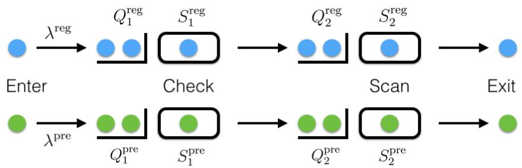
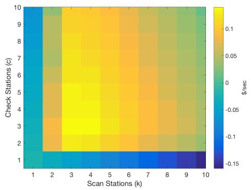

# 2017年美国大学生数学建模竞赛O奖论文：减少机场安检等待时间（Team 56632）

原件经识别和整理；“参考解答”是我们补的。

---
title: 2017年美国大学生数学建模竞赛O奖论文：减少机场安检等待时间（Team 56632）
kind: 课件
course: 数学建模
term: 2017
source: Team 56632, 2017 MCM/ICM O Prize Paper
---

# 2017年美国大学生数学建模竞赛O奖论文：减少机场安检等待时间（Team 56632）

本文档整理自2017年美国大学生数学建模竞赛（MCM/ICM）O奖获奖团队56632的论文《Reducing Wait Times at Airport Security》第1-3页内容，包含摘要表、标题页、摘要及目录。

## Summary Sheet

### 2017 MCM/ICM

**Problem Chosen:** D

**Summary:**

Passengers arrive at TSA security screening at seemingly random times, and the uncertainty in their arrival along with TSA inefficiencies can cause abnormally long and varying wait times. A major problem the agency must confront is the improvement of passenger throughput while maintaining a strict standard of security. Our solution consists of four main parts: a queuing model describing the security screening, a method of simulation for theory verification and experimentation, the application of these results to cost-benefit analysis, and modifications to the model to account for different traveler characteristics.

We decided that a reasonable measure for TSA inefficiency was the average time a passenger spent waiting in line. The queuing model was formulated by expressing the relationship between wait times in the queue recursively. We used kernel density estimation and exponential fitting to estimate distributions on the random variables involved in the model. We obtained explicit expressions for passenger wait times, which we used to reason about the system behavior as the number of passengers and arrival rates varied.

Using the above framework we developed a method for simulation that used dynamic programming to sample arrival times of passengers within the security system. The simulation numerically verified the results of the theory and allowed for further experimentation with varying parameters. The results of these experiments gave us insights on where the TSA procedure could be optimized and the passenger experience improved.

We applied cost-benefit analysis to the efficiency-cost tradeoff that TSA must consider when staffing employees and screening passengers. We found an optimal allocation of resources that maximized profit rate by plotting a profit objective function against the different configurations of TSA employees.

Finally, we considered distinctions between travelers and how they might affect the activity in the queuing system and each other’s wait times as a result. We investigated alternative methods to order passengers in queue and found that this approach was not as successful as we expected.

Using a diverse array of techniques, we were able to successfully model the flow of passengers through airport security, identify bottlenecks in the screening process, and suggest improvements to the current procedure. As our world becomes more interconnected and airline activity increases, TSA will have to confront the issue of passenger throughput inefficiency. The use of mathematical models will undoubtedly become an invaluable tool in optimizing efficiency while maintaining passenger safety.

## Reducing Wait Times at Airport Security

**Team 56632**
January 24, 2017

### Abstract

In this report, we develop and employ a queuing model for lines and servicing at TSA security in order to identify bottlenecks in the procedure and suggest improvements. We model the influx of passengers as a Poisson process, allowing us to sample from an exponential distribution to simulate inter-arrival times. To find probabilistic distributions on the service time spent in security stations, we take a nonparametric approach, using kernel density estimation to obtain probability densities from the given data. Using recurrence concepts from our queuing network, we develop a simulation method via dynamic programming as a means to verify the theoretical results and conduct further experiments. We apply these results to a cost-benefit analysis, which we use to identify the optimal allocation of TSA resources. Additionally, we consider different cultural norms regarding passenger interaction in queues, and add complexity in our model to account for them. These tools allow us to perform experiments, which are realistic within reason, and give suggestions for improvement in a manner justified by both the given and researched data.

## Contents

1. Introduction
    1.1 Outline
    1.2 Main Assumptions
2. A Queuing Model
    2.1 Obtaining Probability Densities
        2.1.1 Exponential Fitting
        2.1.2 Kernel Density Estimation
    2.2 Writing Down a Recurrence
        2.2.1 Definitions and Derivations
        2.2.2 Average Wait Time Values
3. The Simulation
    3.1 A Dynamic Programming Method
        3.1.1 Pseudo code
    3.2 Comparison to the Model
4. Evaluation/Results
    4.1 Bottlenecks in Passenger Throughput
        4.1.1 ID Check Station
        4.1.2 Scan Station
    4.2 Variance in Passenger Wait Time
    4.3 Modifications to the Model
        4.3.1 Cost-Benefit Analysis
        4.3.2 Sensitivity Analysis
5. Improving the Model
    5.1 Traveler Characteristics
    5.2 Different Queuing Disciplines
    5.3 Arrival Rate Regulation
    5.4 Improving Profit Measure
6. Conclusion
7. Bibliography

## 1 Introduction

In this report, we present a model and simulation to optimize TSA security lines with respect to passenger throughput and variance in wait times. Specifically, we study the relationship between the number of ID check and scan stations and arrival rate to identify bottlenecks in the security process. We also define a cost measure to determine the optimal number of service stations. Further, we explore the implementation of a “virtual queue” and varying passenger traveling speeds and how they impact these bottlenecks. Our model provides the TSA valuable information for reducing wait time and variance in security lines, while maintaining the same standards of safety and security.

### 1.1 Outline

Our objective is to develop and implement a model to explore the flow of passengers through airport security, identify bottlenecks in the current process, and suggest modifications. To realize this objective we will proceed as follows:

- Formulate a queuing model to explore passenger wait times as a measure of inefficiency.
- Implement a simulation method to verify the theoretical framework and perform experiments to gain further insights.
- Analyze simulation results to identify the optimal allocation of resources according to a cost-benefit analysis.
- Make modifications to the model based on cost-benefit analysis and cultural differences. Incorporate more complexity in the model to account for these considerations.

### 1.2 Main Assumptions

Queuing systems are probabilistic in nature and as a result are difficult to describe and predict. In order to quantify the uncertainty in waiting times, it is necessary to make some simplifying assumptions. Listed below are several of the main assumptions we make regarding how we view the problem. Throughout the remainder of this paper we introduce additional assumptions as they become relevant.

- Transit times between stations and queues are negligible. We assume that the time spent moving from a queue to a station or a station to a queue is negligible. This is a reasonable assumption in that most TSA checkpoints are relatively compact.
- Queues operate on the “First In First Out” (FIFO) discipline. This principle states that the first person to line up in a queue will be the first person to be served.
- All employees are identical in terms of competency at their job. We assume that all TSA employees are equally capable. This isn’t entirely realistic because some workers are better at their jobs than others; however, this distinction doesn’t serve to provide any further meaningful insights into the problem.
- Passenger wait times are an accurate measure of throughput efficiency. Large passenger wait times in queues are the result of inefficiencies in the TSA screening process. Passenger throughput (given as passengers per unit time) is inversely proportional to time spent in the system by each passenger. Thus, maximizing passenger throughput is essentially the same as minimizing wait time.

## 2 A Queuing Model

We model the airport security line as 2 nearly-identical parallel queuing networks with the FIFO discipline depicted below. The network with green entities corresponds to the TSA precheck lane and the network with blue entities corresponds to passengers in the regular lane. Both networks are comprised of a queue, $Q_1$, leading to a server $S_1$ (ID check station), leading to another queue $Q_2$, leading to another server $S_2$ (scan station, which includes mm wave scan, carry on screening, and extra screening if necessary). A pre-determined fraction of people will queue in the precheck lane while the rest will queue in the regular lane.

### 2.1 Obtaining Probability Densities

#### 2.1.1 Exponential Fitting

Depicted below are histograms of the passenger inter-arrival times extracted from the given data file. They strongly resemble the shape of an exponential probability density, motivating the next key assumption.

#### 2.1.2 Kernel Density Estimation

We define the following random variables.

- $T_{\mathrm{total}}^{(j)}$ = The total time entity $j$ spends at TSA check in.
- $T_{Q_i}^{(j)}$ = The wait time of entity $j$ in queue $i$.
- $S_i^{(j)}$ = The time spent of entity $j$ in service $i$.
- $A_j$ = The arrival time of entity $j$.
- $I_j \doteq$ The inter-arrival time between passenger $j-1$ and $j$.

The $A_j$’s can be written as sums of the first $j$ inter-arrival times, which we assumed to be distributed i.i.d. exponential. To find the distributions on the $S_i^{(j)}$, we perform kernel density estimation on the given data using Matlab’s `ksdensity` function for estimation of a density over a positive support.

> **Assumption 4:** Time spent in the scan station is smaller for precheck passengers since they do not need to remove as many personal items.
>
> *Remark.* This is a reasonable assumption, as precheck passengers pay an extra fee in order to exercise this privilege.

To find the distribution on the time spent in service station 2 (scanning) for precheck passengers, we noted that since they don’t have to remove personal items, the time they spend in the scanning station, $S_2^{\mathrm{pre}}$, is the maximum of the time spent in the mm wave scan and the time spent on luggage scanning. For instance, if the luggage finishes scanning first, then as soon as the passenger exits the mm wave scan, they can immediately pick up their luggage and go.

- $X$ = Time spent in the mm wave scan.
- $W$ = Time spent scanning a piece of luggage.

$$
Y \doteq 2.26 \cdot W
$$

$$
S_2^{\mathrm{pre}} \doteq \max(X, Y)
$$

Since the provided data file reports the times that each piece of luggage exits the scan machine, we must multiply the random variable representing this time by the number of bags that the average passenger carries on. According to the TSA, a passenger brings 2.26 bags on average [10].

> **Assumption 5:** $X$ and $Y$ are independent.
>
> *Remark.* This is a reasonable assumption, as scan times for luggage machines and mm wave scan machines don’t influence each other.

# 2017年美国大学生数学建模竞赛O奖论文：减少机场安检等待时间（Team 56632）

本资料为《2017年美国大学生数学建模竞赛O奖论文》第3部分（共7部分）的整理内容，涵盖第9–10页关于分布估计与递推关系推导的章节。

## 二、模型构建与推导

### 2.2 建立递推关系

#### 2.2.1 定义与推导

我们将乘客 $n$ 在系统中的总时间定义为在排队区和服务站所花费时间的总和：

$$
T _ {\mathrm{total}} ^ {(n)} = T _ {Q _ {1}} ^ {(n)} + T _ {Q _ {2}} ^ {(n)} + S _ {1} ^ {(n)} + S _ {2} ^ {(n)} \tag{1}
$$

我们递归地定义第一个队列 $\{ T _ { Q _ { 1 } } ^ { ( i ) } \} _ { i \geq 1 }$ 中的等待时间。乘客 $i$ 在1号队列花费的时间等于其到达时刻减去乘客 $i-1$ 离开第一个服务站的时刻。后者可以表示为前一位乘客以下三个量的总和：到达时间、排队时间和接受服务的时间。该递推关系如下所示：

$$
\begin{array}{c} {T _ {Q _ {1}} ^ {(1)} = 0} \\ {T _ {Q _ {1}} ^ {(2)} = A _ {1} + T _ {Q _ {1}} ^ {(1)} + S _ {1} ^ {(1)} - A _ {2}} \\ {\vdots} \\ {T _ {Q _ {1}} ^ {(n)} = A _ {n - 1} + T _ {Q _ {1}} ^ {(n - 1)} + S _ {1} ^ {(n - 1)} - A _ {n}} \end{array}
$$

**假设 6**：当乘客到达任一队列时，队列中总是有人排在其后（首位到达的乘客除外）。

> [!WARNING]
> **说明**：在我们的定义中，对于 $T _ { Q _ { 1 } } ^ { ( i ) }$，我们应该取上述表达式与 0 的最大值，因为我们可能会出现 $A _ { i } > A _ { i - 1 } + T _ { Q _ { 1 } } ^ { ( i - 1 ) } + S _ { 1 } ^ { ( i - 1 ) }$ 的情况，即乘客 $i$ 在乘客 $i-1$ 离开服务站后才到达。这将导致负的等待时间。然而，省略最大值运算允许获得 $T _ { Q _ { 1 } } ^ { ( n ) }$ 的显式解，并极大地简化了计算。稍后我们将在第 3 节中移除这个假设。

求解该递推关系，我们得到乘客 $n$ 在1号队列等待时间的显式形式：

$$
T _ {Q _ {1}} ^ {(n)} = \left(\sum_ {i = 1} ^ {n - 1} S _ {1} ^ {(i)}\right) - A _ {n} + A _ {1}
$$

注意，$A _ { n }$ 可以写成独立同分布（i.i.d.）指数分布 $\text{exp}(\lambda)$ 的间隔到达时间 $\{ I _ { j } \} _ { j = 1 } ^ { n }$ 之和，因此 $T _ { Q _ { 1 } } ^ { ( n ) }$ 的期望值为：

$$
\begin{array}{l} \mathbb {E} (T _ {Q _ {1}} ^ {(n)}) = \mathbb {E} \Big (A _ {1} - A _ {n} + \sum_ {i = 1} ^ {n - 1} S _ {1} ^ {(i)} \Big) \\ \qquad = \mathbb {E} \Big (A _ {1} - \sum_ {i = 1} ^ {n} I _ {i} + \sum_ {i = 1} ^ {n - 1} S _ {1} ^ {(i)} \Big) \\ \qquad = \lambda - \sum_ {i = 1} ^ {n} \lambda + \sum_ {i = 1} ^ {n - 1} \mathbb {E} (S _ {1} ^ {(i)}) \\ \qquad = \lambda (1 - n) + \mathbb {E} (S _ {1} ^ { (1) }) (n - 1) \end{array}
$$

其中第三个等式遵循期望的线性性质，且由于 $A _ { 1 }$ 和 $I _ { i }$ 服从 $\text{exp}(\lambda)$ 分布。简化后，我们得到：

$$
\mathbb {E} (T _ {Q _ {1}} ^ {(n)}) = (n - 1) (\mathbb {E} (S _ {1} ^ { (1) }) - \lambda) \tag{2}
$$

> [!NOTE]
> **直观解释**：这个表达式在直觉上是合理的，因为如果每位客户的预期服务时间 $\mathbb { E } ( S _ { 1 } ^ { ( 1 ) } )$ 相对于每位乘客的到达时间 $\lambda$ 较大，那么队伍将会堆积，因此在第一个队列中等待的预期时间将随着乘客数量 $n$ 的增加而增长。

> [!CAUTION]
> **修正说明**：我们也注意到表达式中存在不一致性，即按当前写法它可能是负数。实际上，时间绝不可能是负数。这种负值是假设 6 的结果，因为我们在计算中没有对该量取与 0 的最大值。此说明适用于所有方框方程 (5)、(6) 和 (7)。一旦在第 3 节中移除假设 6，时间将严格为非负。

此外，我们使用核密度估计来估计 $X$ 和 $Y$ 的分布（如图4左侧图中的虚线密度所示）。为了获得 $S _ { 2 } ^ { \mathrm { p r e } }$ 上的分布，我们写出：

$$
\begin{array}{r l} & F _ {S} (s) \doteq P (S _ {2} ^ {\mathrm{pre}} \leq s) \\ & \quad = P (\max (X, Y) \leq s) \\ & \quad = P (X \leq s, Y \leq s) \\ & \quad = F _ {X} (s) F _ {Y} (s) \end{array}
$$

其中最后一个等式基于独立性成立。对 $S _ { 2 } ^ { \mathrm { p r e } }$ 求导以获得密度函数，我们得到：

$$
f _ {S} (s) \doteq \frac {d}{d s} F _ {S} (s) = f _ {X} (s) F _ {Y} (s) + f _ {Y} (s) F _ {X} (s)
$$

该密度函数已计算并绘制在图4左侧图中（绿色曲线），并与 $f _ { X }$ 和 $f _ { W }$ 的核密度估计进行了对比。

# 2017年美国大学生数学建模竞赛O奖论文：减少机场安检等待时间（Team 56632）

本资料整理自《2017年美国大学生数学建模竞赛O奖论文：减少机场安检等待时间（Team 56632）》教材第4部分（共7部分），由识别工具读取的第11–13页内容。

## 二、模型建立与求解

### 计算队列2的等待时间

类似地，我们可以递归地表示在队列 $2$ 中花费的时间，并求解 $T _ { Q _ { 2 } } ^ { ( n ) }$ 。该过程与 $T _ { Q _ { 1 } } ^ { ( n ) }$ 非常相似，因此我们省略计算步骤，直接给出最终表达式。

$$
T _ {Q _ {2}} ^ {(n)} = \left(\sum_ {i = 1} ^ {n - 1} S _ {2} ^ {(i)} - \sum_ {i = 1} ^ {n} T _ {Q _ {1}} ^ {(i)}\right) + A _ {1} + S _ {1} ^ {(1)} - A _ {n} - S _ {1} ^ {(n)}
$$

根据期望的线性性质，且由于 $S _ { 1 } ^ { ( 1 ) } \stackrel { ( d ) } { = } S _ { 1 } ^ { ( n ) }$ ，

$$
\mathbb {E} (T _ {Q _ {2}} ^ {(n)}) = \Big (\sum_ {i = 1} ^ {n - 1} \mathbb {E} (S _ {2} ^ {(i)}) - \sum_ {i = 1} ^ {n} \mathbb {E} (T _ {Q _ {1}} ^ {(i)}) \Big) + \lambda (1 - n)
$$

将 (2) 式代入 $\mathbb { E } ( T _ { Q _ { 1 } } ^ { ( n ) } )$ 并利用 $S _ { ( 2 ) } ^ { ( i ) }$ 的独立同分布（i.i.d.）假设进行简化，我们得到

$$
\mathbb {E} (T _ {Q _ {2}} ^ {(n)}) = (n - 1) \Big (\mathbb {E} (S _ {2} ^ {(1)}) - \frac {1}{2} \cdot (E (S _ {1} ^ {(1)}) - \lambda) - \lambda \Big)\tag{3}
$$

因此，乘客 $i$ 在 TSA 检查中花费的总时间的期望值为

$$
\mathbb {E} (T _ {\mathrm{total}} ^ {(n)}) = \mathbb {E} (T _ {Q _ {1}} ^ {(n)}) + \mathbb {E} (T _ {Q _ {2}} ^ {(n)}) + \mathbb {E} (S _ {1} ^ {(1)}) + \mathbb {E} (S _ {2} ^ {(1)})\tag{4}
$$

其中 $\mathbb { E } ( T _ { Q _ { 1 } } ^ { ( n ) } )$ 和 $\mathbb { E } ( T _ { Q _ { 2 } } ^ { ( n ) } )$ 分别由公式 (2) 和 (3) 给出。

### 2.2.2 平均等待时间数值

为了计算任何乘客在队列 1 中花费的平均等待时间 $T _ { Q _ { 1 } } ^ { \mathrm { a v g } }$ ，我们对所有等待时间取平均值。这将得到一个关于 $T _ { Q _ { 1 } } ^ { ( i ) }$ 的表达式，它们是随机变量。然后我们取期望值以获得在队列中花费的平均时间。

$$
\begin{array}{c} T _ {Q _ {1}} ^ {\mathrm{avg}} \doteq \mathbb {E} \Big (\frac {1}{n} \sum_ {i = 1} ^ {n} T _ {Q _ {1}} ^ {(i)} \Big) \\ = \frac {1}{n} \sum_ {i = 1} ^ {n} (i - 1) (E (S _ {1} ^ {(1)}) - \lambda) \end{array}
$$

最后一步等号成立依据是公式 (2)。简化后，我们得到

$$
\boxed {T _ {Q _ {1}} ^ {\mathrm{avg}} = \frac {n - 1}{2} (E (S _ {1} ^ {(1)}) - \lambda)}\tag{5}
$$

通过类似的计算得出队列 1 的平均等待时间，可以得到

$$
\boxed {T _ {Q _ {2}} ^ {\text {avg}} = \frac {n - 1}{2} \cdot (\mathbb {E} (S _ {2} ^ {(1)}) - \frac {1}{2} \mathbb {E} (S _ {1} ^ {(1)}) - \frac {1}{2} \lambda)}\tag{6}
$$

为了找到平均总等待时间，我们将平均等待时间 (5) 和 (6) 与表达式 (1) 结合。

$$
\left| T _ {\text {total}} ^ {\text {avg}} = T _ {Q _ {1}} ^ {\text {avg}} + T _ {Q _ {2}} ^ {\text {avg}} + \mathbb {E} (S _ {1} ^ {(1)}) + \mathbb {E} (S _ {2} ^ {(1)}) \right|\tag{7}
$$

我们计算方框中的表达式 (5)、(6) 和 (7)，以便与下一节中的仿真结果进行比较。这将用于验证我们的仿真方法。

## 三、仿真模拟

### 3.1 动态规划方法

在前面的章节中，为了使计算简化，对身份检查站和扫描站的数量做出了假设。因此，我们能够获得显式公式。在接下来的部分中，我们不再做出这种简化假设，而是记作：

- $c$ = 检查站的服务席位数量
- $k$ = 扫描站的服务席位数量
- $n$ = 乘客数量

尽管我们的模型并不局限于有限数量的乘客，但我们仍用 $n$ 表示乘客数量。为了仿真的目的，我们对 $n$ 名乘客进行采样，其中 $n$ 可以任意大。

每位乘客都有一个到达时间、身份检查过程的开始/结束时间以及扫描过程的开始/结束时间。由于这些时间的表达式是递归的，我们采用动态规划方法来填充一个二维数组，其行代表时间事件，列代表乘客。

由于到达间隔时间服从独立同分布的指数分布 $\text{exp}(\lambda)$，我们通过保持独立同分布指数随机变量的运行和来模拟到达时间。因为有 $c$ 个身份检查席位，我们检查前 $c$ 名乘客的身份检查离开时间，以确定哪一个最 readily available（可用）。如果当前乘客的到达时间超过这个量，那么该乘客可以直接进入其中一个身份检查席位。否则，他们必须等待直到有空位。扫描过程的开始时间是使用 $k$（扫描站的数量）代替 $c$ 类似计算的。两个服务站的结束时间是通过从服务时间的核密度估计中采样并将这些值加到开始时间来计算的。

为了计算平均等待时间，我们取服务开始时间与乘客开始等待的时间之间的差值，这取决于他们是在排队等候哪项服务（即他们的到达时间或身份检查结束时间）。然后我们对所有乘客取平均值并返回此结果。下面给出了更简洁的指令集作为伪代码。

### 3.1.1 伪代码

*(注：原文此处仅有标题，未提供具体伪代码内容)*

### 3.2 与模型的比较

我们在 Matlab 中实现了上述描述的仿真，并将仿真的平均等待时间与前一节推导出的显式公式进行了比较，即表达式 (3)、(6) 和 (7)。

---
title: 2017年美国大学生数学建模竞赛O奖论文：减少机场安检等待时间（Team 56632）
kind: 课件
course: 数学建模
term: 2017
source: Team 56632, MCM/ICM 2017 O Award Paper
---

# 2017年美国大学生数学建模竞赛O奖论文：减少机场安检等待时间（Team 56632）

本部分为论文第 5 部分（共 7 部分），内容涵盖模型验证、瓶颈分析、方差分析及成本效益分析。由识别工具读取并整理自教材第 14–17 页。

## 一、模型验证与结果评估

### 章节 1 模型结果对比

Figure 5 shows the calculated results from our model against the simulated results. It appears that they follow the same trend on average as the number of passengers increases from 50 to 4050. As a result, we are more inclined to believe the results obtained from using our simulation in the proceeding experiments. The simulation also seems to vary from the theoretical results more drastically in the waiting time for queue 1. However, looking at the scale on which these waiting times are plotted, we reason that we see this relatively large variance because the waiting times for queue 1 are much smaller in magnitude than those for queue 2. The plot of simulated versus theoretical values for total time spent in the system is omitted since it is essentially the sum of the above two plots and as a result, follows the same trend.

## 二、瓶颈与吞吐量分析

### 章节 1 乘客通过率的瓶颈

From our model we identified two major bottlenecks in the flow of passengers through airport security: ID check stations and scan stations. Through simulation we investigated how the number of service spots at each station affects the total time a passenger waits.

#### 小节 1 ID Check Station

The first bottleneck a passenger experiences upon reaching airport security is the ID check station. Both TSA precheck and regular passengers receive service at the same rate from this station and therefore, when investigating this bottleneck we considered only one service distribution. However, TSA precheck and regular passengers arrive at different rates to this station, so we investigated how varying arrival rates and the number of check stations would affect the wait time in the checking queue. The results from our simulation can be seen below.

The average wait time of a passenger in the checking queue appears to be independent of the number of scanning stations, $k$, an intuitive result. However, there is a clear relationship between the number of open spots at the ID check station, $c$, and the average wait time of a passenger in the ID check queue. The wait time undergoes a significant transition, decreasing drastically, as the arrival rate of passengers slows ($\rho$ increases). Using the queuing model described previously, the $\rho$ value at which this transition takes place can be estimated by the following relation.

$$
\lambda = \frac {\mathbb {E} (S _ {1} ^ {(i)})}{c}\tag{8}
$$

Remark. This relation can be understood as the condition for when the average arrival rate ($\lambda$) is equal to the average service rate $( \mathbb { E } ( S _ { 1 } ^ { ( i ) } ) / c )$. When passengers arrive faster than they are being serviced at the ID check stations, a queue forms, causing a bottle neck on passenger throughput. Conversely, when passengers are serviced more quickly than they arrive, a queue becomes less likely to form. In the case of $c = 1$, this is equivalent to setting the expected waiting time in $Q _ { 1 }$ given by (2) equal to 0.

The estimated $\rho$ transition values given by (8) are plotted as vertical lines on the same plot in Figure 6. One can see that these points correspond very closely to the observed transitions from our simulation.

#### 小节 2 Scan Station

The second bottleneck a passenger will experience in airport security is the scan station. We conducted an analysis similar to the one we performed on the first bottleneck. Unlike the ID check station, TSA precheck and regular passengers experience different service rates at this station; however, the general trend remains the same. The results from our simulation of regular passengers can be seen below.

The average wait time of a passenger in the scanning station is dependent on both $c$ and $k$. We observe that the concept of $\rho$ transition values, discussed above in the first bottleneck, are important as they mark significant transitions in $T _ { Q _ { 2 } } ^ { ( n ) }$ where the analogous values are given by

$$
\lambda = \frac {\mathbb {E} (S _ {2} ^ {(i)})}{c}\tag{9}
$$

## 三、等待时间的方差分析

### 章节 1 乘客等待时间的方差

Increasing passenger throughput and decreasing wait times is only part of the story when it comes to improving airport security. Equally important is reducing the variance in passenger wait times to ensure that passengers know generally how long security lines will be. Using our simulation, we investigated how the number of check stations ($c$) and scan stations ($k$) affected the variance of passenger wait times in queues. We found that the number of check stations had a larger effect on the variance of wait times in both queues than the number of scan stations.

As seen in the plots above, the variance in passenger wait times spent in either queue decreases as arrival rate increases. Major transitions occur at the same $\rho$ transition values given by (8).

## 四、模型修正与成本效益分析

### 章节 1 成本效益分析

In this section we confront the optimization problem of balancing the cost of employing TSA workers with the benefit of increasing passenger flow. Following the events of September 11, TSA began to include a \$6.60 security fee per oneway-trip in the year 2017 [3]. The fee goes to funding the TSA’s airport security measures. In other words, increasing passenger throughput while limiting security costs can be profitable for TSA. In order to investigate this relationship, we describe an objective function for TSA profit using the following variables.

- $C _ { p }$ = September 11 fee per one-way-trip
- $C _ { t }$ = The cost of a Transportation Security Officer (TSO).
- $T_{total}$ = Average time spent from entering to leaving the system.

Remark. In the ATL Hartsfield-Jackson airport, a TSO makes on average 18.5 dollars an hour. Converting this salary into units relevant to our calculations, the average TSO makes 0.0005139 dollars per second [9]. In addition, we assume that 1 TSO is required to operate an ID check station, and that 3 TSOs are required to operate a scan station: one for the mm wave scan, one for the X-Ray, and one for auxiliary help.

---
title: 2017年美国大学生数学建模竞赛O奖论文：减少机场安检等待时间（Team 56632）
kind: 课件
course: 运筹学/数学建模
source: 《2017年美国大学生数学建模竞赛O奖论文：减少机场安检等待时间》第 6 部分（共 7 部分），第 18–21 页
---

# 2017年美国大学生数学建模竞赛O奖论文：减少机场安检等待时间（Team 56632）

本资料整理自《2017年美国大学生数学建模竞赛O奖论文：减少机场安检等待时间》（Team 56632）的第 6 部分，涵盖敏感性分析、模型改进建议及结论。内容涉及虚拟排队、优先级策略、旅客特征细化及利润模型的局限性讨论。

## 一、敏感性分析

### 4.3.2 Sensitivity Analysis

**假设 7：** TSA 安检点运行的唯一成本是雇佣 TSA 工作人员的费用。

> **备注：** 尽管还存在其他成本，包括管理、机器维护和 TSO（TSA 官员）培训等，但这些人均成本与员工工资相比是微不足道的。

最后，我们定义 TSA 利润率 $P$ 为 TSA 通过“9·11 费用”获得资金的速率与 TSA 因支付员工薪资而损失资金的速率之差。结合上述定义的项，得出一个衡量利润的指标 $P$，其单位为美元/秒。

$$
P = \frac {C _ {p}}{T _ {\mathrm{total}}} - (c + 3 k) \cdot C _ {t}
$$

其中，$c$ 和 $k$ 分别指 ID 检查站和扫描站的站点数量（同第 3 节）。我们希望找到使该目标函数最大化的参数 $c$ 和 $k$。使用第 3 节描述的动态规划方法，我们对 $T _ { \mathrm { t o t a l } }$ 采样值，计算不同 $c$ 和 $k$ 值下的 $P$，并绘制下方的热力图。

对于 TSA 预检通道（precheck line），最具成本效益的布局是设置 3 个检查站和 3 个扫描站，从而实现 $P = 0.140$ 美元/秒的利润率。对于常规安检通道，最具成本效益的布局是设置 2 个检查站和 3 个扫描站，产生的利润率为 $P = 0.083$ 美元/秒。与常规筛查相比，TSA 预检使每位乘客的收入增加了 68.6%。

### 虚拟排队与优先级策略

我们的另一项修改是引入**虚拟排队（virtual queuing）**，这是一种最初在呼叫中心实施的方法，旨在最小化感知等待时间 [7]。乘客办理登机手续后，航空公司会为其分配到达时间和进入安检流程的时间窗口。分配的登机时间指示乘客何时到达第一个队列。现在，乘客有更多的空闲时间在机场商店购物，而不是物理上排队等候。

虚拟排队不仅允许减少感知等待时间，还允许实施非 FIFO（先进先出）纪律。

我们区分两种类型的旅行者：**慢速**（ inexperienced，新手）和**快速**（experienced，有经验），他们的服务时间乘以一个预设因子。我们定义一种新的纪律 **Priority（优先级）**，描述使用虚拟队列将经验水平相似的乘客分组，即所有慢速乘客先走，随后是快速乘客。这与之前的纪律形成对比，之前不同速度的乘客随机到达。

在 Figure 10 中，我们绘制了等待时间与慢速乘客比例的关系图。与我们最初的假设相反，**Priority 纪律通常导致更长的平均总等待时间和更高的方差**。可能的解释是，如果慢速人员先走，他们会使快速乘客在队列中等待更长时间，从而增加整体的平均等待时间。

在现实中，不熟悉的旅行者（慢速）更可能提前到达，因为他们对安检流程不熟悉；而有经验的旅行者（快速）更可能迟到。因此，他们自然会聚集在一起，形成类似我们 Priority 纪律模拟的条件。因为我们的模拟表明这降低了乘客吞吐量，机场可以使用虚拟排队和新纪律来确保乘客分布更加均匀，以避免瓶颈。

## 二、模型改进

### 5.1 Traveler Characteristics

在我们的模型和修改中，我们仅根据旅行经验将旅行者视为慢速或快速。然而，我们可以通过创建一个基于各种特征（如年龄、步行速度、家庭等）对人群进行画像的系统来获得更细致的结果。也许在设计针对不同种类旅行者的不同车道方面存在最优解。

### 5.2 Different Queuing Disciplines

我们仅考虑了 FIFO 和 Priority 纪律进行模拟。我们可以进一步探索新的纪律和组织乘客群体的方式。这些纪律可能导致更有效的虚拟排队。

### 5.3 Arrival Rate Regulation

由于机场调度的性质，到达率不太可能在一天中的过程中遵循一致的泊松分布 [2]。虚拟排队为我们提供了更大的控制力，可以调节到达率 ($\lambda$) 的变化，因为我们设定了乘客的到达时间。在我们的模拟中，我们展示了总等待时间及其方差主要由 $\lambda$ 的波动决定。因此，我们可以探索在确保所有乘客赶上航班的同时调节到达率的方法。

### 5.4 Improving Profit Measure

在我们的利润指标构建中，有许多成本和收入来源未被包含。一些例子包括机器维护、员工管理和乘客等待时间的方差。

## 三、结论

解决机场安检过度等待时间的问题，需要使用来自统计学和计算机科学领域的多种技术集合。TSA 安检动态的不确定性由排队网络描述，并使用动态规划进行模拟。我们的模拟结果有助于确定雇用安全官员的最佳数量以最大化利润率，而敏感性分析暗示我们基于乘客经验的初始直觉关于线路排序是错误的。

我们进一步确定了可以通过考虑诸如旅客特征、创造性排队纪律和到达时间调节等因素来增强模型力量的地方。现实世界继续向人类提出各种有趣的问题，需要思考和开发数学工具来解决。我们试图深入理解这个问题的尝试紧密遵循这一叙述，阐明了并将理论应用于应用以及好奇心用于探索的重要性。

# 2017年美国大学生数学建模竞赛O奖论文：减少机场安检等待时间（Team 56632）

本文档整理自《2017年美国大学生数学建模竞赛O奖论文：减少机场安检等待时间》教材第7部分（参考文献页），由识别工具读取并转换为Markdown格式。

## 参考文献

[1] Chen, Hong, David D. Yao. “Fundamentals of Queuing Networks: Performance, Asymptotics, and Optimization.” New York: Springer, 2001. Print.

[2] Dorton, Stephen L. ”Analysis of Airport Security Screening Checkpoints using Queuing Networks and Discrete Event Simulation: A Theoretical and Empirical Approach.” Embry-Riddle Scholarly Commons (2011): n. pag. Embry-Riddle Aeronautical Unviersity, 2011. Web.

[3] Gillen, David, William G. Morrison. “Aviation security: Costing, pricing, finance and performance.” Journal of Air Transport Management 48 (2015): 1-12. Web. 21 Jan. 2017.

[4] Bowman, A. W., Adelchi Azzalini. “Applied smoothing techniques for data analysis: the kernel approach with S-Plus illustrations.” Oxford: Clarendon Press, 1997. Print.

[5] Casella, George, and Roger L. Berger. “Statistical inference.” Australia: Thomson Learning, 2002. Print.

[6] Jacobson, Sheldon H., Arash Khatibi, Ge Yu. “When should TSA PreCheck be offered at no cost to travelers?” Journal of Transportation Security (2016): 1-7. Web. 21 Jan. 2017.

[7] Lange, Robert De, Ilya Samoilovich, Bo Van Der Rhee. “Virtual queuing at airport security lanes.” European Journal of Operational Research 225.1 (2013): 153-65. Web. 21 Jan. 2017.

[8] TranSafety. “Study Compares Older and Younger Pedestrian Walking Speeds.” USRoads. N.p., n.d. Web. 22 Jan. 2017.

[9] “Transportation Security Officer (TSO) Job Offering.” USAJOBS. Transportation Security Administration, n.d. Web. 21 Jan. 2017.

[10] “TSA releases 2015 statistics.” Transportation Security Administration. Department of Homeland Security, 21 Jan. 2016. Web. 21 Jan. 2017.
