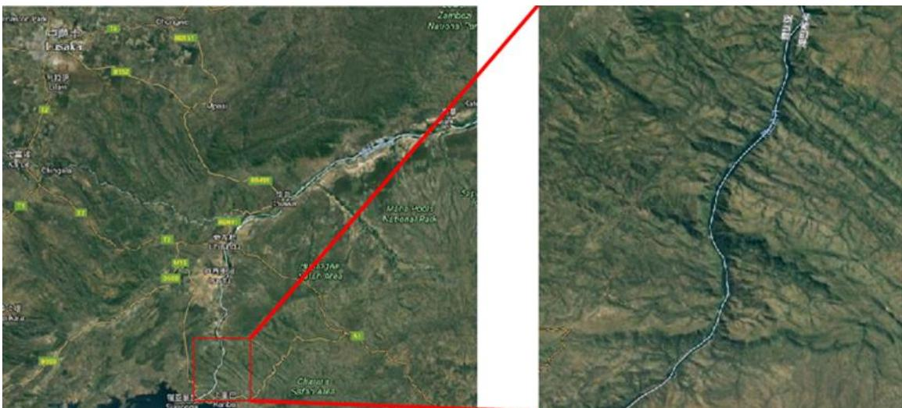
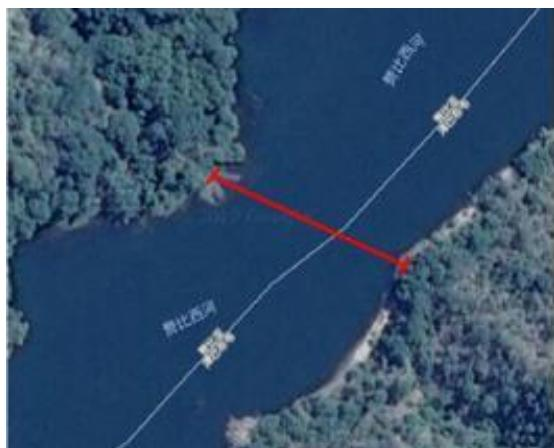
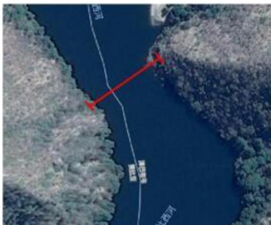

# 2017年美国大学生数学建模竞赛O奖论文：卡里巴大坝修复问题（A题）

原件为竞赛论文。补充：文中的阅读练习及“参考解答”为整理时增加，原件图文保留出处。

本资料整理自2017年美国大学生数学建模竞赛（MCM/ICM）A题获奖论文（Team #55069），原文为英文，此处保留原始结构并修正部分识别错误，便于阅读与分析。

## 一、摘要与目录

### 摘要

Recently, the Institute of Risk Management of South Africa has just warned that the Kariba dam is in desperate need of rehabilitation, otherwise the whole dam would collapse, putting 3.5 million people at risk. Aimed to look for the best strategy with the three options listed to maintain the dam, we employ AHP model to filter factors and determine two most influential criteria, including potential costs and benefits. With the weight of each criterion worked out, our model demonstrates that option 3 is the optimal choice.

According to our choice, we are required to offer the recommendation as to the number and placement of the new dams. Regarding it as a set covering problem, we develop a multi-objective optimization model to minimize the number of smaller dams while improving the water resources management capacity. Applying TOPSIS evaluation method to get the demand of the electricity and water, we solve this problem with genetic algorithm and get an approximate optimal solution with 12 smaller dams and determine the location of them.

Taking the strategy for modulating the water flow into account, we construct a joint operation of dam system to simulate the relationship among the smaller dams with genetic algorithm approach. We define four kinds of year based on the Kariba’s climate data of climate, namely, normal flow year, low flow year, high flow year and differential year. Finally, these statistics could help us simulate the water flow of each month in one year, then we obtain the water resources planning and modulating strategy.

The sensitivity analysis of our model has pointed out that small alteration in our constraints (including removing an important city of the countries and changing the measurement of the economic development index etc.) affects the location of some of our dams slightly while the number of dams remains the same. Also we find that the output coefficient is not an important factor for joint operation of the dam system, for the reason that the discharge index and the capacity index would not change a lot with the output coefficient changing.

> **注**：原文末尾附带的微店推广链接“更多数学建模资料请关注微店店铺‘数学建模学习交流’ https://k.weidian.com/RHO6PSpA”属于广告信息，已删除。

知识点：[层次分析法 AHP（Analytic Hierarchy Process）用于综合评价](../../../topics/数学建模/ahp_fangfa.md)、[TOPSIS 模型构建步骤（逼近理想解排序法）](../../../topics/数学建模/topsis_moxing.md)、[敏感性分析方法（Sensitivity Analysis，单参数与多参数变动）](../../../topics/数学建模/minganxing_fenxi.md)

### 目录

1. Overview
   1.1 Background
   1.2 Restatement of the Problem
   1.3 Literature Review
2. Assumptions and Justifications
3. Notation
4. Model Overview
5. Model Theory
   5.1 Determination of the Number and Location of the Dams
   5.2 Joint operation of dam system model
6. Model Implementation and Results
   6.1 The Number and Location
   6.2 The Strategy of Modulating Water Flow
7. Sensitivity Analysis
   7.1 The Model of Determination of the Number and Location
   7.2 The Model of Modulating Water Flow
8. Further discussion
9. Strengths and Weaknesses
   9.1 Strengths
   9.2 Weaknesses
10. Conclusion
11. The Evaluation of Three Options
    11.1 Establish a Hierarchical Model
    11.2 Analysis and Results

## 二、正文第一部分

知识点：[问题重述与分析（Problem Restatement and Analysis）](../../../topics/数学建模/wenti_chongshu.md)、[文献综述与研究背景撰写方法](../../../topics/数学建模/wenxian_zongshu.md)、[数学建模的基本步骤（问题分析、模型假设、建立、求解、检验、推广）](../../../topics/数学建模/jianmo_buzhou.md)

### 1.1 背景

A Zambezi River Authority conference was held in March 2014, engineers warned that the foundations of the dam had weakened and there was a possibility of dam failure unless repairs were made.

On 3 October 2014 the BBC reported that “The Kariba Dam is in a dangerous state. Opened in 1959, it was built on a seemingly solid bed of basalt. However, in the past 50 years, the torrents from the spillway have eroded that bedrock, carving a vast crater that has undercut the dam’s foundations, engineers are now warning that without urgent repairs, the whole dam will collapse. If that happened, a tsunami-like wall of water would rip through the Zambezi valley, reaching the Mozambique border within eight hours. The torrent would overwhelm Mozambique’s Cahora Bassa Dam and knock out 40% of southern Africa’s hydroelectric capacity. Along with the devastation of wildlife in the valley, the Zambezi River Authority estimates that the live of 3.5 million people are at risk.”

On February 2015, Engineers have started on a R3.3bn rescue marathon to prevent the “catastrophic failure” of the Kariba Dam. According to a World Bank special report on the beleaguered structure-one of the biggest man-made dams in the world-a potential wall collapse threatens the lives of about 3-million people living on the Zambezi River floodplain between the hydro scheme on the Zambia-Zimbabwe border and the Mozambique coast. [1]

知识点：[问题重述与分析（Problem Restatement and Analysis）](../../../topics/数学建模/wenti_chongshu.md)、[任务分解与目标明确](../../../topics/数学建模/renwu_fenjie.md)、[文献综述与研究背景撰写方法](../../../topics/数学建模/wenxian_zongshu.md)

### 1.2 问题重述

We are required to provide an overview of potential costs and benefits with the three options already listed. Then we need to establish a model to determine the number and placement of the new dams when removing the Kariba dam along the Zambezi River. The same overall water management capabilities are also needed. In addition, we should consider emergency water flow situations and restrictions regarding the locations and time, so that we could give out the strategy for modulating the water flow through our new multiple dam system.

In order to solve those problems, we will proceed as follows:

- Build a model to determine the number and location of the multiple dams.
- Give the corresponding strategy of modulating water flow in different conditions.

In our model, we first establish a multi-objective model and use genetic algorithm determine the number and location of the multiple dams. There are two goals improving the water resources management capacity and reducing the cost. Besides, we add some constraints such as water balance, water level, safety and water protection. We choose twenty suitable dam sites and employ the genetic algorithm to solve the optimal problem to determine the number and the location.

After determining the number and location of the dams, we construct our joint operation of dam system model and employ the genetic algorithm to solve the problem based on the thought of dynamic programming. According to the Kariba’s climate data for about 30 years, we abstract normal flow year, low flow year, high flow year and differential year. We use them to work out the water resources planning and scheduling strategy. The construction of the discharge index and the capacity index benefits an analysis and evaluation for joint operation of the dam system’s performance in different month and year.

# 2017年美国大学生数学建模竞赛O奖论文：卡里巴大坝修复问题（A题）

kind: 习题
course: 数学建模
source: 2017 MCM/ICM Problem A O Award Paper

这是一份关于卡里巴大坝修复问题的O奖论文节选，主要包含文献综述、假设与理由、符号说明及模型概述部分。

## 一、文献综述

知识点：[多目标优化模型（药物相对充足阶段的配送策略）](../../../topics/数学建模/duo_mubiao_youhua.md)、[一般假设及其合理性说明（Assumptions and Justifications）](../../../topics/数学建模/jiaben_shezhi.md)、[文献综述与研究背景撰写方法](../../../topics/数学建模/wenxian_zongshu.md)

### 文献综述 1

**内容：**

Dating back to 2004, the United States removed 72 dams in total, which created a historical record. Therefore, it is high time for us to focus on the construction of dams concerning their number and placement. Plenty of researchers have already made a number of notable papers to address these problems.

Alfer Weber (1909) first proposed a framework for location problem, which is an allocation question with respect to space resource. Among the three classical location model, set covering problem is a significant branch of siting issues. They explored a multi-objective location model to tackle problems with siting optimal points. In their model, maximizing coverage rate in order to satisfy every place’s need is the target function, the concentric point and the capacity restrictions are constraint conditions. Thus, they could convert the optimization problem to the mixed integer linear programming question.

After the set covering model was established, we can optimize our choice of siting the dams. Then several scientists were devoted to building an optimal operation model to provide a reasonable balance between safety and balance. They begin to figure out how the multiple dam system would benefit or affect each other within its system. Masse(1940) first illustrated the concept of it; their main computing method was to optimize water modulating strategy during dispatching period.

Further studies are carried out about different methods to investigate the optimal operation model, including dynamic programming algorithm and neural network algorithm based on improved computer technique. Also, there is much theoretical analysis about location problem since 1990. John Current and Morton O'Kelly(1992) suggested using a modified version of the set covering location model, which still didn’t take the reality into account.

## 二、假设与理由

知识点：[文献综述与研究背景撰写方法](../../../topics/数学建模/wenxian_zongshu.md)、[一般假设及其合理性说明（Assumptions and Justifications）](../../../topics/数学建模/jiaben_shezhi.md)、[多目标优化模型（药物相对充足阶段的配送策略）](../../../topics/数学建模/duo_mubiao_youhua.md)

### 假设与理由 1

为了简化问题，我们做出以下基本假设，每个假设都有适当的理由支持。

- **假设 1：** 大坝系统建在卡里巴大坝下游的山谷中。
    - **理由：** 这样建设更方便，成本更低，易于实施。
- **假设 2：** 大坝的成本大致相同。
    - **理由：** 由于峡谷长度不大（24km），地质条件和气候条件大致相同。
- **假设 3：** 每个大坝的供水量大致相同。
    - **理由：** 考虑到整个多坝系统的安全运行，我们应该尽可能使每个大坝的负担相同。
- **假设 4：** 大坝系统的水质是两个水库之间水质的平均值。
    - **理由：** 河流是流动的，所以水质大致相似。
- **假设 5：** 下游大坝的水仅来自上游大坝和自然降水。
    - **理由：** 根据谷歌地图，峡谷附近没有支流。同时根据水的守恒原理，公式应保持成立。

## 三、符号说明

知识点：[一般假设及其合理性说明（Assumptions and Justifications）](../../../topics/数学建模/jiaben_shezhi.md)、[符号说明与术语定义（Nomenclature / Symbols and Definitions）](../../../topics/数学建模/fuhao_shuoming.md)

### 符号说明 1

| Abbreviation | Description |
| :--- | :--- |
| $Y = \{ y_1, y_2, \cdots y_m \}$ | The set of cities |
| $X = \{ x_1, x_2, \cdots x_n \}$ | The set of dams |
| $d(y_i, X_n)$ | The distance from the $i_{th}$ city to the nearest smaller dam |
| $Ele_i$ | The electricity demand of $i_{th}$ city |
| $Wat_i$ | The water demand of $i_{th}$ city |
| $W(t,i)$ | The discharge amount of the $i_{th}$ dam at the end of period t |
| $Z(t,i)$ | The total amount of water released during period t |
| $T(t,i)$ | The amount of natural water in period t |
| $V_{ij}$ | The volume in the $j_{th}$ period of the $i_{th}$ dam |
| $Q_{ij}$ | The inflow in the $j_{th}$ period of the $i_{th}$ dam |
| $q_{ij}$ | The discharge volume in the $j_{th}$ period of the $i_{th}$ dam |
| $QJ_{ij}$ | The runoff volume between the $i_{th}$ dam and the $(i-1)_{th}$ dam |
| $S_{ij}$ | The actual water supply $i_{th}$ dam in the $j_{th}$ period |
| $D_{ij}$ | The planned water supply of the $i_{th}$ dam in the $j_{th}$ period |
| $H_{ij}$ | The hydraulic head of $i_{th}$ dam in the $j_{th}$ period |
| $K_i$ | The fore-voltage factor of the $i_{th}$ dam |
| $\lambda_t$ | The discharge flow indicators in the $t_{th}$ period |
| $\mu_t$ | The storage capacity indicators in the $t_{th}$ period |

## 四、模型概述

知识点：[符号说明与术语定义（Nomenclature / Symbols and Definitions）](../../../topics/数学建模/fuhao_shuoming.md)

### 模型概述 1

为了详细分析选项（3）——拆除卡里巴大坝并新建十到二十座较小的水坝，我们需要首先确定多个水坝的数量和位置。在此基础上，我们必须建立一个模型来调节通过多坝系统的水流以适应不同的情况。还需要在我们的策略安全和成本之间取得合理的平衡。

我们的第一个模型允许我们确定多个水坝的数量和位置。我们将该最优问题视为一个集合覆盖问题，并建立一个多目标模型来解决该问题。有两个目标，即提高水资源管理能力和降低成本。还有一些约束条件，包括水平衡、水位、安全、水资源保护和数量约束。鉴于最优问题难以在多项式时间内求解，因此我们使用遗传算法来获得解。

在确定数量和位置后，我们建立了联合大坝系统操作模型，以获得在不同条件下调节水流的策略。虽然这也是一个多目标问题，但它与之前的模型不同。我们以最大化经济和社会效益为目标，并设置一些约束，如水平衡、水库容量和泄流量约束。我们使用遗传算法来获取

知识点：[多目标优化模型（药物相对充足阶段的配送策略）](../../../topics/数学建模/duo_mubiao_youhua.md)、[遗传算法优化人力资本管理（染色体表示与适应度函数）](../../../topics/数学建模/yichuan_suanfa.md)

### 5 Model Theory

知识点：[数学建模的基本步骤（问题分析、模型假设、建立、求解、检验、推广）](../../../topics/数学建模/jianmo_buzhou.md)、[基本再生数 R0 的估计方法](../../../topics/数学建模/r0_guji.md)、[传统 SEIR 流行病模型（Susceptible-Exposed-Infectious-Recovered）](../../../topics/数学建模/seir_moxing.md)

### 5.1 Determination of the Number and Location of the Dams

知识点：[任务分解与目标明确](../../../topics/数学建模/renwu_fenjie.md)、[配送地点选址模型（公平原则与效率原则）](../../../topics/数学建模/peisong_xuanzhi.md)、[多目标优化模型（药物相对充足阶段的配送策略）](../../../topics/数学建模/duo_mubiao_youhua.md)

### 5.1.1 Establishment of the model

The construction of dams needs to consider many aspects, while at the same time it is subject to economic, social, environmental constraints and other factors. In order to obtain the proper number of dams and their location, we establish a multi-objective model.

#### The Objective

**Improve Water Resources Management Capacity**

The purpose of building smaller dams instead of larger dams is to manage water resources better, mainly to satisfy dweller’s demand for the electricity consumption and water consumption (Including agricultural, industrial and domestic water) of the neighboring cities. Demand may vary between cities, but it is clear that for cities with greater demand, the dam should be built closer to them. So we get that

$$
\min \sum_{i=1}^{m} Ele_i d(y_i, X_n)
$$

$$
\min \sum_{i=1}^{m} Wat_i d(y_i, X_n)
$$

**Reduce the Cost**

On the basis of ensuring the water supply and power supply, we should minimize the cost of our plan. The whole cost consists of the removal of the Kariba dam and building new smaller dams. Since the cost of removal is fixed, so we only consider the variable cost (building cost), which is only related to the number of dams. So we should minimize the quantity of the smaller dams.

$$
\min n
$$

#### The Constraints

**Water Balance**

$$
W(t, i) = W(t-1, i) + \sum_{k \in \pi(i)} Z(t, k) + T(t, i)
$$

$W(t, i)$ and $T(t, i)$ represent the discharge amount of the $i_{th}$ dam at the end of period $t$, the total amount of water released during period $t$ and the amount of natural water in period $t$ respectively. $\pi(i)$ denotes the set of all higher dams of $i_{th}$ dam. If $\pi(i)$ is empty, the corresponding summation is zero.[2]

**Water Level**

The water level in the dam area should be kept between the dead water level and the limited water level in the flood season. Dead Water Level, namely the lowest water level that allows a reservoir to fall off under normal operating conditions. Flood limited water level is the requirements of control over flood to limit reservoirs’ water storage.

$$
DWL \leq WL \leq FWL
$$

**Safety**

The construction of multiple smaller dams is at least as safe as the original larger dams. The safety considerations for dam construction mainly include reducing the probability of dam failure, thereby reducing damage to dams downstream and enhancing resistance ability to extreme weather.

$$
Safety_{sd} \geq Safety_{Bd}
$$

$Safety_{sd}$ represents the safety of multiple dams system, while $Safety_{Bd}$ denotes the safety of the existing Kariba dam.

**Water Resources Protection**

The construction of smaller dams should require a higher degree of protection for the water resources as the replacement of the existing dam.

$$
WRP_{sd} \geq WRP_{Bd}
$$

$WRP_{sd}$ represents the environment protection of the multiple dams system, while $WRP_{Bd}$ denotes the environment protection of the existing Kariba dam.

**Number**

The number of small dams should be greater than ten and less than twenty. Option 3 is replacing the Kariba dam with a series of ten to twenty smaller dams.

To ensure the continuity of the model establishment, the parameters of the constraints will be described in the next part. And in the sixth section, we will clarify how to calculate the demand of electricity ($Ele_i$), the demand of the water ($Wat_i$), the safety of different dams and the environment protection of different dams.

To sum up, we model the problem about smaller dams’ number and location decision with multi-objective optimization. The formulas of this model is

$$
\begin{aligned}
& \min \sum_{i=1}^{m} Ele_i d(y_i, X_n) \\
& \min \sum_{i=1}^{m} Wat_i d(y_i, X_n) \\
& \min n \\
& s.t. \quad W(t, i) = W(t-1, i) + \sum_{k \in \pi(i)} Z(t, k) + T(t, i) \\
& \quad \quad DWL \leq WL \leq FWL \\
& \quad \quad Safety_{sd} \geq Safety_{Bd} \\
& \quad \quad WRP_{sd} \geq WRP_{Bd} \\
& \quad \quad 10 \leq n \leq 20 \quad (n = 10, 11, 12 \dots 20)
\end{aligned}
$$

知识点：[多目标优化模型（药物相对充足阶段的配送策略）](../../../topics/数学建模/duo_mubiao_youhua.md)、[模型参数的确定（基于数据拟合或实验选择）](../../../topics/数学建模/canshu_queding.md)

### 5.1.2 The Parameter of the Constraints

**The Demand of Electricity**

The power demand of a city is mainly related to its economic and demographic factors. Our paper uses the city's latest available GDP data as the representative of its economic factors, and the total urban population as the representative of its demographic factor.

The GDP of the $i_{th}$ city is $GDP_i$. The population of the $i_{th}$ city is $pop_i$.

**The Demand of Water**

The water consumption of residents is mainly affected by residents' income, water price and other factors. Since within a country, the price difference is relatively small, so here we ignore the price difference. Therefore, the water consumption of urban residents is mainly affected by the income of residents. We use the city's GNI to represent its urban residents. The GNI of the $i_{th}$ city is $GNI_i$.

**The Safety of Dams and the Kariba Dam[3]**

For the safety of dam construction, our paper mainly considers the index of risk loss as the agent of its safety indicators.

For a single Big dam, its Risk Loss Index (RLI) $R^{Bd}$ equals to $P$ multiply $N$. $P$ is the failure probability of the dam beyond the current code standard. For example, the current code specifies that if a dam's seismic safety standard is 50 years beyond 10%, the probability of failure exceeding the current code specification is $0.1 / 50 = 0.002$. $N$ is the life loss of dam failure (we can convert economic loss into life loss in a certain percentage). We use the Dekay & McClelland method to calculate the loss. Thus, the RLI of the Kariba dam is

# 2017年美国大学生数学建模竞赛O奖论文：卡里巴大坝修复问题（A题）

本文整理自2017年MCM O奖论文（Team #55069），内容涉及多坝系统模型构建、联合运行策略及目标函数与约束条件的数学表达。

## 一、多坝系统安全性与水资源保护

知识点：[模型参数的确定（基于数据拟合或实验选择）](../../../topics/数学建模/canshu_queding.md)、[影响因素评估指标体系构建（温度、湿度、经济、教育等）](../../../topics/数学建模/yingxiang_zhibiao.md)、[一般假设及其合理性说明（Assumptions and Justifications）](../../../topics/数学建模/jiaben_shezhi.md)

### 多坝系统可靠性指标 (RLI)

对于单个大坝，其可靠性指标 $R^{Bd}$ 定义为：

$$
R ^ {Bd} = P (K) \cdot N (K)
$$

对于多坝系统，第 $j$ 个大坝的可靠性指标 $R_j$ 为：

$$
R _ {j} = P (j) \cdot N (j) + \sum_ {l = j + 1} ^ {n} P (l \mid j) \cdot P (j) \cdot N (l)
$$

整个多坝系统的可靠性指标 $R^{sd}$ 为：

$$
R ^ {sd} = \sum_ {j = 1} ^ {n} R _ {j} ^ {sd}
$$

为确保多坝系统的安全性不低于现有的卡里巴大坝，需满足条件 $R ^ {sd} \leq R ^ {Bd}$，即：

$$
\sum _ {i = 1 } ^ { n } R _ { i } ^ {sd} \leq P ( K ) \cdot N ( K )
$$

其中，$n$ 为整数，且满足 $10 < n < 20$。

知识点：[符号说明与术语定义（Nomenclature / Symbols and Definitions）](../../../topics/数学建模/fuhao_shuoming.md)

### 水资源保护目标

根据国际大坝委员会 (ICOLD) 的定义，水资源管理主要有三个目标：
- 改善供水管理
- 改善河流的水质
- 改善流域的环境状况

鉴于卡里巴峡谷支流较少，本研究主要考虑供水管理和水质改善两个方面。

#### 供水约束

根据约束条件，多坝系统的供水量应大于或等于单一大坝的供水量：

$$
W S _ {sd} \geq W S _ {Bd}
$$

其中：
- $W S _ {sd}$ 表示较小大坝数量乘以单个小水库的供水量；
- $W S _ {Bd}$ 代表卡里巴大坝的供水量。

#### 水质约束

多坝系统的水质也应优于或等于卡里巴大坝的现状水质：

$$
W Q _ {sd} \geq W Q _ {Bd}
$$

其中：
- $W Q _ {sd}$ 代表若当局采用方案三时，卡里巴湖的预期平均水质；
- $W Q _ {Bd}$ 代表卡里巴湖当前的水质。

## 二、大坝系统联合运行模型

知识点：[数学建模的基本步骤（问题分析、模型假设、建立、求解、检验、推广）](../../../topics/数学建模/jianmo_buzhou.md)、[任务分解与目标明确](../../../topics/数学建模/renwu_fenjie.md)

### 模型概述

大坝系统的联合运行可以利用不同大坝容量和水文条件的差异，从而产生联合补偿效应，充分利用水资源。与传统的大型单一大坝相比，基于多坝系统建立的大坝群有助于发挥水资源的社会效益（包括经济和社会效益）。因此，有必要制定有效的水资源调度方案。

为了更清晰地表达模型，定义如下符号：
- $T$：表示大坝的数量 ($j = 1, \dots, T$)；
- $t$：表示水资源调度的周期；
- $V_{ij}$：表示第 $i$ 个大坝在第 $j$ 个时期的蓄水量。

知识点：[符号说明与术语定义（Nomenclature / Symbols and Definitions）](../../../topics/数学建模/fuhao_shuoming.md)、[数学建模的基本步骤（问题分析、模型假设、建立、求解、检验、推广）](../../../topics/数学建模/jianmo_buzhou.md)

### 目标函数

水电站主要带来经济和社会效益，其中直接体现经济效益的是大坝发电。因此，将水库发电量作为经济效益的衡量指标：

$$
I _ {e} = \sum_ {i = 1} ^ {n} \sum_ {j = 1} ^ {T} K _ {i} \cdot q _ {i j} \cdot H _ {i j} \cdot \Delta t
$$

参数说明：
- $q _ {i j}$：第 $i$ 个大坝在第 $j$ 个时期的泄流量；
- $H _ {i j}$：第 $i$ 个大坝在第 $j$ 个时期的水头；
- $K _ {i}$：第 $i$ 个大坝的力压系数（force-voltage factor）；
- $\Delta t$：时间周期。

除了巨大的经济效益外，大型大坝还能带来巨大的社会效益。通过建设大坝，可以满足大量工业、农业及生活用水的需求。社会效益的目标函数表示为：

$$
I _ {s} = \sum_ {i = 1} ^ {n} \sum_ {j = 1} ^ {T} (S _ {i j} - D _ {i j})
$$

参数说明：
- $S _ {i j}$：第 $i$ 个大坝在第 $j$ 阶段的实际供水量；
- $D _ {i j}$：第 $i$ 个大坝在第 $j$ 阶段的水需求或计划供水量。

综合目标是使经济和社会效益最大化：

$$
I = \max (I _ {e} + I _ {s})
$$

知识点：[符号说明与术语定义（Nomenclature / Symbols and Definitions）](../../../topics/数学建模/fuhao_shuoming.md)、[多目标优化模型（药物相对充足阶段的配送策略）](../../../topics/数学建模/duo_mubiao_youhua.md)

### 约束条件

#### 1. 水量平衡约束

$$
V _ {i, (t + 1)} = V _ {i t} + \left(Q _ {i t} - q _ {i t}\right) \cdot \Delta t - L _ {i t}
$$

$$
Q _ {i, (t + 1)} = q _ {(i - 1), t} + Q J _ {i t}
$$

参数说明：
- $Q _ {i t}$ 和 $q _ {i t}$：分别为第 $i$ 个大坝在第 $t$ 时期的平均入库流量和泄流量；
- $L _ {i t}$：蒸发和渗漏损失；
- $Q J _ {i t}$：第 $i$ 个大坝与第 $j$ 个大坝之间的径流量。

#### 2. 大坝库容约束

为防止洪涝和干旱，每个大坝的库容必须受到限制：

$$
V \min _ {i} \leq V _ {i t} \leq V \max _ {i}
$$

其中：
- $V \min _ {i}$ 和 $V \max _ {i}$ 分别是第 $i$ 个大坝蓄水量的上限和下限，即死库容和防洪库容。

#### 3. 泄流流量约束

为了保持正常的生活标准并维持下游生态用水，必须保证一定的下泄流量。设 $q \min _ {i}$ 为最小泄流量。同时，受限于大坝自身能力及防洪目的，还需设定最大泄流能力约束：

$$
q \min _ {i} \leq q _ {i t} \leq q \max _ {i}
$$

In conclusion, in order to make economic benefit and social benefit as large as possible while satisfying the constraint conditions, we need to develop water resources optimized dispatching scheme.

$$
\begin{array}{l} \max I = \sum_ {i = 1} ^ {n} \sum_ {j = 1} ^ {T} K _ {i} * q _ {i j} * H _ {i j} * \Delta t + \sum_ {i = 1} ^ {n} \sum_ {j = 1} ^ {T} (S _ {i j} - D _ {i j}) \\ s. t. \left\{ \begin{array}{c} V _ {i, (t + 1)} = V _ {i t} + (Q _ {i t} - q _ {i t}) * \Delta t - L _ {i t} \\ Q _ {i, (t + 1)} = q _ {(i - 1), t} + Q J _ {i t} \\ V \min _ {i} \leq V _ {i t} \leq V \max _ {i} \\ q \min _ {i} \leq q _ {i t} \leq q \max _ {i} \end{array} \right. \end{array}
$$

$V_{it}, q_{it}$ are the interval-type variables, $V \min_i, q \min_i$ correspond to meet the basic industrial and agricultural water, domestic water and ecological water, they are the dead water level. For safety considerations such as flood control, $V \max_i, q \max_i$ are the maximal water level.

We let $[V f_i, V P_i]$ to be the of $V_{it}, [q f_i, q F_i]$ is the optimum interval of $q_{it}$. $^{[7]}$

$$
\lambda_{i t} = \left\{ \begin{array}{c} 1 - (V f _ {i} - V _ {i t}) / (V f _ {i} - V \min _ {i}), V \min _ {i} \leq V _ {i t} \leq V f _ {i} \\ 1, V f _ {i} \leq V _ {i t} \leq V F _ {i} \\ 1 - (V _ {i t} - V F _ {i}) / (V \max _ {i} - V F _ {i}), V F _ {i} \leq V _ {i t} \leq V \max _ {i} \\ 0, e l s e \end{array} \right.
$$

$$
\lambda_{t} = \frac {1}{N} \sum_{i = 1} ^ {N} \lambda_{i t}
$$

$$
\mu_{i t} = \left\{ \begin{array}{c} 1 - \left(q f _ {i} - q _ {i t}\right) / \left(q f _ {i} - q \min _ {i}\right), q \min _ {i} \leq q _ {i t} \leq q f _ {i} \\ 1, q f _ {i} \leq q _ {i t} \leq q F _ {i} \\ 1 - \left(q _ {i t} - q F _ {i}\right) / \left(q \max _ {i} - q F _ {i}\right), q F _ {i} \leq q _ {i t} \leq q \max _ {i} \\ 0, e l s e \end{array} \right.
$$

$$
\mu_{t} = \frac {1}{N} \sum_{i = 1} ^ {N} \mu_{i t}
$$

## 6 Model Implementation and Results

知识点：[一般假设及其合理性说明（Assumptions and Justifications）](../../../topics/数学建模/jiaben_shezhi.md)、[模型参数的确定（基于数据拟合或实验选择）](../../../topics/数学建模/canshu_queding.md)

### 6.1 The Number and Location

#### Measuring the demand of the nearby city

TOPSIS (Technique for Order Preference by Similarity to an Ideal Solution) is a commonly used and effective method in multi-objective decision analysis. Hence, we employ this model and then investigate extended TOPSIS to evaluate the demand of electricity and water of each city.

Then we use the data to calculate the demand of the electricity and water with TOPSIS, and part of the results is shown in Table 1.

**Table 1 The Demand of Electricity and Water**

| | Electricity demand | Water demand |
| :--- | :--- | :--- |
| Chongwe | 0.11946089 | 0.11547689 |
| Kafue | 0.23850413 | 0.26352475 |
| Luangwa | 0.0341398 | 0.0994167 |
| Lusaka | 0.559806 | 0.64089 |
| Choma | 0.12199417 | 0.24991764 |
| Livingstone | 0.29028867 | 0.12028768 |
| Monze | 0.1492781 | 0.1832683 |

#### Calculate the shortest distance from each dam to each city

The dam should be built in the valley of the river fully, because the project is small with low cost. Moreover, the construction of small dams is mainly to replace the larger dam, so the small dam should be constructed mainly in the downstream of the Kariba dam in the canyon. Figure 1 is the suitable site for building dams.

With respect to the option 3 that we need to construct 10 to 20 small dams, considering the geological factors around the dam, we first select the suitable location of the 20 dams.

According to our model, we use the distance from the dam to the center of the city as a representative of the distance to the city. A total of 25 cities are selected close to the Kariba gorge, including 15 cities in Zambia, 10 cities in Zimbabwe. We search and calculate the shortest distance and path of each dam to the city through Google maps, and the results of some small dams to the cities are shown in Table 2.

**Table 2 The Distance Between the Dams and the City(Part)**

| | Dam 1(Km) | Dam 8 | Dam 16 | Dam 20 |
| :--- | :--- | :--- | :--- | :--- |
| Chongwe | 130.47 | 123.44 | 118.31 | 117.87 |
| Lusaka | 133.78 | 128.50 | 125.76 | 122.72 |
| Kafue | 104.12 | 102.64 | 98.91 | 97.73 |
| Monze | 141.19 | 143.32 | 146.46 | 146.49 |

#### The Data of Other Factors

At the same time, we collect the data of other related factors through the Zambia National Bureau of Statistics, the World Bank, the World Commission on Dams and other institutions to gain the relevant statistics.

**Table 3 The Data of Other Factors**

| | DWL | NWL | FWL | BFWL | RLI | WS | WQ |
| :--- | :--- | :--- | :--- | :--- | :--- | :--- | :--- |
| Kariba | 475.5 | 484.6 | 490 | 476.7 | 9000 | 608.5 | 19 |
| Multiple | 382 | 408 | 412 | 385 | $\sum_{i=1}^{n} R_i^{sd}$ | $WS^e \cdot n$ | $WQ^e$ |

Under normal circumstances the water level should be higher than the dead water level, and lower than the normal position. But before the flood season, the water level is lower than the limit of water level.

#### The numbers and the location

This optimal problem belongs to the NP-hard problem. We can’t solve it in polynomial time. So we can only use heuristic algorithms such as artificial neural networks, genetic algorithm, simulated annealing to obtain the approximate solution. In this paper, we select the genetic algorithm to solve the problem.

We run the program repeatedly, and finally get a relatively good result and determine our number and location of the dams. There should be 12 smaller dams in the Kariba Gorge. Besides, we select the optimal 12 dam location to maximize our objective function from 20 appropriate dam sites. The sixth and twelfth site locations are listed in the Table 4

Table 4 The Location of the Dam

| | The 6th smaller dam | The 12th smaller dam |
| :--- | :--- | :--- |
| Longitude | $28.831345^{\circ}E$ - $28.832703^{\circ}E$ | $28.849015^{\circ}E$ - $28.850422^{\circ}E$ |
| Latitude | $16.417931^{\circ}S$ - $16.418605^{\circ}S$ | $16.371407^{\circ}S$ - $16.371123^{\circ}S$ |

At the same time, we will also mark the location of the small dam on the map, we put the location of the sixth and twelfth dam on the map. We can see it on the Figure 2 and Figure 3

知识点：[TOPSIS 模型构建步骤（逼近理想解排序法）](../../../topics/数学建模/topsis_moxing.md)、[影响因素评估指标体系构建（温度、湿度、经济、教育等）](../../../topics/数学建模/yingxiang_zhibiao.md)、[Summary Sheet（摘要页）的撰写规范](../../../topics/数学建模/zhaiyao_xiezuo.md)

### 6.2 The Strategy of Modulating Water Flow

Traditional optimization algorithm mostly belongs to the convex optimization category. It demands a unique global optimal solution, which is often used in practical applications. A number of heuristic intelligent algorithm, for example genetic algorithm etc.These methods show that the algorithm can work out satisfactory results for solving the optimization problem. Employing joint operation of dam system model, we use genetic algorithm and Matlab2014 for the solution.[8]

By running the genetic algorithm and adjusting the parameters, we obtain a relatively satisfactory result, and then develop a joint operation of dam system model.(The picture of the results is shown in the appendix part four.)

Normal Flow Year：Take the climate and hydrological conditions of the average of nearly 5 years to simulate normal climatic conditions.

In normal years, the water resources dispatching of the dam system shows obvious seasonal difference. In the dry season from June to September, the discharge of each reservoir reaches the bottom line. Compared with the middle and lower reaches of the river, upper and middle reaches of water resources and reserves are relatively abundant, therefore, still a lot of water could be scheduled downstream. But until the rainy season from November to March, the precipitation intensity and the discharge of each dam are very large. The results show that the discharge index and storage capacity index perform better in May and October, which are in the optimum range, while the other month are all above 0.7, this is a satisfactory result.

Low Flow Year: The monthly precipitation is taken as the highest value in the past 30 years, simulating the more serious flood threat..

When the annual precipitation decreases, each dam discharge is significantly lower, but the discharge index and the capacity index is still above 0.7, which reflects the joint operation of dam system still has obvious effect to resist abnormal weather like the drought condition.

High Flow Year：The monthly precipitation is taken as the highest value inthe past 30 years, simulating the more serious flood threat.

When the annual precipitation has increased significantly, then the reservoir’s discharge would increase. While the discharge of the rainy season increases a lot, but in dry season the increase range is smaller, which makes the discharge capacity index and volume index increase significantly from May to September. Although the index decreases significantly in November and February the figure are more than 0.7, is still relatively satisfactory.

Differentiation Year：The precipitation from May to September is taken as the lowest value in the past 30 years, the precipitation from October to April was taken as the highest value in the past 30 years. So that we could simulate drought, flood significantly differentiated condition..

When confronted with the differentiation year where there comes rainy season when the precipitation increases and the dry season when the precipitation decreases all come about in one year. The discharge flow of each reservoir expands seasonally, which makes the discharge index and storage capacity index of each month decrease, and it is more obvious in the rainy season. Which can not be ignored is that the discharge flow indicators and storage capacity indicators remained at 0.7 or more.[9]

知识点：[关键参数区域与临界条件分析（埃博拉何时能被根除）](../../../topics/数学建模/genchu_tiaojian.md)、[一般假设及其合理性说明（Assumptions and Justifications）](../../../topics/数学建模/jiaben_shezhi.md)、[模型优缺点分析（Strengths and Weaknesses）](../../../topics/数学建模/youque_dian.md)

### 7. Sensitivity Analysis

知识点：[敏感性分析方法（Sensitivity Analysis，单参数与多参数变动）](../../../topics/数学建模/minganxing_fenxi.md)、[模型验证方法概述（随机模型与确定性模型验证）](../../../topics/数学建模/moxing_yanzheng.md)、[模型参数的确定（基于数据拟合或实验选择）](../../../topics/数学建模/canshu_queding.md)

### 7.1 The Model of Determination of the Number and Location

#### Remove an important city of both countries

In the questions we discussed above，we have selected 15 cities in Zambia，10 cities in Zimbabwe to specify the number and placement of the newly built smaller dams. Among the sensitivity analysis, we remove important cities of the two countries, thus, we could see whether this movement would influence the number and placement of constructing dams.

In our analysis, we leave out Lusaka (The capital city of Zambia) and Harare(The capital city of Zimbabwe) from our original cities, yet, we still use the multi objective optimization model and genetic algorithm we already established to calculate the number and placement of smaller dams. We discover that the optimal number of constructing dams is also 12, but the location of each dam is slightly changed. Just the fourth and the eleventh dam’s place changes a lot, while other dam’s place just changes a little. Therefore, we list the location of the fourth and the eleventh dam’s site in Table 5.

# 2017年美国大学生数学建模竞赛O奖论文：卡里巴大坝修复问题（A题）

## 一、模型灵敏度分析

知识点：[敏感性分析方法（Sensitivity Analysis，单参数与多参数变动）](../../../topics/数学建模/minganxing_fenxi.md)、[多目标优化模型（药物相对充足阶段的配送策略）](../../../topics/数学建模/duo_mubiao_youhua.md)

### 选择 1

**题干：** 移除大城市对选址的影响如何？

- **原文结论：** 移除大城市的影響并不显著。根据之前的模型，我们仍可得出结论：大城市对大坝选址有巨大影响。因此，在构建大坝模型时纳入大城市是合适的选择。
- **数据支撑：** 表 5 展示了改变经济发展指标测量方式后，第 4 座和第 11 座大坝位置的变化情况。

**表 5 改变经济发展指标测量方式后的第 4 座和第 11 座大坝位置**

| | 4 | 11 |
| :--- | :--- | :--- |
| longitude (经度) | $28.8442536^{\circ}E - 28.843764^{\circ}E$ | $28.813760^{\circ}E - 28.815164^{\circ}E$ |
| latitude (纬度) | $16.395876^{\circ}S - 16.396158^{\circ}S$ | $16.475824^{\circ}S - 16.476281^{\circ}S$ |

**参考解答：** 模型中主要采用各城市当前的 GDP 作为经济发展的衡量指标，同时也将其作为衡量水电需求的指标之一。此处，我们将使用 GDP 增长率作为城市经济发展的代理指标，并通过改变其 GDP 增长率来观察其对大坝建设数量及位置的影响。

首先利用城市的经济增长数据来衡量其水电需求，然后在此基础上进行浮动，最大变化幅度可达 8%。经济增长对大坝数量的影响如表 6 所示。

**表 6 GDP 增长率的敏感性分析**

| GDP growth rate (GDP 增长率) | Number (数量) | Change (变化量) | Change ratio (变化率) |
| :--- | :---: | :---: | :---: |
| 0% | 12 | 0 | 0% |
| +2% | 12 | 0 | 0% |
| -2% | 12 | 0 | 0% |
| +4% | 13 | 1 | 8.3% |
| -4% | 12 | 0 | 0% |
| +6% | 13 | 1 | 8.3% |
| -6% | 11 | 1 | -8.3% |
| +8% | 14 | 2 | 16.67% |
| -8% | 10 | 2 | -16.67% |

**答案：** 从表中可以看出，经济增长率的变化对小坝建设数量的影响相对较小。即使达到 8% 的变化，仅需在原基础上多建两座小坝即可满足水电需求。由于赞比亚和津巴布韦是非洲国家，经济条件相对落后，缺乏经济发展动力，未来其经济增长的变化相对较小。因此，建造 12 座大坝是一个合理的选择。

此外，经济增长率的改变对大坝位置的影响很小。基于卡里巴峡谷长约 34.9 公里的事实，且我们只需要在峡谷内建造 10 到 20 座小坝，同时小坝之间需要保持一定距离，因此小坝的位置相对稳定，变化不大。

**补充：** 综上所述，代表其经济发展的指标是合理的。尽管该数值会有上下波动，但其对小坝的数量和位置影响相对较小。这也表明我们在前文中建立的关于小坝位置和数量的模型具有稳健性，并能很好地适应现实情况。

知识点：[敏感性分析方法（Sensitivity Analysis，单参数与多参数变动）](../../../topics/数学建模/minganxing_fenxi.md)、[参数合理性验证](../../../topics/数学建模/canshu_heli_xing.md)

### 选择 2

**题干：** 调节水流量的模型参数及其影响。

- **定义：** 输出系数（Output coefficient）是一个综合效益系数，反映了水轮发电机组的整体效率。它等于涡轮机效率、发电机效率、传输效率乘以不变常数 9.81。其值取决于水电站大坝的规模。对于大型水电站，该值约为 8.5；对于中型水电站，该值约为 8-8.5；而对于小型水电站，该值约为 6.0-8.0。将系数、水头和水流量相乘，即得到单位输出。
- **分析：** 表 7 分析了输出系数的变化对大坝系统联合运行的影响。

**表 7 输出系数的敏感性分析**

| K | \multicolumn{2}{c|}{Normal flow year (平水年)} | \multicolumn{2}{c|}{Low flow year (枯水年)} | \multicolumn{2}{c|}{Rich flow year (丰水年)} | \multicolumn{2}{c|}{Differentiation year (特殊年)} |
| :--- | :---: | :---: | :---: | :---: | :---: | :---: | :---: | :---: |
| | $\lambda$ | $\mu$ | $\lambda$ | $\mu$ | $\lambda$ | $\mu$ | $\lambda$ | $\mu$ |
| -15% | 1.7% | -0.4% | 4.1% | -1.2% | 0.8% | 0.2% | 0.5% | 1.1% |
| -10% | 0.0% | 0.6% | 0.9% | 0.0% | 1.4% | -0.9% | 1.2% | -2.3% |
| -5% | 0.3% | 1.2% | -2.3% | 0.5% | 0.0% | -0.4% | 0.7% | 1.0% |
| 0% | 0.0% | 0.0% | 0.0% | 0.0% | 0.0% | 0.0% | 0.0% | 0.0% |
| 5% | 0.0% | -0.3% | 1.4% | -0.7% | 0.0% | 1.3% | -0.8% | 2.1% |
| 10% | -1.0% | -1.1% | 0.0% | -0.5% | 3.3% | 2.2% | -1.7% | 0.3% |
| 15% | 2.5% | 0.2% | -1.2% | 3.1% | 2.8% | -1.2% | 0.9% | 3.3% |

**答案：** 从表 7 可以看出，输出系数的变化带来的 $\lambda$ 和 $\mu$ 变化仅约为百分之几。这表明输出系数并不是大坝系统联合运行的重要因素。

## 二、进一步讨论

知识点：[敏感性分析方法（Sensitivity Analysis，单参数与多参数变动）](../../../topics/数学建模/minganxing_fenxi.md)、[模型参数的确定（基于数据拟合或实验选择）](../../../topics/数学建模/canshu_queding.md)、[模型验证方法概述（随机模型与确定性模型验证）](../../../topics/数学建模/moxing_yanzheng.md)

### 简答 1

**题干：** 考虑未来的效益。

**正文：** 水库运行不仅具有当前的经济社会效益，还具有未来的经济社会效益。未来的经济效益可以通过调度周期结束时的总蓄能来表示，总蓄能越大，未来发展的潜力就越大。未来的社会效益可以体现在最后一个调度周期的总库容上。一般来说，水库中的蓄水量越多，就越能满足后代的需求。

# 2017年美国大学生数学建模竞赛O奖论文：卡里巴大坝修复问题（A题）

本文档整理了《2017年美国大学生数学建模竞赛O奖论文：卡里巴大坝修复问题（A题）》第 8 部分（共 10 部分），内容对应原稿第 20–22 页。

## 一、生态效益与约束条件

知识点：[一般假设及其合理性说明（Assumptions and Justifications）](../../../topics/数学建模/jiaben_shezhi.md)、[模型优缺点分析（Strengths and Weaknesses）](../../../topics/数学建模/youque_dian.md)、[多目标优化模型（药物相对充足阶段的配送策略）](../../../topics/数学建模/duo_mubiao_youhua.md)

### 计算 1 生态效益目标函数

原文提出了增加生态效益的考量。传统上人们更关注发电、防洪、供水等功能，此处将生态效益作为调度目标之一，而非仅仅作为约束。

$$
I _ {e} = \sum_ {i = 1} ^ {n} \sum_ {j = 1} ^ {T} \left[ K _ {i} * q _ {i j} * H _ {i j} * \Delta t + \left(h _ {(i - 1), j} - h _ {i, j}\right) \left(Q _ {i j} - q _ {i j}\right) \right]
$$

$$
I _ {s} = V _ {T} + \sum_ {i = 1} ^ {n} \sum_ {i = 1} ^ {T} (S _ {i j} - D _ {i j})
$$

其中，$h _ { i j }$ 表示第 $i$ 座大坝在第 $j$ 时段的水位，$V _ { T }$ 表示调度期末大坝的水库蓄水量。

**补充说明：**
增加生态效益意味着大多数人关注传统的发电、防洪、供水等功能，但我们需要进一步考虑水库的生态效益。我们不把生态流量作为一个约束条件，而是将其视为调度目标之一，尽管这存在许多困难。

知识点：[多目标优化模型（药物相对充足阶段的配送策略）](../../../topics/数学建模/duo_mubiao_youhua.md)、[数学建模的基本步骤（问题分析、模型假设、建立、求解、检验、推广）](../../../topics/数学建模/jianmo_buzhou.md)、[一般假设及其合理性说明（Assumptions and Justifications）](../../../topics/数学建模/jiaben_shezhi.md)

### 计算 2 生态需水目标函数

$$
I _ {e n} = \sum_ {i = 1} ^ {n} \sum_ {j = 1} ^ {T} f (V _ {i j}, Q _ {i j}, q _ {i j}, d e _ {i j})
$$

其中，$d e _ { i j }$ 是第 $i$ 座大坝在第 $j$ 时段的生态需水量。

知识点：[模型参数的确定（基于数据拟合或实验选择）](../../../topics/数学建模/canshu_queding.md)、[确定模型的定点与稳定性分析](../../../topics/数学建模/dingdian_wending.md)、[数学建模的基本步骤（问题分析、模型假设、建立、求解、检验、推广）](../../../topics/数学建模/jianmo_buzhou.md)

### 计算 3 水位变化约束

为了避免水库水位的大幅度变化导致地质条件改变，甚至引发水库地震，我们增加了约束条件：

$$
\left| h _ { i t } - h _ { i , ( t + 1 ) } \right| \leq \delta _ { i }
$$

其中，$\delta _ { i }$ 是允许的水库水位变化幅度。

## 二、模型的优缺点分析

知识点：[一般假设及其合理性说明（Assumptions and Justifications）](../../../topics/数学建模/jiaben_shezhi.md)、[模型优缺点分析（Strengths and Weaknesses）](../../../topics/数学建模/youque_dian.md)

### 9 Strengths and Weaknesses

#### 9.1 Strengths

- **鲁棒性**：我们的模型在参数变化时具有鲁棒性。也就是说，参数的微小变化不会导致结果的显著变化。
- **通用性**：我们的模型可以很好地应用于其他地方，我们只需要稍微改变具体条件即可。
- **针对性策略**：基于不同的情况，我们开发了相应的调节策略，并制定了相对全面的计划。这可以为 ZRA（赞比亚铁路管理局或相关机构，根据上下文推测）提供具体的指导。
- **数据来源可靠**：我们的数据来自官方网站，如赞比亚中央统计局等，具有可信度。

#### 9.2 Weaknesses

- **未来效益未充分考虑**：我们的模型没有考虑未来经济、社会和环境效益。我们主要关注当前效益。但实际上，未来前景对于可持续发展很重要。因此，我们在进一步讨论中添加了相关内容，并希望将来能解决它。
- **数据不足**：关于电力和水需求的数据不多。因此，对需求的分析可能不全面，可能会有一些偏差。但这并没有对结果产生重大影响。
- **预测数据的影响**：某些参数的数据是预测数据，因为我们没有建造大坝。然而，基于敏感性分析，如果参数发生轻微变化，它们不会产生巨大的差异。

## 三、结论

知识点：[模型优缺点分析（Strengths and Weaknesses）](../../../topics/数学建模/youque_dian.md)

### 10 Conclusion

通过建立三个模型，我们分别评估了三个方案。首先，我们选择了大坝的数量和位置，然后规划了大坝系统的联合运行。我们从五个方面综合考虑了三个方案的评估：直接成本、潜在成本、经济效益、环境效益和社会效益。通过 AHP 分析，我们得出结论：方案三是一个相对较好的解决方案。

然后，我们建立了多目标优化模型来确定大坝的数量和位置。我们将水资源管理能力和成本作为目标函数，将水量平衡函数、水位限制、水资源保护和数量作为约束条件。我们还使用遗传算法求解问题，发现 12 座大坝是一个相对令人满意的结果，并确定了它们的地理位置。

在确定大坝的数量和位置后，我们建立了大坝系统联合运行模型。我们以经济社会效益为目标，以水量平衡函数和流量限制为约束。考虑四种不同的年份类型，我们使用遗传算法求解并确定相应的调度方案。此外，敏感性结果表明，大坝的联合运行可以很好地适应不同的气候条件。

最后，我们对模型的优缺点进行了客观分析，并尝试进一步扩展模型，以使我们的模型和方法更加成功。

## 四、三种方案的评估

知识点：[层次分析法 AHP（Analytic Hierarchy Process）用于综合评价](../../../topics/数学建模/ahp_fangfa.md)、[多目标优化模型（药物相对充足阶段的配送策略）](../../../topics/数学建模/duo_mubiao_youhua.md)、[模型优缺点分析（Strengths and Weaknesses）](../../../topics/数学建模/youque_dian.md)

### 11 The Evaluation of Three Options

南非刚刚警告说，该大坝急需修复。原因如下：

- 迫使下游居民撤离，因为大雨可能导致大坝泄洪。
- 基于看似坚固的玄武岩床基，卡里巴大坝已被溢洪道的激流侵蚀，如果不进行紧急修复，可能会导致严重坍塌。

针对已给出的三个方案，我们采用 AHP 模型，使用两个最具影响力的准则，对潜在的成本和收益提供一个简要概述。

Jery Stedinger 和 Pete Loucks（1982年2月）[10]认为大坝的评价标准应包括可靠性、恢复力和脆弱性准则；Mohamed Rami Mahmoud 和 Luis A. Garcia（2000年7月）[11]提出了用于 Red Bluff 分流坝的不同多标准评估方法。借助当前的文献，我们开发了考虑这些主要因素的 AHP 模型。

知识点：[层次分析法 AHP（Analytic Hierarchy Process）用于综合评价](../../../topics/数学建模/ahp_fangfa.md)

### 11.1 Establish a Hierarchical Model

#### Cost Index

Chengxinwen（2008）[12] 提出了在建设或运营维修过程中的成本组成部分。此外，重建卡里巴大坝的费用远远大于仅修复现有大坝的费用。以下因素至关重要：

- **直接成本**：拆除 [A1]、建设 [A2]、运营 [A3]、维护和管理费用 [A4]
- **潜在成本**：大坝失效损失 [B1]、泛滥损害 [B2]

#### Benefit Index

用十到二十个小坝替换大坝可能会带来利弊。我们的目标是找出移除卡里巴大坝是否有益。我们将效益指数分为以下三个主要类别：[13]

- **经济效应**：灌溉 [C1]、供水 [C2]、发电 [C3]、航运效益 [C4]
- **环境效应**：气候变化 [D1]；河流生态系统改变 [D2]
- **社会效应**：防洪效益 [E1]；抗旱效益 [E2]

通过对影响评估显著的三个主要准则的分析，层次图显示在

## 11.2 分析与结果

我们采用 1–7 比较法构造比较矩阵，进而得到各指标的权重。（项目层次结构的完整矩阵见附录。）[14]

表 8 层次 II–III 的两两比较矩阵

| 综合影响 | 直接成本 | 潜在成本 | 权重 |
|---|---|---|---|
| 直接成本 | 1 | 4 | 0.8 |
| 潜在成本 | 1/4 | 1 | 0.2 |

表 9 层次 II–III 的两两比较矩阵

| 综合影响 | 经济效益 | 环境效益 | 社会效益 | 权重 |
|---|---|---|---|---|
| 经济效益 | 1 | 2 | 5 | 0.2908 |
| 环境效益 | 1/2 | 1 | 3 | 0.1545 |
| 社会效益 | 1/5 | 1/3 | 1 | 0.0547 |

一致性比例：0.0961

在五个指标中，只有经济效益与环境效益为正向指标。此外，由上表可知，所有一致性检验均通过。

由权重可以得出结论：直接成本对大坝建设极为重要，潜在成本与修复大坝密切相关；同时，选择方案 3 可获得更好的经济效益与航运效益。[15]

基于上述指标与结果，我们得出结论：兼顾潜在成本与收益，方案 3 是我们的最佳选择。

## 参考文献

[1] http://www.zaraho.org.zm/hydrology/lake-levels

[2] Grigier J C and Stedinger J R. Algorithms for network programming. Wiley-interscience publication, 1980

[3] Dekay M L, Mcclelland G H. Predicting loss of life in cases of dam failure and flash flood[J]. Risk analysis, 1993, 13(2):193-205

[4] http://www.icold-cigb.org/GB/dams/dams_and_environment.asp

[5] Ayvaz MT (2009a) Application of Harmony Search algorithm to the solution of groundwater management models. Adv Water Resour 32:916–924

[6] Chang L C, Chang F J. Multi-objective evolutionary algorithm for operating parallel reservoir system [J]. Journal of Hydrology, 2009, 377:12-20.

[7] Approved consolidated baseline and monitoring methodology ACM0002

[8] http://www.zaraho.org.zm/

[9] http://worldweather.wmo.int/en/city.html?cityId=966

[10] Larkin, P. A., Maybe you can't get there from here: History of research in relation to management of Pacific Salmon. J. Fish. Res. Board Can., 36(1), 98-106, 1979.

[11] Tecle, A., 1992. Selecting a multicriterion decision making technique for watershed resources management. Water Resources Bulletin 28(1), 129–140.

[12] Larkin, P. A., Maybe you can't get there from here: History of research in relation to management of Pacific Salmon. J. Fish. Res. Board Can., 36(1), 98-106, 1979.

[13] Loucks, D. P., J. R. Stedinger, and D. A. Haith. Water Resource Systems Planning and Analysis, Prentice-Hall, Englewood Cliffs, New Jersey, 1981.

[14] Mark, R. K., and D. E. Stuart-Alexander. Disaster as a necessary part of benefit-cost analyses. Science, 197, 1180, 1977.

[15] Velikanov, A. K., The aspects of long-term water resources planning as applied to the integrated regional development problem, Collabor. Pap. CP-37-1, 11-11, Int. for Appl. Systems Anal., Laxenburg, Austria, May 1979.

## 附录

知识点：[层次分析法 AHP（Analytic Hierarchy Process）用于综合评价](../../../topics/数学建模/ahp_fangfa.md)、[影响因素评估指标体系构建（温度、湿度、经济、教育等）](../../../topics/数学建模/yingxiang_zhibiao.md)、[一般假设及其合理性说明（Assumptions and Justifications）](../../../topics/数学建模/jiaben_shezhi.md)

### 第一部分：准则层比较矩阵

表 10 层次 II–III 的两两比较矩阵

| 综合影响 | 直接成本 | 潜在成本 | 权重 |
|---|---|---|---|
| 直接成本 | 1 | 4 | 0.8 |
| 潜在成本 | 1/4 | 1 | 0.2 |

表 11 层次 II–III 的两两比较矩阵

| 综合影响 | 经济效益 | 环境效益 | 社会效益 | 权重 |
|---|---|---|---|---|
| 经济效益 | 1 | 2 | 5 | 0.2908 |
| 环境效益 | 1/2 | 1 | 3 | 0.1545 |
| 社会效益 | 1/5 | 1/3 | 1 | 0.0547 |

一致性比例：0.0961

表 12 层次 III–IV 的两两比较矩阵

| 综合影响 | 拆除费用 | 建设费用 | 运行费用 | 维护管理费用 | 权重 |
|---|---|---|---|---|---|
| 拆除 | 1 | 1/9 | 1/2 | 3 | 0.0403 |
| 建设 | 9 | 1 | 4 | 9 | 0.2672 |
| 运行 | 2 | 1/4 | 1 | 4 | 0.0728 |
| 维护管理 | 1/3 | 1/9 | 1/4 | 1 | 0.0197 |

一致性比例：0.0405

表 13 层次 III–IV 的两两比较矩阵

| 综合影响 | 溃坝损失 | 淹没损失 | 权重 |
|---|---|---|---|
| 溃坝损失 | 1 | 1/5 | 0.0167 |
| 淹没损失 | 5 | 1 | 0.0833 |

一致性比例：0.0122

## 层次 III-IV 成对比较矩阵

知识点：[层次分析法 AHP（Analytic Hierarchy Process）用于综合评价](../../../topics/数学建模/ahp_fangfa.md)、[影响因素评估指标体系构建（温度、湿度、经济、教育等）](../../../topics/数学建模/yingxiang_zhibiao.md)、[可持续发展指数 SDI 的构建与指标体系结构](../../../topics/数学建模/kechixu_zhibiao.md)

### 表 14：层次 III-IV 成对比较矩阵（综合影响）

<table>
<tr><th>综合影响</th><th>灌溉</th><th>供水</th><th>发电</th><th>航运效益</th><th>权重</th></tr>
<tr><td>灌溉</td><td>1</td><td>3</td><td>1/5</td><td>2</td><td>0.0466</td></tr>
<tr><td>供水</td><td>1/3</td><td>1</td><td>1/9</td><td>1/4</td><td>0.0143</td></tr>
<tr><td>发电</td><td>5</td><td>9</td><td>1</td><td>8</td><td>0.1968</td></tr>
<tr><td>航运</td><td>1/2</td><td>4</td><td>1/8</td><td>1</td><td>0.0331</td></tr>
</table>

一致性比率 (Consistency ratio)：0.0684

知识点：[层次分析法 AHP（Analytic Hierarchy Process）用于综合评价](../../../topics/数学建模/ahp_fangfa.md)、[影响因素评估指标体系构建（温度、湿度、经济、教育等）](../../../topics/数学建模/yingxiang_zhibiao.md)、[模型参数的确定（基于数据拟合或实验选择）](../../../topics/数学建模/canshu_queding.md)

### 表 15：层次 III-IV 成对比较矩阵（环境因素）

<table>
<tr><th>综合影响</th><th>气候变化</th><th>河流生态系统改变</th><th>权重</th></tr>
<tr><td>气候变化</td><td>1</td><td>2</td><td>0.1030</td></tr>
<tr><td>生态系统改变</td><td>1/2</td><td>1</td><td>0.0513</td></tr>
</table>

一致性比率 (Consistency ratio)：0.0674

知识点：[层次分析法 AHP（Analytic Hierarchy Process）用于综合评价](../../../topics/数学建模/ahp_fangfa.md)、[稳定性分析（Stability Analysis）](../../../topics/数学建模/wending_xing.md)

### 表 16：层次 III-IV 成对比较矩阵（防洪抗旱）

<table>
<tr><th colspan="2">综合影响</th><th>防洪效益</th><th>控制</th><th>抗旱效益</th><th>抵抗</th><th>权重</th></tr>
<tr><td>防洪效益</td><td>控制</td><td>1</td><td></td><td>3</td><td></td><td>0.0410</td></tr>
<tr><td>抗旱效益</td><td>抵抗</td><td>1/3</td><td></td><td>1</td><td></td><td>0.0137</td></tr>
</table>

*注：原表中部分单元格为空，此处保留原样。*

一致性比率 (Consistency ratio)：0.021

---

## 项目层次成对比较矩阵

知识点：[层次分析法 AHP（Analytic Hierarchy Process）用于综合评价](../../../topics/数学建模/ahp_fangfa.md)

### 表 17：项目层次成对比较矩阵

<table>
<tr><th>A1</th><td>Op1</td><td>Op2</td><td>Op3</td></tr><tr><td>Op1</td><td>1</td><td>1/6</td><td>2</td></tr><tr><td>Op2</td><td>6</td><td>1</td><td>8</td></tr><tr><td>Op3</td><td>1/2</td><td>1/8</td><td>1</td></tr>
</table>
<table>
<tr><th>A2</th><td>Op1</td><td>Op2</td><td>Op3</td></tr><tr><td>Op1</td><td>1</td><td>1/10</td><td>2</td></tr><tr><td>Op2</td><td>10</td><td>1</td><td>11</td></tr><tr><td>Op3</td><td>1/2</td><td>1/11</td><td>1</td></tr>
</table>
<table>
<tr><th>A3</th><td>Op1</td><td>Op2</td><td>Op3</td></tr><tr><td>Op1</td><td>1</td><td>1/3</td><td>2</td></tr><tr><td>Op2</td><td>3</td><td>1</td><td>2</td></tr><tr><td>Op3</td><td>1/2</td><td>1/2</td><td>1</td></tr>
</table>

<table>
<tr><th>A4</th><td>Op1</td><td>Op2</td><td>Op3</td></tr><tr><td>Op1</td><td>1</td><td>2</td><td>3</td></tr><tr><td>Op2</td><td>1/2</td><td>1</td><td>2</td></tr><tr><td>Op3</td><td>1/3</td><td>1/2</td><td>1</td></tr>
</table>
<table>
<tr><th>B1</th><td>Op1</td><td>Op2</td><td>Op3</td></tr><tr><td>Op1</td><td>1</td><td>2</td><td>4</td></tr><tr><td>Op2</td><td>1/2</td><td>1</td><td>2</td></tr><tr><td>Op3</td><td>1/4</td><td>1/2</td><td>1</td></tr>
</table>
<table>
<tr><th>B2</th><td>Op1</td><td>Op2</td><td>Op3</td></tr><tr><td>Op1</td><td>1</td><td>4</td><td>6</td></tr><tr><td>Op2</td><td>1/4</td><td>1</td><td>3</td></tr><tr><td>Op3</td><td>1/6</td><td>1/3</td><td>1</td></tr>
</table>

<table>
<tr><th>C1</th><td>Op1</td><td>Op2</td><td>Op3</td></tr><tr><td>Op1</td><td>1</td><td>1/2</td><td>1/3</td></tr><tr><td>Op2</td><td>2</td><td>1</td><td>1/2</td></tr><tr><td>Op3</td><td>3</td><td>2</td><td>1</td></tr>
</table>
<table>
<tr><th>C2</th><td>Op1</td><td>Op2</td><td>Op3</td></tr><tr><td>Op1</td><td>1</td><td>1/3</td><td>1/4</td></tr><tr><td>Op2</td><td>3</td><td>1</td><td>1/2</td></tr><tr><td>Op3</td><td>4</td><td>2</td><td>1</td></tr>
</table>
<table>
<tr><th>C3</th><td>Op1</td><td>Op2</td><td>Op3</td></tr><tr><td>Op1</td><td>1</td><td>1/2</td><td>3</td></tr><tr><td>Op2</td><td>2</td><td>1</td><td>4</td></tr><tr><td>Op3</td><td>1/3</td><td>1/4</td><td>1</td></tr>
</table>

<table>
<tr><th>C4</th><td>Op1</td><td>Op2</td><td>Op3</td></tr><tr><td>Op1</td><td>1</td><td>1/2</td><td>2</td></tr><tr><td>Op2</td><td>2</td><td>1</td><td>3</td></tr><tr><td>Op3</td><td>1/2</td><td>1/3</td><td>1</td></tr>
</table>
<table>
<tr><th>D1</th><td>Op1</td><td>Op2</td><td>Op3</td></tr><tr><td>Op1</td><td>1</td><td>4</td><td>1/2</td></tr><tr><td>Op2</td><td>1/4</td><td>1</td><td>1/7</td></tr><tr><td>Op3</td><td>2</td><td>7</td><td>1</td></tr>
</table>
<table>
<tr><th>D2</th><td>Op1</td><td>Op2</td><td>Op3</td></tr><tr><td>Op1</td><td>1</td><td>4</td><td>1/2</td></tr><tr><td>Op2</td><td>1/4</td><td>1</td><td>1/8</td></tr><tr><td>Op3</td><td>2</td><td>8</td><td>1</td></tr>
</table>

<table>
<tr><th>E1</th><td>Op1</td><td>Op2</td><td>Op3</td></tr><tr><td>Op1</td><td>1</td><td>1/2</td><td>1/6</td></tr><tr><td>Op2</td><td>2</td><td>1</td><td>1/8</td></tr><tr><td>Op3</td><td>6</td><td>8</td><td>1</td></tr>
</table>
<table>
<tr><th>E2</th><td>Op1</td><td>Op2</td><td>Op3</td></tr><tr><td>Op1</td><td>1</td><td>1/2</td><td>1/4</td></tr><tr><td>Op2</td><td>2</td><td>1</td><td>1/3</td></tr><tr><td>Op3</td><td>4</td><td>3</td><td>1</td></tr>
</table>

---

## 确定数量和位置模型的数据

知识点：[层次分析法 AHP（Analytic Hierarchy Process）用于综合评价](../../../topics/数学建模/ahp_fangfa.md)、[符号说明与术语定义（Nomenclature / Symbols and Definitions）](../../../topics/数学建模/fuhao_shuoming.md)、[任务分解与目标明确](../../../topics/数学建模/renwu_fenjie.md)

### 表 18：区域基础数据（人口、GDP、温度）

<table>
<tr><th>地区</th><th>人口</th><th>GDP (百万)</th><th>温度</th></tr>
<tr><td>Chongwe</td><td>187,969</td><td>255.14913</td><td>21°C</td></tr>
<tr><td>Kafue</td><td>242,754</td><td>344.49221</td><td>20°C</td></tr>
<tr><td>Luangwa</td><td>25,294</td><td>30.58854</td><td>23°C</td></tr>
<tr><td>Lusaka</td><td>1,742,979</td><td>2,495.607</td><td>22°C</td></tr>
<tr><td>Choma</td><td>244,180</td><td>301.31812</td><td>24°C</td></tr>
<tr><td>Livingstone</td><td>142,034</td><td>245.37794</td><td>25°C</td></tr>
<tr><td>Monze</td><td>195,921</td><td>331.22012</td><td>22°C</td></tr>
</table>

知识点：[影响因素评估指标体系构建（温度、湿度、经济、教育等）](../../../topics/数学建模/yingxiang_zhibiao.md)、[模型参数的确定（基于数据拟合或实验选择）](../../../topics/数学建模/canshu_queding.md)、[TOPSIS 模型构建步骤（逼近理想解排序法）](../../../topics/数学建模/topsis_moxing.md)

### 表 19：区域经济与环境数据（GNI、水价、降雨、玉米产量）

<table>
<tr><th>地区</th><th>GNI</th><th>水价 (Kwacha/m³)</th><th>月降雨量 (mm)</th><th>玉米产量</th></tr>
<tr><td>Chongwe</td><td>1458.71</td><td>3.36</td><td>71.37</td><td>41087.25</td></tr>
<tr><td>Kafue</td><td>1578.43</td><td>3.13</td><td>65.34</td><td>29217.6</td></tr>
<tr><td>Luangwa</td><td>1630.4</td><td>3.45</td><td>68.3</td><td>27087.15</td></tr>
<tr><td>Lusaka</td><td>2354.2</td><td>4.72</td><td>105.375</td><td>24348</td></tr>
<tr><td>Choma</td><td>1832.7</td><td>3.16</td><td>78.15</td><td>68898.109</td></tr>
<tr><td>Livingstone</td><td>1966.8</td><td>3.93</td><td>125.9125</td><td>21868.851</td></tr>
<tr><td>Monze</td><td>1959.2</td><td>3.54</td><td>89.87</td><td>58577.337</td></tr>
</table>

---

## 水流调节模型

知识点：[影响因素评估指标体系构建（温度、湿度、经济、教育等）](../../../topics/数学建模/yingxiang_zhibiao.md)、[模型参数的确定（基于数据拟合或实验选择）](../../../topics/数学建模/canshu_queding.md)、[确定模型的定点与稳定性分析](../../../topics/数学建模/dingdian_wending.md)

### 卡里巴地区的气候与水文特征

#### 表 20：月度气象数据

<table>
<tr><th>月份</th><th>日均最低气温 (°C)</th><th>日均最高气温 (°C)</th><th>总平均降雨量 (mm)</th><th>平均降雨天数</th></tr>
<tr><td>Jan</td><td>21.8</td><td>31</td><td>191.6</td><td>16</td></tr>
<tr><td>Feb</td><td>21.4</td><td>30.8</td><td>157.7</td><td>13</td></tr>
<tr><td>Mar</td><td>20.7</td><td>31.2</td><td>112.5</td><td>10</td></tr>
<tr><td>Apr</td><td>18.5</td><td>30.5</td><td>30</td><td>3</td></tr>
<tr><td>May</td><td>14.3</td><td>28.5</td><td>4.2</td><td>1</td></tr>
<tr><td>Jun</td><td>11.2</td><td>26.3</td><td>1</td><td>0</td></tr>
<tr><td>Jul</td><td>11.1</td><td>26.3</td><td>0.6</td><td>0</td></tr>
<tr><td>Aug</td><td>13.9</td><td>28.9</td><td>0.1</td><td>0</td></tr>
<tr><td>Sep</td><td>19.1</td><td>32.9</td><td>0.6</td><td>0</td></tr>
<tr><td>Oct</td><td>23.2</td><td>35.1</td><td>17.8</td><td>2</td></tr>
<tr><td>Nov</td><td>23.4</td><td>33.9</td><td>74.4</td><td>7</td></tr>
<tr><td>Dec</td><td>22.1</td><td>31.3</td><td>175</td><td>14</td></tr>
</table>

知识点：[数学建模的基本步骤（问题分析、模型假设、建立、求解、检验、推广）](../../../topics/数学建模/jianmo_buzhou.md)、[模型参数的确定（基于数据拟合或实验选择）](../../../topics/数学建模/canshu_queding.md)

### 水库水位

#### 正常年份流量分析

*(注：原文此处为图表占位符或后续内容，本页仅包含标题)*

知识点：[模型参数的确定（基于数据拟合或实验选择）](../../../topics/数学建模/canshu_queding.md)、[参数合理性验证](../../../topics/数学建模/canshu_heli_xing.md)、[数学建模的基本步骤（问题分析、模型假设、建立、求解、检验、推广）](../../../topics/数学建模/jianmo_buzhou.md)
