# 2017年美国大学生数学建模竞赛O奖论文：收费站后区域优化设计

按原件顺序阅读，文字可对照页图。

## 第1页

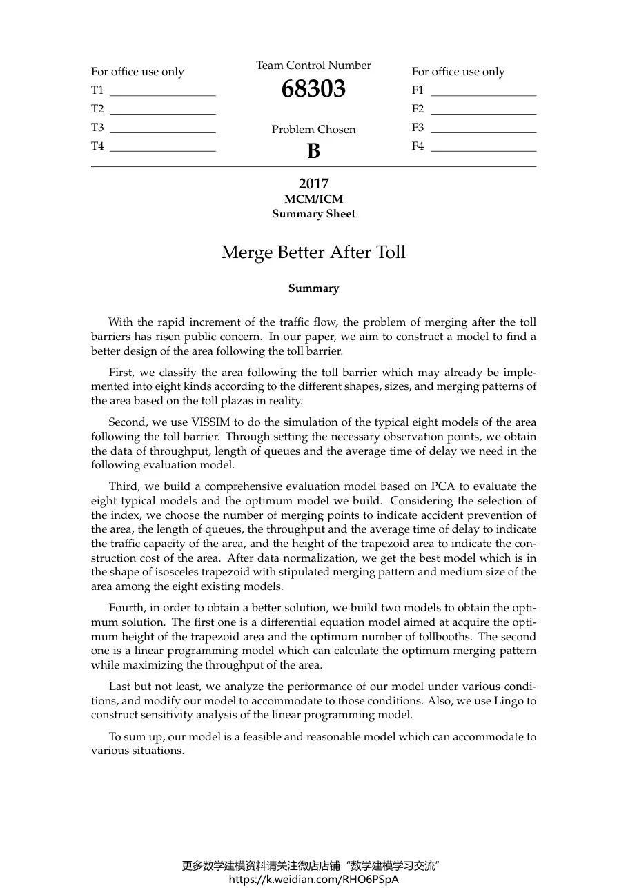

For office use only

Team Control Number

For office use only

T1

68303

F1

T2

F2

T3

Problem Chosen

F3

T4

B

F4

2017 MCM/ICM Summary Sheet

## Merge Better After Toll

### Summary

With the rapid increment of the traffic flow, the problem of merging after the toll barriers has risen public concern. In our paper, we aim to construct a model to find a better design of the area following the toll barrier.

First, we classify the area following the toll barrier which may already be implemented into eight kinds according to the different shapes, sizes, and merging patterns of the area based on the toll plazas in reality.

Second, we use VISSIM to do the simulation of the typical eight models of the area following the toll barrier. Through setting the necessary observation points, we obtain the data of throughput, length of queues and the average time of delay we need in the following evaluation model.

Third, we build a comprehensive evaluation model based on PCA to evaluate the eight typical models and the optimum model we build. Considering the selection of the index, we choose the number of merging points to indicate accident prevention of the area, the length of queues, the throughput and the average time of delay to indicate the traffic capacity of the area, and the height of the trapezoid area to indicate the construction cost of the area. After data normalization, we get the best model which is in the shape of isosceles trapezoid with stipulated merging pattern and medium size of the area among the eight existing models.

Fourth, in order to obtain a better solution, we build two models to obtain the optimum solution. The first one is a differential equation model aimed at acquire the optimum height of the trapezoid area and the optimum number of tollbooths. The second one is a linear programming model which can calculate the optimum merging pattern while maximizing the throughput of the area.

Last but not least, we analyze the performance of our model under various conditions, and modify our model to accommodate to those conditions. Also, we use Lingo to construct sensitivity analysis of the linear programming model.

To sum up, our model is a feasible and reasonable model which can accommodate to various situations.

更多数学建模资料请关注微店店铺“数学建模学习交流” https://k.weidian.com/RHO6PSpA

## 第2页

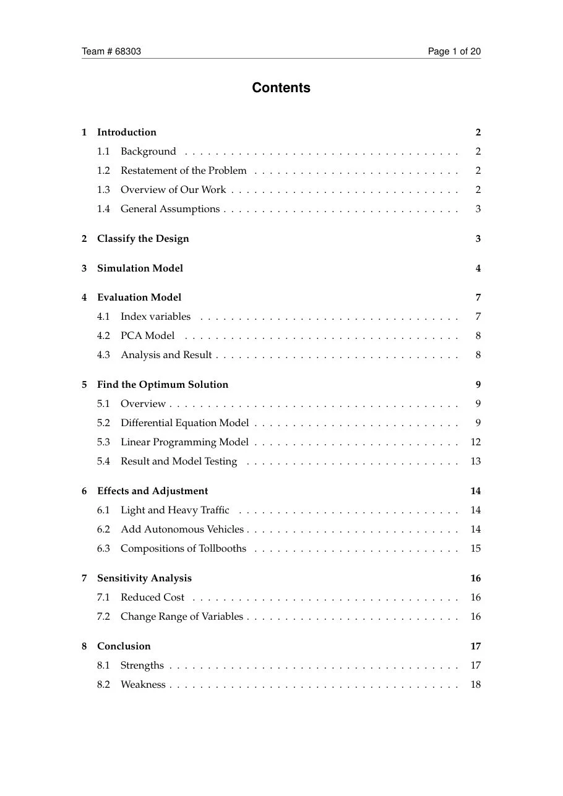

### Contents

1 Introduction 2
1.1 Background . . . . . . . . . . . . . . . . . . . . . . . . . . . . . . . . . . . . . . . . . . . . . . . . . . . . . . . . . . . . . . . . . . . . . . .
1.2 Restatement of the Problem . . . . . . . . . . . . . . . . . . . . . . . . . . . . . . . . . . . . . . . . . . . . . . . . . . . . . . . .
1.3 Overview of Our Work . . . . . . . . . . . . . . . . . . . . . . . . . . . . . . . . . . . . . . . . . . . . . . . . . . 2
1.4 General Assumptions .. ........ 3
2 Classify the Design 3
3 Simulation Model 4
4 Evaluation Model 7
4.1 Index variables ..... 7
4.2 PCA Model ..... 8
4.3 Analysis and Result ..... 8
5 Find the Optimum Solution 9
5.1 Overview ..... 9
5.2 Differential Equation Model ..... 9
5.3 Linear Programming Model ..... 12
5.4 Result and Model Testing ..... 13
6 Effects and Adjustment 14
6.1 Light and Heavy Traffic ..... 14
6.2 Add Autonomous Vehicles ..... 14
6.3 Compositions of Tollbooths ..... 15
7 Sensitivity Analysis 16
7.1 Reduced Cost ..... 16
7.2 Change Range of Variables ..... 16
8 Conclusion 17
8.1 Strengths ..... 17
8.2 Weakness ..... 18

Team # 68303

Page 1 of 20

## 第3页

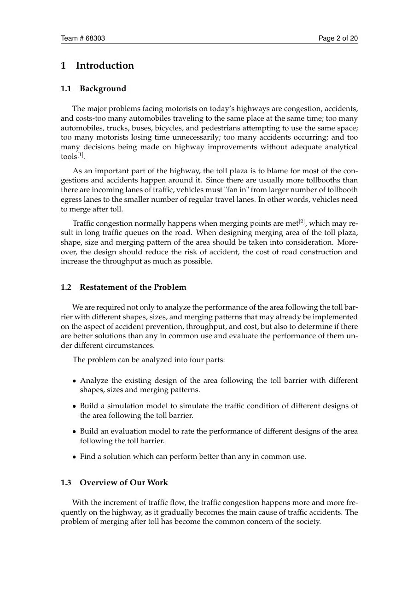

### 1 Introduction

### 1.1 Background

The major problems facing motorists on today’s highways are congestion, accidents, and costs-too many automobiles traveling to the same place at the same time; too many automobiles, trucks, buses, bicycles, and pedestrians attempting to use the same space; too many motorists losing time unnecessarily; too many accidents occurring; and too many decisions being made on highway improvements without adequate analytical tools[1].

As an important part of the highway, the toll plaza is to blame for most of the congestions and accidents happen around it. Since there are usually more tollbooths than there are incoming lanes of traffic, vehicles must "fan in" from larger number of tollbooth egress lanes to the smaller number of regular travel lanes. In other words, vehicles need to merge after toll.

Traffic congestion normally happens when merging points are met[2], which may result in long traffic queues on the road. When designing merging area of the toll plaza, shape, size and merging pattern of the area should be taken into consideration. Moreover, the design should reduce the risk of accident, the cost of road construction and increase the throughput as much as possible.

### 1.2 Restatement of the Problem

We are required not only to analyze the performance of the area following the toll barrier with different shapes, sizes, and merging patterns that may already be implemented on the aspect of accident prevention, throughput, and cost, but also to determine if there are better solutions than any in common use and evaluate the performance of them under different circumstances.

The problem can be analyzed into four parts:

Analyze the existing design of the area following the toll barrier with different shapes, sizes and merging patterns.

Build a simulation model to simulate the traffic condition of different designs of the area following the toll barrier.

Build an evaluation model to rate the performance of different designs of the area following the toll barrier.

Find a solution which can perform better than any in common use.

### 1.3 Overview of Our Work

With the increment of traffic flow, the traffic congestion happens more and more frequently on the highway, as it gradually becomes the main cause of traffic accidents. The problem of merging after toll has become the common concern of the society.

Team # 68303

Page 2 of 20

## 第4页

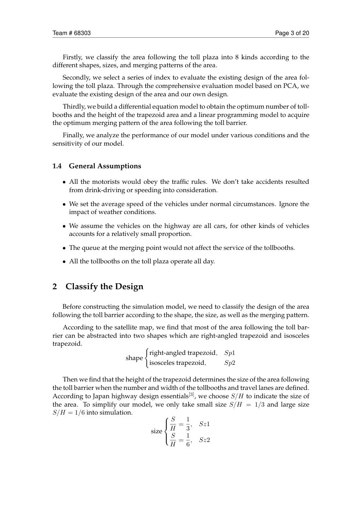

Firstly, we classify the area following the toll plaza into 8 kinds according to the different shapes, sizes, and merging patterns of the area.

Secondly, we select a series of index to evaluate the existing design of the area following the toll plaza. Through the comprehensive evaluation model based on PCA, we evaluate the existing design of the area and our own design.

Thirdly, we build a differential equation model to obtain the optimum number of tollbooths and the height of the trapezoid area and a linear programming model to acquire the optimum merging pattern of the area following the toll barrier.

Finally, we analyze the performance of our model under various conditions and the sensitivity of our model.

### 1.4 General Assumptions

All the motorists would obey the traffic rules. We don’t take accidents resulted from drink-driving or speeding into consideration.

We set the average speed of the vehicles under normal circumstances. Ignore the impact of weather conditions.

We assume the vehicles on the highway are all cars, for other kinds of vehicles accounts for a relatively small proportion.

The queue at the merging point would not affect the service of the tollbooths.

All the tollbooths on the toll plaza operate all day.

### 2 Classify the Design

Before constructing the simulation model, we need to classify the design of the area following the toll barrier according to the shape, the size, as well as the merging pattern.

According to the satellite map, we find that most of the area following the toll barrier can be abstracted into two shapes which are right-angled trapezoid and isosceles trapezoid.

$$
\mathrm{shape} \left\{ \begin{array}{l l} \mathrm{right-angledtrapezoid}, & S p 1 \\ \mathrm{isoscelestrapezoid}, & S p 2 \end{array} \right.
$$

Then we find that the height of the trapezoid determines the size of the area following the toll barrier when the number and width of the tollbooths and travel lanes are defined. According to Japan highway design essentials[3], we choose $S / H$ to indicate the size of the area. To simplify our model, we only take small size $S / H = 1 / 3$ and large size $S / H = 1 / 6$ into simulation.

$$
\text {size} \left\{ \begin{array}{l l} \frac {S}{H} = \frac {1}{3}, & S z 1 \\ \frac {S}{H} = \frac {1}{6}, & S z 2 \end{array} \right.
$$

Team # 68303

Page 3 of 20

## 第5页

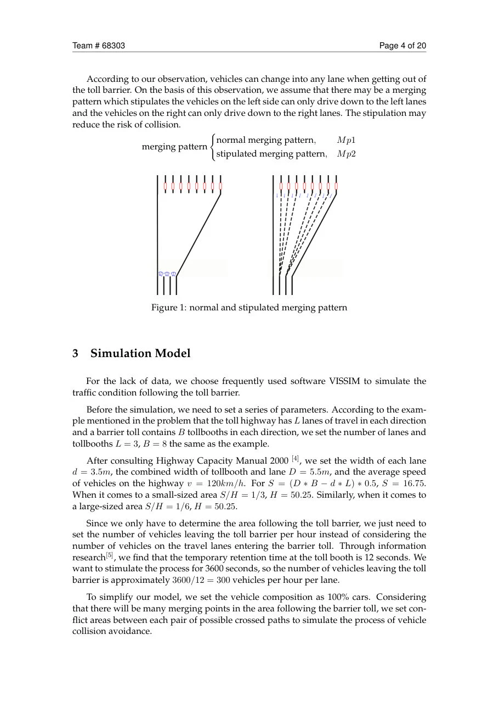

According to our observation, vehicles can change into any lane when getting out of the toll barrier. On the basis of this observation, we assume that there may be a merging pattern which stipulates the vehicles on the left side can only drive down to the left lanes and the vehicles on the right can only drive down to the right lanes. The stipulation may reduce the risk of collision.

### 3 Simulation Model

For the lack of data, we choose frequently used software VISSIM to simulate the traffic condition following the toll barrier.

Before the simulation, we need to set a series of parameters. According to the example mentioned in the problem that the toll highway has L lanes of travel in each direction and a barrier toll contains B tollbooths in each direction, we set the number of lanes and tollbooths $L = 3 , B = 8$ the same as the example.

After consulting Highway Capacity Manual 2000 [4], we set the width of each lane $d = 3 . 5 m ,$ , the combined width of tollbooth and lane $D = 5 . 5 m ,$ , and the average speed of vehicles on the highway $v = 1 2 0 k m / h$ . For $S = ( D * B - d * L ) * 0 . 5 , S = 1 6 . 7 5$ When it comes to a small-sized area $S / H = 1 / 3 , H = 5 0 . 2 5$ . Similarly, when it comes to a large-sized area $S / H = 1 / 6 , H = 5 0 . 2 5$

Since we only have to determine the area following the toll barrier, we just need to set the number of vehicles leaving the toll barrier per hour instead of considering the number of vehicles on the travel lanes entering the barrier toll. Through information research[5], we find that the temporary retention time at the toll booth is 12 seconds. We want to stimulate the process for 3600 seconds, so the number of vehicles leaving the toll barrier is approximately $3 6 0 0 / 1 2 = 3 0 0$ vehicles per hour per lane.

To simplify our model, we set the vehicle composition as 100% cars. Considering that there will be many merging points in the area following the barrier toll, we set conflict areas between each pair of possible crossed paths to simulate the process of vehicle collision avoidance.

Team # 68303

Page 4 of 20

## 第6页

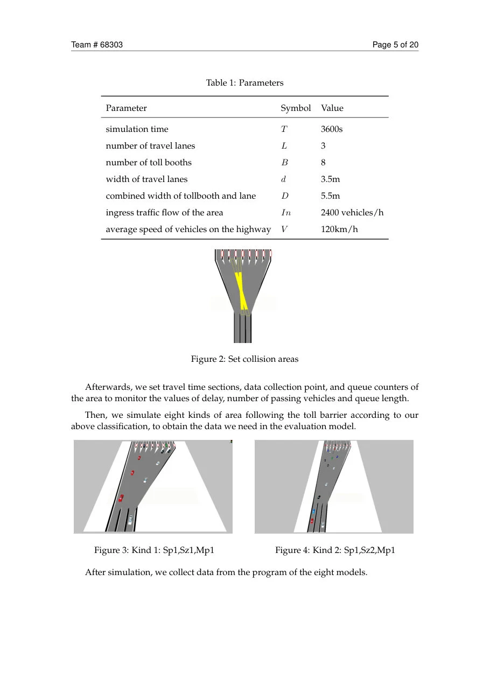

Table 1: Parameters
<table><tr><td>Parameter</td><td>Symbol</td><td>Value</td></tr><tr><td>simulation time</td><td>T</td><td>3600s</td></tr><tr><td>number of travel lanes</td><td>L</td><td>3</td></tr><tr><td>number of toll booths</td><td>B</td><td>8</td></tr><tr><td>width of travel lanes</td><td>d</td><td>3.5m</td></tr><tr><td>combined width of tollbooth and lane</td><td>D</td><td>5.5m</td></tr><tr><td>ingress traffic flow of the area</td><td>In</td><td>2400 vehicles/h</td></tr><tr><td>average speed of vehicles on the highway</td><td>V</td><td>120km/h</td></tr></table>

Afterwards, we set travel time sections, data collection point, and queue counters of the area to monitor the values of delay, number of passing vehicles and queue length.

Then, we simulate eight kinds of area following the toll barrier according to our above classification, to obtain the data we need in the evaluation model.

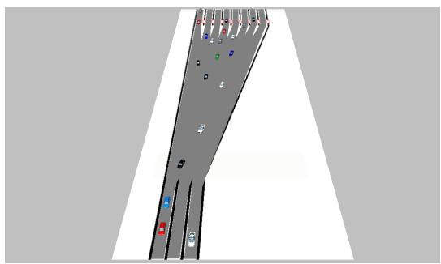

Team # 68303

Page 5 of 20

## 第7页

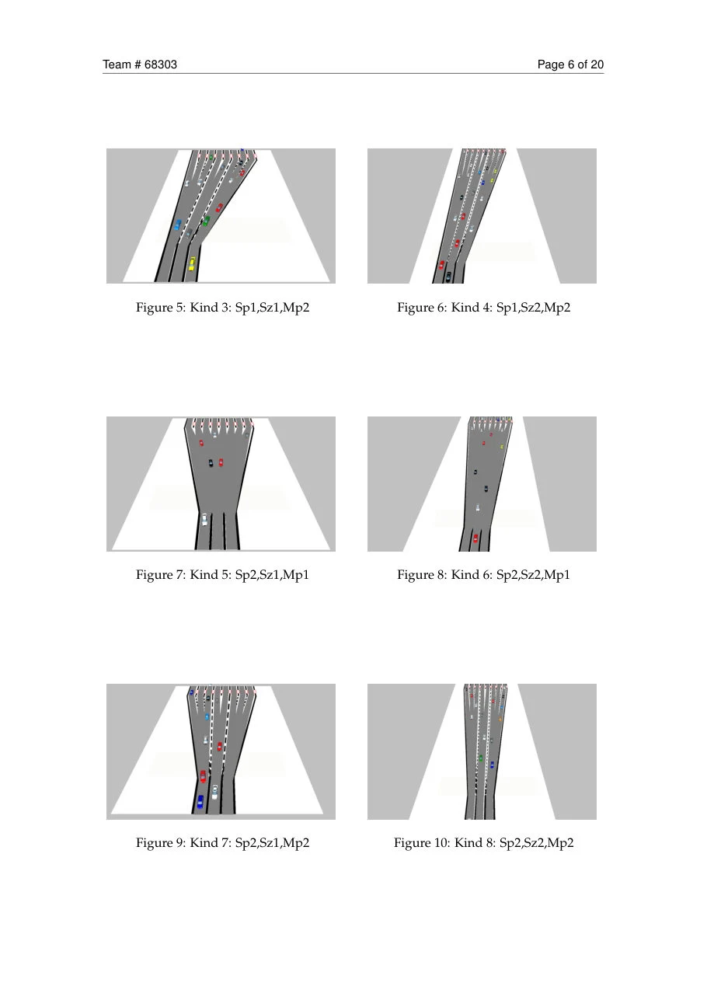

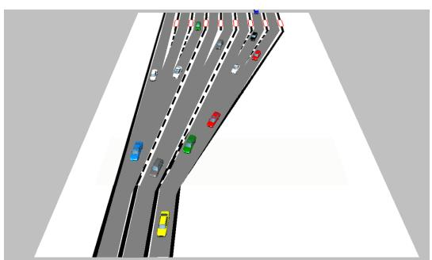

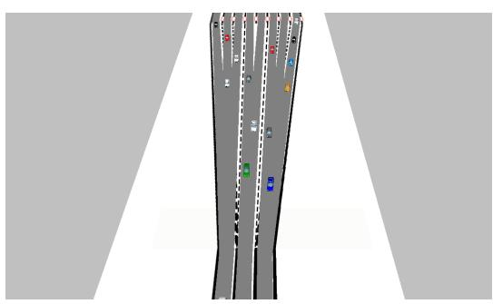

Team # 68303

Page 6 of 20

## 第8页

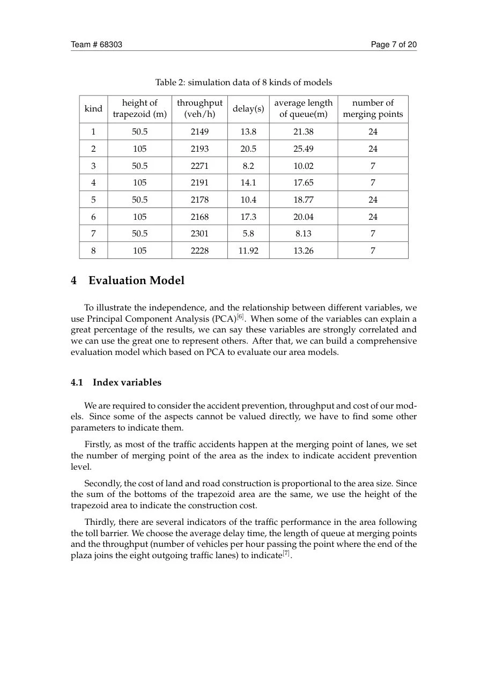

Table 2: simulation data of 8 kinds of models
<table><tr><td>kind</td><td>height of trapezoid (m)</td><td>throughput (veh/h)</td><td>delay(s)</td><td>average length of queue(m)</td><td>number of merging points</td></tr><tr><td>1</td><td>50.5</td><td>2149</td><td>13.8</td><td>21.38</td><td>24</td></tr><tr><td>2</td><td>105</td><td>2193</td><td>20.5</td><td>25.49</td><td>24</td></tr><tr><td>3</td><td>50.5</td><td>2271</td><td>8.2</td><td>10.02</td><td>7</td></tr><tr><td>4</td><td>105</td><td>2191</td><td>14.1</td><td>17.65</td><td>7</td></tr><tr><td>5</td><td>50.5</td><td>2178</td><td>10.4</td><td>18.77</td><td>24</td></tr><tr><td>6</td><td>105</td><td>2168</td><td>17.3</td><td>20.04</td><td>24</td></tr><tr><td>7</td><td>50.5</td><td>2301</td><td>5.8</td><td>8.13</td><td>7</td></tr><tr><td>8</td><td>105</td><td>2228</td><td>11.92</td><td>13.26</td><td>7</td></tr></table>

### 4 Evaluation Model

To illustrate the independence, and the relationship between different variables, we use Principal Component Analysis (PCA)[6]. When some of the variables can explain a great percentage of the results, we can say these variables are strongly correlated and we can use the great one to represent others. After that, we can build a comprehensive evaluation model which based on PCA to evaluate our area models.

### 4.1 Index variables

We are required to consider the accident prevention, throughput and cost of our models. Since some of the aspects cannot be valued directly, we have to find some other parameters to indicate them.

Firstly, as most of the traffic accidents happen at the merging point of lanes, we set the number of merging point of the area as the index to indicate accident prevention level.

Secondly, the cost of land and road construction is proportional to the area size. Since the sum of the bottoms of the trapezoid area are the same, we use the height of the trapezoid area to indicate the construction cost.

Thirdly, there are several indicators of the traffic performance in the area following the toll barrier. We choose the average delay time, the length of queue at merging points and the throughput (number of vehicles per hour passing the point where the end of the plaza joins the eight outgoing traffic lanes) to indicate[7].

Team # 68303

Page 7 of 20

## 第9页

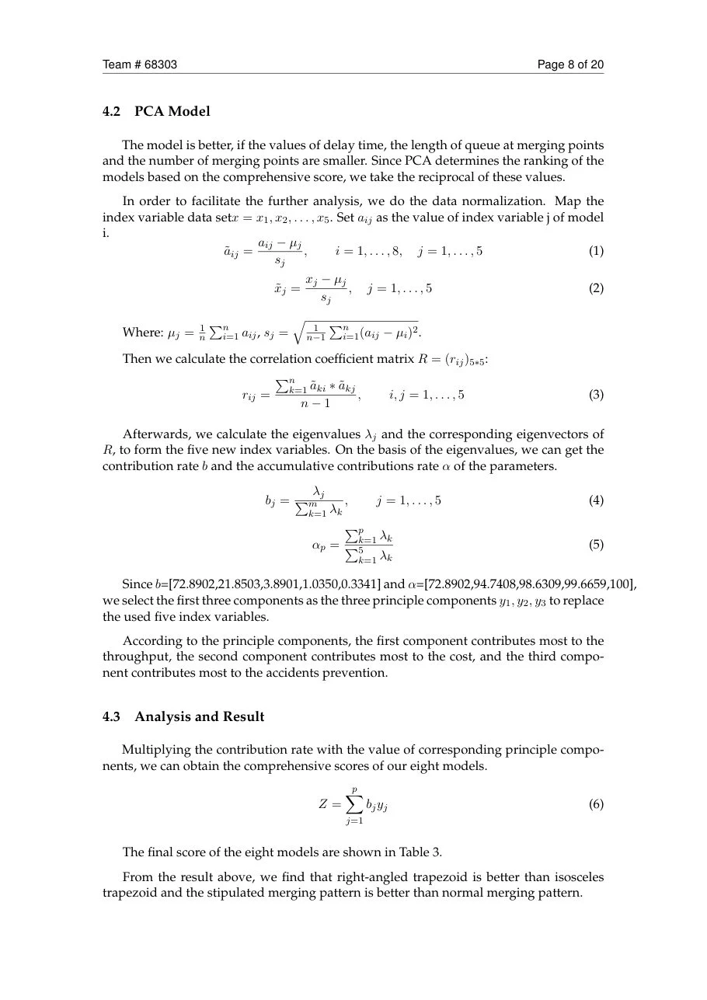

### 4.2 PCA Model

The model is better, if the values of delay time, the length of queue at merging points and the number of merging points are smaller. Since PCA determines the ranking of the models based on the comprehensive score, we take the reciprocal of these values.

In order to facilitate the further analysis, we do the data normalization. Map the index variable data $\sec x = x _ { 1 } , x _ { 2 } , \dotsc , x _ { 5 } . \sec a _ { i j }$ as the value of index variable j of model i.

$$
\tilde {a} _ {i j} = \frac {a _ {i j} - \mu_ {j}}{s _ {j}}, \qquad i = 1, \ldots , 8, \quad j = 1, \ldots , 5\tag{1}
$$

$$
\tilde {x} _ {j} = \frac {x _ {j} - \mu_ {j}}{s _ {j}}, \quad j = 1, \ldots , 5\tag{2}
$$

Where: $\begin{array} { r } { \mu _ { j } = \frac { 1 } { n } \sum _ { i = 1 } ^ { n } a _ { i j } , s _ { j } = \sqrt { \frac { 1 } { n - 1 } \sum _ { i = 1 } ^ { n } ( a _ { i j } - \mu _ { i } ) ^ { 2 } } . } \end{array}$

Then we calculate the correlation coefficient matrix $\boldsymbol { R } = ( r _ { i j } ) _ { 5 * 5 } \mathrm { : }$

$$
r _ {i j} = \frac {\sum_ {k = 1} ^ {n} \tilde {a} _ {k i} * \tilde {a} _ {k j}}{n - 1}, \qquad i, j = 1, \ldots , 5\tag{3}
$$

Afterwards, we calculate the eigenvalues $\lambda _ { j }$ and the corresponding eigenvectors of R, to form the five new index variables. On the basis of the eigenvalues, we can get the contribution rate b and the accumulative contributions rate α of the parameters.

$$
b _ {j} = \frac {\lambda_ {j}}{\sum_ {k = 1} ^ {m} \lambda_ {k}}, \qquad j = 1, \ldots , 5\tag{4}
$$

$$
\alpha_ {p} = \frac {\sum_ {k = 1} ^ {p} \lambda_ {k}}{\sum_ {k = 1} ^ {5} \lambda_ {k}}\tag{5}
$$

Since $b = [ 7 2 . 8 9 0 2 , 2 1 . 8 5 0 3 , 3 . 8 9 0 1 , 1 . 0 3 5 0 , 0 . 3 3 4 1 ]$ and α=[72.8902,94.7408,98.6309,99.6659,100], we select the first three components as the three principle components $y _ { 1 } , y _ { 2 } , y _ { 3 }$ to replace the used five index variables.

According to the principle components, the first component contributes most to the throughput, the second component contributes most to the cost, and the third component contributes most to the accidents prevention.

### 4.3 Analysis and Result

Multiplying the contribution rate with the value of corresponding principle components, we can obtain the comprehensive scores of our eight models.

$$
Z = \sum_ {j = 1} ^ {p} b _ {j} y _ {j}\tag{6}
$$

The final score of the eight models are shown in Table 3.

From the result above, we find that right-angled trapezoid is better than isosceles trapezoid and the stipulated merging pattern is better than normal merging pattern.

Team # 68303

Page 8 of 20

## 第10页

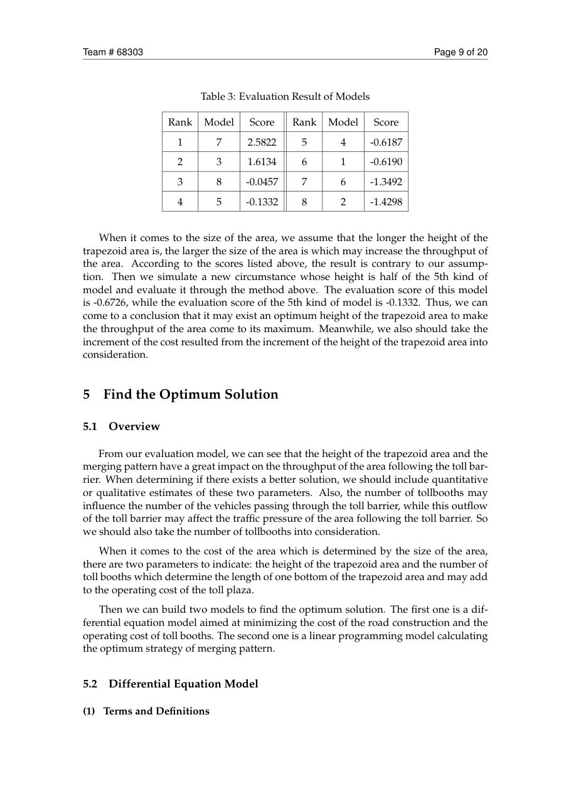

Table 3: Evaluation Result of Models
<table><tr><td>Rank</td><td>Model</td><td>Score</td><td>Rank</td><td>Model</td><td>Score</td></tr><tr><td>1</td><td>7</td><td>2.5822</td><td>5</td><td>4</td><td>-0.6187</td></tr><tr><td>2</td><td>3</td><td>1.6134</td><td>6</td><td>1</td><td>-0.6190</td></tr><tr><td>3</td><td>8</td><td>-0.0457</td><td>7</td><td>6</td><td>-1.3492</td></tr><tr><td>4</td><td>5</td><td>-0.1332</td><td>8</td><td>2</td><td>-1.4298</td></tr></table>

When it comes to the size of the area, we assume that the longer the height of the trapezoid area is, the larger the size of the area is which may increase the throughput of the area. According to the scores listed above, the result is contrary to our assumption. Then we simulate a new circumstance whose height is half of the 5th kind of model and evaluate it through the method above. The evaluation score of this model is -0.6726, while the evaluation score of the 5th kind of model is -0.1332. Thus, we can come to a conclusion that it may exist an optimum height of the trapezoid area to make the throughput of the area come to its maximum. Meanwhile, we also should take the increment of the cost resulted from the increment of the height of the trapezoid area into consideration.

### 5 Find the Optimum Solution

### 5.1 Overview

From our evaluation model, we can see that the height of the trapezoid area and the merging pattern have a great impact on the throughput of the area following the toll barrier. When determining if there exists a better solution, we should include quantitative or qualitative estimates of these two parameters. Also, the number of tollbooths may influence the number of the vehicles passing through the toll barrier, while this outflow of the toll barrier may affect the traffic pressure of the area following the toll barrier. So we should also take the number of tollbooths into consideration.

When it comes to the cost of the area which is determined by the size of the area, there are two parameters to indicate: the height of the trapezoid area and the number of toll booths which determine the length of one bottom of the trapezoid area and may add to the operating cost of the toll plaza.

Then we can build two models to find the optimum solution. The first one is a differential equation model aimed at minimizing the cost of the road construction and the operating cost of toll booths. The second one is a linear programming model calculating the optimum strategy of merging pattern.

### 5.2 Differential Equation Model

(1) Terms and Definitions

Team # 68303

Page 9 of 20

## 第11页

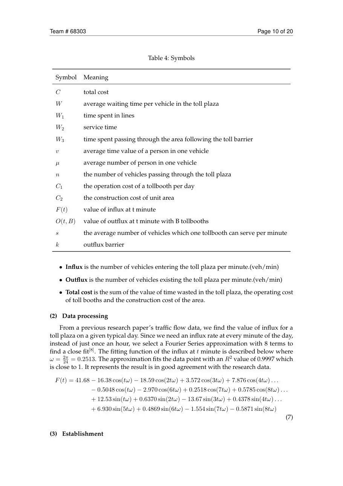

Table 4: Symbols
<table><tr><td>Symbol</td><td>Meaning</td></tr><tr><td>C</td><td>total cost</td></tr><tr><td>W</td><td>average waiting time per vehicle in the toll plaza</td></tr><tr><td> $W_1$ </td><td>time spent in lines</td></tr><tr><td> $W_2$ </td><td>service time</td></tr><tr><td> $W_3$ </td><td>time spent passing through the area following the toll barrier</td></tr><tr><td>v</td><td>average time value of a person in one vehicle</td></tr><tr><td>μ</td><td>average number of person in one vehicle</td></tr><tr><td>n</td><td>the number of vehicles passing through the toll plaza</td></tr><tr><td> $C_1$ </td><td>the operation cost of a tollbooth per day</td></tr><tr><td> $C_2$ </td><td>the construction cost of unit area</td></tr><tr><td>F(t)</td><td>value of influx at t minute</td></tr><tr><td>O(t,B)</td><td>value of outflux at t minute with B tollbooths</td></tr><tr><td>s</td><td>the average number of vehicles which one tollbooth can serve per minute</td></tr><tr><td>k</td><td>outflux barrier</td></tr></table>

Influx is the number of vehicles entering the toll plaza per minute.(veh/min)

Outflux is the number of vehicles existing the toll plaza per minute.(veh/min)

Total cost is the sum of the value of time wasted in the toll plaza, the operating cost of toll booths and the construction cost of the area.

### (2) Data processing

From a previous research paper’s traffic flow data, we find the value of influx for a toll plaza on a given typical day. Since we need an influx rate at every minute of the day, instead of just once an hour, we select a Fourier Series approximation with 8 terms to find a close fit[8]. The fitting function of the influx at t minute is described below where $\begin{array} { r } { \omega = \frac { 2 \pi } { 2 4 } = 0 . 2 5 1 3 } \end{array}$ . The approximation fits the data point with an $R ^ { 2 }$ value of 0.9997 which is close to 1. It represents the result is in good agreement with the research data.

$$
\begin{array}{r l} & F (t) = 4 1. 6 8 - 1 6. 3 8 \cos (t \omega) - 1 8. 5 9 \cos (2 t \omega) + 3. 5 7 2 \cos (3 t \omega) + 7. 8 7 6 \cos (4 t \omega) \dots \\ & \qquad - 0. 5 0 4 8 \cos (t \omega) - 2. 9 7 0 \cos (6 t \omega) + 0. 2 5 1 8 \cos (7 t \omega) + 0. 5 7 8 5 \cos (8 t \omega) \dots \\ & \qquad + 1 2. 5 3 \sin (t \omega) + 0. 6 3 7 0 \sin (2 t \omega) - 1 3. 6 7 \sin (3 t \omega) + 0. 4 3 7 8 \sin (4 t \omega) \dots \\ & \qquad + 6. 9 3 0 \sin (5 t \omega) + 0. 4 8 6 9 \sin (6 t \omega) - 1. 5 5 4 \sin (7 t \omega) - 0. 5 8 7 1 \sin (8 t \omega) \end{array}\tag{7}
$$

### (3) Establishment

Team # 68303

Page 10 of 20

## 第12页

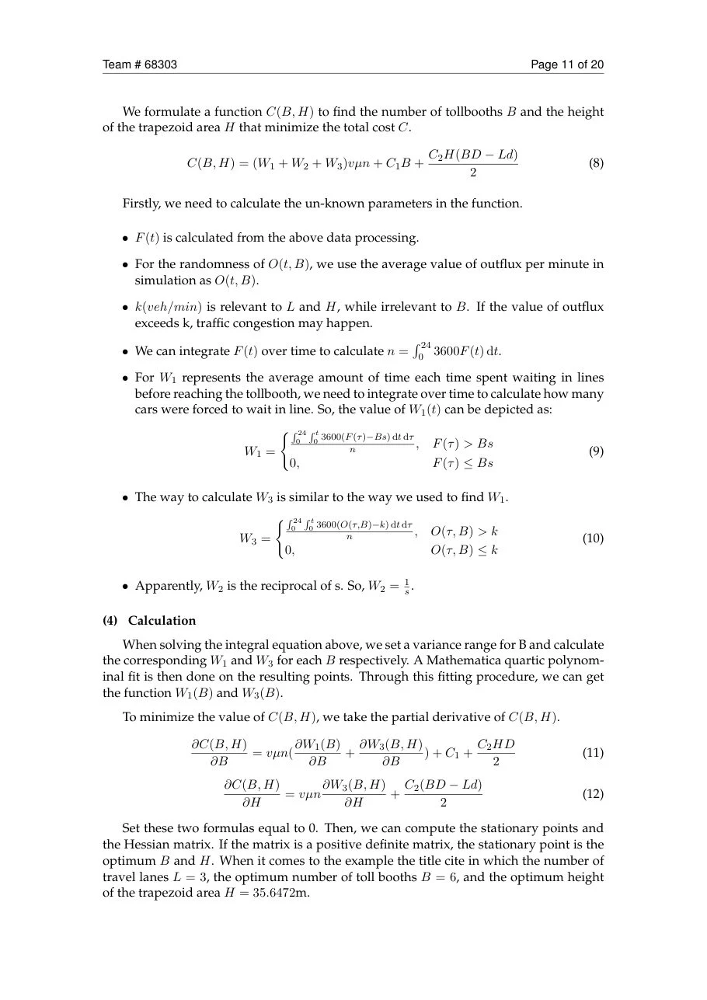

We formulate a function $C ( B , H )$ to find the number of tollbooths B and the height of the trapezoid area H that minimize the total cost C.

$$
C (B, H) = \left(W _ {1} + W _ {2} + W _ {3}\right) v \mu n + C _ {1} B + \frac {C _ {2} H (B D - L d)}{2}\tag{8}
$$

Firstly, we need to calculate the un-known parameters in the function.

$F ( t )$ is calculated from the above data processing.

For the randomness of $O ( t , B )$ , we use the average value of outflux per minute in simulation as $O ( t , B )$

$k ( v e h / m i n )$ is relevant to L and $H ,$ while irrelevant to B. If the value of outflux exceeds $\mathbf { k } ,$ traffic congestion may happen.

We can integrate $F ( t )$ over time to calculate $\begin{array} { r } { n = \int _ { 0 } ^ { 2 4 } 3 6 0 0 F ( t ) \mathrm { d } t } \end{array}$

For $W _ { 1 }$ represents the average amount of time each time spent waiting in lines before reaching the tollbooth, we need to integrate over time to calculate how many cars were forced to wait in line. So, the value of $W _ { 1 } ( t )$ can be depicted as:

$$
W _ {1} = \left\{ \begin{array}{l l} \frac {\int_ {0} ^ {2 4} \int_ {0} ^ {t} 3 6 0 0 (F (\tau) - B s)   \mathrm{d} t   \mathrm{d} \tau}{n}, & F (\tau) > B s \\ 0, & F (\tau) \leq B s \end{array} \right.\tag{9}
$$

The way to calculate $W _ { 3 }$ is similar to the way we used to find $W _ { 1 }$ .

$$
W _ {3} = \left\{ \begin{array}{l l} \frac {\int_ {0} ^ {2 4} \int_ {0} ^ {t} 3 6 0 0 (O (\tau , B) - k)   \mathrm{d} t   \mathrm{d} \tau}{n}, & O (\tau , B) > k \\ 0, & O (\tau , B) \leq k \end{array} \right.\tag{10}
$$

Apparently, $W _ { 2 }$ is the reciprocal of s. $\begin{array} { r } { { \cal S } _ { 0 } , { \cal W } _ { 2 } = \frac { 1 } { s } } \end{array}$

### (4) Calculation

When solving the integral equation above, we set a variance range for B and calculate the corresponding $W _ { 1 }$ and $W _ { 3 }$ for each B respectively. A Mathematica quartic polynominal fit is then done on the resulting points. Through this fitting procedure, we can get the function $W _ { 1 } ( B )$ and $W _ { 3 } ( B )$ .

To minimize the value of $C ( B , H )$ , we take the partial derivative of $C ( B , H )$

$$
\frac {\partial C (B , H)}{\partial B} = v \mu n (\frac {\partial W _ {1} (B)}{\partial B} + \frac {\partial W _ {3} (B , H)}{\partial B}) + C _ {1} + \frac {C _ {2} H D}{2}\tag{11}
$$

$$
\frac {\partial C (B , H)}{\partial H} = v \mu n \frac {\partial W _ {3} (B , H)}{\partial H} + \frac {C _ {2} (B D - L d)}{2}\tag{12}
$$

Set these two formulas equal to 0. Then, we can compute the stationary points and the Hessian matrix. If the matrix is a positive definite matrix, the stationary point is the optimum B and H. When it comes to the example the title cite in which the number of travel lanes $L = 3 ,$ , the optimum number of toll booths $B = 6 ,$ , and the optimum height of the trapezoid area $H = 3 5 . 6 4 7 2 \mathrm { m }$

Team # 68303

Page 11 of 20

## 第13页

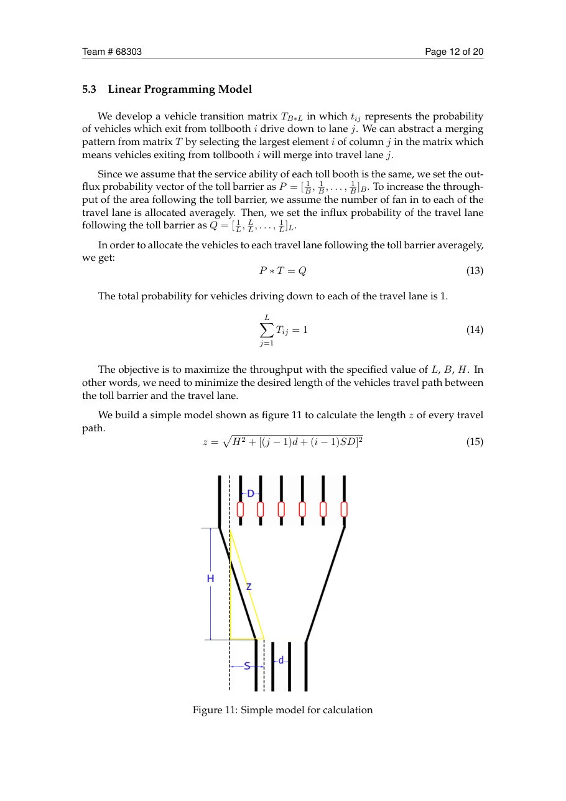

### 5.3 Linear Programming Model

We develop a vehicle transition matrix $T _ { B * L }$ in which $t _ { i j }$ represents the probability of vehicles which exit from tollbooth i drive down to lane j. We can abstract a merging pattern from matrix T by selecting the largest element i of column j in the matrix which means vehicles exiting from tollbooth i will merge into travel lane j.

Since we assume that the service ability of each toll booth is the same, we set the outflux probability vector of the toll barrier as $\boldsymbol { P } = \bigl [ \frac { 1 } { B } , \frac { 1 } { B } , \dots , \frac { 1 } { B } \bigr ] _ { B }$ . To increase the throughput of the area following the toll barrier, we assume the number of fan in to each of the travel lane is allocated averagely. Then, we set the influx probability of the travel lane following the toll barrier as $\overset { \smile } { Q } = \bigl [ \frac { 1 } { L } , \frac { L } { L } , \dots , \frac { 1 } { L } \bigr ] _ { L }$

In order to allocate the vehicles to each travel lane following the toll barrier averagely, we get:

$$
P * T = Q\tag{13}
$$

The total probability for vehicles driving down to each of the travel lane is 1.

$$
\sum_ {j = 1} ^ {L} T _ {i j} = 1\tag{14}
$$

The objective is to maximize the throughput with the specified value of $L , B , H$ . In other words, we need to minimize the desired length of the vehicles travel path between the toll barrier and the travel lane.

We build a simple model shown as figure 11 to calculate the length z of every travel path.

$$
z = \sqrt {H ^ {2} + [ (j - 1) d + (i - 1) S D ] ^ {2}}\tag{15}
$$

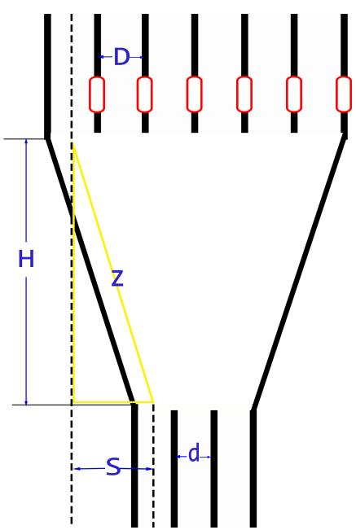

Team # 68303

Page 12 of 20

## 第14页

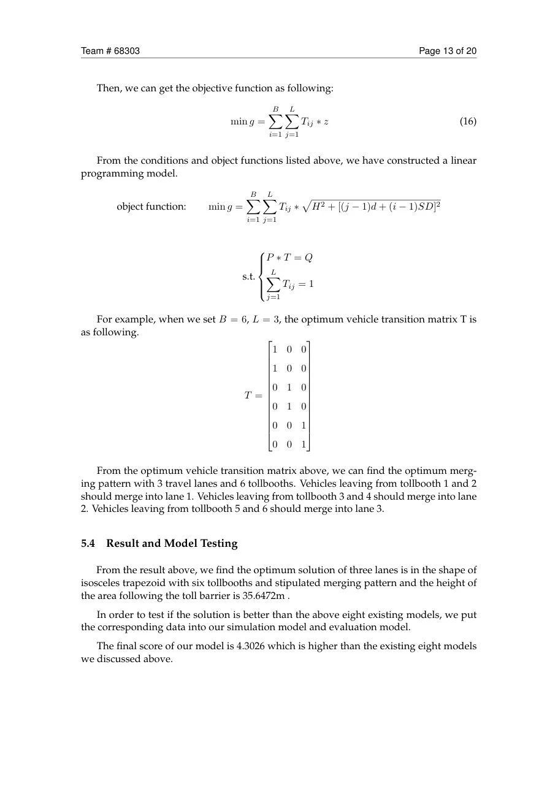

Then, we can get the objective function as following:

$$
\min g = \sum_ {i = 1} ^ {B} \sum_ {j = 1} ^ {L} T _ {i j} * z\tag{16}
$$

From the conditions and object functions listed above, we have constructed a linear programming model.

object function:

$$
\min g = \sum_ {i = 1} ^ {B} \sum_ {j = 1} ^ {L} T _ {i j} * \sqrt {H ^ {2} + [ (j - 1) d + (i - 1) S D ] ^ {2}}
$$

$$
\text {s.t.} \left\{ \begin{array}{l} P * T = Q \\ \sum_ {j = 1} ^ {L} T _ {i j} = 1 \end{array} \right.
$$

For example, when we set $B = 6 , L = 3$ , the optimum vehicle transition matrix T is as following.

$$
T = \left[ \begin{array}{c c c} 1 & 0 & 0 \\ 1 & 0 & 0 \\ 0 & 1 & 0 \\ 0 & 1 & 0 \\ 0 & 0 & 1 \\ 0 & 0 & 1 \end{array} \right]
$$

From the optimum vehicle transition matrix above, we can find the optimum merging pattern with 3 travel lanes and 6 tollbooths. Vehicles leaving from tollbooth 1 and 2 should merge into lane 1. Vehicles leaving from tollbooth 3 and 4 should merge into lane 2. Vehicles leaving from tollbooth 5 and 6 should merge into lane 3.

### 5.4 Result and Model Testing

From the result above, we find the optimum solution of three lanes is in the shape of isosceles trapezoid with six tollbooths and stipulated merging pattern and the height of the area following the toll barrier is 35.6472m .

In order to test if the solution is better than the above eight existing models, we put the corresponding data into our simulation model and evaluation model.

The final score of our model is 4.3026 which is higher than the existing eight models we discussed above.

Team # 68303

Page 13 of 20

## 第15页

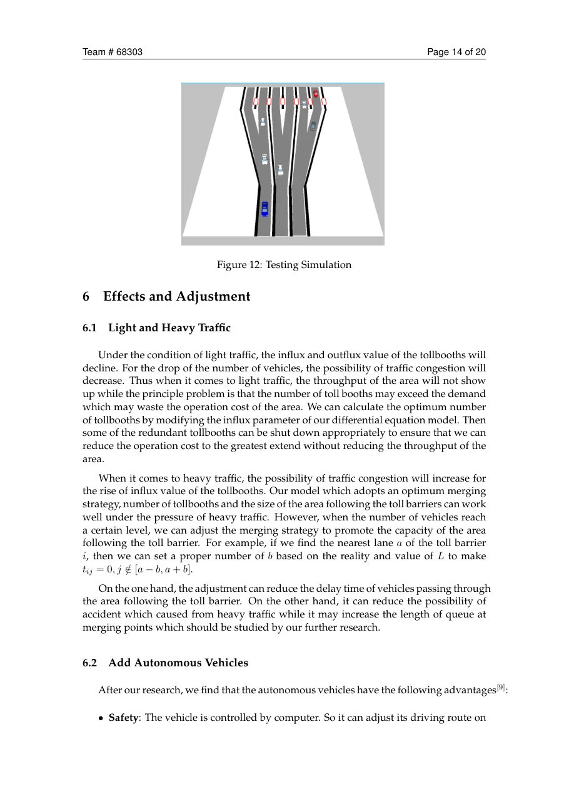

### 6 Effects and Adjustment

### 6.1 Light and Heavy Traffic

Under the condition of light traffic, the influx and outflux value of the tollbooths will decline. For the drop of the number of vehicles, the possibility of traffic congestion will decrease. Thus when it comes to light traffic, the throughput of the area will not show up while the principle problem is that the number of toll booths may exceed the demand which may waste the operation cost of the area. We can calculate the optimum number of tollbooths by modifying the influx parameter of our differential equation model. Then some of the redundant tollbooths can be shut down appropriately to ensure that we can reduce the operation cost to the greatest extend without reducing the throughput of the area.

When it comes to heavy traffic, the possibility of traffic congestion will increase for the rise of influx value of the tollbooths. Our model which adopts an optimum merging strategy, number of tollbooths and the size of the area following the toll barriers can work well under the pressure of heavy traffic. However, when the number of vehicles reach a certain level, we can adjust the merging strategy to promote the capacity of the area following the toll barrier. For example, if we find the nearest lane a of the toll barrier i, then we can set a proper number of b based on the reality and value of L to make $t _ { i j } = 0 , j \notin \left[ a - b , a + b \right]$

On the one hand, the adjustment can reduce the delay time of vehicles passing through the area following the toll barrier. On the other hand, it can reduce the possibility of accident which caused from heavy traffic while it may increase the length of queue at merging points which should be studied by our further research.

### 6.2 Add Autonomous Vehicles

After our research, we find that the autonomous vehicles have the following advantages[9]:

Safety: The vehicle is controlled by computer. So it can adjust its driving route on time and choose the safer path when entering the area following the toll barrier. As a result, self-driving can reduce the risk of traffic accidents caused by limitations of human beings.

Team # 68303

Page 14 of 20

## 第16页

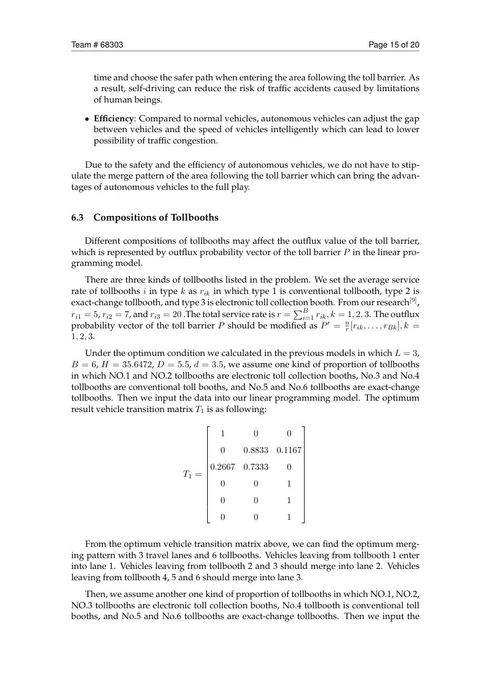

Efficiency: Compared to normal vehicles, autonomous vehicles can adjust the gap between vehicles and the speed of vehicles intelligently which can lead to lower possibility of traffic congestion.

Due to the safety and the efficiency of autonomous vehicles, we do not have to stipulate the merge pattern of the area following the toll barrier which can bring the advantages of autonomous vehicles to the full play.

### 6.3 Compositions of Tollbooths

Different compositions of tollbooths may affect the outflux value of the toll barrier, which is represented by outflux probability vector of the toll barrier $P$ in the linear programming model.

There are three kinds of tollbooths listed in the problem. We set the average service rate of tollbooths i in type k as $r _ { i k }$ in which type 1 is conventional tollbooth, type 2 is exact-change tollbooth, and type 3 is electronic toll collection booth. From our research $[ 9 ]$ , $r _ { i 1 } = 5 , r _ { i 2 } = 7 .$ , and $r _ { i 3 } = 2 0$ .The total service rate is $\begin{array} { r } { r = \sum _ { i = 1 } ^ { B } r _ { i k } , k = 1 , 2 , 3 } \end{array}$ . The outflux probability vector of the toll barrier $P$ should be modified as $\begin{array} { r } { P ^ { \prime } = \frac { n } { r } [ r _ { i k } , \dots , r _ { B k } ] , k = } \end{array}$ 1, 2, 3.

Under the optimum condition we calculated in the previous models in which $L = 3 ,$ $B = 6 , H = 3 5 . 6 4 7 2 , D = 5 . 5 , d = 3 . 5$ , we assume one kind of proportion of tollbooths in which NO.1 and NO.2 tollbooths are electronic toll collection booths, No.3 and No.4 tollbooths are conventional toll booths, and No.5 and No.6 tollbooths are exact-change tollbooths. Then we input the data into our linear programming model. The optimum result vehicle transition matrix $T _ { 1 }$ is as following:

$$
T _ {1} = \left[ \begin{array}{c c c} 1 & 0 & 0 \\ 0 & 0. 8 8 3 3 & 0. 1 1 6 7 \\ 0. 2 6 6 7 & 0. 7 3 3 3 & 0 \\ 0 & 0 & 1 \\ 0 & 0 & 1 \\ 0 & 0 & 1 \end{array} \right]
$$

From the optimum vehicle transition matrix above, we can find the optimum merging pattern with 3 travel lanes and 6 tollbooths. Vehicles leaving from tollbooth 1 enter into lane 1. Vehicles leaving from tollbooth 2 and 3 should merge into lane 2. Vehicles leaving from tollbooth 4, 5 and 6 should merge into lane 3.

Then, we assume another one kind of proportion of tollbooths in which NO.1, NO.2, NO.3 tollbooths are electronic toll collection booths, No.4 tollbooth is conventional toll booths, and No.5 and No.6 tollbooths are exact-change tollbooths. Then we input the data into our linear programming model. The optimum result vehicle transition matrix $T _ { 2 }$ is as following:

Team # 68303

Page 15 of 20

## 第17页

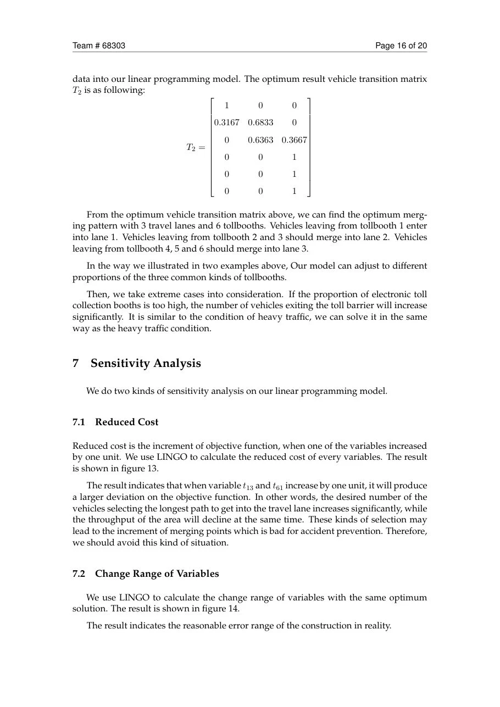

$$
T _ {2} = \left[ \begin{array}{c c c} 1 & 0 & 0 \\ 0. 3 1 6 7 & 0. 6 8 3 3 & 0 \\ 0 & 0. 6 3 6 3 & 0. 3 6 6 7 \\ 0 & 0 & 1 \\ 0 & 0 & 1 \\ 0 & 0 & 1 \end{array} \right]
$$

From the optimum vehicle transition matrix above, we can find the optimum merging pattern with 3 travel lanes and 6 tollbooths. Vehicles leaving from tollbooth 1 enter into lane 1. Vehicles leaving from tollbooth 2 and 3 should merge into lane 2. Vehicles leaving from tollbooth 4, 5 and 6 should merge into lane 3.

In the way we illustrated in two examples above, Our model can adjust to different proportions of the three common kinds of tollbooths.

Then, we take extreme cases into consideration. If the proportion of electronic toll collection booths is too high, the number of vehicles exiting the toll barrier will increase significantly. It is similar to the condition of heavy traffic, we can solve it in the same way as the heavy traffic condition.

### 7 Sensitivity Analysis

We do two kinds of sensitivity analysis on our linear programming model.

### 7.1 Reduced Cost

Reduced cost is the increment of objective function, when one of the variables increased by one unit. We use LINGO to calculate the reduced cost of every variables. The result is shown in figure 13.

The result indicates that when variable $t _ { 1 3 }$ and $t _ { 6 1 }$ increase by one unit, it will produce a larger deviation on the objective function. In other words, the desired number of the vehicles selecting the longest path to get into the travel lane increases significantly, while the throughput of the area will decline at the same time. These kinds of selection may lead to the increment of merging points which is bad for accident prevention. Therefore, we should avoid this kind of situation.

### 7.2 Change Range of Variables

We use LINGO to calculate the change range of variables with the same optimum solution. The result is shown in figure 14.

The result indicates the reasonable error range of the construction in reality.

Team # 68303

Page 16 of 20

## 第18页

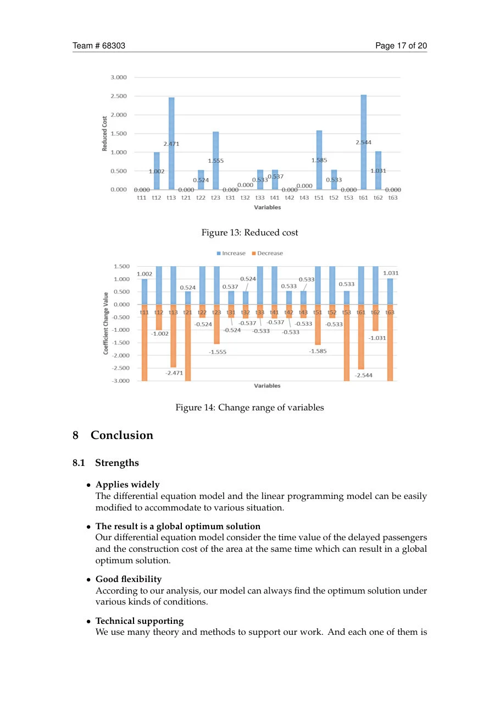

### 8 Conclusion

### 8.1 Strengths

### • Applies widely

The differential equation model and the linear programming model can be easily modified to accommodate to various situation.

### The result is a global optimum solution

Our differential equation model consider the time value of the delayed passengers and the construction cost of the area at the same time which can result in a global optimum solution.

### Good flexibility

According to our analysis, our model can always find the optimum solution under various kinds of conditions.

### Technical supporting

We use many theory and methods to support our work. And each one of them is

Team # 68303

Page 17 of 20

## 第19页

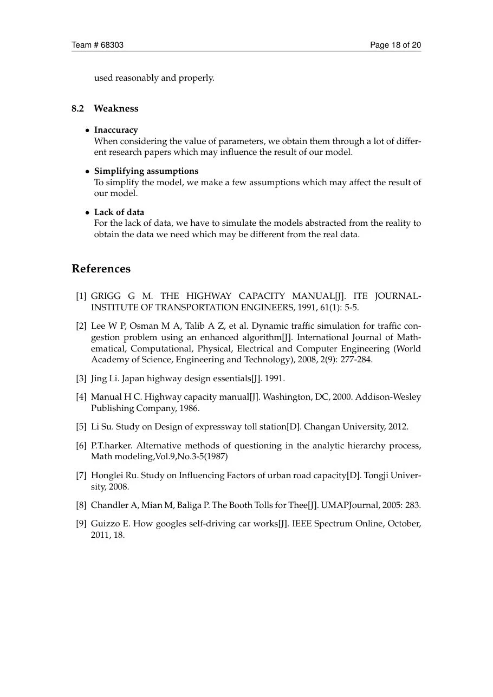

used reasonably and properly.

### 8.2 Weakness

### Inaccuracy

When considering the value of parameters, we obtain them through a lot of different research papers which may influence the result of our model.

### Simplifying assumptions

To simplify the model, we make a few assumptions which may affect the result of our model.

### Lack of data

For the lack of data, we have to simulate the models abstracted from the reality to obtain the data we need which may be different from the real data.

### References

[1] GRIGG G M. THE HIGHWAY CAPACITY MANUAL[J]. ITE JOURNAL-INSTITUTE OF TRANSPORTATION ENGINEERS, 1991, 61(1): 5-5.

[2] Lee W P, Osman M A, Talib A Z, et al. Dynamic traffic simulation for traffic congestion problem using an enhanced algorithm[J]. International Journal of Mathematical, Computational, Physical, Electrical and Computer Engineering (World Academy of Science, Engineering and Technology), 2008, 2(9): 277-284.

[3] Jing Li. Japan highway design essentials[J]. 1991.

[4] Manual H C. Highway capacity manual[J]. Washington, DC, 2000. Addison-Wesley Publishing Company, 1986.

[5] Li Su. Study on Design of expressway toll station[D]. Changan University, 2012.

[6] P.T.harker. Alternative methods of questioning in the analytic hierarchy process, Math modeling,Vol.9,No.3-5(1987)

[7] Honglei Ru. Study on Influencing Factors of urban road capacity[D]. Tongji University, 2008.

[8] Chandler A, Mian M, Baliga P. The Booth Tolls for Thee[J]. UMAPJournal, 2005: 283.

[9] Guizzo E. How googles self-driving car works[J]. IEEE Spectrum Online, October, 2011, 18.

Team # 68303

Page 18 of 20

## 第20页

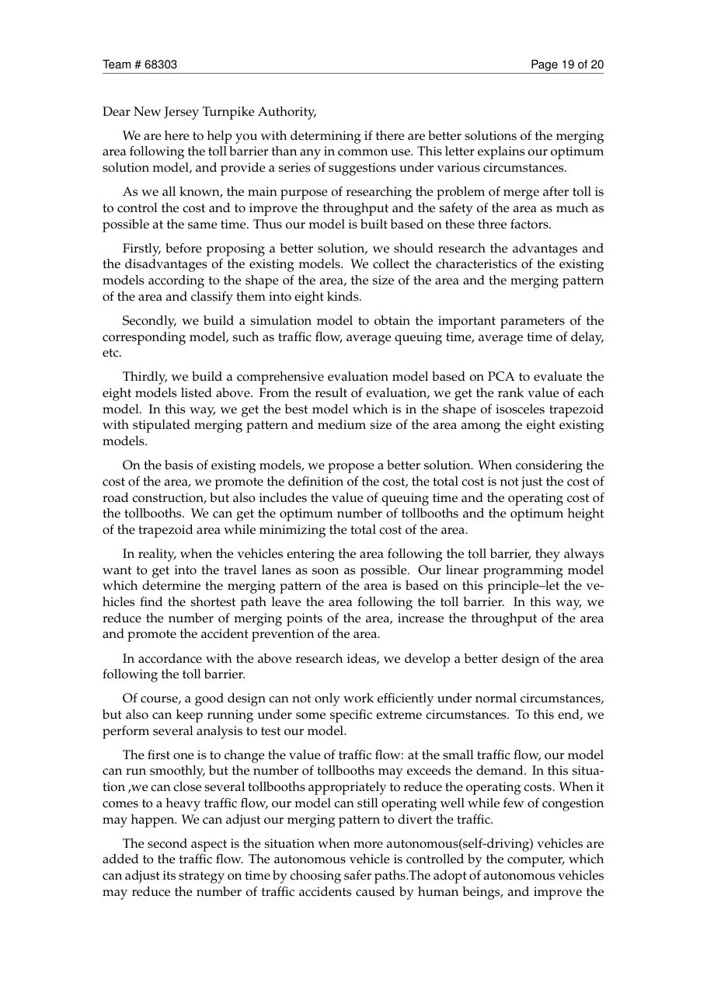

### Dear New Jersey Turnpike Authority,

We are here to help you with determining if there are better solutions of the merging area following the toll barrier than any in common use. This letter explains our optimum solution model, and provide a series of suggestions under various circumstances.

As we all known, the main purpose of researching the problem of merge after toll is to control the cost and to improve the throughput and the safety of the area as much as possible at the same time. Thus our model is built based on these three factors.

Firstly, before proposing a better solution, we should research the advantages and the disadvantages of the existing models. We collect the characteristics of the existing models according to the shape of the area, the size of the area and the merging pattern of the area and classify them into eight kinds.

Secondly, we build a simulation model to obtain the important parameters of the corresponding model, such as traffic flow, average queuing time, average time of delay, etc.

Thirdly, we build a comprehensive evaluation model based on PCA to evaluate the eight models listed above. From the result of evaluation, we get the rank value of each model. In this way, we get the best model which is in the shape of isosceles trapezoid with stipulated merging pattern and medium size of the area among the eight existing models.

On the basis of existing models, we propose a better solution. When considering the cost of the area, we promote the definition of the cost, the total cost is not just the cost of road construction, but also includes the value of queuing time and the operating cost of the tollbooths. We can get the optimum number of tollbooths and the optimum height of the trapezoid area while minimizing the total cost of the area.

In reality, when the vehicles entering the area following the toll barrier, they always want to get into the travel lanes as soon as possible. Our linear programming model which determine the merging pattern of the area is based on this principle–let the vehicles find the shortest path leave the area following the toll barrier. In this way, we reduce the number of merging points of the area, increase the throughput of the area and promote the accident prevention of the area.

In accordance with the above research ideas, we develop a better design of the area following the toll barrier.

Of course, a good design can not only work efficiently under normal circumstances, but also can keep running under some specific extreme circumstances. To this end, we perform several analysis to test our model.

The first one is to change the value of traffic flow: at the small traffic flow, our model can run smoothly, but the number of tollbooths may exceeds the demand. In this situation ,we can close several tollbooths appropriately to reduce the operating costs. When it comes to a heavy traffic flow, our model can still operating well while few of congestion may happen. We can adjust our merging pattern to divert the traffic.

The second aspect is the situation when more autonomous(self-driving) vehicles are added to the traffic flow. The autonomous vehicle is controlled by the computer, which can adjust its strategy on time by choosing safer paths.The adopt of autonomous vehicles may reduce the number of traffic accidents caused by human beings, and improve the safety of the area. Due to the safety and the efficiency of autonomous vehicles, we do not have to stipulate the merge pattern of the area following the toll barrier which can bring the advantages of autonomous vehicles to the full play.

Team # 68303

Page 19 of 20

## 第21页

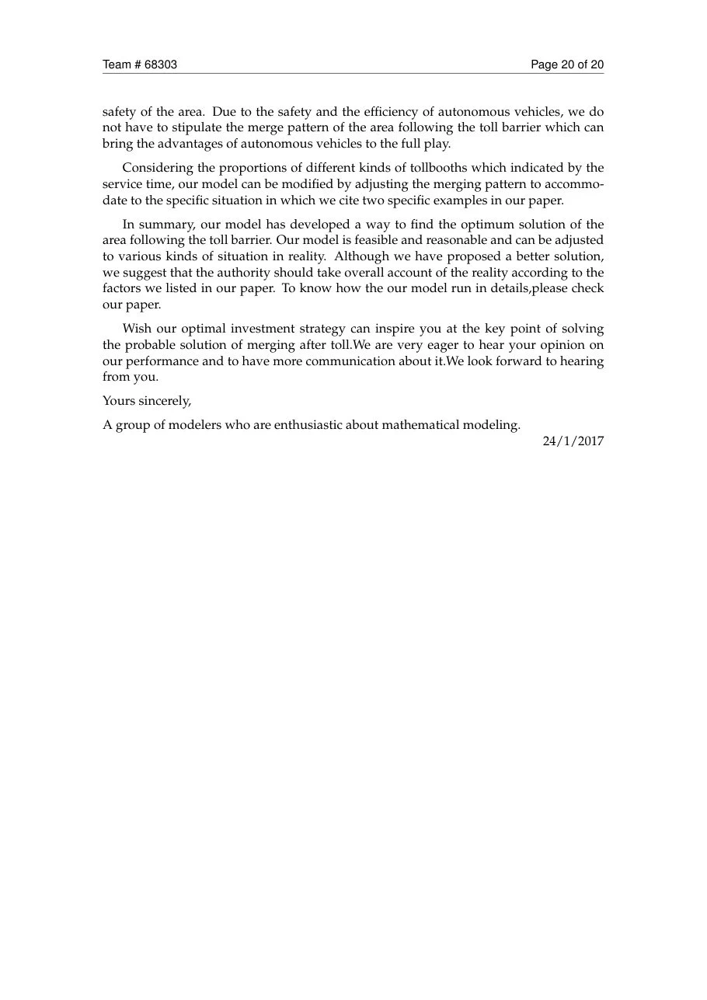

Considering the proportions of different kinds of tollbooths which indicated by the service time, our model can be modified by adjusting the merging pattern to accommodate to the specific situation in which we cite two specific examples in our paper.

In summary, our model has developed a way to find the optimum solution of the area following the toll barrier. Our model is feasible and reasonable and can be adjusted to various kinds of situation in reality. Although we have proposed a better solution, we suggest that the authority should take overall account of the reality according to the factors we listed in our paper. To know how the our model run in details,please check our paper.

Wish our optimal investment strategy can inspire you at the key point of solving the probable solution of merging after toll.We are very eager to hear your opinion on our performance and to have more communication about it.We look forward to hearing from you.

### Yours sincerely,

A group of modelers who are enthusiastic about mathematical modeling.

24/1/2017

Team # 68303

Page 20 of 20
