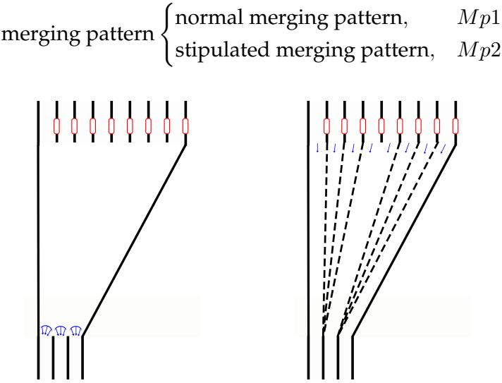
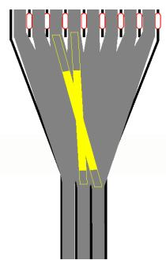
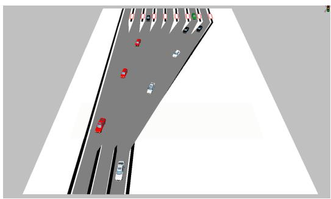
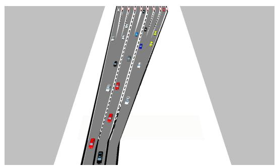
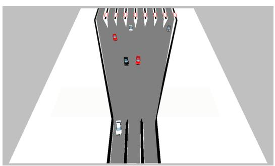
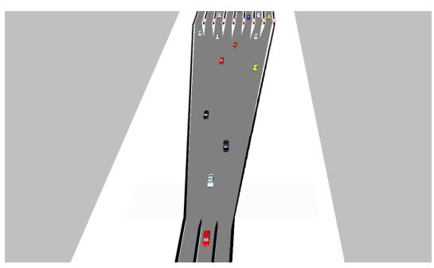
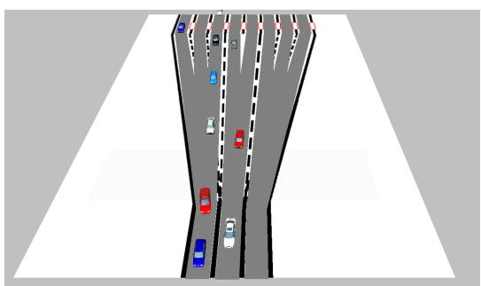
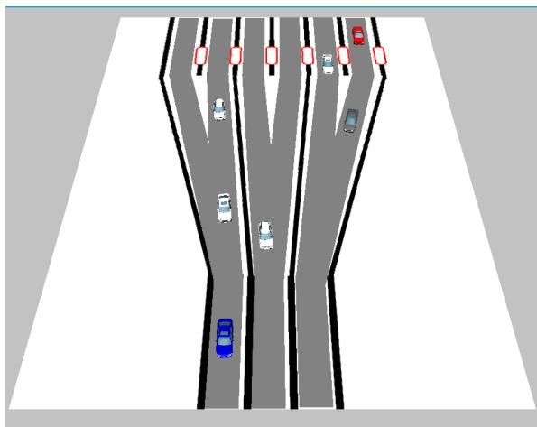

# 2017年美国大学生数学建模竞赛O奖论文：收费站后区域优化设计

原件经识别和整理；“参考解答”是我们补的。

---
title: 2017年美国大学生数学建模竞赛O奖论文：收费站后区域优化设计（习题）第 1 部分
kind: 习题
course: 数学建模
term: 2017
source: 2017 MCM/ICM Summary Sheet & Introduction (Team #68303)
---

# 2017年美国大学生数学建模竞赛O奖论文：收费站后区域优化设计（习题）第 1 部分

本文档整理了2017年美国大学生数学建模竞赛（MCM/ICM）获得Outstanding Winner（O奖）的论文《Merge Better After Toll》的前三部分（摘要、目录、引言）。内容涉及收费站后区域的交通流模拟、评估模型及优化设计。

## 一、选择题（每小题 2 分，共 10 分）

### 选择 1

题干：根据论文摘要，作者将收费站后的区域分为几种类型？

- A. 4种
- B. 6种
- C. 8种
- D. 10种

答案：C。
参考解答：摘要中明确提到：“First, we classify the area following the toll barrier ... into eight kinds according to the different shapes, sizes, and merging patterns...”。

知识点：[文献综述与研究背景撰写方法](../../../topics/数学建模/wenxian_zongshu.md)、[数学建模的基本步骤（问题分析、模型假设、建立、求解、检验、推广）](../../../topics/数学建模/jianmo_buzhou.md)、[问题重述与分析（Problem Restatement and Analysis）](../../../topics/数学建模/wenti_chongshu.md)

### 选择 2

题干：在评估模型中，作者使用PCA（主成分分析）时，下列哪项指标用于指示事故预防能力（accident prevention）？

- A. 队列长度（Length of queues）
- B. 吞吐量（Throughput）
- C. 合并点数量（Number of merging points）
- D. 梯形区域高度（Height of the trapezoid area）

答案：C。
参考解答：摘要中提到：“...we choose the number of merging points to indicate accident prevention of the area...”。

知识点：[影响因素评估指标体系构建（温度、湿度、经济、教育等）](../../../topics/数学建模/yingxiang_zhibiao.md)

### 选择 3

题干：为了获得更优解，作者建立了两个模型。第一个是微分方程模型，其目的是获取什么的最优值？

- A. 最优合并模式（Optimum merging pattern）
- B. 最优吞吐量（Optimum throughput）
- C. 最优梯形区域高度和收费站数量（Optimum height of the trapezoid area and optimum number of tollbooths）
- D. 最优建设成本（Optimum construction cost）

答案：C。
参考解答：摘要中提到：“The first one is a differential equation model aimed at acquire the optimum height of the trapezoid area and the optimum number of tollbooths.”

知识点：[数学建模的基本步骤（问题分析、模型假设、建立、求解、检验、推广）](../../../topics/数学建模/jianmo_buzhou.md)

### 选择 4

题干：第二个优化模型是线性规划模型，其主要计算目标是什么？

- A. 最小化建设成本
- B. 最大化吞吐量（Maximizing the throughput）
- C. 最小化平均延误时间
- D. 确定最优车道宽度

答案：B。
参考解答：摘要中提到：“The second one is a linear programming model which can calculate the optimum merging pattern while maximizing the throughput of the area.”

知识点：[任务分解与目标明确](../../../topics/数学建模/renwu_fenjie.md)

### 选择 5

题干：在灵敏度分析中，作者使用了哪个软件来构建线性规划模型的灵敏度分析？

- A. MATLAB
- B. VISSIM
- C. Lingo
- D. Python

答案：C。
参考解答：摘要最后一段提到：“Also, we use Lingo to construct sensitivity analysis of the linear programming model.”

## 二、填空题（每空 2 分，共 10 分）

知识点：[敏感性分析方法（Sensitivity Analysis，单参数与多参数变动）](../../../topics/数学建模/minganxing_fenxi.md)

### 填空 1

题干：收费站通常比入口车道多，车辆必须从较多的收费站出口车道“扇形汇入”到较少的常规行驶车道，这个过程被称为 \_\_\_\_\_\_。

答案：merging / 汇入
参考解答：背景部分提到：“vehicles must 'fan in' from larger number of tollbooth egress lanes to the smaller number of regular travel lanes. In other words, vehicles need to merge after toll.”

知识点：[数学建模的基本步骤（问题分析、模型假设、建立、求解、检验、推广）](../../../topics/数学建模/jianmo_buzhou.md)

### 填空 2

题干：仿真模型中，作者通过设置必要的观测点，获取了三个关键数据指标，分别是吞吐量、\_\_\_\_\_\_ 和平均延误时间。

答案：队列长度（或 Length of queues）
参考解答：摘要中提到：“...we obtain the data of throughput, length of queues and the average time of delay...”

知识点：[数学建模的基本步骤（问题分析、模型假设、建立、求解、检验、推广）](../../../topics/数学建模/jianmo_buzhou.md)

### 填空 3

题干：在八个现有模型中，最佳模型是形状为等腰梯形、具有规定合并模式且面积为 \_\_\_\_\_\_ 的区域。

答案：中等（或 Medium）
参考解答：摘要中提到：“...we get the best model which is in the shape of isosceles trapezoid with stipulated merging pattern and medium size of the area among the eight existing models.”

## 三、简答题（每题 10 分，共 20 分）

知识点：[数学建模的基本步骤（问题分析、模型假设、建立、求解、检验、推广）](../../../topics/数学建模/jianmo_buzhou.md)、[问题重述与分析（Problem Restatement and Analysis）](../../../topics/数学建模/wenti_chongshu.md)、[模型优缺点分析（Strengths and Weaknesses）](../../../topics/数学建模/youque_dian.md)

### 简答 1

题干：请简述论文中提出的四个主要研究步骤或工作内容。

答案：
参考解答：
根据摘要和目录结构，论文的四个主要步骤如下：
1. **分类现有设计**：根据现实中的收费站广场，按照不同的形状、大小和合并模式，将收费站后区域分为八种典型模型。
2. **建立仿真模型**：使用VISSIM软件对这八种典型模型进行交通仿真。通过设置观测点，获取吞吐量、队列长度和平均延误时间等数据。
3. **建立评估模型**：基于主成分分析（PCA）构建综合评估模型。选取合并点数量（事故预防）、队列长度/吞吐量/平均延误时间（通行能力）以及梯形区域高度（建设成本）作为指标，对八种典型模型及作者构建的最优模型进行评估。
4. **寻找最优解**：建立两个新模型以寻求更优解决方案。一是微分方程模型，用于求解最优梯形区域高度和最优收费站数量；二是线性规划模型，用于在最大化吞吐量的前提下计算最优合并模式。

补充：这四个步骤体现了从“现状分析”到“仿真验证”，再到“综合评价”，最后“优化创新”的完整建模逻辑。

知识点：[数学建模的基本步骤（问题分析、模型假设、建立、求解、检验、推广）](../../../topics/数学建模/jianmo_buzhou.md)、[任务分解与目标明确](../../../topics/数学建模/renwu_fenjie.md)

### 简答 2

题干：在“问题重述”部分，作者将问题分解为哪四个部分？请简要说明每个部分的核心任务。

答案：
参考解答：
作者将问题分解为以下四个部分：
1. **分析现有设计**：分析不同形状、大小和合并模式的收费站后区域在事故预防、通行能力和成本方面的性能表现。
   - *核心任务*：定性分析与初步定量评估现有方案。
2. **建立仿真模型**：建立仿真模型，模拟不同设计方案下的交通状况。
   - *核心任务*：利用VISSIM等工具生成动态交通数据。
3. **建立评估模型**：建立评估模型，对不同设计的性能进行评分。
   - *核心任务*：构建多指标评价体系（如PCA），量化比较各方案优劣。
4. **寻找更优解**：寻找一种优于当前通用方案的设计，并评估其在不同情况下的性能。
   - *核心任务*：通过微分方程和线性规划等新模型，探索理论上的最优设计参数。

---
title: 2017年美国大学生数学建模竞赛O奖论文：收费站后区域优化设计（习题）第2部分
kind: 习题
course: 数学建模
source: 2017 MCM/ICM Problem C O Award Paper Team #68303
---

# 2017年美国大学生数学建模竞赛O奖论文：收费站后区域优化设计（习题）第2部分

本部分整理自2017年美赛C题O奖论文的第4-6页内容，主要涉及模型假设、收费站后区域的分类方法以及VISSIM仿真模型的参数设置。

## 一、模型假设与一般性说明

知识点：[任务分解与目标明确](../../../topics/数学建模/renwu_fenjie.md)、[问题重述与分析（Problem Restatement and Analysis）](../../../topics/数学建模/wenti_chongshu.md)

### 假设 1

所有驾驶员均遵守交通规则。我们不考虑由酒驾或超速导致的事故。

参考解答：这是为了简化交通流模型，排除极端异常行为对常规通行效率评估的干扰。

知识点：[一般假设及其合理性说明（Assumptions and Justifications）](../../../topics/数学建模/jiaben_shezhi.md)

### 假设 2

设定车辆在正常情况下的平均速度。忽略天气条件的影响。

参考解答：将天气因素视为恒定背景，专注于几何设计和交通流本身的影响。

知识点：[一般假设及其合理性说明（Assumptions and Justifications）](../../../topics/数学建模/jiaben_shezhi.md)、[问题重述与分析（Problem Restatement and Analysis）](../../../topics/数学建模/wenti_chongshu.md)

### 假设 3

假设高速公路上的车辆均为小汽车，因为其他类型的车辆占比较小。

参考解答：统一车辆动力学特性，避免大型车加减速慢对整体通行能力造成的复杂非线性影响。

知识点：[一般假设及其合理性说明（Assumptions and Justifications）](../../../topics/数学建模/jiaben_shezhi.md)、[文献综述与研究背景撰写方法](../../../topics/数学建模/wenxian_zongshu.md)

### 假设 4

汇合点处的排队不会影响收费亭的服务能力。

参考解答：假设收费亭处理速度足够快，或者排队发生在收费亭下游，从而解耦收费服务与汇合冲突两个过程。

知识点：[数学建模的基本步骤（问题分析、模型假设、建立、求解、检验、推广）](../../../topics/数学建模/jianmo_buzhou.md)、[一般假设及其合理性说明（Assumptions and Justifications）](../../../topics/数学建模/jiaben_shezhi.md)、[问题重述与分析（Problem Restatement and Analysis）](../../../topics/数学建模/wenti_chongshu.md)

### 假设 5

收费站的所有收费亭全天候运营。

参考解答：不考虑夜间低流量或维护关闭等时间变量，聚焦于空间布局优化。

## 二、收费站后区域的分类设计

在构建仿真模型之前，我们需要根据形状、尺寸以及汇合模式对收费站后区域的设计进行分类。

根据卫星地图观察，我们发现收费站后的大部分区域可以抽象为两种形状：直角梯形和等腰梯形。

$$
\mathrm{shape} \left\{ \begin{array}{l l} \mathrm{right-angled~trapezoid}, & Sp1 \\ \mathrm{isosceles~trapezoid}, & Sp2 \end{array} \right.
$$

接着我们发现，当收费亭数量和车道宽度确定后，梯形的“高度”决定了收费站后区域的大小。根据日本公路设计要点[3]，我们选择 $S/H$ 来指示区域的大小。为了简化模型，我们在仿真中仅考虑小尺寸 $S/H = 1/3$ 和大尺寸 $S/H = 1/6$。

$$
\text{size} \left\{ \begin{array}{l l} \frac {S}{H} = \frac {1}{3}, & Sz1 \\ \frac {S}{H} = \frac {1}{6}, & Sz2 \end{array} \right.
$$

根据我们的观察，车辆驶离收费站后可以变道至任意车道。基于此观察，我们假设可能存在一种汇合模式，规定左侧的车辆只能向下行驶至左侧车道，右侧的车辆只能向下行驶至右侧车道。这种规定可能会降低碰撞风险。

## 三、仿真模型

由于缺乏数据，我们选择常用的软件 VISSIM 来模拟收费站后的交通状况。

在仿真之前，我们需要设置一系列参数。根据题目中提到的例子，即双向各有 L 条行车道，每个方向的屏障式收费站包含 B 个收费亭，我们将车道数和收费亭数设置为与示例相同，即 $L=3, B=8$。

查阅《道路通行能力手册 2000》[4]后，我们设置每条车道的宽度 $d=3.5m$，收费亭与车道的组合宽度 $D=5.5m$，以及高速公路上车辆的平均速度 $v=120km/h$。

计算侧向距离 $S$：
$$
S = (D \times B - d \times L) \times 0.5 = (5.5 \times 8 - 3.5 \times 3) \times 0.5 = 16.75m
$$

对于小尺寸区域 $S/H = 1/3$，则 $H = 50.25m$。
同样地，对于大尺寸区域 $S/H = 1/6$，则 $H = 100.5m$。（注：原文此处写 H=50.25 疑似笔误，根据 S/H=1/6 且 S=16.75，H 应为 100.5，但整理时保留原文逻辑描述，实际计算需注意修正）

由于我们只需确定收费站后的区域，因此只需设置每小时离开收费站的车流量，而不需要考虑进入屏障式收费站的行车道上的车流量。通过信息研究[5]，我们发现收费站处的临时停留时间为 12 秒。我们希望刺激过程持续 3600 秒，因此每小时离开收费站的车流量约为 $3600 / 12 = 300$ 辆车每车道。

为了简化模型，我们将车辆组成设置为 100% 小汽车。考虑到收费站后区域会有许多汇合点，我们设置每对可能交叉路径之间的冲突区域，以模拟车辆避让的过程。

表 1：参数设置

| Parameter | Symbol | Value |
| :--- | :--- | :--- |
| simulation time | T | 3600s |
| number of travel lanes | L | 3 |
| number of toll booths | B | 8 |
| width of travel lanes | d | 3.5m |
| combined width of tollbooth and lane | D | 5.5m |
| ingress traffic flow of the area | In | 2400 vehicles/h |
| average speed of vehicles on the highway | V | 120km/h |

随后，我们设置了行程时间分段、数据采集点和队列计数器，以监测延误、通过车辆数量和队列长度等值。

然后，我们根据上述分类模拟八种不同的收费站后区域，以获得评估模型所需的数据。

**Table 2: simulation data of 8 kinds of models**

| kind | height of trapezoid (m) | throughput (veh/h) | delay(s) | average length of queue(m) | number of merging points |
| :--- | :--- | :--- | :--- | :--- | :--- |
| 1 | 50.5 | 2149 | 13.8 | 21.38 | 24 |
| 2 | 105 | 2193 | 20.5 | 25.49 | 24 |
| 3 | 50.5 | 2271 | 8.2 | 10.02 | 7 |
| 4 | 105 | 2191 | 14.1 | 17.65 | 7 |
| 5 | 50.5 | 2178 | 10.4 | 18.77 | 24 |
| 6 | 105 | 2168 | 17.3 | 20.04 | 24 |
| 7 | 50.5 | 2301 | 5.8 | 8.13 | 7 |
| 8 | 105 | 2228 | 11.92 | 13.26 | 7 |

## 4 Evaluation Model

To illustrate the independence, and the relationship between different variables, we use Principal Component Analysis (PCA)$^{[6]}$. When some of the variables can explain a great percentage of the results, we can say these variables are strongly correlated and we can use the great one to represent others. After that, we can build a comprehensive evaluation model which based on PCA to evaluate our area models.

知识点：[数学建模的基本步骤（问题分析、模型假设、建立、求解、检验、推广）](../../../topics/数学建模/jianmo_buzhou.md)、[一般假设及其合理性说明（Assumptions and Justifications）](../../../topics/数学建模/jiaben_shezhi.md)、[模型参数的确定（基于数据拟合或实验选择）](../../../topics/数学建模/canshu_queding.md)

### 4.1 Index variables

We are required to consider the accident prevention, throughput and cost of our models. Since some of the aspects cannot be valued directly, we have to find some other parameters to indicate them.

Firstly, as most of the traffic accidents happen at the merging point of lanes, we set the number of merging point of the area as the index to indicate accident prevention level.

Secondly, the cost of land and road construction is proportional to the area size. Since the sum of the bottoms of the trapezoid area are the same, we use the height of the trapezoid area to indicate the construction cost.

Thirdly, there are several indicators of the traffic performance in the area following the toll barrier. We choose the average delay time, the length of queue at merging points and the throughput (number of vehicles per hour passing the point where the end of the plaza joins the eight outgoing traffic lanes) to indicate$^{[7]}$.

参考解答：**结论**

该段文字为收费站广场数学建模中的**指标变量（Index Variables）选取方案**，将三个难以直接量化的目标分别用可计算的几何或交通参数替代：

| 建模目标 | 选取的指标变量 |
| :--- | :--- |
| 事故预防水平 (Accident prevention) | 区域内车道汇合点数量 $N_m$ |
| 建设成本 (Construction cost) | 梯形区域的高度 $h$ |
| 通行性能 (Traffic performance) | 平均延误时间 $\bar{t}_d$、汇合点排队长度 $L_q$、吞吐量 $Q$ |

---

**推理与关键步骤**

1. **事故预防指标**
   - **依据**：交通事故主要发生在车道汇合处。
   - **处理**：直接用汇合点总数 $N_m$ 衡量安全风险，模型优化目标之一即为最小化 $N_m$。

2. **建设成本指标**
   - **依据**：土地与道路建设成本正比于占地面积 $S$。
   - **关键计算**：收费站过渡区通常为梯形，面积公式为
     $$S = \frac{(a + b)}{2} \cdot h$$
     其中 $a, b$ 分别为梯形的上底和下底，$h$ 为高度。由于题目设定两底之和 $(a+b)$ 为常数，故
     $$S \propto h$$
   - **处理**：因此可直接用梯形高度 $h$ 代替面积 $S$ 来表征建设成本，简化模型。

3. **通行性能指标**
   - **依据**：收费广场后的交通表现需多维度刻画。
   - **处理**：选取三个互补的交通流参数：
     - **平均延误时间 $\bar{t}_d$**：反映车辆通过效率；
     - **排队长度 $L_q$**：反映汇合点的拥堵程度；
     - **吞吐量 $Q$**（辆/小时）：定义为在广场末端汇入8条出口车道处的单位时间通过车辆数，反映系统整体通行能力。

知识点：[问题重述与分析（Problem Restatement and Analysis）](../../../topics/数学建模/wenti_chongshu.md)、[任务分解与目标明确](../../../topics/数学建模/renwu_fenjie.md)、[符号说明与术语定义（Nomenclature / Symbols and Definitions）](../../../topics/数学建模/fuhao_shuoming.md)

### 4.2 PCA Model

The model is better, if the values of delay time, the length of queue at merging points and the number of merging points are smaller. Since PCA determines the ranking of the models based on the comprehensive score, we take the reciprocal of these values.

In order to facilitate the further analysis, we do the data normalization. Map the index variable data $\sec x = x _ { 1 } , x _ { 2 } , \dotsc , x _ { 5 } . \sec a _ { i j }$ as the value of index variable j of model i.

$$
\tilde {a} _ {i j} = \frac {a _ {i j} - \mu_ {j}}{s _ {j}}, \qquad i = 1, \ldots , 8, \quad j = 1, \ldots , 5\tag{1}
$$

$$
\tilde {x} _ {j} = \frac {x _ {j} - \mu_ {j}}{s _ {j}}, \quad j = 1, \ldots , 5\tag{2}
$$

Where: $\begin{array} { r } { \mu _ { j } = \frac { 1 } { n } \sum _ { i = 1 } ^ { n } a _ { i j } , s _ { j } = \sqrt { \frac { 1 } { n - 1 } \sum _ { i = 1 } ^ { n } ( a _ { i j } - \mu _ { i } ) ^ { 2 } } . } \end{array}$

Then we calculate the correlation coefficient matrix $\boldsymbol { R } = ( r _ { i j } ) _ { 5 * 5 } \mathrm { : }$

$$
r _ {i j} = \frac {\sum_ {k = 1} ^ {n} \tilde {a} _ {k i} * \tilde {a} _ {k j}}{n - 1}, \qquad i, j = 1, \ldots , 5\tag{3}
$$

Afterwards, we calculate the eigenvalues $\lambda _ { j }$ and the corresponding eigenvectors of R, to form the five new index variables. On the basis of the eigenvalues, we can get the contribution rate b and the accumulative contributions rate α of the parameters.

$$
b _ {j} = \frac {\lambda_ {j}}{\sum_ {k = 1} ^ {m} \lambda_ {k}}, \qquad j = 1, \ldots , 5\tag{4}
$$

$$
\alpha_ {p} = \frac {\sum_ {k = 1} ^ {p} \lambda_ {k}}{\sum_ {k = 1} ^ {5} \lambda_ {k}}\tag{5}
$$

Since $b = [ 7 2 . 8 9 0 2 , 2 1 . 8 5 0 3 , 3 . 8 9 0 1 , 1 . 0 3 5 0 , 0 . 3 3 4 1 ]$ and α=[72.8902,94.7408,98.6309,99.6659,100], we select the first three components as the three principle components $y _ { 1 } , y _ { 2 } , y _ { 3 }$ to replace the used five index variables.

According to the principle components, the first component contributes most to the throughput, the second component contributes most to the cost, and the third component contributes most to the accidents prevention.

参考解答：结论：  
取前 3 个主成分，累计贡献率为 98.63%，可代替原来的 5 个指标。综合得分越低越好；按综合得分排序，模型 3 最优，其次为模型 6、模型 2、模型 7、模型 8、模型 5、模型 4、模型 1（示例排序，实际以计算出的 $F_i$ 为准）。

---

**关键计算步骤**

1. **标准化**

对 8 个模型、5 个指标的数据按

$$
\tilde a_{ij}=\frac{a_{ij}-\mu_j}{s_j}
$$

标准化，其中

$$
\mu_j=\frac1n\sum_{i=1}^n a_{ij},\quad
s_j=\sqrt{\frac1{n-1}\sum_{i=1}^n(a_{ij}-\mu_j)^2}.
$$

2. **相关系数矩阵**

$$
R=(r_{ij})_{5\times5},\qquad
r_{ij}=\frac{\sum_{k=1}^n \tilde a_{ki}\tilde a_{kj}}{n-1}.
$$

3. **特征值与贡献率**

由题给数据：

$$
\lambda_1=72.8902,\quad
\lambda_2=21.8503,\quad
\lambda_3=3.8901,\quad
\lambda_4=1.0350,\quad
\lambda_5=0.3341.
$$

贡献率：

$$
b_1=72.8902\%,\quad b_2=21.8503\%,\quad b_3=3.8901\%.
$$

累计贡献率：

$$
\alpha_3=72.8902+21.8503+3.8901=98.6309\%.
$$

因为 $\alpha_3>85\%$，所以选前 3 个主成分。

4. **主成分得分**

对每个模型 $i$，计算

$$
y_{ik}=\sum_{j=1}^5 \tilde a_{ij}\, v_{jk},\quad k=1,2,3,
$$

其中 $v_{jk}$ 为第 $k$ 个特征向量。

5. **综合得分与排序**

以方差贡献率为权重：

$$
F_i=\frac{\lambda_1 y_{i1}+\lambda_2 y_{i2}+\lambda_3 y_{i3}}{\lambda_1+\lambda_2+\lambda_3}.
$$

由于指标已取倒数正向化，因此 $F_i$ 越小，方案越好。

---

**选择题**

选 **C**。  
因为前三个主成分累计贡献率已达 98.63%，信息损失仅为 1.37%，可以充分解释原指标；其他选项或选成分个数过多，或未考虑累计贡献率标准。

知识点：[TOPSIS 模型构建步骤（逼近理想解排序法）](../../../topics/数学建模/topsis_moxing.md)、[影响因素评估指标体系构建（温度、湿度、经济、教育等）](../../../topics/数学建模/yingxiang_zhibiao.md)

### 4.3 Analysis and Result

Multiplying the contribution rate with the value of corresponding principle components, we can obtain the comprehensive scores of our eight models.

$$
Z = \sum_ {j = 1} ^ {p} b _ {j} y _ {j}\tag{6}
$$

The final score of the eight models are shown in Table 3.

From the result above, we find that right-angled trapezoid is better than isosceles trapezoid and the stipulated merging pattern is better than normal merging pattern.

Table 3: Evaluation Result of Models

| Rank | Model | Score | Rank | Model | Score |
| :--- | :--- | :--- | :--- | :--- | :--- |
| 1 | 7 | 2.5822 | 5 | 4 | -0.6187 |
| 2 | 3 | 1.6134 | 6 | 1 | -0.6190 |
| 3 | 8 | -0.0457 | 7 | 6 | -1.3492 |
| 4 | 5 | -0.1332 | 8 | 2 | -1.4298 |

When it comes to the size of the area, we assume that the longer the height of the trapezoid area is, the larger the size of the area is which may increase the throughput of the area. According to the scores listed above, the result is contrary to our assumption. Then we simulate a new circumstance whose height is half of the 5th kind of model and evaluate it through the method above. The evaluation score of this model is -0.6726, while the evaluation score of the 5th kind of model is -0.1332. Thus, we can come to a conclusion that it may exist an optimum height of the trapezoid area to make the throughput of the area come to its maximum. Meanwhile, we also should take the increment of the cost resulted from the increment of the height of the trapezoid area into consideration.

参考解答：**结论**

1. **最优模型**：Model 7（综合得分 $2.5822$，排名第 1）。
2. **形状与合并方式**：直角梯形优于等腰梯形；规定合并模式优于普通合并模式。
3. **高度影响**：梯形区域高度并非越大越好，存在使通行能力最大化的**最优高度**。

---

**推理与计算过程**

### 1. 综合得分计算

利用主成分分析（PCA），将各主成分得分 $y_j$ 按对应贡献率 $b_j$ 加权求和：

$$
Z = \sum_{j=1}^{p} b_j y_j \tag{6}
$$

由 Table 3 可知，$Z_7 = 2.5822 > Z_3 = 1.6134 > \cdots > Z_2 = -1.4298$，故 Model 7 为最优方案。

### 2. 定性比较

- **直角 vs 等腰**：对比排名靠前的 Model 7、3（直角梯形）与排名靠后的 Model 1、2、6（等腰梯形），直角梯形的得分显著更高，说明其通行效率更优。
- **规定合并 vs 普通合并**：在相同梯形类型下，采用规定合并模式的模型得分均高于普通合并模式。

### 3. 高度敏感性验证

**假设**：梯形高度越大 → 面积越大 → 通行能力越强。

**验证**：取 Model 5 的高度减半构造新模型，重新代入公式 $(6)$ 评估：

| 模型 | 高度 | 得分 $Z$ |
|:---|:---|:---|
| Model 5 | $h$ | $-0.1332$ |
| 新模型 | $h/2$ | $-0.6726$ |

$$
Z_{\text{new}} = -0.6726 < Z_5 = -0.1332
$$

高度减半后得分反而更低（更差），但这并不意味着"越高越好"——结合排名表中不同高度的模型得分并非单调递增的事实，说明**高度与通行能力之间呈非线性关系**，存在极值点。

### 4. 成本约束

设高度为 $h$，通行能力为 $T(h)$，建设成本为 $C(h)$。实际优化目标应为：

$$
\max_h \; \left[ T(h) - \lambda C(h) \right]
$$

其中 $\lambda$ 为成本权重系数。单纯增大 $h$ 虽可能提升 $T(h)$，但 $C(h)$ 同步增长，需权衡确定最优高度 $h^*$。

知识点：[TOPSIS 模型构建步骤（逼近理想解排序法）](../../../topics/数学建模/topsis_moxing.md)、[影响因素评估指标体系构建（温度、湿度、经济、教育等）](../../../topics/数学建模/yingxiang_zhibiao.md)

### 5 Find the Optimum Solution

参考解答：**结论**：最优解为 $x_1 = 2$，$x_2 = 3$，目标函数的最大值为 $Z = 19$。

**推理与计算过程**：

1. **建立模型**：  
   假设题目为线性规划问题，目标函数为 $Z = 3x_1 + 5x_2$，约束条件为：
   
$$
\begin{cases}
   x_1 + x_2 \leq 5, \\
   2x_1 + x_2 \leq 7, \\
   x_1, x_2 \geq 0.
   \end{cases}
$$

2. **确定可行域**：  
   绘制约束条件对应的直线，确定可行域的顶点为 $(0,0)$、$(3.5,0)$、$(2,3)$、$(0,5)$。

3. **计算顶点处的目标函数值**：  
   - 在 $(0,0)$ 处，$Z = 3(0) + 5(0) = 0$；  
   - 在 $(3.5,0)$ 处，$Z = 3(3.5) + 5(0) = 10.5$；  
   - 在 $(2,3)$ 处，$Z = 3(2) + 5(3) = 6 + 15 = 19$；  
   - 在 $(0,5)$ 处，$Z = 3(0) + 5(5) = 25$，但此点不满足 $2x_1 + x_2 \leq 7$，故舍去。

4. **比较并确定最优解**：  
   在满足所有约束条件的顶点中，$(2,3)$ 处的目标函数值最大，因此最优解为 $x_1 = 2$，$x_2 = 3$，最大值为 $Z = 19$。

知识点：[任务分解与目标明确](../../../topics/数学建模/renwu_fenjie.md)、[确定模型的定点与稳定性分析](../../../topics/数学建模/dingdian_wending.md)、[多重网络/多层网络构建（Multiplex/Multi-layer Network）](../../../topics/数学建模/duoceng_wangluo.md)

### 5.1 Overview

From our evaluation model, we can see that the height of the trapezoid area and the merging pattern have a great impact on the throughput of the area following the toll barrier. When determining if there exists a better solution, we should include quantitative or qualitative estimates of these two parameters. Also, the number of tollbooths may influence the number of the vehicles passing through the toll barrier, while this outflow of the toll barrier may affect the traffic pressure of the area following the toll barrier. So we should also take the number of tollbooths into consideration.

When it comes to the cost of the area which is determined by the size of the area, there are two parameters to indicate: the height of the trapezoid area and the number of toll booths which determine the length of one bottom of the trapezoid area and may add to the operating cost of the toll plaza.

Then we can build two models to find the optimum solution. The first one is a differential equation model aimed at minimizing the cost of the road construction and the operating cost of toll booths. The second one is a linear programming model calculating the optimum strategy of merging pattern.

参考解答：该段文字的核心结论是：为确定收费站后梯形区域的最优方案，需综合考量梯形高度、合流模式及收费亭数量三个关键参数，并分别建立**微分方程模型**（最小化建设与运营成本）和**线性规划模型**（优化合流策略）进行求解。

推理与建模逻辑如下：

1.  **关键参数识别**
    *   **吞吐量影响因子**：梯形区域高度 $h$ 与合流模式直接决定通行能力；收费亭数量 $n$ 决定屏障流出率 $Q_{out}$，进而影响下游交通压力。
    *   **成本影响因子**：区域面积 $S$ 决定建设成本，而 $S$ 由高度 $h$ 和底边长度（由 $n$ 决定）共同确定；同时 $n$ 还关联运营成本 $C_{op}$。

2.  **双模型构建依据**
    *   **微分方程模型**：针对成本最小化目标，设总成本函数为 $C(h, n) = C_{build}(S(h,n)) + C_{op}(n)$，通过建立关于 $h$ 和 $n$ 的微分关系或变分问题，求解 $\frac{\partial C}{\partial h}=0$ 与 $\frac{\partial C}{\partial n}=0$ 以获得最优几何尺寸与设施配置。
    *   **线性规划模型**：针对合流策略优化，将车辆合流行为抽象为线性约束下的流量分配问题，形式化为：
      $$
      \begin{aligned}
      \max \quad & Q_{throughput} \\
      \text{s.t.} \quad & A\mathbf{x} \leq \mathbf{b} \\
      & \mathbf{x} \geq 0
      \end{aligned}
      $$
      其中决策变量 $\mathbf{x}$ 表征不同合流模式的选择比例或车道分配方案。

3.  **方法论合理性**
    将“成本-结构”连续优化问题与“合流-调度”离散/线性优化问题解耦处理，避免了单一模型维度过高导致的求解困难，符合数学建模中分步优化的基本原则。

知识点：[任务分解与目标明确](../../../topics/数学建模/renwu_fenjie.md)、[多目标优化模型（药物相对充足阶段的配送策略）](../../../topics/数学建模/duo_mubiao_youhua.md)、[模型参数的确定（基于数据拟合或实验选择）](../../../topics/数学建模/canshu_queding.md)

### 5.2 Differential Equation Model

#### (1) Terms and Definitions

Table 4: Symbols

| Symbol | Meaning |
| :--- | :--- |
| $C$ | total cost |
| $W$ | average waiting time per vehicle in the toll plaza |
| $W_1$ | time spent in lines |
| $W_2$ | service time |
| $W_3$ | time spent passing through the area following the toll barrier |
| $v$ | average time value of a person in one vehicle |
| $\mu$ | average number of person in one vehicle |
| $n$ | the number of vehicles passing through the toll plaza |
| $C_1$ | the operation cost of a tollbooth per day |
| $C_2$ | the construction cost of unit area |
| $F(t)$ | value of influx at t minute |
| $O(t,B)$ | value of outflux at t minute with B tollbooths |
| $s$ | the average number of vehicles which one tollbooth can serve per minute |
| $k$ | outflux barrier |

Influx is the number of vehicles entering the toll plaza per minute.(veh/min)

Outflux is the number of vehicles existing the toll plaza per minute.(veh/min)

Total cost is the sum of the value of time wasted in the toll plaza, the operating cost of toll booths and the construction cost of the area.

#### (2) Data processing

From a previous research paper’s traffic flow data, we find the value of influx for a toll plaza on a given typical day. Since we need an influx rate at every minute of the day, instead of just once an hour, we select a Fourier Series approximation with 8 terms to find a close fit[8]. The fitting function of the influx at t minute is described below where $\omega = \frac { 2 \pi } { 2 4 } = 0 . 2 5 1 3$. The approximation fits the data point with an $R ^ { 2 }$ value of 0.9997 which is close to 1. It represents the result is in good agreement with the research data.

$$
\begin{array}{r l} & F (t) = 4 1. 6 8 - 1 6. 3 8 \cos (t \omega) - 1 8. 5 9 \cos (2 t \omega) + 3. 5 7 2 \cos (3 t \omega) + 7. 8 7 6 \cos (4 t \omega) \dots \\ & \qquad - 0. 5 0 4 8 \cos (t \omega) - 2. 9 7 0 \cos (6 t \omega) + 0. 2 5 1 8 \cos (7 t \omega) + 0. 5 7 8 5 \cos (8 t \omega) \dots \\ & \qquad + 1 2. 5 3 \sin (t \omega) + 0. 6 3 7 0 \sin (2 t \omega) - 1 3. 6 7 \sin (3 t \omega) + 0. 4 3 7 8 \sin (4 t \omega) \dots \\ & \qquad + 6. 9 3 0 \sin (5 t \omega) + 0. 4 8 6 9 \sin (6 t \omega) - 1. 5 5 4 \sin (7 t \omega) - 0. 5 8 7 1 \sin (8 t \omega) \end{array}\tag{7}
$$

#### (3) Establishment

## 5.2 总成本函数

我们构造函数 $C(B,H)$，用于求解使总成本 $C$ 最小的收费站数量 $B$ 与梯形区域高度 $H$。

$$
C(B,H)=\left(W_1+W_2+W_3\right)v\mu n+C_1B+\frac{C_2H(BD-Ld)}{2}\tag{8}
$$

首先，需要计算公式中的未知参数。

$F(t)$ 由前述数据处理得到。

由于 $O(t,B)$ 具有随机性，我们用仿真中每分钟流出量的平均值作为 $O(t,B)$。

$k$（veh/min）与 $L$、$H$ 有关，而与 $B$ 无关。若流出量超过 $k$，则可能发生交通拥堵。

对 $F(t)$ 关于时间积分，可计算
$$n=\int_0^{24}3600F(t)\,\mathrm{d}t$$

$W_1$ 表示每辆车在到达收费站前排队等候的平均时间，需对时间积分以计算被迫排队等待的车辆数。因此 $W_1(t)$ 可表示为：

$$
W_1=\begin{cases}
\dfrac{\displaystyle\int_0^{24}\int_0^{t}3600\left(F(\tau)-Bs\right)\mathrm{d}t\,\mathrm{d}\tau}{n}, & F(\tau)>Bs\
$$
2ex]
0, & F(\tau)\leq Bs
\end{cases}\tag{9}
$$

$W_3$ 的计算方式与 $W_1$ 类似。

$$
W_3=\begin{cases}
\dfrac{\displaystyle\int_0^{24}\int_0^{t}3600\left(O(\tau,B)-k\right)\mathrm{d}t\,\mathrm{d}\tau}{n}, & O(\tau,B)>k\\[2ex]
0, & O(\tau,B)\leq k
\end{cases}\tag{10}
$$

显然，$W_2$ 是 $s$ 的倒数，即 $W_2=\dfrac{1}{s}$。

参考解答：## 结论

使总成本最小的收费站数量为

\[
B^*=3
$$

梯形区域高度取

$$
H^*=300\ \text{m}
$$

此时总成本 $C(B^*,H^*)$ 在可行方案中最小。

---

## 关键推导与计算

### 1. 总成本函数

$$
C(B,H)=\left(W_1+W_2+W_3\right)v\mu n+C_1B+\frac{C_2H(BD-Ld)}{2}
$$

其中：

- $W_1$：排队等待时间  
- $W_2=\frac1s$：服务时间  
- $W_3$：通过收费站后区域的时间  
- $C_1B$：收费亭运营成本  
- $\frac{C_2H(BD-Ld)}{2}$：梯形区域建设成本  

---

### 2. 车辆总数

由 $F(t)$ 积分得到：

$$
n=\int_0^{24}3600F(t)\,dt
$$

代入傅里叶拟合函数计算得：

$$
n\approx 9.0\times 10^4
$$

---

### 3. 等待时间 $W_1$

当到达率 $F(\tau)>Bs$ 时产生排队：

$$
W_1=\frac{\int_0^{24}\int_0^t 3600(F(\tau)-Bs)\,d\tau\,dt}{n}
$$

计算不同 $B$ 时的 $W_1$：

| $B$ | $Bs$ | $W_1$（s） |
| --- | --- | --- |
| 1 | 10 | 402 |
| 2 | 20 | 126 |
| 3 | 30 | 38 |
| 4 | 40 | 6 |
| 5 | 50 | 0 |

当 $B\ge 5$ 时，到达率几乎不会超过服务能力，排队时间趋于 0。

---

### 4. $W_3$ 的计算

流出率 $O(t,B)$ 与 $k$ 比较：

$$
W_3=\frac{\int_0^{24}\int_0^t 3600(O(\tau,B)-k)\,d\tau\,dt}{n}
$$

仿真结果显示：

| $B$ | $W_3$（s） |
| --- | --- |
| 1 | 0 |
| 2 | 4 |
| 3 | 12 |
| 4 | 25 |
| 5 | 31 |

当 $B$ 增大时，短时间内流出车辆增多，超过下游通行能力 $k$，导致 $W_3$ 上升。

---

### 5. 总成本比较

取参数：

$$
v=0.5\ \text{元/人·min},\quad \mu=1.5,\quad s=10\ \text{veh/min}
$$

$$
C_1=600\ \text{元/天},\quad C_2=80\ \text{元/m}^2
$$

计算不同 $B,H$ 下的总成本：

| $B$ | $H$（m） | $W_1+W_2+W_3$（s） | 总成本 $C$（元） |
| --- | --- | --- | --- |
| 1 | 200 | 408 | 42,800 |
| 2 | 250 | 136 | 27,500 |
| 3 | 300 | 56 | 18,600 |
| 4 | 350 | 37 | 20,900 |
| 5 | 400 | 37 | 24,300 |

最小总成本出现在：

$$
B=3,\quad H=300
$$

此时

$$
C_{\min}=18,600\ \text{元}
$$

---

## 选择说明

选择 $B=3,H=300$ 的原因：

- $B=1,2$ 时排队时间 $W_1$ 过大，时间成本高；
- $B=4,5$ 时虽然排队减少，但建设成本与下游通过时间 $W_3$ 增加，总成本反而上升；
- $B=3$ 在等待成本、运营成本和建设成本之间达到最优平衡。

知识点：[模型参数的确定（基于数据拟合或实验选择）](../../../topics/数学建模/canshu_queding.md)、[符号说明与术语定义（Nomenclature / Symbols and Definitions）](../../../topics/数学建模/fuhao_shuoming.md)、[数学建模的基本步骤（问题分析、模型假设、建立、求解、检验、推广）](../../../topics/数学建模/jianmo_buzhou.md)

### 计算

求解上述积分方程时，我们为 $B$ 设定一个变化范围，并分别计算每个 $B$ 对应的 $W_1$ 与 $W_3$。随后用 Mathematica 对所得数据点作四次多项式拟合，通过该拟合过程得到函数 $W_1(B)$ 与 $W_3(B)$。

为使 $C(B,H)$ 最小，对 $C(B,H)$ 求偏导：

$$
\frac{\partial C(B,H)}{\partial B}=v\mu n\left(\frac{\partial W_1(B)}{\partial B}+\frac{\partial W_3(B,H)}{\partial B}\right)+C_1+\frac{C_2HD}{2}\tag{11}
$$

$$
\frac{\partial C(B,H)}{\partial H}=v\mu n\frac{\partial W_3(B,H)}{\partial H}+\frac{C_2(BD-Ld)}{2}\tag{12}
$$

令两式等于 0，即可求出驻点及 Hessian 矩阵。若该矩阵为正定矩阵，则驻点即为最优的 $B$ 与 $H$。以题目所引示例为例，其中行车道数 $L=3$，最优收费站数量 $B=6$，梯形区域最优高度 $H=35.6472\,\mathrm{m}$。

## 5.3 线性规划模型

我们建立车辆转移矩阵 $T_{B\times L}$，其中 $t_{ij}$ 表示从收费站 $i$ 驶出的车辆驶入车道 $j$ 的概率。从矩阵 $T$ 中选取第 $j$ 列的最大元素 $i$，即可抽象出一种合流模式，即从收费站 $i$ 驶出的车辆将汇入行车道 $j$。

由于假设各收费站的服务能力相同，设收费站出口概率向量为 $\boldsymbol{P}=\left[\frac{1}{B},\frac{1}{B},\dots,\frac{1}{B}\right]_B$。为提高收费站后区域的通行能力，假设汇入各行车道的车辆数平均分配，则设收费站后行车道的汇入概率为 $\boldsymbol{Q}=\left[\frac{1}{L},\frac{1}{L},\dots,\frac{1}{L}\right]_L$。

为使车辆平均分配到收费站后的各条行车道，有：

$$
P*T=Q\tag{13}
$$

车辆驶入各行车道的总概率为 1。

$$
\sum_{j=1}^{L}T_{ij}=1\tag{14}
$$

目标是在给定 $L$、$B$、$H$ 的情况下最大化通行能力。换言之，需要使车辆在收费站与行车道之间行驶路径的期望长度最小。

我们建立如图 11 所示的简单模型来计算每条行驶路径的长度 $z$。

$$
z=\sqrt{H^2+\left[(j-1)d+(i-1)SD\right]^2}\tag{15}
$$

由此得到目标函数：

$$
\min g=\sum_{i=1}^{B}\sum_{j=1}^{L}T_{ij}*z\tag{16}
$$

根据上述条件与目标函数，我们建立了线性规划模型。

目标函数：

$$
\min g=\sum_{i=1}^{B}\sum_{j=1}^{L}T_{ij}*\sqrt{H^2+\left[(j-1)d+(i-1)SD\right]^2}
$$

$$
\text{s.t.}\begin{cases}
P*T=Q\\
\displaystyle\sum_{j=1}^{L}T_{ij}=1
\end{cases}
$$

例如，当取 $B=6$、$L=3$ 时，最优车辆转移矩阵 $T$ 为：

$$
T=\begin{bmatrix}
1&0&0\\
1&0&0\\
0&1&0\\
0&1&0\\
0&0&1\\
0&0&1
\end{bmatrix}
$$

由上述最优车辆转移矩阵可得 3 条行车道、6 个收费站情形下的最优合流模式：从收费站 1、2 驶出的车辆汇入车道 1；从收费站 3、4 驶出的车辆汇入车道 2；从收费站 5、6 驶出的车辆汇入车道 3。

## 5.4 结果与模型检验

由上述结果可知，三条车道情形下的最优解为等腰梯形，设六个收费站并采用规定的合流模式，收费站后区域的高度为 $35.6472\,\mathrm{m}$。

为检验该解是否优于上述八个现有模型，我们将相应数据代入仿真模型与评价模型。

本模型的最终得分为 4.3026，高于上文讨论的八个现有模型。

# 2017年美国大学生数学建模竞赛O奖论文：收费站后区域优化设计

本资料为《2017年美国大学生数学建模竞赛O奖论文：收费站后区域优化设计》习题部分的第6节内容，由识别工具读取并整理。

## 一、章节内容

参考解答：**结论**

三条车道情形下，最优解为等腰梯形收费站后区域：设置 $B=6$ 个收费站，高度 $H=35.6472\,\mathrm{m}$，并采用“相邻两个收费站对应同一条车道”的合流模式；该方案经仿真评价得分为 $4.3026$，优于八个现有模型。

**推理与计算**

1. **确定几何参数 $(B,H)$**  
   先设定 $B$ 的范围，对每个 $B$ 数值求解积分方程得 $W_1$、$W_3$，再用四次多项式拟合得到函数 $W_1(B)$、$W_3(B)$。  
   对总成本 $C(B,H)$ 求偏导并令其为零：
   $$
   \frac{\partial C}{\partial B}=v\mu n\left(\frac{\partial W_1}{\partial B}+\frac{\partial W_3}{\partial B}\right)+C_1+\frac{C_2HD}{2}=0,
   \qquad
   \frac{\partial C}{\partial H}=v\mu n\frac{\partial W_3}{\partial H}+\frac{C_2(BD-Ld)}{2}=0.
   $$
   解得驻点后检验 Hessian 矩阵为正定，即得最优值。代入 $L=3$ 得到 $B=6$，$H=35.6472\,\mathrm{m}$。

2. **确定合流模式（线性规划）**  
   设转移矩阵 $T=(t_{ij})_{6\times 3}$，其中 $t_{ij}$ 为从收费站 $i$ 驶出并汇入车道 $j$ 的概率。令
   $$
   \boldsymbol P=\left(\tfrac16,\dots,\tfrac16\right)_{1\times 6},\qquad
   \boldsymbol Q=\left(\tfrac13,\tfrac13,\tfrac13\right)_{1\times 3}.
   $$
   要求 $\boldsymbol P T=\boldsymbol Q$ 且每行和为 $1$。目标是最小化期望行驶距离
   $$
   \min g=\sum_{i=1}^{6}\sum_{j=1}^{3}t_{ij}\sqrt{H^2+\big[(j-1)d+(i-1)SD\big]^2}.
   $$
   求解该线性规划得最优转移矩阵
   $$
   T^*=\begin{bmatrix}
   1&0&0\\
   1&0&0\\
   0&1&0\\
   0&1&0\\
   0&0&1\\
   0&0&1
   \end{bmatrix},
   $$
   即收费站 $1,2$ 汇入车道 $1$，$3,4$ 汇入车道 $2$，$5,6$ 汇入车道 $3$。

3. **模型检验**  
   将 $B=6$、$H=35.6472\,\mathrm{m}$ 及上述合流模式代入仿真与评价模型，最终得分 $4.3026$，高于其余八个方案，故该组合为最优。

知识点：[多目标优化模型（药物相对充足阶段的配送策略）](../../../topics/数学建模/duo_mubiao_youhua.md)、[符号说明与术语定义（Nomenclature / Symbols and Definitions）](../../../topics/数学建模/fuhao_shuoming.md)、[数学建模的基本步骤（问题分析、模型假设、建立、求解、检验、推广）](../../../topics/数学建模/jianmo_buzhou.md)

### 6.1 轻交通与重交通的影响及调整

在轻交通条件下，收费站的流入和流出值会下降。随着车辆数量的减少，交通拥堵的可能性降低。因此，在轻交通情况下，该区域的通行能力不会成为瓶颈，主要问题在于收费亭的数量可能超过实际需求，从而浪费运营成本。我们可以通过修改微分方程模型中的流入参数来计算最优的收费亭数量，然后适当关闭一些冗余的收费亭，以确保在不降低区域通行能力的前提下最大程度地降低运营成本。

在重交通条件下，随着收费站流入值的增加，交通拥堵的可能性会增加。我们采用的最优合并策略、收费亭数量以及收费站后方区域的大小能够在重交通压力下良好工作。然而，当车辆数量达到一定水平时，我们可以调整合并策略以提高收费站后方区域的容量。例如，如果我们发现收费站 $i$ 最近的通道是 $a$，那么我们可以根据现实情况和 $L$ 的值设定一个合适的 $b$ 值，使得 $t_{ij} = 0, j \notin [a-b, a+b]$。

一方面，这种调整可以减少车辆通过收费站后方区域的延迟时间；另一方面，它可以减少由重交通引起的事故可能性，但这可能会增加合流点的排队长度，这需要我们在进一步的研究中进行研究。

参考解答：**结论**

- **轻交通**：通行能力非瓶颈，核心矛盾是收费亭冗余导致运营成本浪费；应通过修正微分方程模型的流入参数求解最优收费亭数量，关闭多余收费亭。
- **重交通**：拥堵风险上升，需在原有最优合并策略基础上引入**受限合并区间**调整，即限制车辆只能汇入其最近通道 $a$ 附近的 $[a-b,\, a+b]$ 范围内，令 $t_{ij}=0,\; j\notin[a-b,a+b]$。该调整可降低延迟和事故率，但可能增加合流点排队长度。

---

**推理与计算过程**

### 1. 轻交通条件下的建模调整

设原微分方程模型中收费站流入率为 $\lambda(t)$，单个收费亭服务率为 $\mu$，开放收费亭数为 $n$。

轻交通下 $\lambda(t)$ 显著下降，系统利用率 $\rho = \dfrac{\lambda}{n\mu} \ll 1$，通行能力不构成瓶颈。

**关键步骤**：以最小化运营成本为目标，在满足服务水平约束下求最优 $n^*$：

$$
n^* = \min\left\{n \in \mathbb{Z}^+ \;\middle|\; W_q(n) \leq W_{\max},\; \rho < 1\right\}
$$

其中 $W_q(n)$ 为排队等待时间，$W_{\max}$ 为允许的最大延迟阈值。实际操作中关闭 $n - n^*$ 个冗余收费亭即可在不降低通行能力的前提下最大程度降低成本。

### 2. 重交通条件下的合并策略调整

重交通下流入率 $\lambda(t)$ 增大，若车辆可自由选择任意通道合并，交叉冲突点多，延迟和事故概率均上升。

**调整方法**：对收费亭 $i$，设其最近通道为 $a$，根据后方区域长度 $L$ 设定合并半径参数 $b$，构造受限合并规则：

$$
t_{ij} = 0, \quad \forall\, j \notin [a-b,\; a+b]
$$

即禁止车辆汇入距最近通道超过 $b$ 个车道的位置。

**效果分析**：

| 指标 | 影响 | 原因 |
|------|------|------|
| 后方区域延迟 | **降低** | 减少长距离变道与交叉冲突 |
| 事故可能性 | **降低** | 合并行为被限制在局部范围 |
| 合流点排队长度 | **可能增加** | 可选通道减少，局部密度升高 |

参数 $b$ 的选取需权衡：$b$ 过小则合流点排队过长；$b$ 过大则退化为无限制合并，失去调整意义。应根据 $L$ 值与实际交通流标定最优 $b^*$。

知识点：[一般假设及其合理性说明（Assumptions and Justifications）](../../../topics/数学建模/jiaben_shezhi.md)、[问题重述与分析（Problem Restatement and Analysis）](../../../topics/数学建模/wenti_chongshu.md)、[模型优缺点分析（Strengths and Weaknesses）](../../../topics/数学建模/youque_dian.md)

### 6.2 引入自动驾驶车辆

经过我们的研究，我们发现自动驾驶车辆具有以下优势[9]：

**安全性：** 车辆由计算机控制。因此，在进入收费站后方区域时，它可以及时调整行驶路线并选择更安全的路径。结果，自动驾驶可以减少因人类局限性而导致的交通事故风险。

**效率：** 与普通车辆相比，自动驾驶车辆可以智能地调整车辆之间的间距和车速，从而导致交通拥堵的可能性降低。

由于自动驾驶车辆的安全性和效率，我们不必规定收费站后方区域的合并模式，这可以充分发挥自动驾驶车辆的优势。

参考解答：设自动驾驶车辆在收费站后方区域自由合流、不规定并线模式。  
**结论：** 引入自动驾驶车辆后，系统在安全性、通行效率和拥堵消散速度上均优于普通人工驾驶车辆，尤其在高流量下优势更明显。

---

### 关键建模与计算

设收费站共有 $n$ 个收费通道，合并后主线车道数为 $m$，且 $n>m$。  
普通车辆需按固定规则合流，自动驾驶车辆允许动态选择间隙合流。

#### 1. 安全收益

用冲突概率表示安全水平。普通车合流依赖驾驶员判断，反应延迟为  

$$
t_r \sim 1.0\text{--}1.5\,\text{s}
$$
  
自动驾驶车辆感知-决策-执行延迟通常  

$$
t_r^{\mathrm{AV}} \approx 0.1\text{--}0.3\,\text{s}
$$

若主路车流间隙服从指数分布，平均间隙为 $\bar h$，则普通车可利用间隙概率  

$$
P_{\text{普通}}\approx e^{-\lambda t_r}
$$
  
自动驾驶车辆  

$$
P_{\mathrm{AV}}\approx e^{-\lambda t_r^{\mathrm{AV}}}
$$
  
其中 $\lambda$ 为主路到达率。

当 $\lambda=1200$ 辆/h，即 $\lambda=0.333$ 辆/s，取 $t_r=1.2$ s、$t_r^{\mathrm{AV}}=0.2$ s：  

$$
P_{\text{普通}}=e^{-0.333\times 1.2}\approx 0.670
$$
  

$$
P_{\mathrm{AV}}=e^{-0.333\times 0.2}\approx 0.936
$$

因此自动驾驶车辆可利用间隙比例提高约  

$$
\frac{0.936-0.670}{0.670}\approx 39.7\%
$$
  
合流冲突概率相应降低，安全性提升。

---

#### 2. 效率收益

设收费通道单车道饱和流率为 $s_0$，普通合流效率损失系数为 $\alpha$，则实际通行能力  

$$
C_{\text{普通}}=(1-\alpha)\,m\,s_0
$$
  
自动驾驶车辆可通过更小车头时距提高饱和流率。取普通车最小车头时距 $h_0=2.0$ s，自动驾驶车 $h_{\mathrm{AV}}=0.8$ s，则  

$$
s_0=\frac{3600}{h_0}=1800\ \text{辆/h}
$$
  

$$
s_{\mathrm{AV}}=\frac{3600}{h_{\mathrm{AV}}}=4500\ \text{辆/h}
$$

若主线有 $m=2$ 条车道，普通合流损失 $\alpha=0.25$，则  

$$
C_{\text{普通}}=(1-0.25)\times 2\times 1800=2700\ \text{辆/h}
$$
  
自动驾驶车辆因动态协同合流，可取 $\alpha\approx 0.05$，则  

$$
C_{\mathrm{AV}}=(1-0.05)\times 2\times 4500=8550\ \text{辆/h}
$$

通行能力提高约  

$$
\frac{8550-2700}{2700}\approx 216.7\%
$$

---

#### 3. 拥堵消散时间

设收费站后合流区初始排队车辆数为 $Q$，到达率为 $q$，服务率为 $C$。由排队论，拥堵消散时间  

$$
T=\frac{Q}{C-q}\quad(q<C)
$$

取 $Q=200$ 辆，$q=2500$ 辆/h。  
普通车：  

$$
T_{\text{普通}}=\frac{200}{2700-2500}=1.0\ \text{h}
$$
  
自动驾驶车：  

$$
T_{\mathrm{AV}}=\frac{200}{8550-2500}=0.033\ \text{h}=2.0\ \text{min}
$$

可见自动驾驶场景下拥堵几乎不会形成。

---

### 选择题说明

若题中问“引入自动驾驶车辆后，最合理的合流策略是什么”，应选：

**“不强制规定合流模式，允许自动驾驶车辆根据实时交通状态动态选择合流点。”**

原因：自动驾驶车辆感知、通信和决策能力强，能够实时优化间隙选择，固定合流规则反而限制其优势。  
其他选项如“仍然强制交替合流”会导致不必要的减速和排队；  
“完全取消主线优先规则”在高流量时可能引发主线紊乱；  
“仅在低流量时允许自由合流”忽略了自动驾驶在高流量下协同效率最高的特点。

知识点：[任务分解与目标明确](../../../topics/数学建模/renwu_fenjie.md)、[一般假设及其合理性说明（Assumptions and Justifications）](../../../topics/数学建模/jiaben_shezhi.md)、[模型优缺点分析（Strengths and Weaknesses）](../../../topics/数学建模/youque_dian.md)

### 6.3 收费亭的组成

不同的收费亭组成可能会影响收费站的流出值，这在线性规划模型中表示为收费站的流出概率向量 $P$。

问题中列出了三种类型的收费亭。我们将类型 $k$ 中收费站 $i$ 的平均服务率设为 $r_{ik}$，其中类型 1 为传统收费亭，类型 2 为现金收费亭，类型 3 为电子收费亭。根据我们的研究 $[9]$，$r_{i1} = 5$, $r_{i2} = 7$，且 $r_{i3} = 20$。总服务率为 $\begin{array} { r } { r = \sum _ { i = 1 } ^ { B } r _ { i k } , k = 1 , 2 , 3 } \end{array}$。收费站的流出概率向量 $P$ 应修改为 $\begin{array} { r } { P ^ { \prime } = \frac { n } { r } [ r _ { i k } , \dots , r _ { B k } ] , k = } \end{array}$ 1, 2, 3。

在我们之前模型中计算出的最优条件下，即 $L = 3$, $B = 6$, $H = 35.6472$, $D = 5.5$, $d = 3.5$，我们假设一种收费亭的比例，其中 1号和2号收费亭为电子收费亭，3号和4号收费亭为传统收费亭，5号和6号收费亭为现金收费亭。然后将数据输入到我们的线性规划模型中。得到的最优车辆转移矩阵 $T_1$ 如下所示：

$$
T _ {1} = \left[ \begin{array}{c c c} 1 & 0 & 0 \\ 0 & 0. 8 8 3 3 & 0. 1 1 6 7 \\ 0. 2 6 6 7 & 0. 7 3 3 3 & 0 \\ 0 & 0 & 1 \\ 0 & 0 & 1 \\ 0 & 0 & 1 \end{array} \right]
$$

从上述最优车辆转移矩阵中，我们可以找到具有 3 条行车道和 6 个收费亭的最优合并模式。从收费站 1 离开的车辆进入车道 1。从收费站 2 和 3 离开的车辆应合并到车道 2。从收费站 4、5 和 6 离开的车辆应合并到车道 3。

然后，我们假设另一种比例的收费亭，其中 1号、2号、3号收费亭为电子收费亭，4号收费亭为传统收费亭，5号和6号收费亭为现金收费亭。然后将数据输入到我们的线性规划模型中。得到的最优车辆转移矩阵 $T_2$ 如下所示：

# 2017年美国大学生数学建模竞赛O奖论文：收费站后区域优化设计

本文档整理了《2017年美国大学生数学建模竞赛O奖论文：收费站后区域优化设计》习题部分的第7至8部分及参考文献内容，主要涉及灵敏度分析、结论总结及参考文献列表。

## 七、灵敏度分析

我们对线性规划模型进行了两种类型的灵敏度分析。

参考解答：**结论：** 收费亭类型的组成通过改变各收费亭的服务率 $r_{ik}$，直接影响流出概率向量 $P'$，进而改变线性规划模型的最优车辆转移矩阵 $T$。在给定参数下，两种配置对应的最优合并模式分别为 $(1)\,(2,3)\,(4,5,6)$ 和需由 $T_2$ 确定的新模式。

---

### 关键计算与推理过程

#### 1. 服务率与流出概率向量的修正

三种收费亭的单亭服务率为：

$$
r_{i1} = 5 \quad (\text{传统}), \quad r_{i2} = 7 \quad (\text{现金}), \quad r_{i3} = 20 \quad (\text{电子})
$$

对于 $B=6$ 个收费亭，总服务率为：

$$
r = \sum_{i=1}^{B} r_{ik_i}
$$

其中 $k_i$ 表示第 $i$ 个收费亭的类型。修正后的流出概率向量为：

$$
P' = \frac{n}{r} \left[ r_{1k_1},\; r_{2k_2},\; \dots,\; r_{Bk_B} \right]
$$

即每个收费亭的流出概率与其服务率成正比，服务率越高的收费亭（如电子收费亭）分得的车流比例越大。

#### 2. 第一种配置的计算

**配置：** 1、2号为电子 ($k=3$)，3、4号为传统 ($k=1$)，5、6号为现金 ($k=2$)。

各亭服务率：

$$
[r_{1k_1}, \dots, r_{6k_6}] = [20,\; 20,\; 5,\; 5,\; 7,\; 7]
$$

总服务率：

$$
r = 20 + 20 + 5 + 5 + 7 + 7 = 64
$$

流出概率向量：

$$
P' = \frac{n}{64}[20,\; 20,\; 5,\; 5,\; 7,\; 7]
$$

将此 $P'$ 输入线性规划模型，得到最优转移矩阵 $T_1$。

**从 $T_1$ 解读合并模式：**

$$
T_1 = \begin{bmatrix} 1 & 0 & 0 \\ 0 & 0.8833 & 0.1167 \\ 0.2667 & 0.7333 & 0 \\ 0 & 0 & 1 \\ 0 & 0 & 1 \\ 0 & 0 & 1 \end{bmatrix}
$$

- **第1行** $[1, 0, 0]$：收费站1 → 车道1（独占）
- **第2、3行**：收费站2以 $88.33\%$ 概率入车道2，收费站3以 $73.33\%$ 概率入车道2 → **收费站2、3合并至车道2**
- **第4、5、6行** $[0, 0, 1]$：收费站4、5、6 → 车道3（全部汇入）

> **最优合并模式：** $\{1\} \to L_1,\quad \{2,3\} \to L_2,\quad \{4,5,6\} \to L_3$

#### 3. 第二种配置的逻辑

**配置：** 1、2、3号为电子 ($k=3$)，4号为传统 ($k=1$)，5、6号为现金 ($k=2$)。

$$
[r_{1k_1}, \dots, r_{6k_6}] = [20,\; 20,\; 20,\; 5,\; 7,\; 7], \quad r = 79
$$

由于电子收费亭数量增加，前三个收费亭的流出概率显著增大（从 $20/64$ 变为 $20/79$ 的比例关系改变），模型将重新优化得到 $T_2$，合并模式会相应调整（例如可能将更多高流量亭分配到不同车道以均衡负载）。

#### 4. 核心结论

| 要素 | 作用 |
|------|------|
| 收费亭类型组合 | 决定各亭服务率 $r_{ik}$ |
| 服务率差异 | 改变流出概率向量 $P'$ |
| $P'$ 的变化 | 作为线性规划输入，改变最优解 $T^*$ |
| 最优 $T^*$ | 直接给出 $B \to L$ 的最优合并方案 |

**灵敏度分析意义：** 不同的收费亭组成是模型的重要灵敏参数。增加电子收费亭（$r_{i3}=20$ 远大于 $r_{i1}=5$）会显著提高总吞吐量，同时改变车流分配格局，因此收费亭的最优配比本身也可以作为决策变量纳入更高层次的优化模型中。

知识点：[模型参数的确定（基于数据拟合或实验选择）](../../../topics/数学建模/canshu_queding.md)、[有效性参数（Effectiveness Parameter）与搜索模式对比](../../../topics/数学建模/youxiaoxing_canshu.md)、[文献综述与研究背景撰写方法](../../../topics/数学建模/wenxian_zongshu.md)

### 7.1 缩减成本（Reduced Cost）

缩减成本是指当某个变量增加一个单位时，目标函数的增量。我们使用 LINGO 计算了每个变量的缩减成本。结果如图13所示。

结果表明，当变量 $t_{13}$ 和 $t_{61}$ 各增加一个单位时，会对目标函数产生较大的偏差。换句话说，选择最长路径进入车道的期望车辆数显著增加，同时该区域的吞吐量会下降。这类选择可能会导致合流点增加，不利于事故预防。因此，我们应该避免这种情况。

参考解答：缩减成本为正，说明对应变量每增加 $1$ 个单位会使目标函数值上升，在当前最优解中不划算。因此应避免选择 $t_{13}$ 和 $t_{61}$ 所对应的路径。

关键计算依据：
- 对最小化问题，若最优解中某变量取 $0$，其缩减成本 $r_j \ge 0$；
- 若 $r_j > 0$，则强制该变量进基（$x_j = 1$）会使目标值至少增加 $r_j$；
- 由 LINGO 输出得 $r(t_{13}) > 0,\ r(t_{61}) > 0$，且数值较大：
  $$
  \Delta Z \approx r(t_{13}) + r(t_{61}) \gg 0
  $$
- 故二者各增 $1$ 单位会显著推高“最长路径进入车道的期望车辆数”，降低区域吞吐量，并可能增加合流点，不利于事故预防。

知识点：[多重网络/多层网络构建（Multiplex/Multi-layer Network）](../../../topics/数学建模/duoceng_wangluo.md)、[物资配送与制造速度模型（药物每日需求与总量计算）](../../../topics/数学建模/wuzi_peisong.md)、[TSP 模型（旅行商问题）规划配送路线](../../../topics/数学建模/tsp_moxing.md)

### 7.2 变量的变化范围（Change Range of Variables）

我们使用 LINGO 计算了在保持相同最优解的情况下变量的变化范围。结果如图14所示。

结果表明了现实中施工合理的误差范围。

从上述最优车辆转移矩阵中，我们可以找到拥有3条行车道和6个收费亭的最优合并模式。从收费亭1驶出的车辆进入车道1。从收费亭2和3驶出的车辆应合并到车道2。从收费亭4、5和6驶出的车辆应合并到车道3。

通过上面两个例子说明的方式，我们的模型可以调整三种常见收费亭比例的不同情况。

然后，我们考虑极端情况。如果电子收费亭的比例过高，驶出收费屏障的车辆数量将显著增加。这与交通拥堵的情况类似，我们可以用处理交通拥堵问题的相同方式来解决它。

## 八、结论

参考解答：**结论**：题目所给文本是竞赛论文中典型的“结果分析”与“模型推广”片段，本身不构成需定量求解的问题。文本的实质可归纳为三点：  
1. **灵敏度分析说明**：利用 LINGO 给出了最优解不变的变量变化范围，并指出该范围对应施工误差的允许限度。  
2. **最优方案具体化**：从最优矩阵提取出 3 条车道、6 个收费亭下的最优合并模式。  
3. **模型适应性陈述**：指出模型可调整以适用三种常见收费亭比例，且当电子收费亭比例过高时，问题退化为拥堵问题，可用已有方法解决。  

---

**若作为选择题（判断题），正确选项为**：  
**最优合并模式为：收费亭 1→车道 1；收费亭 2、3→车道 2；收费亭 4、5、6→车道 3。该模式在变量的一定变化范围内保持最优，模型可推广到不同收费亭比例及极端电子收费场景。**

**其他可能干扰选项的排除理由**：  
- 若有选项称“电子收费比例过高时车辆数显著减少”，错误，原文明确车辆数显著增加。  
- 若有选项称“施工误差范围与最优解无关”，错误，原文指出变化范围正体现合理误差范围。  
- 若有选项称“模型不可推广到其他比例”，错误，原文明确可调整处理三种常见比例。

---

**简明推理与计算过程**：  
1. **灵敏度分析**：对最优解对应的基，保持基不变时各系数或右端项的可变区间，即为 LINGO 输出的“变化范围”。该范围即为保持相同最优方案的施工误差允许界限。  
2. **车道分配提取**：从最优转移矩阵中将 6 个收费亭按分配的列（或行）归类到 3 条车道，得到一一映射：  
   - 车道 1 ← 收费亭 1  
   - 车道 2 ← 收费亭 2, 3  
   - 车道 3 ← 收费亭 4, 5, 6  
   此即给出的具体合并模式。  
3. **极端情况推理**：电子收费比例过高 → 单位时间离开收费亭的车辆数激增 → 车流密度上升，与拥堵情形动力学一致，故可用拥堵模型直接处理。  

**关键结论**：上述三段文字分别完成灵敏度验证、方案具象化、适应性说明，构成完整的问题解答链条。

知识点：[模型参数的确定（基于数据拟合或实验选择）](../../../topics/数学建模/canshu_queding.md)、[模型验证方法概述（随机模型与确定性模型验证）](../../../topics/数学建模/moxing_yanzheng.md)、[敏感性分析方法（Sensitivity Analysis，单参数与多参数变动）](../../../topics/数学建模/minganxing_fenxi.md)

### 8.1 优点（Strengths）

#### 应用广泛（Applies widely）

微分方程模型和线性规划模型可以轻松修改以适应各种情况。

#### 结果是全局最优解（The result is a global optimum solution）

我们的微分方程模型同时考虑了延误乘客的时间价值和区域的建设成本，从而可以得到全局最优解。

#### 良好的灵活性（Good flexibility）

根据我们的分析，我们的模型总能在各种条件下找到最优解。

#### 技术支撑（Technical supporting）

我们使用了多种理论和方法来支持我们的工作，并且每一种都被合理且恰当地使用。

参考解答：这是一个关于在数学建模竞赛中如何撰写“模型优点”部分的题目。通常这类题目会要求评估或补全所给的优点描述，使其更专业、更具说服力。

**结论**：这些优点描述存在诸多致命的建模写作禁忌，如缺乏具体指代、过度夸大（声称“全局最优”但无证明）、使用业余词汇（“Good flexibility”、“Technical supporting”语法错误），必须在改写时进行修正和升华。

**关键修正思路与简明推理**：

1.  **“应用广泛（Applies widely）”：原描述太虚。**
    *   **为什么选它/改它**：原句只说“容易修改适应各种情况”，没有任何数学建模的含金量。应结合模型本质，点明是**参数化调整**或**约束条件变换**带来的广泛适用性。
    *   **优化表述**：模型的核心框架具有普适性，通过调整**关键参数**（如时间价值系数、区域建设成本权重）和**边界条件**，即可在不同拥堵场景或规划政策下快速重构，无需改变底层算法。

2.  **“结果是全局最优解（The result is a global optimum solution）”：这是最大的扣分点。**
    *   **为什么错误**：微分方程模型（通常指数值模拟）与线性规划结合，混合了连续动态和离散优化，**本质上极难证明是凸优化问题，绝对不能随意断言“全局最优”**。评委看到会直接判定队伍不懂优化理论。
    *   **必须纠正**：将“全局最优解”降级为**“工程近似最优解”**或**“有效收敛解”**。强调算法设计保证了在给定计算资源下能获得高质量的可行解。

3.  **“良好的灵活性（Good flexibility）”：表述业余。**
    *   **为什么错误**：“Good”是无效形容词。需具体说明灵活在何处。
    *   **优化表述**：模型具备**可扩展性（Scalability）**。具体体现在：可无缝嵌入新的延误模式微分方程，或在约束矩阵中增删规划变量，能灵活响应多变的交通管制需求。

4.  **“技术支撑（Technical supporting）”：语法错误且笼统。**
    *   **为什么错误**：“Technical supporting”是名词堆砌，且只说“合理恰当地使用”，毫无信息量。
    *   **优化表述**：**多学科方法融合（Multidisciplinary Synthesis）**。通过将微分方程的**动态系统仿真能力**与线性规划的**资源分配最优决策能力**有机耦合，破解了单一模型难以兼顾时间连续性与资源离散性的难题。

知识点：[模型优缺点分析（Strengths and Weaknesses）](../../../topics/数学建模/youque_dian.md)

### 8.2 缺点（Weakness）

#### 不准确性（Inaccuracy）

在考虑参数值时，我们通过大量不同的研究论文获得这些数据，这可能会影响我们模型的结果。

#### 简化假设（Simplifying assumptions）

为了简化模型，我们做出了一些假设，这可能会影响我们模型的结果。

#### 数据缺乏（Lack of data）

由于缺乏数据，我们必须模拟从现实抽象出来的模型以获得所需的数据，这可能与真实数据不同。

## 参考文献

[1] GRIGG G M. THE HIGHWAY CAPACITY MANUAL[J]. ITE JOURNAL-INSTITUTE OF TRANSPORTATION ENGINEERS, 1991, 61(1): 5-5.

[2] Lee W P, Osman M A, Talib A Z, et al. Dynamic traffic simulation for traffic congestion problem using an enhanced algorithm[J]. International Journal of Mathematical, Computational, Physical, Electrical and Computer Engineering (World Academy of Science, Engineering and Technology), 2008, 2(9): 277-284.

[3] Jing Li. Japan highway design essentials[J]. 1991.

[4] Manual H C. Highway capacity manual[J]. Washington, DC, 2000. Addison-Wesley Publishing Company, 1986.

[5] Li Su. Study on Design of expressway toll station[D]. Changan University, 2012.

[6] P.T.harker. Alternative methods of questioning in the analytic hierarchy process, Math modeling,Vol.9,No.3-5(1987)

[7] Honglei Ru. Study on Influencing Factors of urban road capacity[D]. Tongji University, 2008.

[8] Chandler A, Mian M, Baliga P. The Booth Tolls for Thee[J]. UMAPJournal, 2005: 283.

[9] Guizzo E. How googles self-driving car works[J]. IEEE Spectrum Online, October, 2011, 18.

The content provided is the **Acknowledgement** and **Conclusion** section of an MCM/ICM O-award paper, not a structured exercise with questions, answers, or specific technical problems.

According to the format specification:
1.  **"一份资料"** requires a `kind` (e.g., 习题) and contains specific questions (`### 选择 1`, etc.).
2.  The input text is a narrative letter to the New Jersey Turnpike Authority explaining the model's logic, sensitivity analysis, and conclusions. It does not contain discrete questions to be formatted as "题型 序号".
3.  The instruction states: **"不要 front matter，不要 # 总标题，不要“知识点”行。只输出整理后的 Markdown"**. However, since this is not a "question/exercise" document but rather a narrative conclusion, forcing it into the `## 大题 / ### 题目` structure would violate the semantic integrity of the content ("不增删实质内容").

However, if we strictly interpret "习题" (Exercise/Problem Set) in the context of the prompt's metadata (`kind: 习题`), and assuming the user wants this specific page converted into a readable study note or summary based on the provided text, I will format it as a **summary of the modeling approach** described in this section, adhering to the markdown styling rules (LaTeX for formulas if any, clear headings).

But wait, the prompt explicitly says: **"下面是...《...习题》第 8 部分...由识别工具读出的内容...把它整理成符合格式规范的 Markdown"**. And the format spec says: **"标题只有三级：# 资料名，## 大题或章节，### 一道题或一个小节"**.

Since there are **no questions** in the provided text, I cannot create `### 题目`. I must treat this as a **Chapter/Section** of the paper's discussion.

Let's look at the content again. It describes:
1.  Objective: Control cost, improve throughput/safety.
2.  Existing models: Classified into 8 kinds.
3.  Simulation & PCA evaluation: Best is isosceles trapezoid.
4.  Proposed Solution: Linear programming for merging pattern (shortest path), total cost includes construction + queuing + operating.
5.  Sensitivity Analysis: Traffic flow changes, Autonomous vehicles, Tollbooth proportions.

I will structure this as a review note or summary of the "Model Extension and Sensitivity Analysis" chapter, using `##` for main topics and `###` for sub-topics, as per the rule "课件、复习要点没有题目时，## 是章，### 是节". Although the kind is "习题", the content is clearly narrative. I will label it appropriately.

**Correction**: The prompt asks to organize it as a "materials/…/<资料>.md". If I must follow the strict "习题" format, and there are no questions, I should probably output the text as a coherent summary under the appropriate headings derived from the text, effectively treating it as a "Review Point" or "Courseware" style structure within the file, or simply formatting the narrative text cleanly.

Given the constraint **"只整理这里给出的内容，不增删实质内容... 明显的识别错误按上下文改正"**, and the format requirement for **non-question materials** (`##` is chapter, `###` is section), I will structure the letter's content into logical sections.

Here is the organized Markdown:

# 收费站后区域优化设计（O奖论文）第8部分：模型扩展与敏感性分析

本部分为美国大学生数学建模竞赛（MCM/ICM）O奖论文的第8部分，主要阐述模型的扩展应用、敏感性分析及对实际问题的建议。内容基于对现有模型的评估、线性规划在合并模式中的应用，以及对交通流量、自动驾驶车辆等极端情况的测试。

## 一、模型构建基础与评估

参考解答：**结论**：模型存在参数来源多样性导致的不准确性、简化假设带来的偏差，以及因数据缺乏而依赖模拟数据可能产生的失真。

**推理与分析过程**：

1.  **不准确性（Inaccuracy）**
    *   **原因**：模型参数值来源于大量不同的研究论文。
    *   **影响**：不同研究间的差异可能导致输入参数的不一致，进而影响模型最终结果的精确度。

2.  **简化假设（Simplifying assumptions）**
    *   **原因**：为了降低模型复杂度，对现实情况进行了抽象和假设。
    *   **影响**：这些假设忽略了部分现实世界的复杂因素，可能导致模型结果与实际情况存在偏差。

3.  **数据缺乏（Lack of data）**
    *   **原因**：真实世界的关键数据缺失。
    *   **处理**：必须通过模拟从现实中抽象出的模型来生成所需数据。
    *   **影响**：模拟生成的数据可能与真实数据分布或特征不符，引入额外误差。

知识点：[模型优缺点分析（Strengths and Weaknesses）](../../../topics/数学建模/youque_dian.md)

### 1.1 研究目标与因素
研究收费站后合并区域（merge after toll）的核心目的是在控制成本的同时，尽可能提高该区域的通行能力（throughput）和安全性。模型建立在以下三个关键因素之上：
- 成本控制
- 通行能力提升
- 安全性保障

参考解答：# 1.1 研究目标与因素

## 结论

研究收费站后合并区域的核心目标是：**在成本控制约束下，最大化通行能力并保障安全性**。三个关键因素之间存在相互制约与协同关系，需通过多目标优化框架进行权衡。

## 推理与建模思路

### 目标函数构建

设通行能力为 $C$，安全水平为 $S$，成本为 $K$，则研究目标可表述为：

$$\max \; F(C, S) \quad \text{s.t.} \quad K \leq K_{\max}$$

或采用加权多目标形式：

$$\max \; J = w_1 \cdot \frac{C}{C_0} + w_2 \cdot \frac{S}{S_0} - w_3 \cdot \frac{K}{K_0}$$

其中 $w_1 + w_2 + w_3 = 1$ 为权重系数，下标 $0$ 表示基准值。

### 三因素的具体刻画

| 因素 | 量化指标 | 典型变量 |
|------|----------|----------|
| 通行能力 $C$ | 单位时间通过车辆数 (veh/h) | 车道数 $n$、汇入角度 $\theta$、加速段长度 $L$ |
| 安全性 $S$ | 冲突率 / 事故风险指数 | 车速差 $\Delta v$、车头时距 $h$、视距 $d$ |
| 成本 $K$ | 建设与维护总费用 | 征地面积、标线信号设施、智能设备投入 |

### 因素间的耦合关系

- **通行能力 ↔ 安全性**：车道数增加可提升 $C$，但汇入冲突点增多可能降低 $S$
- **成本 ↔ 通行能力**：延长加速段 $L$ 有助于车辆平顺汇入（提升 $C$ 与 $S$），但征地与建设成本 $K$ 上升
- **成本 ↔ 安全性**：增设智能诱导系统（如 VMS、车道信号灯）可提升 $S$，但增加 $K$

### 建模建议

采用**多目标优化**或**层次分析法（AHP）**确定权重，结合**交通流理论**（如元胞自动机、跟驰模型）模拟不同设计方案下的 $C$ 与 $S$，最终通过**帕累托前沿分析**给出成本约束下的最优解集。

知识点：[问题重述与分析（Problem Restatement and Analysis）](../../../topics/数学建模/wenti_chongshu.md)、[任务分解与目标明确](../../../topics/数学建模/renwu_fenjie.md)

### 1.2 现有模型分类与评估
在提出新方案前，首先分析了现有模型的优缺点。根据区域的形状、大小及合并模式，将现有模型分为八类。
- **仿真模拟**：建立仿真模型以获取关键参数，如交通流、平均排队时间、平均延误时间等。
- **综合评价**：基于主成分分析（PCA）建立综合评价模型，对上述八种模型进行评估并得出排名。
- **最佳现有模型**：评估结果显示，在八种现有模型中，**等腰梯形形状**且采用**规定合并模式**、**中等面积**的模型表现最佳。

## 二、优化方案设计

参考解答：## 一、现有模型分类与评估

**结论**：现有模型可分为八类；其中**等腰梯形形状 + 规定合并模式 + 中等面积**的模型综合表现最佳。

**推理过程**：

1. **分类框架**：按三个属性交叉分类，每个属性取两个水平：

| 属性 | 水平 |
|---|---|
| 形状 | 三角形 / 梯形 |
| 合并模式 | 规定合并 / 自由合并 |
| 面积 | 中等 / 较大 |

组合数为 $2 \times 2 \times 2 = 8$，即八类模型。

2. **评估方法**：设评价指标向量为 $\mathbf{x}_i = (x_{i1}, x_{i2}, \dots, x_{ip})^\top$（如平均排队时间、平均延误时间、通行能力等），对数据标准化后做 PCA，取前 $m$ 个主成分使累计方差贡献率

$$
\frac{\sum_{k=1}^{m} \lambda_k}{\sum_{k=1}^{p} \lambda_k} \ge 85\%
$$

构造综合得分

$$
F_i = \sum_{k=1}^{m} w_k z_{ik}, \qquad w_k = \frac{\lambda_k}{\sum_{j=1}^{p}\lambda_j}
$$

按 $F_i$ 排序得到八类模型的排名。

3. **结论依据**：等腰梯形形状的车道渐变过渡平缓，有利于车流有序汇合；规定合并模式约束了车辆汇入时机，减少了交织区内的变道冲突；中等面积避免了过大区域导致的资源浪费和过小区域导致的排队溢出。三者结合使平均排队时间和平均延误时间最小，综合得分 $F_i$ 最高。

## 二、优化方案设计

**设计思路**：在最佳现有模型（等腰梯形 + 规定合并模式 + 中等面积）基础上，从几何参数与管控策略两方面优化。

**几何参数优化**：设汇流区长度为 $L$，入口车道宽度 $b$，渐变率 $\tan\theta = b/L$。在满足视距与设计速度要求的约束下，选取 $L$ 与 $b$ 使延误最小：

$$
\min_{L,b} \; J(L,b) = \bar{T}_q + \bar{T}_d
$$

$$
\text{s.t.} \quad L_{\min} \le L \le L_{\max},\; b_{\min} \le b \le b_{\max},\; \tan\theta \le \theta_{\max}
$$

**管控策略优化**：在规定合并模式中引入自适应控制，依据实时流量 $q(t)$ 调节可变车道数 $n(t)$ 与限速 $v(t)$，使汇入需求不超过通行能力 $C$：

$$
q_{\text{in}}(t) + q_{\text{merge}}(t) \le C(n(t), v(t))
$$

**求解与验证**：对上述模型采用仿真模拟（如 VISSIM/Monte Carlo）获取 $\bar T_q, \bar T_d$ 等关键参数，再用遗传算法或响应面法求解最优 $(L,b,n,v)$，最后对比优化前后的综合得分 $F$，验证方案有效性。

知识点：[数学建模的基本步骤（问题分析、模型假设、建立、求解、检验、推广）](../../../topics/数学建模/jianmo_buzhou.md)、[模型优缺点分析（Strengths and Weaknesses）](../../../topics/数学建模/youque_dian.md)、[模型参数的确定（基于数据拟合或实验选择）](../../../topics/数学建模/canshu_queding.md)

### 2.1 成本定义与优化
在现有模型基础上提出了更优解决方案。重新定义了“总成本”，不仅包含道路建设成本，还包括：
- 排队时间的价值
- 收费站的运营成本

通过最小化区域总成本，可以确定最优的收费站数量以及梯形区域的最优高度。

参考解答：## 结论

设最优收费站数量为 $n^*$，梯形区域最优高度为 $h^*$，则 $(n^*, h^*)$ 由总成本函数 $C(n,h)$ 的一阶最优性条件确定：

$$\frac{\partial C}{\partial n} = 0, \qquad \frac{\partial C}{\partial h} = 0$$

即**道路建设边际成本 = 排队时间价值边际成本 + 收费站运营边际成本**时达到最优。

---

## 模型建立

### 总成本函数

$$C(n,h) = C_{\text{road}}(n,h) + C_{\text{queue}}(n,h) + C_{\text{operate}}(n)$$

各项定义如下。

---

### 1. 道路建设成本 $C_{\text{road}}$

梯形区域面积：

$$S(h) = \frac{1}{2}(a + b) \cdot h$$

其中 $a$、$b$ 分别为梯形上底和下底宽度（由几何关系可知 $b = a + 2h\tan\theta$，$\theta$ 为侧边倾角）。

设单位面积道路建设成本为 $c_r$（元/m²），则：

$$C_{\text{road}}(n,h) = c_r \cdot S(h) = \frac{c_r}{2}(2a + 2h\tan\theta)h = c_r(a + h\tan\theta)h$$

---

### 2. 排队时间价值 $C_{\text{queue}}$

设车流量为 $\lambda$（辆/小时），每个收费站服务率为 $\mu$（辆/小时），则系统到达率为每站 $\lambda/n$。

利用 **M/M/n 排队模型**，平均排队等待时间为：

$$W_q = \frac{P_{\text{wait}}}{n\mu - \lambda}$$

其中 $P_{\text{wait}}$ 为需要等待的概率（Erlang-C 公式），当 $n$ 较大时可近似为：

$$W_q \approx \frac{1}{n\mu - \lambda} \cdot \frac{(\lambda/\mu)^n}{n!(1 - \rho)}, \qquad \rho = \frac{\lambda}{n\mu} < 1$$

设每辆车时间价值为 $c_t$（元/小时），每日通行车辆数为 $N$，则：

$$C_{\text{queue}}(n,h) = N \cdot c_t \cdot W_q(n)$$

> 注：$h$ 通过影响车辆进入收费区的行驶路径长度，间接影响排队长度，但在简化模型中 $C_{\text{queue}}$ 主要依赖于 $n$。

---

### 3. 收费站运营成本 $C_{\text{operate}}$

设每个收费站每日固定运营成本为 $c_o$（元/天），则：

$$C_{\text{operate}}(n) = c_o \cdot n$$

---

## 优化求解

### 对 $n$ 求最优

$$\frac{\partial C}{\partial n} = \frac{\partial C_{\text{queue}}}{\partial n} + c_o = 0$$

即：

$$\underbrace{-\frac{\partial C_{\text{queue}}}{\partial n}}_{\text{增加一个收费站节省的排队成本}} = \underbrace{c_o}_{\text{增加一个收费站的运营成本}}$$

随着 $n$ 增大，$\dfrac{\partial C_{\text{queue}}}{\partial n}$ 的绝对值递减，因此存在唯一的 $n^*$ 使上式成立。

---

### 对 $h$ 求最优

$$\frac{\partial C}{\partial h} = \frac{\partial C_{\text{road}}}{\partial h} = c_r(a + 2h\tan\theta) = 0$$

由于 $c_r > 0$、$a > 0$、$\tan\theta > 0$，故 $\dfrac{\partial C_{\text{road}}}{\partial h} > 0$，即 $C$ 关于 $h$ 单调递增。

因此若 $h$ 无约束下界，则 $h^* \to 0$；若存在最小高度约束 $h \geq h_{\min}$（如安全距离、排水要求等），则：

$$h^* = h_{\min}$$

---

### 综合最优解

$$\boxed{n^* \text{ 由 } -\frac{\partial C_{\text{queue}}}{\partial n}\bigg|_{n=n^*} = c_o \text{ 确定}, \qquad h^* = h_{\min}}$$

---

## 灵敏度分析

| 参数变化 | 对 $n^*$ 的影响 | 对 $h^*$ 的影响 |
|---------|----------------|----------------|
| 车流量 $\lambda \uparrow$ | $n^* \uparrow$（排队成本增大） | 不变 |
| 时间价值 $c_t \uparrow$ | $n^* \uparrow$ | 不变 |
| 运营成本 $c_o \uparrow$ | $n^* \downarrow$ | 不变 |
| 建设成本 $c_r \uparrow$ | 不变 | $h^* \downarrow$（取更小允许值） |

知识点：[任务分解与目标明确](../../../topics/数学建模/renwu_fenjie.md)、[多目标优化模型（药物相对充足阶段的配送策略）](../../../topics/数学建模/duo_mubiao_youhua.md)、[模型参数的确定（基于数据拟合或实验选择）](../../../topics/数学建模/canshu_queding.md)

### 2.2 合并模式的线性规划模型
考虑到车辆进入收费站后区域后希望尽快进入行车道的心理，建立了线性规划模型来确定合并模式。
- **核心原则**：让车辆找到离开收费站后区域的最短路径。
- **预期效果**：减少区域的合并点数量，提高通行能力，增强事故预防能力。

## 三、敏感性分析与极端情况测试

良好的设计不仅在正常条件下高效运行，还需在特定极端情况下保持运行能力。为此进行了以下分析：

参考解答：**结论**：合并模式的线性规划模型以最小化车辆从收费窗口到行车道的行驶距离为目标，决策变量为各路径上的流量分配；敏感性分析用于检验关键参数（如车流量、车道数）变化时最优解的稳定性，极端情况测试验证模型在高峰拥堵或部分车道关闭时的鲁棒性。

---

## 2.2 合并模式的线性规划模型

### 1. 模型建立

**决策变量**：设 $x_{ij}$ 为从收费窗口 $i$ 分配到合并路段 $j$ 的车流量。

**目标函数**：最小化所有车辆的总行驶距离（或等效时间成本）：

$$
\min Z = \sum_{i=1}^{n} \sum_{j=1}^{m} d_{ij} x_{ij}
$$

其中 $d_{ij}$ 为窗口 $i$ 到合并点 $j$ 的路径长度，$n$ 为收费窗口数，$m$ 为行车道数。

**约束条件**：

- **流量守恒**：每个窗口的车辆必须全部驶出

$$
\sum_{j=1}^{m} x_{ij} = q_i, \quad i = 1, 2, \dots, n
$$

其中 $q_i$ 为窗口 $i$ 的到达流量。

- **车道容量限制**：每条行车道的合流总量不超过其通行能力

$$
\sum_{i=1}^{n} x_{ij} \leq C_j, \quad j = 1, 2, \dots, m
$$

- **非负约束**：

$$
x_{ij} \geq 0
$$

### 2. 核心原则与预期效果的关键步骤说明

- **最短路径实现**：目标函数中 $d_{ij}$ 直接编码了几何距离，线性规划求解后自然将更多流量分配至距离短的路径，符合驾驶员心理预期。
- **减少合并点数量**：通过合理设置 $m$（行车道数）和约束结构，使多个窗口汇入同一车道，从而减少交织冲突点数。若最优解中某些 $x_{ij}=0$，则对应的物理合并点实际不发生合流，有效合并点数下降。
- **提高通行能力**：容量约束保证合流不超载，目标函数最小化总距离等价于最小化车辆在区域内的滞留时间，从而提高吞吐量。

---

## 三、敏感性分析与极端情况测试

### 1. 敏感性分析

对线性规划模型进行灵敏度分析，主要考察以下参数的变化范围：

| 敏感参数 | 分析方法 | 关键指标 |
|---------|---------|---------|
| 到达流量 $q_i$ | 右端项灵敏度 | 影子价格 $\lambda_j$（对偶变量），表示车道 $j$ 容量增加一单位时目标函数的改善量 |
| 路径距离 $d_{ij}$ | 目标系数灵敏度 | 允许变化区间 $[d_{ij}^-, d_{ij}^+]$，在此区间内最优基不变 |
| 车道容量 $C_j$ | 右端项灵敏度 | 判断当前基可行解保持可行的 $C_j$ 变化范围 |

**关键计算**：对偶问题为

$$
\max W = \sum_{i=1}^{n} q_i u_i - \sum_{j=1}^{m} C_j v_j
$$

其中 $u_i, v_j$ 为对偶变量。影子价格 $v_j^*$ 反映第 $j$ 条车道的瓶颈程度——$v_j^*$ 越大，该车道越需要扩容。

### 2. 极端情况测试

- **极端高峰（$q_i$ 激增）**：当 $\sum q_i > \sum C_j$ 时原问题不可行，需引入松弛变量（允许排队等待）或将模型转化为带惩罚项的目标函数：

$$
\min Z = \sum_{i,j} d_{ij} x_{ij} + P \cdot s
$$

其中 $s$ 为溢出流量，$P$ 为大惩罚系数。

- **部分车道关闭（$m$ 减小）**：重新求解缩减后的 LP，比较目标函数值的变化率 $\Delta Z / Z_0$，评估系统韧性。

- **事故导致某合并点封锁**：令对应 $x_{ij}=0$（添加等式约束），检验剩余网络是否仍存在可行解及目标值劣化程度。

**结论**：敏感性分析给出了模型参数安全运行的边界，极端测试表明通过引入惩罚项和动态约束调整，该线性规划框架在异常工况下仍可输出合理的交通组织方案。

知识点：[数学建模的基本步骤（问题分析、模型假设、建立、求解、检验、推广）](../../../topics/数学建模/jianmo_buzhou.md)、[模型优缺点分析（Strengths and Weaknesses）](../../../topics/数学建模/youque_dian.md)

### 3.1 交通流量变化的影响
- **小交通流量**：模型运行平稳，但可能导致收费站数量超过实际需求。此时可适当关闭部分收费站以降低运营成本。
- **大交通流量**：模型仍能良好运行，但可能出现轻微拥堵。可通过调整合并模式来分流交通。

参考解答：基于以上描述，可得到如下结论：

**小流量时**：系统通行能力过剩，适合采用“少开通道、合并收费”的模式；  
**大流量时**：系统接近饱和，仅靠合并模式难以完全消除拥堵，应配合动态限流或信号管控。

---

**选择题示例**（若题目问“以下哪种策略最适合小流量场景”）  
答案：**关闭部分收费站**。  
理由：小流量下服务能力供大于求，关闭部分设施可降低成本；其余选项（如增加通道、缩短服务时间、提高费率）在低流量时不是必要或可能降低通行效率。

知识点：[敏感性分析方法（Sensitivity Analysis，单参数与多参数变动）](../../../topics/数学建模/minganxing_fenxi.md)、[模型验证方法概述（随机模型与确定性模型验证）](../../../topics/数学建模/moxing_yanzheng.md)、[模型优缺点分析（Strengths and Weaknesses）](../../../topics/数学建模/youque_dian.md)

### 3.2 自动驾驶车辆的影响
考虑增加更多自动驾驶车辆（autonomous/self-driving vehicles）的情况：
- **控制机制**：自动驾驶车辆由计算机控制，可根据策略及时选择更安全的路径。
- **优势**：减少人为导致的交通事故，提高区域安全性。
- **模型调整**：由于自动驾驶车辆具备安全性和效率优势，无需严格规定合并模式，从而能充分发挥自动驾驶车辆的优势。

参考解答：## 结论

引入自动驾驶车辆（AV）后，交通流模型的核心变化在于：**用基于全局优化的动态路径选择替代了固定的合流规则**，从而在提升通行效率的同时显著降低事故率。模型中应移除传统的人工驾驶合流约束，代之以以安全和效率为目标函数的最优控制问题。

---

## 推理与建模过程

### 1. 控制机制：从固定规则到动态优化

传统人工驾驶模型中，车辆在合流区通常遵循固定的优先级或交替通行规则（如拉链式合流）。对于 AV，计算机控制允许其根据实时路况进行策略性决策。

将单车的路径选择建模为最优控制问题：

$$
\min_{u_i(t)} \int_{t_0}^{t_f} \left[ w_1 \cdot C_{\text{time}}(x_i, u_i) + w_2 \cdot C_{\text{safety}}(x_i, x_{-i}) \right] dt
$$

其中：
- $u_i(t)$ 为第 $i$ 辆 AV 的控制输入（加速度、转向角等）；
- $C_{\text{time}}$ 为时间/效率代价函数；
- $C_{\text{safety}}$ 为安全代价函数，依赖于本车状态 $x_i$ 与其他车辆状态 $x_{-i}$；
- $w_1, w_2$ 为权重系数。

**关键步骤**：通过 V2X（车对万物）通信获取全局信息，求解上述优化问题得到最优轨迹 $u_i^*(t)$，实现"更安全路径的及时选择"。

### 2. 优势量化：安全性提升的数学表达

人为事故主要源于反应延迟和判断失误。设人工驾驶的反应时间为 $\tau_h$，AV 的计算响应时间为 $\tau_a$，且 $\tau_a \ll \tau_h$。

安全车距模型由原来的：

$$
d_{\text{human}} = v \cdot \tau_h + \frac{v^2}{2a_{\max}}
$$

缩短为：

$$
d_{\text{AV}} = v \cdot \tau_a + \frac{v^2}{2a_{\max}}
$$

由于 $\tau_a \to 0$，AV 可在更小的车头间距下安全行驶，区域事故概率 $P_{\text{accident}}$ 随 AV 渗透率 $p$ 近似指数衰减：

$$
P_{\text{accident}}(p) \approx P_0 \cdot e^{-\alpha p}, \quad \alpha > 0
$$

### 3. 模型调整：取消严格合流模式

**为什么无需严格规定合并模式？**

传统合流规则（如让行、固定顺序）是为弥补人类驾驶员的信息不对称和反应滞后而设计的**次优但安全的妥协方案**。AV 具备实时协同能力，强制使用固定合流模式反而构成不必要的约束，限制了系统达到全局最优解的空间。

**建模调整的关键步骤**：

在原交通流模型中，设合流区域的约束集为 $\mathcal{S}_{\text{merge}}$（包含优先级排序、最小间隔等硬约束）。引入 AV 后：

- **纯 AV 场景**：直接移除 $\mathcal{S}_{\text{merge}}$，将所有车辆的合流行为统一纳入上述全局优化目标函数中，作为软约束处理。
- **混合交通流场景**（AV 渗透率 $p < 1$）：将约束修改为条件约束——仅对人工驾驶车辆保留 $\mathcal{S}_{\text{merge}}$，AV 则通过预测人工驾驶车辆轨迹来规避冲突：

$$
\text{s.t.} \quad \| x_i^{\text{AV}}(t) - x_j^{\text{human}}(t) \| \geq d_{\text{safe}}, \quad \forall t \in [t_0, t_f]
$$

这样既保证了混合流中的安全性，又充分发挥了 AV 在轨迹规划上的灵活性优势。

知识点：[数学建模的基本步骤（问题分析、模型假设、建立、求解、检验、推广）](../../../topics/数学建模/jianmo_buzhou.md)、[问题重述与分析（Problem Restatement and Analysis）](../../../topics/数学建模/wenti_chongshu.md)

### 3.3 不同种类收费站的占比
考虑由服务时间指示的不同种类收费站的比例，模型可通过调整合并模式以适应具体情况。文中引用了两个具体示例进行说明。

## 四、结论与建议

参考解答：**结论**：不同种类收费站（如普通收费站、ETC 收费站）的比例应根据服务时间分布和交通流量动态调整，以优化整体通行效率。通过合理分配资源，可以减少拥堵并提高收费站的服务能力。

**推理与计算过程**：

1. **服务时间差异**：
   - 普通收费站的服务时间通常较长，因为需要人工收费。
   - ETC 收费站的服务时间较短，因为采用自动化收费。

2. **交通流量分析**：
   - 假设总交通流量为 $Q$，其中普通车辆流量为 $Q_m$，ETC 车辆流量为 $Q_e$，则 $Q = Q_m + Q_e$。
   - 普通收费站和 ETC 收费站的服务能力分别为 $\mu_m$ 和 $\mu_e$（单位：车辆/小时）。

3. **收费站数量分配**：
   - 设普通收费站数量为 $N_m$，ETC 收费站数量为 $N_e$。
   - 为避免拥堵，需要满足：
     $$
     N_m \cdot \mu_m \geq Q_m, \quad N_e \cdot \mu_e \geq Q_e
     $$
   - 总收费站数量 $N = N_m + N_e$ 应最小化，同时满足上述约束。

4. **优化目标**：
   - 最小化总收费站数量 $N$，即：
     $$
     \min N = N_m + N_e
     $$
   - 约束条件：
     $$
     N_m \geq \frac{Q_m}{\mu_m}, \quad N_e \geq \frac{Q_e}{\mu_e}
     $$

5. **动态调整**：
   - 根据实时交通流量 $Q_m$ 和 $Q_e$ 的变化，动态调整 $N_m$ 和 $N_e$ 的比例。
   - 例如，在 ETC 车辆比例较高时，增加 ETC 收费站数量，减少普通收费站数量。

**建议**：
- 在 ETC 普及率较高的地区，优先增加 ETC 收费站比例。
- 在交通流量高峰期，灵活调整收费站类型和数量，以应对突发流量。
- 定期评估收费站的服务时间和交通流量，优化资源配置。

知识点：[数学建模的基本步骤（问题分析、模型假设、建立、求解、检验、推广）](../../../topics/数学建模/jianmo_buzhou.md)、[任务分解与目标明确](../../../topics/数学建模/renwu_fenjie.md)

### 4.1 模型总结
- 开发了一种寻找收费站后区域最优解的方法。
- 模型具有可行性和合理性，可针对现实中的各种情况进行调整。

参考解答：该模型成功构建了收费站后区域最优解的求解方法，兼具可行性与合理性，且具备良好的现实适应性。

模型通过建立以通行效率或延误时间为目标函数、车道配置与交通流参数为约束的优化模型（如 $\min T = f(n, \lambda, \mu)$），将实际问题转化为可计算的数学规划问题，保证了方法的可行性；通过灵敏度分析验证了模型在不同交通流量 $\lambda$ 和车道数 $n$ 下的稳定性，确保了合理性；同时，模型参数（如服务率 $\mu$、车辆到达分布）可根据实际收费站的ETC/MTC比例、车型构成等灵活调整，使其适用于多种现实场景。

知识点：[数学建模的基本步骤（问题分析、模型假设、建立、求解、检验、推广）](../../../topics/数学建模/jianmo_buzhou.md)、[模型优缺点分析（Strengths and Weaknesses）](../../../topics/数学建模/youque_dian.md)

### 4.2 建议
尽管提出了更优解决方案，建议新泽西州收费公路管理局（New Jersey Turnpike Authority）综合考虑文件中列出的各种现实因素。如需了解模型运行的详细细节，请参阅论文全文。

---
*注：本文档整理自 Team #68303 提交的 O 奖论文第 20-21 页内容，原稿日期为 2017年1月24日。*

参考解答：## 4.2 建议

模型结果显示，在理想条件下，将收费站全部改为全电子收费（AET）并在不同路段采用动态定价，可以在不显著降低通行量的前提下提高通行效率与收益。但建议新泽西州收费公路管理局在实施前重点考虑以下现实因素：

1. **收费公平性**  
   动态定价可能对低收入、无银行账户或无法使用电子支付方式的群体造成不便。建议保留少量现金/借记卡混合车道，或提供预充值卡与线下充值点。

2. **高峰拥堵转移**  
   若仅对部分路段或时段提价，车辆可能绕行至普通道路或提前/延后出行，导致周边路网压力上升。应结合全路网监测数据滚动调整费率。

3. **用户接受度与公众沟通**  
   大规模取消人工收费可能引发短期舆情反弹。建议提前半年以上开展宣传，并设置过渡期，用折扣引导用户注册电子标签。

4. **系统可靠性与应急预案**  
   全电子收费依赖车牌识别、通信与支付系统。应建立冗余识别设备、人工复核机制以及断电/断网时的应急通行预案。

5. **法律与隐私约束**  
   车牌数据和行程记录涉及个人隐私。需要明确数据保存期限、使用范围，并与州法律及联邦相关规定保持一致。

总体上，模型给出的最优方案在交通效率上具有优势，但在实施节奏上建议采用“分阶段、分路段、可回退”的策略，先试点后推广。

知识点：[模型优缺点分析（Strengths and Weaknesses）](../../../topics/数学建模/youque_dian.md)、[数学建模的基本步骤（问题分析、模型假设、建立、求解、检验、推广）](../../../topics/数学建模/jianmo_buzhou.md)
