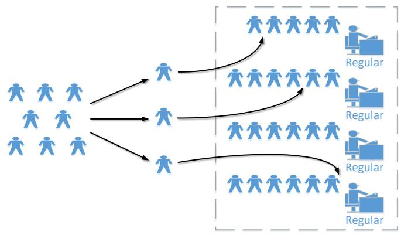

# 2017年美国大学生数学建模竞赛O奖论文：机场安检流程分析与优化

原件为竞赛论文。补充：文中的阅读练习及“参考解答”为整理时增加，原件图文保留出处。

## Summary

Security check is essential to the safety of airline passengers. However, it is also a time consuming process. Passengers have to wait in lines, get ID check, prepare the belongings and get screening inspection and sometimes it even takes hours of time to finish. Besides, the variance of the waiting time in the checkpoints line is also very high, which is difficult for passengers to decide when to reach the airport. Therefore, we are required to figure out the potential issues and make some modifications to the current process that can reduce the average waiting time and its variance.

We develop the basic model to simulate the current situation of American airports security check and study the properties of Pre-Check policy. Though more ‘Pre-Check’ passengers can help alleviate congestion to some degree, the time in the process of wait for screening is the overwhelming majority of the time spent in security check. It occupy over 98% of total time during rush hours. In addition, we also plot the distribution of different total waiting time, and find that it is nearly a uniform distribution over several hours. The variance is hence too high for passengers to predict their total waiting time.

Based on this conclusion, we mainly build two efficient modification models to optimize the current situation. The first one is ‘multi-passenger linkage model of belongings preparation (MPL)’. It shows that if the airport opens up a small zone for several passengers to prepare for screening at the same time, the average time and variance will obviously decrease. The other one is ‘priority-based queuing model (PBQ)’. It suggests airports to set some appropriate time interval limits to provide passengers who is to take off with great convenience without increasing the average time. Besides, it can encourage people not to arrive at airports so early that aggravate congestion.

We also speculate about the TSA’s latest institution for the elderly and children, but it does not make much contribution. At last, we consider the Chinese cultural norms and apply our model to Chinese airports. We construct the cut-in-line model. The result shows that MPL and PBQ models can still keep their high effectiveness. In other word, our models have high stability, high error-tolerant rate and extensive applicability.

Keywords: Security Check; Poisson Distribution; Gaussian Distribution; Queuing Methods

## Contents

1. Restatement of the Problem 3
   1.1 Background ..... 3
   1.1.1 An Overview of the Problem ..... 3
   1.1.2 The Process of Security Check ..... 3
   1.2 literature review ..... 3
   1.3 The Task at Hand ..... 4
2. Model Assumptions and Notations 4
   2.1 Assumptions and Justifications ..... 4
   2.2 Notations ..... 5
3. The Basic Model of Security Checkpoints 6
   3.1 The Design of the Model ..... 6
   3.2 Sub Models ..... 6
   3.2.1 Inflow Model ..... 6
   3.2.2 Attributes Generation Model ..... 6
   3.2.3 Queuing Model ..... 7
   3.2.4 Screening Model ..... 7
   3.3 The Result of the Model ..... 8
   3.3.1 The Distribution of the Total Time T ..... 8
   3.3.2 The proportion of the Time Spent in Different Steps ..... 8
   3.3.3 The Influence of the Ratio of Pre-Check Passengers and Regular Passengers ..... 8
   3.3.4 The Influence of the Ratio of Pre-Check Lanes and Regular Lanes ..... 10
4. Modifications to the Current Process 11
   4.1 Multi-passenger Linkage Model of Belongings Preparation ..... 11
   4.1.1 The Design of MPL Model ..... 11
   4.1.2 The Effectiveness of MPL Model ..... 11
   4.2 Priority-based Queuing Model ..... 12
   4.2.1 The Design of PBQ Model ..... 12
   4.2.2 The Effectiveness of PBQ Model ..... 13
   4.3 Model of Special Population ..... 14
   4.3.1 The Design of SP Model ..... 14
   4.3.2 The Effectiveness of SP Model ..... 15
5. Model Evaluation & Sensitivity Analysis ..... 15
   5.1 The Cut-in-line Model ..... 15
   5.2 The Sensitivity of MPL Model ..... 16
   5.3 The Sensitivity of PBQ Model ..... 17
6. Conclusion ..... 18
   6.1 Strengths and Weaknesses ..... 18
   6.1.1 Strengths ..... 18
   6.1.2 Weaknesses ..... 18
   6.2 Suggestions to the Security Manager ..... 18
   6.3 Future Plans ..... 19
7. Other figures ..... 30
   7.1 Figures in 'Modifications to the Current Process' ..... 30
   7.2 Figures in 'Model Evaluation & Sensitivity Analysis' ..... 30

Appendices ..... 20
   Appendix A Simulation Code ..... 20

### 1 Restatement of the Problem

#### 1.1 Background

##### 1.1.1 An Overview of the Problem

In recent years, as the threat of terrorism is upgrading, American society has attached great significance to the security of the airport. A key part of the security measures at the airport is security checkpoints, where the passengers and their belongings should be inspected for dangerous objects. However, if the passengers takes a long time to pass the security checkpoints, there will be a negative impact on the customers’ feelings, then the interests of the airlines can be influenced.

There are two major problems in Chicago’s O’Hare international airport and other American airports. First, it is annoying that there are sometimes over-long queues at the airports, but we cannot give an explanation or a prediction. Second, the variance of waiting time is high, that is to say, it is difficult for the travelers to find a suitable time to reach the airport without being unnecessarily early or missing the plane. Therefore it makes great sense to solve the congestion problem.

##### 1.1.2 The Process of Security Check

The process of security check can be decomposed into following processes:

- Arriving process: Passengers are assigned at the beginning of our model.
- Process of waiting at the checkpoints: Passengers wait at the checkpoints in Zone A and then move to the subsequent queue in Zone B.
- ID check process: Passengers get the identification check in this process.
- Process of waiting for screening: Passengers wait in lanes for screening.
- Preparing process: After reaching the front of the line, passengers place their belongings, including their jackets, liquid containers, computers and so on.
- Screening process: Passengers get screened by the millimeter scanner while the goods are scanned by the X-ray, then they retrieve their belongings.
- Additional inspection process: If the passengers fail in the screening process, they should get additional inspections in Zone D.

#### 1.2 Literature Review

To simplify the problem and facilitate the implementation of computer language, researchers treat time as a discrete variable in the analysis of a single-server queuing system at first [1]. After that, some people have applied Queuing Theory to the dynamic allocation of airport security resources, which used pure Markov chain, discontinuous Markov process, Poisson process, statistical properties of transition probability equation and the birth and death process [2] [3]. What’s more, some other people try to achieve a goal of virtual queuing instead of real one in order to get a smoother distribution of arriving passengers [4]. We expect to find some convenient and intuitive modifications for the airport security based on the previous wisdom and some necessary math knowledge like Queuing Theory, Probability and Statistics [5].

#### 1.3 The Task at Hand

- Construct a mathematical model to simulate the situation of the current security checkpoints and find an explanation for the phenomenon of congestion.
- Propose some modifications to improve the current process.
- Take the various behaviors of travelers into consideration, then discuss the influence of those factors on the model.
- On the basis of the model, give some policy and procedural suggestions to ameliorate the situation of the security checkpoints.

知识点：[问题重述与分析（Problem Restatement and Analysis）](../../../topics/数学建模/wenti_chongshu.md)、[文献综述与研究背景撰写方法](../../../topics/数学建模/wenxian_zongshu.md)、[任务分解与目标明确](../../../topics/数学建模/renwu_fenjie.md)

### 2 Model Assumptions and Notations

#### 2.1 Assumptions and Justifications

In order to simplify the course of modeling and draw some reasonable conclusions from our model, we make assumptions as follows:

- The excel data can embody the overall level of the airport to some degree. We use the differential method to calculate out the mean value and the standard deviation of the time consumed in different processes.
- The intervals of the passengers’ arrivals obey Poisson distribution. Because the time when a passenger arrives is unrelated to that of the last passenger, therefore we assume that the intervals of the passengers’ arrivals obey Poisson distribution. The mean values of the distribution are obtained from the excel data.
- The time of ID check and millimeter wave scanning obeys Gaussian distribution. In this two processes, we suppose that the staff of the airport are skillful, that is to say the time cost in these processes fluctuates around a mean value. Thus we assume that they obey Gaussian distribution. The mean values and the standard deviations are also calculated out according to the excel data.
- The time interval of two examinations is 11s to pass the X-ray scanning and the time interval between two placements is 2s. According to the excel data, we can see that the interval is sometimes around 2s and sometimes around 11s. We interpret it as: in one time of examination, the inspector inspects several pieces of luggage. There are time intervals between each examinations.
- All of the passengers know the rules of the airport. They will go to the back of the shortest queue after arrival.

# 2017年美国大学生数学建模竞赛O奖论文：机场安检流程分析与优化（习题）第3部分

本资料整理自《2017年美国大学生数学建模竞赛O奖论文：机场安检流程分析与优化》第6-8页内容，主要涵盖基本模型的假设、符号定义及子模型构建。

## 一、模型假设与基础设定

知识点：[一般假设及其合理性说明（Assumptions and Justifications）](../../../topics/数学建模/jiaben_shezhi.md)、[符号说明与术语定义（Nomenclature / Symbols and Definitions）](../../../topics/数学建模/fuhao_shuoming.md)

### 假设 1

• There are no emergency incidents happened in the airport. What we discuss is the airport in order and it is clear that any emergency incident can break the order of any airport.

答案：在机场没有发生紧急事件。我们讨论的是秩序井然的机场，显然任何紧急事件都会打破机场的秩序。

知识点：[一般假设及其合理性说明（Assumptions and Justifications）](../../../topics/数学建模/jiaben_shezhi.md)

### 假设 2

• Pre-Check passengers can choose to go through the regular passage of security check when the Pre-Check passage is crowded. As for Pre-Check passengers, it takes them the same time either in Pre-Check passages or in regular passages.

答案：Pre-Check（快速通道）乘客在快速通道拥挤时可以选择通过常规安检通道。对于Pre-Check乘客而言，无论选择快速通道还是常规通道，所花费的时间相同。

知识点：[问题重述与分析（Problem Restatement and Analysis）](../../../topics/数学建模/wenti_chongshu.md)、[一般假设及其合理性说明（Assumptions and Justifications）](../../../topics/数学建模/jiaben_shezhi.md)

### 假设 3

• The time of preparing the belongings is $15 \pm 5 + 5X$ s in the Pre-Check passage, while it is $45 \pm 10 + 5X$ s in the ordinary passage. This is based on our experiments. X is the number of the pieces of luggage.

答案：准备随身物品的时间在Pre-Check通道为 $15 \pm 5 + 5X$ 秒，而在普通通道为 $45 \pm 10 + 5X$ 秒。这是基于我们的实验数据得出的。其中 $X$ 是行李件数。

知识点：[一般假设及其合理性说明（Assumptions and Justifications）](../../../topics/数学建模/jiaben_shezhi.md)、[模型参数的确定（基于数据拟合或实验选择）](../../../topics/数学建模/canshu_queding.md)

### 假设 4

• In our model, there are 4 ID checkpoints in Zone A and 4 checking lanes in Zone B.

答案：在我们的模型中，A区有4个身份检查点，B区有4个检查通道。

知识点：[数学建模的基本步骤（问题分析、模型假设、建立、求解、检验、推广）](../../../topics/数学建模/jianmo_buzhou.md)、[一般假设及其合理性说明（Assumptions and Justifications）](../../../topics/数学建模/jiaben_shezhi.md)、[文献综述与研究背景撰写方法](../../../topics/数学建模/wenxian_zongshu.md)

### 假设 5

• We do not take the transiting time between different stations into consideration.

答案：我们不考虑不同站点之间的转移时间。

## 二、符号说明

知识点：[符号说明与术语定义（Nomenclature / Symbols and Definitions）](../../../topics/数学建模/fuhao_shuoming.md)、[一般假设及其合理性说明（Assumptions and Justifications）](../../../topics/数学建模/jiaben_shezhi.md)、[问题重述与分析（Problem Restatement and Analysis）](../../../topics/数学建模/wenti_chongshu.md)

### 符号表 1

Table 1: Notations

| Symbol | Description |
| :--- | :--- |
| $t_a$ | the time interval between two passengers' arrivals |
| $t_p$ | the time interval between two Pre-Check passengers' arrivals |
| $t_r$ | the time interval between two regular passengers' arrivals |
| $t_{waitA}$ | the time of waiting at Zone A |
| $t_{waitB}$ | the time of waiting at Zone B |
| $t_{check}$ | the time of identification check |
| $\sigma_{check}$ | the standard deviation of $t_{check}$ |
| $t_{xray}$ | the time of X-ray scanning |
| $t_{milli}$ | the time of millimeter wave scanning |
| $t_{pre}$ | the time of preparing |
| $\sigma_{pre}$ | the standard deviation of $t_{pre}$ |
| $t_{screening}$ | the time of screening |
| T | the total time of the security check of a single person |
| $T_{avg}$ | the total time of the security check process of a group of people |
| $\sigma_T$ | the standard deviation of $T_{avg}$ |
| $T_r$ | the total time consumed by regular passengers |
| $T_p$ | the total time consumed by Pre-Check passengers |
| $\sigma_{Tr}$ | the standard deviation of $T_r$ |
| $\sigma_{Tp}$ | the standard deviation of $T_p$ |
| $N_{prepare}$ | the number of passengers preparing their belongings |
| $R_{passenger}$ | the ratio of $t_p$ to $t_r$ |
| $R_{lane}$ | the ratio of Pre-Check lanes to regular lanes |
| $R_{oyp}$ | the percentage of people over 70 or under 12 |
| $R_{cut}$ | the percentage of people who cut in line |

答案：符号及其描述如上表所示。部分符号将在后续章节中进一步定义。

## 三、安检通道基本模型

知识点：[符号说明与术语定义（Nomenclature / Symbols and Definitions）](../../../topics/数学建模/fuhao_shuoming.md)

### 模型概述

In this section, we develop the basic model to explain the current situation of American airports. The basic model simulates the processes mentioned in Section 1.1.2. Then we discover that the process of waiting for screening is the most time consuming. The Pre-Check policy of TSA is effective, but we need to find more strategies to solve the problem.

答案：在本节中，我们建立了基本模型来解释美国机场的现状。该基本模型模拟了第1.1.2节中提到的流程。我们发现等待筛查的过程是最耗时的。TSA的快速检查政策是有效的，但我们需要找到更多策略来解决这个问题。

知识点：[问题重述与分析（Problem Restatement and Analysis）](../../../topics/数学建模/wenti_chongshu.md)

### 模型设计

In order to demonstrate our basic model clearly, we divide it into the four following sub models.

• Inflow model: This model is designed to simulate the random arrivals of the passengers.

• Sub model two: Attributes generating model: In this model, we attribute different properties to the passengers that will influence the time length of security check.

• Queuing model: This model studies the process of waiting in lines.

• Screening model: The preparing process and the screening process are discussed in this model.

答案：为了清晰地展示我们的基本模型，我们将其分为以下四个子模型。

1.  **流入模型 (Inflow model)**：旨在模拟乘客的随机到达。
2.  **属性生成模型 (Attributes generating model)**：在此模型中，我们为乘客赋予不同的属性，这些属性将影响安检所需的时间长度。
3.  **排队模型 (Queuing model)**：研究排队等候的过程。
4.  **筛查模型 (Screening model)**：讨论准备过程和筛查过程。

## 四、子模型详解

知识点：[任务分解与目标明确](../../../topics/数学建模/renwu_fenjie.md)、[数学建模的基本步骤（问题分析、模型假设、建立、求解、检验、推广）](../../../topics/数学建模/jianmo_buzhou.md)

### 4.1 流入模型 (Inflow Model)

The inflow model simulates the stochastic arrivals of passengers at the entrance of the airport. According to the excel data, we can obtain that the average time interval of passengers’ arrivals. We can assume that the arrival of each passenger obeys Poisson distribution in Equation (1). λ is the average time interval between the arrivals of two passengers according to the excel data, and N is the number of seconds between the arrivals of two passengers in our stochastic process.

$$
P(t = N) = e^{-\lambda} \frac{\lambda^N}{N!} \tag{1}
$$

答案：流入模型模拟了乘客在机场入口处的随机到达。根据Excel数据，我们可以获得乘客到达的平均时间间隔。我们可以假设每位乘客的到达服从泊松分布，如公式(1)所示。$\lambda$ 是根据Excel数据得出的两名乘客到达之间的平均时间间隔，而 $N$ 是我们随机过程中两名乘客到达之间的秒数。

知识点：[模型参数的确定（基于数据拟合或实验选择）](../../../topics/数学建模/canshu_queding.md)、[随机模型与确定性模型的对比（Stochastic vs Deterministic Model）](../../../topics/数学建模/suiji_queding.md)

### 4.2 属性生成模型 (Attributes Generation Model)

After a passenger is assigned in the program, we give some relevant attributes to the passengers, including the time for ID check, the time for millimeter wave scanning, the pieces of luggage they carry, the time for preparing the personal belongings and whether the passenger has enrolled in ‘Pre-Check’. We assume that the first two factors obey Gaussian distribution in Equation (2). Then we calculate the mean value and the standard deviation of the first three affecting factors. Those of the fourth one are given in the assumptions.

$$
t_i = \frac{1}{\sigma_i \sqrt{2\pi}} e^{-\frac{(x - \mu_i)^2}{2\sigma_i^2}} \tag{2}
$$

The mean value and the standard are listed in Table 2

Table 2: the Attributes of the Generated Passengers and Their Mean Values and Standard Deviations

| Attributes ($t_i$) | Mean Value ($\mu_i/s$) | Standard Deviation ($\sigma_i/s$) |
| :--- | :--- | :--- |
| $t_{check}$ | 11.31 | 3.70 |
| $t_{milli}$ | 11.64 | 5.82 |
| $t_{pre\_r}$ | 45 | 10 |
| $t_{pre\_p}$ | 15 | 5 |

答案：当乘客被分配到程序中后，我们赋予他们一些相关属性，包括身份证检查时间、毫米波扫描时间、携带的行李件数、准备个人物品所需的时间以及乘客是否参加了“快速检查”。我们假设前两个因素服从高斯分布，如公式(2)所示。然后我们计算前三个影响因素的平均值和标准差。第四个因素的数值在假设中给出。

平均值和标准差列于表2中。

知识点：[一般假设及其合理性说明（Assumptions and Justifications）](../../../topics/数学建模/jiaben_shezhi.md)、[模型参数的确定（基于数据拟合或实验选择）](../../../topics/数学建模/canshu_queding.md)

### 4.3 排队模型 (Queuing Model)

After the arrival of the passengers, they will automatically go to the back of the shortest queue. Then, we use a queuing model to simulate the process that the passengers are waiting in lines. We treat each waiting line of the airport as a queue in our program. The first passenger added to the queue will be the first to get out as Figure 1 demonstrates.

At the front of the queue, the rate of removing each passenger from the queue is determined in the attribute generation model.

答案：乘客到达后，会自动排到最短队列的后面。然后，我们使用排队模型来模拟乘客排队的过程。在我们的程序中，我们将机场的每条等待线视为一个队列。正如图1所示，添加到队列中的第一位乘客将是第一个离开队列的人。

在队列前端，从队列中移除每位乘客的速率由属性生成模型确定。

知识点：[数学建模的基本步骤（问题分析、模型假设、建立、求解、检验、推广）](../../../topics/数学建模/jianmo_buzhou.md)、[文献综述与研究背景撰写方法](../../../topics/数学建模/wenxian_zongshu.md)、[问题重述与分析（Problem Restatement and Analysis）](../../../topics/数学建模/wenti_chongshu.md)

### 4.4 筛查模型 (Screening Model)

When the passengers finished queuing, they first begin to prepare their belongings. Then the passengers and their belongings are scanned respectively. The time cost in this process should be the maximum of the millimeter wave scanning time $t_{milli}$ and the

答案：当乘客完成排队后，他们首先开始准备随身物品。然后，乘客及其随身物品分别进行扫描。此过程所花费的时间应该是毫米波扫描时间 $t_{milli}$ 和……（原文此处截断）

# 2017年美国大学生数学建模竞赛O奖论文：机场安检流程分析与优化（习题）

本部分为《2017年美国大学生数学建模竞赛O奖论文：机场安检流程分析与优化》的第4部分，主要涉及模型结果分析及对现有流程的改进策略。内容由识别工具读取整理。

## 三、模型结果分析

知识点：[数学建模的基本步骤（问题分析、模型假设、建立、求解、检验、推广）](../../../topics/数学建模/jianmo_buzhou.md)、[任务分解与目标明确](../../../topics/数学建模/renwu_fenjie.md)、[模型优缺点分析（Strengths and Weaknesses）](../../../topics/数学建模/youque_dian.md)

### 3.3 模型结果

我们使用 C++ 程序实现了该模型并得到一组虚拟数据，随后处理这些数据以找出拥堵的原因。

#### 选择 1

**题干：** X-ray scanning time $t_{xray}$ 与总筛查时间的关系公式是什么？

$$
t_{screening} = \max [ t_{milli}, t_{xray} ]\tag{3}
$$

#### 选择 2

**题干：** 根据图2，总时间 $T$ 在旅客群体中的分布情况如何？

- A. 呈正态分布
- B. 非常均匀地分布在人群中
- C. 呈指数分布
- D. 随机分布

答案：B。
知识点：[模型参数的确定（基于数据拟合或实验选择）](../../../topics/数学建模/canshu_queding.md)、[敏感性分析方法（Sensitivity Analysis，单参数与多参数变动）](../../../topics/数学建模/minganxing_fenxi.md)、[一般假设及其合理性说明（Assumptions and Justifications）](../../../topics/数学建模/jiaben_shezhi.md)

### 4.1 多乘客行李准备联动模型

#### 4.1.1 MPL 模型的设计

如第 3 节所述，拥堵主要发生在等待筛查的过程中。在前一个模型中，一名乘客必须等到最后一名乘客完成行李准备后才能开始准备自己的物品。显然，我们可以在此过程中节省更多时间。因此，我们做出了以下改进。

假设每个检查点允许 $N_{prepare}$ 名乘客同时准备他们的随身物品。一旦一名乘客完成准备并开始筛查过程，排在等待队伍前面的另一名乘客就可以加入准备过程。在这种联动过程中，我们可以保证始终有若干名乘客在一起准备随身物品。虽然特定乘客的准备时间没有减少，但其他乘客的等待时间减少了。

#### 4.1.2 MPL 模型的有效性

接下来，我们要找到能减少等待时间且准备区域不至于过于拥挤的最优 $N_{prepare}$。如图 8 和图 9 所示，当 $N_{prepare} = 3$ 时，总时间 $T_{avg}$ 显著减少。当 $N_{prepare}$ 达到 4 和 5 时，变化不明显但区域变得更拥挤。因此，我们可以得出结论，三人联动模型是最好的策略。经过 MPL 修改后，我们再次绘制了不同流程的时间占比。如图 11 所示，等待筛查过程消耗的时间从 98.11% 减少到 57.21%。

知识点：[模型参数的确定（基于数据拟合或实验选择）](../../../topics/数学建模/canshu_queding.md)、[有效性参数（Effectiveness Parameter）与搜索模式对比](../../../topics/数学建模/youxiaoxing_canshu.md)

### 4.2 基于优先级的排队模型

#### 4.2.1 PBQ 模型的设计

在该模型中，我们将安检的四条车道分为以下几类：一条预检车道，两条常规车道和一条紧急车道。在属性生成过程中，我们向属性中添加一个新属性 $t_{ad}$，即乘客到达机场到飞机起飞之间的时间间隔。基于此属性，我们将乘客分为三个优先级。我们设定两个时间间隔 $t_{ad1}$ 和 $t_{ad2}$。$t_{ad}$ 小于 $t_{ad1}$ 的乘客属于第一优先级，介于 $[t_{ad1}, t_{ad1} + t_{ad2}]$ 之间的属于第二优先级，其余的属于第三优先级。相关的群体分别称为优先组、常规组和超时组。

对于不同的优先级，乘客享受不同的政策。对于优先组，乘客可以立即使用紧急车道。对于常规组，乘客在机场等待了一段时间 $t_{ad1}$ 之前不能通过紧急车道。当时间段 $t_{ad2}$ 过去后，超时组的乘客可以使用紧急车道。这项政策不仅可以保证紧急情况下的乘客第一时间登机，还可以警告人们不要不必要地过早到达。图 12 描述了这一新的修改。

## 4.2.2 PBQ 模型的有效性

我们研究了在 PBQ 改进下不同人群在整个流程中消耗的平均时间。我们改变 $t_a$，即两名乘客之间的到达时间间隔，观察曲线的变化趋势，然后与未作 PBQ 改进的情况进行比较。根据图 13 和图 23，在乘客高峰流量（$t_a < 1\,\text{s}$）时，第一组的 $T_{avg}$ 及其标准差显著……

我们编程实现该改进，并绘制 $T_{avg}$ 关于 $t_{ad1}$ 和 $t_{ad2}$ 的函数图像，以找出最优参数 $t_{ad1}$ 和 $t_{ad2}$。

根据图 15 和图 16，我们可以得出 PBQ 模型具有以下性质。

如图 15 所示，三组的平均时间随参数变化不大。也就是说，当 $t_{ad1}$ 和 $t_{ad2}$ 设置不当、与相应乘客流量不匹配时，不会产生负面影响。但是，如果设置合适的参数，前两组的安检速度可以加快。换言之，容错率较强。

显然，在图 16 中，如果 $t_{ad1}$ 与 $t_{ad2}$ 之和为常数，前两组（优先组和普通组）的平均时间变化不大。当该和变小时，平均时间也随之变小。这是因为随着 $t_{ad1}$ 和 $t_{ad2}$ 减小，乘客数量也减少，即能够使用应急通道的乘客数量减少。

因此，我们可以按照两组乘客数量的比例来设置 $t_{ad1}$ 与 $t_{ad2}$ 的比值。这意味着我们可以提高现有资源的利用率。此外，这一现象也表明模型符合实际。

## 4.3 特殊人群模型

知识点：[数学建模的基本步骤（问题分析、模型假设、建立、求解、检验、推广）](../../../topics/数学建模/jianmo_buzhou.md)、[模型参数的确定（基于数据拟合或实验选择）](../../../topics/数学建模/canshu_queding.md)、[敏感性分析方法（Sensitivity Analysis，单参数与多参数变动）](../../../topics/数学建模/minganxing_fenxi.md)

### 4.3.1 SP 模型的设计

在实际情况下，老人和儿童携带危险物品的可能性较小，而且他们通常也不携带行李。根据 TSA 网站[6]，他们已实施一项政策，缩短 75 岁以上老人和 12 岁以下儿童的安检时间。他们声称这些人将不再需要脱鞋和脱下轻薄外套。

我们建立特殊人群模型来模拟这一情形。我们假设老人和儿童均不携带行李。在这种情况下，根据式 (3)，安检时间等于人体扫描时间。

我们分别将比例设为 0、10%、20%、30%。在每种情况下，我们研究 $T_{avg}$（平均总时间）如何随 $t_a$（两名乘客到达之间的时间间隔）变化。

知识点：[一般假设及其合理性说明（Assumptions and Justifications）](../../../topics/数学建模/jiaben_shezhi.md)、[模型参数的确定（基于数据拟合或实验选择）](../../../topics/数学建模/canshu_queding.md)、[敏感性分析方法（Sensitivity Analysis，单参数与多参数变动）](../../../topics/数学建模/minganxing_fenxi.md)

### 4.3.2 SP 模型的有效性

如图 17 和图 18 所示，0、10%、20%、30% 四条曲线相似。该制度带来的 $T_{avg}$ 变化很细微。也就是说，TSA 官网上的新政策效果并不显著。

## 5 模型评价与灵敏度分析

我们在中国机场的条件下运行模型以检验其灵敏度。我们建立一个插队模型来描述中国的情况，然后在中国机场中检验各改进模型的灵敏度。

知识点：[模型优缺点分析（Strengths and Weaknesses）](../../../topics/数学建模/youque_dian.md)、[敏感性分析方法（Sensitivity Analysis，单参数与多参数变动）](../../../topics/数学建模/minganxing_fenxi.md)

### 5.1 插队模型

在该模型中，我们考虑中国现实下的一些特殊因素，包括：

- 在中国，恐怖主义威胁不那么严重，因此中国机场的规则不如美国严格。乘客不需要脱下衣服和鞋子。
- 乘客会非常重视个人效率，存在插队现象。

因此，我们对模型作出相应改动：

- 所有中国人的准备时间与美国模型中的预检（Pre-Check）乘客相同。
- 当生成一名乘客时，我们为其赋予两个额外属性：一是该乘客是否会插队，二是该乘客插入的位置。我们假设插入到该乘客前方每个位置的概率相同。该过程如图 19 所示。

知识点：[数学建模的基本步骤（问题分析、模型假设、建立、求解、检验、推广）](../../../topics/数学建模/jianmo_buzhou.md)、[一般假设及其合理性说明（Assumptions and Justifications）](../../../topics/数学建模/jiaben_shezhi.md)、[模型参数的确定（基于数据拟合或实验选择）](../../../topics/数学建模/canshu_queding.md)

### 5.2 MPL 模型的灵敏度

我们在中国情境下研究 MPL 模型的灵敏度。在不同的插队率下，我们观察该模型带来的差异。根据图 20 和图 21，总时间及其方差仍可显著降低。

知识点：[敏感性分析方法（Sensitivity Analysis，单参数与多参数变动）](../../../topics/数学建模/minganxing_fenxi.md)、[参数合理性验证](../../../topics/数学建模/canshu_heli_xing.md)、[数学建模的基本步骤（问题分析、模型假设、建立、求解、检验、推广）](../../../topics/数学建模/jianmo_buzhou.md)

### 5.3 PBQ 模型的灵敏度

我们在中国情境下检验 PBQ 模型的灵敏度。在不同的插队率下，我们观察该模型带来的差异。根据图 22 和图 23，优先组的平均时间及其方差可显著降低，而全体乘客的平均时间与未使用该模型时保持不变。这与美国的情况相同。从图 24 可以看出，经 PBQ 模型改进后，插队率对平均消耗时间没有影响。

总之，MPL 模型和 PBQ 模型在中国与在美国同样有效。也就是说，我们的模型经过少量修改后也可应用于中国机场。

## 6 Conclusion

知识点：[敏感性分析方法（Sensitivity Analysis，单参数与多参数变动）](../../../topics/数学建模/minganxing_fenxi.md)、[模型验证方法概述（随机模型与确定性模型验证）](../../../topics/数学建模/moxing_yanzheng.md)

### 6.1 Strengths and Weaknesses

#### 6.1.1 Strengths

Our models are adaptable to different conditions. Both MPL and PBQ models can still provide stable efficiency improvement though there may be some impacts.

PBQ model has strong fault tolerance. Though we may not get the exact optimal time interval $t_{ad1}$ and $t_{ad2}$, the modification is still able to reduce a lot of time, especially when we meet the extreme peak flow.

Our models have broad application prospect. PBQ model can not only reduce the urgent people’s waiting time, but also encourages people not to arrive at airport too early. This can decline the pressure during peak flow.

#### 6.1.2 Weaknesses

Our models ignore the probability of emergent incident, thus our models only work in a peaceful environment.

In the SP model, we just consider the old and the young as another ‘PreCheck’ passenger, this may be improper.

In the Cut-in-line model, we assume that the occurrence probability of the cutting in line is constant, this may be a little different from reality.

知识点：[模型优缺点分析（Strengths and Weaknesses）](../../../topics/数学建模/youque_dian.md)

### 6.2 Suggestions to the Security Manager

According to our simulation result, we have the following recommendations for the security managers.

- Pre-Check policy is indeed effective in accelerating the process, and the ratio of Pre-Check lanes and regular lanes is optimal. Therefore we should keep the suitable ratio and advertise the advantages of Pre-Check policy.
- The airports can add a small zone between the screening machine and the waiting lanes, which can allow 3 passengers to prepare for screening in advance at the same time.
- The airports can set up some time limit intervals for security check as PBQ model, to reduce the waiting time of the passengers who is going to takeoff. This policy can also encourage passengers not to arrive too early, so that congestion during fastigia can be alleviated. What’s more, the length of the time intervals $t_{ad1}$ and $t_{ad2}$ and the number of passengers in the priority group flow are directly related.
- It is not necessary for TSA to consider adjusting policy to the old and the young too much, because this modification will not provide passengers with much help.
- For Chinese airports, cutting in lines will not influence the effectiveness of the two models, therefore we can also apply these two models to Chinese airports.

知识点：[数学建模的基本步骤（问题分析、模型假设、建立、求解、检验、推广）](../../../topics/数学建模/jianmo_buzhou.md)、[模型优缺点分析（Strengths and Weaknesses）](../../../topics/数学建模/youque_dian.md)

### 6.3 Future Plans

Our present PBQ model has fixed total peak passenger flow, in the future, we try to use the passenger generating time to decide the duration of peak period, MPL can study the linkage condition and time node at a fixed peak time, make more objective evaluations on its performance.

Make the occurrence probability of the cutting in line be related to the congestion level, in the real condition, more crowded the airport is, more cut-in-line phenomenon will take place.

知识点：[数学建模的基本步骤（问题分析、模型假设、建立、求解、检验、推广）](../../../topics/数学建模/jianmo_buzhou.md)、[模型优缺点分析（Strengths and Weaknesses）](../../../topics/数学建模/youque_dian.md)

### References

[1] T. Meisling, “Discrete-time queuing theory,” Operations Research, vol. 6, no. 1, pp. 96–105, 1958.

[2] G. Yang, Z. Min, Z. Hang, and L. Yue, “Research on dynamic allocations of airport security check resources,” Aeronautical Computing Technology, vol. 46, no. 5, 2016.

[3] R. de Lange, I. Samoilovich, and B. van der Rhee, “Virtual queuing at airport security lanes,” European Journal of Operational Research, vol. 225, no. 1, pp. 153 – 165, 2013.

[4] M. Bevilacqua and F. E. Ciarapica, “Analysis of check-in procedure using simulation: A case study,” in 2010 IEEE International Conference on Industrial Engineering and Engineering Management, Dec 2010, pp. 1621–1625.

[5] X. He, Stochastic process and queuing theory. Hunan University Press, 2010.

[6] http://www.portofportland.com/Notices/PDX_TSA_75over_Scrng_01_BLT.htm.

知识点：[数学建模的基本步骤（问题分析、模型假设、建立、求解、检验、推广）](../../../topics/数学建模/jianmo_buzhou.md)、[随机模型与确定性模型的对比（Stochastic vs Deterministic Model）](../../../topics/数学建模/suiji_queding.md)、[动态规划求解（状态变量、决策变量、状态转移函数、值函数）](../../../topics/数学建模/dongtai_guihua.md)

### Appendices

#### Appendix A Simulation Code

Our simulation codes written in C++:

*(Note: Specific code content was omitted in the source text provided)*

知识点：[数学建模的基本步骤（问题分析、模型假设、建立、求解、检验、推广）](../../../topics/数学建模/jianmo_buzhou.md)、[文献综述与研究背景撰写方法](../../../topics/数学建模/wenxian_zongshu.md)、[问题重述与分析（Problem Restatement and Analysis）](../../../topics/数学建模/wenti_chongshu.md)

### 7 Other figures

#### 7.1 Figures in ‘Modifications to the Current Process’

*(Figure placeholders omitted as per instruction to remove decorative/non-substantive images or if content missing)*

#### 7.2 Figures in ‘Model Evaluation & Sensitivity Analysis

*(Figure placeholders omitted as per instruction to remove decorative/non-substantive images or if content missing)*

知识点：[模型优缺点分析（Strengths and Weaknesses）](../../../topics/数学建模/youque_dian.md)、[敏感性分析方法（Sensitivity Analysis，单参数与多参数变动）](../../../topics/数学建模/minganxing_fenxi.md)、[数学建模的基本步骤（问题分析、模型假设、建立、求解、检验、推广）](../../../topics/数学建模/jianmo_buzhou.md)
