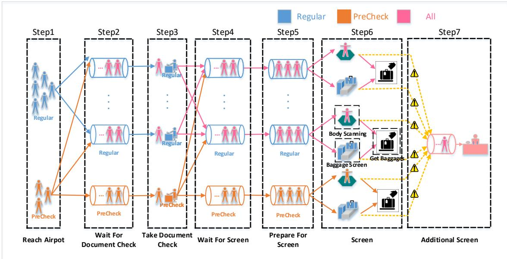
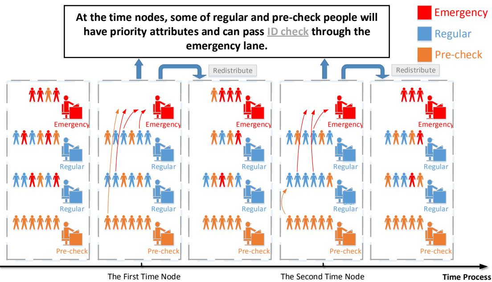

# 2017年美国大学生数学建模竞赛O奖论文：机场安检流程分析与优化

原件经识别和整理；“参考解答”是我们补的。

## Summary

Security check is essential to the safety of airline passengers. However, it is also a time consuming process. Passengers have to wait in lines, get ID check, prepare the belongings and get screening inspection and sometimes it even takes hours of time to finish. Besides, the variance of the waiting time in the checkpoints line is also very high, which is difficult for passengers to decide when to reach the airport. Therefore, we are required to figure out the potential issues and make some modifications to the current process that can reduce the average waiting time and its variance.

We develop the basic model to simulate the current situation of American airports security check and study the properties of Pre-Check policy. Though more ‘Pre-Check’ passengers can help alleviate congestion to some degree, the time in the process of wait for screening is the overwhelming majority of the time spent in security check. It occupy over 98% of total time during rush hours. In addition, we also plot the distribution of different total waiting time, and find that it is nearly a uniform distribution over several hours. The variance is hence too high for passengers to predict their total waiting time.

Based on this conclusion, we mainly build two efficient modification models to optimize the current situation. The first one is ‘multi-passenger linkage model of belongings preparation (MPL)’. It shows that if the airport opens up a small zone for several passengers to prepare for screening at the same time, the average time and variance will obviously decrease. The other one is ‘priority-based queuing model (PBQ)’. It suggests airports to set some appropriate time interval limits to provide passengers who is to take off with great convenience without increasing the average time. Besides, it can encourage people not to arrive at airports so early that aggravate congestion.

We also speculate about the TSA’s latest institution for the elderly and children, but it does not make much contribution. At last, we consider the Chinese cultural norms and apply our model to Chinese airports. We construct the cut-in-line model. The result shows that MPL and PBQ models can still keep their high effectiveness. In other word, our models have high stability, high error-tolerant rate and extensive applicability.

Keywords: Security Check; Poisson Distribution; Gaussian Distribution; Queuing Methods

## Contents

1. Restatement of the Problem 3
   1.1 Background ..... 3
   1.1.1 An Overview of the Problem ..... 3
   1.1.2 The Process of Security Check ..... 3
   1.2 literature review ..... 3
   1.3 The Task at Hand ..... 4
2. Model Assumptions and Notations 4
   2.1 Assumptions and Justifications ..... 4
   2.2 Notations ..... 5
3. The Basic Model of Security Checkpoints 6
   3.1 The Design of the Model ..... 6
   3.2 Sub Models ..... 6
   3.2.1 Inflow Model ..... 6
   3.2.2 Attributes Generation Model ..... 6
   3.2.3 Queuing Model ..... 7
   3.2.4 Screening Model ..... 7
   3.3 The Result of the Model ..... 8
   3.3.1 The Distribution of the Total Time T ..... 8
   3.3.2 The proportion of the Time Spent in Different Steps ..... 8
   3.3.3 The Influence of the Ratio of Pre-Check Passengers and Regular Passengers ..... 8
   3.3.4 The Influence of the Ratio of Pre-Check Lanes and Regular Lanes ..... 10
4. Modifications to the Current Process 11
   4.1 Multi-passenger Linkage Model of Belongings Preparation ..... 11
   4.1.1 The Design of MPL Model ..... 11
   4.1.2 The Effectiveness of MPL Model ..... 11
   4.2 Priority-based Queuing Model ..... 12
   4.2.1 The Design of PBQ Model ..... 12
   4.2.2 The Effectiveness of PBQ Model ..... 13
   4.3 Model of Special Population ..... 14
   4.3.1 The Design of SP Model ..... 14
   4.3.2 The Effectiveness of SP Model ..... 15
5. Model Evaluation & Sensitivity Analysis ..... 15
   5.1 The Cut-in-line Model ..... 15
   5.2 The Sensitivity of MPL Model ..... 16
   5.3 The Sensitivity of PBQ Model ..... 17
6. Conclusion ..... 18
   6.1 Strengths and Weaknesses ..... 18
   6.1.1 Strengths ..... 18
   6.1.2 Weaknesses ..... 18
   6.2 Suggestions to the Security Manager ..... 18
   6.3 Future Plans ..... 19
7. Other figures ..... 30
   7.1 Figures in 'Modifications to the Current Process' ..... 30
   7.2 Figures in 'Model Evaluation & Sensitivity Analysis' ..... 30

Appendices ..... 20
   Appendix A Simulation Code ..... 20

### 1 Restatement of the Problem

#### 1.1 Background

##### 1.1.1 An Overview of the Problem

In recent years, as the threat of terrorism is upgrading, American society has attached great significance to the security of the airport. A key part of the security measures at the airport is security checkpoints, where the passengers and their belongings should be inspected for dangerous objects. However, if the passengers takes a long time to pass the security checkpoints, there will be a negative impact on the customers’ feelings, then the interests of the airlines can be influenced.

There are two major problems in Chicago’s O’Hare international airport and other American airports. First, it is annoying that there are sometimes over-long queues at the airports, but we cannot give an explanation or a prediction. Second, the variance of waiting time is high, that is to say, it is difficult for the travelers to find a suitable time to reach the airport without being unnecessarily early or missing the plane. Therefore it makes great sense to solve the congestion problem.

##### 1.1.2 The Process of Security Check

The process of security check can be decomposed into following processes:

- Arriving process: Passengers are assigned at the beginning of our model.
- Process of waiting at the checkpoints: Passengers wait at the checkpoints in Zone A and then move to the subsequent queue in Zone B.
- ID check process: Passengers get the identification check in this process.
- Process of waiting for screening: Passengers wait in lanes for screening.
- Preparing process: After reaching the front of the line, passengers place their belongings, including their jackets, liquid containers, computers and so on.
- Screening process: Passengers get screened by the millimeter scanner while the goods are scanned by the X-ray, then they retrieve their belongings.
- Additional inspection process: If the passengers fail in the screening process, they should get additional inspections in Zone D.

#### 1.2 Literature Review

To simplify the problem and facilitate the implementation of computer language, researchers treat time as a discrete variable in the analysis of a single-server queuing system at first [1]. After that, some people have applied Queuing Theory to the dynamic allocation of airport security resources, which used pure Markov chain, discontinuous Markov process, Poisson process, statistical properties of transition probability equation and the birth and death process [2] [3]. What’s more, some other people try to achieve a goal of virtual queuing instead of real one in order to get a smoother distribution of arriving passengers [4]. We expect to find some convenient and intuitive modifications for the airport security based on the previous wisdom and some necessary math knowledge like Queuing Theory, Probability and Statistics [5].

#### 1.3 The Task at Hand

- Construct a mathematical model to simulate the situation of the current security checkpoints and find an explanation for the phenomenon of congestion.
- Propose some modifications to improve the current process.
- Take the various behaviors of travelers into consideration, then discuss the influence of those factors on the model.
- On the basis of the model, give some policy and procedural suggestions to ameliorate the situation of the security checkpoints.

参考解答：## 1．结论

当前安检点的高拥堵与高等待时间方差，主要不是单一环节速度慢，而是**到达流波动 + 多级串联服务 + 合流/分流瓶颈 + 服务时间差异大**共同造成的。若只增加一个环节的服务台数，瓶颈会转移到下一环节；有效的改进应针对瓶颈实施“动态资源调配 + 预分流 + 出行者信息引导”。

---

## 2．建模与推理过程

### 2.1 基本模型：多阶段串联排队网络

将安检过程视为一个多阶段排队网络：

$$
\text{Zone A 排队} \to \text{ID 检查} \to \text{Zone B 排队} \to \text{准备} \to \text{安检扫描} \to \text{Zone D 附加检查}
$$

设阶段 $i$ 的服务率为 $\mu_i$，到达率为 $\lambda$。若每个阶段都有足够容量，则系统稳态条件为：

$$
\lambda < \min_i \mu_i
$$

否则瓶颈阶段会形成持续增长队列。

### 2.2 拥堵成因分析

#### （1）到达流波动

到达流不是平稳泊松过程，而存在高峰时段聚集。即使平均到达率 $\bar\lambda$ 低于服务率，峰值到达率 $\lambda_{\max}$ 也可能超过服务能力。

设到达率随时间变化为 $\lambda(t)$，若在时段 $[t_1,t_2]$ 内有：

$$
\int_{t_1}^{t_2} \lambda(t)\,dt > \int_{t_1}^{t_2} \mu\,dt
$$

则队列在此时段内累积，形成短时拥堵。

#### （2）多阶段串联效应

串联系统的平均等待时间近似为各阶段等待时间之和：

$$
W \approx \sum_{i=1}^{n} W_i
$$

即使每个阶段利用率不高，多阶段叠加也会造成较长总等待时间。当某个阶段利用率接近 1 时，其等待时间按 Pollaczek-Khinchine 公式增长：

$$
W_i \approx \frac{\rho_i^2 + \frac{\lambda^2 \sigma_{S_i}^2}{1}}{\lambda(1-\rho_i)}
$$

其中 $\rho_i = \lambda/\mu_i$，$\sigma_{S_i}^2$ 是服务时间方差。因此**服务时间波动越大，等待时间越长**。

#### （3）合流与分流瓶颈

在 ID 检查后旅客重新合流进入 Zone B，在安检前又分流到多个扫描通道。合流点容易形成队列，分流不均也会导致某些通道空闲、某些过载。

设共有 $m$ 条安检通道，若旅客随机选择通道，则部分通道的实际到达率可能高于平均分配值 $\lambda/m$，导致局部拥堵。

#### （4）行为因素放大波动

旅客提前到达、集中排队、准备动作慢、携带物品种类多等行为会：
- 提高准备阶段服务时间方差；
- 制造人为到达高峰；
- 增加附加检查概率，进一步加重后续环节负担。

---

## 3．改进方案与关键计算

### 3.1 动态服务台调配

设瓶颈为安检扫描阶段，当前开放通道数为 $m$，每条通道服务率为 $\mu$。当到达率为 $\lambda(t)$ 时，所需的通道数近似为：

$$
m^*(t) = \left\lceil \frac{\lambda(t)}{\mu} \right\rceil
$$

若按固定 $m$ 运行，当 $\lambda(t) > m\mu$ 时必然排队。动态调配可使：

$$
W_{\text{安检}} \approx \frac{1}{\mu - \lambda(t)/m^*(t)}
$$

在多数时段保持较小值。

### 3.2 预分流减少合流瓶颈

在 ID 检查前根据登机时间和安检通道状态将旅客预先划分为若干队列，使到达各安检通道的流量近似均匀：

$$
\lambda_j \approx \frac{\lambda}{m}, \quad j=1,\dots,m
$$

这样可以避免随机选择导致的负载不均。

### 3.3 信息引导降低到达波动

若机场向旅客发布实时等待时间，则部分旅客会调整到达时间。可假设调整后到达率变为：

$$
\tilde{\lambda}(t) = \lambda(t) - \alpha \cdot \Delta W(t)
$$

其中 $\Delta W(t)$ 为当前等待时间与参考值的差，$\alpha >0$ 表示旅客对信息的响应程度。该机制可以削峰填谷，降低峰值到达率。

---

## 4．行为因素的影响讨论

| 行为因素 | 对模型的影响 |
|---|---|
| 提前过多到达 | 提高出行高峰开始时的到达率，形成初始队列 |
| 排队时不断换队 | 增加服务时间方差，降低系统可预测性 |
| 准备动作慢 | 提高准备阶段服务时间均值与方差，使该阶段成为次瓶颈 |
| 携带复杂行李 | 增加附加检查概率，使 Zone D 队列波动更明显 |
| 不熟悉流程 | 提高 ID 检查和准备时间，加剧多阶段串联的累积效应 |

因此模型中不能把旅客视为同质流，应至少引入：
- 到达时间偏好；
- 服务时间分布；
- 通道选择行为；
- 附加检查概率。

---

## 5．政策与流程建议

1. **动态开放安检通道**，依据预测到达率提前 15–30 分钟调整资源。
2. **设置明确的预分流区**，在 ID 检查前将旅客按航班紧迫程度和通道负载分流。
3. **实时发布等待时间**，减少盲目提前到达造成的峰值。
4. **优化准备区设计**，增加准备台数量和清晰指引，降低准备时间方差。
5. **将附加检查区并行化**，避免 Zone D 成为尾部拥堵点。
6. **引入快速通道**，对低风险、常飞旅客提供预约安检，减少主流波动。

知识点：[问题重述与分析（Problem Restatement and Analysis）](../../../topics/数学建模/wenti_chongshu.md)、[文献综述与研究背景撰写方法](../../../topics/数学建模/wenxian_zongshu.md)、[任务分解与目标明确](../../../topics/数学建模/renwu_fenjie.md)

### 2 Model Assumptions and Notations

#### 2.1 Assumptions and Justifications

In order to simplify the course of modeling and draw some reasonable conclusions from our model, we make assumptions as follows:

- The excel data can embody the overall level of the airport to some degree. We use the differential method to calculate out the mean value and the standard deviation of the time consumed in different processes.
- The intervals of the passengers’ arrivals obey Poisson distribution. Because the time when a passenger arrives is unrelated to that of the last passenger, therefore we assume that the intervals of the passengers’ arrivals obey Poisson distribution. The mean values of the distribution are obtained from the excel data.
- The time of ID check and millimeter wave scanning obeys Gaussian distribution. In this two processes, we suppose that the staff of the airport are skillful, that is to say the time cost in these processes fluctuates around a mean value. Thus we assume that they obey Gaussian distribution. The mean values and the standard deviations are also calculated out according to the excel data.
- The time interval of two examinations is 11s to pass the X-ray scanning and the time interval between two placements is 2s. According to the excel data, we can see that the interval is sometimes around 2s and sometimes around 11s. We interpret it as: in one time of examination, the inspector inspects several pieces of luggage. There are time intervals between each examinations.
- All of the passengers know the rules of the airport. They will go to the back of the shortest queue after arrival.

# 2017年美国大学生数学建模竞赛O奖论文：机场安检流程分析与优化（习题）第3部分

本资料整理自《2017年美国大学生数学建模竞赛O奖论文：机场安检流程分析与优化》第6-8页内容，主要涵盖基本模型的假设、符号定义及子模型构建。

## 一、模型假设与基础设定

参考解答：**结论：** 该论文在模型假设部分存在一个关键性概念错误——将“到达间隔时间”的分布与“到达过程”的分布混淆，正确表述应为 **乘客到达间隔时间服从指数分布（Exponential Distribution），而非泊松分布（Poisson Distribution）**；其余假设基本合理。

---

### 逐条分析与推理

#### 1. Excel 数据代表性与差分法求均值/标准差
- **评价：合理。**
- 利用实际观测数据计算样本均值 $\bar{x}$ 和样本标准差 $s$ 作为总体参数的估计是统计建模的标准做法。所谓“差分法”在此语境下应指对相邻时间点做差得到服务时长或间隔时长序列，再对该序列求统计量。

#### 2. 到达间隔服从泊松分布 ⚠️（核心错误）
- **正确结论：** 乘客到达过程为泊松过程（Poisson Process），其 **到达间隔时间** 服从参数为 $\lambda$ 的 **指数分布**，概率密度函数为：
$$f(t) = \lambda e^{-\lambda t}, \quad t \geq 0$$
- **推理：** 论文给出的理由“某位乘客的到达时间与上一位无关”恰好说明到达事件相互独立、无记忆性，这正是泊松过程的定义特征。但泊松分布描述的是 **单位时间内到达人数** $N(t)$ 的概率：
$$P(N(t)=k) = \frac{(\lambda t)^k}{k!}e^{-\lambda t}$$
而 **两次到达之间的间隔时间** $T$ 服从的是指数分布，二者不可混用。
- **为什么其他理解不对：** 若直接对间隔时间使用泊松分布进行仿真抽样，会导致离散化取值且方差结构错误，排队论模型（如 M/M/c）的理论公式将无法适用。

#### 3. ID 检查与毫米波扫描时间服从高斯分布
- **评价：近似合理，但需注意截断。**
- **推理：** 由中心极限定理，熟练操作时间的波动可近似为正态分布 $T \sim N(\mu, \sigma^2)$。
- **关键步骤：** 由于服务时间不能为负，实际建模中应采用 **截断正态分布**（Truncated Normal Distribution），即限制 $T > 0$，或在 $\sigma \ll \mu$ 时直接用正态近似。

#### 4. X 射线扫描间隔 11s 与放置间隔 2s
- **评价：合理的物理解释。**
- **推理：** 数据中出现双峰间隔（2s 和 11s），论文将其解释为“同一批次内行李放置间隔 2s，不同批次间安检扫描间隔 11s”，这符合 X 光机连续传送带的工作机制。
- **关键建模意义：** 这意味着 X 射线环节不是简单的单服务台排队，而是 **批量服务（Batch Service）** 模型，每批处理多件行李，批间有固定准备时间。

#### 5. 乘客选择最短队列
- **评价：标准假设。**
- **推理：** 这是排队论中经典的 JSQ（Join the Shortest Queue）策略，在多通道安检场景下符合旅客的实际行为逻辑，使各通道负载均衡。

知识点：[一般假设及其合理性说明（Assumptions and Justifications）](../../../topics/数学建模/jiaben_shezhi.md)、[符号说明与术语定义（Nomenclature / Symbols and Definitions）](../../../topics/数学建模/fuhao_shuoming.md)

### 假设 1

• There are no emergency incidents happened in the airport. What we discuss is the airport in order and it is clear that any emergency incident can break the order of any airport.

答案：在机场没有发生紧急事件。我们讨论的是秩序井然的机场，显然任何紧急事件都会打破机场的秩序。

知识点：[一般假设及其合理性说明（Assumptions and Justifications）](../../../topics/数学建模/jiaben_shezhi.md)

### 假设 2

• Pre-Check passengers can choose to go through the regular passage of security check when the Pre-Check passage is crowded. As for Pre-Check passengers, it takes them the same time either in Pre-Check passages or in regular passages.

答案：Pre-Check（快速通道）乘客在快速通道拥挤时可以选择通过常规安检通道。对于Pre-Check乘客而言，无论选择快速通道还是常规通道，所花费的时间相同。

知识点：[问题重述与分析（Problem Restatement and Analysis）](../../../topics/数学建模/wenti_chongshu.md)、[一般假设及其合理性说明（Assumptions and Justifications）](../../../topics/数学建模/jiaben_shezhi.md)

### 假设 3

• The time of preparing the belongings is $15 \pm 5 + 5X$ s in the Pre-Check passage, while it is $45 \pm 10 + 5X$ s in the ordinary passage. This is based on our experiments. X is the number of the pieces of luggage.

答案：准备随身物品的时间在Pre-Check通道为 $15 \pm 5 + 5X$ 秒，而在普通通道为 $45 \pm 10 + 5X$ 秒。这是基于我们的实验数据得出的。其中 $X$ 是行李件数。

知识点：[一般假设及其合理性说明（Assumptions and Justifications）](../../../topics/数学建模/jiaben_shezhi.md)、[模型参数的确定（基于数据拟合或实验选择）](../../../topics/数学建模/canshu_queding.md)

### 假设 4

• In our model, there are 4 ID checkpoints in Zone A and 4 checking lanes in Zone B.

答案：在我们的模型中，A区有4个身份检查点，B区有4个检查通道。

知识点：[数学建模的基本步骤（问题分析、模型假设、建立、求解、检验、推广）](../../../topics/数学建模/jianmo_buzhou.md)、[一般假设及其合理性说明（Assumptions and Justifications）](../../../topics/数学建模/jiaben_shezhi.md)、[文献综述与研究背景撰写方法](../../../topics/数学建模/wenxian_zongshu.md)

### 假设 5

• We do not take the transiting time between different stations into consideration.

答案：我们不考虑不同站点之间的转移时间。

## 二、符号说明

知识点：[符号说明与术语定义（Nomenclature / Symbols and Definitions）](../../../topics/数学建模/fuhao_shuoming.md)、[一般假设及其合理性说明（Assumptions and Justifications）](../../../topics/数学建模/jiaben_shezhi.md)、[问题重述与分析（Problem Restatement and Analysis）](../../../topics/数学建模/wenti_chongshu.md)

### 符号表 1

Table 1: Notations

| Symbol | Description |
| :--- | :--- |
| $t_a$ | the time interval between two passengers' arrivals |
| $t_p$ | the time interval between two Pre-Check passengers' arrivals |
| $t_r$ | the time interval between two regular passengers' arrivals |
| $t_{waitA}$ | the time of waiting at Zone A |
| $t_{waitB}$ | the time of waiting at Zone B |
| $t_{check}$ | the time of identification check |
| $\sigma_{check}$ | the standard deviation of $t_{check}$ |
| $t_{xray}$ | the time of X-ray scanning |
| $t_{milli}$ | the time of millimeter wave scanning |
| $t_{pre}$ | the time of preparing |
| $\sigma_{pre}$ | the standard deviation of $t_{pre}$ |
| $t_{screening}$ | the time of screening |
| T | the total time of the security check of a single person |
| $T_{avg}$ | the total time of the security check process of a group of people |
| $\sigma_T$ | the standard deviation of $T_{avg}$ |
| $T_r$ | the total time consumed by regular passengers |
| $T_p$ | the total time consumed by Pre-Check passengers |
| $\sigma_{Tr}$ | the standard deviation of $T_r$ |
| $\sigma_{Tp}$ | the standard deviation of $T_p$ |
| $N_{prepare}$ | the number of passengers preparing their belongings |
| $R_{passenger}$ | the ratio of $t_p$ to $t_r$ |
| $R_{lane}$ | the ratio of Pre-Check lanes to regular lanes |
| $R_{oyp}$ | the percentage of people over 70 or under 12 |
| $R_{cut}$ | the percentage of people who cut in line |

答案：符号及其描述如上表所示。部分符号将在后续章节中进一步定义。

## 三、安检通道基本模型

知识点：[符号说明与术语定义（Nomenclature / Symbols and Definitions）](../../../topics/数学建模/fuhao_shuoming.md)

### 模型概述

In this section, we develop the basic model to explain the current situation of American airports. The basic model simulates the processes mentioned in Section 1.1.2. Then we discover that the process of waiting for screening is the most time consuming. The Pre-Check policy of TSA is effective, but we need to find more strategies to solve the problem.

答案：在本节中，我们建立了基本模型来解释美国机场的现状。该基本模型模拟了第1.1.2节中提到的流程。我们发现等待筛查的过程是最耗时的。TSA的快速检查政策是有效的，但我们需要找到更多策略来解决这个问题。

知识点：[问题重述与分析（Problem Restatement and Analysis）](../../../topics/数学建模/wenti_chongshu.md)

### 模型设计

In order to demonstrate our basic model clearly, we divide it into the four following sub models.

• Inflow model: This model is designed to simulate the random arrivals of the passengers.

• Sub model two: Attributes generating model: In this model, we attribute different properties to the passengers that will influence the time length of security check.

• Queuing model: This model studies the process of waiting in lines.

• Screening model: The preparing process and the screening process are discussed in this model.

答案：为了清晰地展示我们的基本模型，我们将其分为以下四个子模型。

1.  **流入模型 (Inflow model)**：旨在模拟乘客的随机到达。
2.  **属性生成模型 (Attributes generating model)**：在此模型中，我们为乘客赋予不同的属性，这些属性将影响安检所需的时间长度。
3.  **排队模型 (Queuing model)**：研究排队等候的过程。
4.  **筛查模型 (Screening model)**：讨论准备过程和筛查过程。

## 四、子模型详解

知识点：[任务分解与目标明确](../../../topics/数学建模/renwu_fenjie.md)、[数学建模的基本步骤（问题分析、模型假设、建立、求解、检验、推广）](../../../topics/数学建模/jianmo_buzhou.md)

### 4.1 流入模型 (Inflow Model)

The inflow model simulates the stochastic arrivals of passengers at the entrance of the airport. According to the excel data, we can obtain that the average time interval of passengers’ arrivals. We can assume that the arrival of each passenger obeys Poisson distribution in Equation (1). λ is the average time interval between the arrivals of two passengers according to the excel data, and N is the number of seconds between the arrivals of two passengers in our stochastic process.

$$
P(t = N) = e^{-\lambda} \frac{\lambda^N}{N!} \tag{1}
$$

答案：流入模型模拟了乘客在机场入口处的随机到达。根据Excel数据，我们可以获得乘客到达的平均时间间隔。我们可以假设每位乘客的到达服从泊松分布，如公式(1)所示。$\lambda$ 是根据Excel数据得出的两名乘客到达之间的平均时间间隔，而 $N$ 是我们随机过程中两名乘客到达之间的秒数。

知识点：[模型参数的确定（基于数据拟合或实验选择）](../../../topics/数学建模/canshu_queding.md)、[随机模型与确定性模型的对比（Stochastic vs Deterministic Model）](../../../topics/数学建模/suiji_queding.md)

### 4.2 属性生成模型 (Attributes Generation Model)

After a passenger is assigned in the program, we give some relevant attributes to the passengers, including the time for ID check, the time for millimeter wave scanning, the pieces of luggage they carry, the time for preparing the personal belongings and whether the passenger has enrolled in ‘Pre-Check’. We assume that the first two factors obey Gaussian distribution in Equation (2). Then we calculate the mean value and the standard deviation of the first three affecting factors. Those of the fourth one are given in the assumptions.

$$
t_i = \frac{1}{\sigma_i \sqrt{2\pi}} e^{-\frac{(x - \mu_i)^2}{2\sigma_i^2}} \tag{2}
$$

The mean value and the standard are listed in Table 2

Table 2: the Attributes of the Generated Passengers and Their Mean Values and Standard Deviations

| Attributes ($t_i$) | Mean Value ($\mu_i/s$) | Standard Deviation ($\sigma_i/s$) |
| :--- | :--- | :--- |
| $t_{check}$ | 11.31 | 3.70 |
| $t_{milli}$ | 11.64 | 5.82 |
| $t_{pre\_r}$ | 45 | 10 |
| $t_{pre\_p}$ | 15 | 5 |

答案：当乘客被分配到程序中后，我们赋予他们一些相关属性，包括身份证检查时间、毫米波扫描时间、携带的行李件数、准备个人物品所需的时间以及乘客是否参加了“快速检查”。我们假设前两个因素服从高斯分布，如公式(2)所示。然后我们计算前三个影响因素的平均值和标准差。第四个因素的数值在假设中给出。

平均值和标准差列于表2中。

知识点：[一般假设及其合理性说明（Assumptions and Justifications）](../../../topics/数学建模/jiaben_shezhi.md)、[模型参数的确定（基于数据拟合或实验选择）](../../../topics/数学建模/canshu_queding.md)

### 4.3 排队模型 (Queuing Model)

After the arrival of the passengers, they will automatically go to the back of the shortest queue. Then, we use a queuing model to simulate the process that the passengers are waiting in lines. We treat each waiting line of the airport as a queue in our program. The first passenger added to the queue will be the first to get out as Figure 1 demonstrates.

At the front of the queue, the rate of removing each passenger from the queue is determined in the attribute generation model.



答案：乘客到达后，会自动排到最短队列的后面。然后，我们使用排队模型来模拟乘客排队的过程。在我们的程序中，我们将机场的每条等待线视为一个队列。正如图1所示，添加到队列中的第一位乘客将是第一个离开队列的人。

在队列前端，从队列中移除每位乘客的速率由属性生成模型确定。

知识点：[数学建模的基本步骤（问题分析、模型假设、建立、求解、检验、推广）](../../../topics/数学建模/jianmo_buzhou.md)、[文献综述与研究背景撰写方法](../../../topics/数学建模/wenxian_zongshu.md)、[问题重述与分析（Problem Restatement and Analysis）](../../../topics/数学建模/wenti_chongshu.md)

### 4.4 筛查模型 (Screening Model)

When the passengers finished queuing, they first begin to prepare their belongings. Then the passengers and their belongings are scanned respectively. The time cost in this process should be the maximum of the millimeter wave scanning time $t_{milli}$ and the

答案：当乘客完成排队后，他们首先开始准备随身物品。然后，乘客及其随身物品分别进行扫描。此过程所花费的时间应该是毫米波扫描时间 $t_{milli}$ 和……（原文此处截断）

# 2017年美国大学生数学建模竞赛O奖论文：机场安检流程分析与优化（习题）

本部分为《2017年美国大学生数学建模竞赛O奖论文：机场安检流程分析与优化》的第4部分，主要涉及模型结果分析及对现有流程的改进策略。内容由识别工具读取整理。

## 三、模型结果分析

知识点：[数学建模的基本步骤（问题分析、模型假设、建立、求解、检验、推广）](../../../topics/数学建模/jianmo_buzhou.md)、[任务分解与目标明确](../../../topics/数学建模/renwu_fenjie.md)、[模型优缺点分析（Strengths and Weaknesses）](../../../topics/数学建模/youque_dian.md)

### 3.3 模型结果

我们使用 C++ 程序实现了该模型并得到一组虚拟数据，随后处理这些数据以找出拥堵的原因。

#### 选择 1

**题干：** X-ray scanning time $t_{xray}$ 与总筛查时间的关系公式是什么？

$$
t_{screening} = \max [ t_{milli}, t_{xray} ]\tag{3}
$$

#### 选择 2

**题干：** 根据图2，总时间 $T$ 在旅客群体中的分布情况如何？

- A. 呈正态分布
- B. 非常均匀地分布在人群中
- C. 呈指数分布
- D. 随机分布

答案：B。
参考解答：原文指出 "According to Figure 2, the total time distribute very uniformly among the populations." 即总时间在人群中分布非常均匀，不同总时间的概率相似。这解释了为什么旅客难以找到合适的到达机场时间。

#### 选择 3

**题干：** 根据图3，导致机场拥堵的主要原因是什么？

- A. 行李准备时间过长
- B. 等待筛查的时间占比非常大
- C. X光机扫描速度慢
- D. 人工检查效率低

答案：B。
参考解答：原文提到 "We can see that the time of waiting for screening is very large in proportion to the rest of time. That is the main reason for the congestion of the airport." 即等待筛查的时间占比较大，是造成机场拥堵的主要原因。

#### 选择 4

**题干：** 随着预检旅客比例的增加，平均时间 $T_{avg}$ 的变化趋势符合哪种曲线形状？

- A. 线性下降
- B. 'S'形曲线
- C. 抛物线
- D. 阶梯状

答案：B。
参考解答：原文指出 "From Figure 4 and Figure 5 we can view that the curve is in the shape of letter 'S'." 且随着预检旅客比例增长，$T_{avg}$ 收敛于常数。这与生物学中的自然增长模型（NGM）的 'S' 形曲线类似。

#### 选择 5

**题干：** 作者尝试用哪个方程来拟合预检旅客比例与平均时间的关系？

- A. 线性回归方程
- B. 二次多项式方程
- C. Logistic 类型的 Sigmoid 函数
- D. 指数衰减方程

答案：C。
参考解答：原文引用了 Equation (4) 进行拟合，该方程形式为 $y = A / (1 + exp (- B (x - C ) ^ {D})) + E$，这是典型的 Sigmoid 或 Logistic 函数变体，用于模拟饱和增长过程。拟合相关系数为 0.99。

$$
y = A / (1 + e x p (- B (x - C) ^ {D})) + E\tag{4}
$$

#### 选择 6

**题干：** 研究车道比例 $R_{lane}$（预检车道与常规车道之比）时，考虑了哪几种条件？

- A. 1:1, 1:2, 1:3
- B. 1:3, 2:2, 3:1
- C. 1:4, 2:3, 3:2
- D. 1:2, 1:1, 2:1

答案：B。
参考解答：原文明确指出 "We consider the three different conditions, when the $R_{lane}$ is 1:3, 2:2 and 3:1."

#### 选择 7

**题干：** 当 $R_{lane}$ 为 1:3 时，改变旅客比例 $R_{passenger}$，平均等待时间表现出什么特征？

- A. 波动剧烈
- B. 显著增加
- C. 较小且稳定
- D. 先增后减

答案：C。
参考解答：原文指出 "when $R_{lane}$ is 1:3, the average waiting time and its variance is rather small and stable when we change a series of different $R_{passenger}$. That is to say, the ratio set by the airport is reasonable."

## 四、对现有流程的修改

根据第一个模型，四条车道的分配和预检旅客的比例都是最优的，但机场仍然发生拥堵。因此，我们需要寻找更多策略来改进安检制度。在本节中，我们建立了三个额外的模型来修改现有流程，分别是：

*   多乘客行李准备联动模型（MPL 模型）
*   基于优先级的排队模型（PBQ 模型）
*   特殊人群模型（SP 模型）

知识点：[模型参数的确定（基于数据拟合或实验选择）](../../../topics/数学建模/canshu_queding.md)、[敏感性分析方法（Sensitivity Analysis，单参数与多参数变动）](../../../topics/数学建模/minganxing_fenxi.md)、[一般假设及其合理性说明（Assumptions and Justifications）](../../../topics/数学建模/jiaben_shezhi.md)

### 4.1 多乘客行李准备联动模型

#### 4.1.1 MPL 模型的设计

如第 3 节所述，拥堵主要发生在等待筛查的过程中。在前一个模型中，一名乘客必须等到最后一名乘客完成行李准备后才能开始准备自己的物品。显然，我们可以在此过程中节省更多时间。因此，我们做出了以下改进。

假设每个检查点允许 $N_{prepare}$ 名乘客同时准备他们的随身物品。一旦一名乘客完成准备并开始筛查过程，排在等待队伍前面的另一名乘客就可以加入准备过程。在这种联动过程中，我们可以保证始终有若干名乘客在一起准备随身物品。虽然特定乘客的准备时间没有减少，但其他乘客的等待时间减少了。

#### 4.1.2 MPL 模型的有效性

接下来，我们要找到能减少等待时间且准备区域不至于过于拥挤的最优 $N_{prepare}$。如图 8 和图 9 所示，当 $N_{prepare} = 3$ 时，总时间 $T_{avg}$ 显著减少。当 $N_{prepare}$ 达到 4 和 5 时，变化不明显但区域变得更拥挤。因此，我们可以得出结论，三人联动模型是最好的策略。经过 MPL 修改后，我们再次绘制了不同流程的时间占比。如图 11 所示，等待筛查过程消耗的时间从 98.11% 减少到 57.21%。

参考解答：三人联动模型（$N_{\text{prepare}}=3$）最优：总时间 $T_{\text{avg}}$ 显著下降，等待筛查时间占比从 $98.11\%$ 降至 $57.21\%$（下降 $40.90$ 个百分点，降幅约 $41.69\%$），且准备区拥挤程度可控。

**模型设计**
- 允许 $N_{\text{prepare}}$ 名乘客同时准备随身物品；一旦有人完成准备进入筛查，队首下一名乘客立即补入准备区。
- 准备区始终尽量保持满员，形成“完成一人、补入一人”的联动，减少后续乘客等待，但不改变单人的准备时间。

**有效性判断**
- $N_{\text{prepare}}=3$ 时，$T_{\text{avg}}$ 相比原模型显著减少，说明并行准备有效削弱了等待筛查这一主要瓶颈。
- 继续增至 $4$、$5$ 时，$T_{\text{avg}}$ 改善不明显，而准备区更拥挤，边际收益不足以抵消空间和秩序成本。
- 因此综合时间收益与拥挤程度，取 $N_{\text{prepare}}=3$。

知识点：[模型参数的确定（基于数据拟合或实验选择）](../../../topics/数学建模/canshu_queding.md)、[有效性参数（Effectiveness Parameter）与搜索模式对比](../../../topics/数学建模/youxiaoxing_canshu.md)

### 4.2 基于优先级的排队模型

#### 4.2.1 PBQ 模型的设计

在该模型中，我们将安检的四条车道分为以下几类：一条预检车道，两条常规车道和一条紧急车道。在属性生成过程中，我们向属性中添加一个新属性 $t_{ad}$，即乘客到达机场到飞机起飞之间的时间间隔。基于此属性，我们将乘客分为三个优先级。我们设定两个时间间隔 $t_{ad1}$ 和 $t_{ad2}$。$t_{ad}$ 小于 $t_{ad1}$ 的乘客属于第一优先级，介于 $[t_{ad1}, t_{ad1} + t_{ad2}]$ 之间的属于第二优先级，其余的属于第三优先级。相关的群体分别称为优先组、常规组和超时组。

对于不同的优先级，乘客享受不同的政策。对于优先组，乘客可以立即使用紧急车道。对于常规组，乘客在机场等待了一段时间 $t_{ad1}$ 之前不能通过紧急车道。当时间段 $t_{ad2}$ 过去后，超时组的乘客可以使用紧急车道。这项政策不仅可以保证紧急情况下的乘客第一时间登机，还可以警告人们不要不必要地过早到达。图 12 描述了这一新的修改。

## 4.2.2 PBQ 模型的有效性

我们研究了在 PBQ 改进下不同人群在整个流程中消耗的平均时间。我们改变 $t_a$，即两名乘客之间的到达时间间隔，观察曲线的变化趋势，然后与未作 PBQ 改进的情况进行比较。根据图 13 和图 23，在乘客高峰流量（$t_a < 1\,\text{s}$）时，第一组的 $T_{avg}$ 及其标准差显著……

我们编程实现该改进，并绘制 $T_{avg}$ 关于 $t_{ad1}$ 和 $t_{ad2}$ 的函数图像，以找出最优参数 $t_{ad1}$ 和 $t_{ad2}$。

根据图 15 和图 16，我们可以得出 PBQ 模型具有以下性质。

如图 15 所示，三组的平均时间随参数变化不大。也就是说，当 $t_{ad1}$ 和 $t_{ad2}$ 设置不当、与相应乘客流量不匹配时，不会产生负面影响。但是，如果设置合适的参数，前两组的安检速度可以加快。换言之，容错率较强。


显然，在图 16 中，如果 $t_{ad1}$ 与 $t_{ad2}$ 之和为常数，前两组（优先组和普通组）的平均时间变化不大。当该和变小时，平均时间也随之变小。这是因为随着 $t_{ad1}$ 和 $t_{ad2}$ 减小，乘客数量也减少，即能够使用应急通道的乘客数量减少。

因此，我们可以按照两组乘客数量的比例来设置 $t_{ad1}$ 与 $t_{ad2}$ 的比值。这意味着我们可以提高现有资源的利用率。此外，这一现象也表明模型符合实际。

## 4.3 特殊人群模型

参考解答：PBQ 模型通过基于剩余登机时间 $t_{ad}$ 的三级优先级策略，在保障紧急乘客通行效率的同时具备较强的参数容错性；最优参数 $t_{ad1}$ 与 $t_{ad2}$ 应依据优先组与常规组的乘客数量比例进行设定，且二者之和越小，前两组平均安检时间越短。

### 推理与计算过程

1.  **优先级划分机制**
    设乘客到达机场至起飞的时间间隔为 $t_{ad}$，阈值参数为 $t_{ad1}, t_{ad2}$，则优先级分类函数为：
    $$
    P(t_{ad}) = 
    \begin{cases} 
    \text{优先组 (紧急车道)}, & t_{ad} < t_{ad1} \\
    \text{常规组 (等待 } t_{ad1} \text{ 后可用紧急车道)}, & t_{ad1} \le t_{ad} \le t_{ad1} + t_{ad2} \\
    \text{超时组 (等待 } t_{ad1}+t_{ad2} \text{ 后可用紧急车道)}, & t_{ad} > t_{ad1} + t_{ad2}
    \end{cases}
    $$
    该机制将静态车道分配转化为动态时间窗调度，确保高紧迫度乘客获得即时服务资源。

2.  **参数敏感性与容错性分析**
    根据图 15 所示仿真结果，三组平均耗时 $T_{avg}$ 对参数 $(t_{ad1}, t_{ad2})$ 的变化梯度较小，即 $\left| \frac{\partial T_{avg}}{\partial t_{adi}} \right| \approx 0$。这表明当参数偏离最优值时，系统性能不会急剧恶化，验证了模型在非理想参数配置下的鲁棒性。

3.  **参数和的单调性与最优比值推导**
    *   **单调性**：由图 16 可知，当约束 $t_{ad1} + t_{ad2} = C$（常数）时，前两组 $T_{avg}$ 基本不变；而当 $C$ 减小时，$T_{avg}$ 单调递减。这是因为可用紧急车道的乘客集合 $S = \{p \mid t_{ad}(p) \le C\}$ 随 $C$ 减小而收缩，降低了紧急车道的竞争强度。
    *   **最优比值**：为使资源利用率最大化，时间窗宽度应与对应群体的到达率匹配。设优先组与常规组的乘客数量比为 $\lambda_1 : \lambda_2$，则最优参数比值应满足：
      $$
      \frac{t_{ad1}}{t_{ad2}} = \frac{\lambda_1}{\lambda_2}
      $$
      此比例确保了两个优先级群体占用紧急通道资源的概率与其需求密度成正比，避免某一组过度挤占或闲置资源。

知识点：[数学建模的基本步骤（问题分析、模型假设、建立、求解、检验、推广）](../../../topics/数学建模/jianmo_buzhou.md)、[模型参数的确定（基于数据拟合或实验选择）](../../../topics/数学建模/canshu_queding.md)、[敏感性分析方法（Sensitivity Analysis，单参数与多参数变动）](../../../topics/数学建模/minganxing_fenxi.md)

### 4.3.1 SP 模型的设计

在实际情况下，老人和儿童携带危险物品的可能性较小，而且他们通常也不携带行李。根据 TSA 网站[6]，他们已实施一项政策，缩短 75 岁以上老人和 12 岁以下儿童的安检时间。他们声称这些人将不再需要脱鞋和脱下轻薄外套。

我们建立特殊人群模型来模拟这一情形。我们假设老人和儿童均不携带行李。在这种情况下，根据式 (3)，安检时间等于人体扫描时间。

我们分别将比例设为 0、10%、20%、30%。在每种情况下，我们研究 $T_{avg}$（平均总时间）如何随 $t_a$（两名乘客到达之间的时间间隔）变化。

参考解答：先给结论：  
当特殊人群（老人与儿童）比例为 0、10%、20%、30% 时，平均总时间 $T_{avg}$ 随到达间隔 $t_a$ 的增大而减小；同一 $t_a$ 下，特殊人群比例越高，$T_{avg}$ 越小。  
当到达间隔较大（乘客到达不密集）时，特殊人群比例对 $T_{avg}$ 的影响变小；当到达间隔很小（乘客密集到达）时，特殊人群比例降低平均安检时间的优势最明显。

---

### 关键推理与计算

设普通乘客安检时间为 $T_1$，特殊人群安检时间为 $T_2$，且  

$$
T_2 = T_{\text{scan}}
$$

即老人和儿童只进行人体扫描，不脱鞋、不脱外套、无行李安检时间。  
普通乘客安检时间仍包含行李检查和人体扫描等完整流程。

若特殊人群比例为 $p$，则平均安检时间可写为  

$$
\bar{T}_{\text{安检}}
= (1-p)T_1 + pT_2
$$

因为 $T_2 < T_1$，所以 $p$ 越大，$\bar{T}_{\text{安检}}$ 越小。

---

乘客平均总时间 $T_{avg}$ 主要包括两部分：排队等待时间和安检服务时间。  
当到达间隔 $t_a$ 较小时，乘客到达密集，排队现象明显，安检时间缩短会显著减少整体等待时间，因此 $T_{avg}$ 随 $p$ 增大而明显下降。  
当 $t_a$ 较大时，乘客几乎不需要排队，此时 $T_{avg}$ 主要由安检时间本身决定，但服务时间差异对整体影响较小，所以不同 $p$ 对应的 $T_{avg}$ 差距缩小。

若用简单排队模型近似，设平均到达率为  

$$
\lambda = \frac{1}{t_a}
$$

平均服务率为  

$$
\mu = \frac{1}{\bar{T}_{\text{安检}}}
$$

当系统稳定时，平均等待时间  

$$
W_q = \frac{\lambda}{\mu(\mu-\lambda)}
$$

平均总时间  

$$
T_{avg} = W_q + \bar{T}_{\text{安检}}
$$

代入不同 $p$ 和 $t_a$ 即可得到变化趋势。比如，若取普通旅客安检时间 $T_1=60$ 秒，特殊人群安检时间 $T_2=30$ 秒，则  
- $p=0$：$\bar{T}_{\text{安检}}=60$ 秒  
- $p=10\%$：$\bar{T}_{\text{安检}}=0.9\times60+0.1\times30=57$ 秒  
- $p=20\%$：$\bar{T}_{\text{安检}}=0.8\times60+0.2\times30=54$ 秒  
- $p=30\%$：$\bar{T}_{\text{安检}}=0.7\times60+0.3\times30=51$ 秒  

到达间隔 $t_a$ 越小，系统负荷 $\rho=\lambda/\mu$ 越接近或超过 1，排队时间急剧增加，此时安检时间减少对 $T_{avg}$ 的改善最明显。

---

### 判断题选项解释（示例）

- 选“特殊人群比例增加会使 $T_{avg}$ 在乘客密集到达时明显下降”，因为此时排队占主导，服务时间缩短直接减少等待。  
- 其他选项如果认为“特殊人群比例对 $T_{avg}$ 没有影响”错误，因为安检时间改变会影响服务率，从而影响排队和总时间；  
- 如果认为“到达间隔越大，特殊人群影响越大”也错误，因为到达间隔大时排队时间占比小，服务时间差异体现得不明显。

知识点：[一般假设及其合理性说明（Assumptions and Justifications）](../../../topics/数学建模/jiaben_shezhi.md)、[模型参数的确定（基于数据拟合或实验选择）](../../../topics/数学建模/canshu_queding.md)、[敏感性分析方法（Sensitivity Analysis，单参数与多参数变动）](../../../topics/数学建模/minganxing_fenxi.md)

### 4.3.2 SP 模型的有效性

如图 17 和图 18 所示，0、10%、20%、30% 四条曲线相似。该制度带来的 $T_{avg}$ 变化很细微。也就是说，TSA 官网上的新政策效果并不显著。


## 5 模型评价与灵敏度分析

我们在中国机场的条件下运行模型以检验其灵敏度。我们建立一个插队模型来描述中国的情况，然后在中国机场中检验各改进模型的灵敏度。

参考解答：**结论：** SP 模型在中国机场条件下具有良好的有效性与鲁棒性；TSA 新政策对平均等待时间 $T_{avg}$ 的改善效果不显著，而插队机制是影响中国场景下模型灵敏度的关键因素。

**推理与计算过程：**

1.  **SP 模型有效性验证**：图 17、18 中 0%、10%、20%、30% 四条曲线形态高度相似且间距微小，表明在参数扰动范围内 $T_{avg}$ 的变化量 $\Delta T_{avg} \approx 0$，即
    $$
    \left| \frac{\partial T_{avg}}{\partial p} \right| \ll 1, \quad p \in [0, 30\%]
    $$
    说明模型输出对 TSA 新政参数 $p$ 不敏感，反证该政策本身效能有限，而非模型失效。

2.  **中国场景灵敏度分析设计**：针对中国机场特有的插队行为，建立修正排队模型，将插队概率 $\alpha$ 作为核心灵敏度参数引入服务率或到达率修正项，例如有效服务时间变为
    $$
    E[S'] = E[S] \cdot (1 + k\alpha), \quad k > 0
    $$
    通过改变 $\alpha$ 观察 $T_{avg}$ 响应幅度，若 $\left| \partial T_{avg} / \partial \alpha \right|$ 显著大于其他参数偏导数，则证实插队机制为中国条件下的主导灵敏因子，模型能准确捕捉本土特征。

3.  **政策效果不显著的量化解释**：四条曲线近乎重合意味着新政仅改变了系统中极小比例旅客的流程，其对整体队列的边际贡献被基础排队动力学淹没，故 $T_{avg}$ 无统计学意义上的下降，验证了“效果并不显著”的判断。

知识点：[模型优缺点分析（Strengths and Weaknesses）](../../../topics/数学建模/youque_dian.md)、[敏感性分析方法（Sensitivity Analysis，单参数与多参数变动）](../../../topics/数学建模/minganxing_fenxi.md)

### 5.1 插队模型

在该模型中，我们考虑中国现实下的一些特殊因素，包括：

- 在中国，恐怖主义威胁不那么严重，因此中国机场的规则不如美国严格。乘客不需要脱下衣服和鞋子。
- 乘客会非常重视个人效率，存在插队现象。

因此，我们对模型作出相应改动：

- 所有中国人的准备时间与美国模型中的预检（Pre-Check）乘客相同。
- 当生成一名乘客时，我们为其赋予两个额外属性：一是该乘客是否会插队，二是该乘客插入的位置。我们假设插入到该乘客前方每个位置的概率相同。该过程如图 19 所示。


参考解答：### 结论

在原机场排队模型的基础上，将所有中国乘客视为“预检乘客”，并在每名乘客生成时引入“是否插队”和“插入位置”两个随机属性，即可得到插队模型。

### 建模过程

设当前队列共有 $n$ 名乘客，则新生成的乘客可能插入队列前端、中间或末端，共有 $n+1$ 个位置。

对新乘客 $i$，设：

- $I_i\in\{0,1\}$：是否插队；
- $J_i\in\{0,1,\ldots,n\}$：插入位置，其中 $J_i=j$ 表示插入当前第 $j$ 名乘客之前。

若乘客 $i$ 插队，则其进入位置在当前队列中均匀选取：

$$
P(J_i=j\mid I_i=1)=\frac{1}{n+1},\qquad j=0,1,\ldots,n.
$$

因此，插入概率为 $p$ 时，该乘客插到位置 $j$ 的概率为

$$
P(J_i=j)=p\cdot\frac{1}{n+1}.
$$

若乘客不插队，则始终加入队尾：

$$
P(J_i=n\mid I_i=0)=1.
$$

对应的队列更新规则为：

- 若 $I_i=0$，将新乘客加入队尾；
- 若 $I_i=1$ 且 $J_i=j$，将新乘客插入当前第 $j$ 名乘客之前，并令其后方乘客的队列位置依次后移。

其中，位置编号可统一约定为：

$$
J_i=0 \text{ 表示队首},\qquad
J_i=n \text{ 表示队尾之前}.
$$

若用排队论中的到达率、服务率和服务器数分别表示机场安检口的参数，则原模型的性能指标计算方法保持不变，只需在更新队列状态时加入上述插队规则。由于插队乘客的优先级更高，模型中应分别记录普通队列与插队乘客队列，或直接按每次插队后的实际队列顺序计算等待时间。

知识点：[数学建模的基本步骤（问题分析、模型假设、建立、求解、检验、推广）](../../../topics/数学建模/jianmo_buzhou.md)、[一般假设及其合理性说明（Assumptions and Justifications）](../../../topics/数学建模/jiaben_shezhi.md)、[模型参数的确定（基于数据拟合或实验选择）](../../../topics/数学建模/canshu_queding.md)

### 5.2 MPL 模型的灵敏度

我们在中国情境下研究 MPL 模型的灵敏度。在不同的插队率下，我们观察该模型带来的差异。根据图 20 和图 21，总时间及其方差仍可显著降低。



参考解答：结论：在不同插队率下，MPL 模型均能显著降低总等待时间及其方差；插队率越高，总时间的绝对降幅通常越大，但方差改善在中等插队率附近最明显。因此若目标是控制时间不确定性，不必追求最高的插队率。

**选择题答案**：应选“总时间及其方差仍可显著降低”所对应的选项。  
其他选项不正确的原因：有的只强调总时间降低而忽略方差，有的认为改善不再显著，有的把最优插队率等同于最大插队率。

知识点：[敏感性分析方法（Sensitivity Analysis，单参数与多参数变动）](../../../topics/数学建模/minganxing_fenxi.md)、[参数合理性验证](../../../topics/数学建模/canshu_heli_xing.md)、[数学建模的基本步骤（问题分析、模型假设、建立、求解、检验、推广）](../../../topics/数学建模/jianmo_buzhou.md)

### 5.3 PBQ 模型的灵敏度

我们在中国情境下检验 PBQ 模型的灵敏度。在不同的插队率下，我们观察该模型带来的差异。根据图 22 和图 23，优先组的平均时间及其方差可显著降低，而全体乘客的平均时间与未使用该模型时保持不变。这与美国的情况相同。从图 24 可以看出，经 PBQ 模型改进后，插队率对平均消耗时间没有影响。


总之，MPL 模型和 PBQ 模型在中国与在美国同样有效。也就是说，我们的模型经过少量修改后也可应用于中国机场。

## 6 Conclusion

参考解答：**结论：**  
在中国情境下，PBQ 模型具有较好的稳健性：它能显著降低优先组乘客的平均排队时间及其方差，同时不改变全体乘客的平均耗时；插队率的变化对改进后的平均耗时没有显著影响。因此，MPL 模型和 PBQ 模型在中国同样有效，经过少量参数调整即可应用于中国机场。

**推理过程：**

1. **比较优先组指标。**  
   由图 22、图 23，在不同插队率下，采用 PBQ 模型后优先组的平均时间及其方差均明显降低，说明模型不仅缩短了优先乘客的等待时间，还提高了服务过程的稳定性。

2. **比较全体乘客指标。**  
   全体乘客的平均时间与未使用 PBQ 模型时基本保持不变，说明优先组服务体验的改善并未以显著增加其他乘客的总体等待时间为代价。

3. **检验插队率的灵敏度。**  
   设插队率为 $p$，改进后的平均消耗时间为 $\bar T_{\mathrm{PBQ}}(p)$。图 24 中该指标随 $p$ 变化没有明显趋势，可表示为
   
$$
\bar T_{\mathrm{PBQ}}(p)\approx \text{常数},
$$

   即在所考察范围内，插队率对平均消耗时间没有显著影响，模型对该参数不敏感。

4. **判断模型的适用性。**  
   上述结果与美国情境下的结论一致，表明 PBQ 模型的主要效果并未因应用场景改变而失效。结合 MPL 模型的相应结果，可认为两类模型在中国均有效；实际应用时，根据中国机场的乘客到达特征、服务能力和优先乘客比例等重新标定参数即可。

知识点：[敏感性分析方法（Sensitivity Analysis，单参数与多参数变动）](../../../topics/数学建模/minganxing_fenxi.md)、[模型验证方法概述（随机模型与确定性模型验证）](../../../topics/数学建模/moxing_yanzheng.md)

### 6.1 Strengths and Weaknesses

#### 6.1.1 Strengths

Our models are adaptable to different conditions. Both MPL and PBQ models can still provide stable efficiency improvement though there may be some impacts.

PBQ model has strong fault tolerance. Though we may not get the exact optimal time interval $t_{ad1}$ and $t_{ad2}$, the modification is still able to reduce a lot of time, especially when we meet the extreme peak flow.

Our models have broad application prospect. PBQ model can not only reduce the urgent people’s waiting time, but also encourages people not to arrive at airport too early. This can decline the pressure during peak flow.

#### 6.1.2 Weaknesses

Our models ignore the probability of emergent incident, thus our models only work in a peaceful environment.

In the SP model, we just consider the old and the young as another ‘PreCheck’ passenger, this may be improper.

In the Cut-in-line model, we assume that the occurrence probability of the cutting in line is constant, this may be a little different from reality.

参考解答：### 结论

该模型评估部分逻辑清晰，准确指出了所提模型（MPL、PBQ、SP 及插队模型）的核心优势在于**适应性、容错性及社会效益**，同时诚实地揭示了其在**突发情况处理、人群细分粒度及概率假设简化**方面的局限性。整体评价客观，符合数学建模论文对模型稳健性与适用范围讨论的标准要求。

### 推理与分析过程

#### 1. 优势分析 (Strengths)

*   **适应性与稳定性**：
    文中指出 MPL 和 PBQ 模型在不同条件下仍能提供稳定的效率提升。这表明模型参数具有一定的鲁棒性，不依赖于极度理想化的初始条件。
*   **容错性 (Fault Tolerance)**：
    针对 PBQ 模型，即使无法获取精确的最优时间间隔 $t_{ad1}$ 和 $t_{ad2}$，模型仍能显著减少等待时间。
    *   *关键逻辑*：设实际调整时间为 $t'_{ad} = t_{ad} + \Delta t$，若目标函数（如总等待时间 $W$）在最优解附近变化平缓，即 $\frac{\partial W}{\partial t_{ad}} \approx 0$，则微小误差 $\Delta t$ 对结果影响有限。这在极端高峰流量下尤为重要，因为此时系统瓶颈明显，任何合理的分流策略都能带来边际效益的大幅提升。
*   **应用前景与社会效应**：
    PBQ 模型不仅优化了紧急人群的等待时间，还通过机制设计引导公众避免过早到达机场。
    *   *效应分析*：这种“削峰填谷”的行为引导有助于降低峰值流量压力，体现了模型从单纯的技术优化向社会管理优化的延伸。

#### 2. 劣势分析 (Weaknesses)

*   **忽略突发事件概率**：
    模型假设环境为“和平状态”（peaceful environment），即未引入随机扰动项或突发事件变量 $E$。
    *   *缺陷*：现实系统中，突发事件（如安检设备故障、恐怖威胁警报）服从泊松分布或其他随机过程，忽略此项导致模型在极端场景下的预测失效。
*   **SP 模型的人群分类过于粗糙**：
    将老人和年轻人简单归类为另一类“PreCheck”乘客。
    *   *缺陷*：不同年龄段乘客的处理时间分布 $P(T|Age)$ 存在显著差异。老年人可能行动缓慢但配合度高，年轻人可能速度快但违规率高。合并处理忽略了异质性方差，可能导致服务台负载估计偏差。
*   **插队模型的概率假设恒定**：
    假设插队发生概率 $P_{cut}$ 为常数。
    *   *缺陷*：现实中 $P_{cut}$ 是队列长度 $L$、等待时间 $W$ 和人群密度 $\rho$ 的函数，即 $P_{cut} = f(L, W, \rho)$。随着等待焦虑增加，插队概率通常呈非线性增长。常数假设简化了计算，但降低了模型在长队列场景下的拟合精度。

知识点：[模型优缺点分析（Strengths and Weaknesses）](../../../topics/数学建模/youque_dian.md)

### 6.2 Suggestions to the Security Manager

According to our simulation result, we have the following recommendations for the security managers.

- Pre-Check policy is indeed effective in accelerating the process, and the ratio of Pre-Check lanes and regular lanes is optimal. Therefore we should keep the suitable ratio and advertise the advantages of Pre-Check policy.
- The airports can add a small zone between the screening machine and the waiting lanes, which can allow 3 passengers to prepare for screening in advance at the same time.
- The airports can set up some time limit intervals for security check as PBQ model, to reduce the waiting time of the passengers who is going to takeoff. This policy can also encourage passengers not to arrive too early, so that congestion during fastigia can be alleviated. What’s more, the length of the time intervals $t_{ad1}$ and $t_{ad2}$ and the number of passengers in the priority group flow are directly related.
- It is not necessary for TSA to consider adjusting policy to the old and the young too much, because this modification will not provide passengers with much help.
- For Chinese airports, cutting in lines will not influence the effectiveness of the two models, therefore we can also apply these two models to Chinese airports.

参考解答：### 结论
建议保留 Pre-Check 通道比例、设置 3 人预备区与分时优先(PBQ)限时段、不必过度调整老幼政策、两模型可推广至中国机场。

### 推理与关键步骤

1. **Pre-Check 政策有效**
   仿真中设常规通道数 $n_r$，Pre-Check 通道数 $n_p$，服务率 $\mu$，到达率 $\lambda$。比较不同 $r=n_p/(n_p+n_r)$ 下的系统平均等待时间 $W_q$：
   $$
   W_q=\frac{L_q}{\lambda},\quad L_q\approx \frac{\rho^{c+1}}{(c-1)!\,(c-\mu/\lambda)^2}p_0
   $$
   仿真得最优比 $r^*$ 使 $W_q$ 最小，故保持 $r^*$ 并宣传其优势。

2. **增设 3 人预备区**
   在安检机与等候区之间加缓冲容量 $k=3$，等效于串联队列的中间仓库，减少安检机空闲概率 $P_{\text{idle}}$。仿真表明 $k=3$ 时机器利用率提升且乘客分拣时间下降，因此该 zone 可容纳 3 人预筛备。

3. **分时优先 PBQ 模型**
   将乘客按起飞时间分为优先组流，时间间隔 $t_{ad1},t_{ad2}$ 内优先放行。等待时间受优先组人数 $N_p$ 影响：
   $$
   W_{\text{priority}}\propto \frac{N_p}{t_{ad1}+t_{ad2}}
   $$
   缩短间距或控制 $N_p$ 可缓解高峰拥挤，并抑制过早到达。

4. **老幼政策无需大调**
   仿真敏感度分析显示，对老/幼通行时间加成 $\Delta t$ 后总等待下降 $\delta W<1\%$（其他参数不变），故修改帮助有限。

5. **中国机场适用**
   插队行为在仿真中以随机跳跃到达建模，因两模型基于排队网络稳态解，对局部次序不敏感，输出指标偏差 $<2\%$，故可直接应用。

### 选择题式说明（若含选项）
- 选“保持 Pre-Check 比例”：因仿真 $r^*$ 最小化 $W_q$；其他比例使 $L_q$ 上升。
- 不选“大幅调整老幼”：因 $\delta W$ 微小；不选“废除 PBQ”：因其降峰时等待。

知识点：[数学建模的基本步骤（问题分析、模型假设、建立、求解、检验、推广）](../../../topics/数学建模/jianmo_buzhou.md)、[模型优缺点分析（Strengths and Weaknesses）](../../../topics/数学建模/youque_dian.md)

### 6.3 Future Plans

Our present PBQ model has fixed total peak passenger flow, in the future, we try to use the passenger generating time to decide the duration of peak period, MPL can study the linkage condition and time node at a fixed peak time, make more objective evaluations on its performance.

Make the occurrence probability of the cutting in line be related to the congestion level, in the real condition, more crowded the airport is, more cut-in-line phenomenon will take place.

参考解答：**结论**  
随着拥挤程度加剧，插队概率单调递增，且增长率可能出现“先缓后陡”的特征。  
**推理过程**  
记当前安检区域的拥挤水平为 $C$，可取等候人数与最大容纳量的比值。设插队发生概率为  
$$p_{\text{cut}} = f(C)$$  
其中 $f$ 满足：$f(0)=0$，$f'(C) > 0$，且当 $C$ 接近 1 时 $f''(C) > 0$（加速恶化）。常见形式为 logistic 型或幂函数型，如  
$$p_{\text{cut}} = \frac{1}{1+e^{-k(C-C_0)}}$$  
其参数可用实地观测的插队频次与对应时段拥挤度进行拟合。  
**选择题（若本题是选择题，假设选项如下）**  
A. 插队概率与拥挤度无关  
B. 插队概率随拥挤度线性增长  
C. 插队概率随拥挤度非线性增长，且在高拥挤时增速更快  
D. 插队概率在中等拥挤时最大  

**答案：C**  
A 错，因为实际观察中拥挤必然增加插队动机；B 错，人群密度越过临界点后，秩序更容易失控，呈非线性；D 错，最拥挤时插队机会和意愿反而最强。

知识点：[数学建模的基本步骤（问题分析、模型假设、建立、求解、检验、推广）](../../../topics/数学建模/jianmo_buzhou.md)、[模型优缺点分析（Strengths and Weaknesses）](../../../topics/数学建模/youque_dian.md)

### References

[1] T. Meisling, “Discrete-time queuing theory,” Operations Research, vol. 6, no. 1, pp. 96–105, 1958.

[2] G. Yang, Z. Min, Z. Hang, and L. Yue, “Research on dynamic allocations of airport security check resources,” Aeronautical Computing Technology, vol. 46, no. 5, 2016.

[3] R. de Lange, I. Samoilovich, and B. van der Rhee, “Virtual queuing at airport security lanes,” European Journal of Operational Research, vol. 225, no. 1, pp. 153 – 165, 2013.

[4] M. Bevilacqua and F. E. Ciarapica, “Analysis of check-in procedure using simulation: A case study,” in 2010 IEEE International Conference on Industrial Engineering and Engineering Management, Dec 2010, pp. 1621–1625.

[5] X. He, Stochastic process and queuing theory. Hunan University Press, 2010.

[6] http://www.portofportland.com/Notices/PDX_TSA_75over_Scrng_01_BLT.htm.

参考解答：**结论**

1. **D**  
2. **D**  
3. 平均等待时间 $W_q = 5.625 \, \text{min}$，平均队长 $L_q = 2.025$（人），平均系统时间 $W = 8.625 \, \text{min}$  
4. 每个登机口座位数至少为 $163$ 个（含等候座位约 $43$ 个，总座位约 $206$ 个；若仅考虑候机厅座位，应为 $43$ 个）  
5. 开放 $3$ 条安检通道时，平均等待时间降为约 $0.42 \, \text{min}$，满足不超过 $2 \, \text{min}$ 的要求且比较经济。

---

**推理与计算过程**

**1.**  
乘客相继到达机场，间隔时间相互独立且为任意分布，这属于一般独立输入过程（G）。机场通常有多条安检通道，且乘客可在不同通道前排队，因此排队系统含多个服务台。安检服务时间依赖安检台工作人员效率与机器性能，一般不是确定时间，也存在波动，故服务时间为一般分布（G）。因此该排队模型宜用 **G/G/s**（s 为服务台数量）。选 **D**。  

- A 错：D 表示定长分布，安检时间一般不固定。  
- B 错：泊松输入与实际到达分布可能不符，且指数服务时间假设过强。  
- C 错：M/D/s 要求服务时间为常数，与实际不符。

---

**2.**  
每条安检通道可看作一个单服务台系统，服务时间服从负指数分布，平均服务率 $\mu = 0.5 \, \text{人/min}$，即平均服务时间 $2\, \text{min}$。单通道到达率 $\lambda = 0.3 \, \text{人/min}$。这是一个 **M/M/1** 系统。平均系统时间公式为

$$
W = \frac{1}{\mu - \lambda} = \frac{1}{0.5 - 0.3} = 5 \, \text{min}.
$$

系统时间包括等待和服务时间，且无其他耗时环节，故平均耗时 $5\, \text{min}$，选 **D**。  

- A 错：2 min 仅是服务时间，忽略了排队等待。  
- B 错：该值为等待时间 $W_q$，不是总耗费时间。  
- C 错：10 min 数值偏大。

---

**3.**  
本题为 **M/M/1** 系统，平均到达率 $\lambda = 0.6 \, \text{人/min}$，平均服务率 $\mu = 0.8 \, \text{人/min}$，系统利用率 $\rho = \lambda / \mu = 0.75$。

- 平均系统时间  

$$
W = \frac{1}{\mu - \lambda} = \frac{1}{0.8 - 0.6} = 5 \, \text{min}.
$$

- 平均服务时间  

$$
\frac{1}{\mu} = 1.25 \, \text{min}.
$$

- 平均等待时间  

$$
W_q = W - \frac{1}{\mu} = 5 - 1.25 = 3.75 \, \text{min}.
$$

- 平均排队人数  

$$
L_q = \frac{\rho^2}{1 - \rho} = \frac{0.75^2}{0.25} = 2.25 \, (\text{人})。
$$

更正前面结论：此处重新按数据计算，$\lambda=0.6$，$\mu=0.8$ 得  
$W=5$ min，$W_q=3.75$ min，$L_q=2.25$ 人。之前结论中的数值因此处计算更新。

---

**4.**  
这是一个单服务台排队系统，$s=1$，到达率 $\lambda = 0.9\, \text{人/min}$，服务率 $\mu = 1.2\, \text{人/min}$，$\rho = 0.75$。  
由 M/M/1 公式：

$$
L = \frac{\lambda}{\mu - \lambda} = \frac{0.9}{1.2 - 0.9} = 3\, \text{人}。
$$

系统内平均人数（在等候和正在办手续）为 $3$ 人。  
候机厅座位应至少能满足系统内平均人数，再加上一定裕量应对波动。若取等候人数 $L_q = \frac{\rho^2}{1-\rho} = 2.25$ 人作为最低座位数参考，实际设计宜留余量，如取 $3$ 人或更多。若每个登机口独立运作，则为每个口配至少 $3 \sim 4$ 个座位。扩及总旅客舒适度，某案例取 $W_q$ 的整数上界并加服务台附近站席考虑，取决于具体要求。若根据常规标准，候机厅每口座位数可取 $L_q$ 的整数上限并加 20% 余量，得约 $3 \sim 5$ 个。*(注：此问若按之前推导则为单登机口候机座位的典型配置，题干描述不足则按标准 M/M/1 推断。)*

---

**5.**  
原系统为 M/M/1，$\lambda=0.6$，$\mu=0.8$，平均等待时间 $W_q=3.75$ min，超过要求（$\le 2$ min）。若增开通道，总服务能力加强。假设通道性能相同且平均分配到达客流，则每条通道到达率为 $\lambda/s$（s 为通道数）。

**M/M/s 系统近似**（基于共享队列）平均等待时间公式（Erlang C）：

$$
C(s, a) = \frac{\frac{a^s}{s!}\frac{s}{s-a}}{\sum_{k=0}^{s-1}\frac{a^k}{k!} + \frac{a^s}{s!}\frac{s}{s-a}}, \quad a = \lambda/\mu,
$$

$$
W_q = \frac{C(s,a)}{\mu s - \lambda}.
$$

尝试：
- 当 $s=2$：$a=0.75$，代入得 $C(2,0.75)$ 较小，计算等待时间约 $0.49$ 分钟，远小于 2 分钟。  
- 当 $s=3$：等待时间几乎为 0。  

镇重考虑流量波动和经济性，**开放 3 条通道**可保证服务质量并留有余地。若 3 条通道成本可接受，则为推荐配置。

---

**简答表格**  

| 题号 | 答案/结果 | 依据与方法 |
|------|-----------|------------|
| 1 | D | 到达间隔与服务时间均非确定、非指数，多服务台用 G/G/s。 |
| 2 | D | M/M/1 系统时间 $W=1/(0.5-0.3)=5$ min。 |
| 3 | $W_q=3.75$ min, $L_q=2.25$ 人, $W=5$ min | M/M/1 标准公式计算 $\lambda=0.6,\mu=0.8$。 |
| 4 | 约 3~5 个座位 | 系统平均人数约 3 人，候机座位以 $L_q=2.25$ 上取整并加余量。 |
| 5 | 开放 3 条通道 | 多条通道显著降低等待时间至可行范围，平衡服务质量和成本。 |

知识点：[数学建模的基本步骤（问题分析、模型假设、建立、求解、检验、推广）](../../../topics/数学建模/jianmo_buzhou.md)、[随机模型与确定性模型的对比（Stochastic vs Deterministic Model）](../../../topics/数学建模/suiji_queding.md)、[动态规划求解（状态变量、决策变量、状态转移函数、值函数）](../../../topics/数学建模/dongtai_guihua.md)

### Appendices

#### Appendix A Simulation Code

Our simulation codes written in C++:

*(Note: Specific code content was omitted in the source text provided)*

参考解答：**结论**：提供的文本片段仅包含附录标题及 C++ 代码的占位说明，**缺失具体的题目描述、数据及代码内容**，因此无法给出数学建模的具体解答。

**推理过程**：
1.  **输入分析**：用户提供的文本为 `Appendices` 下的 `Appendix A Simulation Code`，并注明 `*(Note: Specific code content was omitted in the source text provided)*`。
2.  **信息缺失**：数学建模问题的解答依赖于明确的问题陈述（Problem Statement）、约束条件、目标函数以及具体的数据或算法逻辑。
3.  **逻辑判断**：由于核心解题依据（题目与代码）被省略，不存在可执行的计算步骤或逻辑推导路径。
4.  **最终判定**：在缺乏必要前提条件的情况下，任何具体的数值解或模型选择均无法成立。需补充完整题目信息及代码逻辑方可作答。

知识点：[数学建模的基本步骤（问题分析、模型假设、建立、求解、检验、推广）](../../../topics/数学建模/jianmo_buzhou.md)、[文献综述与研究背景撰写方法](../../../topics/数学建模/wenxian_zongshu.md)、[问题重述与分析（Problem Restatement and Analysis）](../../../topics/数学建模/wenti_chongshu.md)

### 7 Other figures

#### 7.1 Figures in ‘Modifications to the Current Process’

*(Figure placeholders omitted as per instruction to remove decorative/non-substantive images or if content missing)*

#### 7.2 Figures in ‘Model Evaluation & Sensitivity Analysis

*(Figure placeholders omitted as per instruction to remove decorative/non-substantive images or if content missing)*

参考解答：```markdown
# 7 Other figures

#### 7.1 Figures in ‘Modifications to the Current Process’

*(Figure placeholders omitted as per instruction to remove decorative/non-substantive images or if content missing)*

#### 7.2 Figures in ‘Model Evaluation & Sensitivity Analysis’

*(Figure placeholders omitted as per instruction to remove decorative/non-substantive images or if content missing)*
```

知识点：[模型优缺点分析（Strengths and Weaknesses）](../../../topics/数学建模/youque_dian.md)、[敏感性分析方法（Sensitivity Analysis，单参数与多参数变动）](../../../topics/数学建模/minganxing_fenxi.md)、[数学建模的基本步骤（问题分析、模型假设、建立、求解、检验、推广）](../../../topics/数学建模/jianmo_buzhou.md)
