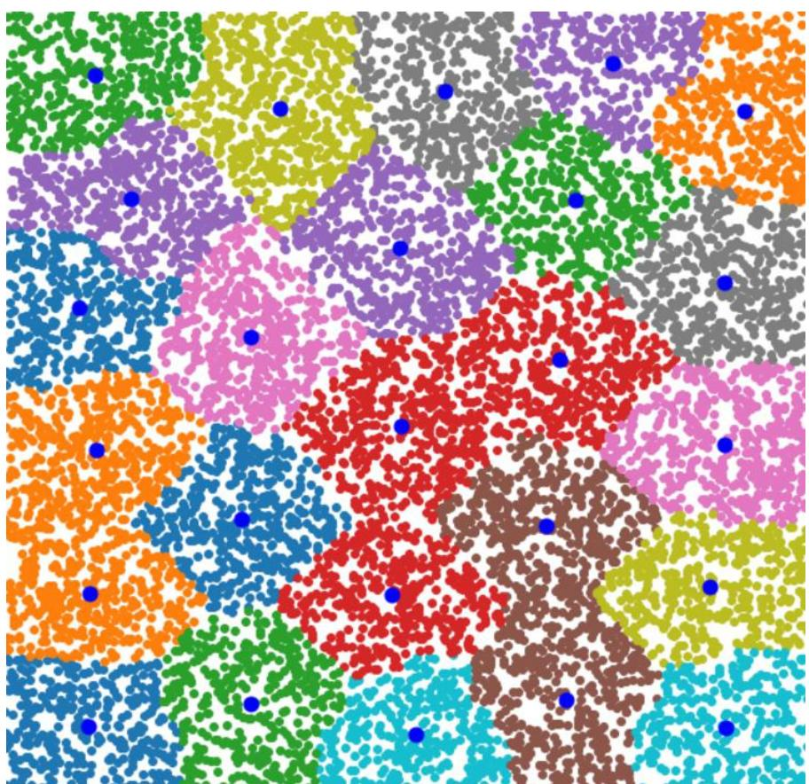
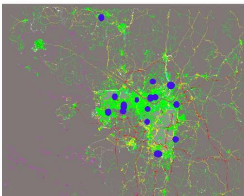
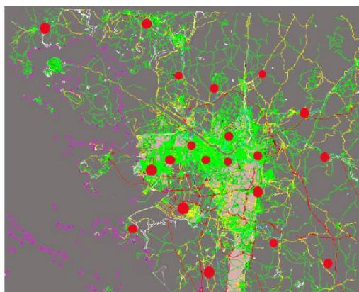
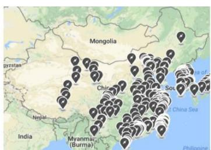
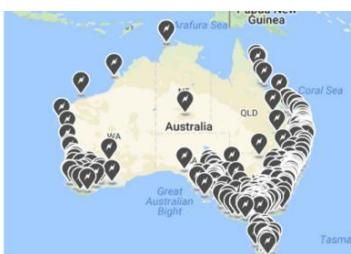

# 2018年MCM/ICM美国大学生数学建模竞赛D题O奖论文（D82504）

原件为竞赛论文。补充：文中的阅读练习及“参考解答”为整理时增加，原件图文保留出处。

本文档整理自《2018年MCM/ICM美国大学生数学建模竞赛D题O奖论文（D82504）》教材的第1部分（共8部分），由识别工具读取后经过格式规范化处理。内容涵盖摘要、目录及引言部分。

## 摘要（Summary Sheet）

### 选择 1

**背景与目标**：
团队被要求为一个不断增长的电动汽车充电网络构建评估和规划系统。该模型涉及从经济水平到消费者心理等多个因素。在所有这些因素中，我们选择人均GDP、车辆密度和人口密度作为主要评价指标的关键组成部分。此外，我们将模型应用于美国、韩国等国家的实际情况。除了考虑其他可量化因素和非量化因素的影响并给出分析外，我们还建立了相应的模型。

**主要工作与方法**：
1. **关键因素量化与聚类**：首先对关键因素对充电网络的影响进行量化。重新定义了城市、郊区和农村地区的概念，并建立了充电桩密度与我们所选因素之间的函数关系。然后使用K-Means聚类方法确定不同区域充电桩的最佳位置。以美国和韩国为例，给出了不同区域的充电站数量。考虑到实际情况，调整了分布并改进了模型。
2. **马尔可夫方法与路网关系**：接下来使用马尔可夫方法确定充电站与路网之间的关系。验证了充站控制的流量仅与节点总流量的概率有关，而与节点的输出无关，这是我们的模型基础。然后给出了首尔的推荐站点位置。我们还分析了国家如何根据消费者心理、经济水平、宣传需求等因素投资充电网络。
3. **物流模型与预测**：建立了一个物流模型来计算未来几年充电站的数量和分布。给出了时间、电动汽车拥有量和其他重要因素之间的量化关系。将该模型应用于韩国，给出了电动汽车达到所有机动车不同百分比所需的时间。
4. **分类系统与新技术影响**：还考虑了与网络相关的其他可能因素，如地理、人口密度分布和财富分布。除了数学方法外，结合社会学理论，建立了基于人均GDP、人口密度、基尼系数和一些量化因素的分类系统，以确定一个国家是否有资格发展充电网络。我们还讨论了新技术对我们模型的影响。

**结论**：
最后，基于以上所有分析，我们得出结论，提供了可靠的评估指标、科学的评估方法、完整的分类系统以及关于充电网络设计的详细分析。

**关键词**：K-Means聚类，马尔可夫方法，人均GDP，人口密度，基尼系数

参考解答：此部分为论文的摘要页，概述了整篇论文的研究背景、方法论、主要发现及结论。在数学建模竞赛中，摘要至关重要，它直接决定了评委对论文的第一印象。本摘要清晰地展示了模型的层次性（从单国规划到跨国迁移再到技术影响）。

## 目录（Contents）

| 章节 | 标题 | 页码 |
| :--- | :--- | :--- |
| 1 | Introduction | 2 |
| 1.1 | Problem Statement | 2 |
| 1.2 | Related Work | 2 |
| 2 | Preparation of the Models | 3 |
| 2.1 | Assumptions | 3 |
| 2.2 | Notations | 3 |
| 3 | Exploring Tesla Network in the United States | 4 |
| 3.1 | Tesla's Objective | 4 |
| 3.2 | Charging Network in Urban and Suburban Areas | 4 |
| 3.3 | Charging Network in Rural Areas | 7 |
| 3.4 | Distribution of Charging Stations | 7 |
| 4 | Exploring Charging Network in South Korea | 8 |
| 4.1 | Switch to All-electric in South Korea | 8 |
| 4.2 | A proposal for evolving South Korea from zero chargers to a full electric-vehicle system | 12 |
| 4.3 | Timeline | 13 |
| 5 | Model Migration to Different Countries | 15 |
| 5.1 | Classification of Countries | 15 |
| 5.2 | Assessment of Feasibility | 16 |
| 6 | Impact from Advanced Technologies | 17 |
| 6.1 | Batteries | 17 |
| 6.2 | Construction Technology of Charging Piles | 18 |
| 6.3 | Types of Vehicles | 18 |
| 7 | Strengths and Weaknesses | 18 |
| 7.1 | Strengths | 18 |
| 7.2 | Weaknesses | 19 |
| 7.3 | Future Work | 19 |
| 8 | Handout for International Energy Summit | 20 |
| Reference | | 21 |
| A | K-Means Clustering (Python) | 22 |
| B | Matlab Codes | 23 |

补充：目录显示了论文的逻辑结构，从问题陈述、模型准备、具体案例（美国、韩国）、模型迁移、技术影响到优缺点分析及附录代码，结构完整且层次分明。

## 1 引言（Introduction）

### 1.1 问题陈述（Problem Statement）

受环境和经济需求的驱动，人们对电动汽车的发展越来越感兴趣。电动汽车充电站网络的布局将对电动汽车的推广产生巨大影响。存在若干因素，如车辆密度、经济水平和人口密度，会影响充电站的选址。基于特斯拉和政府提供的官方数据，我们将：

1. 构建多个模型，以在不同情况下提供建设计划。
2. 如果国家将所有传统车辆替换为电动汽车，确定电动汽车的总数及其主要影响因素。
3. 确定时间表和建设顺序。
4. 分析其他因素对充电站网络的影响。
5. 提供一份包含对不同国家的建议及关键因素的手册（Handout）。

参考解答：这是竞赛题目的核心任务拆解。选手需要将抽象的“建设充电网络”转化为具体的数学建模任务：选址优化、总量预测、时序规划、敏感性分析及政策建议。

### 1.2 相关工作（Related Work）

随机流量捕获模型（SFCLM）是一种对交通捕获进行整数规划的模型。它可以用于构建大规模充电网络。它是基于最短距离、司机的焦虑范围以及假设每个司机每天充电不超过一次的假设。输入数据源可以随机生成[1]。

通过将SFCLM与确定性模型进行比较，在确定性模型中，电动汽车流量被设定为其期望值。研究表明，如果要建设的充电站数量有限，SFCLM优于确定性模型。随着要建设的车站数量增加，SFCLM和确定性模型选择的站点位置非常相似。

补充：这里提到了前人研究中的两种模型对比：随机模型（Stochastic）与确定性模型（Deterministic）。这为后续模型的选择提供了依据——即在资源有限时，随机模型更能反映真实世界的波动性和不确定性。

# 2018年MCM/ICM美国大学生数学建模竞赛D题O奖论文（D82504）

本部分整理自《2018年MCM/ICM美国大学生数学建模竞赛D题O奖论文（D82504）》第 4–8 页，涵盖模型准备、美国特斯拉充电网络探索及城市/郊区充电网络优化等内容。

## 2 Preparation of the Models

### 2.1 Assumptions

1. (Shortest-path) Each vehicle go to the station with the shortest distance to get charged.
2. (Range-anxiety threshold) An electric vehicle driver will only seek to recharge his or her vehicle if its state of charge (Soc) falls below 10%.
3. Only public charging stations are considered in this essay.

### 2.2 Notations

The primary notations used in this paper are listed in the table below.

**Table 1: Notations**

| Symbol | Definition |
| :--- | :--- |
| $x^{(i)}$ | sample point in K-Means clustering |
| $c^{(i)}$ | the cluster centroid to which $x^{(i)}$ is assigned |
| $r_u$ | the maximum radius of capturing areas of urban stations |
| $r_s$ | the maximum radius of capturing areas of suburban stations |
| $n_0$ | the number of charging stations in an 40 $\times$ 40 mile $^2$ square |
| v | average number of vehicles per capita density of population |
| G | GDP per capita |
| $c_u$ | a constant used in calculating $r_u$ |
| $c_s$ | a constant used in calculating $r_s$ |
| l | total length of expressways |
| $n_v$ | total number of villages |
| n | number of charging stations |
| $n_u$ | number of charging stations in urban area |
| $n_s$ | number of charging stations in suburban area |
| $n_r$ | number of charging stations in rural area |
| $S_u$ | total area of urban area |
| $S_s$ | total area of suburban area |
| R | the ratio of Tesla num to all motor vehicle num |
| t | year |
| k | an index concerning about population density and economic level |

## 3 Exploring Tesla Network in the United States

### 3.1 Tesla’s Objective

In recent years, Tesla has built more than 2500 charging stations around the United States, which is a quite impressive number. From the official system called Find Us[2], it is obvious that there have been Tesla’s charging stations along most of the big cities and main expressways in the United States, even in Alaska and Hawaii.

Apparently, although, there are still many areas not covered by built charging stations, the number of charging stations has exceeded 1% of the number of gas stations, which is smaller than 200 thousand[3]. While the total number of sold Tesla is only around 300 thousand[4], which is only around 0:1% of the number of cars[5]. Tesla is building charging stations much more than it is supposed to build, which reflects its long-term plan of developing electric vehicles.

Furthermore, Tesla is generally known and accepted by more people. It is also investing more and more in construction of charging stations, research and technical development. Although electric cars can still not complete long distance travel because of the limit of battery, superchargers can partly solve this problem if a complete charging network is completed. Except those who need to drive long distance at a daily frequency, which are only a small part of drivers, most people’s daily need for vehicles can be satisfied by existing technology provided by Tesla.

Certainly, it is not an easy task to replace millions of vehicles on the road, but Tesla is on the right track, and we have strong confidence that Tesla can complete the switch to all-electric in the U.S.

### 3.2 Charging Network in Urban and Suburban Areas

In big cities like New York or Los Angles, we need many charging station-s to garuantee that electric vehicle drivers can get their cars charged whenever their cars are lack of power. Therefore, considering the cost of building charging stations, the proper number and distribution of the charging stations become an essential problem.

#### 3.2.1 Optimal Number of Charging Stations

To calculate the number of charging stations, especially in the suburban ar-eas, based on the assumptions of shortest-path and range-anxiety threshold men-tioned in 2.1, our goal is to make sure that a driver can go to the nearest charging station with at most 5% of a charge so that they can arrive the stations with at least 5% power, which can protect the battery from the damage of too little power left. Based on the data given in the official website[6], most Tesla cars can cover around 300 miles with a charge. Thus we set the maximum radius of the cap-turing area of a charging station is 15 miles. However, 15 miles is not a distance easy to cover in the complex urban traffic. Considering the negative correlation between r and the economical condition, density of people and average number of vehicle per capita, we can calculate r more accurately by

$$
r _ {u} = \frac {c _ {u}}{(\rho v \bar {G}) ^ {\frac {1}{4}}} \tag{1}
$$

$$
r _ {s} = \frac {c _ {s}}{(\rho v \bar {G}) ^ {\frac {1}{4}}} \tag{2}
$$

$$
r _ {s}, r _ {u} \leq 1 5 m i l e s
$$

where $c_u$, $c_s$ are constants unrelated with areas. In practice, we use the completed charging network in Manhattan to estimate $c_u$, and $c_s$ is calculated by $c_u$ and the ratio of urban size and suburban size, urban residents and suburban residents.

Without loss of generality, we can divide the urban area to several squares, and consider the distribution of stations in each square. Empirically, we think the shape of capturing area is close to a square when the cars in the urban and suburban areas are evenly distributed, which is evidenced by using advanced K-Means clustering algorithm. Thus, the estimation of the optimal number of charging stations in a square with length of 40 miles can be estimated by

$$
n _ {0} = d \overline {{r _ {2}}} ^ {4 0 ^ {2}} e \tag{3}
$$

where r is defined by the above equation.

#### 3.2.2 Optimal Location: K-Means Clustering and Our Improvements

Traditionally, K-Means clustering is a popular algorithm used in data mining. Since our model assumes the cars are evenly distributed in urban and suburban

## 3.2 Charging Network in Urban Areas

areas, we can also use K-Means in choosing the optimal locations of the charging stations after some original improvements.

Firstly, instead of commonly used Euclidean distance $dist_{Euclidean} = \| \vec{p} - \vec{q} \|_2$, we choose Manhattan distance

$$
dist_{Manhattan} = \| \vec{p} - \vec{q} \|_1 \tag{4}
$$

Considering the real-world city planning, we usually can not go to the stations in direct roads, and it is obvious that Manhattan distance is a more realistic definition in this case.

Besides, the objective of traditional K-Means clustering is to minimize the distortion function[7] $J(c, \mu) = \sum_{i=1}^{n} \| x^{(i)} - \mu_{c^{(i)}} \|_2^2$, while our algorithm's distortion function is defined as

$$
J(c, \mu) = max_i \| x^{(i)} - \mu_{c^{(i)}} \|_\infty \tag{5}
$$

By the above improvements of K-Means clustering, we can regard the centroids generated by our algorithm as the optimal placements of charging stations, since our definition of distance and distortion function can guarantee that the car can always find the nearest station within r miles if $J(c, \mu) < r$.

Below is an example of capturing areas and optimal placement of charging stations chosen by K-Means clustering.



Figure 2: Optimal Locations by K-Means Clustering

### 3.3 Charging Network in Rural Areas

The U.S. Department of Health and Human Service defines the word rural as encompassing "...all population, housing, and territory not included within an urban area. Whatever is not urban is considered rural." [8] Thus, we can divide the rural areas which need charging stations construction to two parts: villages and public roads.

In most cases, the radius of a village will be smaller than 4 miles, so there needs to be only one charging station in a village.

When considering the charging stations on public roads, since there will be no gas station if everyone switched to all-electric personal passenger vehicles, an important function of charging stations is to offer a place to rest for drivers. Besides, there will be congestion in charging stations if everyone needs to charge in the same charging station. Therefore, we need to construct stations at relatively high frequency. Compared to the distribution of gas stations, considering the longer time of charging, constructing a charging station every 20 miles is an acceptable frequency.

Therefore, we have

$$
n_r = n_v + \lceil \frac{l}{20} \rceil \tag{6}
$$

In practice, since the difference between town, county and village are not very clear, we regard the cities with population fewer than 10,000 as villages[9].

### 3.4 Distribution of Charging Stations

Based on the above discussions, the number of charging stations needed can be calculated by

$$
n = n_u + n_s + n_r = \lceil \frac{S_u}{r_u^2} \rceil + \lceil \frac{S_s}{r_s^2} \rceil + n_v + \lceil \frac{l}{20} \rceil \tag{7}
$$

To make it more accurate, we calculate it state by state, and here are the results.

**Table 2: Distribution of Charging Stations in the United States[10]**

| Area Type | Station Number | Percentage (%) |
| :--- | :--- | :--- |
| Urban | 58739 | 45.0 |
| Suburban | 42533 | 32.6 |
| Rural[11] | 29161 | 22.4 |
| Total | 130433 | 100 |

As for the ratio of destination charging and superchargers, we need to take user needs into consideration. On expressways, most chargers are used to give electric vehicles power to keep going in a short time, so most chargers located on expressways should be superchargers. In contrast, chargers in urban and suburban area or villages are mostly used by residents, thus we can put more destination charging in these stations. Based on this analysis, we recommend 90% of the chargers in the stations located on expressways should be superchargers, and 70% of the chargers in the stations located in urban, suburban areas or villages should be destination charging.

## 4 Exploring Charging Network in South Korea

Based on the first task, we set some more indexes to assess the amount of charging stations, their locations and other details.

### 4.1 Switch to All-electric in South Korea

Korea is one of the typical countries in the world which have the ability to complete the plan of replacing motor vehicles with electric cars.

#### 4.1.1 Amount of Two Types of Charging Stations

##### Destination Charging Stations

First, We divide South Korea into three parts: rural, cities and suburbs based on the population density in Korea. According to the table, we classify Seoul, Busan as urban. Gwangju, Daejeon, Daegu, Incheon, Gyeonggi-do, Ulsan, Sejong-si as suburban. Jeju-do, Gyeongsangnam-do, Chungcheongnam-do, Jeollabuk-do, Chungcheongbuk-do, Jeollanam-do, Gyeongsangbuk-do, Gangwon-do as rural.

**Table 3: Classification of different regions by Population density**

| Population Density | Type |
| :--- | :--- |
| 4000+ | Urban |
| 1000-4000 | Suburb |
| 0-1000 | Rural |

Next, we conduct cluster analysis of different areas and quantify the influence of population density on charger density. Meanwhile, the GDP data and population data will also have an impact on the amount of charging stations. For data obtained, we use direct least square fitting method and conclude the simulation results.

Then, we substitute the conclusion into the equations listed in task1 and conclude that the capturing radius for destination chargers in South Korea is The

**Table 4: Capturing radius of Destination chargers in South Korea**

| Area Type | Capturing radius (km) |
| :--- | :--- |
| Urban | 5 |
| Suburban | 10 |
| Rural | 15 |

connection between capturing area and charging station density is displayed in the picture below.

## Supercharging Stations

When it comes to the position selection of supercharging stations, especially on highways, we should pay attention to other factors besides the basic needs of charging. Today's dense gas stations take the responsibility for ensuring drivers' rest time, which is what we think the most important factor when designing the network. Therefore, we set the distance between two charging stations on national highway to about 20–50 km, 50–170 km for other roads. Finally, by calculation based on the road length and the coverage area of road network, we reach the total number of supercharging stations.

The number is 30343.

### 4.1.2 The placement of charging stations in South Korea

We use two methods to select the site for stations and compare them with each other. For displaying our work clearer, we will only show the detailed results of Seoul.

Through verification, the two methods can be applied to most cities.

#### Markov method

First, we assume that the flow rate controlled by the charging station is only related to the probability of the total flow of the node, which has no relevance with the output of the node.

Next, we verified the assumption as listed below. In general, we consider the situation of three nodes. For node A, B, C, define their opposite side as a, b, c. Its corresponding Markov transition matrix is

Obviously, this matrix is an irreducible matrix.

Then, we analyze the matrix after limitless steps. Conducting spectral decomposition on the matrix, we get the characteristic roots of it.

$$
x_1 = 1 \tag{8}
$$

$$
x_2 = \frac{-1 + \sqrt{1 - \frac{8abc}{(a+b)(a+c)(b+c)}}}{2} \tag{9}
$$

$$
x_3 = \frac{-1 - \sqrt{1 - \frac{8abc}{(a+b)(a+c)(b+c)}}}{2} \tag{10}
$$

Define matrix D as

$$
\left[ \begin{array}{ccc} x_1 & 0 & 0 \\ 0 & x_2 & 0 \\ 0 & 0 & x_3 \end{array} \right]
$$

We can also get the transition matrix T by calculating. Define $\mathbf{K} = \mathbf{Diag}(\frac{1}{3}, \frac{1}{3}, \frac{1}{3})$. Therefore, the final situation is available. Every element in $KT^{-1}D^{\infty}T$ will get larger as its proportion rate increases. When two rates equal, their corresponding elements equal.

When the number of nodes comes to 4, we might as well assume the four edges' weights as 1, 3, 2, 2. Then its Markov transition matrix is

$$
\left[ \begin{array}{cccc} 0 & 0.33333333 & 0 & 0.66666667 \\ 0.25000000 & 0 & 0.75000000 & 0 \\ 0 & 0.60000000 & 0 & 0.40000000 \\ 0.50000000 & 0 & 0.50000000 & 0 \end{array} \right]
$$

Its ergodic state is

$$
\left[ \begin{array}{llll} 0.18749998 & 0.24999998 & 0.31249997 & 0.24999998 \end{array} \right]
$$

Based on the calculation results, we can reach the conclusion that even if each in-degree edge's weight is different, the final distribution represents the same results. For any diagram, we can block it to several small pieces and apply our method to it.

Thus, our assumption is verified. The flow chart in the actual situation is

#### SFCLM method

In the related work of the article, we made a brief introduction of SFCLM. When it comes to the verification, we apply Seoul road data into it and get a comparable solution.

Using these two methods, we draw the picture of charger network we recommend for Seoul. As in the pictures shown below, the distribution is similar to each other, verifying our model's reliability.





### 4.2 A proposal for evolving South Korea from zero chargers to a full electric-vehicle system

In a formed charging network, there is a mutually beneficial relationship between the construction of new charging stations and the sales of electric vehicles. However, in the early stage of network construction, since the charging stations are scarce, most of the users' needs have not yet been met. For this reason, most customers tend to take a wait-and-see attitude. Therefore, in the beginning, the construction should give priority to those areas with the most potential customer-

# 2018年MCM/ICD美国大学生数学建模竞赛D题O奖论文（D82504）

## 一、充电基础设施建设的阶段性策略与模型

### 建设阶段分析

s. Building all-city based chargers will dispel potential customers’ worries as well as play the role of propaganda.

As Ona Egbue and Suzanna Long stated in their article, "Consumer acceptance is important as it is key to the commercial success (or failure) of EVs[10]". The construction of charging station should aim at arousing the customers’ interests. Considering customers’ worries, in the early construction, we recommend building chargers first to attract customers. We define this period as ’extension period’. After the user of electric vehicle reaches a certain ratio of all the users, the speed of construction can slow down. In this ’stationary period’, the construction has less relevance with the car purchases, but the population density or other possible factors. As construction continues, the charging stations tend to saturate. To avoid the waste of resources, we need to aim at customers’ needs. In this ’mature period’, we suggest building chargers in response to car purchases.

The key factors that shaped our proposed charging station plan includes population density, GDP per capita and vehicle density, which have something to do with purchase desire.

### 4.3 Timeline

To calculate the number and the distribution of charging station, we establish a model of logistic model.

The high market proportion of Tesla in a region tends to have positive feedback on the local Tesla ownership. Therefore, we have

$$
\frac {\mathrm{d} R}{\mathrm{d} t} = k R \tag{11}
$$

Since the ratio can’t reach 1, we can change our model to

$$
\frac {\mathrm{d} R}{\mathrm{d} t} = k R (1 - R) \tag{12}
$$

Then solve the equation

$$
R = \frac {C e ^ {k t}}{1 + C e ^ {k t}} \tag{13}
$$

In 2018, the market proportion of Tesla cars is estimated about 1%. Then we conclude that $C=0.01$. New technology tends to spread the fastest in urban areas, then in suburban areas, the slowest in rural areas. Besides, the amount of Tesla cars in an area has a strong connection with the economic level. If we set $k$ in urban areas equaling to 0.3, in suburban areas equaling to 0.26, in rural areas equaling to 0.22.

Based on our model, we estimate that by the end of 2026, 10% motor vehicles in South Korea will be driven by pure electricity, 30% by the end of 2031, 50% by the end of 2034, and 90% by the end of 2042. We can also conclude from the simulation results that in the recent years, the increasing rate will reach its maximum. In 2035, the increasing rate in suburban areas will catch up with that in urban areas. In 2038, the increasing rate in rural areas will catch up with that in suburban areas.

Here are the visualized simulation results of the variation trend of Tesla’s market share and its increasing rate.

Based on the car ownership data provided by Statistics Korea[11], we build the growth model of motor vehicles in South Korea.

$$
\frac {\mathrm{d}y}{\mathrm{dt}} = 2.2 \cdot 10^{-4} \cdot (5000 - y) \tag{14}
$$

The current population of South Korea is fifty million. The ownership of vehicles will gradually saturate while approaching the population. At the present stage, the increasing rate is estimated to be about 10%. Then we conclude the num of electric vehicles in South Korea when the proportion differs. The electric vehicle density by province in South Korea in different period is as the chart shown.

Table 5: Electric vehicle num in different period

| proportion | 10% | 30% | 50% | 90% |
| :--- | :--- | :--- | :--- | :--- |
| year | 2026 | 2031 | 2034 | 2042 |
| num(million) | 2.246 | 2.250 | 2.253 | 2.276 |

## 二、模型迁移至不同国家

### 5 Model Migration to Different Countries

Nowadays, there are more than 200 countries in the world. Different countries have different geometrical, economical, political and cultural differences, which will all impact the promotion of electric vehicles. Next, we will present our classification pattern and growth model for some typical types of countries.

### 5.1 Classification of Countries

In short, GDP per capita and density of population are two essential factors in this classification model because GDP per capita can reflect the purchasing ability, which will influence the switch speed, and density of population can reflect geometrical features of the country, which will influence the construction process of charging stations.

Besides these factors, we also introduce Gini coefficient to classification since GDP per capita and density of population can not reflects the actual situation in some unbalanced countries, and Gini coefficient is a well-accepted measure of inequality.

In practice, we divide both the GDP per capita and density of population[12] to three degrees named low, medium and high. For the country with low degree of GDP per capita, we do not recommend them migrate to electric cars at present since there will be unignorable expenses. To the left 6 types of countries, we have different growth models based on their varied backgrounds. Below are the standards of classification and some typical examples

Table 6: Classification Standards of Countries

| Factors | Standard | GDP per capita (USD) <br> Medium | GDP per capita (USD) <br> High |
| :--- | :--- | :--- | :--- |
| Density (=mi) | Low | 100 | Russia | Australia |
| | Medium | 100 and 300 | Bulgaria | Korean |
| | High | 300 | Indonesia | Singapore |

As for the countries larger than 1000 square mile whose Gini coefficient is higher than 0.6, we think them have problems of imbalanced regional development

ment, which make the above classification model not suitable. In this condition, we will seperate them to several parts with each part having more similar background, then we can regard these parts as "small countries", classify them to different types defined in the above model and apply different growth models to them.

Take China as example. In our classification, China has medium GDP per capita and high density of population. However, in eastern provinces like Zhejiang, the GDP per capita is higher than 10000 USD and the density of population is higher than $1000 = \mathrm{mi}^2$, which meet the standards of countries with high GDP per capita and high density of population. Meanwhile, Tibet’s condition is totally different. With density of population of $1000 = \mathrm{mi}^2$ and GDP per capita of 4500 USD, it should be regarded as medium GDP per capita and low density of pop-ulation. Obviously, applying different growth models to them is a more reliable choice.

## 5.2 Assessment of Feasibility

### 5.2.1 Some Non-quantifiable Factors

There exist several factors which may influence the feasibility of the charging network’s expansion. We choose some typical ones to conduct further discus-sions. It is remarkable that according to the model we build before, the number of charging stations in a country should be positively associated with GDP per capita and vehicle density. For some certain reasons like political restriction, some countries like Russian or Singapore is against the conclusion. This situation is not discussed in our assessing system in detail.

### 5.2.2 Geography

The picture below is the distribution of destination charging stations in Saudi Arabia, China and Australia. Intuitively, we can see that the stations are much denser along coastal areas and the most economically developed areas. There are two reasons resulting in the situation. On the one hand, these areas are opener to the outer world and new technology. On the other hand, the GDP per capita in these areas are higher, so there exist more potential customers with stronger purchasing ability than other areas.






Figure 10: Destination chargers in Saudi Arabia, China and Australia

### 5.2.3 Combined Index

However, to migrate to electric vehicles completely, it’s far from enough to just set charging stations in these areas. To determine whether an area is qualified to construct charging network, we set some indexes to quantify it.

Profit function: $(x) = ax + e$. $a$ means the profit per vehicle. $x$ means the number of electric vehicles. $e$ means the network construction fee which the area can afford.

Consumption function: $g(x) = p c e^{k t}$. $p$ means the saturated number of charging stations. $c$ equals to price ($p_{\text{station\_num\_at\_present}}$). $k$ is in proportion to the increasing rate of electric vehicles in the area/country. In the beginning, the amount of charging stations is nearly in proportion to the num of electric vehicles. When traditional vehicles no longer exist, the needs for charging will always be satisfied no matter how the num of electric vehicles changes. The cost will be a relatively number.

Evaluation function: $f(x) = (x) g(x) = ax + b(p + ce^{kx})$

When $g(x) > (x)$, we think the area’s comprehensive ability is not enough to construct large-scale charging network and recommend developing economy at first. The stagnation point of $f(x)$ is $\frac{1}{a}$. The solution is the year when the $\frac{k \ln(c \bar{K})}{...}$ area is able to build large-scale charging network.

We verify the model by applying several countries’ data into it. For example, China is able to conduct the construction while Indonesia is not. The results of other countries also match the reality.

## 6 Impact from Advanced Technologies

### 6.1 Batteries

The development of battery technology will influence the charging network in two ways.

On the one hand, the battery capacity determines electric vehicles maximum distance once charged, which is the major basis for capturing area defined in our model, as to change the network.

On the other hand, in addition to charging station, several companies used to consider the possibilities of replacing batteries when it’s out of energy. However, the labor and time cost is much higher for customers than charging in the stations. Therefore, most people choose to charge in the station nowadays. Once batteries

### 6.2 Construction Technology of Charging Piles

The construction of a charging station has demands in many areas, such as the ground situation, wires availability, etc. Today’s technology may not be able to install charging stations in all the places our model planned for. The real network may not be the idealized network. Meanwhile, in the large-scale installation process, designers must take installation costs into account. The high costs of charging station are against the expansion of charging stations, further slowing down the replacement of traditional vehicles. With the development of the manufacturing technology of charging piles, network designers are able to no more considerate these social restrictions and adapt the network to a more optimized one. In our model, these changes will reflect on the percentage of electric vehicles among all the vehicles, which can also be quantified and are similar to the results in task 2a.

### 6.3 Types of Vehicles

From the present perspective, replacing traditional vehicles with electric ones is the best choice for human development. However, vehicles change rapidly. Electricity has never been the only choice. In the near future, vehicles driven by other energy or hybrids may attract customers’ interests. Charging stations will face fiercer competition and increasing requirements. Other factors, such as the convenient access, energy types or quality, may play a more important role in network planning. Under this situation, we plan to add more influence factors to the evaluation index in our model, as to understand the demands more precisely.

## 7 Strengths and Weaknesses

Our model takes economic level, population density, vehicle density, regional differences into consideration when forming the model. Based on the modeling process, we make some comments on our model as listed below.

### 7.1 Strengths

**Reliability**: The factors we choose to form the evaluation system are typical, which perform well in real testings. The data sources include authorities and several national statistical agencies, ensuring the data quality. Besides, during the process of modeling, we try to quantify the indexes as far as possible, which avoid the interference originating from the researchers' individual social tendencies, thus strengthening the reliability.

**Extensibility**: Every test index used is relatively independent. Therefore, it’s easy to adapt test indexes to different testing situations. Since all the indexes used in our model are easily available, we can extend our model to multiple types of countries with various background without many adjustments.

**Universality**: Our model uses the formula (1)(2) to describe the relationship between the vehicle density and the density of the station, which is universal. It has high universality for different population density in different areas. For the growth mode of Tesla electric vehicle, we adopt the logistic growth model, which reflects the development trend of Tesla EV in the future decades. It can be references for the government’s decisions. When it comes to the site selection, we use Markov chain model and SFCLM model. The former is convenient and easy to operate, and the latter has precise characteristics. Both have a complementary role in the construction of government investment. At the same time, our model has made a specific classification for different types of countries, and predicted the construction of the Tesla charging station in Korea.

### 7.2 Weaknesses

**Construction fee ignored**: Construction fee of charging stations is always uncertain and varies from regions, and it is nearly impossible to estimate when we are dealing with the model designed for many countries. Thus, we haven’t taken the factor into consideration of our general model. If we need to build a charging station distribution model for a certain region, then it would be quite easier to introduce the influence of construction fee to our model.

**Data Limitation**: Because of the limit of data availability, we are not able to predict exactly where is unsuitable for construction. At the same time, we do not consider political factors and other non-quantified indexes so that the model may not be applied in some special countries where there are political or regional constraints on electric vehicles. Meanwhile, since Tesla is the latest technology, we may not consider the effect of alternative factors like other power resources which can replace electricity.

### 7.3 Future Work

In the process of future development of charging stations, we may face more influence factors which are hard to quantify, such as some additional functions of the charging station. Our team suggests conducting fuzzy classification of these factors to provide more practical design for the network. We hope to apply more theories of different subjects to make contributions to the betterment of charging network construction and human’s future.

### 8 国际能源峰会宣传单

尊敬的各位：

我们非常荣幸向您呈递我们关于电动汽车转型的研究成果。我们诚挚希望，这份成果能为您制定政策与规划提供一些参考，也希望我们的建议能为电动汽车的发展与人类福祉的改善贡献一份力量。在宣传单的下一部分中，我们将向您详细描述我们的建模思路与建议。

我们模型的关键因素包括：经济水平、用户密度与发展潜力，这些都可以精确量化。其他因素包括地理条件、消费者心理或其他难以量化的因素。各组成部分及其功能在本文中有详细说明，您在制定政策时可参考。

在我们的评估体系中，设计充电网络分为四步。首先，使用评估函数判断贵国或贵地区的经济水平是否足以承担建设成本。该函数已经过验证，是有效的。

其次，计算不同区域的充电站数量。利用我们提供的函数，可以得到不同区域的建议充电站密度。一些特殊情况，例如高速公路上的充电站，也已纳入考虑。

然后，确定具体位置。基于马尔可夫方法，可以确定充电站与路网之间的关系。最后，为网络添加其他功能。除了我们提供的指标与函数外，您还可以向评估体系中加入本国特征数据。私人充电桩的建设与使用可能在未来影响整个网络。

利用我们提供的方法，您还可以估算电动汽车达到某一比例时所需的确切时间。根据这一时间表，可以科学地确定禁售燃油车的日期。

向纯电动汽车的转型是一个长期过程。然而，星星之火，可以燎原。我们希望看到充电站的快速扩张，为了未来，也为了人类。

您诚挚的，#82504

### 参考文献

[1] Fei Wu, Ramteen Sioshansi. A stochastic flow-capturing model to optimize the location of fast-charging stations with uncertain electric vehicle flows.[J] Transportation Research Part D: Transport and Environment. 2012.

[2] Find Us, Tesla: https://www.tesla.com/findus#/

[3] How many gas stations are there in the U.S?: https://www.fueleconomy.gov/feg/quizzes/answerQuiz16.shtml

[4] Tesla Sales: https://en.wikipedia.org/wiki/Tesla,_Inc.#Production_and_sales

[5] Number of registered vehicles: https://www.statista.com/statistics/183505/number-ofvehicles-in-the-united-states-since-1990/

[6] Tesla Model S: https://www.tesla.com/model-s Tesla Model X: https://www.tesla.com/model-x Tesla Model 3: https://www.tesla.com/model3

[7] K-Means clustering: http://cs229.stanford.edu/notes/cs229-notes7a.pdf

[8] Rural Area: https://en.wikipedia.org/wiki/Rural_area

[9] Number of cities, towns, villages by population size: https://www.statista.com/statistics/241695/number-of-us-cities-townsvillages-by-population-size/

[10] Ona Egbue, SuzannaLong, 2012. Barriers to widespread adoption of electric vehicles: An analysis of consumer attitudes and perceptions

[11] http://kostat.go.kr/portal/eng/index.action

[12] All the data in this subsection is from Wikipedia

### 附录 A K-Means 聚类（Python）

k=25

### 附录 B Matlab 代码

```matlab
function y = divSolution(num)
y0 = 2017;
y2 = 2067;
