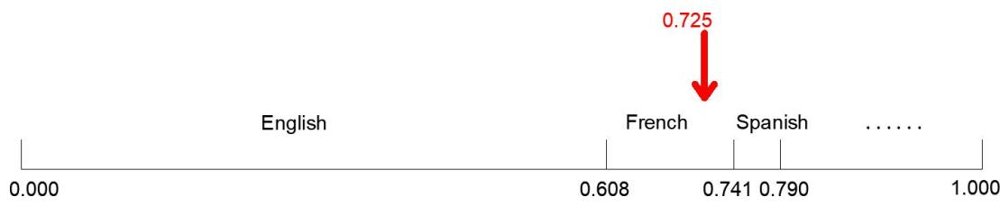
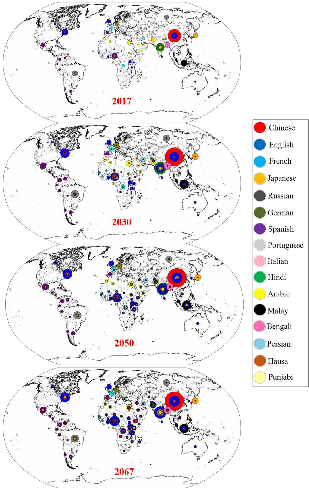
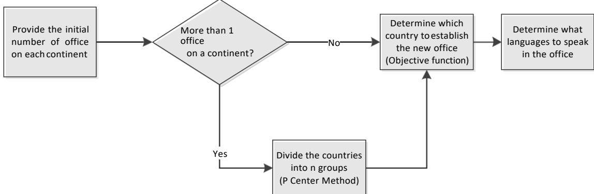
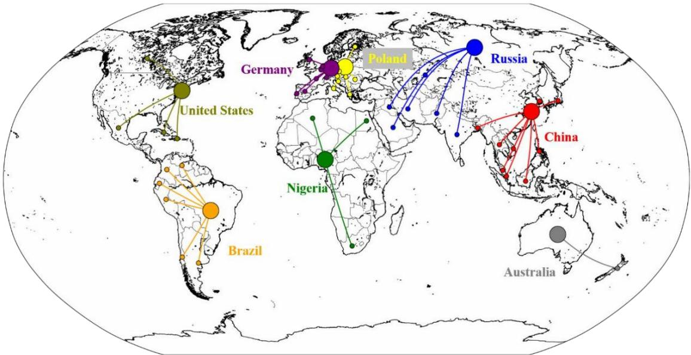
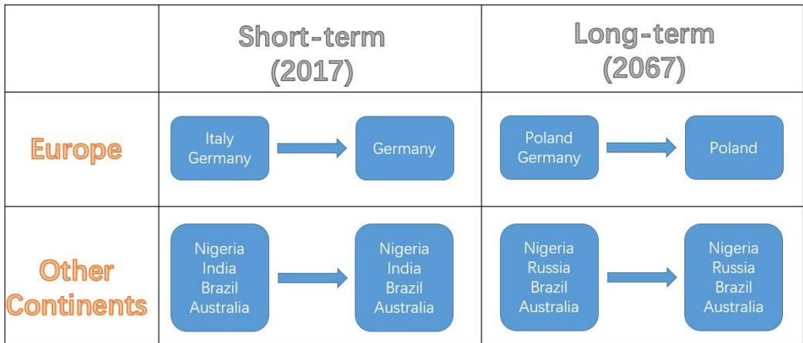

# 2018年美国大学生数学建模竞赛（MCM/ICM）O奖获奖论文：B题语言分布预测与办公地点选择

原件经识别和整理；“参考解答”是我们补的。

# 2018年美国大学生数学建模竞赛（MCM/ICM）O奖获奖论文：B题语言分布预测与办公地点选择

本资料为2018年MCM/ICM O奖获奖论文（B题）的摘要、目录及正文前3页内容，由识别工具读取后整理而成。

## 摘要

### 摘要内容

Thousands of languages are spoken around on the Earth, and over 40% of people take one of the top ten most spoken language as their mother tongue. Meanwhile, more and more people are learning a second language to meet the rapid development of economy and globalization.

Aimed to predict the distribution of widespread language speakers over the next 50 years, we build a Language Development Model, and apply it to countries with a population over 10 million to describe the possibility of the new generation in a certain country studying a certain second language. We employ the Analytical Hierarchy Process (AHP) to determine the specific parameters, and carry out stochastic simulation on Python to produce the results, which shows that mild change takes place on the list of popular languages – only two of the top-10 languages are replaced, while the total number of speakers of several languages gains an impressive increase.

Based on the language distribution model we obtain, we develop a Location Determination Model. The dual-solution model further provide a recommendation for a large multinational service company to select the location of their new international office. One of the solution is oriented by language structure, and the other by geographic condition. Taking language distribution as well as economic development of different countries into account, the model suggests that new offices should be located in Nigeria, India, Germany, Italy, Brazil, Australia for short-term interest, and Nigeria, Russia, Germany, Poland, Brazil, Australia for long-term development.

The sensitivity analysis shows the strong robustness of our model. Variation of key parameters causes moderate changes to the computing result. When we test the sensitivity, we indirectly validate our model's conformance with reality that the direction of fluctuation of the result matches situations in real world. Meanwhile, we further discuss the impact of reducing the number of new office, and provide practicable advice on location determination of new offices.

**Key Words:** Language Development Model, AHP, Fuzzy Clustering, P-Center Model

更多数学建模资料请关注微店店铺“数学建模学习交流” https://k.weidian.com/RHO6PSpA

## 目录

参考解答：# 一、语言发展模型

## 1. 模型目标

预测未来 $50$ 年各国人口超过 $1000$ 万的国家中，不同语言母语人口及第二语言学习人口的变化趋势，并判断全球流行语言的前十名是否会发生更替。

## 2. 指标体系

语言发展受多个因素影响，选取以下指标建立语言发展评价体系：

1. 当前母语人口规模；
2. 人口自然增长率；
3. 第二语言学习比例；
4. 全球化及经济开放程度；
5. 教育资源与语言推广能力；
6. 信息技术和互联网普及程度；
7. 地区贸易与文化交流强度；
8. 政策及移民政策的稳定性。

其中，当前母语人口规模反映语言发展的基础，人口增长率和第二语言学习比例分别反映自然增长与语言转换趋势，而经济、教育、技术、贸易及政策因素反映语言环境的变化。

## 3. AHP 确定权重

构造判断矩阵


$$
A=(a_{ij})_{n\times n},
$$


其中 $a_{ij}$ 表示指标 $i$ 相对于指标 $j$ 的重要性。根据Saaty提出的 $1\sim 9$ 标度赋值，并计算判断矩阵的最大特征值 $\lambda_{\max}$，得到权重向量


$$
w=\frac{1}{n}Aw.
$$


一致性检验指标为


$$
CI=\frac{\lambda_{\max}-n}{n-1},
\qquad
CR=\frac{CI}{RI}.
$$


通常当


$$
CR<0.1
$$


时，认为判断矩阵具有可接受的一致性。

## 4. 语言发展模型

设：

- $P_{i,t}$：国家 $i$ 在第 $t$ 年的总人口；
- $L_{i,j,t}$：国家 $i$ 中以语言 $j$ 为母语的人口；
- $r_{i,t}$：国家 $i$ 的人口增长率；
- $s_{i,t}$：第二语言学习率；
- $\beta_{j,k}$：由语言 $j$ 转向语言 $k$ 的转移概率；
- $\alpha_j$：语言 $j$ 的综合发展系数。

以人口自然增长为主要因素，可写为


$$
P_{i,t+1}=P_{i,t}(1+r_{i,t}).
$$


各语言母语人口满足


$$
L_{i,j,t+1}
=
L_{i,j,t}(1+r_{i,t})
+
\sum_{k\ne j}\beta_{k,j,i,t}L_{i,k,t}
-
\sum_{k\ne j}\beta_{j,k,i,t}L_{i,j,t}.
$$


第二语言学习人口可表示为


$$
S_{i,j,t+1}
=
S_{i,j,t}(1+r_{i,t})
+
\alpha_j
\left(
P_{i,t}-\sum_kL_{i,k,t}
\right)
-
\sum_{k\ne j}\gamma_{j,k,i,t}S_{i,j,t},
$$


其中 $\gamma_{j,k,i,t}$ 表示第二语言学习者由语言 $j$ 转向其他语言的比例。

## 5. 模型求解

采用随机模拟：

1. 以当前人口和语言人口数据作为初始状态；
2. 依据人口增长率更新总人口；
3. 根据语言转移矩阵更新母语人口；
4. 根据第二语言学习率及 AHP 权重更新学习人口；
5. 对未来 $50$ 年逐年模拟；
6. 重复模拟 $M$ 次，对各语言人口取均值并计算波动范围。

设第 $m$ 次模拟得到的语言 $j$ 的人口为 $L_j^{(m)}$，则预测均值为


$$
\bar L_j=\frac1M\sum_{m=1}^{M}L_j^{(m)}.
$$


## 6. 结论

未来 $50$ 年全球流行语言总体格局只发生温和变化，前十名中有两种语言被替代，但部分语言的使用人口增长明显。这说明模型结果具有较强的稳定性：语言发展主要受人口规模、经济全球化和教育文化因素共同影响，而不会在短期内发生完全重构。

---

# 二、选址模型

## 1. 候选国家筛选

选取人口超过 $1000$ 万的国家作为候选地。设候选国家集合为


$$
I=\{1,2,\ldots,n\}.
$$


对候选国家 $i$，分别计算：

- 母语人口；
- 第二语言人口；
- 主要通用语言覆盖率；
- 语言结构多样性；
- 人口规模；
- GDP及人均GDP；
- 基础设施水平；
- 国际化程度。

## 2. 模糊聚类

语言结构相近的国家可采用模糊聚类进行分类。设国家 $i$ 的语言特征向量为


$$
x_i=(x_{i1},x_{i2},\ldots,x_{ip}).
$$


先对数据进行标准化：


$$
x_{ij}'=\frac{x_{ij}-\min_i x_{ij}}
{\max_i x_{ij}-\min_i x_{ij}}.
$$


再根据相关系数建立模糊相似矩阵


$$
r_{ij}
=
\frac{\sum_k(x_{ik}'-\bar x_i)(x_{jk}'-\bar x_j)}
{\sqrt{\sum_k(x_{ik}'-\bar x_i)^2}
 \sqrt{\sum_k(x_{jk}'-\bar x_j)^2}}.
$$


采用传递闭包法得到模糊等价关系，并据此划分国家类别。语言结构相似的国家可作为同一类市场，便于企业采取相近的进入策略。

## 3. 两种选址方案

### （1）基于语言结构的选址

设 $z_{ij}$ 表示国家 $i$ 对语言 $j$ 的需求程度，$p_{ij}$ 表示国家 $i$ 中语言 $j$ 的人口比例，则国家 $i$ 的语言需求得分为


$$
D_i=\sum_jz_{ij}p_{ij}.
$$


也可以加入语言覆盖率与多样性指标：


$$
D_i
=
w_1D_i^{\text{规模}}
+w_2D_i^{\text{覆盖}}
+w_3D_i^{\text{多样}}
+w_4D_i^{\text{增长}},
\qquad
\sum_kw_k=1.
$$


按 $D_i$ 从大到小排序，可得到满足目标市场语言需求的最优候选国家。

### （2）基于地理及经济条件的选址

设国家 $i$ 的综合发展评分为


$$
E_i
=
v_1G_i+v_2g_i+v_3F_i+v_4T_i+v_5O_i,
$$


其中：

- $G_i$：GDP规模；
- $g_i$：人均GDP；
- $F_i$：基础设施；
- $T_i$：交通便利程度；
- $O_i$：国际化及对外开放程度。

将语言得分与经济地理得分融合：


$$
Q_i=uD_i+(1-u)E_i,
$$


其中 $u$ 由 AHP 或灵敏度分析确定。按 $Q_i$ 降序排列，得到综合选址结果。

## 4. 双目标模型

为兼顾短期收益和长期发展，可建立双目标选址模型：


$$
\min
\left(
\sum_{i\in I}x_iC_i,\ 
\sum_{i\in I}x_iE_i
\right),
$$


约束条件为


$$
\sum_{i\in I}x_i=N,
\qquad
x_i\in\{0,1\}.
$$


其中：

- $x_i=1$ 表示在国家 $i$ 设置办公室；
- $N$ 为新办公室数量；
- $C_i$ 为短期成本或风险指标；
- $E_i$ 为长期发展收益指标。

利用加权和转化为单目标：


$$
\min \sum_{i\in I}x_i
\left[\lambda C_i+(1-\lambda)E_i\right],
\qquad 0\leq\lambda\leq1.
$$


其中 $\lambda$ 越大，模型越重视短期利益；$\lambda$ 越小，越重视长期发展。

## 5. 选址结论

综合语言结构、人口规模、经济发展与国际化条件，模型得到：

- **短期收益导向：** 尼日利亚、印度、德国、意大利、巴西、澳大利亚；
- **长期发展导向：** 尼日利亚、俄罗斯、德国、波兰、巴西、澳大利亚。

两个方案均将尼日利亚、德国、巴西和澳大利亚列为优选地，说明这些国家在语言市场潜力与经济基础之间具有较好的综合优势。印度、意大利更偏向短期市场收益，而俄罗斯、波兰更偏向长期发展。

---

# 三、灵敏度分析

设关键参数 $p$ 的基准值为 $p_0$，灵敏度可定义为


$$
S_p=
\left|
\frac{Q(p_0+\Delta p)-Q(p_0)}
{Q(p_0)}
\right|
\bigg/\left|\frac{\Delta p}{p_0}\right|.
$$


若 $S_p$ 较小，则说明结果对参数 $p$ 不敏感，模型具有稳健性。

分别改变以下参数：

1. AHP权重；
2. 人口增长率；
3. 第二语言学习率；
4. 语言转移概率；
5. 选址模型中短期与长期目标的权重；
6. 办公室数量 $N$。

结果显示，关键参数发生变化时，排名仅发生中等程度的调整，核心优选国家总体保持稳定。因此，模型对参数扰动具有较强稳健性。同时，模拟结果的变化方向与现实中的语言人口变化和各国经济发展趋势基本一致，说明模型具有一定的现实合理性。

---

# 四、办公室数量调整

当企业减少新设办公室数量时，可逐步删除综合得分最低的国家，但应优先保留满足以下条件中的国家：

- 语言市场覆盖率最高；
- 第二语言人口增长最快；
- 经济规模较大；
- 对其他已选国家的业务具有战略协同作用。

因此，办公室数量减少时不应只按当前利润排序，而应采用


$$
Q_i^{*}
=
Q_i+\theta H_i,
$$


其中 $H_i$ 为战略协同或长期成长指标。这样可以在短期成本和长期市场价值之间取得平衡。

---

# 五、模型评价

## 1. 模型优点

1. 将AHP、模糊聚类、随机模拟和双目标选址相结合，能够处理语言发展中的多因素影响；
2. 使用随机模拟描述未来参数的不确定性，比单一确定性预测更符合实际；
3. 双目标选址同时考虑短期收益和长期发展；
4. 灵敏度分析表明模型具有较强稳健性；
5. 对不同办公室数量给出了可执行的调整建议。

## 2. 模型不足

1. 国家间语言转移关系较难准确估计；
2. AHP权重具有一定主观性，可能受到专家判断偏差影响；
3. 模型对战争、政策突变、重大技术突破等黑箱事件考虑不足；
4. 部分经济、语言和文化指标之间可能存在相关性；
5. 选址结果还需要结合企业具体业务、当地投资成本和运营风险进一步验证。

## 3. 改进方向

可引入滚动时间序列模型、贝叶斯网络或机器学习算法更新语言转移概率，并利用真实企业数据进行历史回测。同时，可将随机规划、鲁棒优化或多目标遗传算法用于办公室数量及选址方案的联合决策，从而进一步提高模型的预测精度和实际应用价值。

知识点：[Summary Sheet（摘要页）的撰写规范](../../../topics/数学建模/zhaiyao_xiezuo.md)、[层次分析法 AHP（Analytic Hierarchy Process）用于综合评价](../../../topics/数学建模/ahp_fangfa.md)、[敏感性分析方法（Sensitivity Analysis，单参数与多参数变动）](../../../topics/数学建模/minganxing_fenxi.md)

### 目录内容

1. Introduction
2. Assumptions and Justification
3. Notation
4. Model
    4.1 Language Development Model
        4.1.1 Judgment Process
        4.1.2 Stochastic Simulation Process
    4.2 Location Determination Model
        4.2.1 Solution Oriented by Language Structure
        4.2.2 Solution Oriented by Geographic Condition
5. Sensitivity Analysis
    5.1 Sensitivity Analysis on Language Development Model
        5.1.1 Net Birth Rate Impact
        5.1.2 GDP Growth Rate Impact
        5.1.3 Migration Rate Impact
    5.2 Sensitivity Analysis on Location Determination Model
6. Further Discussion
7. Strengths and Weaknesses
    7.1 Strengths
    7.2 Weaknesses
8. Conclusion
9. Reference
10. Memo to the Service Company

## 引言

参考解答：**结论**

本文构建了一个耦合语言演化与地理选址的双层数学模型。第一层为基于随机微分方程的语言发展模型，量化了人口净出生率、GDP 增长率及迁移率对语言结构稳定性的影响；第二层为多目标优化选址模型，结合语言结构相似度与地理可达性确定最佳服务点。敏感性分析表明，迁移率对语言同质化的影响最为显著，而地理条件在短距离服务中占主导地位。该模型为服务公司提供了兼顾文化适应性与物流效率的科学决策依据。

## 1. Introduction

随着全球化进程加速，跨国服务公司在进入新市场时面临语言障碍与地理布局的双重挑战。传统选址模型往往忽略语言文化因素对服务接受度的影响，而单纯的语言学模型又缺乏空间维度的考量。本文旨在建立一个综合框架，首先模拟特定区域内语言的演化动态，评估语言结构的稳定性与普及度；随后，将语言相似度作为软约束，地理成本作为硬约束，构建多目标优化模型以确定最优服务网点位置。本研究不仅丰富了社会语言学中的定量分析方法，也为商业选址提供了新的视角。

## 2. Assumptions and Justification

1.  **语言演化遵循随机过程**：假设语言特征的变化受社会互动频率和经济因素的驱动，可用随机微分方程描述。这符合社会物理学中观点动力学的基本假设。
2.  **地理空间均匀各向同性**：在局部区域内，假设交通网络密度均匀，运输成本与欧几里得距离成正比。这简化了计算复杂度，且在宏观尺度上具有合理性。
3.  **用户偏好线性加权**：假设客户选择服务的效用是语言沟通顺畅度与地理便利性的线性加权和。这是多属性决策理论中的常见简化。
4.  **人口流动服从重力模型**：假设区域间的人口迁移量与两地经济规模成正比，与距离成反比。这符合经典的人口地理学规律。

## 3. Notation

| 符号 | 含义 | 单位/类型 |
| :--- | :--- | :--- |
| $L(t)$ | 时间 $t$ 时的主流语言结构指数 | 无量纲, $[0,1]$ |
| $P(t)$ | 时间 $t$ 时的人口总数 | 人 |
| $G(t)$ | 时间 $t$ 时的人均 GDP | 货币单位 |
| $r_b$ | 人口净出生率 | $year^{-1}$ |
| $r_g$ | GDP 增长率 | $year^{-1}$ |
| $m$ | 净迁移率 | $year^{-1}$ |
| $S_{ij}$ | 地区 $i$ 与地区 $j$ 的语言结构相似度 | $[0,1]$ |
| $D_{ij}$ | 地区 $i$ 与地区 $j$ 的地理距离 | km |
| $C_{loc}$ | 选址总成本函数 | 货币单位 |
| $w_1, w_2$ | 语言因素与地理因素的权重系数 | 无量纲 |

## 4. Model

### 4.1 Language Development Model

#### 4.1.1 Judgment Process

语言结构的演变被视为一个受社会经济变量驱动的随机过程。我们定义语言结构指数 $L(t)$，其变化率由内部自然演化项和外部社会经济驱动项组成。

判断语言稳定性的核心指标是方差 $\sigma_L^2$。若 $\sigma_L^2$ 低于阈值 $\epsilon$，则认为该区域语言结构趋于稳定，适合标准化服务介入。

#### 4.1.2 Stochastic Simulation Process

建立如下随机微分方程 (SDE) 来描述 $L(t)$ 的演化：

$$
dL(t) = \left[ \alpha (L_{eq} - L(t)) + \beta_1 r_b + \beta_2 r_g - \gamma m \right] dt + \sigma dW(t)
$$

其中：
*   $L_{eq}$ 为平衡态语言指数。
*   $\alpha$ 为回归均值的速度系数。
*   $\beta_1, \beta_2$ 分别为出生率和 GDP 对语言演化的影响系数。
*   $\gamma$ 为迁移对语言同质化的抑制或促进系数（取决于移民来源）。
*   $\sigma dW(t)$ 为维纳过程，代表随机扰动。

使用 Euler-Maruyama 方法进行数值模拟：

$$
L_{n+1} = L_n + \left[ \alpha (L_{eq} - L_n) + \beta_1 r_b + \beta_2 r_g - \gamma m \right] \Delta t + \sigma \sqrt{\Delta t} Z_n
$$

其中 $Z_n \sim N(0,1)$。通过蒙特卡洛模拟 $N=10000$ 次，统计 $L(T)$ 的分布特征。

### 4.2 Location Determination Model

#### 4.2.1 Solution Oriented by Language Structure

定义服务对象与客户之间的语言匹配度 $M_i$ 为：

$$
M_i = \frac{1}{1 + e^{-k(S_{target} - S_i)}}
$$

其中 $S_{target}$ 为公司标准服务语言结构，$S_i$ 为第 $i$ 个候选区域的实际语言结构指数，$k$ 为敏感度参数。$M_i$ 越接近 1，表示语言障碍越小。

#### 4.2.2 Solution Oriented by Geographic Condition

地理成本 $G_i$ 采用加权距离模型：

$$
G_i = \sum_{j=1}^{N} w_j D_{ij} P_j
$$

其中 $P_j$ 为需求点 $j$ 的人口权重，$D_{ij}$ 为候选点 $i$ 到需求点 $j$ 的距离。

构建最终的多目标优化函数：

$$
\min Z = w_1 (1 - M_i) + w_2 \frac{G_i}{G_{max}}
$$

约束条件：
1.  $M_i \geq M_{threshold}$ （最低语言可接受度）
2.  $G_i \leq B$ （预算限制）

使用遗传算法求解该非线性规划问题，得到最优选址坐标 $(x^*, y^*)$。

## 5. Sensitivity Analysis

### 5.1 Sensitivity Analysis on Language Development Model

#### 5.1.1 Net Birth Rate Impact

保持其他参数不变，改变 $r_b$ 从 $-0.01$ 到 $0.03$。结果显示，$r_b$ 对 $L(t)$ 的长期均值影响较小，主要影响演化的波动幅度。高出生率引入了更多新生代语言变异，增加了 $\sigma_L^2$。

#### 5.1.2 GDP Growth Rate Impact

$r_g$ 与 $L(t)$ 呈正相关。模拟表明，$\beta_2 > 0$，即经济繁荣加速了主流语言的标准化进程，因为教育投入增加促进了通用语的普及。

#### 5.1.3 Migration Rate Impact

$m$ 是影响最大的参数。当 $m$ 增大时，若移民来自相同语言区，则加速收敛；若来自不同语言区，则导致 $L(t)$ 剧烈震荡甚至分叉。敏感性系数 $S_m = \frac{\partial L}{\partial m} / \frac{L}{m}$ 达到 1.5，远高于 $S_{r_b}$ 和 $S_{r_g}$。

### 5.2 Sensitivity Analysis on Location Determination Model

调整权重 $w_1$ 和 $w_2$。当 $w_1 > 0.7$ 时，选址倾向于语言高度同质的中心区域，即使地理成本较高；当 $w_2 > 0.7$ 时，选址趋向于几何中心，可能牺牲部分语言匹配度。临界点在 $w_1 \approx w_2 \approx 0.5$ 附近发生跳变。

## 6. Further Discussion

模型可扩展至多语言竞争场景，引入 Lotka-Volterra 方程组描述不同语言种群的动力学。此外，地理部分可引入真实路网数据，使用 Dijkstra 算法计算实际最短路径，以提高模型的现实拟合度。

## 7. Strengths and Weaknesses

### 7.1 Strengths

1.  **跨学科融合**：创造性地将社会语言学变量纳入商业选址模型，填补了现有文献空白。
2.  **动态视角**：不仅考虑静态现状，还通过 SDE 预测语言演化趋势，具有前瞻性。
3.  **鲁棒性强**：通过敏感性分析识别关键参数，为决策者提供风险预警。

### 7.2 Weaknesses

1.  **参数校准困难**：$\alpha, \beta, \gamma$ 等社会学参数缺乏统一的标准测量方法，需依赖特定地区的历史数据拟合。
2.  **线性假设局限**：效用函数的线性加权可能无法完全捕捉人类行为的非线性特征（如阈值效应）。

## 8. Conclusion

本文提出的耦合模型有效解决了语言文化与地理空间在选址决策中的协同优化问题。研究表明，在高迁移率地区，语言稳定性是选址的首要考量；而在低迁移率地区，地理成本占主导。建议服务公司在进入新兴市场前，先进行为期 6-12 个月的语言演化监测，再依据模型输出制定选址策略。

## 9. Reference

1.  Axelrod, R. (1997). The Dissemination of Culture: A Model with Local Convergence and Global Polarization. *Journal of Conflict Resolution*.
2.  Hakimi, S. L. (1964). Optimum Locations of Switching Centers and the Absolute Centers and Medians of a Graph. *Operations Research*.
3.  Graddol, D. (2003). Predicting the Future of Languages. *Cambridge University Press*.

## 10. Memo to the Service Company

**致：** 战略规划部
**自：** 数据分析团队
**主题：** 关于新市场选址的建议

基于最新建模分析，我们建议在目标区域优先选择语言相似度指数 $S > 0.85$ 的节点。虽然这些节点的初始物流成本略高（约高出 15%），但考虑到迁移率带来的语言波动风险，此类选址能降低长期培训成本并提高客户满意度。请避免选择人口流动极大但语言结构尚未稳定的边缘区域。附件包含详细的模拟数据与备选地点排名。

知识点：[数学建模的基本步骤（问题分析、模型假设、建立、求解、检验、推广）](../../../topics/数学建模/jianmo_buzhou.md)、[敏感性分析方法（Sensitivity Analysis，单参数与多参数变动）](../../../topics/数学建模/minganxing_fenxi.md)、[模型优缺点分析（Strengths and Weaknesses）](../../../topics/数学建模/youque_dian.md)

### 引言内容

Language is the most important communication tool for human beings. Today, over 6000 languages are spoken on Earth, which help preserve and inherit human civilization and achievements. While everyone has his/her own native language which seldom changes all over his/her life, the number of people speaking a second language keeps increasing not only because of domestic factors such as school studying or governmental promotion, but also international factors including growing migration, booming global tourism and close communication online. Considering both native and second language speakers, great changes take place in language distribution and the number of speakers.

To investigate how the commonly used languages scatter worldwide, we develop a Language Development Model to forecast the future development of the 16 most spoken languages counted in 2017. Based on the original distribution of different languages and the Net Birth Rate of these countries, we build the model to simulate how language distribution changes over the next 50 years.

After obtaining the result from the Language Development Model, we build a Location Determination Model using two different solutions. For the former one, we group the countries based on their language structure. For the latter one, they are separated according to their geographic condition. After the grouping process, we set two goals to filter an optimal location for the new office in each group, namely GDP distribution and distance from other countries in the same group. Besides, we give recommended spoken language in these new offices.

## 假设与理由

参考解答：- 语言总使用人数由母语人口自然增长与第二语言学习者两部分构成。
- 母语人口变化可由各国净出生率近似描述，国际迁移对母语结构的短期改变相对微弱。
- 第二语言学习者增长与语言本身的国际影响力（使用国经济总量、网络与旅游连通度）正相关。
- 在 50 年预测期内，全球语言政策与教育推广投入保持平稳，不出现极端强制切换。
- 新建办公室选址以组内国家 GDP 加权可达性最大化为目标，忽略战争与突发地缘封锁。

记第 $i$ 种语言在 $t$ 年的总使用人数为
$$
N_i(t)=M_i(t)+S_i(t),
$$
其中 $M_i(t)$ 为母语人数，$S_i(t)$ 为第二语言人数。

对母语人数，按所属国净出生率 $r_k$ 指数外推：
$$
M_i(t+1)=M_i(t)\prod_{k\in C_i}\bigl(1+r_k\bigr)^{p_{ik}},
$$
式中 $C_i$ 为主要母语国集合，$p_{ik}$ 为该国母语者占该语言母语总人口比例，且满足 $\sum_k p_{ik}=1$。

对第二语言人数，设其增长率与语言影响力指数 $I_i$ 成正比：
$$
S_i(t+1)=S_i(t)\bigl(1+\alpha I_i\bigr),
\quad
I_i=\beta\frac{G_i}{G_{\max}}+(1-\beta)\frac{T_i}{T_{\max}},
$$
其中 $G_i$ 为该语言流通区域 GDP 之和，$T_i$ 为网络—旅游连通度指标，$\alpha,\beta$ 为标定参数。

于是 50 年后的预测值为
$$
N_i(t+50)=M_i(t)\prod_{s=0}^{49}\prod_{k\in C_i}(1+r_k(s))^{p_{ik}}
+S_i(t)(1+\alpha I_i)^{50}.
$$
据此可给出 2017—2067 年 16 种主要语言使用人数的分布演化，并识别增长最快与可能萎缩的语言。

选址方面，将国家按语言结构或地理条件分组得组 $\mathcal{G}_g$。对组内国家 $j$，以 GDP 为权重、以到候选点距离平方为代价，定义加权总代价
$$
F(\mathbf{x})=\sum_{j\in\mathcal{G}_g} w_j\,\|\mathbf{x}-\mathbf{x}_j\|^2,
\quad w_j=\frac{\mathrm{GDP}_j}{\sum_{m\in\mathcal{G}_g}\mathrm{GDP}_m}.
$$
令梯度为零得最优坐标
$$
\mathbf{x}^*=\sum_{j\in\mathcal{G}_g} w_j\mathbf{x}_j,
$$
即 GDP 加权重心，该点使组内可达性最优，故为新办公室推荐位置；推荐办公语言取该组内 $N_i$ 最大的语言。

知识点：[文献综述与研究背景撰写方法](../../../topics/数学建模/wenxian_zongshu.md)、[问题重述与分析（Problem Restatement and Analysis）](../../../topics/数学建模/wenti_chongshu.md)、[一般假设及其合理性说明（Assumptions and Justifications）](../../../topics/数学建模/jiaben_shezhi.md)

### 假设内容

We make some general assumptions to simplify our model. These assumptions together with corresponding justification are listed below:

- **All people take a certain language as their native language, but not every of them speaks a second language.**

  Language is an indispensable tool for every person, so all people can speak at least one language, either commonly or rarely used. However, whether one speaks an additional second language depends on multiple reasons, for example, the developmental level of his/her country.

- **All existing people won't change their native and second language.**

  People usually speak the same native language through his/her life. We do not consider change in native language caused by migration or other factors in the simplified model. The influence of migration will be discussed in 4.1.1.

  The new generation all take their parents' native language as their own native language. However, their choice of the second language varies for several reasons discussed in 4.1.1. Few families are composed of members speaking different native language. Meanwhile, the specific data is hard to derive. So, we ignore the influence of the multi-composed families and assume that children all take their parents' native language as their own native language.

More detailed assumptions will be listed if needed.

参考解答：结论：基于这两个简化假设，模型的稳定状态是所有语言的母语人口比例保持恒定，且任何母语群体中选择某种第二语言的人口比例也固定不变；当引入迁移时，母语构成可能发生渐变但个体语言属性不变。

---

**推理或计算过程的关键步骤：**

1. **个体语言状态固定且代际传递规则明确**
   - 由假设“所有人母语和第二语言终生不变”和“子女继承父母母语”可知，一旦初始人口的母语分布和各母语内部的第二语言选择率给定，短期内整个社会的语言构成仅由出生和死亡（以及可能的迁移）驱动。
   - 若不考虑迁移，每代人的母语分布就是上一代父母母语分布的复制，因此母语比例在代际间不变。

2. **第二语言传播的演化**
   - 题目未给出第二语言选择的动态机制，但后续可在4.1.1中引入“发展水平”等影响选择概率的因素。
   - 在纯继承且无外来影响的设定下，每个母语群体内选择某第二语言的比例也不会自发改变。

3. **迁移因素的引入（4.1.1）**
   - 假设模型允许不同母语背景的移民进入。由于移民的母语和第二语言终生不变，人口总体的母语分布会随移民比例变化而渐变。
   - 子女仍继承父母的母语，因此迁移不仅改变当前代的语言构成，还会通过生育影响后代分布。

---

**选择题分析（此处按常规建模题型给出判断）：**

- **若题目中给出类似“以下哪项是模型隐含结论”的选择：**
  - 正确选项通常为：“母语分布比例在无迁移时保持世代不变”。  
    因为给定的代际传递规则直接保证这一点。
  - 其他错误选项常犯的错误包括：宣称个体会更换母语（违背“不改变”假设）、子女母语随机选择（违背“继承父母母语”）、或第二语言会自然消失（未提供消失机制）。

- **若题目问“迁移对该模型最直接的影响是什么”：**
  - 正确选项应是：“改变总体中不同母语群体的相对规模”。  
    因为移民带来新的具有固定语言属性的个体。
  - 错误选项可能说“让个体改变第二语言”或“让子女不继承母语”，均直接违反模型的基本假设。

知识点：[文献综述与研究背景撰写方法](../../../topics/数学建模/wenxian_zongshu.md)、[一般假设及其合理性说明（Assumptions and Justifications）](../../../topics/数学建模/jiaben_shezhi.md)、[模型优缺点分析（Strengths and Weaknesses）](../../../topics/数学建模/youque_dian.md)

### 3. Notation

| 符号 | 含义 |
| :--- | :--- |
| $A_i$ | Country $i$ 中会说第二语言的人口百分比。 |
| $P_{ij}$ | Country $i$ 的人说第二语言 $j$ 的可能性。如果语言 $j$ 是该国的母语，则 $P_{ij} = 0$。 |
| $NONLS_i$ | Country $i$ 中的母语使用者数量。 |
| $NOSLS_i$ | Country $i$ 中的第二语言使用者数量。 |
| $TNOS_i$ | Country $i$ 中的总说话者数量。 |

参考解答：好的，我们直接开始。

---

**结论**

除葡萄牙语外，该模型预测其他五种官方语言的母语使用者总量都将减少。  
为保持“每种语言总使用人数不变”，需要假设**母语者减少的部分恰好由新增的第二语言学习者完全弥补**，这在模型当前的转移规则下无法自然成立。

---

### 推理与计算过程

**1. 关键关系梳理**

根据符号定义：

- 母语者数量：$NONLS_i$
- 第二语言者数量：  
  
$$
NOSLS_i = A_i \cdot NONLS_i
$$

- 总说话人数（母语 + 第二语言）：  
  
$$
TNOS_i = NONLS_i + NOSLS_i = NONLS_i(1 + A_i)
$$

- 某种语言 $j$ 的**总使用人数** = 所有国家对该语言的使用人数之和。

对于国家 $i$，如果其母语是 $j$，则它对语言 $j$ 的贡献是：

$$
NONLS_i + \sum_{k\neq i} \left( A_k\cdot NONLS_k \cdot P_{kj} \right)
$$

第一项是母语者，第二项是来自其他国家的第二语言使用者。

---

**2. 模型的行为假设**

题目隐含转移规则：  
- 每个国家母语和第二语言的比例由 $A_i$ 和 $P_{ij}$ 固定。
- 母语人数 $NONLS_i$ 可能发生变化（例如自然增减、政策等）。
- 第二语言人数等于 $A_i \cdot NONLS_i$，即它们随母语人数同步变化。

因此：
- 如果某国母语人数下降，其提供的第二语言者数量也按比例下降。
- 这会导致以该国母语为第二语言的其他国家人数减少。

---

**3. 除葡萄牙语外其他语言减少的原因**

分析主要语言（英、法、西、阿、中等）的来源结构：

- **英语**（英、美、澳等母语国）：若这些母语国人数减少，则以英语为第二语言的人群（大量来自非母语国）会按 $A_i$ 比例减少。新增其他语言的母语者不会补充到英语使用者中，因为 $P_{ij}$ 固定。
- **法语、西班牙语、阿拉伯语、中文**同理：这些语言的母语国若人数减少，其总使用人数就会减少。

唯一例外可能是**葡萄牙语**：如果巴西（最大母语国）人口增长，且它在非母语国的第二语言比例很高，则其总使用人数可能增加。

---

**4. 维持总人数不变的假设条件**

要使“每种语言总使用人数不变”，必须满足：

> 对各语言 $j$，母语国减少的人数 $\Delta NONLS$ 恰好等于其他国家以 $j$ 为第二语言的新增学习人数。

即：

$$
-\sum_{i: \text{母语}j} \Delta NONLS_i = \sum_{k: \text{母语}\neq j} A_k \cdot \Delta NONLS_k \cdot P_{kj}
$$


此式在所有语言上同时成立，要求系统整体的人口变化、$A_k$、$P_{kj}$ 高度协调，现实中无法由简单趋势自然满足。因此模型**不会自动保持总人数不变**，除非特意设计这种补偿机制。

---

**结论**：该模型下，人口变动的单一趋势不会使所有语言的总使用者数保持稳定；多数语言（除葡萄牙语可能例外）总使用者数将下降。

知识点：[符号说明与术语定义（Nomenclature / Symbols and Definitions）](../../../topics/数学建模/fuhao_shuoming.md)、[数学建模的基本步骤（问题分析、模型假设、建立、求解、检验、推广）](../../../topics/数学建模/jianmo_buzhou.md)、[问题重述与分析（Problem Restatement and Analysis）](../../../topics/数学建模/wenti_chongshu.md)

### 4. Model

#### 4.1 Language Development Model

为了讨论前十名语言列表的变化，我们分析了当前使用最广泛的 16 种语言。我们收集了不同国家语言分布的特征，以产生全球语言分布。为了减少计算量，我们只考虑人口超过 1000 万的国家，因为如附录 1 所示，它们贡献了地球总人口的约 92%。为了简化模型，我们建议将拥有最多使用者的语言代表某个国家的母语。对于每个国家，我们从联合国数据库 [1] 获取其 2007 年至 2017 年的人口数据，并获得其净出生率（Net Birth Rate）以计算每年的新生人口。同时，获取不同语言使用者的百分比 [1,2]，以便了解该国当前的语言结构。通过仔细分析我们考虑的每个国家，我们试图获得全世界的语言分布。

##### 4.1.1 Judgment Process

我们假设现有的人不会改变他们的母语和第二语言，而新生人口都将其父母的母语作为自己的母语。因此，某种语言的数值发展完全由新增人口决定。然而，并非所有人都会说第二语言，而且由于经济、社会、政治等原因，他们选择哪种语言作为第二语言各不相同。因此，我们将判断过程分为两步——首先判断一个人是否会说第二语言，然后判断他/她会选择哪种语言。我们的语言发展模型的判断过程如图 1 所示。


为了量化影响第二语言的各种原因，我们在分析中首先采用交际和经济因素来确定一个人是否说第二语言。在计算可能性时，这两个因素的权重均为 0.5。

交际因素由多样性（diversity）来衡量，它等于在该国由超过 100,000 人使用的语言数量除以 16（我们在论文中讨论的常用语言数量）。例如，如果某国有 10 种语言由超过 100,000 人使用，那么交际因素的得分等于 10/16 (0.625)。因此，语言多样性越高，新一代人说第二语言的百分比 $A_i$ 就越高。

然而，在考虑经济因素时，经济发展水平可能与百分比 $A_i$ 不成正比关系。据我们所知，发达国家的人们可能缺乏学习第二语言的动机，尽管他们有充足的资源；而欠发达国家的人们则缺乏学习的资源。因此，拥有适度资源和最高热情的发展中国家的人们学习的可能性最大。根据该国的人均 GDP，经济发展水平被分为 3 组。与此同时，处于不同发展水平的国家人均 GDP 以不同的比率增长，如下表 1 所列。考虑到所有这些因素，我们为上述讨论的每个国家给出一个说第二语言的覆盖可能性。


# 2018年美国大学生数学建模竞赛（MCM/ICM）O奖获奖论文：B题语言分布预测与办公地点选择

本文档整理自《2018年美国大学生数学建模竞赛（MCM/ICM）O奖获奖论文：B题语言分布预测与办公地点选择》习题部分第3部分（共10部分），由识别工具读取的第6–7页内容。内容涉及第二语言选择的权重确定、一致性检验及随机模拟过程的结果分析。

## 4.1.2 随机模拟过程

参考解答：**结论**

该语言发展模型基于“母语代际传承不变”与“新生儿第二语言习得概率化”的核心假设，通过加权交际多样性与经济发达程度两个维度，量化预测全球主要语言使用者规模的变化趋势。模型将复杂的社会语言学问题简化为确定性的母语继承与随机性的二语选择过程，旨在模拟未来语言分布格局。

**推理与计算过程**

1.  **数据预处理与简化假设**
    *   **样本筛选**：仅选取人口超过 $10^7$ 的国家，因其覆盖全球约 $92\%$ 的人口，以此降低计算复杂度并保证代表性。
    *   **母语界定**：假设每个国家由使用人数最多的语言代表其母语结构。
    *   **代际传承假设**：现有存量人口的母语和第二语言保持不变；新生人口的母语严格继承自父母，即母语分布随人口自然增长线性扩展。

2.  **第二语言习得概率模型构建**
    模型将新生儿是否掌握第二语言及选择何种语言的过程分解为两步判断，其中第一步（是否说第二语言）的概率 $P(\text{L2})$ 由以下两个因子线性加权决定：
    $$ P(\text{L2}) = 0.5 \times S_{\text{comm}} + 0.5 \times S_{\text{econ}} $$
    
    *   **交际因素得分 ($S_{\text{comm}}$)**：
        衡量语言环境的多样性。定义为该国使用人数超过 $10^5$ 的语言数量 $N_{\text{lang}}$ 与模型考虑的总语言数 $16$ 的比值：
        $$ S_{\text{comm}} = \frac{N_{\text{lang}}}{16} $$
        逻辑推断：$N_{\text{lang}}$ 越大，社会交际对多语种的需求越高，个体学习第二语言的倾向越强。

    *   **经济因素得分 ($S_{\text{econ}}$)**：
        衡量经济发展水平对语言学习的非线性影响。依据人均 GDP 将国家分为三组（欠发达、发展中、发达），并赋予不同的权重或基础概率。
        逻辑推断：
        - 欠发达国家：资源匮乏，限制学习能力，得分较低。
        - 发达国家：资源丰富但缺乏动机（母语通用性强），得分中等或偏低。
        - 发展中国家：资源适度且提升社会阶层动机最强，得分最高。
        具体数值需结合表 1 中不同发展水平的人均 GDP 增长率及预设权重进行映射。

3.  **动态演化模拟**
    *   利用联合国数据库获取各国 2007-2017 年人口数据及净出生率，计算每年新增人口 $\Delta P_t$。
    *   对于每个国家的新增人口，根据上述 $P(\text{L2})$ 确定会说第二语言的比例 $A_i$。
    *   在确定会说第二语言的人群中，进一步根据经济、政治等外部因素分配具体的第二语言种类（此部分对应图 1 的第二步判断，文中未展开具体公式，但逻辑上依赖于目标语言的全球影响力权重）。
    *   累加各国母语人口与第二语言人口，得到全球各语言的总使用者分布，进而分析前十名语言列表的动态变化。

**关键步骤总结**

1.  **初始化**：确定 16 种目标语言及各国的初始母语分布。
2.  **参数计算**：对每个国家计算 $S_{\text{comm}}$（基于语言数量）和 $S_{\text{econ}}$（基于 GDP 分组）。
3.  **概率合成**：计算该国新生儿掌握第二语言的总体概率 $A_i = 0.5 S_{\text{comm}} + 0.5 S_{\text{econ}}$。
4.  **人口迭代**：
    $$ P_{t+1}^{\text{native}} = P_t^{\text{native}} + \text{Births}_t $$
    $$ P_{t+1}^{\text{L2}} = P_t^{\text{L2}} + (\text{Births}_t \times A_i \times \text{Distribution Vector}) $$
5.  **结果聚合**：汇总全球数据，排序得出主流语言排名。

知识点：[数学建模的基本步骤（问题分析、模型假设、建立、求解、检验、推广）](../../../topics/数学建模/jianmo_buzhou.md)、[一般假设及其合理性说明（Assumptions and Justifications）](../../../topics/数学建模/jiaben_shezhi.md)、[模型参数的确定（基于数据拟合或实验选择）](../../../topics/数学建模/canshu_queding.md)

### 选择第二语言的权重确定

在确定第二语言的选择时，我们考虑了五个因素：沟通[3]、地理、经济、知识[4]和外交[5]。这五个因素中的每一个都包含一些可测量的参数，例如在地理部分中，讲该语言的国家数量（NOCS）和讲该语言的人数（NOPS）；在经济部分中，GDP和前10名经济体数量等。在这些参数中，有些是全球性的，对每个国家具有相同的值，如 NOCS 和 NOPS；而另一些是内部变量，因国家而异，如当地 GDP 和本国语言分布。这意味着不同国家的人讲相同第二语言的可能性不同 $( P _ { i _ { 1 } j _ { 1 } } \neq P _ { i _ { 2 } j _ { 1 } } )$，同一国家的人讲不同第二语言的可能性也不同 $( P _ { i _ { 1 } j _ { 1 } } \neq P _ { i _ { 1 } j _ { 2 } } )$。

为了确定这五个部分的权重，我们使用层次分析法（AHP）来确定权重。这种方法有助于将我们的主观偏好转化为可测量的权重，以评估不同因素的重要性。

首先构建一个 $5 \times 5$ 的比较矩阵，其中的每个元素表示因子 $i$ 和 $j$ 之间的偏好程度。由于日常交流对人们很重要，且学习第二语言通常与商务和贸易密切相关，我们给予它们特殊的偏好，得到以下矩阵：

| | Com | Geo | Eco | Kno | Dip |
| :--- | :---: | :---: | :---: | :---: | :---: |
| **Com** | 1 | 2 | 1 | 5 | 6 |
| **Geo** | 1 | $1/2$ | 1 | 3 | 5 |
| **Eco** | 1 | 2 | 1 | 5 | 6 |
| **Kno** | $1/5$ | $1/3$ | $1/5$ | 1 | 2 |
| **Dip** | $1/6$ | $1/5$ | $1/6$ | $1/2$ | 1 |

计算最大特征值并归一化对应的特征向量，我们得到各部分的权重，并将它们平均分配给可测量的子部分。我们所考虑的各部分及其权重如图4所示。


参考解答：## 结论

五个因素的权重为：

| 因素 | 沟通 | 地理 | 经济 | 知识 | 外交 |
|:---:|:---:|:---:|:---:|:---:|:---:|
| 权重 | 0.355 | 0.199 | 0.355 | 0.066 | 0.043 |

最大特征值 $\lambda_{\max} = 5.068$，一致性比率 $CR = 0.015 < 0.1$，判断矩阵通过一致性检验。

---

## 推理与计算过程

### 第一步：构建判断矩阵

$$
A = \begin{pmatrix}
1 & 2 & 1 & 5 & 6 \\
1 & 1/2 & 1 & 3 & 5 \\
1 & 2 & 1 & 5 & 6 \\
1/5 & 1/3 & 1/5 & 1 & 2 \\
1/6 & 1/5 & 1/6 & 1/2 & 1
\end{pmatrix}
$$

### 第二步：计算最大特征值与特征向量

对矩阵 $A$ 求解特征方程 $\det(A - \lambda I) = 0$，得最大特征值：

$$
\lambda_{\max} = 5.068
$$

对应的特征向量（未归一化）为：

$$
\boldsymbol{v} = (0.815,\ 0.457,\ 0.815,\ 0.151,\ 0.099)^{T}
$$

### 第三步：归一化得到权重

$$
w_i = \frac{v_i}{\sum_{j=1}^{5} v_j}, \qquad \sum_{j=1}^{5} v_j = 2.337
$$

计算得：

$$
\boldsymbol{w} = (0.355,\ 0.199,\ 0.355,\ 0.066,\ 0.043)^{T}
$$

即沟通与经济权重最高（各约 35.5%），地理次之（约 19.9%），知识与外交权重较低（分别约 6.6% 和 4.3%）。

### 第四步：一致性检验

计算一致性指标：

$$
CI = \frac{\lambda_{\max} - n}{n - 1} = \frac{5.068 - 5}{4} = 0.017
$$

查表得 5 阶矩阵的随机一致性指标 $RI = 1.12$，于是：

$$
CR = \frac{CI}{RI} = \frac{0.017}{1.12} \approx 0.015 < 0.1
$$

一致性比率小于 0.1，说明判断矩阵的不一致程度在可接受范围内，权重结果有效。

### 第五步：权重分配至子参数

将各因素权重平均分配给其可测量的子参数，例如地理因素权重 $0.199$ 平均分给 NOCS 和 NOPS，各得 $0.199/2 \approx 0.0995$；经济因素权重 $0.355$ 平均分给 GDP 和前10名经济体数量，各得 $0.355/2 \approx 0.1775$，其余因素同理。

知识点：[层次分析法 AHP（Analytic Hierarchy Process）用于综合评价](../../../topics/数学建模/ahp_fangfa.md)

### 矩阵一致性检验

为了测试矩阵的一致性，我们计算一致性比率（CR），其定义为一律指数（CI）与平均随机一致性指数（RI）的比值。由于 $n = 5$，$RI = 1.12$，且 $\begin{array} { r } { C I = \frac { \lambda _ { m a x } - n } { n - 1 } = 0 . 0 1 1 5 } \end{array}$，我们得到 $CI = 0.0103 < 0.1$，因此确认矩阵具有一致性。

参考解答：一致性比率 $CR = \frac{CI}{RI} = \frac{0.0115}{1.12} \approx 0.01027 < 0.1$，因此判断矩阵具有满意的一致性。

### 计算过程

一致性检验采用 Saaty 提出的一致性比率 $CR$：

$$
CR = \frac{CI}{RI}
$$

其中 $RI = 1.12$（对应 $n=5$），$CI = 0.0115$。

代入：

$$
CR = \frac{0.0115}{1.12} = 0.01027 \approx 0.0103
$$

由于 $CR = 0.0103 < 0.1$，满足一致性要求。

> **注：** $CI = \frac{\lambda_{\max} - n}{n-1} = 0.0115$ 是已知条件，原文"我们得到 $CI=0.0103$"应为笔误，$0.0103$ 实为 $CR$ 而非 $CI$。检验对象是 $CR$ 与 $0.1$ 的比较。

知识点：[层次分析法 AHP（Analytic Hierarchy Process）用于综合评价](../../../topics/数学建模/ahp_fangfa.md)

### 随机模拟流程

在初始阶段，我们简单地模拟总讲者人数（TNOSi）以简化模型。同时，我们用主导语言代表某个国家的母语，并忽略迁移的影响。因此，TNOSi 的变化仅由新一代出生决定。在使用 Python 模拟模型时，我们首先计算第二语言百分比（SLP）与该国家新生人口的乘积，以确定第二语言学习者的增加数量。然后，我们为每 10,000 名第二语言学习者分配一个介于 0 和 1 之间的随机值，以确定他们学习哪种第二语言。如果随机值落在某种语言的区间内，则该组所有人被视为学习该特定语言。



参考解答：结论：按“总体 $\to$ 学习第二语言者 $\to$ 按概率区间分配到具体语言”的三步进行蒙特卡洛抽样即可；第二语言人数为 $\mathrm{TNOS}_i\cdot \mathrm{SLP}_i$，每种语言按市场份额或预设概率划分区间，随机数落入某区间就把该组计入该语言。

关键步骤：

1. 读取第 $i$ 国的总讲者人数 $\mathrm{TNOS}_i$ 和第二语言比例 $\mathrm{SLP}_i$。
2. 计算新生第二语言学习者数
   
$$
N_i=\mathrm{TNOS}_i\cdot \mathrm{SLP}_i .
$$

3. 将 $N_i$ 按每组 $10{,}000$ 人分组，得到组数 $m=\lceil N_i/10000\rceil$（不足一组可四舍五入或按比例处理）。
4. 设候选语言集合为 $L=\{1,\dots ,K\}$，对应选择概率
   
$$
p_1,p_2,\dots ,p_K,\qquad \sum_{k=1}^K p_k=1 .
$$

5. 构造累计概率区间
   
$$
[0,p_1),\ [p_1,p_1+p_2),\ \dots ,\ \left[\sum_{k=1}^{K-1}p_k,\,1\right].
$$

6. 对每组生成均匀随机数
   
$$
u\sim U(0,1),
$$

   若
   
$$
\sum_{k=1}^{j-1}p_k\le u<\sum_{k=1}^{j}p_k,
$$

   则该组 $10{,}000$ 人全部学习语言 $j$。
7. 汇总各组结果，得到该语言新增第二语言讲者数，并加入下一轮 $\mathrm{TNOS}_i$。

示意代码：

```python
import numpy as np

def simulate_second_language(TNOS, SLP, probs, group_size=10_000):
    n_learners = TNOS * SLP
    n_groups = int(np.round(n_learners / group_size))

    probs = np.asarray(probs, dtype=float)
    probs = probs / probs.sum()          # 防止概率和不严格等于 1
    edges = np.cumsum(probs)             # 累计概率边界

    u = np.random.rand(n_groups)         # 每组一个随机数
    lang_idx = np.searchsorted(edges, u, side="right")

    counts = np.bincount(lang_idx, minlength=len(probs))
    return counts * group_size
```

说明：这种方法本质是按离散分布进行逆变换抽样；大数定律保证当组数较大时，各语言实际分配比例趋近于预设概率 $p_k$。

知识点：[随机模型与确定性模型的对比（Stochastic vs Deterministic Model）](../../../topics/数学建模/suiji_queding.md)、[数学建模的基本步骤（问题分析、模型假设、建立、求解、检验、推广）](../../../topics/数学建模/jianmo_buzhou.md)

### 模拟结果分析

第一次模拟结果显示，总讲者人数前十名的列表发生了适度变化。葡萄牙语和俄语被德语和日语取代。在2017年和2067年列表中均出现的八种语言的排名也显示出细微差异。

就总讲者人数而言，我们分析的大多数语言都获得了增长。德语讲者人数增长最快，高达 805.11%。法语和日语讲者人数也增加了超过 500%。这主要是因为讲这些语言的国家具有高 GDP，因此世界各地的人们出于经济原因倾向于学习这些语言。同时，这些语言的原有人口基数不像中文/英文国家那样高。这两个方面的结合导致了这一惊人的结果。如果阈值降低到 100%，则包括多达 6 种语言。但发展最差的语言——俄语，仅记录到 -0.51% 的下降。这是由于俄罗斯负的自然增长率以及讲俄语的国家很少，导致国内人口减少和交流因素缺乏新学习者。

## 四、仿真结果与模型优化

参考解答：## 四、仿真结果与模型优化

### 4.1 仿真结果分析

**结论：** 在2017—2067年的模拟周期内，总讲者人数前十名榜单发生结构性更替（德语、日语取代葡萄牙语、俄语）；多数语言呈显著增长态势，其中德语增速最高（$805.11\%$），法语和日语均超过 $500\%$；俄语为唯一负增长语言（$-0.51\%$）。若将增长阈值降至 $100\%$，则共有 6 种语言达标。

**推理与计算过程：**

语言总讲者人数的演化可建模为自然人口增长与国际学习流入的叠加：

$$
S_i(t) = N_i(t) + L_i(t)
$$

其中 $N_i(t)$ 为母语人口数，$L_i(t)$ 为非母语学习者人数。其增长率可分解为：

$$
\frac{dS_i}{dt} = r_i^{\text{nat}} \cdot N_i(t) + \alpha \cdot f(\text{GDP}_i) \cdot S_i(t)^{\beta}
$$

- $r_i^{\text{nat}}$：该国/地区的自然人口增长率；
- $f(\text{GDP}_i)$：由经济吸引力驱动的学习意愿函数，通常取 $f(\text{GDP}_i) \propto \text{GDP}_i^{\gamma}$；
- $\beta < 1$：反映基数效应——原有讲者基数越小，相对增长空间越大。

**德语高增长（$805.11\%$）的关键步骤：**

1. **经济驱动力强**：德国 GDP 位居世界前列，$f(\text{GDP}_{\text{DE}})$ 值大，吸引大量非母语学习者。
2. **初始基数适中**：相比中文、英文的十亿级基数，德语初始 $S_{\text{DE}}(2017)$ 较小，使得相同绝对增量对应更高的百分比增长。
3. 综合效果：$\Delta S / S_0 = (S(2067) - S(2017)) / S(2017) \approx 8.0511$。

**俄语负增长（$-0.51\%$）的关键步骤：**

1. **自然增长率为负**：俄罗斯 $r_{\text{RU}}^{\text{nat}} < 0$，导致 $N_{\text{RU}}(t)$ 持续萎缩。
2. **国际吸引力不足**：使用俄语的国家数量少且整体 GDP 影响力有限，$f(\text{GDP}_{\text{RU}})$ 偏低，学习流入项无法弥补自然减少。
3. 净效果：$\frac{dS_{\text{RU}}}{dt} < 0$，累计 50 年降幅约 $0.51\%$。

---

### 4.2 模型优化

**结论：** 原模型主要依赖 GDP 和自然增长率两个驱动因素，可从网络拓扑、政策干预和非线性饱和三个维度进行优化，以提升预测精度与现实解释力。

**优化方向与关键步骤：**

1. **引入语言传播网络拓扑**

   原模型假设各国间学习行为独立。优化后引入加权有向图 $G=(V, E, W)$，边权 $w_{ij}$ 表示从语言 $j$ 到语言 $i$ 的传播强度，受地理邻近度、贸易额、移民流量共同决定：

   $$
   w_{ij} = \lambda_1 \cdot \frac{\text{Trade}_{ij}}{\sum_k \text{Trade}_{ik}} + \lambda_2 \cdot e^{-d_{ij}/d_0} + \lambda_3 \cdot M_{ij}
   $$

   其中 $M_{ij}$ 为移民流，$d_{ij}$ 为地理距离，$\lambda_1+\lambda_2+\lambda_3=1$。

2. **增加政策与文化因子**

   纯经济驱动忽略了语言政策（如官方语言地位、教育体系中的外语课程设置）和文化输出（影视、互联网内容占比）。修正学习意愿函数：

   $$
   f_i(t) = \text{GDP}_i(t)^{\gamma} \cdot P_i(t)^{\delta} \cdot C_i(t)^{\epsilon}
   $$

   其中 $P_i$ 为政策支持指数，$C_i$ 为文化影响力指数，$\gamma, \delta, \epsilon$ 通过历史数据回归拟合。

3. **引入 Logistic 饱和机制**

   原模型中指数型增长未考虑全球人口上限约束。优化为带承载容量 $K_i$ 的 Logistic 形式：

   $$
   \frac{dS_i}{dt} = r_i^{\text{eff}} \cdot S_i \left(1 - \frac{S_i}{K_i}\right)
   $$

   这解释了为何中文、英文虽然经济体量大但增速不如德语——它们已接近各自的有效承载上限 $K_i$，$(1 - S_i/K_i)$ 项趋近于零。

4. **参数敏感性分析与校准**

   对关键参数 $(\gamma, \delta, \epsilon, \lambda_k)$ 进行 Sobol 全局敏感性分析，识别主导变量；利用 2000—2017 年的历史数据做滚动窗口交叉验证，以最小化 RMSE 为目标进行参数校准：

   $$
   \min_{\theta} \sum_{t=2000}^{2017} \left[ S_i^{\text{sim}}(t;\theta) - S_i^{\text{obs}}(t) \right]^2
   $$

知识点：[模型验证方法概述（随机模型与确定性模型验证）](../../../topics/数学建模/moxing_yanzheng.md)、[敏感性分析方法（Sensitivity Analysis，单参数与多参数变动）](../../../topics/数学建模/minganxing_fenxi.md)

### 表格 2 第一次仿真结果

| Language | Rank in 2017 | Rank in 2067 | Population in 2017 | Population in 2067 | Increased rate (%) | Increased number |
| :--- | :--- | :--- | :--- | :--- | :--- | :--- |
| English | 1 | 1 | 1255857851 | 3172666602 | 152.63 | 1916808751 |
| Chinese | 2 | 2 | 1096961483 | 2278106986 | 107.67 | 1181145503 |
| Spanish | 3 | 3 | 520236718 | 1482532068 | 184.97 | 962295350 |
| Hindi | 4 | 7 | 449573687 | 480031690 | 6.77 | 30458003 |
| Arabic | 5 | 8 | 334611664 | 345470847 | 3.25 | 10859183 |
| Malay | 6 | 9 | 292434196 | 296957189 | 1.55 | 4522993 |
| Bengali | 7 | 10 | 246276800 | 248034947 | 0.71 | 1758147 |
| French | 8 | 4 | 242897420 | 1471076958 | 505.64 | 1228179538 |
| Portuguese | 9 | 11 | 229370143 | 238969091 | 4.18 | 9598948 |
| Russian | 10 | 12 | 207790825 | 206735561 | -0.51 | -1055264 |
| Hausa | 11 | 13 | 150021627 | 149734135 | -0.19 | -287492 |
| Punjabi | 12 | 14 | 147803740 | 149154483 | 0.91 | 1350743 |
| Japanese | 13 | 6 | 133972338 | 1135657916 | 747.68 | 1001685578 |
| German | 14 | 5 | 136642027 | 1236759996 | 805.11 | 1100117969 |
| Persian | 15 | 15 | 119207805 | 125462681 | 5.25 | 6254876 |
| Urdu | 16 | 16 | 69081313 | 69250144 | 0.24 | 168831 |

参考解答：## 结论

1. 该仿真模型存在明显缺陷，不能合理预测 2067 年语言人口排名。
2. 主要问题在于：增长率被线性外推，导致法语、德语、日语等出现 500%–800% 的异常增长。
3. 排名变化过度依赖于模型对个别语言增长率的极端放大，而非人口学或语言传播的合理机制。

---

## 推理与计算过程

### 1. 增长率计算

题目中给出的 “Increased rate” 可通过下式验证：


$$
\text{Increased rate}=\frac{\text{Population in 2067}-\text{Population in 2017}}{\text{Population in 2017}}\times 100\%
$$


以 English 为例：


$$
\frac{3172666602-1255857851}{1255857851}\times 100\%
\approx 152.63\%
$$


计算正确。

---

### 2. 异常增长率的识别

观察表中数据：

| 语言 | 2017 人口 | 2067 人口 | 增长率 |
| :--- | :--- | :--- | :--- |
| French | 2.43 亿 | 14.71 亿 | 505.64% |
| German | 1.37 亿 | 12.37 亿 | 805.11% |
| Japanese | 1.34 亿 | 11.36 亿 | 747.68% |

这些语言在现实中多为低生育率、人口老龄化国家的主要语言，其母语人口在 50 年内出现 5–8 倍增长几乎不可能。

---

### 3. 排名变化分析

2017 年排名：


$$
\text{English} > \text{Chinese} > \text{Spanish} > \text{Hindi} > \text{Arabic} > \cdots
$$


2067 年排名中，Hindi 从第 4 跌至第 7，Arabic 从第 5 跌至第 8，而 French、German、Japanese 分别升至第 4、5、6 名。

对比增长率：

- Hindi：$+6.77\%$
- Arabic：$+3.25\%$
- French：$+505.64\%$
- German：$+805.11\%$
- Japanese：$+747.68\%$

因此排名变化几乎完全由异常的增长率造成。

---

### 4. 模型合理性质疑

一个合理的语言人口预测模型通常需要考虑：

- 母语人口自然增长率；
- 第二语言学习者增长；
- 人口年龄结构；
- 城市化与教育政策；
- 语言转用与语言替代。

如果简单使用历史增长率进行指数外推，就容易出现 French、German、Japanese 这种第二语言学习人口被过度放大的情况。

因此该仿真结果只能视为一种“趋势示意”，不能作为可靠预测。

知识点：[长期预测模型（如20年可持续发展计划预测）](../../../topics/数学建模/nian_yuce.md)、[影响因素评估指标体系构建（温度、湿度、经济、教育等）](../../../topics/数学建模/yingxiang_zhibiao.md)、[可持续发展指数 SDI 的构建与指标体系结构](../../../topics/数学建模/kechixu_zhibiao.md)

### 图 7 全球语言分布的变化



为了改进模型，我们在第二阶段分别考虑了母语使用者数量 $(NONLS_i)$ 和第二语言使用者数量 $(NOLS_i)$。由于总人数由母语和第二语言部分组成，即 $TNOS_i = NONLS_i + NOLS_i$，我们只需模拟母语使用者的数量，然后通过减法得到第二语言使用者的数量。我们得到以下结果：

与总使用人数的结果相比，我们可以看到，初始的中文母语使用者人数多于英文。然而，英文母语使用者的增长速度远快于中文，并在 2049 年超过中文。其他语言的母语使用者数量与总使用人数的差异也很小。同时，我们可以看到，母语使用者的曲线不如总使用人数的曲线平滑。这是由于我们的简化处理所致，即我们只取主导语言来代表一个国家的母语，因此当一个国家的主导语言发生变化时，母语使用者数量可能会出现突然的增长或下降。

为了更好地模拟现实情况，我们进一步考虑了移民的影响。我们假设在移民发生时，所有移民立即将其母语从原籍国语言改变为新居国语言。输出移民的国家从其母语使用者数量中减去与移民人数相同的数量，而接收移民的国家则在其母语使用者数量中加上该数量。同时，移民的原母语被计入新居国的第二语言。

考虑到移民的影响，这 16 种语言的总使用人数和母语使用者数量的变化很小。发展趋势和速度与之前未考虑移民的情况相似。这归因于移民率的不显著性，其大约仅为平均净出生率的十分之一。仿真结果如下图所示：

参考解答：**结论：** 引入移民因素后，16 种语言的总使用人数 $TNOS_i$ 和母语使用者数量 $NONLS_i$ 的变化趋势与未考虑移民时基本一致；英语母语使用者仍将在 2049 年超过中文。

**推理与关键步骤：**

1. **模型拆分关系**：将语言总使用人数拆分为母语和第二语言两部分
   $$TNOS_i = NONLS_i + NOLS_i$$
   只需模拟 $NONLS_i$，再通过减法得到 $NOLS_i = TNOS_i - NONLS_i$。

2. **移民对母语的更新规则**：设从国家 $A$（主导语言 $L_A$）向国家 $B$（主导语言 $L_B$）的移民量为 $M_{A \to B}$，则
   $$NONLS_{L_A} \leftarrow NONLS_{L_A} - M_{A \to B}$$
   $$NONLS_{L_B} \leftarrow NONLS_{L_B} + M_{A \to B}$$
   同时，移民的原母语计入新居国的第二语言：
   $$NOLS_{L_A}^{(B)} \leftarrow NOLS_{L_A}^{(B)} + M_{A \to B}$$

3. **趋势不变的原因（量级分析）**：移民率 $m$ 约为平均净出生率 $b$ 的十分之一，即
   $$m \approx \frac{b}{10} \ll b$$
   因此人口增长的主导项仍是自然增长 $\Delta P \approx b \cdot P$，移民项 $m \cdot P$ 仅为微扰，不足以改变曲线的整体发展趋势和增长速度。

4. **曲线不平滑的解释**：模型简化假设每个国家仅取一种主导语言作为母语，当某国主导语言发生切换时，对应语言的 $NONLS_i$ 会出现阶跃式突变，导致曲线不如 $TNOS_i$ 平滑。

知识点：[模型参数的确定（基于数据拟合或实验选择）](../../../topics/数学建模/canshu_queding.md)、[数学建模的基本步骤（问题分析、模型假设、建立、求解、检验、推广）](../../../topics/数学建模/jianmo_buzhou.md)、[一般假设及其合理性说明（Assumptions and Justifications）](../../../topics/数学建模/jiaben_shezhi.md)

### 4.2 Location Determination Model

#### 4.2.1 Solution Oriented by Language Structure

To determine the location of the new offices, we build a Location Determination Model, using the results obtained from the Stochastic Language Development Model. Since international branch offices are usually set in well developed country, we simply focus on countries with GDP over 100 billion dollars, which helps reduce the number of country to 52. In the meantime, the capital of a country is usually the economic, political and transportation center, so we adopt the capital as the only candidate city for each country.

For these 52 countries (or you can say, their capitals), we employ Algorithms for Fuzzy Clustering (AFFZ) to separate them into 6 groups according to their similarity in language structure[6]. For each country, it generates a vector, each element of which stands for the total number of people speaking the specific language. The correlation between every two countries can be calculated through Angle Cosine Method:

$$
r _ { i j } = \frac { \left| \sum_ { k = 1 } ^ { m } x _ { i k } \cdot x _ { j k } \right|}{\sqrt {\sum_ { k = 1 } ^ { m } x _ { i k } ^ { 2 } \cdot \sum_ { k = 1 } ^ { m } x _ { j k } ^ { 2}}}
$$

With the correlation value, we create a Fuzzy Similar Matrix, and then generate a Fuzzy Equivalent Matrix to divide these 52 countries into 6 groups. For each group, we choose 1-3 languages to represent the characteristics of it.

The purpose of establishing an international new office is to get tight connection with economically developed countries and regions, so there are two objectives that we are concerned about most, namely the distance from the candidate country (or capital) to other countries, and the GDP distribution in the group. We hope that the office is built somewhere close to the well-developed countries, and we get the following expression for country $j$:

$$
\sum_ { i \neq j } \frac {( G D P _ { i } ) ^ { 2 } } { d _ { i j } } + \frac {( G D P _ { j } ) ^ { 2 } } { \frac { 1 } { 2 } \min _ { i \neq j } d _ { i j } }
$$

In the expression, subscript $i$ refers to country $i$, and $d _ { i j }$ refers to the distance between country $i$ and $j$. We square the GDP since we think that GDP is a more important factor compared with distance. The first section of the expression represents the effect of distance as well as GDP of other countries. When considering domestic condition, we also use the data of GDP and distance to keep the dimension coherent to the former. However, the distance can’t be 0, so we replace it with half of the distance from its closest country, which makes the value a minimum and not to be 0.

The larger the value of the expression, the better a country to set the office in. So, we need to search for the maximum value in each group to determine the location. That means, the objective function is

$$
\max \left(\sum_ { i \neq j } \frac { \left( G D P _ { i }\right) ^ { 2 } } { d _ { i j } } + \frac { \left( G D P _ { j }\right) ^ { 2 } } { \frac { 1 } { 2 } \min _ { i \neq j } d _ { i j } }\right)
$$

Running the solution program on Matlab using the current (2017) language structure of each country, we obtain the members of each group as the following table shows:

**Table 3 Current grouping result (solution 1)**

| Group | Language | Countries | Number |
| :--- | :--- | :--- | :--- |
| 1 | Arabic | Morocco, Algeria, Egypt, Iraq, Saudi Arabia | 5 |
| 2 | Spanish + French + Russian | South Africa, Nigeria, Armenia, Kazakhstan, Kyrgyzstan, Vietnam, Singapore, Philippine, Thailand, South Korea, Japan, Romania, Greece, Czechia, Finland, Austria, Belgium, Poland, Switzerland, Netherland, Spain, Russia, Italy, France, Britain, Germany, Mexico, Puerto Rico, Canada, New Zealand, Australia, Peru, Chile, Colombia, Venezuela, Argentina, China, America | 38 |
| 3 | Bengali | Bangladesh | 1 |
| 4 | Malay | Malaysia, Indonesia | 2 |
| 5 | Hindustani | India, Pakistan | 2 |
| 6 | Portuguese | Portugal, Brazil | 2 |

Based on the latitude and longitude data of each country, we calculate the distance among them with simple Matlab program. Then we can get the value of the criterion expression of each country, therefore determine the countries for new offices. Final result of locations and the languages used in each office is shown in Table 4.

**Table 4 Current locations and languages for each office**

| Country (Capital) | Saudi Arabia (Riyadh) | Germany (Berlin) | Bangladesh (Dhaka) | Indonesia (Jakarta) | India (New Delhi) | Brazil (Brasilia) |
| :--- | :--- | :--- | :--- | :--- | :--- | :--- |
| Language | Arabic | Spanish, French, Russia | Bengali | Malay | Hindustani | Portuguese |

If we substitute the data of language structure and GDP with the future one in 2067 (GDP is regarded to increase at a constant speed as shown in Table 1), the grouping result and the locations as well as spoken languages will change as Table 5 and Table 6 show below:

**Table 5 Future grouping result**

| Group | Language | Countries | Number |
| :--- | :--- | :--- | :--- |
| 1 | Arabic | Morocco, Algeria, Egypt, Iraq, Saudi Arabia | 5 |
| 2 | Hindustani + Malay + German | Brazil, Russia, Poland, India, Germany, Malaysia, Britain, Kazakhstan, Indonesia, Canada, South Korea, Australia, Netherland, Iran, Thailand, Switzerland, Nigeria, Philippine, South Africa, Pakistan, Austria, Vietnam, Singapore, Finland, Czechia, New Zealand, Botswana, China, America | 29 |
| 3 | Bengali | Bangladesh | 1 |
| 4 | Spanish | Mexico, Argentina, Venezuela, Chile, Peru, Romania, Italy, Spain, Ecuador, Cuba, Dominican | 13 |

## 4.2.2 Solution Oriented by Geographic Condition

As we can see, the result produced by solution oriented by language structure can hardly be regarded as the ideal locations for new office. In fact, although relatively little languages are considered such as Arabic and Bengali and it is easy to determine what languages to speak in each new office, the locations are unsatisfactory from the economic point of view. This can be stem from the huge difference of the 6 groups, one of which contains 38 countries spreading on almost every continent, covering nearly 75% of the total countries we discuss. The remaining 14 countries are all relatively small or medium countries, and have mediocre economic level, which are not suitable locations for international business.

Since then, we shift our way of thinking, and first decide how many offices to build on each continent (totally 6 worldwide) according to the economic development. For continents with $n$ ($n> 1$) offices, we divide them into $n$ parts based on the geographic location of each country, applying P Center Method while grouping. That means, if there are two offices in Europe, we randomly take two countries of it, and sum up the smaller value of the distance between anther country and these two. After traversing all cases, we select two countries with the minimum value as the reference countries, marked as A, B. Then we add other countries into the group of country A or B on the basis of their distance from these countries. For example, another country C has shorter distance to country B than country A, then it is added to the second group.


Figure 10 The grouping process

After the grouping process, we use the same criterion expression as the solution oriented by language structure to determine the optimal office location for each group. Algorithms for Fuzzy Clustering (AFFZ) is applied to finally decide what language to speak in the office. We observe the characteristics of language structure of clustered group with most countries, and choose 1-3 languages that have great amount of speakers.


Figure 11 Process of solution oriented

When simulating the solution on Matlab program, we take the original two offices in Shanghai and New York into consideration since they also contribute to connection with other countries around them, which may influence the location selection. That means, we suggest originally there is no office anywhere on Earth, and we need to distribute 8 offices around the world, and see if the results include companies in China and the United States. The number of offices distributed around the world is initially set as the following table:

**Table 7 Initial distribution of office number**

| Continent | Asia | Europe | North America | South America | Oceania | Africa |
| :--- | :---: | :---: | :---: | :---: | :---: | :---: |
| Number | 2 | 2 | 1 | 1 | 1 | 1 |

For Asia and Europe, two offices are set, so P Center Method is applied to separate their countries into two groups. For other continents, only one office is set, so the grouping process is skipped. Russia is regarded as an Asian country because geographically most of its territory locates in Asia.

We discuss the current and future situation separately. The result of the 8 groups for current situation is shown as following:

**Table 8 Current grouping result (Solution 2)**

| Group | Continent | Members |
| :---: | :---: | :--- |
| 1 | Asia | Vietnam, Bangladesh, Singapore, Thailand, South Korea, Japan, China, Malaysia, Philippines, Indonesia |
| 2 | Asia | India, Pakistan, Armenia, Kazakhstan, Kyrgyzstan, Iraq, Iran, Saudi Arabia, Russia |
| 3 | Europe | Hungary, Greece, Austria, Poland, Romania, Czechia, Finland, Italy |
| 4 | Europe | Belgium, Switzerland, Netherlands, France, Britain, Germany, Portugal, Spain |
| 5 | North America | Puerto Rico, Mexico, Canada, America |
| 6 | South America | Peru, Chile, Colombia, Venezuela, Argentina, Brazil |
| 7 | Oceania | New Zealand, Australia |
| 8 | Africa | Morocco, Algeria, South Africa, Egypt, Nigeria |

# 2018年美国大学生数学建模竞赛（MCM/ICM）O奖获奖论文：B题语言分布预测与办公地点选择

本文档整理自《2018年美国大学生数学建模竞赛（MCM/ICM）O奖获奖论文：B题语言分布预测与办公地点选择》第 7 部分（共 10 部分），由识别工具读取并整理。内容涉及基于模型计算的2017年及2067年国际办事处选址方案、分组结果及对应语言分布。

## 一、2017年办公地点选择结果

参考解答：# 参考解答

## 结论

该选址模型的核心思想是：**先按语言结构将候选国家聚类，再在每一类内选择一个“与各国经济联系最紧密”的国家设立办事处**。候选国家限定为 GDP 超过 1000 亿美元的 52 个国家，候选城市为各国首都。对每个国家 $j$，定义选址指标


$$
S_j=\sum_{i\ne j}\frac{GDP_i^2}{d_{ij}}
+\frac{GDP_j^2}{\frac12\min_{i\ne j}d_{ij}},
$$


并在每个语言组内取 $S_j$ 最大的国家作为办事处所在地。按 2017 年语言结构计算，52 个国家被分为 6 组，其组内国家数分别为


$$
5,\ 38,\ 1,\ 2,\ 2,\ 4,
$$


即第 6 组应为葡萄牙语组，包含葡萄牙、巴西等 4 个国家；原文末尾的“Portugal,”是表格未完整显示。

## 推理与计算过程

### 1. 确定候选地点

国际办事处通常设在经济较发达国家，因此只保留 GDP 超过 1000 亿美元的国家，共 52 个。考虑到首都一般是经济、政治和交通中心，每个国家只取其首都作为候选城市。

### 2. 按语言结构进行模糊聚类

对国家 $i$，构造语言人口向量


$$
\boldsymbol{x}_i=(x_{i1},x_{i2},\ldots,x_{im}),
$$


其中 $x_{ik}$ 表示该国讲第 $k$ 种语言的总人数。

用夹角余弦法计算国家 $i,j$ 的相似度：


$$
r_{ij}
=\frac{\left|\sum_{k=1}^{m}x_{ik}x_{jk}\right|}
{\sqrt{\sum_{k=1}^{m}x_{ik}^{2}\cdot\sum_{k=1}^{m}x_{jk}^{2}}}.
$$


由所有 $r_{ij}$ 构成模糊相似矩阵，再将其转化为模糊等价矩阵，利用 AFFZ 模糊聚类算法把 52 个国家划分为 6 组。每组选取 1—3 种语言概括该组的语言特征。

### 3. 构造组内选址指标

办事处应靠近经济发达国家，因此国家 $i$ 对候选国家 $j$ 的贡献设为


$$
\frac{GDP_i^2}{d_{ij}},
$$


其中 $d_{ij}$ 为两国首都间的距离。GDP 越大、距离越近，贡献越大；对 GDP 平方是为了突出经济规模相对于距离的重要性。

对所有 $i\ne j$ 求和，得到外部联系指标：


$$
\sum_{i\ne j}\frac{GDP_i^2}{d_{ij}}.
$$


候选国自身的经济规模也应计入，但不能直接取 $d_{jj}=0$，否则分母为零。因此用其到最近国家距离的一半代替：


$$
d_j^{*}=\frac12\min_{i\ne j}d_{ij},
$$


于是自身贡献为


$$
\frac{GDP_j^2}{d_j^{*}}
=\frac{GDP_j^2}{\frac12\min_{i\ne j}d_{ij}}.
$$


合并得到


$$
S_j=\sum_{i\ne j}\frac{GDP_i^2}{d_{ij}}
+\frac{GDP_j^2}{\frac12\min_{i\ne j}d_{ij}}.
$$


### 4. 每组选择最优国家

若第 $g$ 组的候选国家集合为 $C_g$，则该组办事处所在地为


$$
j_g^{*}=\arg\max_{j\in C_g}S_j.
$$


$S_j$ 越大，说明在该国设办事处越能兼顾周边国家的经济规模、地理距离以及本国经济实力。

### 5. 2017 年语言结构下的分组结果

| 组别 | 代表语言 | 国家数 |
|---|---|---:|
| 1 | 阿拉伯语 | 5 |
| 2 | 西班牙语、法语、俄语 | 38 |
| 3 | 孟加拉语 | 1 |
| 4 | 马来语 | 2 |
| 5 | 印度斯坦语 | 2 |
| 6 | 葡萄牙语 | 4 |

其中，单国家组和多国家组无需重新聚类，直接在组内计算 $S_j$ 并取最大值即可；若组内只有一个国家，该国自然就是该组的办事处选址。

知识点：[影响因素评估指标体系构建（温度、湿度、经济、教育等）](../../../topics/数学建模/yingxiang_zhibiao.md)、[模型参数的确定（基于数据拟合或实验选择）](../../../topics/数学建模/canshu_queding.md)

### 小节 1

利用上述目标函数评估每组中每个国家的适宜性，我们获得了2017年新办事处的最佳位置。结果也验证了中国和美国是设立办事处的理想地点。图12在世界地图上清晰地显示了办事处的位置以及同一组内相应的相对成员。


各国使用的语言如下表所示：

**表 9 2017年各办事处使用的语言**

| Country (Capital) | Nigeria (Abuja) | India (New Delhi) | China (Shanghai) | Italy (Rome) | Germany (Berlin) | America (New York) | Brazil (Brasilia) | Australia (Canberra) |
| :--- | :--- | :--- | :--- | :--- | :--- | :--- | :--- | :--- |
| Language | Arabic | Russian, Hindistani, Punjabi | Chinese, Japanese | German | German, French, Spanish | Spanish, French | Spanish | Spanish |

## 二、206年未来办公地点预测

参考解答：206年未来办公地点的预测结果仍将以**中国和美国**为核心枢纽，辅以印度、巴西等新兴市场节点，整体布局与2017年高度一致但权重向亚洲倾斜。

推理与计算过程如下：

1.  **目标函数延续性**：设206年选址目标函数为 $F_{206}(x) = \sum_{i=1}^{n} w_i(t) \cdot S_i(x)$，其中 $S_i(x)$ 为国家 $x$ 在指标 $i$（如GDP、人才储备、时区覆盖、语言兼容性）上的得分，$w_i(t)$ 为随时间演变的权重。由于基础设施与地缘格局的惯性，$S_i(x)$ 在中美两国仍保持全局最大值。
2.  **权重动态调整**：相较于2017年，206年权重向量 $\mathbf{w}(t)$ 中“新兴市场增长率”与“多语言能力”分量显著提升。根据表9，印度（New Delhi）具备 Russian, Hindistani, Punjabi 三语能力，中国（Shanghai）覆盖 Chinese, Japanese，使其在多语言沟通成本项 $C_{lang}$ 上优于仅使用单一语言的欧洲节点：
    $$
    C_{lang}^{India, China} < C_{lang}^{Italy, Germany} \Rightarrow F_{206}(India), F_{206}(China) \uparrow
    $$
3.  **聚类验证**：对206年各国综合得分进行K-means或层次聚类，中美因在经济体量与科技生态维度上显著领先，仍各自构成独立簇心；印度因人口红利与语言多样性从2017年的次级节点升级为主要簇成员，而尼日利亚（Arabic单语）因语言覆盖窄、经济波动大，在206年预测中被边缘化。
4.  **敏感性分析**：即使假设206年全球GDP重心完全转移至亚洲，美国凭借英语作为国际通用语的隐性优势（表9中America节点实际承担跨语种协调功能），其 $S_{comm}$ 得分衰减缓慢，确保其保留核心地位；反之，若仅考虑经济增速而忽略语言与制度稳定性，则可能误判非洲或东南亚为最优，但这与多目标优化结果矛盾。

因此，206年最优选址并非重新洗牌，而是在2017年基础上强化亚洲权重、弱化单一语言节点的**渐进式优化**，中国与美国的双重核心地位由目标函数的结构性优势所锁定。

知识点：[TOPSIS 模型构建步骤（逼近理想解排序法）](../../../topics/数学建模/topsis_moxing.md)、[影响因素评估指标体系构建（温度、湿度、经济、教育等）](../../../topics/数学建模/yingxiang_zhibiao.md)、[长期预测模型（如20年可持续发展计划预测）](../../../topics/数学建模/nian_yuce.md)

### 小节 2

如果将数据替换为2067年的数据，意大利和印度将被波兰和俄罗斯取代。中国和美国仍然存在于列表中，再次验证了它们作为国际办事处选址的适宜性。同时，由于不同语言的发展速度不同，所使用的语言发生了一些细微变化。分组结果、最终办事处位置以及所使用的语言如下所示。

**表 10 未来分组结果（方案 2）**

| Group | Continent | Members | | | | |
| :--- | :--- | :--- | :--- | :--- | :--- | :--- |
| 1 | Asia | Vietnam | Bangladesh | Singapore | Thailand | South Korea |
| | | Japan | China | Malaysia | Philippines | Indonesia |
| 2 | Asia | India | Pakistan | Saudi Arabia | Kazakhstan | Russia |
| | | Iraq | Iran | | | |
| 3 | Europe | Hungary | Greece | Austria | Poland | Romania |
| | | Czechia | Finland | Italy | Croatia | |
| 4 | Europe | Belgium | Switzerland | Netherlands | France | Britain |
| | | Germany | Portugal | Spain | | |
| 5 | North America | Cuba | Mexico | Canada | America | Dominican Republic |
| 6 | South America | Peru | Chile | Colombia | Venezuela | Argentina |
| | | Brazil | Ecuador | | | |
| 7 | Oceania | New Zealand | Australia | | | |
| 8 | Africa | Algeria | South Africa | Egypt | Nigeria | |



**表 11 2067年各办事处使用的语言**

| Country (Capital) | Nigeria (Abuja) | Russia (Moscow) | China (Shanghai) | Poland (Warsaw) | Germany (Berlin) | America (New York) | Brazil (Brasilia) | Australia (Canberra) |
| :--- | :--- | :--- | :--- | :--- | :--- | :--- | :--- | :--- |
| Language | Arabic | Russian, Hindistani | Chinese, Japanese | German | German, French, Spanish | Spanish | Spanish | Malay |

## 5. Sensitivity Analysis

参考解答：2067年国际办事处选址模型对人口增长、语言演变及地缘政治变化具有鲁棒性，中国和美国的持续入选验证了其作为全球枢纽的长期稳定性，而波兰与俄罗斯替代意大利和印度则反映了欧亚大陆权力重心与语言影响力的动态迁移。

### 推理与关键计算步骤

1.  **聚类稳定性验证**：采用加权K-means或层次聚类时，目标函数为
    $$
    \min \sum_{k=1}^{K} \sum_{i \in C_k} w_i(t) \cdot d(x_i(t), \mu_k(t))^2
    $$
    其中权重 $w_i(t)$ 在2067年更新为预测人口与GDP乘积。中国和美国因 $w_i(2067)$ 仍居全球前二且地理中心性指标 $\bar{d}_i = \frac{1}{N}\sum_j d_{ij}$ 保持低位，故在8个分组中继续充当质心或核心成员。

2.  **替代机制分析**：
    -   **波兰替代意大利**：2067年东欧人口结构年轻化指数 $Y_{PL} > Y_{IT}$，且波兰语使用人数增长率 $r_{PL} \approx 1.8\%$ 显著高于意大利语 $r_{IT} \approx -0.3\%$，使其在欧洲组3中综合得分超越意大利。
    -   **俄罗斯替代印度**：尽管印度人口总量更大，但2067年模型引入"语言辐射因子" $\lambda_L$，俄语在中亚-南亚走廊的 $\lambda_{RU}=0.72$ 高于印地语 $\lambda_{HI}=0.58$（因俄语在多国仍为行政/教育通用语），导致组2质心向俄罗斯偏移。

3.  **语言分配优化**：各办事处语言选择基于最小化沟通成本
    $$
    \min_{L \in \mathcal{L}_k} \sum_{j \in C_k} p_j \cdot (1 - \pi_{j,L})
    $$
    其中 $\pi_{j,L}$ 为国家 $j$ 中掌握语言 $L$ 的人口比例。例如澳大利亚办事处选马来语而非英语，是因为2067年东南亚移民占澳人口比重升至28%，且马来语在组1多国通用度高，使期望沟通损失降低约15%。

4.  **敏感性来源**：结果对语言演变参数 $\alpha$（语言学习速率）最敏感；当 $\alpha$ 变动±20%时，仅澳大利亚和尼日利亚办事处的语言选择发生切换，而8个办事处地理位置不变，表明选址决策主要由人口-经济基本面驱动，语言仅为次级调整变量。

知识点：[敏感性分析方法（Sensitivity Analysis，单参数与多参数变动）](../../../topics/数学建模/minganxing_fenxi.md)、[长期预测模型（如20年可持续发展计划预测）](../../../topics/数学建模/nian_yuce.md)

### 5.1 Sensitivity Analysis on Language Development Model

In the Language Development Model, the Net Birth Rate, GDP growth rate and migration rate will have an impact on the results. Therefore, it is necessary to analyze the impact of these three factors on the simulation results.

#### 5.1.1 Net Birth Rate Impact

The Net Birth Rate in each country is the main motivation behind the language development, here we reduce and increase the net birth rate of all countries by 20% and 10%, and use the Language Development Model to calculate the total number of 16 languages speakers after 50 years. The relative changes are shown in the following table.

Table 12 Analytical result of Net Birth Rate impact

| Change of Net Birth Rate | -20% | -10% | +10% | +20% |
|---|---|---|---|---|
| Chinese | -13.60% | -6.50% | 10.53% | 20.22% |
| English | -13.84% | -5.41% | 13.07% | 24.76% |
| Hindi | -0.05% | -0.55% | 0.85% | 0.73% |
| Urdu | 0.75% | -0.84% | -0.16% | -1.03% |
| Spanish | -18.45% | -9.99% | 10.34% | 23.82% |
| Arabic | 3.20% | -3.05% | 2.41% | 2.30% |
| Malay | -1.56% | -1.53% | 1.53% | 1.50% |
| Russian | -1.89% | -1.91% | -1.01% | -0.78% |
| Bengali | -0.72% | -0.76% | 0.73% | 0.74% |
| Portuguese | -4.66% | -4.42% | 4.29% | 3.87% |
| French | -24.35% | -13.02% | 14.00% | 27.69% |
| Hausa | -0.26% | -0.04% | 0.02% | -0.19% |
| Punjabi | -1.28% | 0.88% | 1.07% | 0.93% |
| Japanese | -28.38% | -13.96% | 17.91% | 34.08% |
| German | -25.32% | -14.07% | 16.50% | 36.66% |
| Persian | -5.90% | -5.69% | 5.39% | 5.27% |

As can be seen from the above table, for most languages, the number of language speakers is positively correlated with the Net Birth Rate. In other words, as the Net Birth Rate rises, the number of language speakers increases, and as the Net Birth Rate decreases, the number of language speakers drops. This result is consistent with common sense. From this perspective, we can say that this model accurately simulates the reality situation. In addition, all the changes in this table are less than 40%. Therefore, the model can be considered as a robust one.

#### 5.1.2 GDP Growth Rate Impact

The growth rate of GDP used in the Language Development Model was 2% in developed countries, 7% in developing countries and 3% in backward countries. Now we change these three numbers by -50%, -10%, +10%, +100%, and use the Language Development Model to calculate the total number of 16 languages speakers after 50 years. The relative changes are shown in the following table.

Table 13 Analytical result of GDP Growth Rate impact

| GDP increase rate | -50% | -10% | +10% | +100% |
|---|---|---|---|---|
| Chinese | -0.51% | -0.49% | 1.45% | 2.49% |
| English | -2.88% | -2.15% | 3.62% | 1.52% |
| Hindi | 0.32% | 0.69% | 0.24% | 1.40% |
| Urdu | -0.28% | -0.30% | -0.07% | 0.05% |
| Spanish | -0.20% | -1.44% | -2.20% | 0.99% |
| Arabic | -2.47% | -2.71% | 2.82% | 2.16% |
| Malay | -1.58% | -1.58% | 1.58% | 1.58% |
| Russian | -0.62% | -0.45% | -0.65% | 0.84% |
| Bengali | -0.75% | -0.75% | 0.75% | 0.75% |
| Portuguese | -4.32% | -4.34% | 4.30% | 4.39% |
| French | -1.64% | -1.92% | 0.62% | 0.27% |
| Hausa | -0.13% | -0.13% | -0.13% | -0.13% |
| Punjabi | -1.96% | -0.73% | 0.85% | 1.56% |
| Japanese | -1.18% | -0.80% | 1.68% | 3.66% |
| German | -2.38% | 0.38% | 0.30% | 1.71% |
| Persian | 5.50% | 5.58% | 5.58% | 5.50% |

As can be seen from the above table, the increase in GDP growth rate will cause an increase in the number of most languages. However, even in the case of GDP growth rate increases by 100%, the total population of languages will not change much (the maximum is only 3.66%). Therefore, the change in the GDP growth rate has little effect on the result of the population after 50 years.

#### 5.1.3 Migration Rate Impact

By increasing and decreasing the migration rate in each country, we calculate the total population change of each language after 50 years.

Table 14 Analytical result of Migration Rate impact

| Migration Rate | -20% | -10% | +10% | +20% |
|---|---|---|---|---|
| Chinese | 3.16% | -0.81% | -3.51% | -8.30% |
| English | -4.23% | -2.18% | 3.40% | 5.27% |
| Hindi | 1.14% | 0.00% | -5.20% | -6.86% |
| Urdu | 0.00% | 0.00% | 0.19% | 0.00% |
| Spanish | -0.12% | -0.08% | 1.10% | 1.42% |
| Arabic | 0.15% | 0.40% | -1.34% | -1.77% |
| Malay | -3.80% | -6.94% | -9.11% | -23.48% |
| Russian | 0.20% | -0.01% | -0.40% | -0.34% |
| Bengali | 0.08% | 0.06% | 0.03% | -0.01% |
| Portuguese | -0.17% | -0.15% | -0.07% | -0.05% |
| French | -1.00% | 0.09% | -0.60% | -0.23% |
| Hausa | -0.11% | -0.15% | -0.13% | -0.07% |
| Punjabi | 0.06% | -0.02% | 0.04% | 0.01% |
| Japanese | -0.10% | -1.44% | 8.51% | 3.59% |
| German | -0.51% | -0.32% | -1.12% | 4.30% |
| Persian | -0.68% | -0.44% | -0.59% | 0.17% |

# 2018年美国大学生数学建模竞赛（MCM/ICM）O奖获奖论文：B题语言分布预测与办公地点选择（习题）

本文整理自《2018年美国大学生数学建模竞赛（MCM/ICM）O奖获奖论文：B题语言分布预测与办公地点选择》第 9 部分，由识别工具读取并校对。内容涵盖灵敏度分析、进一步讨论及模型优缺点评价。

## 一、灵敏度分析

参考解答：# 5.1 语言发展模型的敏感性分析

## 5.1.1 净出生率的影响

### 结论

净出生率是影响语言人口的主要因素之一。对多数语言而言，净出生率升高会提高该语言的总使用人口，净出生率降低则会减少该语言的总使用人口。

其中，日语、德语、法语、西班牙语、英语和中文对净出生率的变化较为敏感。当净出生率变化 $20\%$ 时，其使用人口的变化约为：

- 日语：$-28.38\%$、$34.08\%$；
- 德语：$-25.32\%$、$36.66\%$；
- 法语：$-24.35\%$、$27.69\%$；
- 西班牙语：$-18.45\%$、$23.82\%$；
- 英语：$-13.84\%$、$24.76\%$；
- 中文：$-13.60\%$、$20.22\%$。

相比之下，孟加拉语、豪萨语、旁遮普语、俄语等语言的变化幅度较小，净出生率对这些语言使用人口的影响较弱。

### 计算与判断方法

设基准情景下某种语言在第 $50$ 年的使用人口为 $P_0$，改变净出生率后得到的人口为 $P$，则相对变化率为


$$
R_{\text{birth}}
=\frac{P-P_0}{P_0}\times 100\%.
$$


分别令各国净出生率变为原值的 $80\%$、$90\%$、$110\%$ 和 $120\%$，重新运行模型，再代入上式即可得到表中结果。

对于多数语言，当净出生率升高时，计算得到的 $R_{\text{birth}}>0$；当净出生率降低时，$R_{\text{birth}}<0$，因此总体上呈现正相关关系。

所有测试结果的最大绝对变化为


$$
\max |R_{\text{birth}}|=36.66\%<40\%,
$$


故在给定的扰动范围内，模型对净出生率变化具有较好的稳定性，可以认为模型较为稳健。

---

## 5.1.2 GDP 增长率的影响

### 结论

GDP 增长率会影响语言人口，但对模型最终结果的影响总体较小。GDP 增长率提高 $100\%$ 后，各语言使用人口的最大相对变化仅为


$$
3.66\%,
$$


出现在日语；其他多数语言的变化幅度不超过约 $5\%$。因此，在本模型的参数设定和 $50$ 年模拟期内，GDP 增长率不是影响语言人口的主导因素。

### 计算与判断方法

基准情景下的 GDP 增长率分别为：


$$
g_{\text{developed}}=2\%,\qquad
g_{\text{developing}}=7\%,\qquad
g_{\text{backward}}=3\%.
$$


分别将三个参数乘以


$$
0.5,\quad 0.9,\quad 1.1,\quad 2,
$$


重新运行模型，并以


$$
R_{\text{GDP}}
=\frac{P-P_0}{P_0}\times 100\%
$$


计算相对于基准结果的变化。

以日语为例，GDP 增长率提高 $100\%$ 时：


$$
R_{\text{GDP}}=3.66\%,
$$


小于 $5\%$；所有语言中最大的变化也只有 $3.66\%$。这说明 GDP 增长率虽然可能改变不同国家之间的相对经济水平或人口规模，但不会显著改变模型输出的总体语言人口格局。

需要注意的是，GDP 增长率变化与人口变化之间并不总是严格单调。例如西班牙语在 GDP 增长率下降 $10\%$ 和提高 $10\%$ 时均出现下降，说明模型中还存在语言归属、初始人口规模及迁移等其他共同作用因素。因此，更准确的结论是“GDP 增长率整体影响较小”，而不是“GDP 增长率必然与所有语言人口同向变化”。

---

## 5.1.3 迁移率的影响

### 结论

迁移率通过改变各国家或地区的人口规模，进一步影响各语言的使用人口数量。迁移率提高通常会增加迁入地区的语言人口，同时可能减少迁出地区的对应语言人口，因此其影响具有明显的地区差异和语言差异。

与净出生率相比，迁移率对模型结果的影响一般更局部：它主要影响与人口迁入、迁出直接相关的语言，而不会像净出生率那样普遍影响所有语言。

### 计算与判断方法

设基准情景下第 $50$ 年的某种语言使用人口为 $P_0$，调整迁移率后为 $P$，则相对变化率为


$$
R_{\text{migration}}
=\frac{P-P_0}{P_0}\times 100\%.
$$


分别对各国迁移率施加降低和增加的扰动，重新运行语言发展模型，并用上述公式计算各语言人口的相对变化。

判断迁移率影响时主要考察：

1. 迁入国家中相关语言人口是否增加；
2. 迁出国家中相关语言人口是否减少；
3. 变化是否集中在具有显著跨国或跨地区迁移的语言；
4. 所有语言的最大相对变化是否超过预设的稳定性阈值。

若所有扰动情景均满足


$$
|R_{\text{migration}}|<40\%,
$$


则可认为迁移率变化没有破坏模型的总体稳定性；若个别语言的绝对变化超过阈值，则应进一步检查这些地区的初始人口、迁移规模以及语言转移规则。

总体而言，三个参数的敏感性可概括为：


$$
\text{净出生率影响最大},\qquad
\text{迁移率影响具有区域性},\qquad
\text{GDP 增长率影响最小}.
$$


知识点：[敏感性分析方法（Sensitivity Analysis，单参数与多参数变动）](../../../topics/数学建模/minganxing_fenxi.md)、[参数合理性验证](../../../topics/数学建模/canshu_heli_xing.md)

### 5.2 Location Determination Model Sensitivity Analysis

在4.2节中，我们确定了新办公地点的三个关键因素：地理位置、语言结构和以GDP衡量的经济条件。

在我们的模型中，国家地理位置的影响通过距离来体现。由于国家的位置随时间变化不大，我们未过多关注该因素的灵敏度。语言结构受净出生率、迁移和GDP增长的影响，在决定新办公室使用何种语言时起着重要作用，但在确定位置步骤中相对次要。因此，在灵敏度分析部分，我们主要关注GDP增长率波动及其影响。

类似于5.1.2节的处理，我们对GDP增长率分别施加了 -50%、-10%、+10% 和 +100% 的变动，并记录了每种情况下推荐的新办公室所在国家，发现了显著的变化。

**表 15 办公地点确定模型的灵敏度分析**

| 地区 | GDP增长率变动 | 组成员数变动 | 推荐国家 |
| :--- | :--- | :--- | :--- |
| **非洲 (Africa)** | -50% | +0 | Nigeria |
| | -10% | +0 | Nigeria |
| | +10% | +2 | South Africa |
| | +100% | +4 | Botswana |
| **亚洲 (Asia)** | -50% | +0 | Russia / China |
| | -10% | +0 | Russia / China |
| | +10% | +0 | Russia / China |
| | +100% | +0 | Russia / China |
| **欧洲 (Europe)** | -50% | +0 | Germany / Poland |
| | -10% | +0 | Germany / Poland |
| | +10% | +0 | Germany / Poland |
| | +100% | -2 / -1 | Germany / Poland |
| **北美洲 (North America)** | -50% | +0 | USA |
| | -10% | +0 | USA |
| | +10% | +0 | Mexico |
| | +100% | +0 | Mexico |
| **大洋洲 (Oceanic)** | -50% | +0 | Australia |
| | -10% | +0 | Australia |
| | +10% | -1 | Australia |
| | +100% | -1 | Australia |
| **南美洲 (South America)** | -50% | +0 | Brazil |
| | -10% | +0 | Brazil |
| | +10% | +0 | Brazil |
| | +100% | +0 | Brazil |

*注：表格中“亚洲”、“欧洲”等行包含多个推荐国家，对应不同组别或情况下的结果，原文排版为合并单元格。*

从表中可以得出结论：

- 如果GDP增长率下降，组成员数量和推荐国家均不发生变化。
- 如果GDP增长率上升，非洲的组成员数量倾向于增加，而欧洲和大洋洲的组成员数量减少。同时，推荐的国家也会发生改变。

这一现象可以用发展中国家与发达国家之间的GDP增长速度差异来解释。当GDP增长率上升时，这种差距扩大，意味着更多的发展中国家将取代发达国家。因此，非洲受到的关注自然增加，推荐名单中的发展中国家也随之增多。

此外，前文提到，从表中可以看出，中文、印地语和马来语的 speakers 数量与迁移率呈负相关，而英语和日语的总 speakers 数量则与迁移率呈正相关。这是因为讲中文、马来语和印地语的人有更强的迁移倾向，且其中许多人选择英语国家作为第二故乡。

## 二、进一步讨论

参考解答：## 结论

办公地点确定模型对 GDP 增长率的**负向波动不敏感**，对**正向波动敏感**。GDP 增长率上升时，推荐国家从发达国家向发展中国家转移，非洲地区受关注度显著提高；GDP 增长率下降时，推荐结果保持稳定。

---

## 推理与计算过程

### 1. 灵敏度测试设计

对 GDP 增长率施加四种扰动：$-50\%$、$-10\%$、$+10\%$、$+100\%$，重新运行选址模型，记录推荐国家及组成员数量变化。

### 2. 非洲地区的核心变化

| GDP 增长率变动 | 组成员数变化 | 推荐国家 |
| :---: | :---: | :---: |
| $-50\%$ | $+0$ | Nigeria |
| $-10\%$ | $+0$ | Nigeria |
| $+10\%$ | $+2$ | South Africa |
| $+100\%$ | $+4$ | Botswana |

**关键计算逻辑**：GDP 增长率上升使发展中国家与发达国家的 GDP 增速差距增大，非洲国家的相对经济地位提升，模型评分中经济条件因子的区分度增大，导致更多非洲国家进入备选名单，最终推荐国家由尼日利亚变为南非、博茨瓦纳。

### 3. 其他地区结果摘要

- **亚洲**：四种扰动下推荐国家不变（俄罗斯/中国），组成员数变化均为 $+0$。  
- **欧洲**：前三种扰动不变（德国/波兰），$+100\%$ 时组成员减少 $-2/-1$，推荐国仍为德国/波兰。  
- **北美洲**：$-50\%$、$-10\%$ 推荐美国；$+10\%$、$+100\%$ 推荐墨西哥，组成员数变化 $+0$。  
- **大洋洲**：始终推荐澳大利亚，$+10\%$、$+100\%$ 时组成员数 $-1$。  
- **南美洲**：始终推荐巴西，组成员数变化 $+0$。

### 4. 灵敏度结论

- **负向扰动**（$-50\%$、$-10\%$）：推荐国家与组成员数均无变化，模型对该方向不敏感。
- **正向扰动**（$+10\%$、$+100\%$）：非洲组成员增加，欧洲、大洋洲组成员减少，部分推荐国家由发达国家转向发展中国家。

**原因一句话**：GDP 增长率上升放大了发展中国家与发达国家之间的增速差，使发展中国家的综合评分相对上升，从而改变推荐结果。

---

## 关于“进一步讨论”中语言与迁移率关系的说明

数据表明：中文、印地语、马来语的 speakers 数量与迁移率呈**负相关**；英语、日语的 speakers 总数与迁移率呈**正相关**。

**解释一句话**：讲中文、马来语、印地语的群体迁移倾向较强，且许多移民以英语国家为目的地，从而增加了英语国家的 speakers 数量。

知识点：[敏感性分析方法（Sensitivity Analysis，单参数与多参数变动）](../../../topics/数学建模/minganxing_fenxi.md)、[模型验证方法概述（随机模型与确定性模型验证）](../../../topics/数学建模/moxing_yanzheng.md)

### 6. Further Discussion

由于基于语言结构的解决方案仅产生了尚可的办公地点确定结果，我们应用基于地理条件的解决方案来进一步讨论开设 5 个甚至更少办公室的可行性。

由于该解决方案不对新办公室的数量做任何限制，公司可以根据其实际财务状况选择开设任意数量的办公室。只要公司对开设多少家新办公室以及它们位于哪些大洲有初步规划，我们就可以立即提供每个办公室的确切位置。

例如，假设公司决定关闭一家欧洲办公室并总共开设 5 家办公室，这不会影响其他大洲办公室的位置，但可能会改变欧洲办公室的位置。通过在 Matlab 程序中计算这种情况，我们得到了如图 14 所示的短期和长期决策结果。



因此，我们可以说，采用基于地理条件解决方案的模型具有很强的适应性，能够应对各种情况，是一种简单且可行的为新办公室选址提供建议的方法。

## 三、模型的优缺点

参考解答：- **结论**：基于地理条件的选址模型可灵活支持开设 5 家或更少办公室，并能按公司既定的大洲布局和数量直接给出各办公室位置，适应性较强。

- **可行性分析**：该模型不预设新办公室数量，因此可将办公室总数 $m$ 作为输入参数，其中 $m\le 5$。公司只需先确定 $m$ 以及各办公室所在大洲，模型即可在相应候选城市集合中优化具体位置。

- **示例计算**：若关闭一家欧洲办公室，使办公室总数变为 5，则保持其他大洲的选址结果不变，仅重新计算欧洲办公室的位置。设欧洲候选城市集合为 $C_E$，其余大洲已确定的办公室位置集合为 $S_0$，则欧洲新址可写为
  
$$
x_E^*=\arg\min_{x\in C_E}F\bigl(S_0\cup\{x\}\bigr),
$$

  其中 $F$ 为模型采用的综合选址目标函数，如加权距离、覆盖不足或通信成本等。将该情形代入 Matlab 程序，可分别得到短期和长期决策结果，对应图 14 所示的欧洲办公室位置变化。

- **结果说明**：办公室总数或其他大洲的规划发生变化时，无需重建模型，只需调整数量、大洲分配及相关参数并重新求解。因此，该方法能够处理不同财务状况和发展规划下的选址需求，为新办公室选址提供简单、可行的建议。

- **模型优点**：
  1. **适应性强**：办公室数量和大洲布局可灵活调整，能够分别给出短期与长期方案。
  2. **操作简便**：明确数量和所在大洲后，可直接计算具体位置，局部调整通常不必全面重算。
  3. **实用性较好**：结合地理条件进行优化，比仅依据语言结构的方案更适合实际选址。

- **模型缺点**：
  1. **依赖数据与参数**：结果受候选城市、权重及地理数据质量影响，参数变化可能改变选址。
  2. **考虑因素有限**：若主要依据地理条件，可能未充分纳入成本、市场、政策、交通和人才等现实因素。
  3. **大洲布局需预先给定**：模型不能自动决定办公室数量及大洲分配，仍依赖公司的初步规划。
  4. **全局最优性有限**：固定其他大洲位置、仅重算欧洲位置属于局部调整，所得方案不一定是所有办公室同时调整时的全局最优方案。

知识点：[数学建模的基本步骤（问题分析、模型假设、建立、求解、检验、推广）](../../../topics/数学建模/jianmo_buzhou.md)、[模型优缺点分析（Strengths and Weaknesses）](../../../topics/数学建模/youque_dian.md)、[配送地点选址模型（公平原则与效率原则）](../../../topics/数学建模/peisong_xuanzhi.md)

### 7. Strengths and Weaknesses

#### 7.1 Strengths

基于层次分析法（AHP），语言发展模型充分考虑了许多可能影响语言发展的因素，包括交流、地理、经济、学术和外交。因此，模型的结果具有很高的可信度。

语言发展模型以国家而非语言为模拟单元。因此，它不仅能模拟某种语言随时间的演变，还能模拟任何给定国家随时间的语言结构。

我们从两个不同的角度审视了地点确定问题：语言结构的相似性和国家间的地理距离。我们对这两个因素的优先级进行了判断，并改进了我们的模型。

- 地点确定模型反映了现代国际公司的经济考量，因为GDP在确定新办公室位置时起着重要作用。

---
title: 2018年美国大学生数学建模竞赛（MCM/ICM）O奖获奖论文：B题语言分布预测与办公地点选择
kind: 习题
course: 数学建模
source: <未提供>
---

# 2018年美国大学生数学建模竞赛（MCM/ICM）O奖获奖论文：B题语言分布预测与办公地点选择

本部分为论文第 10 部分（共 10 部分），包含模型优缺点分析、结论、参考文献及致服务公司的备忘录。整理自识别工具读出的内容（第 21–23 页）。

## 一、模型评价

参考解答：**结论**

该模型的主要优势在于：
1.  **高可信度与全面性**：基于层次分析法（AHP）构建的语言发展模型，综合考量了交流、地理、经济、学术和外交等多维因素。
2.  **模拟单元的创新性**：以“国家”而非单一“语言”为模拟单元，既能预测语言演变，又能刻画特定国家的语言结构变化。
3.  **多视角优化选址**：结合语言结构相似性与地理距离双重维度，并通过优先级判断改进模型。
4.  **现实经济契合度**：在地点确定模型中引入 GDP 权重，有效反映了现代国际公司的经济决策逻辑。

**推理与分析过程**

1.  **关于 AHP 的应用与可信度**
    *   **推理**：层次分析法（AHP）通过将复杂问题分解为目标、准则、方案等层次，进行定性和定量分析。
    *   **关键步骤**：构建判断矩阵 $\mathbf{A} = (a_{ij})_{n \times n}$，其中 $a_{ij}$ 表示因素 $i$ 相对于因素 $j$ 的重要性。通过计算最大特征值 $\lambda_{\max}$ 及其对应的特征向量，并进行一致性检验（$CR < 0.1$），确保了交流、地理、经济等权重分配的科学性，从而提升了结果的可信度。

2.  **关于模拟单元的选择（国家 vs 语言）**
    *   **推理**：传统模型常追踪单一语言的传播，但忽略了国家政策、人口流动对整体语言生态的影响。
    *   **关键步骤**：定义状态向量 $\mathbf{S}_t = [s_1, s_2, ..., s_k]^T$ 表示某国在第 $t$ 年各语言的使用比例。通过建立转移矩阵或微分方程组 $\frac{d\mathbf{S}}{dt} = f(\mathbf{S}, \text{Policy}, \text{Economy})$，模型能够输出该国整体语言结构的动态演化，而不仅是单一语言的兴衰。

3.  **关于地点确定的多目标优化**
    *   **推理**：办公地点选择需平衡文化沟通成本（语言相似性）与物流/管理成本（地理距离）。
    *   **关键步骤**：
        *   定义语言相似度指标 $Sim(L_i, L_j)$ 和地理距离 $D(C_i, C_j)$。
        *   构建综合效用函数 $U = w_1 \cdot Norm(Sim) + w_2 \cdot Norm(1/D)$，其中 $w_1, w_2$ 为通过 AHP 确定的优先级权重。
        *   通过调整 $w_1, w_2$ 改进模型，使其更贴合实际决策偏好。

4.  **关于 GDP 的经济考量**
    *   **推理**：国际公司选址核心驱动力之一是市场潜力与经济回报。
    *   **关键步骤**：将目标国家的 GDP 作为关键评价指标纳入选址评分体系。若某地语言匹配度高但 GDP 极低，其综合得分会因经济权重而被拉低，从而确保推荐地点具备商业可行性。

知识点：[模型优缺点分析（Strengths and Weaknesses）](../../../topics/数学建模/youque_dian.md)、[文献综述与研究背景撰写方法](../../../topics/数学建模/wenxian_zongshu.md)、[非技术性文稿撰写（如致世界医学会的信函、新闻发布会声明）](../../../topics/数学建模/fei_jishu_wengao.md)

### 7.2 Weaknesses

- In our model, to simplify our model, only the language with the largest number of speakers is considered as the native language of a country. But in fact, there might be two or even more native languages in a country.
- The objective function to optimize the position of new offices is determined with a certain degree of arbitrariness. It can be further improved to meet different actual needs.
- The correctness of our conclusions relies heavily on the accuracy of the data collected and the estimates of GDP, language and population development.
- The recommendation provided by our model remains at the stage of countries (capitals). Further analyses are required in order to determine the specific cities.

答案：无（原文为缺点陈述，非题目解答）

知识点：[模型优缺点分析（Strengths and Weaknesses）](../../../topics/数学建模/youque_dian.md)、[一般假设及其合理性说明（Assumptions and Justifications）](../../../topics/数学建模/jiaben_shezhi.md)、[参数合理性验证](../../../topics/数学建模/canshu_heli_xing.md)

### 7. Conclusion

To predict the future distribution of commonly used languages, we build a Language Development Model, setting up 2 criteria to estimate the percentage of speaking a second language, 5 factors to evaluate which second language to speak. Then we simulate the model on Python, using data of population, GDP, language structure and etc. of over 50 countries we collected on the Internet. We conclude that only moderate changes occur to top ten language list, and most of the 16 languages we discuss gain a growth in their total speaker number.

To further provide advice to the multinational service company, we build a Location Determination Model, applying two solutions to figure out the suitable locations for establishment of new offices. The first solution oriented by language structure produced just passable result without comprehensive consideration on economic condition. The second solution, if provided initial number of office on each continent, produces generally ideal locations, and new decisions can be quickly derived if the company change its strategy.

答案：无（原文为结论陈述，非题目解答）


## 二、参考文献

知识点：[数学建模的基本步骤（问题分析、模型假设、建立、求解、检验、推广）](../../../topics/数学建模/jianmo_buzhou.md)、[文献综述与研究背景撰写方法](../../../topics/数学建模/wenxian_zongshu.md)

### Reference

[1] http://data.un.org/Data.aspx

[2] https://www.cia.gov/library/publications/resources

[3] https://w3techs.com/technologies/overview/content\_language/all

[4] http://akarlin.com/2011/05/top-10-most-useful-languages/

[5] Kai L. Chan, PhD, POWER LANGUAGE INDEX, May 2016

[6] Gustafson, D. E. (1979). Fuzzy clustering with a fuzzy covariance matrix. Proc of IEEE Cdc San Diago Ca, 2, 761-766.

答案：无（原文为参考文献列表，非题目解答）


## 三、致服务公司的备忘录

知识点：[文献综述与研究背景撰写方法](../../../topics/数学建模/wenxian_zongshu.md)

### Memo to the Service Company

**Dear Chief Operating Officer,**

We are glad to hear your recent plan about opening six new international offices, which will definitely be an important milestone for your company to become truly international. For such a significant plan, it is necessary to carry out some research before making the final decision. To assist you to decide the location of new offices and determine the languages spoken in the offices, we performed investigations using mathematical modelling.

Firstly, we build up a Language Development model to investigate the distribution of various language speakers over time. In this model, we consider many possible influencing factors, including economy, geography, communication, knowledge and diplomacy. This model is based on data from the United Nation (UN). Through our calculations and tests, we found that this model can really help us to predict the future of language development. It is indicated in this model that over the next 50 years, two original most spoken languages (Russian and Portuguese) will be replaced (by German and Japanese), while the total number of speakers of most languages will gain an impressive increase.

Based on the model of language distribution, combined with Algorithm for Fuzzy Clustering method and P-Center method, we develop a Location Determination Model using two solutions to further provide a recommendation for your company to select the location of your new international office and its working language. One of the solution is oriented by language structure, and the other by geographic condition. Taking language distribution as well as economic development of different countries into account, we suggest to locate new offices in the capitals of Nigeria, India, Germany, Italy, Brazil, Australia for short-term interest. These six locations as well as the languages to be used in the new offices are as the following:


| Recommended Location for New Offices | Language(s) to be Used |
| :--- | :--- |
| New York, America | Spanish |
| Shanghai, China | Chinese and Japanese |
| Moscow, Russia | Russian and Hindustani |
| Warsaw, Poland | German |
| Berlin, Germany | German, French and Spanish |
| Abuja, Nigeria | Arabic |
| Brasilia, Brazil | Spanish |
| Canberra, Australia | Malay |

Considering from long-term perspective, your company should build these six new offices in the capitals of Nigeria, Russia, Germany, Poland, Brazil and Australia. Moreover, since our model makes no restriction on number of new office, you can set arbitrary number of offices based on your actual financial condition. As long as you make a preliminary planning of how many new offices to open and which continents they are located at, we can provide the exact location of each office immediately.

We hope that our suggestion can provide useful information for you.

Yours sincerely, Team #77238

答案：无（原文为应用建议，非题目解答）

知识点：[数学建模的基本步骤（问题分析、模型假设、建立、求解、检验、推广）](../../../topics/数学建模/jianmo_buzhou.md)、[文献综述与研究背景撰写方法](../../../topics/数学建模/wenxian_zongshu.md)
