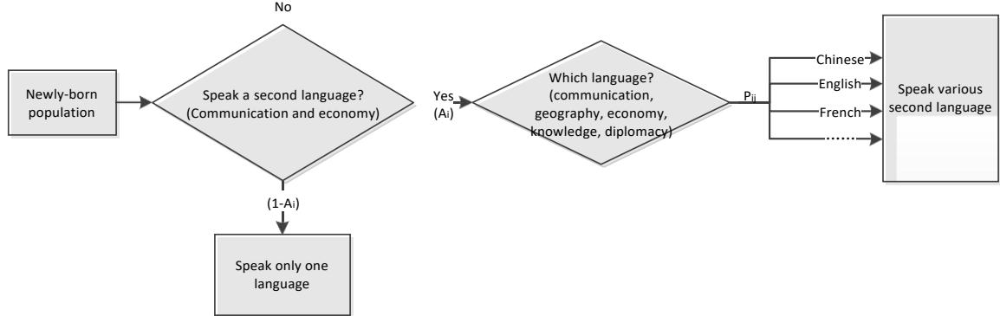
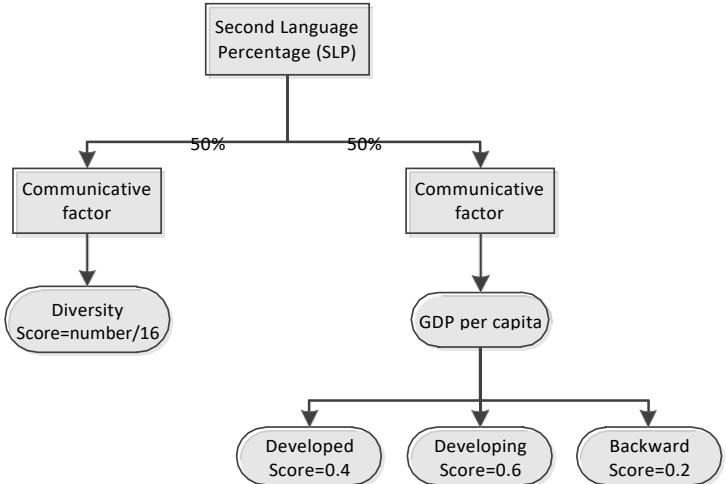
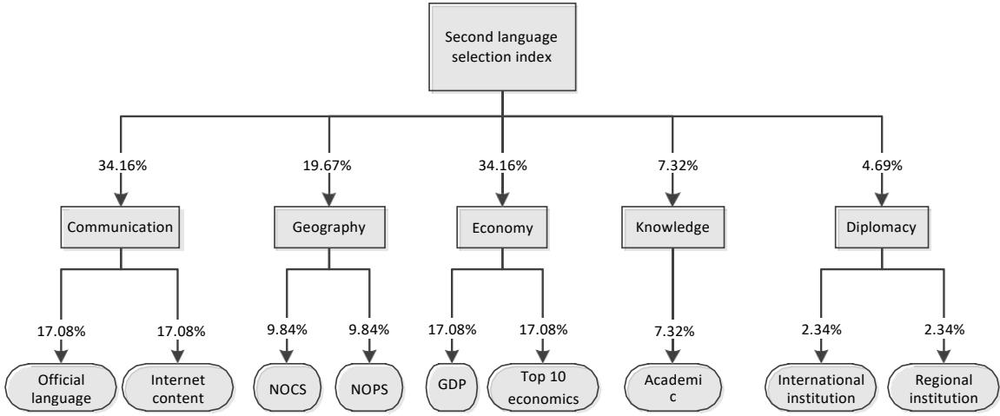
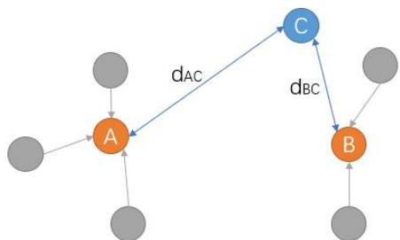
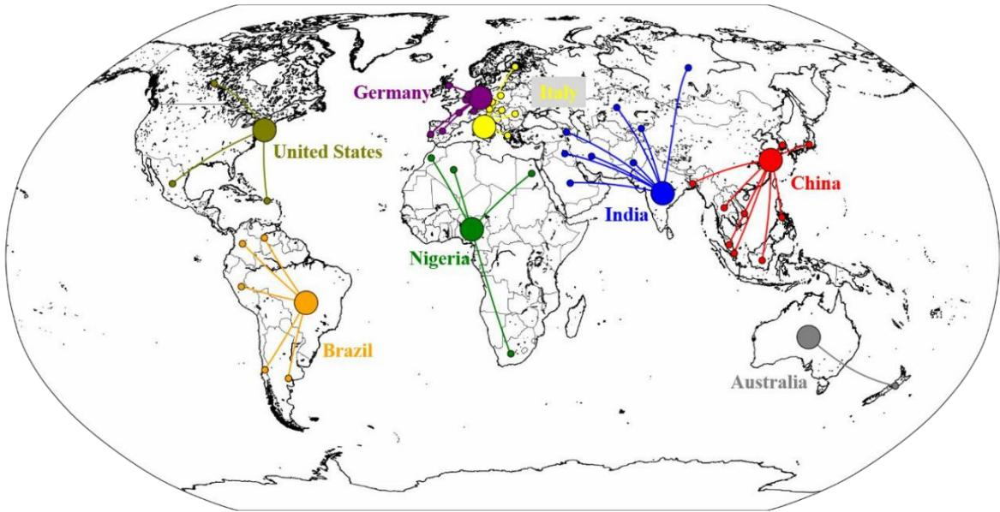

# 2018年美国大学生数学建模竞赛（MCM/ICM）O奖获奖论文：B题语言分布预测与办公地点选择

原件为竞赛论文。补充：文中的阅读练习及“参考解答”为整理时增加，原件图文保留出处。

本资料为2018年MCM/ICM O奖获奖论文（B题）的摘要、目录及正文前3页内容，由识别工具读取后整理而成。

## 摘要

### 摘要内容

Thousands of languages are spoken around on the Earth, and over 40% of people take one of the top ten most spoken language as their mother tongue. Meanwhile, more and more people are learning a second language to meet the rapid development of economy and globalization.

Aimed to predict the distribution of widespread language speakers over the next 50 years, we build a Language Development Model, and apply it to countries with a population over 10 million to describe the possibility of the new generation in a certain country studying a certain second language. We employ the Analytical Hierarchy Process (AHP) to determine the specific parameters, and carry out stochastic simulation on Python to produce the results, which shows that mild change takes place on the list of popular languages – only two of the top-10 languages are replaced, while the total number of speakers of several languages gains an impressive increase.

Based on the language distribution model we obtain, we develop a Location Determination Model. The dual-solution model further provide a recommendation for a large multinational service company to select the location of their new international office. One of the solution is oriented by language structure, and the other by geographic condition. Taking language distribution as well as economic development of different countries into account, the model suggests that new offices should be located in Nigeria, India, Germany, Italy, Brazil, Australia for short-term interest, and Nigeria, Russia, Germany, Poland, Brazil, Australia for long-term development.

The sensitivity analysis shows the strong robustness of our model. Variation of key parameters causes moderate changes to the computing result. When we test the sensitivity, we indirectly validate our model's conformance with reality that the direction of fluctuation of the result matches situations in real world. Meanwhile, we further discuss the impact of reducing the number of new office, and provide practicable advice on location determination of new offices.

**Key Words:** Language Development Model, AHP, Fuzzy Clustering, P-Center Model

更多数学建模资料请关注微店店铺“数学建模学习交流” https://k.weidian.com/RHO6PSpA

## 目录

知识点：[Summary Sheet（摘要页）的撰写规范](../../../topics/数学建模/zhaiyao_xiezuo.md)、[层次分析法 AHP（Analytic Hierarchy Process）用于综合评价](../../../topics/数学建模/ahp_fangfa.md)、[敏感性分析方法（Sensitivity Analysis，单参数与多参数变动）](../../../topics/数学建模/minganxing_fenxi.md)

### 目录内容

1. Introduction
2. Assumptions and Justification
3. Notation
4. Model
    4.1 Language Development Model
        4.1.1 Judgment Process
        4.1.2 Stochastic Simulation Process
    4.2 Location Determination Model
        4.2.1 Solution Oriented by Language Structure
        4.2.2 Solution Oriented by Geographic Condition
5. Sensitivity Analysis
    5.1 Sensitivity Analysis on Language Development Model
        5.1.1 Net Birth Rate Impact
        5.1.2 GDP Growth Rate Impact
        5.1.3 Migration Rate Impact
    5.2 Sensitivity Analysis on Location Determination Model
6. Further Discussion
7. Strengths and Weaknesses
    7.1 Strengths
    7.2 Weaknesses
8. Conclusion
9. Reference
10. Memo to the Service Company

## 引言

知识点：[数学建模的基本步骤（问题分析、模型假设、建立、求解、检验、推广）](../../../topics/数学建模/jianmo_buzhou.md)、[敏感性分析方法（Sensitivity Analysis，单参数与多参数变动）](../../../topics/数学建模/minganxing_fenxi.md)、[模型优缺点分析（Strengths and Weaknesses）](../../../topics/数学建模/youque_dian.md)

### 引言内容

Language is the most important communication tool for human beings. Today, over 6000 languages are spoken on Earth, which help preserve and inherit human civilization and achievements. While everyone has his/her own native language which seldom changes all over his/her life, the number of people speaking a second language keeps increasing not only because of domestic factors such as school studying or governmental promotion, but also international factors including growing migration, booming global tourism and close communication online. Considering both native and second language speakers, great changes take place in language distribution and the number of speakers.

To investigate how the commonly used languages scatter worldwide, we develop a Language Development Model to forecast the future development of the 16 most spoken languages counted in 2017. Based on the original distribution of different languages and the Net Birth Rate of these countries, we build the model to simulate how language distribution changes over the next 50 years.

After obtaining the result from the Language Development Model, we build a Location Determination Model using two different solutions. For the former one, we group the countries based on their language structure. For the latter one, they are separated according to their geographic condition. After the grouping process, we set two goals to filter an optimal location for the new office in each group, namely GDP distribution and distance from other countries in the same group. Besides, we give recommended spoken language in these new offices.

## 假设与理由

知识点：[文献综述与研究背景撰写方法](../../../topics/数学建模/wenxian_zongshu.md)、[问题重述与分析（Problem Restatement and Analysis）](../../../topics/数学建模/wenti_chongshu.md)、[一般假设及其合理性说明（Assumptions and Justifications）](../../../topics/数学建模/jiaben_shezhi.md)

### 假设内容

We make some general assumptions to simplify our model. These assumptions together with corresponding justification are listed below:

- **All people take a certain language as their native language, but not every of them speaks a second language.**

  Language is an indispensable tool for every person, so all people can speak at least one language, either commonly or rarely used. However, whether one speaks an additional second language depends on multiple reasons, for example, the developmental level of his/her country.

- **All existing people won't change their native and second language.**

  People usually speak the same native language through his/her life. We do not consider change in native language caused by migration or other factors in the simplified model. The influence of migration will be discussed in 4.1.1.

  The new generation all take their parents' native language as their own native language. However, their choice of the second language varies for several reasons discussed in 4.1.1. Few families are composed of members speaking different native language. Meanwhile, the specific data is hard to derive. So, we ignore the influence of the multi-composed families and assume that children all take their parents' native language as their own native language.

More detailed assumptions will be listed if needed.

知识点：[文献综述与研究背景撰写方法](../../../topics/数学建模/wenxian_zongshu.md)、[一般假设及其合理性说明（Assumptions and Justifications）](../../../topics/数学建模/jiaben_shezhi.md)、[模型优缺点分析（Strengths and Weaknesses）](../../../topics/数学建模/youque_dian.md)

### 3. Notation

| 符号 | 含义 |
| :--- | :--- |
| $A_i$ | Country $i$ 中会说第二语言的人口百分比。 |
| $P_{ij}$ | Country $i$ 的人说第二语言 $j$ 的可能性。如果语言 $j$ 是该国的母语，则 $P_{ij} = 0$。 |
| $NONLS_i$ | Country $i$ 中的母语使用者数量。 |
| $NOSLS_i$ | Country $i$ 中的第二语言使用者数量。 |
| $TNOS_i$ | Country $i$ 中的总说话者数量。 |

知识点：[符号说明与术语定义（Nomenclature / Symbols and Definitions）](../../../topics/数学建模/fuhao_shuoming.md)、[数学建模的基本步骤（问题分析、模型假设、建立、求解、检验、推广）](../../../topics/数学建模/jianmo_buzhou.md)、[问题重述与分析（Problem Restatement and Analysis）](../../../topics/数学建模/wenti_chongshu.md)

### 4. Model

#### 4.1 Language Development Model

为了讨论前十名语言列表的变化，我们分析了当前使用最广泛的 16 种语言。我们收集了不同国家语言分布的特征，以产生全球语言分布。为了减少计算量，我们只考虑人口超过 1000 万的国家，因为如附录 1 所示，它们贡献了地球总人口的约 92%。为了简化模型，我们建议将拥有最多使用者的语言代表某个国家的母语。对于每个国家，我们从联合国数据库 [1] 获取其 2007 年至 2017 年的人口数据，并获得其净出生率（Net Birth Rate）以计算每年的新生人口。同时，获取不同语言使用者的百分比 [1,2]，以便了解该国当前的语言结构。通过仔细分析我们考虑的每个国家，我们试图获得全世界的语言分布。

##### 4.1.1 Judgment Process

我们假设现有的人不会改变他们的母语和第二语言，而新生人口都将其父母的母语作为自己的母语。因此，某种语言的数值发展完全由新增人口决定。然而，并非所有人都会说第二语言，而且由于经济、社会、政治等原因，他们选择哪种语言作为第二语言各不相同。因此，我们将判断过程分为两步——首先判断一个人是否会说第二语言，然后判断他/她会选择哪种语言。我们的语言发展模型的判断过程如图 1 所示。

为了量化影响第二语言的各种原因，我们在分析中首先采用交际和经济因素来确定一个人是否说第二语言。在计算可能性时，这两个因素的权重均为 0.5。

交际因素由多样性（diversity）来衡量，它等于在该国由超过 100,000 人使用的语言数量除以 16（我们在论文中讨论的常用语言数量）。例如，如果某国有 10 种语言由超过 100,000 人使用，那么交际因素的得分等于 10/16 (0.625)。因此，语言多样性越高，新一代人说第二语言的百分比 $A_i$ 就越高。

然而，在考虑经济因素时，经济发展水平可能与百分比 $A_i$ 不成正比关系。据我们所知，发达国家的人们可能缺乏学习第二语言的动机，尽管他们有充足的资源；而欠发达国家的人们则缺乏学习的资源。因此，拥有适度资源和最高热情的发展中国家的人们学习的可能性最大。根据该国的人均 GDP，经济发展水平被分为 3 组。与此同时，处于不同发展水平的国家人均 GDP 以不同的比率增长，如下表 1 所列。考虑到所有这些因素，我们为上述讨论的每个国家给出一个说第二语言的覆盖可能性。

# 2018年美国大学生数学建模竞赛（MCM/ICM）O奖获奖论文：B题语言分布预测与办公地点选择

## 4.1.2 随机模拟过程

知识点：[数学建模的基本步骤（问题分析、模型假设、建立、求解、检验、推广）](../../../topics/数学建模/jianmo_buzhou.md)、[一般假设及其合理性说明（Assumptions and Justifications）](../../../topics/数学建模/jiaben_shezhi.md)、[模型参数的确定（基于数据拟合或实验选择）](../../../topics/数学建模/canshu_queding.md)

### 选择第二语言的权重确定

在确定第二语言的选择时，我们考虑了五个因素：沟通[3]、地理、经济、知识[4]和外交[5]。这五个因素中的每一个都包含一些可测量的参数，例如在地理部分中，讲该语言的国家数量（NOCS）和讲该语言的人数（NOPS）；在经济部分中，GDP和前10名经济体数量等。在这些参数中，有些是全球性的，对每个国家具有相同的值，如 NOCS 和 NOPS；而另一些是内部变量，因国家而异，如当地 GDP 和本国语言分布。这意味着不同国家的人讲相同第二语言的可能性不同 $( P _ { i _ { 1 } j _ { 1 } } \neq P _ { i _ { 2 } j _ { 1 } } )$，同一国家的人讲不同第二语言的可能性也不同 $( P _ { i _ { 1 } j _ { 1 } } \neq P _ { i _ { 1 } j _ { 2 } } )$。

为了确定这五个部分的权重，我们使用层次分析法（AHP）来确定权重。这种方法有助于将我们的主观偏好转化为可测量的权重，以评估不同因素的重要性。

首先构建一个 $5 \times 5$ 的比较矩阵，其中的每个元素表示因子 $i$ 和 $j$ 之间的偏好程度。由于日常交流对人们很重要，且学习第二语言通常与商务和贸易密切相关，我们给予它们特殊的偏好，得到以下矩阵：

| | Com | Geo | Eco | Kno | Dip |
| :--- | :---: | :---: | :---: | :---: | :---: |
| **Com** | 1 | 2 | 1 | 5 | 6 |
| **Geo** | 1 | $1/2$ | 1 | 3 | 5 |
| **Eco** | 1 | 2 | 1 | 5 | 6 |
| **Kno** | $1/5$ | $1/3$ | $1/5$ | 1 | 2 |
| **Dip** | $1/6$ | $1/5$ | $1/6$ | $1/2$ | 1 |

计算最大特征值并归一化对应的特征向量，我们得到各部分的权重，并将它们平均分配给可测量的子部分。我们所考虑的各部分及其权重如图4所示。

知识点：[层次分析法 AHP（Analytic Hierarchy Process）用于综合评价](../../../topics/数学建模/ahp_fangfa.md)

### 矩阵一致性检验

为了测试矩阵的一致性，我们计算一致性比率（CR），其定义为一律指数（CI）与平均随机一致性指数（RI）的比值。由于 $n = 5$，$RI = 1.12$，且 $\begin{array} { r } { C I = \frac { \lambda _ { m a x } - n } { n - 1 } = 0 . 0 1 1 5 } \end{array}$，我们得到 $CI = 0.0103 < 0.1$，因此确认矩阵具有一致性。

知识点：[层次分析法 AHP（Analytic Hierarchy Process）用于综合评价](../../../topics/数学建模/ahp_fangfa.md)

### 随机模拟流程

在初始阶段，我们简单地模拟总讲者人数（TNOSi）以简化模型。同时，我们用主导语言代表某个国家的母语，并忽略迁移的影响。因此，TNOSi 的变化仅由新一代出生决定。在使用 Python 模拟模型时，我们首先计算第二语言百分比（SLP）与该国家新生人口的乘积，以确定第二语言学习者的增加数量。然后，我们为每 10,000 名第二语言学习者分配一个介于 0 和 1 之间的随机值，以确定他们学习哪种第二语言。如果随机值落在某种语言的区间内，则该组所有人被视为学习该特定语言。

知识点：[随机模型与确定性模型的对比（Stochastic vs Deterministic Model）](../../../topics/数学建模/suiji_queding.md)、[数学建模的基本步骤（问题分析、模型假设、建立、求解、检验、推广）](../../../topics/数学建模/jianmo_buzhou.md)

### 模拟结果分析

第一次模拟结果显示，总讲者人数前十名的列表发生了适度变化。葡萄牙语和俄语被德语和日语取代。在2017年和2067年列表中均出现的八种语言的排名也显示出细微差异。

就总讲者人数而言，我们分析的大多数语言都获得了增长。德语讲者人数增长最快，高达 805.11%。法语和日语讲者人数也增加了超过 500%。这主要是因为讲这些语言的国家具有高 GDP，因此世界各地的人们出于经济原因倾向于学习这些语言。同时，这些语言的原有人口基数不像中文/英文国家那样高。这两个方面的结合导致了这一惊人的结果。如果阈值降低到 100%，则包括多达 6 种语言。但发展最差的语言——俄语，仅记录到 -0.51% 的下降。这是由于俄罗斯负的自然增长率以及讲俄语的国家很少，导致国内人口减少和交流因素缺乏新学习者。

## 四、仿真结果与模型优化

知识点：[模型验证方法概述（随机模型与确定性模型验证）](../../../topics/数学建模/moxing_yanzheng.md)、[敏感性分析方法（Sensitivity Analysis，单参数与多参数变动）](../../../topics/数学建模/minganxing_fenxi.md)

### 表格 2 第一次仿真结果

| Language | Rank in 2017 | Rank in 2067 | Population in 2017 | Population in 2067 | Increased rate (%) | Increased number |
| :--- | :--- | :--- | :--- | :--- | :--- | :--- |
| English | 1 | 1 | 1255857851 | 3172666602 | 152.63 | 1916808751 |
| Chinese | 2 | 2 | 1096961483 | 2278106986 | 107.67 | 1181145503 |
| Spanish | 3 | 3 | 520236718 | 1482532068 | 184.97 | 962295350 |
| Hindi | 4 | 7 | 449573687 | 480031690 | 6.77 | 30458003 |
| Arabic | 5 | 8 | 334611664 | 345470847 | 3.25 | 10859183 |
| Malay | 6 | 9 | 292434196 | 296957189 | 1.55 | 4522993 |
| Bengali | 7 | 10 | 246276800 | 248034947 | 0.71 | 1758147 |
| French | 8 | 4 | 242897420 | 1471076958 | 505.64 | 1228179538 |
| Portuguese | 9 | 11 | 229370143 | 238969091 | 4.18 | 9598948 |
| Russian | 10 | 12 | 207790825 | 206735561 | -0.51 | -1055264 |
| Hausa | 11 | 13 | 150021627 | 149734135 | -0.19 | -287492 |
| Punjabi | 12 | 14 | 147803740 | 149154483 | 0.91 | 1350743 |
| Japanese | 13 | 6 | 133972338 | 1135657916 | 747.68 | 1001685578 |
| German | 14 | 5 | 136642027 | 1236759996 | 805.11 | 1100117969 |
| Persian | 15 | 15 | 119207805 | 125462681 | 5.25 | 6254876 |
| Urdu | 16 | 16 | 69081313 | 69250144 | 0.24 | 168831 |

知识点：[长期预测模型（如20年可持续发展计划预测）](../../../topics/数学建模/nian_yuce.md)、[影响因素评估指标体系构建（温度、湿度、经济、教育等）](../../../topics/数学建模/yingxiang_zhibiao.md)、[可持续发展指数 SDI 的构建与指标体系结构](../../../topics/数学建模/kechixu_zhibiao.md)

### 图 7 全球语言分布的变化

为了改进模型，我们在第二阶段分别考虑了母语使用者数量 $(NONLS_i)$ 和第二语言使用者数量 $(NOLS_i)$。由于总人数由母语和第二语言部分组成，即 $TNOS_i = NONLS_i + NOLS_i$，我们只需模拟母语使用者的数量，然后通过减法得到第二语言使用者的数量。我们得到以下结果：

与总使用人数的结果相比，我们可以看到，初始的中文母语使用者人数多于英文。然而，英文母语使用者的增长速度远快于中文，并在 2049 年超过中文。其他语言的母语使用者数量与总使用人数的差异也很小。同时，我们可以看到，母语使用者的曲线不如总使用人数的曲线平滑。这是由于我们的简化处理所致，即我们只取主导语言来代表一个国家的母语，因此当一个国家的主导语言发生变化时，母语使用者数量可能会出现突然的增长或下降。

为了更好地模拟现实情况，我们进一步考虑了移民的影响。我们假设在移民发生时，所有移民立即将其母语从原籍国语言改变为新居国语言。输出移民的国家从其母语使用者数量中减去与移民人数相同的数量，而接收移民的国家则在其母语使用者数量中加上该数量。同时，移民的原母语被计入新居国的第二语言。

考虑到移民的影响，这 16 种语言的总使用人数和母语使用者数量的变化很小。发展趋势和速度与之前未考虑移民的情况相似。这归因于移民率的不显著性，其大约仅为平均净出生率的十分之一。仿真结果如下图所示：

知识点：[模型参数的确定（基于数据拟合或实验选择）](../../../topics/数学建模/canshu_queding.md)、[数学建模的基本步骤（问题分析、模型假设、建立、求解、检验、推广）](../../../topics/数学建模/jianmo_buzhou.md)、[一般假设及其合理性说明（Assumptions and Justifications）](../../../topics/数学建模/jiaben_shezhi.md)

### 4.2 Location Determination Model

#### 4.2.1 Solution Oriented by Language Structure

To determine the location of the new offices, we build a Location Determination Model, using the results obtained from the Stochastic Language Development Model. Since international branch offices are usually set in well developed country, we simply focus on countries with GDP over 100 billion dollars, which helps reduce the number of country to 52. In the meantime, the capital of a country is usually the economic, political and transportation center, so we adopt the capital as the only candidate city for each country.

For these 52 countries (or you can say, their capitals), we employ Algorithms for Fuzzy Clustering (AFFZ) to separate them into 6 groups according to their similarity in language structure[6]. For each country, it generates a vector, each element of which stands for the total number of people speaking the specific language. The correlation between every two countries can be calculated through Angle Cosine Method:

$$
r _ { i j } = \frac { \left| \sum_ { k = 1 } ^ { m } x _ { i k } \cdot x _ { j k } \right|}{\sqrt {\sum_ { k = 1 } ^ { m } x _ { i k } ^ { 2 } \cdot \sum_ { k = 1 } ^ { m } x _ { j k } ^ { 2}}}
$$

With the correlation value, we create a Fuzzy Similar Matrix, and then generate a Fuzzy Equivalent Matrix to divide these 52 countries into 6 groups. For each group, we choose 1-3 languages to represent the characteristics of it.

The purpose of establishing an international new office is to get tight connection with economically developed countries and regions, so there are two objectives that we are concerned about most, namely the distance from the candidate country (or capital) to other countries, and the GDP distribution in the group. We hope that the office is built somewhere close to the well-developed countries, and we get the following expression for country $j$:

$$
\sum_ { i \neq j } \frac {( G D P _ { i } ) ^ { 2 } } { d _ { i j } } + \frac {( G D P _ { j } ) ^ { 2 } } { \frac { 1 } { 2 } \min _ { i \neq j } d _ { i j } }
$$

In the expression, subscript $i$ refers to country $i$, and $d _ { i j }$ refers to the distance between country $i$ and $j$. We square the GDP since we think that GDP is a more important factor compared with distance. The first section of the expression represents the effect of distance as well as GDP of other countries. When considering domestic condition, we also use the data of GDP and distance to keep the dimension coherent to the former. However, the distance can’t be 0, so we replace it with half of the distance from its closest country, which makes the value a minimum and not to be 0.

The larger the value of the expression, the better a country to set the office in. So, we need to search for the maximum value in each group to determine the location. That means, the objective function is

$$
\max \left(\sum_ { i \neq j } \frac { \left( G D P _ { i }\right) ^ { 2 } } { d _ { i j } } + \frac { \left( G D P _ { j }\right) ^ { 2 } } { \frac { 1 } { 2 } \min _ { i \neq j } d _ { i j } }\right)
$$

Running the solution program on Matlab using the current (2017) language structure of each country, we obtain the members of each group as the following table shows:

**Table 3 Current grouping result (solution 1)**

| Group | Language | Countries | Number |
| :--- | :--- | :--- | :--- |
| 1 | Arabic | Morocco, Algeria, Egypt, Iraq, Saudi Arabia | 5 |
| 2 | Spanish + French + Russian | South Africa, Nigeria, Armenia, Kazakhstan, Kyrgyzstan, Vietnam, Singapore, Philippine, Thailand, South Korea, Japan, Romania, Greece, Czechia, Finland, Austria, Belgium, Poland, Switzerland, Netherland, Spain, Russia, Italy, France, Britain, Germany, Mexico, Puerto Rico, Canada, New Zealand, Australia, Peru, Chile, Colombia, Venezuela, Argentina, China, America | 38 |
| 3 | Bengali | Bangladesh | 1 |
| 4 | Malay | Malaysia, Indonesia | 2 |
| 5 | Hindustani | India, Pakistan | 2 |
| 6 | Portuguese | Portugal, Brazil | 2 |

Based on the latitude and longitude data of each country, we calculate the distance among them with simple Matlab program. Then we can get the value of the criterion expression of each country, therefore determine the countries for new offices. Final result of locations and the languages used in each office is shown in Table 4.

**Table 4 Current locations and languages for each office**

| Country (Capital) | Saudi Arabia (Riyadh) | Germany (Berlin) | Bangladesh (Dhaka) | Indonesia (Jakarta) | India (New Delhi) | Brazil (Brasilia) |
| :--- | :--- | :--- | :--- | :--- | :--- | :--- |
| Language | Arabic | Spanish, French, Russia | Bengali | Malay | Hindustani | Portuguese |

If we substitute the data of language structure and GDP with the future one in 2067 (GDP is regarded to increase at a constant speed as shown in Table 1), the grouping result and the locations as well as spoken languages will change as Table 5 and Table 6 show below:

**Table 5 Future grouping result**

| Group | Language | Countries | Number |
| :--- | :--- | :--- | :--- |
| 1 | Arabic | Morocco, Algeria, Egypt, Iraq, Saudi Arabia | 5 |
| 2 | Hindustani + Malay + German | Brazil, Russia, Poland, India, Germany, Malaysia, Britain, Kazakhstan, Indonesia, Canada, South Korea, Australia, Netherland, Iran, Thailand, Switzerland, Nigeria, Philippine, South Africa, Pakistan, Austria, Vietnam, Singapore, Finland, Czechia, New Zealand, Botswana, China, America | 29 |
| 3 | Bengali | Bangladesh | 1 |
| 4 | Spanish | Mexico, Argentina, Venezuela, Chile, Peru, Romania, Italy, Spain, Ecuador, Cuba, Dominican | 13 |

## 4.2.2 Solution Oriented by Geographic Condition

As we can see, the result produced by solution oriented by language structure can hardly be regarded as the ideal locations for new office. In fact, although relatively little languages are considered such as Arabic and Bengali and it is easy to determine what languages to speak in each new office, the locations are unsatisfactory from the economic point of view. This can be stem from the huge difference of the 6 groups, one of which contains 38 countries spreading on almost every continent, covering nearly 75% of the total countries we discuss. The remaining 14 countries are all relatively small or medium countries, and have mediocre economic level, which are not suitable locations for international business.

Since then, we shift our way of thinking, and first decide how many offices to build on each continent (totally 6 worldwide) according to the economic development. For continents with $n$ ($n> 1$) offices, we divide them into $n$ parts based on the geographic location of each country, applying P Center Method while grouping. That means, if there are two offices in Europe, we randomly take two countries of it, and sum up the smaller value of the distance between anther country and these two. After traversing all cases, we select two countries with the minimum value as the reference countries, marked as A, B. Then we add other countries into the group of country A or B on the basis of their distance from these countries. For example, another country C has shorter distance to country B than country A, then it is added to the second group.

Figure 10 The grouping process

After the grouping process, we use the same criterion expression as the solution oriented by language structure to determine the optimal office location for each group. Algorithms for Fuzzy Clustering (AFFZ) is applied to finally decide what language to speak in the office. We observe the characteristics of language structure of clustered group with most countries, and choose 1-3 languages that have great amount of speakers.

Figure 11 Process of solution oriented

When simulating the solution on Matlab program, we take the original two offices in Shanghai and New York into consideration since they also contribute to connection with other countries around them, which may influence the location selection. That means, we suggest originally there is no office anywhere on Earth, and we need to distribute 8 offices around the world, and see if the results include companies in China and the United States. The number of offices distributed around the world is initially set as the following table:

**Table 7 Initial distribution of office number**

| Continent | Asia | Europe | North America | South America | Oceania | Africa |
| :--- | :---: | :---: | :---: | :---: | :---: | :---: |
| Number | 2 | 2 | 1 | 1 | 1 | 1 |

For Asia and Europe, two offices are set, so P Center Method is applied to separate their countries into two groups. For other continents, only one office is set, so the grouping process is skipped. Russia is regarded as an Asian country because geographically most of its territory locates in Asia.

We discuss the current and future situation separately. The result of the 8 groups for current situation is shown as following:

**Table 8 Current grouping result (Solution 2)**

| Group | Continent | Members |
| :---: | :---: | :--- |
| 1 | Asia | Vietnam, Bangladesh, Singapore, Thailand, South Korea, Japan, China, Malaysia, Philippines, Indonesia |
| 2 | Asia | India, Pakistan, Armenia, Kazakhstan, Kyrgyzstan, Iraq, Iran, Saudi Arabia, Russia |
| 3 | Europe | Hungary, Greece, Austria, Poland, Romania, Czechia, Finland, Italy |
| 4 | Europe | Belgium, Switzerland, Netherlands, France, Britain, Germany, Portugal, Spain |
| 5 | North America | Puerto Rico, Mexico, Canada, America |
| 6 | South America | Peru, Chile, Colombia, Venezuela, Argentina, Brazil |
| 7 | Oceania | New Zealand, Australia |
| 8 | Africa | Morocco, Algeria, South Africa, Egypt, Nigeria |

# 2018年美国大学生数学建模竞赛（MCM/ICM）O奖获奖论文：B题语言分布预测与办公地点选择

本文档整理自《2018年美国大学生数学建模竞赛（MCM/ICM）O奖获奖论文：B题语言分布预测与办公地点选择》第 7 部分（共 10 部分），由识别工具读取并整理。内容涉及基于模型计算的2017年及2067年国际办事处选址方案、分组结果及对应语言分布。

## 一、2017年办公地点选择结果

知识点：[影响因素评估指标体系构建（温度、湿度、经济、教育等）](../../../topics/数学建模/yingxiang_zhibiao.md)、[模型参数的确定（基于数据拟合或实验选择）](../../../topics/数学建模/canshu_queding.md)

### 小节 1

利用上述目标函数评估每组中每个国家的适宜性，我们获得了2017年新办事处的最佳位置。结果也验证了中国和美国是设立办事处的理想地点。图12在世界地图上清晰地显示了办事处的位置以及同一组内相应的相对成员。

各国使用的语言如下表所示：

**表 9 2017年各办事处使用的语言**

| Country (Capital) | Nigeria (Abuja) | India (New Delhi) | China (Shanghai) | Italy (Rome) | Germany (Berlin) | America (New York) | Brazil (Brasilia) | Australia (Canberra) |
| :--- | :--- | :--- | :--- | :--- | :--- | :--- | :--- | :--- |
| Language | Arabic | Russian, Hindistani, Punjabi | Chinese, Japanese | German | German, French, Spanish | Spanish, French | Spanish | Spanish |

## 二、206年未来办公地点预测

知识点：[TOPSIS 模型构建步骤（逼近理想解排序法）](../../../topics/数学建模/topsis_moxing.md)、[影响因素评估指标体系构建（温度、湿度、经济、教育等）](../../../topics/数学建模/yingxiang_zhibiao.md)、[长期预测模型（如20年可持续发展计划预测）](../../../topics/数学建模/nian_yuce.md)

### 小节 2

如果将数据替换为2067年的数据，意大利和印度将被波兰和俄罗斯取代。中国和美国仍然存在于列表中，再次验证了它们作为国际办事处选址的适宜性。同时，由于不同语言的发展速度不同，所使用的语言发生了一些细微变化。分组结果、最终办事处位置以及所使用的语言如下所示。

**表 10 未来分组结果（方案 2）**

| Group | Continent | Members | | | | |
| :--- | :--- | :--- | :--- | :--- | :--- | :--- |
| 1 | Asia | Vietnam | Bangladesh | Singapore | Thailand | South Korea |
| | | Japan | China | Malaysia | Philippines | Indonesia |
| 2 | Asia | India | Pakistan | Saudi Arabia | Kazakhstan | Russia |
| | | Iraq | Iran | | | |
| 3 | Europe | Hungary | Greece | Austria | Poland | Romania |
| | | Czechia | Finland | Italy | Croatia | |
| 4 | Europe | Belgium | Switzerland | Netherlands | France | Britain |
| | | Germany | Portugal | Spain | | |
| 5 | North America | Cuba | Mexico | Canada | America | Dominican Republic |
| 6 | South America | Peru | Chile | Colombia | Venezuela | Argentina |
| | | Brazil | Ecuador | | | |
| 7 | Oceania | New Zealand | Australia | | | |
| 8 | Africa | Algeria | South Africa | Egypt | Nigeria | |

**表 11 2067年各办事处使用的语言**

| Country (Capital) | Nigeria (Abuja) | Russia (Moscow) | China (Shanghai) | Poland (Warsaw) | Germany (Berlin) | America (New York) | Brazil (Brasilia) | Australia (Canberra) |
| :--- | :--- | :--- | :--- | :--- | :--- | :--- | :--- | :--- |
| Language | Arabic | Russian, Hindistani | Chinese, Japanese | German | German, French, Spanish | Spanish | Spanish | Malay |

## 5. Sensitivity Analysis

知识点：[敏感性分析方法（Sensitivity Analysis，单参数与多参数变动）](../../../topics/数学建模/minganxing_fenxi.md)、[长期预测模型（如20年可持续发展计划预测）](../../../topics/数学建模/nian_yuce.md)

### 5.1 Sensitivity Analysis on Language Development Model

In the Language Development Model, the Net Birth Rate, GDP growth rate and migration rate will have an impact on the results. Therefore, it is necessary to analyze the impact of these three factors on the simulation results.

#### 5.1.1 Net Birth Rate Impact

The Net Birth Rate in each country is the main motivation behind the language development, here we reduce and increase the net birth rate of all countries by 20% and 10%, and use the Language Development Model to calculate the total number of 16 languages speakers after 50 years. The relative changes are shown in the following table.

Table 12 Analytical result of Net Birth Rate impact

| Change of Net Birth Rate | -20% | -10% | +10% | +20% |
|---|---|---|---|---|
| Chinese | -13.60% | -6.50% | 10.53% | 20.22% |
| English | -13.84% | -5.41% | 13.07% | 24.76% |
| Hindi | -0.05% | -0.55% | 0.85% | 0.73% |
| Urdu | 0.75% | -0.84% | -0.16% | -1.03% |
| Spanish | -18.45% | -9.99% | 10.34% | 23.82% |
| Arabic | 3.20% | -3.05% | 2.41% | 2.30% |
| Malay | -1.56% | -1.53% | 1.53% | 1.50% |
| Russian | -1.89% | -1.91% | -1.01% | -0.78% |
| Bengali | -0.72% | -0.76% | 0.73% | 0.74% |
| Portuguese | -4.66% | -4.42% | 4.29% | 3.87% |
| French | -24.35% | -13.02% | 14.00% | 27.69% |
| Hausa | -0.26% | -0.04% | 0.02% | -0.19% |
| Punjabi | -1.28% | 0.88% | 1.07% | 0.93% |
| Japanese | -28.38% | -13.96% | 17.91% | 34.08% |
| German | -25.32% | -14.07% | 16.50% | 36.66% |
| Persian | -5.90% | -5.69% | 5.39% | 5.27% |

As can be seen from the above table, for most languages, the number of language speakers is positively correlated with the Net Birth Rate. In other words, as the Net Birth Rate rises, the number of language speakers increases, and as the Net Birth Rate decreases, the number of language speakers drops. This result is consistent with common sense. From this perspective, we can say that this model accurately simulates the reality situation. In addition, all the changes in this table are less than 40%. Therefore, the model can be considered as a robust one.

#### 5.1.2 GDP Growth Rate Impact

The growth rate of GDP used in the Language Development Model was 2% in developed countries, 7% in developing countries and 3% in backward countries. Now we change these three numbers by -50%, -10%, +10%, +100%, and use the Language Development Model to calculate the total number of 16 languages speakers after 50 years. The relative changes are shown in the following table.

Table 13 Analytical result of GDP Growth Rate impact

| GDP increase rate | -50% | -10% | +10% | +100% |
|---|---|---|---|---|
| Chinese | -0.51% | -0.49% | 1.45% | 2.49% |
| English | -2.88% | -2.15% | 3.62% | 1.52% |
| Hindi | 0.32% | 0.69% | 0.24% | 1.40% |
| Urdu | -0.28% | -0.30% | -0.07% | 0.05% |
| Spanish | -0.20% | -1.44% | -2.20% | 0.99% |
| Arabic | -2.47% | -2.71% | 2.82% | 2.16% |
| Malay | -1.58% | -1.58% | 1.58% | 1.58% |
| Russian | -0.62% | -0.45% | -0.65% | 0.84% |
| Bengali | -0.75% | -0.75% | 0.75% | 0.75% |
| Portuguese | -4.32% | -4.34% | 4.30% | 4.39% |
| French | -1.64% | -1.92% | 0.62% | 0.27% |
| Hausa | -0.13% | -0.13% | -0.13% | -0.13% |
| Punjabi | -1.96% | -0.73% | 0.85% | 1.56% |
| Japanese | -1.18% | -0.80% | 1.68% | 3.66% |
| German | -2.38% | 0.38% | 0.30% | 1.71% |
| Persian | 5.50% | 5.58% | 5.58% | 5.50% |

As can be seen from the above table, the increase in GDP growth rate will cause an increase in the number of most languages. However, even in the case of GDP growth rate increases by 100%, the total population of languages will not change much (the maximum is only 3.66%). Therefore, the change in the GDP growth rate has little effect on the result of the population after 50 years.

#### 5.1.3 Migration Rate Impact

By increasing and decreasing the migration rate in each country, we calculate the total population change of each language after 50 years.

Table 14 Analytical result of Migration Rate impact

| Migration Rate | -20% | -10% | +10% | +20% |
|---|---|---|---|---|
| Chinese | 3.16% | -0.81% | -3.51% | -8.30% |
| English | -4.23% | -2.18% | 3.40% | 5.27% |
| Hindi | 1.14% | 0.00% | -5.20% | -6.86% |
| Urdu | 0.00% | 0.00% | 0.19% | 0.00% |
| Spanish | -0.12% | -0.08% | 1.10% | 1.42% |
| Arabic | 0.15% | 0.40% | -1.34% | -1.77% |
| Malay | -3.80% | -6.94% | -9.11% | -23.48% |
| Russian | 0.20% | -0.01% | -0.40% | -0.34% |
| Bengali | 0.08% | 0.06% | 0.03% | -0.01% |
| Portuguese | -0.17% | -0.15% | -0.07% | -0.05% |
| French | -1.00% | 0.09% | -0.60% | -0.23% |
| Hausa | -0.11% | -0.15% | -0.13% | -0.07% |
| Punjabi | 0.06% | -0.02% | 0.04% | 0.01% |
| Japanese | -0.10% | -1.44% | 8.51% | 3.59% |
| German | -0.51% | -0.32% | -1.12% | 4.30% |
| Persian | -0.68% | -0.44% | -0.59% | 0.17% |

# 2018年美国大学生数学建模竞赛（MCM/ICM）O奖获奖论文：B题语言分布预测与办公地点选择（习题）

本文整理自《2018年美国大学生数学建模竞赛（MCM/ICM）O奖获奖论文：B题语言分布预测与办公地点选择》第 9 部分，由识别工具读取并校对。内容涵盖灵敏度分析、进一步讨论及模型优缺点评价。

## 一、灵敏度分析

知识点：[敏感性分析方法（Sensitivity Analysis，单参数与多参数变动）](../../../topics/数学建模/minganxing_fenxi.md)、[参数合理性验证](../../../topics/数学建模/canshu_heli_xing.md)

### 5.2 Location Determination Model Sensitivity Analysis

在4.2节中，我们确定了新办公地点的三个关键因素：地理位置、语言结构和以GDP衡量的经济条件。

在我们的模型中，国家地理位置的影响通过距离来体现。由于国家的位置随时间变化不大，我们未过多关注该因素的灵敏度。语言结构受净出生率、迁移和GDP增长的影响，在决定新办公室使用何种语言时起着重要作用，但在确定位置步骤中相对次要。因此，在灵敏度分析部分，我们主要关注GDP增长率波动及其影响。

类似于5.1.2节的处理，我们对GDP增长率分别施加了 -50%、-10%、+10% 和 +100% 的变动，并记录了每种情况下推荐的新办公室所在国家，发现了显著的变化。

**表 15 办公地点确定模型的灵敏度分析**

| 地区 | GDP增长率变动 | 组成员数变动 | 推荐国家 |
| :--- | :--- | :--- | :--- |
| **非洲 (Africa)** | -50% | +0 | Nigeria |
| | -10% | +0 | Nigeria |
| | +10% | +2 | South Africa |
| | +100% | +4 | Botswana |
| **亚洲 (Asia)** | -50% | +0 | Russia / China |
| | -10% | +0 | Russia / China |
| | +10% | +0 | Russia / China |
| | +100% | +0 | Russia / China |
| **欧洲 (Europe)** | -50% | +0 | Germany / Poland |
| | -10% | +0 | Germany / Poland |
| | +10% | +0 | Germany / Poland |
| | +100% | -2 / -1 | Germany / Poland |
| **北美洲 (North America)** | -50% | +0 | USA |
| | -10% | +0 | USA |
| | +10% | +0 | Mexico |
| | +100% | +0 | Mexico |
| **大洋洲 (Oceanic)** | -50% | +0 | Australia |
| | -10% | +0 | Australia |
| | +10% | -1 | Australia |
| | +100% | -1 | Australia |
| **南美洲 (South America)** | -50% | +0 | Brazil |
| | -10% | +0 | Brazil |
| | +10% | +0 | Brazil |
| | +100% | +0 | Brazil |

*注：表格中“亚洲”、“欧洲”等行包含多个推荐国家，对应不同组别或情况下的结果，原文排版为合并单元格。*

从表中可以得出结论：

- 如果GDP增长率下降，组成员数量和推荐国家均不发生变化。
- 如果GDP增长率上升，非洲的组成员数量倾向于增加，而欧洲和大洋洲的组成员数量减少。同时，推荐的国家也会发生改变。

这一现象可以用发展中国家与发达国家之间的GDP增长速度差异来解释。当GDP增长率上升时，这种差距扩大，意味着更多的发展中国家将取代发达国家。因此，非洲受到的关注自然增加，推荐名单中的发展中国家也随之增多。

此外，前文提到，从表中可以看出，中文、印地语和马来语的 speakers 数量与迁移率呈负相关，而英语和日语的总 speakers 数量则与迁移率呈正相关。这是因为讲中文、马来语和印地语的人有更强的迁移倾向，且其中许多人选择英语国家作为第二故乡。

## 二、进一步讨论

知识点：[敏感性分析方法（Sensitivity Analysis，单参数与多参数变动）](../../../topics/数学建模/minganxing_fenxi.md)、[模型验证方法概述（随机模型与确定性模型验证）](../../../topics/数学建模/moxing_yanzheng.md)

### 6. Further Discussion

由于基于语言结构的解决方案仅产生了尚可的办公地点确定结果，我们应用基于地理条件的解决方案来进一步讨论开设 5 个甚至更少办公室的可行性。

由于该解决方案不对新办公室的数量做任何限制，公司可以根据其实际财务状况选择开设任意数量的办公室。只要公司对开设多少家新办公室以及它们位于哪些大洲有初步规划，我们就可以立即提供每个办公室的确切位置。

例如，假设公司决定关闭一家欧洲办公室并总共开设 5 家办公室，这不会影响其他大洲办公室的位置，但可能会改变欧洲办公室的位置。通过在 Matlab 程序中计算这种情况，我们得到了如图 14 所示的短期和长期决策结果。

因此，我们可以说，采用基于地理条件解决方案的模型具有很强的适应性，能够应对各种情况，是一种简单且可行的为新办公室选址提供建议的方法。

## 三、模型的优缺点

知识点：[数学建模的基本步骤（问题分析、模型假设、建立、求解、检验、推广）](../../../topics/数学建模/jianmo_buzhou.md)、[模型优缺点分析（Strengths and Weaknesses）](../../../topics/数学建模/youque_dian.md)、[配送地点选址模型（公平原则与效率原则）](../../../topics/数学建模/peisong_xuanzhi.md)

### 7. Strengths and Weaknesses

#### 7.1 Strengths

基于层次分析法（AHP），语言发展模型充分考虑了许多可能影响语言发展的因素，包括交流、地理、经济、学术和外交。因此，模型的结果具有很高的可信度。

语言发展模型以国家而非语言为模拟单元。因此，它不仅能模拟某种语言随时间的演变，还能模拟任何给定国家随时间的语言结构。

我们从两个不同的角度审视了地点确定问题：语言结构的相似性和国家间的地理距离。我们对这两个因素的优先级进行了判断，并改进了我们的模型。

- 地点确定模型反映了现代国际公司的经济考量，因为GDP在确定新办公室位置时起着重要作用。

# 2018年美国大学生数学建模竞赛（MCM/ICM）O奖获奖论文：B题语言分布预测与办公地点选择

## 一、模型评价

知识点：[模型优缺点分析（Strengths and Weaknesses）](../../../topics/数学建模/youque_dian.md)、[文献综述与研究背景撰写方法](../../../topics/数学建模/wenxian_zongshu.md)、[非技术性文稿撰写（如致世界医学会的信函、新闻发布会声明）](../../../topics/数学建模/fei_jishu_wengao.md)

### 7.2 Weaknesses

- In our model, to simplify our model, only the language with the largest number of speakers is considered as the native language of a country. But in fact, there might be two or even more native languages in a country.
- The objective function to optimize the position of new offices is determined with a certain degree of arbitrariness. It can be further improved to meet different actual needs.
- The correctness of our conclusions relies heavily on the accuracy of the data collected and the estimates of GDP, language and population development.
- The recommendation provided by our model remains at the stage of countries (capitals). Further analyses are required in order to determine the specific cities.

答案：无（原文为缺点陈述，非题目解答）

知识点：[模型优缺点分析（Strengths and Weaknesses）](../../../topics/数学建模/youque_dian.md)、[一般假设及其合理性说明（Assumptions and Justifications）](../../../topics/数学建模/jiaben_shezhi.md)、[参数合理性验证](../../../topics/数学建模/canshu_heli_xing.md)

### 7. Conclusion

To predict the future distribution of commonly used languages, we build a Language Development Model, setting up 2 criteria to estimate the percentage of speaking a second language, 5 factors to evaluate which second language to speak. Then we simulate the model on Python, using data of population, GDP, language structure and etc. of over 50 countries we collected on the Internet. We conclude that only moderate changes occur to top ten language list, and most of the 16 languages we discuss gain a growth in their total speaker number.

To further provide advice to the multinational service company, we build a Location Determination Model, applying two solutions to figure out the suitable locations for establishment of new offices. The first solution oriented by language structure produced just passable result without comprehensive consideration on economic condition. The second solution, if provided initial number of office on each continent, produces generally ideal locations, and new decisions can be quickly derived if the company change its strategy.

答案：无（原文为结论陈述，非题目解答）

## 二、参考文献

知识点：[数学建模的基本步骤（问题分析、模型假设、建立、求解、检验、推广）](../../../topics/数学建模/jianmo_buzhou.md)、[文献综述与研究背景撰写方法](../../../topics/数学建模/wenxian_zongshu.md)

### Reference

[1] http://data.un.org/Data.aspx

[2] https://www.cia.gov/library/publications/resources

[3] https://w3techs.com/technologies/overview/content\_language/all

[4] http://akarlin.com/2011/05/top-10-most-useful-languages/

[5] Kai L. Chan, PhD, POWER LANGUAGE INDEX, May 2016

[6] Gustafson, D. E. (1979). Fuzzy clustering with a fuzzy covariance matrix. Proc of IEEE Cdc San Diago Ca, 2, 761-766.

答案：无（原文为参考文献列表，非题目解答）

## 三、致服务公司的备忘录

知识点：[文献综述与研究背景撰写方法](../../../topics/数学建模/wenxian_zongshu.md)

### Memo to the Service Company

**Dear Chief Operating Officer,**

We are glad to hear your recent plan about opening six new international offices, which will definitely be an important milestone for your company to become truly international. For such a significant plan, it is necessary to carry out some research before making the final decision. To assist you to decide the location of new offices and determine the languages spoken in the offices, we performed investigations using mathematical modelling.

Firstly, we build up a Language Development model to investigate the distribution of various language speakers over time. In this model, we consider many possible influencing factors, including economy, geography, communication, knowledge and diplomacy. This model is based on data from the United Nation (UN). Through our calculations and tests, we found that this model can really help us to predict the future of language development. It is indicated in this model that over the next 50 years, two original most spoken languages (Russian and Portuguese) will be replaced (by German and Japanese), while the total number of speakers of most languages will gain an impressive increase.

Based on the model of language distribution, combined with Algorithm for Fuzzy Clustering method and P-Center method, we develop a Location Determination Model using two solutions to further provide a recommendation for your company to select the location of your new international office and its working language. One of the solution is oriented by language structure, and the other by geographic condition. Taking language distribution as well as economic development of different countries into account, we suggest to locate new offices in the capitals of Nigeria, India, Germany, Italy, Brazil, Australia for short-term interest. These six locations as well as the languages to be used in the new offices are as the following:

| Recommended Location for New Offices | Language(s) to be Used |
| :--- | :--- |
| New York, America | Spanish |
| Shanghai, China | Chinese and Japanese |
| Moscow, Russia | Russian and Hindustani |
| Warsaw, Poland | German |
| Berlin, Germany | German, French and Spanish |
| Abuja, Nigeria | Arabic |
| Brasilia, Brazil | Spanish |
| Canberra, Australia | Malay |

Considering from long-term perspective, your company should build these six new offices in the capitals of Nigeria, Russia, Germany, Poland, Brazil and Australia. Moreover, since our model makes no restriction on number of new office, you can set arbitrary number of offices based on your actual financial condition. As long as you make a preliminary planning of how many new offices to open and which continents they are located at, we can provide the exact location of each office immediately.

We hope that our suggestion can provide useful information for you.

Yours sincerely, Team #77238

答案：无（原文为应用建议，非题目解答）

知识点：[数学建模的基本步骤（问题分析、模型假设、建立、求解、检验、推广）](../../../topics/数学建模/jianmo_buzhou.md)、[文献综述与研究背景撰写方法](../../../topics/数学建模/wenxian_zongshu.md)
