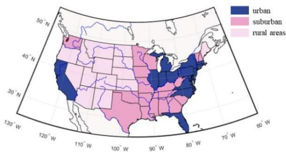
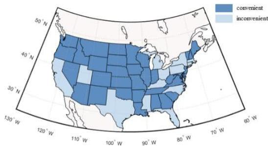

# 2018年美国大学生数学建模竞赛（MCM/ICM）O奖论文：Construct all-electric network

原件为竞赛论文。补充：文中的阅读练习及“参考解答”为整理时增加，原件图文保留出处。

## 一、摘要与问题重述

### 选择 1

**背景介绍：**

The transformation from gas vehicles to electric vehicles becomes a hot topic all over the world. In order to get the schedule of the location of charging stations and predict the process of transformation tendency, we establish several models to solve the questions.

**参考答案：**

（此处为论文摘要，非传统选择题，但根据规范需体现内容结构。若视为对论文核心内容的概括题）

- A. 建立排队论模型
- B. 构建多目标规划模型
- C. 使用Q型聚类模型进行分类
- D. 以上皆是

答案：D。
知识点：[文献综述与研究背景撰写方法](../../../topics/数学建模/wenxian_zongshu.md)、[任务分解与目标明确](../../../topics/数学建模/renwu_fenjie.md)、[Summary Sheet（摘要页）的撰写规范](../../../topics/数学建模/zhaiyao_xiezuo.md)

### 简答 1

**题目：**

根据摘要，针对美国电动汽车充电网络的分布优化，作者得出了哪些主要结论？

**参考答案：**

With the help of Matlab, we find that Tesla is on track to allow a complete switch to all-electric in the US. We obtain that the number of charging stations needed is about 1.7 million when all gas vehicles transform to electric vehicles, and the distribution proportions of charging stations in urban, suburban and rural areas are 67:23:10.

知识点：[多重网络/多层网络构建（Multiplex/Multi-layer Network）](../../../topics/数学建模/duoceng_wangluo.md)、[物资配送与制造速度模型（药物每日需求与总量计算）](../../../topics/数学建模/wuzi_peisong.md)、[TSP 模型（旅行商问题）规划配送路线](../../../topics/数学建模/tsp_moxing.md)

### 简答 2

**题目：**

在韩国案例研究中，影响充电设施建设和电动车转型的关键因素有哪些？

**参考答案：**

For question 2, we establish the site selection models of charging station for urban, suburban and rural areas of South Korea, separately... We get the key factors that affect our plan are the building cost of chargers and the government investment... By considering six indexes, we establish a logistic model... We find that the key factor for this situation is policy orientation... Similarly, we find that the two key factors which influent our model most are wealth distribution and government investment.

知识点：[问题重述与分析（Problem Restatement and Analysis）](../../../topics/数学建模/wenti_chongshu.md)、[影响因素评估指标体系构建（温度、湿度、经济、教育等）](../../../topics/数学建模/yingxiang_zhibiao.md)、[模型参数的确定（基于数据拟合或实验选择）](../../../topics/数学建模/canshu_queding.md)

### 简答 3

**题目：**

论文如何将国家分类，并指出决定不同网络增长策略的关键因素？

**参考答案：**

For question 3, we establish a classification system through Q-type clustering model. According to different national conditions, we divide the countries into three categories... we find out that the key factors that trigger the selection of different approaches to growing the network are policy orientation, wealth distribution and government investment.

知识点：[模糊 C-均值聚类算法（目标函数、约束条件与迭代步骤）](../../../topics/数学建模/mohu_c_junzhi.md)

### 简答 4

**题目：**

新技术对电动汽车发展的影响是如何被评估的？

**参考答案：**

For question 4, to study the influence of various new technologies, we set several indicators to establish our models, such as GDP and OPH. By analyzing our evaluation model, we find that these technologies impact the growth rate of electric vehicles, which contributes to the growing popularity of electric vehicles. Besides, the population of electric vehicles will be driven by these technologies.

知识点：[影响因素评估指标体系构建（温度、湿度、经济、教育等）](../../../topics/数学建模/yingxiang_zhibiao.md)、[TOPSIS 模型构建步骤（逼近理想解排序法）](../../../topics/数学建模/topsis_moxing.md)

### 简答 5

**题目：**

论文最后向领导人提供了什么建议？

**参考答案：**

For question 5, we prepare a one-page handout for the leaders identifying the key factors which they should consider as they return to their home country to develop a national plan to migrate personal transportation towards all-electric cars and set a gas vehicle-ban date for different countries.

知识点：[非技术性文稿撰写（如致世界医学会的信函、新闻发布会声明）](../../../topics/数学建模/fei_jishu_wengao.md)、[任务分解与目标明确](../../../topics/数学建模/renwu_fenjie.md)

### 章节 1

**题目：**

请简述论文的整体结构框架。

**参考答案：**

| 章节 | 标题 | 页码 |
| :--- | :--- | :--- |
| 1 | Introduction | 2 |
| 1.1 | Background | 2 |
| 1.2 | Restatement of the Problem | 3 |
| 1.2 | Literature Review | 3 |
| 1.3 | Our Work | 4 |
| 2 | Assumptions and Justifications | 4 |
| 3 | Distribute the charging stations in the US | 4 |
| ... | ... | ... |
| 9 | A Handout to the Leaders | 20 |
| 10 | Reference | 21 |
| 11 | Appendix | 22 |

知识点：[数学建模的基本步骤（问题分析、模型假设、建立、求解、检验、推广）](../../../topics/数学建模/jianmo_buzhou.md)、[Summary Sheet（摘要页）的撰写规范](../../../topics/数学建模/zhaiyao_xiezuo.md)、[问题重述与分析（Problem Restatement and Analysis）](../../../topics/数学建模/wenti_chongshu.md)

### 章节 2

**题目：**

根据目录，第一章“Introduction”下包含哪些子节？

**参考答案：**

- 1.1 Background
- 1.2 Restatement of the Problem
- 1.2 Literature Review （注：原文编号可能有误，通常应为1.3，但按原文保留）
- 1.3 Our Work

知识点：[文献综述与研究背景撰写方法](../../../topics/数学建模/wenxian_zongshu.md)、[问题重述与分析（Problem Restatement and Analysis）](../../../topics/数学建模/wenti_chongshu.md)

### 1.1 Background

Nowadays, fossil fuel and the environment protection have become the hottest issues in the world [1]. The main transportations all over the world are based on fossil oil, which has caused serious environmental pollutions. Since the resource of fossil fuels is limited and it always leads to the pollution, the transition of it to more clean energy is inevitable. In order to realize this aim, electric vehicles which are the representatives of new energy vehicles, have been recognized as the main development direction of the transformation in the automotive industry in the 21st century [2].

It is well established that electric vehicles are high efficiency, low noise and nearly zero pollution [3]. The advantages of electric vehicles are obvious. Hence, they have been widely used all over the world. To promote the large-scale development of electric vehicles, it is necessary to improve the corresponding infrastructure. As an important part of the construction of electric vehicle facilities, charging stations are crucial to the development of the entire electric vehicle industry. Where and how many do we need to construct the charging stations? Selecting the correct location and estimating the number of charging stations are very important.

知识点：[配送地点选址模型（公平原则与效率原则）](../../../topics/数学建模/peisong_xuanzhi.md)、[影响因素评估指标体系构建（温度、湿度、经济、教育等）](../../../topics/数学建模/yingxiang_zhibiao.md)、[任务分解与目标明确](../../../topics/数学建模/renwu_fenjie.md)

### 1.2 Restatement of the Problem

When we transform the gasoline and fossil fuel cars to electric vehicles, we need to consider the network of charging stations and the growth of them over time. In order to make a development schedule of the charging stations for a country, we are required to answer the following questions.

1. Build a model to judge whether or not Tesla can switch to all-electric all over US. Distribute the charging stations in case of full electric.
2. Select a country to determine the number and location of charging stations. Make a timeline for the full evolution and find out the key factors that matter your model most.
3. Consider whether the model is suitable for the countries with different geographies, population density distributions, and wealth distributions situations, and discuss the feasibility of creating a classification system.
4. Consider that how new technologies affect the analysis of the increasing use of electric vehicles.
5. Write a one-page handout for the leaders to identify the key factors they should consider and set a gas vehicle-ban date.

知识点：[问题重述与分析（Problem Restatement and Analysis）](../../../topics/数学建模/wenti_chongshu.md)、[影响因素评估指标体系构建（温度、湿度、经济、教育等）](../../../topics/数学建模/yingxiang_zhibiao.md)、[配送地点选址模型（公平原则与效率原则）](../../../topics/数学建模/peisong_xuanzhi.md)

### 1.3 Literature Review

Under the pressure of energy conservation and low carbon, the research on the electric vehicles and the construction of charging station network have made great progress. In the planning of charging facilities, some researchers point out that the layout of charging stations are affected by the number of electric vehicles [4]. The construction of power stations needs to meet the requirements of traffic density. Only in this way can they develop in harmony. Taking California for example, we know that there are one million new energy vehicles in existence [5]. By combining the supply and demand of California electricity, they build linear and nonlinear models, aiming at saving energy and reducing emissions. Wang [6] proposed a new method for the layout of charging station. In [6], they considered several influential factors such as technical level, holding capacity and charging behavior of electric vehicles. However, the proposed load-shedding space segment prediction method does not take into the driving features, using mode and charging mode into account. The weight of the method is subjective and the prediction error is large.

For selecting the location of charging stations, Holzman [7] aimed at minimizing the square distance of user-to-facility locations, and constructed the location selection model based on network planning. Then he discussed and expanded the model with specific conditions. Additionally, the authors [8] build the optimization model, whose algorithm was based on game theory. Hakimi [9] conducted a systematic study of the selection of facility location. He considers the location of one or more facilities within a network, providing that the total distance or the maximum distance between the facility and the point is minimized. The theory makes the selection of charging station further developed on the basis of the original theory.

However, the development of electric vehicles are still at the initial stage. The layout planning theory of charging facility is also under exploration and there are still very little studies about the network of charging stations. Although some achievements have been made, we still have lots of the uncertainties to study. In this paper, we propose a brand-new model to imply the location of charging stations. Furthermore, we extend our models to suit different circumstances.

知识点：[文献综述与研究背景撰写方法](../../../topics/数学建模/wenxian_zongshu.md)、[问题重述与分析（Problem Restatement and Analysis）](../../../topics/数学建模/wenti_chongshu.md)

### 1.4 Our Work

Firstly, we establish a multi-objective programming model to calculate the number of charging stations. Besides, we establish a site selection model to determine the distribution in urban, suburban and rural areas. Then we choose six indexes which affect the number of the electric vehicles. According these indexes, we establish a logistic model to predict the number of the electric vehicles. We can find out the key factors through the predicted data. Furthermore, we can analyze the relationship among the different key factors. Next, we expand our model. We establish a classification system through Q-type clustering model to analyze the electric network development plan for countries in different categories. We also consider the effect of various new technologies, and analyze the status of each technology and the trend of future development. Finally, we write a handout for the leaders to offer them some effective advice on the development of electric network.

## 2 Assumptions and Justifications

The charging station which has been built cannot be removed. Since the construction of charging station costs a lot of manpower and financial resources, the demolition of it will cause greater losses.

The candidate points of charging station are obtained through reasonable analysis and rigorous demonstration. Because if the charging station is built in an area with poor or unsafe conditions, it will lead to fewer cars to be charged.

## 3 Distribute the charging stations in the US

Task one requires us to determine whether Tesla is on track to allow a full switch to all-electric in the US, and give the distribution of charging stations based on all-electric condition. Firstly, we searching the population density and car ownership per capita of different states of America. According to population density, we divided the United States into urban, suburban and rural areas. Secondly, the total amount of cars in each area is determined by the amount of car ownership per capita. According to queuing theory, we calculate the average waiting time for car charging. Then, we can get the number of supercharging stations theoretically needed. We compare it with the actual number of charging stations, determine whether or not the US can go all-electric. Finally, with the goal of minimum cost and minimum waiting time, we build a multi-objective optimization model to calculate the number of charging stations required in each region.

知识点：[数学建模的基本步骤（问题分析、模型假设、建立、求解、检验、推广）](../../../topics/数学建模/jianmo_buzhou.md)、[多目标优化模型（药物相对充足阶段的配送策略）](../../../topics/数学建模/duo_mubiao_youhua.md)、[人口密度修正系数与新公式](../../../topics/数学建模/renkou_midu.md)

### 3.1 Concepts introduction

#### Population density

Let $\rho _ { i }$ denote the population density, i.e. the number of people per square kilometer. The population distributions in the US are obtained from the US Census Bureau [10]. We divide the United States into three regions based on the intensity of the population.

When the population density is greater than 150, the area is the urban. Similarly, when the population density is between 50 and 150, the area is suburban. Otherwise, the area is the rural. The dividing results are as follows.

#### Car ownership per capita

Let $H _ { i }$ denote the car ownership per capita, which means the average number of cars owned by each individual. According to the U.S. official statistic [11], the overall car ownership per capita is 0.8. Wherein the car ownership per capita in urban, suburban, rural areas are 0.94, 0.83, 0.60 respectively.

#### Connectivity rate

The distance between two adjacent electric vehicle charging stations has a great influence on the convenience of charging. The closer the charging station is, the higher the charging convenience will be. In general, a supercharging station can provide up to 170 miles of power. If the distance between two charging stations is less than or equal to this value, then the car can provide an endless stream of electricity. That is to say, the distribution of charging station is reasonable to satisfy the charging needs. Therefore, we define the connectivity rate to reflect the rationality of charging station distribution.

$$
\text { connectivity   rate } = \frac {\text { number   of   adjacent   stations } <   1 7 0 \text { miles   away }}{\text { number   of   all   adjacent   stations } / 2}
$$

We find the locations of all the charging stations built and to be built from the Tesla website, and mark them on the US map. Then we connect all adjacent charging stations whose distance is less than 170 miles. The road map is shown as below.

As shown in figure 2, the coverage of the charging stations has basically covered the entire United States, especially in areas with a high population density. After calculation, we find that the connectivity rate has reached 71%. Therefore, we have initially judged that Tesla is making the United States on an all-electric track. Next, we will analyze in detail through modeling.

知识点：[符号说明与术语定义（Nomenclature / Symbols and Definitions）](../../../topics/数学建模/fuhao_shuoming.md)、[人口密度修正系数与新公式](../../../topics/数学建模/renkou_midu.md)

### 3.2 All-electric evaluation model

#### 3.2.1 The model construction

##### 1) Actual number of electric vehicles

The total number of electric vehicles in a region will be affected by many factors. The macroscopic parameter of range is $S _ { i }$ which stands for the acreage of $i _ { th }$ area. The parameter $P _ { i }$ represents the percentage of electric vehicles in $i _ { th }$ area. Hence, we can get the equation between the total number of electric vehicles and the various factors.

$$
n _ {i} = \rho_ {i} \times S _ {i} \times H _ {i} \times P _ {i}
$$

##### 2) Theoretical number of electric vehicles

When the number of electric vehicles reaches a certain level, there needs to be enough charging stations to serve it. Because the supercharging station is much more expensive than the destination charging station, we first consider the number of super charging station. According to the survey data of General Motors in the United States, the utilization rate $\alpha$ of a public charging station is 35%. The electric vehicle can run $T$ miles when charging once at a supercharging station. According to the average annual driving distance $L$ of the car and the average number of driving days $D$, we can calculate the number of times ($N _ { s c }$) a car is charged on the supercharging station every day.

$$
N _ {s c} = \frac {\alpha L}{D T}
$$

Through multiplying the total number of electric vehicles in each area by the average number of charging times each day, we can get the total number of times all the vehicles in the area needs to be recharged daily. For the charging stations, these are the number $N _ { i t o t a l }$ of charging vehicles they need to service each day.

$$
N _ {i t o t a l} = N _ {s c} \times n _ {i}.
$$

Vehicle arrival is a typical Poisson distribution event [12]. The average service time of a supercharging station are $t$ hours every day. There are $\lambda$ vehicles arriving at charging station every hour. Poisson distribution is expressed as follows,

$$
P _ {J} (t) = \frac {e ^ {- \lambda t} (\lambda t) ^ {J}}{J !} (J = 0, 1, 2, \dots).
$$

A supercharging station can be viewed as a single service desk model M/M/1. The average service time per car is $\mu$ . When the vehicle arrives at the charging station at a Poisson distribution, if at this time there are a number of vehicles are charging, then the vehicle must wait in line,

$$
L _ {q} = \frac {\lambda^ {2}}{\mu (\mu - \lambda)}
$$

If the average number of arrivals is greater than a certain degree, cars that arrive later cannot be fully charged in time. Under the condition of stable system, the average waiting time will increase first, and then close to a stable value. That is the average waiting time

$$
T _ {q S C} = \frac {L _ {q}}{\lambda}.
$$

Given a waiting time, we can calculate the total number of cars that a supercharging station can service $n _ { s c } = \lambda t$

知识点：[模型参数的确定（基于数据拟合或实验选择）](../../../topics/数学建模/canshu_queding.md)、[参数合理性验证](../../../topics/数学建模/canshu_heli_xing.md)、[考虑尸体、医院和接触者追踪的原因阐述](../../../topics/数学建模/shi_ti_yiyuan.md)

### 3.2.2 Model solution and analysis

In a charging station, waiting time is generated when more vehicles are queued for charging. The longer the waiting time, the lower the quality of service. In order to make electric vehicles more convenient to charge, we have to shorten the waiting time for the car. Therefore, the number of charging stations need to be increased. The convenience index $C I _ { i }$ is defined to reflect the ease of charging in each area.

$$
C I _ {i} = \frac {N _ {i t o t a l}}{n \times r}
$$

Where $r _ { i }$ denotes the actual number of supercharging stations.

When the actual number of vehicles needed to be charged is less than the maximum number of vehicles that the charging station can supply, the charging station is considered to be convenient. It can be attributed to the following formula.

$$
t y p e = \left\{ \begin{array}{l l} c o n v e n i e n t & , C I _ {i} <   1 \\ i n c o n v e n i e n t & , C I _ {i} > 1 \end{array} \right.
$$

All the convenient areas are marked with dark blue, and shown as below.

From Figure 3, we can clearly see that the convenient area has a wide coverage and basically covers the entire United States. Based on the previous connectivity map in the United States and the connectivity rate of 71%, we have reason to believe that Tesla is expected to achieve full electrification in the United States.

知识点：[数学建模的基本步骤（问题分析、模型假设、建立、求解、检验、推广）](../../../topics/数学建模/jianmo_buzhou.md)、[任务分解与目标明确](../../../topics/数学建模/renwu_fenjie.md)、[一般假设及其合理性说明（Assumptions and Justifications）](../../../topics/数学建模/jiaben_shezhi.md)

### 3.3 Distribution optimization model

知识点：[多目标优化模型（药物相对充足阶段的配送策略）](../../../topics/数学建模/duo_mubiao_youhua.md)、[物资配送与制造速度模型（药物每日需求与总量计算）](../../../topics/数学建模/wuzi_peisong.md)、[TSP 模型（旅行商问题）规划配送路线](../../../topics/数学建模/tsp_moxing.md)

### 3.3.1 The model construction

The distribution of charging stations need to consider many aspects, while at the same time it is subject to economy, time and other factors. In order to obtain the optimal distribution program, we establish a multi-objective model with flexible constraints.

**Goal of minimum cost:**

On the basis of ensuring a rational distribution of charging stations, we should minimize the cost of our program. Since the prices of supercharging stations and destination charging stations ($C _ { S C }$ and $C _ { D C }$) are different, we need to consider the total building cost of them. The number of them are $r _ { s c }$ and $r _ { D C }$ respectively. So, we get that

$$
\min Z _ {i} = \sum r _ {D C} \times C _ {D C} + \sum r _ {S C} \times C _ {S C}.
$$

**Goal of minimum waiting time:**

The purpose of building a number of charging stations is to shorten the waiting time for the car to be charged, thereby improving service convenience. We consider the average waiting time of the supercharging station and the destination charging station simultaneously, and take their respective number as a weighting factor. The total waiting time obtained should be as small as possible

$$
\min T _ {\cdot , q} = \frac {T _ {q D C} \times r _ {D C} + T _ {q S C} \times r _ {S C}}{r _ {D C} + r _ {S C}}, i = 1, 2, 3.
$$

**Constraint of distance:**

When the vehicle travels a long trip, it needs enough power to support it. According to the average annual driving distance $L$ of the car and the average number of driving days $D$ , we can calculate the charging miles the car needs every day

$$
A = \frac {\alpha L}{D}.
$$

Wherein $\alpha$ is the utilization rate of a public charging station

Hence, the total charging miles required in each area can be obtained from the following formula

$$
A _ {i t o t a l} = A _ {i} \times n _ {i}
$$

When the distribution of charging stations is reasonable, the power provided by the charging station should be greater than the power actually needed. Thus the vehicle can travel a long distance without consuming all the electric. So, the constraint is:

$$
A _ {i t o t a l} \leq \sum_ {k} ^ {2} l _ {k} \times n _ {k} \times r _ {k}, \quad k \in \{D C, S C \}
$$

**Constraint of convenience**

When the total number of vehicles that the charging station can serve is greater than the actual number of vehicles, the charging station can satisfy the daily needs. According to convenience index defined before, we should increase the number of charging stations while reducing the waiting time at the same time. Therefore, the convenience index should be less than or equal to 1.

$$
C I _ {i} = \frac {n _ {i}}{\underset {D C} {n} \times r + n + r} \leq 1
$$

知识点：[多目标优化模型（药物相对充足阶段的配送策略）](../../../topics/数学建模/duo_mubiao_youhua.md)、[配送地点选址模型（公平原则与效率原则）](../../../topics/数学建模/peisong_xuanzhi.md)、[模型参数的确定（基于数据拟合或实验选择）](../../../topics/数学建模/canshu_queding.md)

### 车辆约束

目的地充电（DC）与超级充电（SC）之间最大的区别在于充电效率。前者充电时间长，因此提供的行程较长；后者充电时间短，但提供的行程相对较长。因此，后者的充电效率更高。现假设 $T_{DC}$ 表示 DC 的每日供电时间，$t_{DC}$ 表示充满电所需的时间，而 $l_{DC}$ 表示一次充电可提供的行程长度。因此，DC 和 SC 之间的充电效率比如下：

$$
P_{\text{efficiency}} = \frac{EF_{DC}}{EF_{SC}} = \frac{T_{DC} \times l_{DC}}{t_{DC}} / \frac{T_{SC} \times l_{SC}}{t_{SC}}.
$$

因此，在相同电力供应的条件下，DC 站点数量与 SC 站点数量之间的关系为 $r_{SC} = r_{DC} \times P_{\text{efficiency}}$。

此外，所需的充电站数量应大于或等于实际的充电站数量。因此，约束条件为：

$$
r_{SC} \leq \frac{n_i}{n_{SC}}
$$

综上所述，整个优化模型如下：

$$
\begin{array}{l} 
\min Z_i = \sum r_{DC} \times C_{DC} + \sum r_{SC} \times C_{SC} \\ 
\min T_{iq} = \frac{T_{qDC} \times r_{DC} + T_{qSC} \times r_{SC}}{r_{DC} + r_{SC}}, i = 1, 2, 3 \\ 
s.t. \left\{ \begin{array}{ll} 
A_{itotal} \leq \sum_{k}^{2} l_k \times n_k \times r_k, k \in \{DC, SC\} \\ 
CI_i = \frac{n_i}{n_{DC} \times r_{DC} + n_{SC} + r_{SC}} \leq 1 \\ 
r_{SC} = r_{DC} \times P_{\text{efficiency}} & i = 1, 2, 3 \\ 
r_{SC} \leq \frac{n_i}{n_{SC}} \\ 
r_{DC}, r_{SC} \geq 0 (\text{int}) 
\end{array} \right. 
\end{array}
$$

知识点：[多目标优化模型（药物相对充足阶段的配送策略）](../../../topics/数学建模/duo_mubiao_youhua.md)、[非线性规划模型（药物配送阶段划分）](../../../topics/数学建模/feixian_guihua.md)、[模型参数的确定（基于数据拟合或实验选择）](../../../topics/数学建模/canshu_queding.md)

### 模型求解与分析

根据数据统计，一个充电站通常由 8.8 个充电桩组成。使用 MATLAB 求解上述优化模型，我们得出美国总共需要约 1500 万个充电桩。因此，需要 1,704,500 个充电站。经过计算，城市地区需要 1,142,015 个充电站，郊区需要 392,035 个充电站，农村地区需要 170,450 个充电站。

表 1：分布结果

| 区域 | 充电站数量 |
| :--- | :--- |
| 城市地区 | 1,142,015 |
| 郊区 | 392,035 |
| 农村地区 | 170,450 |
| 全美国 | 1,704,500 |

知识点：[数学建模的基本步骤（问题分析、模型假设、建立、求解、检验、推广）](../../../topics/数学建模/jianmo_buzhou.md)、[模型参数的确定（基于数据拟合或实验选择）](../../../topics/数学建模/canshu_queding.md)

### 4 韩国研究

韩国是东北亚的一个典型发达国家。它具有明显的城市-郊区-农村划分。人口密度分布如下所示。其中蓝色区域是人口稠密区。

根据人口密度的差异，我们将韩国分为三个部分：城市地区、郊区和农村地区。对于不同的区域，我们将建立不同的充电站选址模型。

知识点：[人口密度修正系数与新公式](../../../topics/数学建模/renkou_midu.md)、[配送地点选址模型（公平原则与效率原则）](../../../topics/数学建模/peisong_xuanzhi.md)

### 4.1 城市充电站选址模型

由于城市中电动汽车众多，有必要建造大量充电站。一方面，城市中有许多餐厅、酒店和购物中心，其中大多数都有停车场。因此，充电站的建设可以依赖这些消费场所的停车场。另一方面，根据加油站的位置，充电站也可以集中位于交通量相对较大的主要干道旁边。我们以首尔为例来分配充电站。

#### 1) 总建设成本和平均等待时间

以下分析与任务一类似，因此我们将不详细阐述。

首尔的电动汽车总数为：

$$
n_{seoul} = \rho_{seoul} \times S_{seoul} \times H_{seoul} \times P.
$$

每辆车每天的充电次数为：

$$
N = \frac{\alpha L}{D Y}.
$$

每天需要充电的车辆数量为：

$$
N_{total} = N \times n_{seoul}.
$$

公共充电站每天的平均充电里程为：

$$
A = \frac{\alpha L}{D}.
$$

每天所需的总充电里程为：

$$
A_{total} = A \times n_{seoul}.
$$

根据韩国国土交通部驾驶数据，韩国居民主要在 9:00 到 17:00 之间外出驾车。因此，公共充电站的充电时间为 $T = 8$ 小时。此外，大多数驾驶员在外出行时倾向于选择超级充电。因此，设充电时间为 $t = 30$ 分钟，里程为 $Y = 170$ 英里。充电的平均等待时间为 $T_{qseoul}$。

## 4.1 城市充电站选址模型

首尔充电站建设总成本为

$$
Z_{seoul} = r_{seoul} \times C.
$$

知识点：[问题重述与分析（Problem Restatement and Analysis）](../../../topics/数学建模/wenti_chongshu.md)、[文献综述与研究背景撰写方法](../../../topics/数学建模/wenxian_zongshu.md)、[模型参数的确定（基于数据拟合或实验选择）](../../../topics/数学建模/canshu_queding.md)

### 2) 充电站选址

我们的目标是在城市中选择若干消费场所或加油站来安装充电站。充电站应满足附近所有车辆的充电需求。如果采用传统的最短路径选址模型，所选位置会集中在市中心，这将加剧交通压力。相反，如果充电站位于城市边缘，车辆充电将耗费大量时间。因此，选址应综合考虑距离、时间和交通因素。

我们根据电子地图确定城市中心，然后根据城市规模构建 $n \times n$ 加权网络图。最内侧的四个方格为第一层，向外的十二个方格为第二层。共有 $n/2$ 层。每个方格的边长，即初始权重为 1。如果边长对应的实际位置出现湖泊、河流、海洋和沙漠，则边长的默认值为 $\infty$。

为了减少对交通压力的影响，我们引入边长 $\nu_j \nu_k$ 的拥堵指数 $\gamma_{jk}$。对于第 $i$ 层的边长，我们需要在第 $m$ 次计算时更新 $\nu_j \nu_k$ 的权重 $w_{jk}$

$$
w_{jk} = 1 + \varepsilon(m - i), \quad i = 1 \dots \frac{n}{2}, \quad m = 1 \dots \frac{n}{2}
$$

因此，从一点到任意其他点的最短路径之和为：

$$
\sum w_{jk} \times x_{jk}
$$

0-1 变量 $x_{jk}$ 表示是否选择 $\nu_j \nu_k$

$$
x_{jk} = \left\{ \begin{array}{ll} 1 & \text{选择 } v_j v_k \\ 0 & \text{不选择} \end{array} \right.
$$

在任务一的优化模型基础上，我们增加了最短路径的新目标。这将使到充电站的距离尽可能短。

知识点：[配送地点选址模型（公平原则与效率原则）](../../../topics/数学建模/peisong_xuanzhi.md)、[TSP 模型（旅行商问题）规划配送路线](../../../topics/数学建模/tsp_moxing.md)、[多目标优化模型（药物相对充足阶段的配送策略）](../../../topics/数学建模/duo_mubiao_youhua.md)

### 因此，新增目标为

$$
\min \sum w_{jk} \times x_{jk}.
$$

最短路径的确定需要在 $n \times n$ 网格范围内进行。因此，新约束为

$$
\sum_{k=1}^{n} x_{jk} - \sum_{k=1}^{n} x_{kj} = \left\{ \begin{array}{rl} 1 & j = 1 \\ -1 & j = n \\ 0 & j \neq 1, n \end{array} \right.
$$

综上所述，整个模型如下

$$
\begin{array}{l}
\min Z_{seoul} = r_{seoul} \times C, \\
\min T_{qseoul}, \\
\min \sum w_{jk} \times x_{jk}.
\end{array}
$$

$$
s.t \left\{ \begin{array}{l}
A_{total} \leq Y \times n_{seoul} \times r_{seoul} \\
CI_{seoul} = \frac{n_{seoul}}{n_c \times r_{seoul}} \leq 1 \\
\sum_{k=1}^{n} x_{jk} - \sum_{k=1}^{n} x_{kj} = \left\{ \begin{array}{rl} 1, & j = 1 \\ -1, & j = n \\ 0, & j \neq 1, n \end{array} \right. \\
r_{seoul} \geq 0 \ (\text{int})
\end{array} \right.
$$

充电桩应首先分散到城市各处。然后，根据城市建设特点形成充电站。它们分布在消费场所和加油站附近。

## 4.2 郊区充电站选址模型

我们认为城市之间的区域为郊区。由于郊区主要位于交通流量较大的道路两侧，我们将问题简化为高速公路充电站选址问题。

宏观参数 $VF_{ih}$ 为第 $i$ 条道路在 $h$ 小时的交通量。郊区电动汽车总数为：

$$
n_{sub} = P \times \sum_{i=1}^{n} \sum_{h=1}^{24} VF_{ih}
$$

每天需要充电的平均车辆数为

$$
N_{total} = N \times n_{sub}.
$$

每天所需的总充电里程为

$$
A_{total} = A \times n_{sub}.
$$

因此，郊区充电站建设总成本为

$$
Z_{sub} = r_{sub} \times C.
$$

沿高速公路的具体位置不影响优化目标和约束。因此，我们可以直接得到优化模型。

$$
\begin{array}{rl}
& \min Z_{sub} = r_{sub} \times C \\
& \min T_{qsub} \\
& s.t \left\{ \begin{array}{l}
A_{total} \leq Y \times n_{sub} \times r_{sub} \\
CI_{sub} = \frac{n_{sub}}{n_c \times r_{sub}} \leq 1 \\
r_{sub} \geq 0 \ (\text{int})
\end{array} \right.
\end{array}
$$

由于相邻充电站之间的距离不超过 170 英里，我们可以将若干充电桩组合成一个充电站。充电站可以沿道路建设。

## 4.3 农村充电站选址模型

农村地区人口密度低，导致充电需求低。因此，我们可以忽略等待时间。如果一次充电的里程大于两个相邻充电站之间的距离，则可以认为充电网络覆盖了整个农村地区。

我们以充电站位置为圆心，以里程 $Y$ 为服务圆半径。圆的外接正方形为电动汽车充电后可到达的范围。为实现完全覆盖，圆内必须还有另一个充电站。从几何角度看，即让两个圆相交。经过简化，可以使用完整的三角形网格模型来实现农村地区的完全覆盖。

# 4.4 Logistic model

知识点：[模型参数的确定（基于数据拟合或实验选择）](../../../topics/数学建模/canshu_queding.md)

### 4.4.1 Index definition

#### 1) Electric vehicle price (EVP)

The price of electric cars has a great impact on the sales of electric vehicles. The decrease in the car prices will result in more people buying cars. Hence, we define the electric car price as the average price of all the electric cars sold on the current market.

#### 2) Density of population (DP)

There will be more electric cars in places with large population density. According to the population density, we divide the US into three parts: urban, suburban and rural.

#### 3) Wealth distribution (WD)

At present, electric cars are new products, and their prices are relatively high. Hence, there are more electric cars in rich places. We use the GDP value of a certain area to represent the wealth of the region.

#### 4) Environmental awareness (EA)

Electric vehicles are environmental-friendly products. With the increasing awareness of environmental protection, the sales of electric vehicles will become higher. We define the environmental awareness as:

$$
EA = \frac{\text{the number of people buying electric cars}}{\text{the number of people buying cars}}
$$

#### 5) Policy orientation (PO)

Policy orientation can guide the purchasing direction of people to a certain extent. We define the amount of subsidies of buying an electric car as policy orientation.

#### 6) Government investment (GI)

The improvement of supporting services and facilities will largely affect the enthusiasm of consumers purchasing electric cars. So we use the amount of investment in supporting facilities to measure this index.

知识点：[影响因素评估指标体系构建（温度、湿度、经济、教育等）](../../../topics/数学建模/yingxiang_zhibiao.md)、[模型参数的确定（基于数据拟合或实验选择）](../../../topics/数学建模/canshu_queding.md)、[符号说明与术语定义（Nomenclature / Symbols and Definitions）](../../../topics/数学建模/fuhao_shuoming.md)

### 4.4.2 The model construction

Logistic regression is a generalized linear regression analysis model, which is commonly used in the fields of data mining and economic forecasting. Therefore, it is suitable for the question. We select the six indicators defined above as influencing factors, and establish the Logistic regression model to do the prediction.

$$
\ln \frac {p}{1 - p} = \beta_ {0} + \sum_ {k = 1} ^ {6} \beta_ {k} x _ {k}
$$

Where $p$ is the growth rate of electric vehicles. The formula is as follows:

$$
p = \frac {\exp (\beta_ {0} + \sum_ {k = 1} ^ {6} \beta_ {k} x _ {k})}{1 + \exp (\beta_ {0} + \sum_ {k = 1} ^ {6} \beta_ {k} x _ {k})}
$$

知识点：[数学建模的基本步骤（问题分析、模型假设、建立、求解、检验、推广）](../../../topics/数学建模/jianmo_buzhou.md)、[模型参数的确定（基于数据拟合或实验选择）](../../../topics/数学建模/canshu_queding.md)、[影响因素评估指标体系构建（温度、湿度、经济、教育等）](../../../topics/数学建模/yingxiang_zhibiao.md)

### 4.4.3 Model solution and analysis

We use SAS to test the model, and the test results are shown in the appendix. After analysis, we find that only WD, PO and GI pass the test. Therefore, we get the logistic regression equation for these three indicators.

For cities, the regression equation is

$$
\ln \frac {p}{1 - p} = 0. 2 1 7 6 + 1. 7 2 5 8 \times W D + 0. 2 9 8 7 \times P O + 1. 3 2 9 1 \times G I
$$

For rural areas, the regression equation is

$$
\ln \frac {p}{1 - p} = 0. 1 0 8 2 + 0. 9 6 5 2 \times W D + 1. 6 5 4 9 \times P O + 0. 3 4 7 2 \times G I
$$

For the whole country, the regression equation is

$$
\ln \frac {p}{1 - p} = 0. 1 1 1 0 + 1. 7 1 3 7 \times W D + 1. 5 0 0 0 \times P O + 1. 6 1 4 \times G I
$$

知识点：[模型参数的确定（基于数据拟合或实验选择）](../../../topics/数学建模/canshu_queding.md)、[数学建模的基本步骤（问题分析、模型假设、建立、求解、检验、推广）](../../../topics/数学建模/jianmo_buzhou.md)

### 4.5 Answers of the Questions

(a) After calculation, the optimal number of charging stations in South Korea is about 270,000. The distribution is mainly concentrated in the Seoul Metropolitan Area and the Busan Metropolitan Area. The remaining areas are relatively sparsely distributed. Their general location is shown as following figure.

  
*General location of charging stations distribution.*

The model we constructed above aims to minimize the total cost and the average waiting time. While the cost of the chargers will have a direct impact on the total cost. In addition, the number of chargers affect the total cost and average waiting time as well. The number of chargers is affected by the investment. In conclusion, the key factors that shape the development of our plan are the building cost of chargers and government investment.

# 2018年美国大学生数学建模竞赛（MCM/ICM）O奖论文：Construct all-electric network（习题）

本文档整理自《2018年美国大学生数学建模竞赛（MCM/ICM）O奖论文：Construct all-electric network》第 8 部分（共 12 部分），由识别工具读取第 16–17 页内容并格式化。

## 一、模型分析与推导

知识点：[多目标优化模型（药物相对充足阶段的配送策略）](../../../topics/数学建模/duo_mubiao_youhua.md)、[参数合理性验证](../../../topics/数学建模/canshu_heli_xing.md)

### 分析 1

文中指出充电设施数量与电动汽车数量之间存在相互影响和制约关系。为了便于研究，定义了一个滞后指数 $\varepsilon$。宏观参数 $\omega$ 被定义为滞后基数（lag cardinality）。因此，对于函数 $f(x)$，点 $x$ 处的滞后指数为：

$$
\varepsilon = \frac{y - x}{\omega}
$$

其中，$\mu(x) = a^x$，且设定 $\varepsilon_x \propto -x$（即随着 $x$ 增大，滞后效应减小）。

知识点：[数学建模的基本步骤（问题分析、模型假设、建立、求解、检验、推广）](../../../topics/数学建模/jianmo_buzhou.md)、[符号说明与术语定义（Nomenclature / Symbols and Definitions）](../../../topics/数学建模/fuhao_shuoming.md)

### 分析 2

基于超级充电站的增长预测 [13]，在满足服务条件的情况下，获得了特斯拉的销售增长预测曲线 $\eta(x)$。该曲线呈指数型。设定 $\omega = 20$，当 $\varepsilon = 0.05$（即滞后一年）时，得到新的特斯拉销售增长预测曲线。

然而，发现对于曲线 $\theta(x)$ 和 $\eta(x)$，关系式 $\varepsilon_x \propto x$ 并不成立。随着年份增长，这种关系才逐渐建立。

补充：图 7 展示了滞后指数的变化趋势。

知识点：[数学建模的基本步骤（问题分析、模型假设、建立、求解、检验、推广）](../../../topics/数学建模/jianmo_buzhou.md)、[一般假设及其合理性说明（Assumptions and Justifications）](../../../topics/数学建模/jiaben_shezhi.md)、[确定模型的定点与稳定性分析](../../../topics/数学建模/dingdian_wending.md)

### 分析 3

假设充电设施数量对特斯拉销量没有影响，整体建设将滞后一年。新的销售增长预测曲线应出现同步滞后现象，且始终满足 $\mathcal{E}_x \propto -x$。然而，实际预测情况中不存在同步滞后，甚至出现了 $\varepsilon_x \propto x$ 的关系。

这表明建设滞后导致特斯拉销量下降。随着年份增长，销量的蒸发情况加剧，形成恶性循环。同样地，利用特斯拉销售增长预测充电设施的增长，并将整个滞后放入销售增长曲线中，对相关指标进行分析。

根据上述结论，充电设施的投资分布如下所示：

知识点：[一般假设及其合理性说明（Assumptions and Justifications）](../../../topics/数学建模/jiaben_shezhi.md)、[模型参数的确定（基于数据拟合或实验选择）](../../../topics/数学建模/canshu_queding.md)、[模型优缺点分析（Strengths and Weaknesses）](../../../topics/数学建模/youque_dian.md)

### 分析 4

整个过程分为三个阶段：早期、中期和晚期。

**早期阶段**：需要增加充电设施建设投资，以确保早期车主能获得最基本的充电服务。因此，购买电动汽车的人数会增加。

**中期阶段**：由于早期建设的充电设施足以应对电动汽车的增长，可以将部分投资用于补贴，从而刺激新能源汽车产业发展。

**晚期阶段**：车辆数量接近稳定状态。因此，需要不断改进充电设施的服务质量。

综上所述，国家应首先建设城市基础的充电设施。通过城乡曲线的对比可以发现，特斯拉在城市地区的增长率始终高于农村地区。

在建设的初始阶段，应先建设充电站以促进汽车购买；在建设后期，建设充电站是为了应对汽车的购买量。总之，应先建设充电设施。

知识点：[多目标优化模型（药物相对充足阶段的配送策略）](../../../topics/数学建模/duo_mubiao_youhua.md)、[动态规划求解（状态变量、决策变量、状态转移函数、值函数）](../../../topics/数学建模/dongtai_guihua.md)

### 分析 5

从 Logistic 模型的测试结果中，可以筛选出关键因素。因此，影响所提出的充电站计划的关键因素是财富分配和政府投资。

## 二、市场预测与政策分析

知识点：[基于 Logistic 增长的药物生产模型](../../../topics/数学建模/luoji_zengzhang.md)、[模型参数的确定（基于数据拟合或实验选择）](../../../topics/数学建模/canshu_queding.md)

### 分析 6

根据上述建立的 Logistic 模型，绘制了电动汽车市场份额的趋势图及相应的时间线。结果如下表所示。

从下表可以清楚地看到每个完全电动化程度对应的年份。值得注意的是，当电动汽车的市场份额达到 90% 时，接近稳定状态。此时，政府需要干预，禁止使用石油和天然气，这将最终导致真正的全面电动化。

Table 2: Timeline of full evolution to electric vehicles

| Degree | 10% | 20% | 30% | 40% | 50% | 60% | 70% | 80% | 90%~100% |
| :--- | :--- | :--- | :--- | :--- | :--- | :--- | :--- | :--- | :--- |
| Year | 2024 | 2027 | 2031 | 2033 | 2035 | 2037 | 2040 | 2043 | 2069 |

答案：表格数据直接引用自原文 Table 2。

知识点：[基于 Logistic 增长的药物生产模型](../../../topics/数学建模/luoji_zengzhang.md)

### 分析 7

2016 年，特斯拉正式进入韩国市场。此外，韩国购买电动汽车的补贴较少。这表明政策导向对电动化转换具有重要影响。因此，塑造所提出的增长计划时间线的关键因素是政策导向。

# 2018年美国大学生数学建模竞赛（MCM/ICM）O奖论文：Construct all-electric network（习题）

## 五、建立分类系统

由于不同地理、人口和财富分布的国家具有不同的整体增长模式，我们之前提出的充电站网络并不适用于每个国家。为了帮助一个国家确定其应遵循的整体增长模型，我们为每个国家建立了基于 Q 的聚类模型，从而使其能更好地部署充电站网络的覆盖计划。

知识点：[敏感性分析方法（Sensitivity Analysis，单参数与多参数变动）](../../../topics/数学建模/minganxing_fenxi.md)、[任务分解与目标明确](../../../topics/数学建模/renwu_fenjie.md)、[数学建模的基本步骤（问题分析、模型假设、建立、求解、检验、推广）](../../../topics/数学建模/jianmo_buzhou.md)

### 5.1 模型构建

要对不同类型的国家进行分类，有必要定量描述不同国家之间的相似性。虽然一个国家包含许多指标，但我们可以将每个国家视为空间中的一个点，其中 $p$ 是每个国家包含的指标数量。为了更准确地对国家进行分类，我们选择了五个不同的指标：人口密度（DP）、国内生产总值（GDP）、国家面积（CA）、政府投资（GI）、电动汽车价格（EVP）。接下来，我们表征两个国家之间的相似性。

在聚类分析中，闵可夫斯基距离是最常用的方法。

$$
\mathrm{d} _ {q} (x, y) = \left[ \sum_ {k = 1} ^ {p} \left| x _ {k} - y _ {k} \right| ^ {q} \right] ^ {\frac {1}{q}}, q > 0.
$$

然而，在使用闵氏距离时，由于国家指标之间存在相关性，信息会重叠。这会单方面强调某些指标之间的相关性。因此，我们考虑采用马哈拉诺比斯距离来衡量相似性。

$$
d (x, y) = \sqrt {(x - y) ^ {T} \sum (x - y)}.
$$

所有线性变换的马哈拉诺比斯距离是不变的，因此它不受维度的影响。既然我们已经有了衡量国家间相似性的方法，那么接下来我们要衡量类与类之间的相似性。

在这种情况下，采用最近邻法或单链接法。

$$
D (G _ {1}, G _ {2}) = \min _ {x _ {i} \in G _ {1}, x _ {j} \in G _ {2}} \left\{d \left(x _ {i}, y _ {j}\right) \right\}.
$$

我们可以简单地假设这是两类中最近的两个点之间的最短距离。

知识点：[模糊 C-均值聚类算法（目标函数、约束条件与迭代步骤）](../../../topics/数学建模/mohu_c_junzhi.md)、[数学建模的基本步骤（问题分析、模型假设、建立、求解、检验、推广）](../../../topics/数学建模/jianmo_buzhou.md)

### 5.2 模型求解与分析

为了使我们的分类更具代表性，我们选择了世界上不同地区的八个国家。信息如下所示。

表 3：八个国家

| Index | Country | Index | Country |
| :--- | :--- | :--- | :--- |
| 1 | Australia | 5 | Korea |
| 2 | Indonesia | 6 | Saudi Arabia |
| 3 | United States | 7 | China |
| 4 | Singapore | 8 | Uruguay |

使用我们建立的分类系统，我们可以绘制出以下聚类图。

根据这个分类系统，我们可以将这些国家分为三类。

第一类是以美国为首的发达国家。他们在充电站的建设上投入了大量资金，即将进入增长的饱和期。这些国家增长的关键因素是投资。

第二类是以中国为首的发展中国家。这些国家的充电站建设处于早期阶段。在未来几年内，受投资的影响，他们将迎来爆发式增长。网络增长的关键因素是投资和公众的环境保护意识。

第三类是以印度尼西亚为首的不发达国家。这些国家尚未建立充电网络，未来将在政策和投资的影响下缓慢增长。因此，这些国家增长的关键因素是政策和投资。

## 六、评论新技术的效果

超级循环列车利用太阳能在城市间快速通勤，电动汽车可以改善环境质量。但仅以保护环境为目的并不意味着电动汽车能够真正普及。在这方面，我们建立了一个评估模型，以研究这些技术是否能促进电动汽车的普及。

知识点：[文献综述与研究背景撰写方法](../../../topics/数学建模/wenxian_zongshu.md)、[任务分解与目标明确](../../../topics/数学建模/renwu_fenjie.md)、[模糊 C-均值聚类算法（目标函数、约束条件与迭代步骤）](../../../topics/数学建模/mohu_c_junzhi.md)

### 6.1 模型构建

为了调查电动汽车是否普及，我们需要知道它们的增长率，这与国家的 GDP、URP 和 OPH 有关。事物的普遍规律表明，电动汽车的发展将趋于稳定状态，因此我们使用逻辑曲线来预测不同技术对增长率 $r$ 的影响，并确定它是否有助于电动汽车的普及。

首先，为了消除上述三个变量的量纲效应，并使每个变量具有同等的表达能力，我们对 GDP、URP 和 OPH 指标的标准化数据进行处理。公式如下。

$$
\mathrm{b} _ {i j} = \frac {a _ {i j} - a _ {j}}{s _ {j}}, i = 1, 2, \dots , m, j = 1, 2, \dots , n,
$$

$$
\overline {{{{a _ {j}}}}} = \frac {1}{m} \sum_ {i = 1} ^ {m} a _ {i j}, s _ {j} = \sqrt {\frac {1}{m - 1} \sum_ {i = 1} ^ {m} \left(a _ {i j} - \overline {{{{a _ {j}}}}}\right) ^ {2}}, j = 1, 2, \dots n
$$

然后，我们将标准化后的变量放入以下方程

$$
\mathrm{r} = \frac {K R _ {0} e ^ {(G D P + U R P + O P H) t}}{K + R _ {0} (e ^ {(G D P + U R P + O P H) t} - 1)}.
$$

知识点：[参数合理性验证](../../../topics/数学建模/canshu_heli_xing.md)、[基于 Logistic 增长的药物生产模型](../../../topics/数学建模/luoji_zengzhang.md)、[问题重述与分析（Problem Restatement and Analysis）](../../../topics/数学建模/wenti_chongshu.md)

### 6.2 Model analysis

The popularity of electric vehicles results from the construction of the fast-changing power station. At present, electric vehicles use liquid lithium batteries, but the biggest problem with liquid lithium batteries is their short life. This is also the key reason that prevents electric vehicles from becoming mainstream. If drivers charge the car regularly or each charging time is too long, it will affect the mind position in the public about electric car. Fortunately, various countries in the world are stepping up the construction of fast-changing electric vehicles. In particular, Tesla has invested heavily in the construction of charging stations (including super-charging stations and destination charging stations), which lays the foundation for the popularity of electric vehicles.

The development of autopilot technology has increased the ownership of electric vehicles. Nowadays, Artificial Intelligence (AI) has made breakthrough progress in areas such as machine learning and computer vision fields, thus making autopilot technology possible. Because the cost of maintaining the electric vehicles is lower. The prospect of autonomous driving technology is very broad. On the one hand, most of the two types of people are facing mobility restrictions from the aging and the disabled market, and the development of this technology makes their free passage possible. On the other hand, traffic congestion in cities is a problem that every metropolitan area faces. Autonomous driving on-board sensors can be used in conjunction with intelligent transportation systems to optimize traffic flow at intersections. The green or red-light time interval is dynamic. According to the changes of real-time traffic, we alleviate congestion by increasing the efficiency of traffic flow. This provides a powerful driving force for the popularity of electric vehicles.

The development of super-ring trains and flying cars will also contribute to the popularity of electric vehicles. Super Loop trains are solar-powered electric vehicles that can reach 1,223 kilometers per hour at speeds of 340 meters per second. It is apparently faster than any other commercial train traveling on Earth, in terms of future intercity traffic. Revolutionary breakthrough and its construction costs will be lower than the cost of the general high-speed rail construction, under the premise of ignoring the impact of the weather more secure. The demand of public is transferred from flight to the electric vehicles, which improves the ownership of electric vehicles and provides a potential driver for the popularity of electric vehicles.

Therefore, we believe that the popularity of electric vehicles will continue to rise. In the near future, the overall popularity of electric vehicles will surely be realized.

## 7 Sensitivity Analysis

The number of chargers in each charging station has a direct impact on the waiting time of driver. From the model above, we can see that our solution is obtained under the condition that each charging station has 8.8 chargers. In addition, the average waiting time is also affected by the daily charging time and fully charging time. Since the population distribution and economic conditions vary from country to country, the average supplying, there is a slight difference between the daily power supply time and the number of chargers per charging station. To test the robustness of the model and make the model more applicable, we will change the parameters that affect the latency and conduct sensitivity analysis.

We still take the United States as an example. From an intuitive point of view, we can see that when the waiting time for charging is reduced, all-electric charging requires less charging stations on the original basis. The government can save money to invest in other fields. Next, we mainly consider the number of average chargers (NAV) and the daily supply time (AST). Through the model established before, we calculate the results under different values.

Table 4: Sensitivity analysis

| NAV | 8.6 | 8.7 | 8.8 | 8.9 | 9.0 |
| :--- | :--- | :--- | :--- | :--- | :--- |
| **NCS** | 1708680 | 1707530 | 1704500 | 1703750 | 1701980 |
| **AST** | 6 | 7 | 8 | 9 | 10 |
| **NSC** | 1968320 | 1839860 | 1704500 | 1639670 | 1542390 |

Here NSC is the number of charging stations.

Through the table above, we find that the change of these factors does affect the waiting time, thus affecting the number of charging stations required for the full scale. This shows that our model has good stability and strong adaptability.

## 8 Conclusions

知识点：[数学建模的基本步骤（问题分析、模型假设、建立、求解、检验、推广）](../../../topics/数学建模/jianmo_buzhou.md)、[模型优缺点分析（Strengths and Weaknesses）](../../../topics/数学建模/youque_dian.md)、[敏感性分析方法（Sensitivity Analysis，单参数与多参数变动）](../../../topics/数学建模/minganxing_fenxi.md)

### 8.1 Strengths

1) The site-selection model takes the idea of clustering. And it splits the whole network into small cells. Not only effectively solve the distribution problems of charging stations, and simplify the complexity of distribution.

2) The site-selection model has improved the traditional model. The shortest sum of the traditional shortest path location model will make the site concentrated in the central area. In our model, we introduce the concept of congestion index. After multiple calculations, the weight of each side is updated every time. In the end, the scattered distribution is achieved. The results obtained is convincing.

3) We use the custom indicator "lag index" to analyze the relationship between variables. This idea is very innovative.

4) Sensitivity analysis shows that our model is robust and reliable.

知识点：[模型优缺点分析（Strengths and Weaknesses）](../../../topics/数学建模/youque_dian.md)、[任务分解与目标明确](../../../topics/数学建模/renwu_fenjie.md)、[敏感性分析方法（Sensitivity Analysis，单参数与多参数变动）](../../../topics/数学建模/minganxing_fenxi.md)

### 8.2 Weaknesses

1) There are some restrictions on the use of the model. Thus, this model is a bit rough. If we want to improve the model, we should consider more aspects.

2) We do not take the transition time into account, which weakens the accuracy.

知识点：[模型优缺点分析（Strengths and Weaknesses）](../../../topics/数学建模/youque_dian.md)

### 8.3 Model extension

The model can be extended to many industries, such as the courier industry, the medical industry, the retail industry.

Take the courier industry as an example, we can compare a courier point to a charging station. Courier service range corresponds to the mileage of the electric car after charging, while the average delivery time corresponds to the average waiting time for electric car charging. Moreover, the demand for expressing delivery is very different in cities, suburbs and villages. Therefore, it is completely possible to use the charging station model to distribute the courier points.

## 9 A Handout to the Leaders

To reduce the use of fossil fuels and look for cleaner energy sources, we examine the current status of electric vehicle ownership in most countries, as well as the distribution and size of the corresponding charging stations.

First of all, we analyze the present Tesla charging station network. Currently, the United States has 4,200 charging stations at all, 550 of which are super charging stations, making it the world's most advanced charging station construction country. In order to explore whether Tesla can be fully galvanized in the United States, we divide the United States into cities, suburbs and rural areas according to the density of population. For different regions, the charging station location planning mode are different. In particular, we collect the location of all existing charging stations in the United States and the blueprint for building charging stations in the future. Based on these data, we map out the connectivity network for charging stations in the United States, which shows that the connectivity network has basically achieved the coverage of the whole country. Only a small part of the countryside has not been covered. In fact, this is similar to most of the developed countries in the world, such as Britain, Germany and France. For developed countries, the key factor which should be considered is investment.

Secondly, we analyze the construction of the charging station network in more developed countries such as Korea and China. There are currently 131 charging stations in Korea, 22 of which are super charging stations. Similar to the United States, South Korea also has obvious divisions of the urban, suburban and rural areas, in which cities with densely populated areas are mainly located in coastal areas. Popular cities such as Seoul, for example, has basically covered the network of charging stations, while some ordinary cities have not yet built relevant infrastructure and only a handful of rural residents have charging stations. The car ownership per capita and coverage of electric vehicles in South Korea are all obviously lower than that in United States and other developed countries. For those countries that have just begun to develop electric vehicles, the key factors should be considered are investment and environmental awareness. The charging station should be built first. Because city is the core of a country and it has occupied the majority of the population in these countries. Besides, when employing the strategy of encircling the rural areas from the cities, we should not forget the development of environmental protection.

Finally, we have analyzed how underdeveloped countries such as Uruguay and Indonesia build a charging stations network. Due to economic, policy or other reasons, these countries have not yet carried out the construction of related infrastructure, or related construction is extremely small to ignore. It is wise to make a plan to transform personal transport to all-electric vehicles. For those countries that have not developed electric vehicles yet, we suggest that the government should focus on policy and investment. On the one hand, they should encourage citizens to buy electric vehicles and give them considerable subsidies to increase the recognition of electric vehicles among citizens.

## 10 Reference

[1] Gao Jianping. Electric vehicle charging station network planning and optimization [D]. Shandong University, 2012.

[2] Etezadi-amoli M, Choma K, Stefani J. Rapid-charge Electric-vehicle Stations[J]. IEEE Trans on Power Delivery, 2010, 25(3): 1883-1887.

[3] Zhou Hongchao, Li Haifeng. Study on Location Optimization Model of Electric Vehicle Charging Station Based on Game Theory [J]. Science and Technology, 2011,11 (02): 51-54.

[4] Xu Fan, Yu Guoqin, Gu Linfeng. Electric vehicle charging station layout planning [J] East China Electric Power, 2009,17 (10): 1678-1682.

[5] Ahmed Yousuf Saber, Ganesh Kumar Venayagamoorthy. One million plug-in electric vehicles on the road by2015[C]. IEEE Conference on Intelligent Transportation Systems, St.Louis, MO, USA, 2009.

[6] Hengsong Wang, Qi Huang. A novel approach for the layout of electric vehicle charging station[A]. IEEE Conferences, 2010.

[7] Holzman. An Association Between Air Pollution and Mortality in six US Cities[M]. New England J. Med. 1993, 173-175.

[8] Zhou Hongchao, Li Haifeng. Research on Location Optimization of Electric Vehicle Charging Station Based on Game Theory[J]. Science and Industry, 2011,11 (2): 51- 54.

[9] Hakimi. New direction in economical practice[M]. Edward Elgar Publishing Limited, 1997.

[10] http://www.qiwen.org/renkou/shijierenkou/7769.html

[11] http://auto.163.com/18/0125/07/D8VRECD1000884MM.html

[12] Zhao Ying. Poisson distribution and its application [J]. Journal of Liaoning Jiaotong University, 2009.

[13] http://supercharge.info

## 11 Appendix

知识点：[数学建模的基本步骤（问题分析、模型假设、建立、求解、检验、推广）](../../../topics/数学建模/jianmo_buzhou.md)、[模型优缺点分析（Strengths and Weaknesses）](../../../topics/数学建模/youque_dian.md)

### 表 5 城市地区检验结果

Deviations and Pearson Goodness-of-Fit Statistics

| Principle | Value | Degree of freedom | Value/degree of freedom | Pr>Chi |
| --- | --- | --- | --- | --- |
| Deviation | 1.9697 | 35 | 1.1991 | 0.0024 |
| Pearson | 38.1268 | 35 | 1.0893 | 0.4278 |

Maximum likelihood estimation

| Parameter | Degree of freedom | Estimation | Error | Chi-Wald | Pr>Chi |
| --- | --- | --- | --- | --- | --- |
| Intercept | 1 | 0.2176 | 0.5357 | 0.0414 | 0.0150 |
| EVP | 1 | -1.2326 | 0.7627 | 4.3827 | 0.8290 |
| DP | 1 | 2.3297 | 0.6576 | 4.8723 | 0.9802 |
| WD | 1 | 1.7258 | 0.4294 | 5.1284 | 0.0300 |
| EA | 1 | -0.9624 | 0.5876 | 3.8527 | 0.7248 |
| PO | 1 | 0.2987 | 0.8423 | 4.7426 | 0.0186 |
| GI | 1 | 1.3291 | 0.2343 | 3.2973 | 0.0236 |

知识点：[模型参数的确定（基于数据拟合或实验选择）](../../../topics/数学建模/canshu_queding.md)、[参数合理性验证](../../../topics/数学建模/canshu_heli_xing.md)、[模型验证方法概述（随机模型与确定性模型验证）](../../../topics/数学建模/moxing_yanzheng.md)

### 表 6 农村地区检验结果

Deviations and Pearson Goodness-of-Fit Statistics

| Principle | Value | Degree of freedom | Value/degree of freedom | Pr>Chi |
| --- | --- | --- | --- | --- |
| Deviation | 1.1837 | 35 | 1.1837 | 0.0013 |
| Pearson | 43.1245 | 35 | 1.8537 | 0.3867 |

Maximum likelihood estimation

| Parameter | Degree of freedom | Estimation | Error | Chi-Wald | Pr>Chi |
| --- | --- | --- | --- | --- | --- |
| Intercept | 1 | 0.1082 | 0.2635 | 0.4826 | 0.0150 |
| EVP | 1 | -1.9238 | 0.4264 | 5.3742 | 0.9868 |
| DP | 1 | 2.1924 | 0.6336 | 7.2742 | 0.6967 |
| WD | 1 | 0.9652 | 0.2743 | 4.7358 | 0.0283 |
| EA | 1 | 1.2731 | 0.8443 | 6.8648 | 0.7242 |
| PO | 1 | 1.6549 | 0.9535 | 5.8368 | 0.0320 |
| GI | 1 | 0.3472 | 0.4537 | 3.9586 | 0.0153 |

## Logistic model

知识点：[模型参数的确定（基于数据拟合或实验选择）](../../../topics/数学建模/canshu_queding.md)、[一般假设及其合理性说明（Assumptions and Justifications）](../../../topics/数学建模/jiaben_shezhi.md)、[文献综述与研究背景撰写方法](../../../topics/数学建模/wenxian_zongshu.md)
