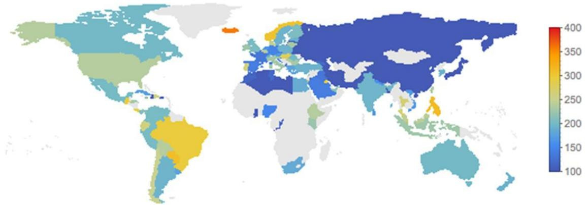

# 2018年美国大学生数学建模竞赛（MCM/ICM）O奖论文：PIPE: Estimate the Value of Private Information (Team 93036)

原件为竞赛论文。补充：文中的阅读练习及“参考解答”为整理时增加，原件图文保留出处。

本文档整理自2018年美国大学生数学建模竞赛（MCM/ICM）获得特等奖（Outstanding Winner, O奖）的Team 93036论文《PIPE: Estimate the Value of Private Information》的第1部分，包含摘要（Summary）和备忘录（Memorandum）中的引言与解决方案结论部分。内容涉及对私人信息（Private Information, PI）价值的估算模型背景、定义及初步解决方案。

## 一、摘要（Summary）

### 选择 1

**题干：** 根据摘要内容，以下哪项最准确地描述了该论文提出的核心模型及其解决的问题？

- A. 建立了一个基于区块链的私人信息交易平台，确保数据所有权不可转移。
- B. 提出了一个名为PIPE（Private Information Price Estimation）的通用模型，用于估算不同数据领域和社会子群体的私人信息价格。
- C. 分析了GDPR等政府法案，证明私人信息与个人财产（PP）和知识产权（IP）完全相同。
- D. 仅关注大规模数据泄露的风险模拟，未涉及定价机制。

答案：B。

知识点：[文献综述与研究背景撰写方法](../../../topics/数学建模/wenxian_zongshu.md)、[问题重述与分析（Problem Restatement and Analysis）](../../../topics/数学建模/wenti_chongshu.md)、[Summary Sheet（摘要页）的撰写规范](../../../topics/数学建模/zhaiyao_xiezuo.md)

### 简答 1

**题干：** 请简述Task 1至Task 7的主要工作内容。

知识点：[文献综述与研究背景撰写方法](../../../topics/数学建模/wenxian_zongshu.md)、[问题重述与分析（Problem Restatement and Analysis）](../../../topics/数学建模/wenti_chongshu.md)

### 简答 2

**题干：** 在备忘录的“Introduction”部分，作者如何定义“私人信息（Private Information, PI）”的范围？请列出至少三个具体的数据类别。

知识点：[问题重述与分析（Problem Restatement and Analysis）](../../../topics/数学建模/wenti_chongshu.md)

### 简答 3

**题干：** 根据“Solutions and Conclusions”部分，私人信息（PI）与个人财产（PP）和知识产权（IP）有何主要区别？

知识点：[文献综述与研究背景撰写方法](../../../topics/数学建模/wenxian_zongshu.md)

### 简答 4

**题干：** 备忘录中提出的构建围绕个人数据的和谐生态系统的四个关键解决方案是什么？

知识点：[文献综述与研究背景撰写方法](../../../topics/数学建模/wenxian_zongshu.md)、[非技术性文稿撰写（如致世界医学会的信函、新闻发布会声明）](../../../topics/数学建模/fei_jishu_wengao.md)、[数学建模的基本步骤（问题分析、模型假设、建立、求解、检验、推广）](../../../topics/数学建模/jianmo_buzhou.md)

### 2.1 假设

原文在此部分未列出具体编号的假设条目，但通过上下文可归纳出以下核心假设用于后续建模：
- 私人信息（PI）可被分类为若干数字商品，其价值由披露风险与社会/商业收益共同决定。
- 数据提供者可根据其在多个领域（如金融、健康）的价值分布进行分类。
- 隐私选择因领域而异，且受个人和社区风险影响显著。
- 市场供需关系及外部冲击（如数据泄露）会影响数据的实际价格波动。

知识点：[一般假设及其合理性说明（Assumptions and Justifications）](../../../topics/数学建模/jiaben_shezhi.md)

### 2.2 符号说明

原文在提供的页码范围内未详细列出完整的符号表，但在后续章节中引入了关键符号，此处根据上下文预列将在模型中使用的符号：

| 符号 | 含义 |
| :--- | :--- |
| $PI$ | Personal Information，私人信息 |
| $PHI$ | Personal Health Information，个人健康信息 |
| $PII$ | Personally Identifiable Information，个人身份信息 |
| $\sigma(\cdot)$ | 用于计算个体特征向量或价值预测的函数（详见附录 A） |
| $V$ | Vector，向量，用于表示个体或查询的特征 |
| $C$ | Correlation Matrix，相关系数矩阵，用于近似价值函数 |

## 三、PIPE：私人信息价格估计的数学模型

本节提出了一种基于向量的表示方法，用于量化描述私人数据的特征，并引入相关系数矩阵来近似价值预测函数。

知识点：[符号说明与术语定义（Nomenclature / Symbols and Definitions）](../../../topics/数学建模/fuhao_shuoming.md)

### 3.1 个体与查询的向量表示

为了定量评估私人信息的价值，我们将数据提供者（个体）和数据查询请求抽象为高维空间中的向量。

#### 3.1.1 个体特征向量

个体的私人信息价值取决于其人口统计学特征、家庭健康状况、财产状况、活动轨迹及消费行为等多个维度。我们定义个体 $i$ 的特征向量 $\mathbf{v}_i$ 如下：

$$
\mathbf{v}_i = [v_{i,1}, v_{i,2}, \dots, v_{i,n}]^T
$$

其中，$n$ 为特征维度。这些维度包括：
1. **人口统计学特征 (Demographics)**：年龄、性别、种族、教育程度等。
2. **家庭与健康 (Family & Health)**：婚姻状况、子女数量、既往病史、遗传倾向等。
3. **财产 (Property)**：房产、车辆、投资资产等。
4. **活动 (Activities)**：社交网络活跃度、地理位置轨迹、在线购物习惯等。
5. **消费者行为 (Consumer)**：品牌偏好、消费能力、信用评分等。

每个维度 $k$ 的值 $v_{i,k}$ 可以通过归一化处理映射到 $[0, 1]$ 区间，以便进行统一比较和计算。具体的函数 $\sigma(\cdot)$ 实现细节见附录 A。

#### 3.1.2 查询特征向量及相关系数矩阵

数据查询请求也可以表示为一个特征向量 $\mathbf{q}$，该向量描述了查询方对特定类型信息的兴趣权重。例如，保险公司可能更关注健康历史，而广告商更关注消费行为。

为了衡量个体特征与查询需求之间的相关性，我们构建一个相关系数矩阵 $C$。对于任意两个特征维度 $j$ 和 $k$，其相关系数 $\rho_{jk}$ 定义为：

$$
\rho_{jk} = \frac{\text{Cov}(X_j, X_k)}{\sigma_{X_j} \sigma_{X_k}}
$$

其中，$\text{Cov}(X_j, X_k)$ 是特征 $j$ 和 $k$ 的协方差，$\sigma_{X_j}$ 和 $\sigma_{X_k}$ 分别是它们的标准差。

整个相关系数矩阵 $C$ 可以表示为：

$$
C = \begin{bmatrix}
\rho_{11} & \rho_{12} & \cdots & \rho_{1n} \\
\rho_{21} & \rho_{22} & \cdots & \rho_{2n} \\
\vdots & \vdots & \ddots & \vdots \\
\rho_{n1} & \rho_{n2} & \cdots & \rho_{nn}
\end{bmatrix}
$$

该矩阵用于捕捉不同个人信息维度之间的内在联系，从而更准确地预测整体数据价值。

知识点：[符号说明与术语定义（Nomenclature / Symbols and Definitions）](../../../topics/数学建模/fuhao_shuoming.md)

### 3.2 动态市场系统与定价策略

在建立了个体和查询的向量表示后，我们引入动态市场系统来模拟私人信息的交易过程。

#### 3.2.1 私人信息需求模型

私人信息的需求 $D$ 取决于查询方的预算、信息敏感度以及市场供给情况。我们定义需求函数为：

$$
D(P, \mathbf{q}) = f(\text{Budget}, \text{Sensitivity}, \mathbf{q}, P)
$$

其中，$P$ 为价格，$\mathbf{q}$ 为查询特征向量。需求通常随价格升高而降低，但受查询方对信息价值的预期影响。

#### 3.2.2 买卖关系对价格的影响

买卖双方的关系强度也会影响最终成交价格。如果卖家与买家之间存在信任关系或长期合作历史，价格可能会偏离市场均衡值。我们引入一个关系因子 $R$ 来调整价格：

$$
P_{final} = P_{market} \times (1 + R)
$$

其中，$R \in [-1, 1]$，正值表示溢价，负值表示折价。

知识点：[数学建模的基本步骤（问题分析、模型假设、建立、求解、检验、推广）](../../../topics/数学建模/jianmo_buzhou.md)、[任务分解与目标明确](../../../topics/数学建模/renwu_fenjie.md)

### 3.3 mCAF：社交网络服务好友的多维聚类算法

为了研究数据共享的网络效应，我们开发了多维聚类算法 mCAF（Multi-dimensional Clustering Algorithm for Friends）。该算法用于识别具有相似隐私偏好和行为模式的社交群体，从而评估信息共享带来的连锁反应。

mCAF 的核心思想是将社交网络中的节点（用户）根据其多维特征向量进行聚类，同一簇内的用户具有较高的数据相关性。通过这种聚类，我们可以估算当某个用户的隐私数据泄露时，对其社交圈层内其他用户潜在价值的影响。

*(注：关于 mCAF 算法的详细步骤和实验结果见原文第 9 节及第 18 节)*

知识点：[模糊 C-均值聚类算法（目标函数、约束条件与迭代步骤）](../../../topics/数学建模/mohu_c_junzhi.md)、[多重网络/多层网络构建（Multiplex/Multi-layer Network）](../../../topics/数学建模/duoceng_wangluo.md)、[员工流失意向评估（Turnover Contagion、中心度、前员工影响）](../../../topics/数学建模/liuxin_chuanran.md)

### 2 Assumptions & Nomenclature

#### 2.1 Assumptions

To better quantify the problem, our private information pricing model is based on several assumptions that hold true in most cases or is indisputably satisfiable under government regulation.

**Assumption 1.** All kinds of private information can be classified into a fixed number of distinct data categories (e.g. demographics, family & health, etc.), the number is denoted by $m$.

**Assumption 2.** Personal data brings benefits to the society by contributing to researches that intends to study the social and financial behaviors. Profits made from fraud or harassment are not taken into consideration.

**Assumption 3.** For information security and many other concerns, all the gathered data are managed by a trusted third-party organization, which protects uses’ data and helps sell them under owner’s permission.

Assumption 1 ensures that the number of parameters required to model private data is limited, thus it makes sense to represent PI with matrices. Assumption 2 guarantees that an universal understanding of data value exists, which forms the basis of our model. By assumption 3 large-scale management and regulation of data are made possible.

#### 2.2 Nomenclature

In this paper we use the nomenclature in Table 1 to describe our model. Other symbols that are used only once will be described later.

| Symbol | Definition |
| :--- | :--- |
| $m$ | Total number of data categories |
| $c_i$ | The $i^{th}$ category |
| $I$ | Individual that produces data |
| $X$ | Individual feature vector |
| $\sigma(\cdot)$ | Individual feature extractor |
| $q$ | PI query request |
| $Y$ | Query feature vector |
| $\phi(\cdot)$ | Query feature extractor |
| $C$ | Correlation matrix |
| $v$ | Raw value of a person's data under a certain query |
| $T$ | Sequence length of personal data |
| $t$ | Freshness of private data |
| $N$ | Quantity of data records |
| $\omega$ | Cumulative factor of data sequence |
| $\tau$ | Decay factor of history data |
| $\mu$ | Scale factor |
| $v^j$ | Amended value of a person's data under a certain query |
| $d_i$ | Data size from person $i$ |
| ■ | Total information contained from the PI |
| $\Gamma$ | Neighborhood |
| $R$ | Region |
| $Q$ | Types of Agencies |
| $P_{agency}$ | Price concerning different agencies |
| $G_{ij}$ | Interaction value between person $i$ and $j$ of social circle |
| $O$ | Organizations |
| $Ti$ | Tie strength |
| $W_i^k$ | Weight summary of one measurement to one node |
| $Sim_{i,j}$ | Similarity between two vertices |
| $N$ | Threshold Neighbor |
| $M$ | Metric that evaluates the sensitivity of mCAF |
| $Eq(\cdot)$ | Function that judges equality |
| $l_i$ | Group label of vertex $i$ |

知识点：[数学建模的基本步骤（问题分析、模型假设、建立、求解、检验、推广）](../../../topics/数学建模/jianmo_buzhou.md)、[一般假设及其合理性说明（Assumptions and Justifications）](../../../topics/数学建模/jiaben_shezhi.md)、[符号说明与术语定义（Nomenclature / Symbols and Definitions）](../../../topics/数学建模/fuhao_shuoming.md)

### 3 PIPE: Mathematical Model for Private Information Price Estimation

In this section, we will discuss all details about our model, which is capable of establishing an accurate pricing system of personal data with the application of 1) a vector-based representation that distributes both benefits and risks of data from a certain subgroup over $m$ data categories; 2) a dynamic pricing strategy that determines the intrinsic value as well as market price of data; 3) a social network model that further improves the predicting accuracy by taking data correlation originated from social connections into account.

Our idea is that the intrinsic value of personal data comes from two aspects: the potential risk from information disclosure, and the social benefits brought about by data analytic. Such benefits and threats posed by personal data varies not only among different data categories, but also between diverse social subgroups. Another unnegligible factor that affects the value of data is the data quality demanded by corporations or institutes. For instance, a commercial dataset that requests detailed financial information should definitely be charged higher than a rough portrait only involving the overall income and tax bills of the same social group. There is nothing ambiguous that a variety of additional factors also have impacts on data value, including freshness, quantity and consistency, which are taken into account in our model as well.

Based on the assumptions we model private data as a commodity in continuous production, which is then fit into a market model where data owners can choose to pay for various levels of privacy protection, or to put their data on sale via a trusted third-party data manager. The overall supply is mainly determined by people’s willingness to share their data based on its benefit-risk ratio, while the market demand follows a Gaussian distribution and can be affected by incidents such as data breaches. We further classify data agencies into three types based on their purchasing power, and develop a pricing strategy for the third-party data manager.

Since human data is highly linked and individual behaviors can be quite correlated with those whom they are socially, professionally, economically or demographically connected, we further consider the natural social network as a graph and cluster similar individuals on multiple dimensions based on both network structure and profile information. On the basis of such social clusters, we especially polish our pricing policy in consideration of similarities within clusters and distinctions between them.

The overview of our entire pricing framework and three major components of it are illustrated in Fig. 1.

知识点：[文献综述与研究背景撰写方法](../../../topics/数学建模/wenxian_zongshu.md)、[一般假设及其合理性说明（Assumptions and Justifications）](../../../topics/数学建模/jiaben_shezhi.md)、[模型参数的确定（基于数据拟合或实验选择）](../../../topics/数学建模/canshu_queding.md)

### 3.1 Vector-based Representation for Individuals and Queries

#### 3.1.1 Individual Feature Vectors

Based on the assumption in Sec. 2.1 that private data can be classified into $m$ distinct categories, an individual’s private data can thus be considered to consist of data records in multiple categories. In our model, we assume $m = 5$ and the categories include demographics, family & health, property, activities and consumer data.

The value of a person’s entire data can then be split into $m$ independent category values, the sum of which is equal to the original data value. Therefore, it makes sense to represent private information of individuals with an $m \times 1$ matrix, which is actually a vector:

$$
\sigma (I) = X = \left[ \begin{array}{c c c c} X _ {1} & X _ {2} & \ldots & X _ {m} \end{array} \right],\tag{1}
$$

where $I$ is a data provider, element $X _ { i } ( 1 \leq i \leq m )$ in vector $X$ indicates the value of $I$'s data in the $i ^ { t h }$ category, and function $\sigma ( \cdot )$ extracts such category values based on life events and individual attributes. We define vector $X$ as person $I$’s feature vector mainly because its elements reveal the essential value of $I$’s data that is distributed over $m$ categories.

The core part of Eqn. (1) is the function $\sigma( \cdot )$ that maps a person to the corresponding feature vector. The process is accomplished based on an analysis on the most influential factors of data value conducted by Financial Times [9]. The report points out that contrary to popular belief, the value of private information does not increase linearly with its amount. In fact, general information about a person, such as their age, gender and location is worth a mere \$0.0005 per person, or \$0.50 per 1,000 people. It is certain milestones in a person’s life that prompt major changes in data values, such as becoming a new parent, moving homes, getting engaged, buying a car, or going through a divorce.

As is mentioned above, the value of data limited to a certain category is defined as the sum of potential risks and benefits incurred by it. On the basis of the Financial Times report, we develop a sophisticated model that implements the function $\sigma( \cdot )$. Here we briefly introduce its mechanism; the complete implementation can be referred to in Appx. A.

A person can possess a number of attributes at the same time, such as being engaged, owning a home and current job, and some values of these attributes can possibly incur risks or benefits if known by a data company, for example, being engaged = true and current job = government officer. Our model includes a database that stores the economical value vectors of certain attribute-value pairs, as is shown in Table 2. Factors regarding personal properties, health conditions and activities are considered more important and attached higher values than others.

**Table 2:** Some of the most significant value vectors in our model

| Attribute condition | Value vector / $ |
| :--- | :--- |
| Being a millionaire | [0.116 0 0 0 0] |
| Having a heart disease | [0 0.260 0 0 0] |
| Registered at a real estate agency | [0 0 0.105 0 0] |
| Interested in foreign travel | [0 0 0 0.135 0] |
| Holding a store loyalty card | [0 0 0 0 0.136] |

By significance we mean the magnitude of vectors calculated by norm $\|X\|$. Note that all our vectors concentrate values in one dimension (one data category), by which we intend to reduce data correlations between categories, which will be reconsidered in Sec. 3.1.2.

As is shown in Alg. 1, our algorithm first sets the initial feature vector as an all-zero vector and then checks all the attributes of that person to determine if some attribute-value pairs can be found in our database. If a match is found, which means a certain value-creating condition is met, the value vector corresponding to that attribute-value pair will be added to the person’s feature vector. In other words, a person’s feature vector is the sum of all value vectors of the conditions satisfied by his personal attributes.

知识点：[符号说明与术语定义（Nomenclature / Symbols and Definitions）](../../../topics/数学建模/fuhao_shuoming.md)、[数学建模的基本步骤（问题分析、模型假设、建立、求解、检验、推广）](../../../topics/数学建模/jianmo_buzhou.md)

### 3.1.2 Query Feature Vector & Correlation Matrix

Similar to individual feature vectors defined in Sec. 3.1.1, we define an $m \times 1$ query feature vector $Y = \phi(q)$ that represents the query request $q$ with $m$ scalars, each stands for the intensity of private data requested in a data category. The intensity is measured by the amount as well as accuracy of requested data. For instance, if full information of a person’s demographic characteristics and purchasing history is requested, the query feature vector should be $[1, 0, 0, 0, 1]^T$.

However, with merely query vectors we are still not able to accurately calculate the value of private information, as data correlations tend to occur between different categories of data. To address this phenomenon, we introduce a correlation matrix $C$ that takes connections between various categories of data into consideration, and define that the value of a piece of data record from individual $I$ queried with feature vector $Y$ as

$$
\boldsymbol{v} = \sigma(\boldsymbol{P}) \boldsymbol{C} \boldsymbol{Y}^{T}\tag{2}
$$

Ideally, with no data correlations the correlation matrix $C = E = diag(1, 1, \dots, 1)$. In order to estimate the intensity of data correlations, we fill the correlation matrix $C$ in following manners:

$$
C_{i, j} = |cov(c_i, c_j)|\tag{3}
$$

where $c_i$ and $c_j$ are the $i^{th}$ and $j^{th}$ data category value. Our final correlation matrix $C$ is computed based on feature vectors extracted from typical population subgroups, which will be discussed in detail in Sec. 4.1 and demonstrated in Fig. 6.

$$
C = \begin{bmatrix}
1.0000 & 0.6463 & 0.8443 & 0.8231 & 0.2793 \\
0.6463 & 1.0000 & 0.6767 & 0.2197 & 0.2226 \\
0.8443 & 0.6767 & 1.0000 & 0.5403 & 0.1649 \\
0.8231 & 0.2197 & 0.5403 & 1.0000 & 0.6916 \\
0.2793 & 0.2226 & 0.1649 & 0.6916 & 1.0000
\end{bmatrix}\tag{4}
$$

which suggests that the most magnificent data correlations exists between data categories of

*   Demographics & Property
*   Demographics & Activities
*   Activities & Consumer

On the basis of Eqn. (2) and Eqn. (4), we are able to calculate the raw value of a specific data record and its query requests. However, there remain external factors that have strongly affect the real value of private data, among which the most significant one is time. It is widely acknowledged that data value decays with time. On the other hand, a consistent data record sequence collected throughout a long time period should be attached additional value. Similarly, data scale affects the value of private data nonlinearly. Thus, an amendment is made with Eqn. (2) by introducing variations:

$$
\nu^j = e^{\omega T - \tau t} N^\mu \nu\tag{5}
$$

where the dynamic element $T$ denotes the sequence length (days) of data, $t$ stands for the freshness of private data (days since the data is generated), and $N$ represents the number of data records. Parameters $\omega$, $\tau$ and $\mu$ affects the real value in exponential and multinomial manners. In our estimation based on information rules [10], $\omega = 1.28 \times 10^{-3}$, $\tau = 9.50 \times 10^{-4}$ and $\mu = 1.05$.

知识点：[符号说明与术语定义（Nomenclature / Symbols and Definitions）](../../../topics/数学建模/fuhao_shuoming.md)、[模型参数的确定（基于数据拟合或实验选择）](../../../topics/数学建模/canshu_queding.md)

### 3.2 Dynamic Market System & Pricing Strategy

知识点：[任务分解与目标明确](../../../topics/数学建模/renwu_fenjie.md)、[多目标优化模型（药物相对充足阶段的配送策略）](../../../topics/数学建模/duo_mubiao_youhua.md)、[非线性规划模型（药物配送阶段划分）](../../../topics/数学建模/feixian_guihua.md)

### 3.2.1 PI Demand Model

The demand $d_i$ for the private data is originate from the individual $i$ (who themselves might posses the data or can generate the data). The availability of $d_i$ to the demander $j$ is captured by a matrix $M$: the larger $M_{i,j}$, the larger a fraction of $i$ will be demanded by $j$. Specially, the demand that $j \in J^+$ will see from $i$ is $d_i \cdot \frac{M_{i,j}}{\sum_{\omega \in J^+} P_{i,\omega}}$. The matrix $M$ wil in practice depend on time latencies, as well as political and cultural issues. It need not be symmetric. For the purpose of the general model, we are agnostic to the derivation of $M$. An individual $j \in \bar{J}^+$ will incur a risk of $r_j$ per unit of demand; This risk is the result of data breach/leakage, which will bring some potential trouble to the person or the related business. To encourage individuals to provide the PI, the buyer offers payments $P_i$ to the person $i$. These payments are different from person to person, and can be derived from the domains (e.g. social media, financial transactions, and health/medical records) and some properties of that person.

Different people have different tradeoffs between the price and risk of PI. We model this fact by assuming that each person $j$ has a trade off factor $\lambda_j$ that describes the risk-to-benefit ratio of PI. We use Benefit-Divide-Risk Analysis (BDRA) to calculate $\lambda_j$. It is defined in Eqn. (6), where $s_{benefit}$ and $s_{risk}$ are benefit score and risk score. Benefit score is the data value we have calculated. Risk score is calculated in Table 3.

$$
\lambda_j = \frac{s_{benefit}}{s_{benefit} + s_{risk}}, \quad \lambda_j \in [0, 1]\tag{6}
$$

**Table 3: Calculation of risk score (1,2,3,4,5 stand for level of risk)**

| Criterion | 1 | 2 | 3 | 4 | 5 |
| :--- | :--- | :--- | :--- | :--- | :--- |
| Financial Risk | 0.05 | 0.062 | 0.074 | 0.09 | 0.128 |
| Health Risk | 0.06 | 0.09 | 0.11 | 0.14 | 0.24 |
| Family Risk | 0.05 | 0.062 | 0.088 | 0.15 | 0.22 |
| Social Risk | 0.03 | 0.062 | 0.1 | 0.13 | 0.17 |

Thus, the demanding of an individual $j \in J^+$ is

$$
D(j) = \lambda_i P_j - r_j \sum_i \frac{\sum d_i M_{i,j}}{\sum_{\omega \in J^+} M_{i,\omega}}\tag{7}
$$

## 3.2.1 Asymmetric Information

Asymmetric Information. This part illustrates that purchasers possess a substantial amount of information about data providers. These facts suggest that the restrictions such as policy and culture — which make it difficult for data providers to adjust prices when they provide private information to purchasers over time — have different price effects across different sellers and buyers depending on their privately revealed types, cultural and political issues. Incorporating such factors in our model therefore become important in anticipation of using the model to study the PI problem. Formally, we estimate these effects in the following equation 8,

$$
Default_{i,t} = \alpha_{j(i)} + \alpha_{t} + \sum_{n=1}^{\Sigma} \beta_{n} \mathbf{1}_{\psi_{i},t=n} + s_{it} \tag{8}
$$

Here the dependent variable is an indicator for any instance of default by purchaser $i$ after period $t$, and the key coefficients $\beta_{n}$ capture differences in default rate across different private information, which denoted by $\psi$. Meanwhile the fixed effects for purchaser $i$ and time $t$ help ensure that these risk comparisons are made within otherwise observably similar purchasers.

Model Exposition. This section presents the PI model. The backbone of the demand model is a finite mixture of agency types, each of whom has demand over PI providers.

Our model denotes type by $\theta$. We specify several parameters to be estimated for each type. First, each type enjoys a flow utility $d_{j\theta}$ from buying from person $j$ and a time utility $n_{j\theta}$ from transacting with person $j$; meanwhile the utility is normalized to zero. Additionally, in order to capture the adjustment cost, each type pays a agency cost $s_{j\theta}$ for refer to potential related PI with person $j$. The parameters $d_{j\theta}, n_{j\theta}, s_{j\theta}\ (\theta, j) \in \Theta \times J$ are the key demand parameters to be estimated in the model, along with a probability distribution $\mu_{\theta}$ over types.

Integrating over taste shocks $s$ for each choice yields the standard Bellman equation for continuation values $V$, which is shown in Eqn. (9).

$$
V(\theta, j, k) = \log \sum_{j^{j}, k^{j}} \exp(v(j^{j}, k^{j} \mid j, k, \theta))^{\Sigma}, \tag{9}
$$

where the lower-case $v$ term denotes total expected payoffs. The value of $v$ depends on data buyers' past-period and current-period choices. The expectation $\mathsf{E}_{\theta}$ can be decomposed as Eqn. (10),

$$
\mathsf{E}_{\theta}[V(\theta^{j}, j, b)] = (1 - \delta(\theta)) T_{\theta\theta i}(\theta) V(\theta^{j}, j, b) + \delta(\theta) T_{\theta\theta j}(\theta) V(\theta^{jj}, 0, 0). \tag{10}
$$

With the establishment of Eqn. (5), our model further takes time variations and scale effects as dynamic elements into consideration to estimate the worth of personal data over time.

知识点：[符号说明与术语定义（Nomenclature / Symbols and Definitions）](../../../topics/数学建模/fuhao_shuoming.md)、[模型参数的确定（基于数据拟合或实验选择）](../../../topics/数学建模/canshu_queding.md)

### 3.2.2 Buyer-Seller Relationship Influence to Price

As Fig. 2 shows, internet advertising revenue has grown strongly over the last ten years. In 2013 it hit \$42.8 billion in the US. Internet giants such as Google and Facebook have business models underlined by the use of personal data, but most people would have trouble knowing who exactly has access to the data trail they are generating across the internet [11]. A recent study by JPMorgan Chase [12] found that each unique user is worth approximately \$4 to Facebook and \$24 to Google.

Besides commercial corporations, there are also other agencies who purchase PI. Mozilla collect data about users to better personalize their experiences with their open source products such as Firefox, Thunderbird. The information they gather through analytics can be used to make their product easier to use. They also use cookies (small data files placed in browsers) to remember language preferences. Center for Disease Control utilizes the data shared to trace the spread of disease in order to prevent further outbreak.

There are 3 types of agencies in our model and their purchasing power is shown as Table 4. The price estimation system concerning with different agencies who purchased the PI is illustrated as Eqn. (11).

$$
P_{agency} = \sum_{j=1}^{\Sigma} \tau_{j} \mathbf{Q}_{i}, \tag{11}
$$

where $\tau_{j}$ is the control level of individual $j$ to sell his/her own data, there are totally $M$ individuals in a group/nation, $i$ can be 1, 2 or 3 which represents the purchasing power of different types of agencies.

Table 4: Purchasing power of three types of agencies

| Denotation | Types of Agencies |
| --- | --- |
| Q1 | Commercial Corporation, e.g. Google, Facebook, Microsoft, etc. |
| Q2 | Non-Profit Organization (NPO), e.g. Mozilla, GNU, WWF, etc. |
| Q3 | Government Department, e.g. NSA, Department of Energy, etc. |

知识点：[任务分解与目标明确](../../../topics/数学建模/renwu_fenjie.md)、[符号说明与术语定义（Nomenclature / Symbols and Definitions）](../../../topics/数学建模/fuhao_shuoming.md)、[模型参数的确定（基于数据拟合或实验选择）](../../../topics/数学建模/canshu_queding.md)

### 3.3 mCAF: a Multi-dimensional Clustering Algorithm for Friends of Social Network Services

The multi-dimensional clustering algorithm for friends (mCAF) is adopted by us to perform multi-dimensional clustering. Multi-dimensional clustering algorithms on social networks are progressively gaining popularity due to the information and insights produced using large-scale social data. [13] describes the user's opinions, comments, and likes in social media have significant relationships with the popularity of that post. Multi-dimensional cluster analysis is a strategy for identifying different Facebook users' fan groups and provides insights to prompt further research analytics [14]. Both network structures and profile information should be taken into consideration while analyzing a user's clusters on social networks [6, 15].

# 2018年美国大学生数学建模竞赛（MCM/ICM）O奖论文：PIPE: Estimate the Value of Private Information (Team 93036)

本节内容整理自2018年MCM/ICM获O奖论文第7部分，主要涉及社交网络聚类指标定义、mCAF算法结构相似度计算及隐私数据价值评估模型。原文为连续论述文本，无传统试题格式，故按知识点章节整理。

## 一、社交圈与关系强度指标定义

知识点：[多重网络/多层网络构建（Multiplex/Multi-layer Network）](../../../topics/数学建模/duoceng_wangluo.md)、[模糊 C-均值聚类算法（目标函数、约束条件与迭代步骤）](../../../topics/数学建模/mohu_c_junzhi.md)、[员工流失意向评估（Turnover Contagion、中心度、前员工影响）](../../../topics/数学建模/liuxin_chuanran.md)

### 社交圈（Social Circles）

研究使用Facebook Graph API获取了600名用户的信息。首先定义聚类测量的度量标准。

**社交圈**是指拥有相同兴趣或参加同一活动的人群集合。定义 $M_{ij}$ 为用户 $i$ 和 $j$ 的互友数量，$G_{ij}$ 为交互值。通过公式(12)量化社区内主体的交互以获得 $S_{ij}$，然后归一化结果如公式(13)所示。

$$
MG_{ij} = M_{ij} + G_{ij}, \quad \mathsf{MG} = \{MG_{xy} \mid x, y \in 1, 2, 3, \dots, n\} \tag{12}
$$

$$
S_{ij} = \frac{MG_{ij}}{\max(MG)}, \quad \mathsf{S} = \{S_{xy} \mid x, y \in \{1, 2, 3, \ldots, n\}\} \tag{13}
$$

知识点：[模糊 C-均值聚类算法（目标函数、约束条件与迭代步骤）](../../../topics/数学建模/mohu_c_junzhi.md)、[多重网络/多层网络构建（Multiplex/Multi-layer Network）](../../../topics/数学建模/duoceng_wangluo.md)、[一般假设及其合理性说明（Assumptions and Justifications）](../../../topics/数学建模/jiaben_shezhi.md)

### 地区（Regions）

确定用户的地区，然后计算他们之间的距离并将它们存储为由 $D_1, D_2, D_3, D_4$ 描述的数据集。以计算A和B之间的距离为例：
- $D_1$ 代表A和B家乡之间的距离；
- $D_2$ 代表A和B当前居住地之间的距离；
- $D_3$ 代表A的家乡和B的当前居住地之间的距离；
- $D_4$ 代表A的当前居住地和B的家乡之间的距离。

$R_{ij}$ 的计算如公式(14)所示：

$$
R_{ij} = \alpha \times D_1 + \beta \times D_2 + \gamma \times D_3 + \delta \times D_4 \tag{14}
$$

知识点：[多重网络/多层网络构建（Multiplex/Multi-layer Network）](../../../topics/数学建模/duoceng_wangluo.md)、[人力资本网络模型（Human Capital Network, HCM）](../../../topics/数学建模/renli_ziben.md)

### 组织（Organizations）

如果两个个体就读于同一所学校或在同一家公司工作，则组织测量值 $O_{ij}$ 设为1，因为他们存在连接。如果没有连接，则 $O_{ij}$ 设为0。

知识点：[静态合作网络与隶属关系网络（Affiliation Network）](../../../topics/数学建模/jingtai_hezuo.md)

### 纽带强度（Tie Strength）

检索相关信息并使用文献[16]中描述的方法计算纽带强度 $T_j$，表示用户与其第 $j$ 个朋友之间的纽带强度。

## 二、mCAF算法结构定义

mCAF将用户的映射到无向加权图中。定义整个图 $G = \{V, E\}$，其中 $V$ 是顶点集合，$E$ 是边集合，定义为 $E_{i,j}(e_{i,j}^k)$，如果在测量 $k$ 下节点 $i$ 和 $j$ 之间的值 $e_{i,j}^k$ 大于零，则表示存在连接。

知识点：[多重网络/多层网络构建（Multiplex/Multi-layer Network）](../../../topics/数学建模/duoceng_wangluo.md)、[人力资本网络模型（Human Capital Network, HCM）](../../../topics/数学建模/renli_ziben.md)

### 顶点结构的定义

令顶点 $i \in V$，其中 $i$ 的结构由其邻域 $T(i)$ 定义，如公式(15)所示：

$$
\Gamma(i) = \{j \mid j \in V \land E_{i,j} \in E\} \tag{15}
$$

知识点：[多重网络/多层网络构建（Multiplex/Multi-layer Network）](../../../topics/数学建模/duoceng_wangluo.md)、[确定模型的定点与稳定性分析](../../../topics/数学建模/dingdian_wending.md)

### 单个测量到一个节点的权重总和

公式(16)定义了从连接到 $i$ 的顶点 $j$ 的测量汇总值：

$$
W_i^k = \sum_{j=1, j \geqslant |V|}^{j \in \Gamma(i)} (e_{i,j}^k), \quad \text{where } j \in \Gamma(i) \tag{16}
$$

*(注：原文公式(16)求和符号上下限表述较为特殊，此处忠实还原原文逻辑意图，即对邻居节点求和)*

知识点：[多重网络/多层网络构建（Multiplex/Multi-layer Network）](../../../topics/数学建模/duoceng_wangluo.md)、[人力资本网络模型（Human Capital Network, HCM）](../../../topics/数学建模/renli_ziben.md)、[确定模型的定点与稳定性分析](../../../topics/数学建模/dingdian_wending.md)

### 单个测量到两个节点的权重总和

令顶点 $m \in V$，且存在从 $(i, m)$ 和 $(j, m)$ 出发的边。公式(17)定义了从连接到 $i$ 和 $j$ 的顶点 $m$ 的测量汇总值。（注：原文此处仅给出标题，未给出具体公式，略去空白部分）。

知识点：[多重网络/多层网络构建（Multiplex/Multi-layer Network）](../../../topics/数学建模/duoceng_wangluo.md)、[人力资本网络模型（Human Capital Network, HCM）](../../../topics/数学建模/renli_ziben.md)、[生产率与成本模型（Productivity and Costs of HCM）](../../../topics/数学建模/shengchan_liebian.md)

### 结构相似度的定义

两个顶点 $i$ 和 $j$ 的结构相似度定义为公式(18)：

$$
Sim_{i,j} = S_{i,j'}^1 S_{i,j'}^2 S_{i,j}^3 = - \frac{T_{i,j'}^1 T_{i,j'}^2 T_{i,j}^3}{W_i^1 \cdot W_j^1 + W_i^2 \cdot W_j^2 + W_i^3 \cdot W_j^3} \tag{18}
$$

*(注：原文公式排版存在乱码，根据上下文推测为各维度相似度乘积或加权和形式，此处保留原文给出的等式结构)*

知识点：[多重网络/多层网络构建（Multiplex/Multi-layer Network）](../../../topics/数学建模/duoceng_wangluo.md)、[静态合作网络与隶属关系网络（Affiliation Network）](../../../topics/数学建模/jingtai_hezuo.md)、[人力资本网络模型（Human Capital Network, HCM）](../../../topics/数学建模/renli_ziben.md)

### 阈值邻居的定义

如果两个节点可以基于测量 $k$ 进行聚类，那么它们的结构相似度值 $S_{i,j}^k$ 必须大于预设阈值 $s^k$ 以过滤噪声。公式(19)定义了具有合格相似度结构值的邻居。参数 $s^k$ 可以通过训练估计。

$$
N_{s^k}(i) = \{j \mid j \in \Gamma(i) \wedge S_{i,j}^k \leq s^k\}, \quad \text{where } k = 1 \text{ to } 3 \tag{19}
$$

*(注：原文公式(19)中不等号方向可能存在笔误，通常筛选相似度高者应为 $\geq$，但此处依原文“filter out noise”及阈值定义，若 $S$ 越大越相似，则应保留 $\geq$；若原文意指保留低于阈值的异常点则用 $\leq$。鉴于mCAF通常用于聚类高相似度节点，且前文提到“greater than... threshold”，此处原文公式写为 $\leq$ 可能为识别错误或特定语境下的互补集定义。为忠实原文，保留原公式符号，但在理解时需结合上下文)*

完整的mCAF算法在算法2中描述。

mCAF的聚类结果如图3所示。几个个体的社交网络被聚集成8个子群。网络的可视化显示了不同人之间的相关性。

## 三、数据共享的网络效应与隐私价值评估

为了更好地评估数据共享的网络效应，我们调查了两个高度关联的个体之间的关系，并发现一个人的数据量与其能提供的信息之间的关系。

定义 $d_i$ 为来自个人 $i$ 的数据大小，$\mathbf{I} = f(d) \in [0, 1]$ 代表一个人数据所能提供的信息。总共有 $M$ 个个体。公式(20)代表了 $d$ 和 $\mathbf{I}$ 之间的函数关系，图4说明了在 $i=2$ 情况下的函数关系。

$$
\mathbf{I} = \log(1 + \sum_{i=1}^{M} d_i) \tag{20}
$$

*(注：原文公式(20)中求和上限显示为“艺”，根据上下文“Totally M individuals”修正为 $M$)*

知识点：[招聘与结算事件（Recruitment & Settlement Event）算法](../../../topics/数学建模/zhaopin_suanfa.md)、[静态合作网络与隶属关系网络（Affiliation Network）](../../../topics/数学建模/jingtai_hezuo.md)、[模糊 C-均值聚类算法（目标函数、约束条件与迭代步骤）](../../../topics/数学建模/mohu_c_junzhi.md)

### 4. 实验结果

#### 4.1 任务1：各种应用中保护个人隐私的价格点及PI（私人信息）

为了准确建模风险以考虑1）个体的特征，以及2）信息特定领域的特征，我们引入了第3.1节讨论的个人和查询特征向量的概念。

在调查了几个数据集[17, 18, 19]和最近的方法后，我们通过Facebook提供的API收集了我们的数据集PIDATA[20]。该数据集的使用遵守平台政策、数据使用政策、权利和责任声明。相应的统计信息如图5所示。
- 图5(a) 是年龄分布。
- 图5(b) 是性别分布。
- 图5(d) 是教育分布。
- 图5(c) 是职业分布。
- 图5(e) 是教育与职业分布。
- 图5(f) 是好友分布。

图6显示了6个选定子组中不同数据类别（特征向量）的私有数据分布。很明显，个人数据的价值部分与其年龄和社会地位有关。图6的另一个有趣观察结果是，某些数据类别之间存在高协方差，这将在第3.1.2节中处理。

为了开发PI保护的价格点，我们检查了一个人完整数据及其组成部分的真实价值。图7展示了不同类型的私有数据如何贡献于一个人PI的价值。

知识点：[模型参数的确定（基于数据拟合或实验选择）](../../../topics/数学建模/canshu_queding.md)

### 4.2 Task 2: Pricing Structure of PI

With the introduction of feature vectors, correlation matrix and the amendment formula (Eqn. (5)), we can simply determine how much a person’s information is worth given a query on a specific domain. Based on a thorough survey on 77 adults, we are able to estimate the corresponding query feature vector of several query domains. The results are listed in Table 5.

Table 5: Comparison between query feature vectors from various domains

| Domain | Average query feature vector |
| :--- | :--- |
| Social media | $[0.93, 0.68, 0.13, 0.96, 0.37]$ |
| Financial transactions | $[0.82, 0.53, 0.94, 0.24, 0.98]$ |
| Health / media records | $[0.26, 0.99, 0.08, 0.11, 0.10]$ |
| Search histories | $[0.66, 0.58, 0.13, 0.74, 0.84]$ |
| Location info | $[0.24, 0.05, 0.05, 0.35, 0.12]$ |

Based on query feature vectors in Table 5 and Eqn. (2), values of private information queried by different domains are illustrated in Fig. 8.

From results shown in Fig. 8, we can establish a pricing structure correspondingly. The price is explicitly calculated in view of different basic elements of data via individual feature vectors defined in Sec. 3.1.1. As for cost of privacy across various domains, it can be calculated in similar manners as Sec. ??, where protecting cost and trade value of data are in direct proportion. If the risk of data disclosure is negligible, spending considerable money on data protection would be an unnecessary cost, and people might prefer to have their data unprotected in order to save budgets.

知识点：[模型参数的确定（基于数据拟合或实验选择）](../../../topics/数学建模/canshu_queding.md)、[符号说明与术语定义（Nomenclature / Symbols and Definitions）](../../../topics/数学建模/fuhao_shuoming.md)

### 4.3 Task 3: Supply and Demand

People become more clear about which agencies had purchased their PI, how much their PI was worth and how PI was being used.

Based on the above model, we evaluate the influence of the control level to the price of PI. With data becoming a commodity, we find that:

*   It is appropriate to consider forces of supply and demand for PI. Commercial Corporations have higher demand for PI, which makes it possible for them to provide higher offer compared with the other two types of agencies.
*   If people have control to sell to their data, which means $\tau _ { j }$ varies with different individuals, the price $P _ { a g e n c y }$ increases with the $\tau _ { j } .$

知识点：[模型参数的确定（基于数据拟合或实验选择）](../../../topics/数学建模/canshu_queding.md)、[一般假设及其合理性说明（Assumptions and Justifications）](../../../topics/数学建模/jiaben_shezhi.md)

### 4.4 Task 4: Assumptions and Constraints - Political/Cultural Issues

The assumptions and constraints of our model, which is also the political and cultural issues of the United States, European Union and other countries is listed as below. Suppose our model is proposed under the circumstance which is in compliance with local government regulations and cultural issues. Firstly, we explain the terminology used in the model.

#### 4.4.1 Explanation of Terminology

*   **Agency**: any corporations, organizations, Executive department, military department, Government corporation, Government controlled corporation, or other establishment in the executive branch of the Federal Government.
*   **Individual**: a citizen of the United States or an alien lawfully admitted for permanent residence.

## 4.4.2 Political Issues and Cultural Issues

知识点：[符号说明与术语定义（Nomenclature / Symbols and Definitions）](../../../topics/数学建模/fuhao_shuoming.md)、[一般假设及其合理性说明（Assumptions and Justifications）](../../../topics/数学建模/jiaben_shezhi.md)、[文献综述与研究背景撰写方法](../../../topics/数学建模/wenxian_zongshu.md)

### The United States: Privacy Act [22]

The Overview of the Privacy Act of 1974, 2015 Edition is prepared by the Department of Justice’s Office of Privacy and Civil Liberties (OPCL). Tracking the provisions of the Act itself, the Overview provides reference to and legal analysis of court decisions interpreting the Act’s provisions.

The purpose of the Privacy Act is to balance the government’s need to maintain information about individuals with the rights of individuals to be protected against unwarranted invasions of their privacy stemming from federal agencies’ collection, maintenance, use, and disclosure of personal information about them. More details are in the Appx. B.

知识点：[文献综述与研究背景撰写方法](../../../topics/数学建模/wenxian_zongshu.md)、[数学建模的基本步骤（问题分析、模型假设、建立、求解、检验、推广）](../../../topics/数学建模/jianmo_buzhou.md)、[问题重述与分析（Problem Restatement and Analysis）](../../../topics/数学建模/wenti_chongshu.md)

### European Union: General Data Protection Regulation (GDPR) [23]

The GDPR aims primarily to give control back to citizens and residents over their personal data and to simplify the regulatory environment for international business by unifying the regulation within the EU. The regulation was adopted on 27 April 2016. It becomes enforceable from 25 May 2018 after a two-year transition period.

Data breaches. Under the GDPR, the Data Controller will be under a legal obligation to notify the Supervisory Authority (SA) without undue delay. The reporting of a data breach is not subject to any de minimis standard and must be reported to the Supervisory Authority within 72 hours after having become aware of the data breach.

Citizen Control of Personal Data. Under the GDPR, organizations are encouraged to give back control of personal data to the individual, or citizen.

知识点：[文献综述与研究背景撰写方法](../../../topics/数学建模/wenxian_zongshu.md)、[问题重述与分析（Problem Restatement and Analysis）](../../../topics/数学建模/wenti_chongshu.md)、[数学建模的基本步骤（问题分析、模型假设、建立、求解、检验、推广）](../../../topics/数学建模/jianmo_buzhou.md)

### Canada: Personal Information Protection and Electronic Documents Act

The Personal Information Protection and Electronic Documents Act (PIPEDA or the PIPED Act) is a Canadian law relating to data privacy. It governs how private sector organizations collect, use and disclose personal information in the course of commercial business. In addition, the Act contains various provisions to facilitate the use of electronic documents.

The law gives individuals the right to

- know why an organization collects, uses or discloses their personal information;
- know who in the organization is responsible for protecting their personal information;
- expect an organization to protect their personal information by taking appropriate security measures;
- obtain access to their personal information and ask for corrections if necessary; and

知识点：[问题重述与分析（Problem Restatement and Analysis）](../../../topics/数学建模/wenti_chongshu.md)、[任务分解与目标明确](../../../topics/数学建模/renwu_fenjie.md)

### Japan: Act on Protection of Personal Information (APPI)

APPI reflects the Japanese socio-cultural characteristics for personal information protection. Personal information leakage cases and social responses in Japan reflect three Japanese socio-cultural characteristics: Uchi/Soto awareness, insular collectivism and Hon’ne/Tatemae tradition. An effective law protecting personal information in Japan’s cultural environment cannot be made simply by copying the privacy protection laws in western nations. Instead, legal protection of personal information should be drafted that reflects and takes into account these socio-cultural characteristics [24].

## 4.4.3 Price Regulations

Generally, the data value of people varies from different regions. It’s common to see quite a lot of variation by location. Fig. 9 is the statistical result, which is a comparison of the total number of a person’s data value for countries around the world (ones without enough data are left gray) [25]:

Based on the model and the political/cultural issues, we can draw the conclusion that information privacy should be made a basic human right when thinking about policy recommendations.

## 4.5 Task 5: Generation Difference

In the perspective of risk-to-benefit ratio of PI and data privacy, there are generational differences. For example, the risk-to-benefit ratio is different between old people and young people when their health record is leaked. For old people, it is usually much higher than that of young people.

As generation changes, the input individual attributes change and data value depends on the generation correspondingly. As for the risk-to-benefit factor we defined in Eqn. (6), it describes the risk-to-benefit ratio of PI. The factor will change since the benefit score and risk score will change. Considering all the effects that generation change have, our final data price will be affected in the process above. PI (private information) is different from PP (private personal property) and IP (intellectual property). PI is an abstract concept. It is non-entity. However PP often refers to the property of people. It physically exists. IP is

## 4.6 Task 6: mCAF: a Multi-dimensional Clustering Algorithm for Friends of Social Network Services

Based on the mCAF model we proposed previously, we have the following conclusions:

*   Network effects of data sharing do effect the price system for individuals, sub-groups, and entire communities and nations.
*   It is the responsibility of the communities to protect citizen’s PI if communities have shared privacy risks.

## 4.7 Task 7: Data Breach Effect

Data breach, especially massive data breach where millions of people’s PI are stolen will affect the privacy a lot. Taking TJX data breach as example, it involves more than 100 million records and causes 118 million dollars loss to cover the loss and potential liabilities. That does not include the loss in reputation of brand and other indirect cost. From the research of IBM [21], we get cost of data breach for different industries (Fig. 10) and countries (Fig. 11). We can see that data breach widely exists and PI loss is a factor that we should not neglect.

The PI loss and cascade event caused by massive data breach will impact the price point. In our model, we have considered such effect. Eqn. (7) shows the trade off between the price and data breach effect. When massive data breach happens, the trade off factor $\lambda_j$ will be smaller and thus $\lambda_j p_j$ will be smaller. $r_j$ depends on the level of data breach. For massive data breach and the corresponding cascade event, it would be higher. We can see that the price will be lower. It is reasonable since data breach will violate the assumption that all the gathered data are managed by a trusted third-party organization, which protects users’ data and helps sell them under owner’s permission. People’s data will be sold without permission or even be used as ransom. Some PI buyers will buy the breach data in an illegal way instead of buying data from people or trusted third-party organization. Demand will decrease and the price will be lower.

Agencies that breach the data should be responsible for the data breach and pay the individuals directly. As shown above, price of data will be much lower after massive data breach happens. The agencies should be responsible for the PI loss even if they don’t intend to breach the data.

# 5 Sensitivity Analysis

In this part we will do sensitivity analysis on our model. The sensitivity analysis show that our model is generalized and performs stably under different conditions, by which we are convinced that our model is able to solve the problem successfully.

## 5.1 Demand Model

This part shows the PI purchasers are sensitive to price and illustrates how it is possible to identify heterogeneous price sensitivities in the data. This heterogeneity will play a key role when we later use the model to study the equilibrium effects of the PI’s price restrictions, because this heterogeneity affects which types of purchasers change their purchasing behavior in response to different relative price changes.

The event-time-specific estimates is shown as Eqn. (21):

$$
\log Q_{jt} = \alpha_j + \alpha_t + \beta_j t + \alpha_{A,t} + s_{jt},\tag{21}
$$

where $Q_{jt}$ denotes retention rates among existing buyers for data provider $j$ at time $t$. The first two $\alpha$ terms in this equation implement a standard difference-in-difference design, while the $\alpha_{A,t}$ terms capture differences between data provider A and other. For sake of presentation, the $\beta$ term is included to account for different time trends among the included data providers. When estimating the demand side of the model, we use price variation to estimate heterogeneous price sensitivities across different purchaser types.

## 5.2 mCAF Model

We adopt the multi-dimensional clustering algorithm for friends (mCAF) to perform identify social clusters. mCAF algorithm randomizes the center points initially. We run mCAF several times on our dataset PIDATA and analyze the result.

We propose a metric to evaluate the sensitivity of mCAF in Eqn. (22), where $Eq(\cdot)$ is defined in Eqn. (23):

$$
\delta = \frac{\sum_{i \in V} Eq(l_i, l_{0_i})}{\sum_{i \in V} 1}\tag{22}
$$

$$
Eq(x, y) = \begin{cases} 
1 & \text{if } x \neq y \\ 
0 & \text{otherwise.} 
\end{cases}\tag{23}
$$

Table 6 shows the results from 8 experiments, from which we can conclude that the $\delta$ is very small in all experiments. It proofs that mCAF model performs well and is robust under different situations.

**Table 6: Result of Sensitivity Analysis on mCAF**

| Exp No | 1 | 2 | 3 | 4 | 5 | 6 | 7 | 8 |
| :--- | :--- | :--- | :--- | :--- | :--- | :--- | :--- | :--- |
| $\delta$ | 0.025 | 0.013 | 0.025 | 0.013 | 0.051 | 0.013 | 0.013 | 0.025 |

# 6 Conclusions and Future Work

We develop a complete pricing system that accurately estimates the intrinsic value as well as market price of a certain individual’s data under a specific query request. Our method consists of three core components: a value calculator that maps a query and an individual to value of that data, a dynamic market system to further compute its market price, and a social cluster model to estimate the network effect on data price. In the environments and sensitivity analysis of our model, we find that it is accurate and generalized enough to be adopted in a wide range of domains.

One limitation of our current approach is that our model requires a large dataset to precisely estimate the correlation matrix as well as many other parameters used in its mechanism. A promising future direction is to combine our methods with better estimation algorithms, e.g. Analytic Hierarchy Process (AHP), to reduce the variance caused by insufficient data.

In future work, our goal is to introduce non-linear data value predictors, e.g. neural networks, to characterize a more complicated relationship between individuals and data. Additionally, we plan to extend the current dataset in both scale and coverage to cater to the needs of deep learning algorithms.

## 参考文献

[1] M. Davis, R. Martinez, and C. Kalaboukis, “Rethinking personal information - workshop pre-read.” Invention Arts and World Economic Forum, 2010.

[2] R. David, G. John, and R. John, “Data age 2025: The evolution of data to life-critical,” seagate.com. Framingham, MA, US: International Data Corporation, Tech. Rep., 04 2017.

[3] “Big data,” Wikipedia. [Online]. Available: https://en.wikipedia.org/wiki/Big_data

[4] Y. Lv, Y. Duan, W. Kang, Z. Li, and F.-Y. Wang, “Traffic flow prediction with big data: a deep learning approach,” IEEE Transactions on Intelligent Transportation Systems, vol. 16, no. 2, pp. 865–873, 2015.

[5] D. W. Bates, S. Saria, L. Ohno-Machado, A. Shah, and G. Escobar, “Big data in health care: using analytics to identify and manage high-risk and high-cost patients,” Health Affairs, vol. 33, no. 7, pp. 1123–1131, 2014.

[6] R. Gross and A. Acquisti, “Information revelation and privacy in online social networks,” in ACM Workshop on Privacy in the Electronic Society, 2005, pp. 71–80.

[7] “Data breach,” Wikipedia. [Online]. Available: https://en.wikipedia.org/wiki/Data_breach

[8] B. Debatin, J. P. Lovejoy, A.-K. Horn, and B. N. Hughes, “Facebook and online privacy: Attitudes, behaviors, and unintended consequences,” Journal of Computer-Mediated Communication, vol. 15, no. 1, pp. 83–108, 2009.

[9] E. Steel, C. Locke, E. Cadman, and B. Freese, “How much is your personal data worth?” https://ig.ft.com/how-much-is-your-personal-data-worth, Financial Times, 2013.

[10] C. Shapiro and H. R. Varian, Information Rules: A Strategic Guide to the Network Economy. Harvard Business Press, 1998.

[11] J. Detemple and M. Rindisbacher, The Private Information Price of Risk. Palgrave Macmillan UK, 2016

[12] J. Brustein, “Start-ups seek to help users put a price on their personal data,” The New York Times, vol. 12, no. 3, 2012.

[13] H. Khobzi and B. Teimourpour, “How significant are users’ opinions in social media?” International Journal of Accounting & Information Management, vol. 22, no. 4, pp. 254–272, 2014.

[14] E. Wallace, I. Buil, L. de Chernatony, and M. Hogan, “Who “likes” you and why? a typology of facebook fans: From “fan”-atics and self-expressives to utilitarians and authentics,” Journal of Advertising Research, vol. 54, no. 1, pp. 92–109, 2014.

[15] J. Mcauley and J. Leskovec, “Discovering social circles in ego networks,” ACM Transactions on Knowledge Discovery from Data (TKDD), vol. 8, no. 1, pp. 1–28, 2014.

[16] T. T-H, C. H-T, C. Y-J, H. Y-H, L. D-H, K. C-C, and Y. T-Y, “TreeIt: an application to create, maintain, and enhance online social connections,” in Networking and Electronic Commerce Conference (NAEC). NAEC2014, 2014.

# 习题：2018年美国大学生数学建模竞赛（MCM/ICM）O奖论文：PIPE: Estimate the Value of Private Information (Team 93036)

本部分整理了原论文第 28–30 页中关于属性值数据库构建及具体问卷数据的附录内容，包含人口统计、家庭健康及房产相关的价值评估表。

## A. 函数 $\sigma(\cdot)$ 的实现

我们将其属性和值数据库格式化为一种用户友好的问卷形式，该问卷由五个部分组成，每个部分对应一个数据类别。我们的数据库中，数值向量集中在一个维度上。以下问卷生成的五个分数构成了测试者个体特征向量的五个元素。

知识点：[文献综述与研究背景撰写方法](../../../topics/数学建模/wenxian_zongshu.md)、[任务分解与目标明确](../../../topics/数学建模/renwu_fenjie.md)、[有效性参数（Effectiveness Parameter）与搜索模式对比](../../../topics/数学建模/youxiaoxing_canshu.md)

### A.1 人口统计

<table>
<tr><th>是否泄露了以下信息？</th><th>价值</th></tr>
<tr><td>年龄</td><td>$0.0005</td></tr>
<tr><td>性别</td><td>$0.0005</td></tr>
<tr><td>邮政编码 (ZIP Code)</td><td>$0.0005</td></tr>
<tr><td>种族</td><td>$0.005</td></tr>
<tr><td>教育程度</td><td>$0.0005</td></tr>
<tr><td colspan="2"></td></tr>
<tr><td>你是百万富翁吗？</td><th>价值</th></tr>
<tr><td>是</td><td>$0.116</td></tr>
<tr><td>否</td><td>$0</td></tr>
<tr><td colspan="2"></td></tr>
<tr><td>你是否订婚？如果是，订了多久？</td><th>价值</th></tr>
<tr><td>是，一个月或更短</td><td>$0.12</td></tr>
<tr><td>是，一到三个月</td><td>$0.115</td></tr>
<tr><td>是，超过三个月</td><td>$0.10</td></tr>
<tr><td>否</td><td>$0</td></tr>
<tr><td colspan="2"></td></tr>
<tr><td>你的情况是？</td><th>价值</th></tr>
<tr><td>最近结婚了吗？</td><td>$0.01</td></tr>
<tr><td>最近离婚了吗？</td><td>$0.01</td></tr>
<tr><td>空巢老人？</td><td>$0.01</td></tr>
<tr><td colspan="2"></td></tr>
<tr><td>你的工作是什么？</td><th>价值</th></tr>
<tr><td>会计师</td><td>$0.072</td></tr>
<tr><td>律师</td><td>$0.08</td></tr>
<tr><td>银行和金融业高管</td><td>$0.08</td></tr>
<tr><td>董事长</td><td>$0.076</td></tr>
<tr><td>首席执行官</td><td>$0.086</td></tr>
<tr><td>首席财务官</td><td>$0.086</td></tr>
<tr><td>首席信息官</td><td>$0.086</td></tr>
<tr><td>首席运营官</td><td>$0.086</td></tr>
<tr><td>首席技术官</td><td>$0.086</td></tr>
<tr><td>公司所有者</td><td>$0.086</td></tr>
<tr><td>美容师 + 美容业</td><td>$0.072</td></tr>
<tr><td>企业家</td><td>$0.10</td></tr>
<tr><td>医疗专业人士</td><td>$0.072</td></tr>
<tr><td>人力资源高管</td><td>$0.08</td></tr>
<tr><td>家居装修承包商</td><td>$0.072</td></tr>
<tr><td>保险代理人</td><td>$0.072</td></tr>
<tr><td>持牌专业人士</td><td>$0.072</td></tr>
<tr><td>制造与工程</td><td>$0.072</td></tr>
<tr><td>非营利组织</td><td>$0.072</td></tr>
<tr><td>飞行员</td><td>$0.072</td></tr>
<tr><td>制药行业高管</td><td>$0.076</td></tr>
<tr><td>总裁</td><td>$0.086</td></tr>
<tr><td>房地产经纪人或代理</td><td>$0.072</td></tr>
<tr><td>副董事长</td><td>$0.086</td></tr>
<tr><td>其他</td><td>$0</td></tr>
</table>

知识点：[问题重述与分析（Problem Restatement and Analysis）](../../../topics/数学建模/wenti_chongshu.md)、[任务分解与目标明确](../../../topics/数学建模/renwu_fenjie.md)

### A.2 家庭与健康

<table>
<tr><th>你有孩子吗？</th><th>价值</th></tr>
<tr><td>是</td><td>$0.005</td></tr>
<tr><td>否</td><td>$0</td></tr>
<tr><td colspan="2"></td></tr>
<tr><th>你正在期待宝宝吗？如果是，这是你的第一个孩子吗？你在哪个孕期？</th><th>价值</th></tr>
<tr><td>是 是 第一胎</td><td>$0.095</td></tr>
<tr><td>是 是 第二胎</td><td>$0.115</td></tr>
<tr><td>是 是 第三胎</td><td>$0.115</td></tr>
<tr><td>是 否 第一胎</td><td>$0.08</td></tr>
<tr><td>是 否 第二胎</td><td>$0.10</td></tr>
<tr><td>是 否 第三胎</td><td>$0.10</td></tr>
<tr><td>否</td><td>$0</td></tr>
<tr><td colspan="2"></td></tr>
<tr><th>你是新手父母吗？如果是，你的新生儿是男孩还是女孩？</th><th>价值</th></tr>
<tr><td>是 男孩</td><td>$0.035</td></tr>
<tr><td>是 女孩</td><td>$0.035</td></tr>
<tr><td>否</td><td>$0</td></tr>
<tr><td colspan="2"></td></tr>
<tr><th>你是否有以下状况？</th><th>价值</th></tr>
<tr><td>胃食管反流 (Acid reflux)</td><td>$0.26</td></tr>
<tr><td>注意力缺陷多动障碍 (ADHD)</td><td>$0.26</td></tr>
<tr><td>过敏症</td><td>$0.26</td></tr>
<tr><td>关节炎</td><td>$0.26</td></tr>
<tr><td>哮喘</td><td>$0.26</td></tr>
<tr><td>背痛</td><td>$0.26</td></tr>
<tr><td>临床抑郁症</td><td>$0.26</td></tr>
<tr><td>糖尿病</td><td>$0.26</td></tr>
<tr><td>频繁胃酸倒流</td><td>$0.26</td></tr>
<tr><td>头痛/偏头痛</td><td>$0.26</td></tr>
</table>

知识点：[文献综述与研究背景撰写方法](../../../topics/数学建模/wenxian_zongshu.md)、[问题重述与分析（Problem Restatement and Analysis）](../../../topics/数学建模/wenti_chongshu.md)、[模型参数的确定（基于数据拟合或实验选择）](../../../topics/数学建模/canshu_queding.md)

### A.3 房产

<table>
<tr><th>你拥有房产吗？</th><th>价值</th></tr>
<tr><td>是</td><td>$0.085</td></tr>
<tr><td>否</td><td>$0</td></tr>
<tr><td colspan="2">如果你拥有房产，数据公司可能已经从公共数据库中知道了以下信息：</td></tr>
<tr><th>你的房子大小</th><th>价值</th></tr>
<tr><td>房子的面积</td><td>$0.005</td></tr>
<tr><td>你的抵押贷款金额</td><td>$0.005</td></tr>
<tr><td>该房产有多少个浴室</td><td>$0.005</td></tr>
<tr><td>该房产有多少个卧室</td><td>$0.005</td></tr>
<tr><td colspan="2"></td></tr>
<tr><th>如果你拥有房产，以下信息是否在公共数据库中发布？</th><th>价值</th></tr>
<tr><td>是</td><td>$0.085</td></tr>
<tr><td>否</td><td>$0</td></tr>
<tr><td colspan="2"></td></tr>
<tr><th>你家有壁炉吗？</th><th>价值</th></tr>
<tr><td>是</td><td>$0</td></tr>
<tr><td>否</td><td>$0</td></tr>
</table>

# 2018年美国大学生数学建模竞赛（MCM/ICM）O奖论文：PIPE: Estimate the Value of Private Information (Team 93036)

本部分整理自该论文附录中关于个人数据价值估算的问卷数据及隐私法案背景介绍。

## 一、活动与爱好数据价值

知识点：[问题重述与分析（Problem Restatement and Analysis）](../../../topics/数学建模/wenti_chongshu.md)、[一般假设及其合理性说明（Assumptions and Justifications）](../../../topics/数学建模/jiaben_shezhi.md)、[模型参数的确定（基于数据拟合或实验选择）](../../../topics/数学建模/canshu_queding.md)

### 选择 1

**Do you have any of these hobbies?**

| Hobby / Activity | Value |
| :--- | :--- |
| Are you a cruise enthusiast? | $0.03 |
| Are you a fitness and exercise buff? | $0.03 |
| Are you interested in foreign travel? | $0.03 |

知识点：[文献综述与研究背景撰写方法](../../../topics/数学建模/wenxian_zongshu.md)、[问题重述与分析（Problem Restatement and Analysis）](../../../topics/数学建模/wenti_chongshu.md)、[Summary Sheet（摘要页）的撰写规范](../../../topics/数学建模/zhaiyao_xiezuo.md)

### 选择 2

**Do you own an aircraft?**

- Yes: $0.085
- No: $0

知识点：[符号说明与术语定义（Nomenclature / Symbols and Definitions）](../../../topics/数学建模/fuhao_shuoming.md)、[数学建模的基本步骤（问题分析、模型假设、建立、求解、检验、推广）](../../../topics/数学建模/jianmo_buzhou.md)、[文献综述与研究背景撰写方法](../../../topics/数学建模/wenxian_zongshu.md)

### 选择 3

**Do you own a boat?**

- Yes: $0.076
- No: $0

知识点：[人口密度修正系数与新公式](../../../topics/数学建模/renkou_midu.md)、[模型参数的确定（基于数据拟合或实验选择）](../../../topics/数学建模/canshu_queding.md)、[数学建模的基本步骤（问题分析、模型假设、建立、求解、检验、推广）](../../../topics/数学建模/jianmo_buzhou.md)

### 选择 4

**Do you exercise or participate in other activities to lose weight?**

- Yes: $0.105
- No: $0

## 二、消费者行为数据价值

知识点：[模型参数的确定（基于数据拟合或实验选择）](../../../topics/数学建模/canshu_queding.md)、[非技术性文稿撰写（如致世界医学会的信函、新闻发布会声明）](../../../topics/数学建模/fei_jishu_wengao.md)

### 选择 5

**Have you searched online or visited websites recently on any of these topics? (please select as many as appropriate)**

| Topic | Value |
| :--- | :--- |
| Auto | $0.0021 |
| Financial information | $0.001 |
| Retail | $0.001 |
| Travel | $0.001 |
| Gossip | $0.0013 |
| Gaming | $0.0013 |
| Food | $0.0013 |
| Education | $0.0013 |
| Cooking topics | $0.0008 |
| Movie information | $0.003 |
| Political and governmental topics | $0.0019 |
| Telecom and television purchase research | $0.0015 |

知识点：[模型参数的确定（基于数据拟合或实验选择）](../../../topics/数学建模/canshu_queding.md)、[符号说明与术语定义（Nomenclature / Symbols and Definitions）](../../../topics/数学建模/fuhao_shuoming.md)、[文献综述与研究背景撰写方法](../../../topics/数学建模/wenxian_zongshu.md)

### 选择 6

**Do you hold any store loyalty cards, at a grocery store or pharmacy, for instance?**

- Yes: $0.001
- No: $0

知识点：[文献综述与研究背景撰写方法](../../../topics/数学建模/wenxian_zongshu.md)、[问题重述与分析（Problem Restatement and Analysis）](../../../topics/数学建模/wenti_chongshu.md)、[数学建模的基本步骤（问题分析、模型假设、建立、求解、检验、推广）](../../../topics/数学建模/jianmo_buzhou.md)

### 选择 7

**Are you looking to buy any of these products? (Select as many as appropriate)**

| Product Category | Value |
| :--- | :--- |
| Car(s) | $0.0018 |
| Consumer packaged goods such as soap, shampoo, toilet paper etc | $0.001 |
| Education | $0.0013 |
| Financial products or services | $0.001 |
| Other vehicles | $0.0011 |
| Clothes | $0.0008 |
| Travel | $0.0011 |

知识点：[文献综述与研究背景撰写方法](../../../topics/数学建模/wenxian_zongshu.md)、[任务分解与目标明确](../../../topics/数学建模/renwu_fenjie.md)、[一般假设及其合理性说明（Assumptions and Justifications）](../../../topics/数学建模/jiaben_shezhi.md)

### 选择 8

**Are you looking to buy a mobile phone?**

- Yes: $0.0125
- No: $0

## 三、隐私法案背景

知识点：[文献综述与研究背景撰写方法](../../../topics/数学建模/wenxian_zongshu.md)、[一般假设及其合理性说明（Assumptions and Justifications）](../../../topics/数学建模/jiaben_shezhi.md)

### 简答 1

**B Privacy Act**

在1974年，国会关注于遏制联邦机构对个人进行的非法监视和调查，这些行为在水门事件丑闻中被揭露。同时，国会也关注政府日益使用计算机通过通用标识符（如个人的社会安全号码）存储和检索个人数据所带来的潜在滥用风险。该法案侧重于四个基本政策目标：

1. 限制由机构维护的个人可识别记录的披露。
2. 授予个人访问由其自身记录在案的机构记录的更大权利。
3. 如果证明记录不准确、不相关、不及时或不完整，则授予个人寻求修改由其自身记录在案的机构记录的权利。
4. 建立一套“公平信息实践”代码，要求机构遵守收集、维护和传播记录的法定规范。

知识点：[文献综述与研究背景撰写方法](../../../topics/数学建模/wenxian_zongshu.md)、[问题重述与分析（Problem Restatement and Analysis）](../../../topics/数学建模/wenti_chongshu.md)
