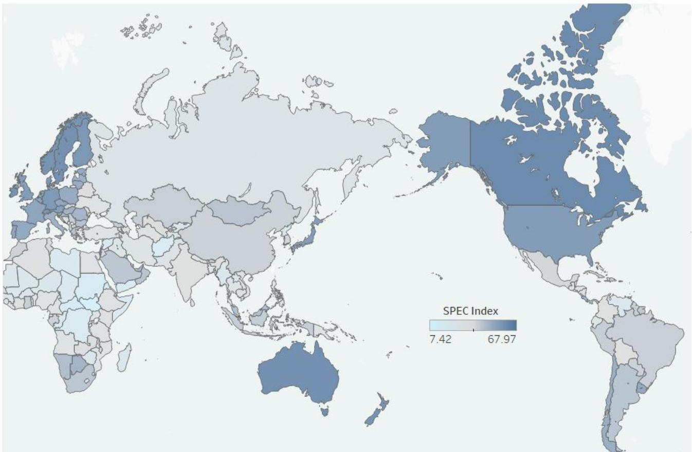
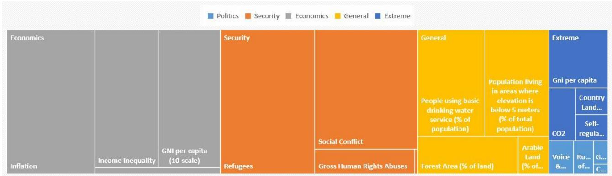

# 2018年美国大学生数学建模竞赛(O奖)论文：SPEC: A Climate-based Fragility Model

原件为竞赛论文。补充：文中的阅读练习及“参考解答”为整理时增加，原件图文保留出处。

本资料为 2018 年美国大学生数学建模竞赛（O奖）论文《SPEC: A Climate-based Fragility Model》的整理版，内容涵盖摘要、目录及引言部分。

## 摘要

气候变化效应已引起全球广泛关注。气候变化的潜在破坏威胁着世界上大多数地区，尤其是那些脆弱的国家。脆弱国家无法满足其人民的需求，且极易受到气候冲击的影响。因此，如何衡量国家的脆弱性至关重要。

我们的 SPEC 模型对世界上大多数国家的脆弱程度提供了定量分析。该模型考虑了多个方面，包括安全、政治、经济和气候变化。

我们使用 20 个独立指标来衡量每个方面。考虑到时间的影响，我们应用“最新确定法”和“加权平均法”对不同指标进行数据加权。此外，在加权平均法中，我们采用指数加权模式以获取具有现实意义的随时间变化的权重，从而更好地衡量长期内的指标。

我们将气候变化的影响分为两部分：一般影响和极端影响。一般部分指气候变化的间接影响。我们使用四个指标来代表海平面上升、耕地减少、生态环境恶化和水源受限的影响。

气候变化的极端部分说明了由气候变化引起的极端天气造成的潜在破坏。我们应用“自我调节因子”来预测国家在面对极端天气时维持当前状况的能力。我们使用三个指标进一步衡量自我调节因子。此外，自我调节因子还与国家的“临界点”有关，我们提出了“临界点模型”。

我们应用层次分析法（AHP）来确定指标的权重。我们参考了世界银行等不同数据库。我们将模型模拟应用于全球 178 个国家，计算出了每个国家的自我调节因子和 SPEC 指数。

我们将 SPEC 模型应用于也门（世界上最脆弱的国家之一）和印度（一个脆弱程度一般的国家）。我们预测了印度政府干预的总成本。

为了使模型更具适用性，我们使用“重新加权法”修改了模型。通过这种方式，我们发现 SPEC 模型在“较小”或“较大”的国家中表现良好。

最后，我们对 SPEC 模型进行了敏感性分析，并讨论了其优缺点。

关键词：SPEC 模型；自我调节因子；加权平均法；数据挖掘；气候影响；层次分析法；

## 封面信息

**标题**: SPEC: A Climate-based Fragility Model
**日期**: February 12, 2018
**队伍控制编号**: 72968
**页码**: Team # 72968 Page 1 of 20

> [!NOTE]
> 更多数学建模资料请关注微店店铺“数学建模学习交流” https://k.weidian.com/RHO6PSpA

## 目录

1. **Introduction**
    1.1 Problem Background
    1.2 Our Efforts
2. Assumptions
3. Nomenclature
4. Statement of Our Model
    4.1 Security
    4.2 Politics
    4.3 Economics
    4.4 Data Weighting Methods for Individual Indicators
        4.4.1 Latest-determine Method
        4.4.2 Weighted Average Method
    4.5 Climate
        4.5.1 General Climate Impact
        4.5.2 Extreme Weather Events
        4.5.3 Self-regulatory factor $R$
    4.6 Calculation
5. Answers to Tasks
    5.1 Task 1
    5.2 Task 2
    5.3 Task 3
        5.3.1 Tipping Model Based on Self-regulatory Factor
        5.3.2 Application of Our Model to India
    5.4 Task 4
        5.4.1 Predict the total cost of intervention
    5.5 Task 5
        5.5.1 Larger "states"
        5.5.2 Ex-State model
        5.5.3 Dealing with missing data
        5.5.4 Smaller "states"
        5.5.5 Re-weighting for SPEC index
        5.5.6 Examples: Guangzhou and Cape Town
6. Model Analysis
    6.1 Sensitivity Analysis
        6.1.1 Impact of Mediate Constant $a$ in Weighted Average Method
        6.1.2 Impact of Universal Extreme Weather Probability $p\%$
    6.2 Strengths & Weaknesses
        6.2.1 Strengths
        6.2.2 Weaknesses
7. Conclusion
Appendices
    Appendix A SPEC Indexes Results
    Appendix B Analytic Hierarchy Process
    Appendix C SPEC Model Data Mining Algorithm
    Appendix D SPEC Model Final Calculation Algorithm

## 第一章 引言

### 1.1 问题背景

冬天看到乘客从北向南飞行的飞机上脱下毛衣和厚外套，总是一件有趣的经历。显然，气候影响了我们的生活方式。此外，如今它显著地影响了国家的稳定性，或者说，反过来说，影响了国家的脆弱性。

脆弱国家是指低收入国家，其特征是国家能力弱和/或国家合法性弱，使公民容易受到一系列冲击的影响 [1]。国家的脆弱性与社会条件相互作用，一旦其中一个指数变得严重，它们很容易陷入恶性循环。因此，人们经常检查脆弱性，将其视为对国家状况的综合反映。

有多种方法可以衡量一个国家的脆弱性。现有的脆弱性清单，如和平基金会 [3] 的脆弱国家指数 [2]，更多地关注关于政治、安全、经济等的社会指标。然而，它们几乎忽略了自然指标，如气候冲击和全球气候变化，这些影响的当今影响力已经变得显著。这里使用“几乎”一词是为了假设它们的权重系统，认为气候对核心指数（包括安全、政治、经济指标）的影响是间接的，因此影响较小。

知识点：[文献综述与研究背景撰写方法](../../../topics/数学建模/wenxian_zongshu.md)、[问题重述与分析（Problem Restatement and Analysis）](../../../topics/数学建模/wenti_chongshu.md)、[可持续发展指数 SDI 的构建与指标体系结构](../../../topics/数学建模/kechixu_zhibiao.md)

### 1.2 我们的工作

为了具体说明气候对脆弱性的影响，我们建立了一个基于气候的脆弱性模型，称为 SPEC 模型，该模型能够分析气候的直接影响和间接影响。在该模型中，我们还量化了其他与安全、政治和经济相关的重要指标。

在第 (2) 节中，我们阐述了 SPEC 模型的基本假设。在第 (4) 节中，我们对模型中使用的每个指标给出了详细的解释和计算。第 (6) 节提供了对 SPEC 模型的全面分析，包括敏感性分析和优缺点审查。

我们还解决了以下列出的任务：

1. 建立一个模型来确定一个国家的脆弱性，并分析气候的影响。
2. 将我们的模型应用于前 10 名最脆弱国家之一，并量化气候对脆弱性的影响。
3. 将我们的模型应用于另一个不在前 10 名最脆弱名单中的国家。找出其脆弱趋势的独特指标和临界点。
4. 使用我们的模型预测积极干预措施，以减少气候的负面影响并避免国家变得脆弱。
5. 将我们的模型推广到不同规模的国家，小到城市，大到大陆。

# 2018年美国大学生数学建模竞赛(O奖)论文：SPEC: A Climate-based Fragility Model（习题）

本部分为《SPEC: A Climate-based Fragility Model》论文第2部分的整理，包含假设、符号说明及模型陈述的前半部分。

## 二、假设 (Assumptions)

针对 SPEC 模型，我们做出以下假设：

知识点：[任务分解与目标明确](../../../topics/数学建模/renwu_fenjie.md)、[问题重述与分析（Problem Restatement and Analysis）](../../../topics/数学建模/wenti_chongshu.md)、[数学建模的基本步骤（问题分析、模型假设、建立、求解、检验、推广）](../../../topics/数学建模/jianmo_buzhou.md)

### 假设 1

国家之间可以交换资源并与邻国进行通信。

知识点：[数学建模的基本步骤（问题分析、模型假设、建立、求解、检验、推广）](../../../topics/数学建模/jianmo_buzhou.md)、[一般假设及其合理性说明（Assumptions and Justifications）](../../../topics/数学建模/jiaben_shezhi.md)、[任务分解与目标明确](../../../topics/数学建模/renwu_fenjie.md)

### 假设 2

在一个国家内部，资源可以从富裕地区快速调配到贫困地区，特别是在该国部分地区遭受自然灾害时。

知识点：[多目标优化模型（药物相对充足阶段的配送策略）](../../../topics/数学建模/duo_mubiao_youhua.md)、[物资配送与制造速度模型（药物每日需求与总量计算）](../../../topics/数学建模/wuzi_peisong.md)

### 假设 3

一个国家的稳定性和实力在很大程度上取决于政治环境、经济状况、社会治安、军事力量、国家资源等。

知识点：[文献综述与研究背景撰写方法](../../../topics/数学建模/wenxian_zongshu.md)、[问题重述与分析（Problem Restatement and Analysis）](../../../topics/数学建模/wenti_chongshu.md)、[一般假设及其合理性说明（Assumptions and Justifications）](../../../topics/数学建模/jiaben_shezhi.md)

### 假设 4

国家资源的丰富程度可以通过国家领土面积来反映。

知识点：[一般假设及其合理性说明（Assumptions and Justifications）](../../../topics/数学建模/jiaben_shezhi.md)

### 假设 5

极端天气事件的风险随着全球气候变化而增加 [4]。

## 三、符号说明 (Nomenclature)

SPEC 是我们基于气候的脆弱性模型的名称，由 Security（安全）、Politics（政治）、Economics（经济）、Climate（气候）四个单词的首字母组成。这四个部分是我们在脆弱性度量模型中的关注点。

我们使用表 1 中的符号来表示 SPEC 模型方程中的指标。仅使用一次的符号未包含在表 1 中，它们将在特定章节中介绍。

**表 1：符号说明**

| 符号 | 定义 |
| :--- | :--- |
| **Security** | 综合安全指标 (Synthetic Security Indicator) |
| $S_{conf}$ | 社会冲突 (Social conflicts) |
| $S_{abs}$ | 政治稳定性与无暴力 (Political stability & Absence of violence) |
| $S_{coups}$ | 政变发生率 (Incidence of coups) |
| $S_{abuse}$ | 严重侵犯人权行为 (Gross human rights abuses) |
| $S_{ref}$ | 难民与领土 (Refuge & Territory) |
| **Politics** | 综合政治指标 (Synthetic Political Indicator) |
| $P_{gov}$ | 政府效能 (Government effectiveness) |
| $P_{law}$ | 法治 (Rule of law) |
| $P_{corpt}$ | 腐败控制 (Control of corruption) |
| $P_{acc}$ | 言论自由与问责制 (Voice & Accountability) |
| **Economics** | 综合经济指标 (Synthetic Economical Indicator) |
| $E_{GNI}$ | 人均国民总收入 (Gross national income per capita) |
| $E_{GDP}$ | 国内生产总值增长率 (Growth of domestic product GDP) |
| $E_{inf}$ | 通货膨胀 (Inflation) |
| $E_{ineq}$ | 收入不平等 (Income inequality) |
| $E_{reg}$ | 监管质量 (Regulatory quality) |
| **Climategen** | 一般全球气候变化的气候指标 (Climate indicator for general global climate change) |
| $C_{elv}$ | 居住在海拔低于5米地区的人口比例 (Population living in areas where elevation is below 5 meters) |
| $C_{frst}$ | 森林面积 (Forest area) |
| $C_{ara}$ | 可耕地面积 (Arable land) |
| $C_{drk}$ | 使用基本饮用水服务的人口比例 (People using basic drinking water service) |
| **Climateext** | 极端天气事件的气候指标 (Climate indicator for extreme weather events) |
| R | 自调节因子 (Self-regulatory factor) |
| $SPEC_{score}$ | 综合 SPEC 模型得分 (the integrated SPEC Model score) |

## 四、模型陈述 (Statement of Our Model)

在对一个国家、一个州或一座城市的脆弱性进行评估时，我们参考多个因素。我们将这些因素分为四个主要领域：政治、经济、安全和气候。不同领域的因素以不同的方式影响脆弱性。我们将逐领域介绍各种因素的影响量化。

知识点：[符号说明与术语定义（Nomenclature / Symbols and Definitions）](../../../topics/数学建模/fuhao_shuoming.md)、[数学建模的基本步骤（问题分析、模型假设、建立、求解、检验、推广）](../../../topics/数学建模/jianmo_buzhou.md)

### 4.1 安全 (Security)

我们在安全领域使用五个安全指标。这五个指标衡量一个国家从内战到严重侵犯人权等不同类型政治暴力的存在情况，评分范围为 0（最小）到 10（最大）。

**社会冲突 (Social conflicts)** 是国家在其边界内维持和平并提供基本人身和人类安全保障能力的指示器。我们参考数据集 *Major Episodes of Political Violence 1946-2016*，该数据集全面记录了世界上所有形式的主要武装冲突。

**政治稳定性与无暴力 (Political stability and absence of violence)** 衡量的是政府被分离主义或暴力手段（包括恐怖主义）颠覆或推翻的可能性的感知。

**政变发生率 (Incidence of coups)**。经历过暴力推翻的国家本质上是不稳定的，并且很可能缺乏确保权力和平过渡的政治机制。对于此指标，如果过去十五年内发生过任何政变，则该国得分为 0；否则得分为 10。我们从维基百科的 *List-of-coups* 获取数据。

**严重侵犯人权行为 (Gross human rights abuses)**。依赖广泛压迫来维持控制的政权容易受到内部不满和不稳定的影响。我们根据 *Political Terror Scale 2015* 为此指标分配分数。

**难民与恐怖主义 (Refugee & Terrorism)** 是衡量一个国家在整个领土范围内行使主权并保持对武力使用垄断能力的最可用指标。

## 4.1 安全

我们用一个国家的安全程度来反映其内部冲突的激烈程度。在 SPEC 模型中，安全指标由五个因素构成：冲突（conf）、滥用（abv）、政变（coups）、虐待（abuse）与难民（ref）。这些指标的数据来自政治不稳定任务组（Political Instability Task Force, 2017）。其中，冲突与政变直接体现国家内部武装对抗的规模；滥用与虐待反映政府对民众权利的侵害程度；难民数量则从侧面反映国家动荡导致的人口外流——当挑战者寻求地位的重大改变而引发革命与族群战争、政府又无力平息时，大量难民便会涌现。

SPEC 模型方程中安全指标的数学表达式为

$$
\text{Security} = \alpha_{1} S_{\text{conf}} + \alpha_{2} S_{\text{abv}} + \alpha_{3} S_{\text{coups}} + \alpha_{4} S_{\text{abuse}} + \alpha_{5} S_{\text{ref}}
$$

我们将在第 4.6 节为这些指标赋予权重 1、2、3、4、5。

## 4.2 政治

我们用四个政治指标量化政治对国家脆弱性的影响。这四个指标在同等程度上反映国家的政治面貌，我们忽略其他次要因素，将它们在脆弱性函数中从 0（最小）到 10（最大）分级，并同等对待。

政府效能（Government effectiveness）直接体现国家的治理能力，包括公共与公务员质量以及政策执行能力。面对社会危机时，政府的应对能力对结果影响巨大。

法治（Rule of law）衡量政府以强有力的法规建设合法国家的信心与效率，与国家的长期稳定密切相关。

腐败控制（Control of corruption）防止国家出现不合理的资源分配与制度侵蚀，是预测公众信任的有力指标。

话语权与问责制（Voice & Accountability）衡量公民参与政府建设的程度，是公民自由的体现，并长期影响政府的稳定性。

在评估政治指标时，我们参考世界银行《治理事务 VI，2007》（Governance Matters VI, 2007）数据集。SPEC 模型方程中政治指标的数学表达式为

$$
Politics = \beta_{1} P_{gov} + \beta_{2} P_{law} + \beta_{3} P_{corpt} + \beta_{4} P_{acc}
$$

其中权重 1、2、3、4 在第 4.6 节给出。

## 4.3 经济

经济方面有五个指标，这些广泛使用的指标使我们能够捕捉国家经济表现的关键方面。

人均国民总收入（GNI per Capita）。我们认为低人均收入是国家弱化的近因效应，它限制了一个国家实现基本政府职能的能力。数据来自《世界发展指标，2007》（World Development Indicators, 2007）。

国内生产总值（GDP）增长率。与人均 GNI 类似，平均经济增长既可能是国家弱化的结果，也可能是其原因。能够维持经济增长的国家通常表现出相对稳定和安全的社会。同一数据集可在世界银行获取。

通货膨胀可能表明一个经济体易受外部冲击或财政政策不可持续的影响。我们使用消费价格年度变化的绝对值，从而以相同方式处理通货紧缩与通货膨胀两种情况。《世界经济展望数据库，2017》（World Economic Outlook Database, 2017）提供了所需数据。

收入不平等。高收入不平等与叛乱及其他形式政治暴力的可能性相关。我们根据基尼系数确定每个国家的得分，基尼系数代表一国居民财富分配状况。

监管质量（Regulatory Quality）。监管质量差表明国家无力营造有利于私营部门增长的环境，而这对于增加国民收入至关重要。《治理事务 VI，2007》提供了所需数据。

SPEC 模型方程中经济指标的数学表达式为

$$
Economics = \gamma_{1} E_{GNI} + \gamma_{2} E_{GDP} + \gamma_{3} E_{inf} + \gamma_{4} E_{ineq} + \gamma_{5} E_{reg}
$$

我们将在第 4.6 节为这些指标赋予权重 1、2、3、4、5。

## 4.4 单项指标的数据加权方法

我们检索安全、政治与经济领域的指标数据，并用两种基本方法处理海量数据：加权平均法与最新值判定法，然后将处理后的指标代入脆弱性方程。

知识点：[任务分解与目标明确](../../../topics/数学建模/renwu_fenjie.md)、[符号说明与术语定义（Nomenclature / Symbols and Definitions）](../../../topics/数学建模/fuhao_shuoming.md)、[模型参数的确定（基于数据拟合或实验选择）](../../../topics/数学建模/canshu_queding.md)

### 4.4.1 最新值判定法

指标对国家脆弱性的作用方式不同：有些具有突变和突然的影响，另一些则具有持续影响。我们对具有突然、短期影响的指标采用最新值判定法，仅用最新数据代表该指标。

在前三个领域引入的全部 14 个指标中，我们对其中 9 个使用最新值判定法，将它们视为瞬时与暂时性因素；仅对下一部分提到的 5 个指标，我们使用加权平均法衡量其相对长期的影响。

知识点：[人口密度修正系数与新公式](../../../topics/数学建模/renkou_midu.md)、[符号说明与术语定义（Nomenclature / Symbols and Definitions）](../../../topics/数学建模/fuhao_shuoming.md)

### 4.4.2 加权平均法

我们采用指数加权模式，体现指标影响随时间衰减。我们定义相对权重 $(1-a)^{T}$，其中 $T$ 为落在 1 至 5 或 1 至 15 的整数区间内的时间序号，$a$ 为落在区间 $[0,1]$ 内的适中正常数。

## 4.4 Weight Calculation

A mediate constant $a = 0.15$ implies the weight decreases by 15 percent when we move back in time each year. Though the mediate constant $a$ in the equation of relative weight can be an arbitrary constant in $[0, 1]$, the value of $a = 0.15$ is rational to quantify the impact variation with time goes by.

Time range of 5 years or 15 years are reasonable enough for the impact of indicators, when $T$ with 15 year range measures long and continuous impact and 5 year range measures relatively small and continuous impact.

Then we scale the relative weight to make the sum equals to 1 and get the result of absolute weight that used in our method of averaging.

$$
Weight_{absolute} = \frac {(1 - a) ^ {T}}{\sum_ {i = 0} ^ {T} (1 - a) ^ {i}}\tag{1}
$$

where we define $a = 0.15$ and $T = 5; 10$.

**Parameter Scheme for Indicators:** We use the weighted average method to process the data of 5 indicators. Three indicators belong to security category: social conflicts, incidence of coups, human rights abuse. Two indicators belong to economy category: Growth of Gross Domestic Product (GDP), Inflation.

We assign 15 year time span for social conflicts, incidence of coups; 5 year time span for human rights abuse, GDP and inflation. A country suffering social conflicts and incidence of coups need a relatively longer time to recover from the mighty and widespread social destruction. Under this condition, there are still repercussions with decreasing impact to make a country fragile. We assign 5 year time span for human rights abuse since it is a more flexible indicator, which can be easily changed by policy or other instant law. GDP and inflation measures the economic appearance of a country. Since economic event happen frequently in modern world and their effects do not vanish instantly, we assume the latest 5 year data forecast the present economy.

知识点：[模型参数的确定（基于数据拟合或实验选择）](../../../topics/数学建模/canshu_queding.md)、[一般假设及其合理性说明（Assumptions and Justifications）](../../../topics/数学建模/jiaben_shezhi.md)、[文献综述与研究背景撰写方法](../../../topics/数学建模/wenxian_zongshu.md)

### 4.5 Climate

We consider two aspects of climate impact on fragility of a state. General climate impact indicator measures the impact under global climate trend such as global warming and glacier melting. The general impact are largely determined by the state’s dependence on agriculture, water source and its location (risk of being submerged by rising sea level), etc. Extreme weather condition indicator measures the possibility of a country to become fragile faced with natural catastrophe. It relates tightly with the state’s possibility of suffering a natural disaster and resistance of destruction.

#### 4.5.1 General Climate Impact

From 1990s, people become more clear about the negative trend of climate and put more efforts on researches and control of the global climate change. Results of climate change including increased droughts, shrinking glaciers and other ecological problems, are blocking the development of many countries.

In this section, we employ four indicators to quantify the general climate impact on a country caused by the current global climate trend.

We process the raw data and normalize the values of four indicators to fall in a range from 0 to 5, and then give them different weights in the SPEC Model equation.

##### Population living in areas where elevation is below 5 meters (% of total population)

Population living in areas where elevation is below 5 meters (% of total population) shows the risk of a country to become fragile faced with global warming and glacier melting. Once the sea level rises, and if a country has a large population living in the place with elevation lower than 5 meters, the residential condition in the country will meet with crisis. We calculate the indicator result as Equation (2), showing that more population living in areas where elevation is below 5 meters, smaller the value of the indicator is, and more fragile the country is.

$$
C _ {e l v} = (1 - D _ {e l v} \% ) \times 5\tag{2}
$$

where

-   $C_{elv}$ is the normalized result of the indicator ranging from 0–5.
-   $D_{elv}$ is the population percentage in the source which ranging from 0–56.18.

##### Forest area (% of land area)

Forest area reflects the animal and plant ranges and is a measurement of species richness. A larger forest area build a more stable and adaptable ecological environment when a state faced with climate change. We calculate the forest area indicator value in SPEC model using Equation (3), showing faster the growth of forest land, higher the indicator value is, and less fragile the country is.

$$
C _ {f r s t} = \exp \left(\frac {D _ {t , f r s t} \%}{D _ {T , f r s t} \%}\right)\tag{3}
$$

-   $C_{frst}$ is the normalized result of the forest area indicator ranging from 0–5.
-   $D_{t; frst}$ is the forest area percentage in the latest year source ranging from 0–73.1.
-   $D_{T; frst}$ is the forest area percentage in the reference year.

##### Arable land (% of land area)

Frequent draughts and floods nowadays are the result of climate change and they diminish the area of arable land. Observing the change of arable land we can predict a country’s resistance towards climate change. Equation (4) calculate the arable land indicator value in the SPEC model, showing lower the decreasing speed of arable land area, higher the arable land indicator value is, and less fragile the state is.

$$
C _ {a r a} = \exp \left(\frac {D _ {t , a r a} \%}{D _ {T , a r a} \%}\right)\tag{4}
$$

-   $C_{ara}$ is the normalized result of the forest area indicator ranging from 0–5.
-   $D_{t; ara}$ is the arable land area percentage in the latest year source ranging from 0–56.175.
-   $D_{T; ara}$ is the arable land area percentage in the reference year.

知识点：[影响因素评估指标体系构建（温度、湿度、经济、教育等）](../../../topics/数学建模/yingxiang_zhibiao.md)、[一般假设及其合理性说明（Assumptions and Justifications）](../../../topics/数学建模/jiaben_shezhi.md)、[模型参数的确定（基于数据拟合或实验选择）](../../../topics/数学建模/canshu_queding.md)

### 4.5.1 Basic Drinking Water Service

Global climate change gives rise to the possibility of floods and droughts. Droughts especially threaten the daily water supply for residence. Water resource is also one of the core inducements of region conflicts. Change of the population using basic drinking water service measures the state’s dependence on water. We use Equation (5) to calculate the drinking water indicator in the SPEC Model. If the population using drinking water service rises with time, the state depends less on water resource and thus less on climate, and appears less fragile.

$C_{drk}$ is the normalized result of the drinking water indicator ranging from 0 to 5.

$D_{f, drk}$ is the drinking water service population in the latest year source ranging from 0 to 100.

$D_{T, drk}$ is the drinking water service population in the reference year.

On the basis of accessible data, we use different ways to process the data and let the indexes fall in the value interval $[0, 5]$. Then we weigh the indicators $C_1, C_2, C_3, C_4$ and get the value of general climate impact indicator as Equation (6).

$$
\text { Climate } _ {\text { gen }} = \varphi_ {1} C _ {\text { elv }} + \varphi_ {2} C _ {\text { frst }} + \varphi_ {3} C _ {\text { ara }} + \varphi_ {4} C _ {\text { drk }}\tag{6}
$$

知识点：[模型参数的确定（基于数据拟合或实验选择）](../../../topics/数学建模/canshu_queding.md)、[可持续发展指数 SDI 的构建与指标体系结构](../../../topics/数学建模/kechixu_zhibiao.md)、[影响因素评估指标体系构建（温度、湿度、经济、教育等）](../../../topics/数学建模/yingxiang_zhibiao.md)

### 4.5.2 Extreme Weather Events

There is little doubt that the Earth’s climate is changing and weather is becoming more extreme. Future warming will bring more dangerous conditions, even if the world manages to keep temperature rises within a 2°C limit to which governments have committed. The state’s ability to cope with extreme weather has shown an increasing role in safeguarding economic and social stability. The full formula for country scoring in extreme condition is given by

$$
Climate _ {e x t} = e ^ {- R} \cdot \ln \frac {C O _ {2 t}}{C O _ {2 T}} \cdot p\tag{7}
$$

where:

- $p\%$ is the universal probability of extreme weather. At current time, it’s reasonable to set the value of $p$ to 5%.
- $CO_{2t}$ is national $CO_2$ emissions (kt) that year.
- $CO_{2T}$ is national $CO_2$ emissions (kt) in year 1990.
- $R$ refers to self-regulation factor. It is originally a measure of the stability of the ecosystem and here it indicates country’s ability to effectively carry out disaster relief and disaster prevention work. This factor is synthesized from three parts which we discuss later.

Extreme weather events are of small probability, but can be catastrophic. In the process of increasing overall national strength, the state’s response capability to extreme weather conditions is also on the rise. However, extreme heatwaves and heavy rain storms are already happening with increasing regularity worldwide because of man-made climate change. Therefore, a proportional item $CO_{2t} / CO_{2T}$ is of necessity in the formula to indicate the increasing difficulty of disaster relief and the increase of probability.

知识点：[一般假设及其合理性说明（Assumptions and Justifications）](../../../topics/数学建模/jiaben_shezhi.md)、[符号说明与术语定义（Nomenclature / Symbols and Definitions）](../../../topics/数学建模/fuhao_shuoming.md)、[模型参数的确定（基于数据拟合或实验选择）](../../../topics/数学建模/canshu_queding.md)

### 4.5.3 Self-regulatory Factor R

Self-regulatory factor $R$ is synthesized from three parts: national land area, per capita income, security. The self-regulatory factor $r$ is determined by Equation (8).

$$
\begin{aligned}
R &= \theta_ {1} r _ {1} + \theta_ {2} r _ {2} + \theta_ {3} r _ {3}, & R &\in (0, 1) \\
r _ {1} &= \ln \frac {s (n)}{s (USA)}, & r _ {1} &\in (0, 1) \\
r _ {2} &= \ln \frac {i (n)}{i (L)}, & r _ {2} &\in (0, 1) \\
r _ {3} &= security / 50, & r _ {3} &\in (0, 1) 
\end{aligned}\tag{8}
$$

where $s(n)$ is national land area, $s(USA)$ is the land area of America. For Russia and Canada, whose land area is bigger than America, we set its $r_1$ to 1 to avoid inaccuracy.

$i(n)$ is per capita income, and $i(L)$ is the per capita income of Luxembourg. According to World Bank, Luxembourg’s per capita income ranks first in the world. Security score is already obtained; we divide it by 50 to have the value fall in the range of zero to one.

Security factors are the basic guarantee for dealing with extreme weather events. Relatively large land area enhances disaster prevention capabilities to some extent for its rich resources and manpower. Per capita income is the embodiment of the current economic strength that supports disaster prevention and relief work.

知识点：[影响因素评估指标体系构建（温度、湿度、经济、教育等）](../../../topics/数学建模/yingxiang_zhibiao.md)、[参数合理性验证](../../../topics/数学建模/canshu_heli_xing.md)

### 4.6 Calculation

The score of the SPEC Model measures the fragility of a state. Higher scores show less fragility while lower scores show more fragility. The $SPEC_{score}$ has the equation form as

$$
SPEC _ {S c o r e} = \frac {\text { Security } + \text { Politics } + \text { Economics } + \text { Climate } _ {g e n}}{\text { Climate } _ {e x t}}\tag{9}
$$

Equation (9) shows the relation between the SPEC score and indicators of four core fields regarding fragility: security, politics, economics and climate, where climate consists of general climate change and extreme weather condition. The five security indicators, the four political indicators, the five economical indicators and four general climate indicators have positive correlation with the SPEC score. Bigger the value of the indicators, bigger the value of the SPEC score and less fragility of a state.

We only put the indicators considering extreme weather condition in the denominator, showing the negative correlation with the SPEC score. Bigger the value of extreme weather indicator, smaller the value of the SPEC score and more fragile of a state.

We span the item of $Climate_{ext}$ referring to Equation (8), since its calculation differs from the other four items in the numerator of Equation (9).

$$
SPEC _ {s c o r e} = \frac {Security + Politics + Economics + Climate _ {g e n}}{e ^ {- R} \cdot \ln \frac {C O _ {2 t}}{C O _ {2 T}} \cdot p}\tag{10}
$$

## 5 任务结果

优先确定各指标权重，并采用 $\mathsf{AHP}$ 求每个指标的系数，结果见表 2。

Table 2: 指标权重
| 指标 | 权重 (%) |
|---|---|
| Social conflicts | 20.69 |
| Political stability and absence of violence | 17.24 |
| Incidence of coups | 27.59 |
| Gross human rights abuses | 10.34 |
| Refugee | 24.14 |
| Government effectiveness | 25.00 |
| Rule of law | 25.00 |
| Control of corruption | 25.00 |
| Voice & Accountability | 25.00 |
| Gross National Income (GNI) per Capita | 25.93 |
| Growth of Gross Domestic Product (GDP) | 29.63 |
| Inflation | 11.11 |
| Income Inequality | 18.51 |
| Regulatory Quality | 14.86 |
| Population living in areas where elevation is below 5 meters | 11.31 |
| Forest area | 35.43 |
| Arable land | 22.61 |
| People using basic drinking water service | 30.65 |

随后，用式 (12) 精确计算各指标，并代入式 (9) 得到 SPEC 得分，结果汇总于图 2。

$$
\begin{array}{c}
\text{Security} = (20.69\%) S_{\text{conf}} + (20.69\%) S_{\text{abv}} + (20.69\%) S_{\text{coups}} + (20.69\%) S_{\text{abuse}} + (24.14\%) S_{\text{ref}} \\
\text{Politics} = (25.00\%) P_{\text{gov}} + (25.00\%) P_{\text{law}} + (25.00\%) P_{\text{corpt}} + (25.00\%) P_{\text{acc}} \\
\text{Economics} = (25.93\%) E_{\text{GNI}} + (29.63\%) E_{\text{GDP}} + (11.11\%) E_{\text{inf}} + (18.51\%) E_{\text{ineq}} + (14.86\%) E_{\text{reg}} \\
\text{Climate}_{\text{gen}} = (11.31\%) C_{\text{elv}} + (35.43\%) C_{\text{frst}} + (22.61\%) C_{\text{ara}} + (30.65\%) C_{\text{drk}}
\end{array}
\tag{12}
$$

其中，自调节因子 $R$ 的具体形式见式 (11)，其系数由 AHP 确定。层次分析法（AHP）是一种基于数学与心理学的、用于组织与分析复杂决策的结构化技术 [5]。

$$
R = (31.89\%)\left(\ln S_{\text{UN}}\right) + (22.1\%)(1 - \ldots) + (46.00\%)(\text{security}/50)
\tag{11}
$$



## 5 任务解答

知识点：[层次分析法 AHP（Analytic Hierarchy Process）用于综合评价](../../../topics/数学建模/ahp_fangfa.md)、[可持续发展指数 SDI 的构建与指标体系结构](../../../topics/数学建模/kechixu_zhibiao.md)

### 5.1 任务 1

我们用 SPEC 模型确定国家的脆弱性。脆弱性分类取决于 SPEC 得分：SPEC 得分在 0 到 27 之间属于脆弱类；在 27 到 50 之间属于易受冲击类；在 50 到 70 之间属于稳定类。

Table 3: 脆弱性分类
| SPEC 得分 | 脆弱性 |
|---|---|
| [0, 27) | Fragile |
| [27, 50) | Vulnerable |
| [50, 70) | Stable |

为衡量气候对脆弱性的影响，我们评估 $\text{Climate}_{\text{ext}}$ 的值以考察直接影响，并分析 $\text{Climate}_{\text{gen}}$ 以考察间接影响。

$\text{Climate}_{\text{ext}}$ 衡量直接极端气候影响的强度。根据 SPEC 模型生成的统计数据，$\text{Climate}_{\text{ext}}$ 大于 2.70 表明该国的极端天气状况在很大程度上影响其脆弱性；$\text{Climate}_{\text{ext}}$ 在 2.00 到 3.70 之间为正常；$\text{Climate}_{\text{ext}}$ 低于 2.00 意味着该国受极端天气影响很小。

$\text{Climate}_{\text{ext}}$ 主要受两个因素影响：i) 自调节因子 $R$：$R$ 低于 0.60 意味着该国无力抵御极端气候影响，极端天气的存在导致更高的脆弱性；0.60 到 0.75 为正常范围；$R$ 高于 0.75 意味着该国应对极端天气的能力很强，对极端气候破坏的敏感度较低。ii) 极端天气事件的概率 $\ln \frac{\mathrm{CO}_{2t}}{\mathrm{CO}_{2T}}$，其受温室气体排放影响。CO₂ 排放指数大于 0.80 是严重现象，表明该国 CO₂ 排放过多，增加了极端天气发生的可能性，从而加剧其脆弱性。

$\text{Climate}_{\text{gen}}$ 衡量气候的间接影响。根据 SPEC 模型统计数据，$\text{Climate}_{\text{gen}}$ 高于 5.00 表示气候通过影响安全、政治、经济领域的其他指标而产生较大的间接影响；$\text{Climate}_{\text{gen}}$ 在 3.00 到 5.00 之间为正常；$\text{Climate}_{\text{gen}}$ 低于 3.00 表示气候变化带来的间接影响很小。

知识点：[问题重述与分析（Problem Restatement and Analysis）](../../../topics/数学建模/wenti_chongshu.md)、[数学建模的基本步骤（问题分析、模型假设、建立、求解、检验、推广）](../../../topics/数学建模/jianmo_buzhou.md)、[一般假设及其合理性说明（Assumptions and Justifications）](../../../topics/数学建模/jiaben_shezhi.md)

### 5.2 任务 2

我们选择也门讨论其脆弱性成因。也门在我们的 SPEC 脆弱性列表中排名第七，这与其在 FSI 列表中的排名吻合。



直接气候指标 $\text{Climate}_{\text{ext}} = 2.83$ 大于 2.70，意味着该国的脆弱性受极端气候事件影响很大。原因在于也门的自调节因子 $R = 0.60$ 较低，表明其抵御自然灾害的能力较差。$R$ 由 $r_3 = \text{security}/50$ 项构成，由于国内存在社会冲突和政变，也门在遭遇气候冲击后恢复能力很差。极端气候条件很容易使也门陷入脆弱。

间接气候指标 $\text{Climate}_{\text{gen}} = 3.67$ 根据 SPEC 的统计数据属于正常值，因此它对也门的脆弱性贡献很小。

知识点：[影响因素评估指标体系构建（温度、湿度、经济、教育等）](../../../topics/数学建模/yingxiang_zhibiao.md)、[参数合理性验证](../../../topics/数学建模/canshu_heli_xing.md)、[文献综述与研究背景撰写方法](../../../topics/数学建模/wenxian_zongshu.md)

### 如何降低脆弱性

- 改善政治状况，停止政变。
- 通过停止社会冲突改善安全状况。
- 与邻国和睦相处，以便在面临气候问题时获得帮助。

# 2018年美国大学生数学建模竞赛(O奖)论文：SPEC: A Climate-based Fragility Model（习题）

本节整理自 O 奖论文《SPEC: A Climate-based Fragility Model》的第 7 部分，主要涵盖基于自我调节因子的临界点模型构建、印度案例应用以及针对印度的干预措施建议。

## 一、模型构建与分析

知识点：[文献综述与研究背景撰写方法](../../../topics/数学建模/wenxian_zongshu.md)、[问题重述与分析（Problem Restatement and Analysis）](../../../topics/数学建模/wenti_chongshu.md)、[模型优缺点分析（Strengths and Weaknesses）](../../../topics/数学建模/youque_dian.md)

### 简答 1

**背景与结论：**
气候变化通过一般部分和极端部分影响国家脆弱性。一般部分指间接影响，短期内对国家脆弱性影响轻微；长期来看（至少二十年尺度），一般部分才会产生显著影响。因此，在衡量国家脆弱性时，主要考虑极端部分的影响。

**自我调节因子与 SPEC 指数的关系：**
由于二氧化碳排放量受限于当前技术且与未来发展密切相关，长期内可能保持稳定，因此主要工作在于讨论自我调节因子。利用已计算的 SPEC 数据发现，SPEC 指数与自我调节因子之间存在良好的线性关系。当自我调节因子增加时，相关的 SPEC 指数也随之增加。这一关系证实了上述假设和讨论。

*图 4：气候变化的决定性影响指标。*

**临界点模型定义：**
基于 SPEC 指数与自我调节因子的关系，提出基于自我调节因子的临界点模型（Tipping Model）。
**临界点（Tipping Point）**定义为：当一个国家的自我调节因子下降至 **0.6** 并继续降低时的时间点。

**合理性说明：**
自我调节因子使用的指标能很好地说明气候变化下国家安全、政治和经济条件的细微变化。当自我调节因子小于 0.6 时，这些国家不可能免受极端气候冲击的安全。模型结果显示，自我调节因子较小的国家大多脆弱，有些则处于弱势状态。这表明临界点的定义是合理的。

知识点：[影响因素评估指标体系构建（温度、湿度、经济、教育等）](../../../topics/数学建模/yingxiang_zhibiao.md)、[一般假设及其合理性说明（Assumptions and Justifications）](../../../topics/数学建模/jiaben_shezhi.md)、[模型优缺点分析（Strengths and Weaknesses）](../../../topics/数学建模/youque_dian.md)

### 简答 2

**印度案例应用分析：**

*图 6：印度概况。*

根据模型分析得出以下结论：
1. 印度是一个脆弱国家。
2. 印度政治稳定但不够强大。
3. 印度存在严重的人权侵犯问题，特别是针对女性。
4. 由于地理位置原因，印度大量人口居住在海拔低于 5 米的地区，面临海平面上升的严重威胁。
5. 逐年增加的 $\text{CO}_2$ 排放使印度面临更高的极端天气风险。
6. 尽管印度的自我调节因子为 **0.735**，但由于热带季风气候，其面临极端天气的风险相当高。

**趋势预测：**
因此，印度对极端天气的脆弱性正在增加。如果印度不采取有效措施解决严重的人权侵犯问题，可能会面临更多的社会冲突，这将负面影响印度的经济和安全。这种不利趋势将降低印度的自我调节因子，印度可能在短期内达到临界点。

知识点：[长期预测模型（如20年可持续发展计划预测）](../../../topics/数学建模/nian_yuce.md)

### 简答 3

**任务 4：干预措施建议**

根据 SPEC 指数，气候变化对国家稳定性有直接和间接影响。需要分别针对这两个方面采取行动。提出的八项以国家为主导的干预措施与 SPEC 指数中的气候指标相符。

**针对一般气候影响的措施：**
1. 在城市化过程中严格控制耕地的重新分区。
2. 促进农业转型和升级，提高用水效率和公平性。
3. 发展海水淡化技术。
4. 进行旧城改造，合理增加城市密度。城市规划需侧重于高层建筑。
5. 增加林业部门收入，注重天然林的更新和再造林，减少单一树种的人工林。

**针对极端天气事件的措施：**
1. 促进精准脱贫，更加重视脱贫政策的一致性。
2. 加强农村基础设施建设，促进低收入居民的住房安全。
3. 将医疗费用纳入地方健康保险计划，重点关注降低 5 岁以下儿童死亡率。

**措施依据说明：**
1. **耕地控制**：根据世界银行发展指标收集的数据，2015年印度耕地面积报告为 1.56463 亿公顷，比 2004 年减少了约 50 万公顷。为了应对耕地萎缩，印度必须严格控制耕地的重新分区。非农业用途的土地需要更有效地利用。
2. **城市密度与住房**：面对人口增长，需要通过缩小地块规模并用联排别墅替换旧房子来增加住宅区的密度。
3. **粮食生产与基础设施**：报告指出，印度的人口增长速度快于其生产大米和小麦的能力。为了养活不断增长的人口，印度应通过减少主食腐烂和改善基础设施来提高农业生产率。

## 5.4.1 Predict the total cost of intervention

It's quite difficult to accurately predict the expenses these measures for India required. We first determine the field to these measures belong and refer to The Expenditure of Government of India 2016-2017 to get access to the government's total spending in this area.

Then we compare and estimate the ratio of expenditures on this measure to major items in this area. The estimated expenditure of our 8 proposed intervention is listed below. (Unit: hundred million dollars)

Table 4: Estimated expenditure of each intervention

| Intervention | Expenditure |
| --- | --- |
| Control of rezoning | 18.7 |
| Agricultural upgrading | 77.9 |
| Desalination | 50 |
| Rural renovation | 1558 |
| Forestry sector | 20 |
| Poverty alleviation | 468 |
| Housing safety | 1000 |
| Healthcare | 100 |

## 5.5 Task 5

We notice that only a few countries cover extra large land areas equivalent of continents. If measured by population, countries that own 20 million to 50 million people is equivalent to the scale of a medium-sized city and only 25 countries is under that size. When coming to smaller states and larger states, to be more mathematically precise, we have to adjust the coefficient of our SPEC Model.

What's noteworthy is that it's never merely the change in land area, indicators in security, politic and economic fields are all affected.

知识点：[可持续发展指数 SDI 的构建与指标体系结构](../../../topics/数学建模/kechixu_zhibiao.md)、[模型参数的确定（基于数据拟合或实验选择）](../../../topics/数学建模/canshu_queding.md)

### 5.5.1 Larger "states"

To obtain a modification of SPEC Model, a ex-State model is required. The following facts need special consideration.

Big countries have more human and energy resources and can be fully deployed during times of emergency.

As a combination of countries, continents have inherent advantages in developing resilient and flexible policy-making. All regions have a higher degree of coordination and complementarity of policies when faced with unrest.

Policy silos are more impossible to exist, it is essential rearrange evaluation system in a broader context of education, healthcare, good governance, and societal resilience.

知识点：[任务分解与目标明确](../../../topics/数学建模/renwu_fenjie.md)、[数学建模的基本步骤（问题分析、模型假设、建立、求解、检验、推广）](../../../topics/数学建模/jianmo_buzhou.md)

### 5.5.2 Ex-State model

As noted above, we already have each country's score on fragility and now we need to weight each of them. The scoring formula is

$$
F_{cop} = \frac{\sum_{k=1}^{n} R_i F_i}{\sum_{k=1}^{n} R_i} \tag{13}
$$

where

– $F_{cop}$ is the fragility of the hole continent.

– $F_i$ is the fragility of the hole continent.

– $R_i$ is the earlier determined self-regulation factor of each country.

Notice that countries rank high in SPEC fragility index has high likelihood of future political and economic instability. In broader view, these countries take on more responsibility in face of difficulties. Therefore we determine the expression of continent's fragility by a weighted average expression. This approach is concise and effective.

知识点：[影响因素评估指标体系构建（温度、湿度、经济、教育等）](../../../topics/数学建模/yingxiang_zhibiao.md)、[层次分析法 AHP（Analytic Hierarchy Process）用于综合评价](../../../topics/数学建模/ahp_fangfa.md)、[模型参数的确定（基于数据拟合或实验选择）](../../../topics/数学建模/canshu_queding.md)

### 5.5.3 Dealing with missing data

Though our SPEC indicators have relatively good data coverage worldwide, there are missing data points. In this ex-State model where multiple area needs to be included, we don't filling these data gaps with imputed estimates.

Instead we calculate with available country data using the formula above. Our rationale is that neither the accuracy of the overall continent weakness score, nor the credibility, are significantly affected by the missing data. Furthermore, most countries have data for all SPEC indicators. There is a risk that imputed data would amount to an implausible estimate of a country's performance on certain indicators.

知识点：[文献综述与研究背景撰写方法](../../../topics/数学建模/wenxian_zongshu.md)、[一般假设及其合理性说明（Assumptions and Justifications）](../../../topics/数学建模/jiaben_shezhi.md)、[模型优缺点分析（Strengths and Weaknesses）](../../../topics/数学建模/youque_dian.md)

### 5.5.4 Smaller "states"

Cities have less industrial diversity and abundance of resources compared with states. here we explain how to rearrange the weight of each SPEC fields.

The following facts need special consideration.

With globalization providing a net benefit to nations around the world, regions are linked closer with each other.

The city's basic climatic conditions can be obtained from the country's data.

Each city has its own major industry which reflect the city's overall strength and significantly affect its vulnerability to economic fluctuations and climate events.

知识点：[模型参数的确定（基于数据拟合或实验选择）](../../../topics/数学建模/canshu_queding.md)、[文献综述与研究背景撰写方法](../../../topics/数学建模/wenxian_zongshu.md)、[数学建模的基本步骤（问题分析、模型假设、建立、求解、检验、推广）](../../../topics/数学建模/jianmo_buzhou.md)

### 5.5.5 Re-weighting for SPEC index

Here are the principles for re-weighting.

1. Four general climatic indicators apply to both cities and states, therefore, scoring formula for general climate conditions doesn't change.

2. As explained earlier, scoring formula for extreme climate condition consist of extreme weather events(EWE) probability, CO2 emission and self-regulatory factor(R). EWE probability doesn't change with land area size. R is determined by the same formula expressed earlier and CO2 emission is available in data set.

3. The weight for security(S), politic(P) and economic(E) fields is rearranged using Analytic Hierarchy Process based on city's major industry.

知识点：[层次分析法 AHP（Analytic Hierarchy Process）用于综合评价](../../../topics/数学建模/ahp_fangfa.md)、[影响因素评估指标体系构建（温度、湿度、经济、教育等）](../../../topics/数学建模/yingxiang_zhibiao.md)、[模型参数的确定（基于数据拟合或实验选择）](../../../topics/数学建模/canshu_queding.md)

### 5.5.6 Examples: Guangzhou and Cape Town

We take Guangzhou and Cape Town as examples to reweight its SPEC index in compliance with principles above.

Guangzhou is the capital and most populous city of the province of Guangdong in southern China. Its urban development characteristics is embodied in following areas.

– main manufacturing hub of one of mainland China's leading commercial and manufacturing regions

– rivers and streams improve the landscape and keep the ecological environment of the city stable

– top ten container ports in the world

Cape Town is the legislative capital of South Africa. Its urban development characteristics is embodied in following areas.

– noted for its architectural heritage and natural setting, once named the best place in the world to visit

– serves as the regional manufacturing centre

# 2018年美国大学生数学建模竞赛(O奖)论文：SPEC: A Climate-based Fragility Model（习题）

本部分整理自《2018年美国大学生数学建模竞赛(O奖)论文：SPEC: A Climate-based Fragility Model》第 9 部分（共 12 部分），对应原文第 25–27 页（即模型分析、优缺点、结论及参考文献部分）。内容涉及敏感性分析、模型强弱项讨论、总结及引用文献。

## 一、模型分析与评估

知识点：[敏感性分析方法（Sensitivity Analysis，单参数与多参数变动）](../../../topics/数学建模/minganxing_fenxi.md)、[模型优缺点分析（Strengths and Weaknesses）](../../../topics/数学建模/youque_dian.md)

### 选择 1（注：此处为论述题/简答题性质，根据规范整理为知识点解析形式，因原文非选择题结构，故调整为章节式讲解，若需严格对应“题型”，可视作“简答 1”关于模型敏感性分析的总结）

#### 6.1 敏感性分析 (Sensitivity Analysis)

**背景与目的：**
SPEC 模型包含多个常数参数。在确定这些参数时，团队参考了在线数据库和各类可获取的文献。本节通过改变参数值来测试 SPEC 模型的敏感性，以展示其可靠性。

##### 6.1.1 加权平均法中介常数 $a$ 的影响

- **设定依据：** 在使用加权平均法为每个指标赋予权重时，将常数 $a$ 设为 0.15，且不再更改。该数值基于《发展中国家国家弱点指数》(Index of State Weakness In the Developing World) [10] 中的相同计算得出。
- **实验过程：** 如图 8 所示，让 $a$ 的值在 0.10 到 0.20 之间以 0.25 为步长变化（注：原文 "by 0:25" 可能指步长或范围，结合上下文理解为在一定范围内变动）。
- **结果分析：** 每条代表特定 $a$ 值的曲线都显示相同的趋势。
- **结论：** SPEC 模型对中介常数 $a$ 的值不敏感。

$$ \text{SPEC Model is not sensitive to the value of mediate constant } a $$

##### 6.1.2 普遍极端天气概率 $p\%$ 的影响

- **设定依据：** 将普遍极端天气概率 $p\%$ 设为 5%，并在 SPEC 模型中保持恒定。参考在线统计数据，发现当前极端天气事件的可能性范围为 5% - 10%。团队选择最小值 5%，并乘以一个修正项 $\left( \ln { \frac { C O _ { 2 t } } { C O _ { 2 T } } } \right)$ 以保持整体估算的精确性。
- **修正机制：** 由于温室气体排放逐年增长，$\left( \ln { \frac { C O _ { 2 t } } { C O _ { 2 T } } } \right)$ 大于 1，起到缓冲作用，抵消了选择较小极端天气概率带来的影响。
- **结论：** 随着稀释因子 $\left( \ln { \frac { C O _ { 2 t } } { C O _ { 2 T } } } \right)$ 的作用，极端天气概率 $p\%$ 对 SPEC 模型的影响不敏感。

$$ p \% \times \left( \ln { \frac { C O _ { 2 t } } { C O _ { 2 T } } } \right) $$

知识点：[敏感性分析方法（Sensitivity Analysis，单参数与多参数变动）](../../../topics/数学建模/minganxing_fenxi.md)、[参数合理性验证](../../../topics/数学建模/canshu_heli_xing.md)

### 选择 2（注：对应原文 6.2 节，整理为模型优缺点评述）

#### 6.2 优势与劣势 (Strengths & Weaknesses)

##### 6.2.1 优势 (Strengths)

1.  **数据可靠性：** SPEC 模型使用准确且最新的数据库，保证结果的可靠性。结果具有高参考价值，可立即应用于现实生活。
2.  **多指标综合衡量：** 采用 4 个领域的 19 个指标来衡量国家的脆弱性。这种方式避免了单一指标的剧烈影响，使结果更加综合（integrated）。
3.  **科学的加权方法：** 根据指标特性，应用两种数据加权方法（最新确定法 Latest-determine Method 和加权平均法 Weighted Average Method），使 SPEC 模型更具科学性。
4.  **气候指标量化直观：** 探索气候指标并将影响分为间接影响和直接影响。对气候指标项目的计算是其对脆弱性影响的直接量化。

##### 6.2.2 劣势 (Weaknesses)

1.  **指标缺失导致误差：** 由于缺乏准确的数据库，忽略了一些指标（如恐怖主义 terrorism），这可能导致某些国家脆弱性评估出现较大误差。
2.  **数据缺失与复杂性：** 某些国家的部分指标缺失。为了获得 SPEC 分数，需要对指标进行额外加权，这意味着 SPEC 模型有时可能较为复杂。

知识点：[模型优缺点分析（Strengths and Weaknesses）](../../../topics/数学建模/youque_dian.md)

### 选择 3（注：对应原文 7 Conclusion，整理为模型总结）

#### 7. 结论 (Conclusion)

- **模型构建目标：** 建立 SPEC 模型以分析国家脆弱性，考虑安全、政治、经济和气候四个方面。
- **方法论应用：**
    - 采用不同的数据加权方法来量化各个指标。
    - 应用层次分析法 (Analytic Hierarchy Process, AHP) 确定权重数值。
    - 提出自我调节因子 (Self-regulatory Factor) 以更好地衡量不同国家的临界点 (Tipping Point)。
    - 修改模型以确保其适用于“更大”或“更小”的国家。
- **数据来源与成果：** 参考世界银行 (Worldbank) 等数据库，计算出全球 178 个国家和地区的详细且量化的 SPEC 指标。
- **验证：** 最终的 SPEC 分数与脆弱国家指数 (Fragile States Index) 相对应。最后进行了敏感性分析，讨论了优势和劣势，证明了 SPEC 模型的可信度。

## 二、参考文献 (References)

以下是原文列出的参考文献列表，已整理为 Markdown 格式以便查阅：

| 序号 | 作者/来源 | 标题 | 出版信息/链接 |
| :--- | :--- | :--- | :--- |
| [1] | Wikipedia | “Fragile state” | https://en.wikipedia.org/wiki/Fragile_state |
| [2] | Fund for Peace (FFP) | “Fragile states index” | http://fundforpeace.org/fsi/ |
| [3] | Wikipedia | “Fund for peace” | https://en.wikipedia.org/wiki/Fund_for_Peace |
| [4] | M. M. Q. Mirza | “Climate change and extreme weather events: can developing countries adapt?” | *Climate policy*, vol. 3, no. 3, pp. 233–248, 2003. |
| [5] | Wikipedia | “Analytic hierarchy process” | https://en.wikipedia.org/wiki/Analytic_hierarchy_process |
| [6] | S. Sengupta | “The food chain in fertile india, growth outstrips agriculture” | *New York Times*. http://www.nytimes.com/2008/06/22/business/22indiafood.html, 2008. |
| [7] | C. P. Ilbert | *The Government of India* | BiblioBazaar, LLC, 2008. |
| [8] | K. Chakraborty et al. | “Recognizing the rapid expansion of rubber plantation–a threat to native forest in parts of northeast india” | *CURRENT SCIENCE*, vol. 114, no. 1, pp. 207–213, 2018. |
| [9] | P. Berman et al. | “The impoverishing effect of healthcare payments in india: new methodology and findings” | *Economic and Political Weekly*, pp. 65–71, 2010. |
| [10] | S. E. Rice and S. Patrick | *Index of state weakness in the developing world* | Brookings Institution Washington, DC, 2008. |

知识点：[层次分析法 AHP（Analytic Hierarchy Process）用于综合评价](../../../topics/数学建模/ahp_fangfa.md)、[敏感性分析方法（Sensitivity Analysis，单参数与多参数变动）](../../../topics/数学建模/minganxing_fenxi.md)、[模型优缺点分析（Strengths and Weaknesses）](../../../topics/数学建模/youque_dian.md)

### Appendices

知识点：[数学建模的基本步骤（问题分析、模型假设、建立、求解、检验、推广）](../../../topics/数学建模/jianmo_buzhou.md)、[一般假设及其合理性说明（Assumptions and Justifications）](../../../topics/数学建模/jiaben_shezhi.md)、[敏感性分析方法（Sensitivity Analysis，单参数与多参数变动）](../../../topics/数学建模/minganxing_fenxi.md)

### Appendix A SPEC Indexes Results

<table><tr><td>k</td><td>Country</td><td>Governance</td><td>Rule of</td><td>Control</td><td>Voice &amp;</td><td>Social</td><td>CPf</td><td>Prlitic</td><td>Incidence</td><td>Gross</td><td>Hu</td><td>Refugees</td><td>GNT per</td><td>Growth</td><td>Inflastic</td><td>Income</td><td>Regulate</td><td>Populati</td><td>Forest</td><td>Aable</td><td>L People</td><td>Country</td><td>GNT per</td><td>COL2</td><td>enl</td><td>Self-reg</td><td>Extreme</td><td>SPRC</td><td>Ind</td></tr><tr><td>1</td><td>South Su</td><td>0.05</td><td>0.29</td><td>0.19</td><td>0.54</td><td>2.74</td><td>0.19</td><td>0.00</td><td>1.32</td><td>0.00</td><td>5.99</td><td>0.00</td><td>7.16</td><td>5.37</td><td>0.29</td><td>4.98</td><td>1.94</td><td>2.50</td><td>3.25</td><td>0.83</td><td>0.60</td><td>1.02</td><td>0.43</td><td>3.30</td><td></td><td>7.42</td><td></td><td></td><td></td></tr><tr><td>2</td><td>Sudan</td><td>0.72</td><td>0.91</td><td>0.14</td><td>0.34</td><td>3.36</td><td>0.24</td><td>0.00</td><td>1.02</td><td>3.49</td><td>6.86</td><td>5.60</td><td>7.18</td><td>6.46</td><td>0.48</td><td>4.98</td><td>1.94</td><td>4.65</td><td>3.88</td><td>0.92</td><td>0.60</td><td>1.10</td><td>0.52</td><td>3.27</td><td>12.72</td><td></td><td></td><td></td><td></td></tr><tr><td>3</td><td>Central</td><td>0.29</td><td>0.19</td><td>0.91</td><td>1.87</td><td>8.41</td><td>0.71</td><td>0.00</td><td>3.00</td><td>5.09</td><td>5.29</td><td>0.00</td><td>8.28</td><td>4.38</td><td>0.58</td><td>5.00</td><td>2.69</td><td>2.54</td><td>2.83</td><td>0.83</td><td>0.53</td><td>1.04</td><td>0.54</td><td>3.02</td><td>12.96</td><td></td><td></td><td></td><td></td></tr><tr><td>4</td><td>Burundi</td><td>0.77</td><td>0.77</td><td>1.06</td><td>0.79</td><td>8.98</td><td>0.52</td><td>0.00</td><td>3.30</td><td>5.92</td><td>5.04</td><td>5.16</td><td>9.16</td><td>6.08</td><td>2.07</td><td>5.00</td><td>4.03</td><td>3.63</td><td>2.91</td><td>0.63</td><td>0.50</td><td>1.14</td><td>0.48</td><td>3.52</td><td>14.80</td><td></td><td></td><td></td><td></td></tr><tr><td>5</td><td>Afghanistan</td><td>0.98</td><td>0.39</td><td>0.34</td><td>2.12</td><td>8.57</td><td>0.10</td><td>10.00</td><td>1.67</td><td>0.00</td><td>5.88</td><td>7.23</td><td>9.44</td><td>5.60</td><td>0.72</td><td>5.00</td><td>2.72</td><td>2.67</td><td>10.24</td><td>0.94</td><td>0.57</td><td>1.37</td><td>0.59</td><td>3.80</td><td>15.70</td><td></td><td></td><td></td><td></td></tr><tr><td>6</td><td>Somalia</td><td>0.05</td><td>0.05</td><td>0.05</td><td>0.30</td><td>5.00</td><td>0.29</td><td>10.00</td><td>1.89</td><td>0.00</td><td>5.88</td><td>3.00</td><td>10.00</td><td>5.00</td><td>0.10</td><td>4.87</td><td>2.33</td><td>2.93</td><td>6.92</td><td>0.83</td><td>0.59</td><td>1.03</td><td>0.58</td><td>2.88</td><td>16.35</td><td></td><td></td><td></td><td></td></tr><tr><td>7</td><td>Yemen</td><td>0.24</td><td>0.48</td><td>0.10</td><td>0.59</td><td>8.85</td><td>0.05</td><td>0.00</td><td>1.76</td><td>9.82</td><td>6.22</td><td>0.00</td><td>9.16</td><td>6.33</td><td>0.53</td><td>4.92</td><td>2.72</td><td>2.47</td><td>5.19</td><td>0.82</td><td>0.62</td><td>1.03</td><td>0.60</td><td>2.83</td><td>16.38</td><td></td><td></td><td></td><td></td></tr><tr><td>8</td><td>Congo De</td><td>0.58</td><td>0.43</td><td>0.77</td><td>1.08</td><td>0.00</td><td>0.43</td><td>10.00</td><td>0.00</td><td>4.63</td><td>5.43</td><td>10.00</td><td>9.59</td><td>5.79</td><td>0.77</td><td>5.00</td><td>2.64</td><td>2.89</td><td>3.38</td><td>0.91</td><td>0.54</td><td>1.26</td><td>0.59</td><td>3.47</td><td>16.98</td><td></td><td></td><td></td><td></td></tr><tr><td>9</td><td>Chad</td><td>0.63</td><td>0.72</td><td>0.48</td><td>1.23</td><td>8.63</td><td>1.10</td><td>0.00</td><td>6.15</td><td>9.86</td><td>5.89</td><td>7.66</td><td>9.58</td><td>5.67</td><td>0.96</td><td>5.00</td><td>2.16</td><td>4.33</td><td>2.95</td><td>0.88</td><td>0.59</td><td>1.28</td><td>0.64</td><td>3.38</td><td>18.20</td><td></td><td></td><td></td><td></td></tr><tr><td>10</td><td>Libya</td><td>0.14</td><td>0.14</td><td>0.29</td><td>1.18</td><td>9.44</td><td>0.38</td><td>0.00</td><td>2.17</td><td>9.91</td><td>7.57</td><td>0.00</td><td>9.63</td><td>5.00</td><td>0.05</td><td>4.89</td><td>2.72</td><td>2.58</td><td>2.72</td><td>0.90</td><td>0.76</td><td>1.02</td><td>0.67</td><td>2.61</td><td>18.29</td><td></td><td></td><td></td><td></td></tr><tr><td>11</td><td>Syria</td><td>0.19</td><td>0.10</td><td>0.24</td><td>0.15</td><td>9.48</td><td>0.05</td><td>10.00</td><td>0.00</td><td>0.00</td><td>6.73</td><td>3.00</td><td>9.33</td><td>6.42</td><td>0.38</td><td>4.99</td><td>3.12</td><td>2.66</td><td>2.77</td><td>0.76</td><td>0.67</td><td>0.96</td><td>0.60</td><td>2.63</td><td>19.37</td><td></td><td></td><td></td><td></td></tr><tr><td>12</td><td>Equatorial</td><td>0.67</td><td>0.67</td><td>0.05</td><td>0.20</td><td>10.00</td><td>3.90</td><td>0.00</td><td>5.38</td><td>10.00</td><td>7.94</td><td>2.15</td><td>9.67</td><td>6.00</td><td>0.63</td><td>4.95</td><td>2.46</td><td>2.52</td><td>2.76</td><td>0.64</td><td>0.79</td><td>1.07</td><td>0.64</td><td>2.81</td><td>20.60</td><td></td><td></td><td></td><td></td></tr><tr><td>13</td><td>Haiti</td><td>0.10</td><td>1.63</td><td>0.72</td><td>2.66</td><td>9.77</td><td>2.24</td><td>0.00</td><td>5.95</td><td>9.70</td><td>5.96</td><td>6.05</td><td>9.32</td><td>5.91</td><td>0.82</td><td>4.91</td><td>2.43</td><td>3.94</td><td>3.12</td><td>0.64</td><td>0.60</td><td>1.08</td><td>0.58</td><td>3.02</td><td>20.89</td><td></td><td></td><td></td><td></td></tr><tr><td>14</td><td>Venezuel</td><td>0.87</td><td>0.05</td><td>0.67</td><td>1.82</td><td>10.00</td><td>1.29</td><td>0.00</td><td>0.00</td><td>9.92</td><td>8.39</td><td>3.89</td><td>4.11</td><td>5.31</td><td>0.24</td><td>4.88</td><td>2.59</td><td>2.82</td><td>2.76</td><td>0.85</td><td>0.84</td><td>1.01</td><td>0.67</td><td>2.56</td><td>20.98</td><td></td><td></td><td></td><td></td></tr><tr><td>15</td><td>Congo Re</td><td>1.20</td><td>1.44</td><td>0.96</td><td>1.72</td><td>0.00</td><td>2.52</td><td>10.00</td><td>0.00</td><td>9.87</td><td>6.66</td><td>7.05</td><td>9.65</td><td>5.11</td><td>1.06</td><td>4.98</td><td>2.69</td><td>3.15</td><td>3.33</td><td>0.79</td><td>0.67</td><td>1.21</td><td>0.66</td><td>3.14</td><td>21.18</td><td></td><td></td><td></td><td></td></tr><tr><td>16</td><td>Guinea R</td><td>0.43</td><td>0.63</td><td>0.38</td><td>2.76</td><td>0.00</td><td>2.91</td><td>10.00</td><td>0.00</td><td>9.82</td><td>5.82</td><td>7.31</td><td>9.77</td><td>6.63</td><td>0.87</td><td>4.24</td><td>2.53</td><td>3.02</td><td>3.44</td><td>0.77</td><td>0.58</td><td>1.12</td><td>0.63</td><td>2.96</td><td>22.07</td><td></td><td></td><td></td><td></td></tr><tr><td>17</td><td>North Eo</td><td>0.38</td><td>0.34</td><td>0.53</td><td>0.05</td><td>0.00</td><td>2.19</td><td>10.00</td><td>0.00</td><td>9.99</td><td>6.71</td><td>3.00</td><td>10.00</td><td>6.00</td><td>0.05</td><td>4.74</td><td>2.07</td><td>2.78</td><td>2.71</td><td>0.73</td><td>0.67</td><td>0.95</td><td>0.64</td><td>2.51</td><td>22.34</td><td></td><td></td><td></td><td></td></tr><tr><td>18</td><td>Comoros</td><td>0.53</td><td>1.15</td><td>3.17</td><td>3.94</td><td>10.00</td><td>4.67</td><td>0.00</td><td>9.24</td><td>9.99</td><td>5.95</td><td>5.29</td><td>9.67</td><td>5.50</td><td>1.25</td><td>4.96</td><td>2.28</td><td>2.72</td><td>2.63</td><td>0.47</td><td>0.59</td><td>1.09</td><td>0.57</td><td>3.08</td><td>22.64</td><td></td><td></td><td></td><td></td></tr><tr><td>19</td><td>Myanmar</td><td>1.63</td><td>1.68</td><td>3.08</td><td>2.41</td><td>0.00</td><td>2.33</td><td>10.00</td><td>2.28</td><td>5.10</td><td>6.34</td><td>10.00</td><td>9.38</td><td>6.19</td><td>1.88</td><td>4.45</td><td>2.30</td><td>3.13</td><td>3.43</td><td>0.84</td><td>0.63</td><td>1.10</td><td>0.62</td><td>2.96</td><td>23.77</td><td></td><td></td><td></td><td></td></tr><tr><td>20</td><td>Eritrea</td><td>0.34</td><td>0.58</td><td>1.15</td><td>0.10</td><td>9.70</td><td>1.71</td><td>10.00</td><td>2.00</td><td>5.41</td><td>5.60</td><td>4.22</td><td>10.00</td><td>6.00</td><td>0.14</td><td>4.96</td><td>2.61</td><td>4.00</td><td>3.15</td><td>0.72</td><td>0.56</td><td>1.02</td><td>0.66</td><td>2.64</td><td>23.94</td><td></td><td></td><td></td><td></td></tr><tr><td>21</td><td>Guinea</td><td>1.49</td><td>0.87</td><td>1.49</td><td>2.61</td><td>9.95</td><td>3.10</td><td>0.00</td><td>5.12</td><td>9.82</td><td>5.82</td><td>7.31</td><td>8.77</td><td>6.63</td><td>1.92</td><td>4.70</td><td>2.51</td><td>3.02</td><td>3.44</td><td>0.77</td><td>0.58</td><td>1.05</td><td>0.63</td><td>2.79</td><td>24.31</td><td></td><td></td><td></td><td></td></tr><tr><td>22</td><td>Madagascar</td><td>1.06</td><td>2.55</td><td>1.63</td><td>3.74</td><td>10.00</td><td>3.14</td><td>0.00</td><td>6.47</td><td>10.00</td><td>5.36</td><td>5.75</td><td>9.31</td><td>5.73</td><td>2.60</td><td>4.92</td><td>2.60</td><td>3.52</td><td>3.97</td><td>0.83</td><td>0.54</td><td>1.08</td><td>0.64</td><td>2.82</td><td>24.36</td><td></td><td></td><td></td><td></td></tr><tr><td>23</td><td>Niger</td><td>3.13</td><td>2.98</td><td>3.13</td><td>3.45</td><td>10.00</td><td>1.19</td><td>0.00</td><td>6.32</td><td>9.99</td><td>5.29</td><td>9.10</td><td>9.86</td><td>6.60</td><td>2.64</td><td>5.00</td><td>2.36</td><td>3.65</td><td>3.34</td><td>0.88</td><td>0.53</td><td>1.18</td><td>0.64</td><td>3.11</td><td>24.62</td><td></td><td></td><td></td><td></td></tr><tr><td>24</td><td>Kyrgyz B</td><td>1.78</td><td>1.30</td><td>1.20</td><td>3.25</td><td>0.00</td><td>2.29</td><td>10.00</td><td>0.00</td><td>9.97</td><td>6.27</td><td>7.92</td><td>9.25</td><td>7.10</td><td>4.04</td><td>5.00</td><td>2.10</td><td>2.64</td><td>2.96</td><td>0.76</td><td>0.63</td><td>1.11</td><td>0.64</td><td>2.94</td><td>24.77</td><td></td><td></td><td></td><td></td></tr><tr><td>25</td><td>Bangladesh</td><td>2.55</td><td>3.08</td><td>2.12</td><td>3.10</td><td>10.00</td><td>1.05</td><td>0.00</td><td>2.91</td><td>9.86</td><td>6.44</td><td>9.32</td><td>9.27</td><td>6.79</td><td>2.21</td><td>4.55</td><td>2.65</td><td>2.46</td><td>2.80</td><td>0.73</td><td>0.64</td><td>1.08</td><td>0.60</td><td>2.95</td><td>24.96</td><td></td><td></td><td></td><td></td></tr><tr><td>26</td><td>Mali</td><td>1.59</td><td>2.26</td><td>2.98</td><td>3.99</td><td>9.84</td><td>0.86</td><td>0.00</td><td>3.37</td><td>8.44</td><td>5.95</td><td>6.99</td><td>9.80</td><td>6.70</td><td>2.84</td><td>5.00</td><td>2.22</td><td>19.37</td><td>4.52</td><td>0.87</td><td>0.59</td><td>1.08</td><td>0.62</td><td>2.90</td><td>25.02</td><td></td><td></td><td></td><td></td></tr><tr><td>27</td><td>Honduras</td><td>2.31</td><td>1.20</td><td>2.79</td><td>3.35</td><td>10.00</td><td>3.38</td><td>0.00</td><td>4.68</td><td>9.90</td><td>6.87</td><td>6.45</td><td>9.49</td><td>4.99</td><td>3.08</td><td>4.95</td><td>2.05</td><td>1.96</td><td>3.07</td><td>0.73</td><td>0.69</td><td>1.06</td><td>0.64</td><td>2.80</td><td>25.22</td><td></td><td></td><td></td><td></td></tr><tr><td>28</td><td>Mauritien</td><td>2.12</td><td>2.31</td><td>2.18</td><td>2.46</td><td>10.00</td><td>2.10</td><td>0.00</td><td>6.82</td><td>9.64</td><td>6.29</td><td>7.46</td><td>9.66</td><td>6.76</td><td>2.40</td><td>4.04</td><td>2.03</td><td>2.92</td><td>3.68</td><td>0.86</td><td>0.63</td><td>1.11</td><td>0.67</td><td>2.84</td><td>25.32</td><td></td><td></td><td></td><td></td></tr><tr><td>29</td><td>Zimbabwe</td><td>1.11</td><td>0.92</td><td>0.87</td><td>1.97</td><td>10.00</td><td>2.43</td><td>0.00</td><td>4.01</td><td>9.82</td><td>6.08</td><td>9.64</td><td>9.79</td><td>5.68</td><td>0.34</td><td>5.00</td><td>2.10</td><td>3.81</td><td>2.57</td><td>0.80</td><td>0.61</td><td>1.00</td><td>0.63</td><td>2.64</td><td>25.43</td><td></td><td></td><td></td><td></td></tr><tr><td>30</td><td>Timor-Lie</td><td>1.39</td><td>1.01</td><td>3.46</td><td>5.42</td><td>0.00</td><td>4.33</td><td>10.00</td><td>7.40</td><td>10.00</td><td>6.83</td><td>7.52</td><td>9.37</td><td>6.97</td><td>1.39</td><td>4.95</td><td>2.23</td><td>3.64</td><td>3.86</td><td>0.60</td><td>0.68</td><td>1.21</td><td>0.65</td><td>3.16</td><td>25.56</td><td></td><td></td><td></td><td></td></tr><tr><td>31</td><td>Malawi</td><td>2.26</td><td>3.85</td><td>2.40</td><td>4.83</td><td>10.00</td><td>4.52</td><td>0.00</td><td>7.15</td><td>10.00</td><td>5.16</td><td>7.07</td><td>7.87</td><td>5.39</td><td>1.97</td><td>5.00</td><td>2.42</td><td>5.22</td><td>3.68</td><td>0.71</td><td>0.52</td><td>1.06</td><td>0.62</td><td>2.85</td><td>26.34</td><td></td><td></td><td></td><td></td></tr><tr><td>32</td><td>Burkins</td><td>3.46</td><td>3.41</td><td>5.24</td><td>4.88</td><td>10.00</td><td>1.52</td><td>0.00</td><td>6.79</td><td>9.98</td><td>5.75</td><td>8.17</td><td>9.86</td><td>6.47</td><td>3.80</td><td>5.00</td><td>2.35</td><td>5.68</td><td>3.17</td><td>0.78</td><td>0.58</td><td>1.15</td><td>0.63</td><td>3.08</td><td>26.58</td><td></td><td></td><td></td><td></td></tr><tr><td>33</td><td>Laos</td><td>3.94</td><td>2.40</td><td>1.54</td><td>0.44</td><td>10.00</td><td>6.24</td><td>0.00</td><td>0.00</td><td>9.93</td><td>6.87</td><td>10.00</td><td>9.57</td><td>6.36</td><td>2.45</td><td>5.00</td><td>3.11</td><td>6.74</td><td>5.79</td><td>0.77</td><td>0.69</td><td>1.12</td><td>0.65</td><td>2.91</td><td>26.69</td><td></td><td></td><td></td><td></td></tr><tr><td>34</td><td>Benin</td><td>3.32</td><td>2.93</td><td>3.65</td><td>6.31</td><td>10.00</td><td>4.86</td><td>0.00</td><td>7.65</td><td>10.00</td><td>6.00</td><td>7.64</td><td>9.80</td><td>5.22</td><td>3.03</td><td>4.41</td><td>2.34</td><td>5.24</td><td>3.05</td><td>0.73</td><td>0.60</td><td>1.17</td><td>0.65</td><td>3.06</td><td>26.75</td><td></td><td></td><td></td><td></td></tr><tr><td>35</td><td>Iraq</td><td>0.91</td><td>0.24</td><td>0.63</td><td>2.22</td><td>5.44</td><td>0.33</td><td>10.00</td><td>1.21</td><td>6.84</td><td>7.69</td><td>9.11</td><td>9.69</td><td>7.05</td><td>1.11</td><td>4.71</td><td>2.76</td><td>2.80</td><td>2.88</td><td>0.81</td><td>0.77</td><td>1.06</td><td>0.69</td><td>2.65</td><td>27.04</td><td></td><td></td><td></td><td></td></tr><tr><td>36</td><td>Montenegro</td><td>5.77</td><td>5.34</td><td>5.43</td><td>4.93</td><td>0.00</td><td>5.10</td><td>0.00</td><td>8.01</td><td>9.99</td><td>7.94</td><td>5.02</td><td>9.79</td><td>6.81</td><td>6.25</td><td>4.50</td><td>3.75</td><td>1.05</td><td>2.79</td><td>0.59</td><td>0.79</td><td>1.01</td><td>0.55</td><td>2.90</td><td>27.27</td><td></td><td></td><td></td><td></td></tr><tr><td>37</td><td>Maldives</td><td>4.09</td><td>3.61</td><td>2.89</td><td>2.56</td><td>0.00</td><td>6.00</td><td>10.00</td><td>7.24</td><td>10.00</td><td>8.30</td><td>8.33</td><td>9.49</td><td>6.16</td><td>3.46</td><td>2.59</td><td>2.72</td><td>3.67</td><td>3.02</td><td>0.36</td><td>0.83</td><td>1.17</td><td>0.62</td><td>3.16</td><td>27.67</td><td></td><td></td><td></td><td></td></tr><tr><td>38</td><td>Philippi</td><td>5.19</td><td>3.65</td><td>3.41</td><td>5.07</td><td>6.82</td><td>1.00</td><td>0.00</td><td>2.41</td><td>10.00</td><td>7.32</td><td>9.04</td><td>9.69</td><td>5.99</td><td>5.38</td><td>4.72</td><td>3.14</td><td>2.80</td><td>2.86</td><td>0.79</td><td>0.73</td><td>1.04</td><td>0.61</td><td>2.82</td><td>28.21</td><td></td><td></td><td></td><td></td></tr><tr><td>39</td><td>Ecuador</td><td>3.85</td><td>2.69</td><td>2.93</td><td>3.79</td><td>10.00</td><td>4.29</td><td>0.00</td><td>5.98</td><td>9.99</td><td>7.75</td><td>6.90</td><td>9.61</td><td>5.35</td><td>1.30</td><td>4.74</td><td>2.49</td><td>2.97</td><td>3.05</td><td>0.78</td><td>0.78</td><td>1.06</td><td>0.69</td><td>2.68</td><td>28.70</td><td></td><td></td><td></td><td></td></tr><tr><td>40</td><td>Lesotho</td><td>2.02</td><td>4.76</td><td>5.77</td><td>4.78</td><td>10.00</td><td>3.71</td><td>0.00</td><td>7.34</td><td>10.00</td><td>6.39</td><td>6.72</td><td>9.52</td><td>4.58</td><td>3.85</td><td>4.99</td><td>3.21</td><td>2.27</td><td>2.94</td><td>0.64</td><td>0.64</td><td>1.04</td><td>0.62</td><td>2.79</td><td>28.80</td><td></td><td></td><td></td><td></td></tr><tr><td>41</td><td>Papua Ne</td><td>2.36</td><td>2.45</td><td>1.59</td><td>5.27</td><td>10.00</td><td>2.90</td><td>0.00</td><td>5.91</td><td>10.00</td><td>7.06</td><td>10.00</td><td>9.48</td><td>5.82</td><td>2.98</td><td>4.98</td><td>2.71</td><td>4.77</td><td>2.71</td><td>0.81</td><td>0.71</td><td>1.08</td><td>0.67</td><td>2.77</td><td>28.89</td><td></td><td></td><td></td><td></td></tr><tr><td>42</td><td>Gambia</td><td>1.92</td><td>2.50</td><td>2.21</td><td>1.38</td><td>10.00</td><td>2.76</td><td>10.00</td><td>5.36</td><td>9.88</td><td>5.43</td><td>5.62</td><td>9.43</td><td>5.27</td><td>3.17</td><td>3.82</td><td>2.88</td><td>15.12</td><td>2.96</td><td>0.58</td><td>0.54</td><td>1.13</td><td>0.68</td><td>2.85</td><td>29.08</td><td></td><td></td><td></td><td></td></tr><tr><td>43</td><td>Russia</td><td>4.42</td><td>2.12</td><td>1.88</td><td>1.53</td><td>0.00</td><td>1.67</td><td>10.00</td><td>0.00</td><td>9.37</td><td>8.22</td><td>4.10</td><td>9.07</td><td>6.23</td><td>3.70</td><td>4.94</td><td>2.74</td><td>2.54</td><td>2.75</td><td>1.00</td><td>0.82</td><td>1.01</td><td>0.74</td><td>2.39</td><td>29.18</td><td></td><td></td><td></td><td></td></tr><tr><td>44</td><td>Pakistan</td><td>2.88</td><td>2.02</td><td>1.92</td><td>2.96</td><td>4.86</td><td>0.14</td><td>10.00</td><td>2.33</td><td>8.95</td><td>6.54</td><td>7.17</td><td>9.29</td><td>6.93</td><td>2.74</td><td>4.95</td><td>2.01</td><td>2.77</td><td>2.71</td><td>0.85</td><td>0.65</td><td>1.04</td><td>0.70</td><td>2.58</td><td>29.52</td><td></td><td></td><td></td><td></td></tr><tr><td>45</td><td>Pakistanian</td><td>2.88</td><td>2.02</td><td>1.92</td><td>2.96</td><td>4.86</td><td>0.14</td><td>10.00</td><td>2.33</td><td>8.95</td><td>6.54</td><td>7.17</td><td>9.29</td><td>6.93</td><td>2.74</td><td>4.95</td><td>2.01</td><td>2.77</td><td>2.71</td><td>0.85</td><td>0. 65</td><td>1.04</td><td>0 .70</td><td>2 .58</td><td>29 .52</td><td></td><td></td><td></td><td></td></tr><tr><td>46</td><td>Thailand</td><td>6 .63</td><td>5 .53</td><td>4 .09</td><td>2 .</td><td></td><td></td><td></td><td></td><td></td><td></td><td></td><td></td><td></td><td></td><td></td><td></td><td></td><td></td><td></td><td></td><td></td><td></td><td></td><td></td><td></td><td></td><td></td><td></td></tr></table>

# 2018年美国大学生数学建模竞赛(O奖)论文：SPEC: A Climate-based Fragility Model（习题）

## 一、数据表格

知识点：[可持续发展指数 SDI 的构建与指标体系结构](../../../topics/数学建模/kechixu_zhibiao.md)、[模型参数的确定（基于数据拟合或实验选择）](../../../topics/数学建模/canshu_queding.md)、[影响因素评估指标体系构建（温度、湿度、经济、教育等）](../../../topics/数学建模/yingxiang_zhibiao.md)

### 数据表 1

以下为原文中列出的部分国家及其相关指标数据（序号 89–133）。由于原始 HTML 表格未提供表头，此处保留原始数据结构。注意：第 133 行“Mongoliae”的数据在单元格内以逗号分隔列出，而非标准表格列格式，且后续单元格为空，疑似为异常数据或特定备注。

| 序号 | 国家名称 | Col 2 | Col 3 | Col 4 | Col 5 | Col 6 | Col 7 | Col 8 | Col 9 | Col 10 | Col 11 | Col 12 | Col 13 | Col 14 | Col 15 | Col 16 | Col 17 | Col 18 | Col 19 | Col 20 | Col 21 | Col 22 | Col 23 | Col 24 | Col 25 |
| :--- | :--- | :--- | :--- | :--- | :--- | :--- | :--- | :--- | :--- | :--- | :--- | :--- | :--- | :--- | :--- | :--- | :--- | :--- | :--- | :--- | :--- | :--- | :--- | :--- | :--- |
| 89 | Nicaragua | 2.40 | 3.03 | 1.73 | 3.00 | 10.00 | 3.95 | 10.00 | 6.73 | 9.99 | 6.84 | 8.33 | 9.38 | 5.34 | 3.22 | 4.96 | 2.26 | 3.12 | 2.77 | 0.73 | 0.68 | 1.02 | 0.78 | 2.35 | 38.31 |
| 90 | Zambia | 2.74 | 4.33 | 4.23 | 3.55 | 10.00 | 5.29 | 10.00 | 6.77 | 10.00 | 6.46 | 7.89 | 9.21 | 4.29 | 3.27 | 5.00 | 2.59 | 3.93 | 3.53 | 0.84 | 0.65 | 1.11 | 0.82 | 2.46 | 38.34 |
| 91 | Bosnia S | 3.80 | 4.38 | 3.70 | 4.09 | 10.00 | 3.29 | 10.00 | 6.81 | 9.82 | 7.61 | 4.55 | 10.00 | 6.62 | 4.86 | 4.99 | 2.72 | 3.36 | 2.75 | 0.68 | 0.76 | 1.05 | 0.77 | 2.43 | 38.40 |
| 92 | Sri Lank | 4.47 | 5.43 | 4.91 | 4.29 | 7.11 | 4.95 | 10.00 | 4.05 | 9.83 | 7.37 | 8.80 | 9.55 | 6.08 | 5.14 | 4.85 | 2.57 | 4.21 | 3.29 | 0.69 | 0.74 | 1.06 | 0.73 | 2.55 | 38.45 |
| 93 | Armenia | 4.95 | 5.05 | 3.27 | 3.05 | 10.00 | 2.48 | 10.00 | 4.97 | 9.89 | 7.37 | 7.18 | 9.57 | 6.76 | 6.30 | 5.00 | 2.71 | 2.87 | 2.81 | 0.64 | 0.74 | 1.05 | 0.74 | 2.51 | 38.49 |
| 94 | Bahamas | 7.40 | 6.01 | 8.27 | 7.49 | 0.00 | 7.81 | 10.00 | 7.40 | 10.00 | 9.11 | 2.37 | 9.83 | 6.00 | 6.35 | 3.99 | 2.72 | 2.72 | 2.70 | 0.57 | 0.91 | 1.06 | 0.72 | 2.58 | 38.61 |
| 95 | Brunei D | 8.13 | 7.31 | 7.26 | 2.32 | 0.00 | 9.38 | 10.00 | 8.84 | 10.00 | 9.30 | 2.57 | 9.94 | 6.00 | 7.12 | 4.92 | 2.60 | 12.18 | 2.72 | 0.53 | 0.93 | 1.08 | 0.73 | 2.61 | 38.64 |
| 96 | Senegal | 3.65 | 4.71 | 5.72 | 5.76 | 9.96 | 3.67 | 10.00 | 7.24 | 9.77 | 6.13 | 7.33 | 9.89 | 5.97 | 4.90 | 4.50 | 2.53 | 2.86 | 3.39 | 0.76 | 0.61 | 1.09 | 0.77 | 2.51 | 39.54 |
| 97 | Tunisia | 4.52 | 5.58 | 5.39 | 5.67 | 10.00 | 1.33 | 10.00 | 5.27 | 9.98 | 7.35 | 4.91 | 9.51 | 6.42 | 3.32 | 4.57 | 3.47 | 2.71 | 2.93 | 0.75 | 0.73 | 1.03 | 0.77 | 2.39 | 39.67 |
| 98 | Mexico | 5.96 | 3.32 | 2.31 | 4.38 | 7.77 | 2.00 | 10.00 | 3.29 | 9.90 | 8.15 | 5.73 | 9.64 | 5.18 | 6.44 | 4.92 | 2.65 | 2.78 | 3.01 | 0.90 | 0.82 | 1.01 | 0.81 | 2.25 | 40.11 |
| 99 | Seychell | 6.73 | 5.87 | 7.69 | 5.12 | 0.00 | 6.95 | 10.00 | 8.76 | 10.00 | 8.63 | 8.09 | 9.62 | 5.32 | 4.47 | 4.17 | 2.72 | 1.16 | 2.81 | 0.38 | 0.96 | 0.96 | 0.65 | 2.52 | 40.18 |
| 100 | El Salva | 4.28 | 2.64 | 3.32 | 5.52 | 10.00 | 4.48 | 10.00 | 7.26 | 9.80 | 7.40 | 4.93 | 9.88 | 5.92 | 5.72 | 4.98 | 2.22 | 3.58 | 3.19 | 0.62 | 0.74 | 1.01 | 0.76 | 2.35 | 40.30 |
| 101 | Jordan | 5.87 | 6.20 | 6.44 | 2.51 | 10.00 | 2.67 | 10.00 | 4.92 | 9.98 | 7.40 | 5.71 | 9.68 | 6.63 | 5.43 | 5.00 | 2.70 | 2.39 | 2.69 | 0.71 | 0.74 | 1.05 | 0.77 | 2.44 | 40.38 |
| 102 | Albania | 5.24 | 3.94 | 4.13 | 5.17 | 10.00 | 5.52 | 10.00 | 7.40 | 9.98 | 7.46 | 4.80 | 9.79 | 7.10 | 6.06 | 4.65 | 2.73 | 2.90 | 2.84 | 0.64 | 0.75 | 1.07 | 0.78 | 2.46 | 40.49 |
| 103 | Barbados | 9.17 | 7.69 | 8.80 | 9.47 | 0.00 | 9.14 | 10.00 | 9.00 | 10.00 | 8.62 | 3.36 | 9.69 | 6.00 | 6.98 | 4.96 | 2.72 | 1.99 | 2.71 | 0.38 | 0.86 | 1.01 | 0.66 | 2.61 | 40.51 |
| 104 | South Rd | 8.08 | 9.81 | 6.69 | 6.70 | 0.00 | 5.19 | 10.00 | 0.00 | 10.00 | 9.15 | 5.98 | 9.83 | 6.84 | 8.41 | 4.85 | 2.85 | 2.15 | 2.75 | 0.72 | 0.91 | 1.02 | 0.71 | 2.51 | 40.65 |
| 105 | Cuba | 5.00 | 3.51 | 6.06 | 0.64 | 10.00 | 6.62 | 10.00 | 4.79 | 9.94 | 7.86 | 5.87 | 10.00 | 6.00 | 0.67 | 4.85 | 3.88 | 2.39 | 2.78 | 0.72 | 0.79 | 1.03 | 0.81 | 2.29 | 40.77 |
| 106 | Solomon | 1.54 | 4.04 | 4.38 | 6.26 | 9.84 | 6.29 | 10.00 | 9.33 | 10.00 | 6.75 | 7.53 | 9.56 | 6.30 | 1.54 | 4.86 | 2.62 | 6.16 | 2.22 | 0.64 | 0.67 | 1.05 | 0.78 | 2.41 | 40.82 |
| 107 | Macedonii | 5.63 | 4.18 | 4.66 | 3.84 | 10.00 | 3.24 | 10.00 | 0.00 | 9.98 | 7.62 | 5.69 | 9.82 | 6.44 | 6.83 | 5.00 | 2.86 | 1.99 | 2.69 | 0.63 | 0.76 | 0.95 | 0.73 | 2.29 | 41.42 |
| 108 | Morocco | 5.10 | 4.90 | 5.29 | 2.91 | 10.00 | 3.57 | 10.00 | 5.19 | 9.98 | 7.12 | 6.96 | 9.89 | 5.92 | 4.52 | 4.92 | 3.09 | 2.49 | 3.65 | 0.81 | 0.71 | 1.04 | 0.80 | 2.24 | 41.59 |
| 109 | Slovak R | 7.64 | 7.50 | 6.35 | 7.54 | 0.00 | 6.67 | 10.00 | 0.00 | 9.99 | 8.71 | 5.63 | 9.85 | 7.39 | 7.88 | 5.00 | 2.75 | 2.42 | 2.72 | 0.67 | 0.87 | 0.98 | 0.70 | 2.43 | 41.70 |
| 110 | Gabon | 2.07 | 3.13 | 2.45 | 2.27 | 10.00 | 4.38 | 10.00 | 8.49 | 10.00 | 7.95 | 8.00 | 9.81 | 5.78 | 2.16 | 4.75 | 2.84 | 3.01 | 3.04 | 0.78 | 0.79 | 1.01 | 0.83 | 2.20 | 41.89 |
| 111 | Trinidad | 6.30 | 4.81 | 4.86 | 6.60 | 10.00 | 5.67 | 10.00 | 7.91 | 10.00 | 8.67 | 3.40 | 9.42 | 5.97 | 5.67 | 4.85 | 2.73 | 1.87 | 2.87 | 0.53 | 0.87 | 1.06 | 0.78 | 2.43 | 41.99 |
| 112 | China | 6.78 | 4.62 | 4.90 | 0.69 | 9.97 | 2.71 | 10.00 | 2.82 | 7.92 | 8.07 | 10.00 | 9.74 | 5.78 | 4.42 | 4.67 | 3.24 | 2.63 | 3.44 | 1.00 | 0.81 | 1.07 | 0.84 | 2.31 | 42.05 |
| 113 | Paraguay | 2.16 | 2.88 | 2.50 | 4.53 | 10.00 | 5.33 | 10.00 | 7.78 | 10.00 | 7.43 | 8.02 | 9.57 | 5.20 | 4.23 | 5.00 | 2.21 | 8.06 | 3.74 | 0.80 | 0.74 | 1.05 | 0.83 | 2.28 | 42.14 |
| 114 | Brazil | 4.76 | 5.19 | 3.85 | 6.16 | 10.00 | 3.00 | 10.00 | 3.00 | 9.98 | 8.13 | 3.56 | 9.31 | 4.87 | 4.66 | 4.87 | 2.58 | 4.69 | 2.83 | 0.99 | 0.81 | 1.04 | 0.87 | 2.17 | 42.62 |
| 115 | Serbia | 5.58 | 5.00 | 4.57 | 5.32 | 7.44 | 4.81 | 10.00 | 7.16 | 9.83 | 7.67 | 3.31 | 9.49 | 7.09 | 5.48 | 5.00 | 3.00 | 2.71 | 2.70 | 0.71 | 0.77 | 0.97 | 0.77 | 2.23 | 42.68 |
| 116 | Ghana | 4.62 | 5.48 | 5.10 | 6.75 | 10.00 | 4.00 | 10.00 | 7.13 | 9.84 | 6.47 | 9.91 | 8.68 | 5.78 | 4.57 | 4.87 | 2.85 | 5.36 | 3.35 | 0.77 | 0.65 | 1.08 | 0.79 | 2.47 | 42.73 |
| 117 | Kuwait | 4.68 | 5.87 | 5.00 | 2.81 | 10.00 | 4.14 | 10.00 | 6.10 | 9.99 | 9.38 | 5.95 | 9.67 | 6.00 | 5.29 | 4.13 | 3.63 | 6.86 | 2.72 | 0.61 | 0.94 | 1.05 | 0.80 | 2.36 | 42.94 |
| 118 | Kazakhstan | 5.14 | 3.46 | 2.07 | 1.33 | 10.00 | 4.78 | 10.00 | 4.77 | 9.98 | 8.13 | 7.29 | 9.35 | 7.35 | 5.19 | 5.00 | 2.67 | 2.31 | 2.98 | 0.92 | 0.81 | 1.05 | 0.87 | 2.21 | 42.89 |
| 119 | Georgia | 7.12 | 6.39 | 7.36 | 5.37 | 9.90 | 3.52 | 10.00 | 6.43 | 9.94 | 7.38 | 7.56 | 9.69 | 6.15 | 8.13 | 4.88 | 2.78 | 1.76 | 2.87 | 0.70 | 0.74 | 1.11 | 0.77 | 2.55 | 42.92 |
| 120 | Bhutan | 7.02 | 6.83 | 8.32 | 4.48 | 10.00 | 8.29 | 10.00 | 8.98 | 9.88 | 7.00 | 8.46 | 9.25 | 6.12 | 2.69 | 5.00 | 3.02 | 2.48 | 3.34 | 0.66 | 0.70 | 1.16 | 0.80 | 2.59 | 43.22 |
| 121 | Peru | 4.86 | 3.37 | 4.33 | 5.57 | 10.00 | 4.10 | 10.00 | 5.61 | 9.97 | 7.78 | 7.46 | 9.67 | 5.57 | 6.97 | 4.95 | 2.64 | 3.17 | 3.05 | 0.88 | 0.78 | 1.08 | 0.84 | 2.32 | 43.35 |
| 122 | Indonesi | 5.34 | 3.89 | 4.28 | 5.02 | 9.54 | 3.33 | 10.00 | 4.61 | 9.87 | 7.28 | 8.41 | 9.41 | 6.05 | 5.00 | 4.63 | 2.50 | 3.66 | 3.32 | 0.90 | 0.73 | 1.04 | 0.82 | 2.27 | 43.56 |
| 123 | Guyana | 4.18 | 4.23 | 4.52 | 5.62 | 10.00 | 4.62 | 10.00 | 7.91 | 10.00 | 7.47 | 7.30 | 9.81 | 5.55 | 3.65 | 3.61 | 2.70 | 2.40 | 2.94 | 0.76 | 0.75 | 1.03 | 0.82 | 2.28 | 43.57 |
| 124 | Dominicae | 4.38 | 4.47 | 2.26 | 5.22 | 10.00 | 5.71 | 10.00 | 6.03 | 10.00 | 7.84 | 8.47 | 9.63 | 5.51 | 5.34 | 4.94 | 3.80 | 2.43 | 2.82 | 0.67 | 0.78 | 1.01 | 0.79 | 2.28 | 44.36 |
| 125 | Jamaicae | 6.83 | 4.52 | 5.19 | 7.04 | 10.00 | 5.48 | 10.00 | 6.33 | 9.98 | 7.55 | 3.63 | 9.31 | 5.45 | 5.96 | 4.82 | 2.67 | 2.42 | 2.78 | 0.58 | 0.76 | 0.96 | 0.76 | 2.25 | 44.64 |
| 126 | Surinamee | 4.04 | 4.95 | 4.47 | 6.11 | 10.00 | 5.62 | 10.00 | 8.60 | 10.00 | 7.92 | 4.20 | 9.37 | 4.24 | 2.79 | 2.19 | 2.71 | 3.13 | 2.90 | 0.75 | 0.79 | 0.95 | 0.83 | 2.13 | 44.90 |
| 127 | Maltae | 7.74 | 8.22 | 7.60 | 8.82 | 0.00 | 8.95 | 10.00 | 8.78 | 10.00 | 9.03 | 8.30 | 9.86 | 6.00 | 8.51 | 4.89 | 2.72 | 2.11 | 2.72 | 0.36 | 0.90 | 0.99 | 0.67 | 2.55 | 44.94 |
| 128 | Saudi Arz | 6.35 | 6.78 | 6.30 | 0.39 | 9.73 | 2.86 | 10.00 | 4.10 | 9.99 | 8.93 | 7.77 | 9.68 | 6.00 | 5.58 | 4.74 | 2.72 | 2.61 | 2.81 | 0.91 | 0.89 | 1.06 | 0.86 | 2.23 | 45.42 |
| 129 | South Af | 6.49 | 5.92 | 6.01 | 6.90 | 10.00 | 4.24 | 10.00 | 4.73 | 10.00 | 7.70 | 5.05 | 9.46 | 3.68 | 6.20 | 4.99 | 2.72 | 2.59 | 3.00 | 0.87 | 0.77 | 1.02 | 0.84 | 2.21 | 45.91 |
| 130 | Argentinh | 6.06 | 3.99 | 4.62 | 6.55 | 10.00 | 5.38 | 10.00 | 6.24 | 10.00 | 8.40 | 4.28 | 9.49 | 5.73 | 3.37 | 4.85 | 2.34 | 4.32 | 2.74 | 0.92 | 0.84 | 1.04 | 0.89 | 2.14 | 46.27 |
| 131 | Greece | 6.25 | 5.91 | 5.67 | 6.90 | 10.00 | 4.19 | 10.00 | 7.09 | 10.00 | 8.82 | 0.00 | 9.83 | 6.42 | 5.91 | 4.78 | 3.08 | 2.17 | 2.74 | 0.73 | 0.88 | 0.97 | 0.83 | 2.12 | 46.45 |
| 132 | Oman | 6.15 | 6.54 | 6.63 | 2.02 | 10.00 | 7.19 | 10.00 | 6.16 | 10.00 | 8.77 | 7.35 | 9.85 | 6.00 | 7.26 | 4.72 | 2.72 | 2.96 | 3.29 | 0.79 | 0.88 | 1.11 | 0.86 | 2.34 | 46.49 |
| 133 | Mongoliae | 5,05,4,66,3,58,6,8,8,8,8,8,8,8,8,8,8,8,8,8,8,8,8,8,8,8,8,8,8,8,8,8,8,8,8,8,8,8,8,8,8,8,8,8,8,8,8,8,8,8,8,8,8,8,8,8,8,8,8,8,8,8,8,8,8,8,8,8,8,8,8,8,8,8,8,8,8,8,8,8,8,8,8,8,8,8,8,8,8,8,8,8,8,8,8,8,8,8,8,8,8,8,8,8,8,8,8,8,8,8,8,8,8,8,8,8,8,8,8,8,8,8,8,8,8,8,8,8,8,8,8,8,8,8,8,8,8,8,8,8,8,8,8,8,8,8,8,8,8,8,8,8,8,8,8,8,8,8,8,8,8,8,8,8,8,8,8,8,8,8,8,8,8,8,8,8,8,8,8,8,8,8,8,8,8,8,8,8,8,8,8,8,8,8,8,8,8,8,8,8,8,8,8,8,8,8,8,8,8,8,8,8,8,8,8,8,8,8,8,8,8,8,8,8,8,8,8,8,8,8,8,8,8,8,8,8,8,8,8,8,8,8,8,8,8,8,8,8,8,8,8,8,8,8,8,8,8...... | | | | | | | | | | | | | | | | | | | | | | | |

## 二、附录代码

知识点：[符号说明与术语定义（Nomenclature / Symbols and Definitions）](../../../topics/数学建模/fuhao_shuoming.md)、[影响因素评估指标体系构建（温度、湿度、经济、教育等）](../../../topics/数学建模/yingxiang_zhibiao.md)

### Appendix B Analytic Hierarchy Process

以下为原文中提供的 MATLAB 代码片段，用于计算层次分析法（AHP）中的特征向量、一致性指标及权重。代码包含两个判断矩阵 `a` 和 `b` 的计算过程。

```matlab
clc 
% 第一个判断矩阵 a
a=[1,3,1/6,5;1/3,1,1/7,4;6,7,1,9;1/7,1/4,1/9,1]; 
n=length(a);
[x,y]=eig(a);
eigenvalue=diag(y);
lamda=eigenvalue(1); 
ci1=(lamda-4)/3;
RI=[0,0,0.58,0.9,1.12,1.24,1.32,1.41,1.45,1.49,1.51]; 
RI(n)
CR=ci1/RI(n) 
w1=x(:,1)/sum(x(:,1)) 

% 第二个判断矩阵 b
b=[1,3,1/4,1/4;1/3,1,1/6,1/6;4,6,1,3;4,6,1/3,1]; 
m=length(b); 
[p,q]=eig(b);
eigenvalue2=diag(q);
lamda2=eigenvalue2(1);

知识点：[层次分析法 AHP（Analytic Hierarchy Process）用于综合评价](../../../topics/数学建模/ahp_fangfa.md)、[一般假设及其合理性说明（Assumptions and Justifications）](../../../topics/数学建模/jiaben_shezhi.md)、[模型参数的确定（基于数据拟合或实验选择）](../../../topics/数学建模/canshu_queding.md)

### Appendix C SPEC Model Data Mining Algorithm

知识点：[文献综述与研究背景撰写方法](../../../topics/数学建模/wenxian_zongshu.md)、[一般假设及其合理性说明（Assumptions and Justifications）](../../../topics/数学建模/jiaben_shezhi.md)、[模型参数的确定（基于数据拟合或实验选择）](../../../topics/数学建模/canshu_queding.md)

### Part I

$$c_{i2} = (\lambda_2 - 4) / 3; \quad CR_2 = c_{i2} / RI(n) \quad w_2 = p(:,1) / \sum(p(:,1))$$

知识点：[层次分析法 AHP（Analytic Hierarchy Process）用于综合评价](../../../topics/数学建模/ahp_fangfa.md)、[参数合理性验证](../../../topics/数学建模/canshu_heli_xing.md)

### Part II

知识点：[数学建模的基本步骤（问题分析、模型假设、建立、求解、检验、推广）](../../../topics/数学建模/jianmo_buzhou.md)

### Appendix D SPEC Model Final Calculation Algorithm

知识点：[TOPSIS 模型构建步骤（逼近理想解排序法）](../../../topics/数学建模/topsis_moxing.md)、[影响因素评估指标体系构建（温度、湿度、经济、教育等）](../../../topics/数学建模/yingxiang_zhibiao.md)、[层次分析法 AHP（Analytic Hierarchy Process）用于综合评价](../../../topics/数学建模/ahp_fangfa.md)
