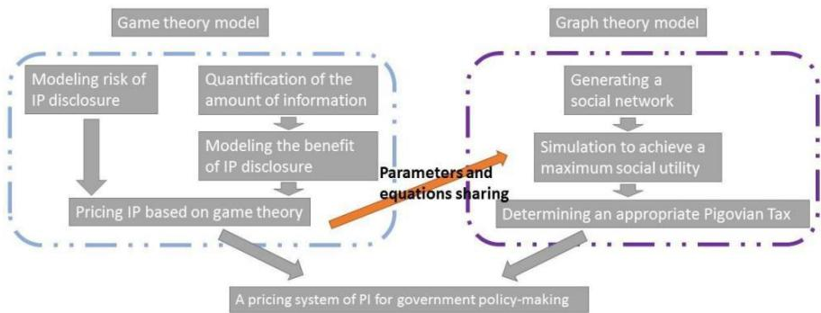
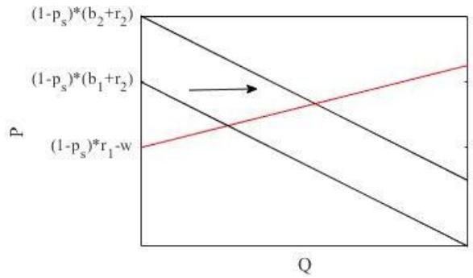
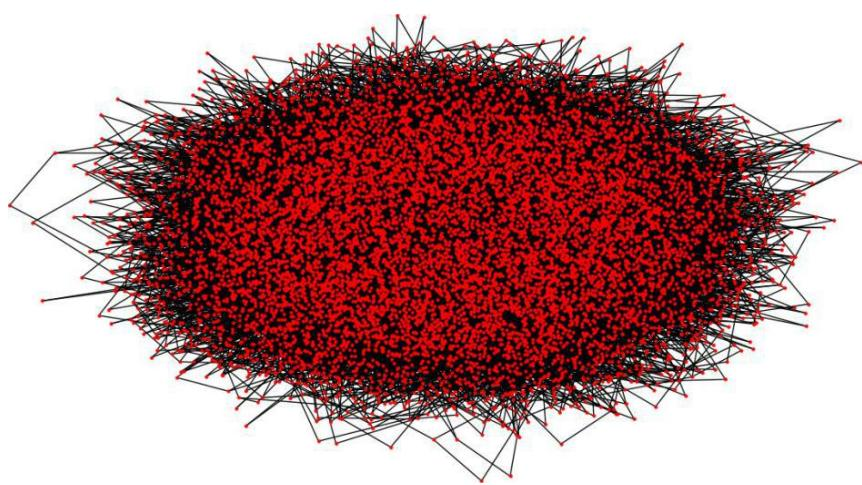

# 2018年美国大学生数学建模竞赛(O奖)论文：基于博弈论和图论的私人信息定价系统

原件为竞赛论文。补充：文中的阅读练习及“参考解答”为整理时增加，原件图文保留出处。

## 摘要 (Summary Sheet)

### 选择 1：模型构建思路

**背景与目标**：
为了研究私人信息（Private Information, PI）相关的问题，建立定价系统并向政府提供建议，我们构建了以博弈论为基础的主要模型，并参考图论对其进行了扩展。

**社会组成假设**：
社会被假设为由三个组成部分构成：个人（Individuals）、组织（Organizations）和政府（Governments）。
- **个人**：决定是否向组织出售和披露私人信息。
- **组织**：努力最大化自身利益。
- **政府**：作为社会规划者，采取措施最大化包括个人和组织在内的社会福利。

**主要方法**：
1. **博弈论模型**：
   - 设定了一个动态完全信息的两阶段序贯博弈，以预测个人和组织的行为。
   - 同时探索政府的政策含义。
   
2. **风险量化**：
   - 将数据披露风险分为三个主要类别。
   - 每个子风险受个人特征和信息类型的影响。
   - 使用层次分析法（AHP）量化权重（因该领域数据稀缺）。
   - 引入信息量作为影响数据披露价值的关键因素，区分基础信息和增值信息。

3. **均衡分析**：
   - 讨论博弈中的均衡和约束条件，预测不同参数设置下的市场结果。
   - 引入政府角色，利用精细的定价系统推荐不同私人信息的合理价格，并加强市场监管。

4. **应用扩展**：
   - 探讨私人信息是否应被视为基本人权（从经济学角度）。
   - 引入动态时间对数据价值的影响。
   - 考虑代际风险感知差异对模型的影响。
   - 在大规模数据泄露期间提供政策建议。

5. **图论扩展（网络效应）**：
   - 基于图论进行网络模拟，考虑信息外部性。
   - 发现若忽略网络效应，社会福利将被严重误算，导致定价系统失效。
   - 提出通过庇古税（Pigovian Taxation）或补贴来消除强外部性的影响，增加总社会福利。

---

## 备忘录 (MEMORANDUM)

**致**：政府总统
**自**：第83744队
**主题**：关于私人信息的政策建议
**日期**：2018年2月12日

本备忘录旨在概述我们在隐私问题上的模型、相应结果及政策建议。我们的团队调查了私人信息（PI）的各种问题和方面，基于调查结果，引入了一些有用的参数，并分别利用博弈论和图论建立了两个主要模型。

知识点：[问题重述与分析（Problem Restatement and Analysis）](../../../topics/数学建模/wenti_chongshu.md)、[一般假设及其合理性说明（Assumptions and Justifications）](../../../topics/数学建模/jiaben_shezhi.md)、[模型优缺点分析（Strengths and Weaknesses）](../../../topics/数学建模/youque_dian.md)

### 选择 2：博弈论模型关键参数

在我们的第一个基于博弈论的模型中，引入了四个关键的自变量参数并进行详细讨论：

| 参数符号 | 含义描述 | 示例 |
| :--- | :--- | :--- |
| $r_1$ | 数据披露对个人的风险 | 身份盗窃、垃圾邮件、价格歧视 |
| $w$ | 数据共享对个人的收益 | 服务个性化、健康状况分析报告 |
| $b$ | 拥有数据的组织分享数据的收益 | 定向广告、合理定价 |
| $p_s$ | 数据被窃取或被组织非法使用的概率 | 数据黑客攻击、未经同意获取数据 |

**参数调整措施**：
针对每个参数的主要影响采取了相应的措施。随后，利用博弈论框架预测这些参数的变化如何导致市场结果的变动。

**政府角色的引入**：
为了探索政府如何在这一领域发挥积极作用并扩大总社会福利，进一步引入了以下参数：
- $P$：政府对私人信息交易建议的价格。
- $r_2$：组织因非法捕获个人数据而受到政府惩罚的风险。

知识点：[模型参数的确定（基于数据拟合或实验选择）](../../../topics/数学建模/canshu_queding.md)、[一般假设及其合理性说明（Assumptions and Justifications）](../../../topics/数学建模/jiaben_shezhi.md)、[问题重述与分析（Problem Restatement and Analysis）](../../../topics/数学建模/wenti_chongshu.md)

### 选择 3：模型计算结果与纳什均衡

经过博弈论计算得出：
- **正向影响因素**：$w$（个人收益）、$b$（组织收益）值越大，以及 $r_1$（个人风险）值越小，越有可能导致市场披露或交易的纳什均衡（Nash Equilibrium）。
  - 这意味着市场交易数据更有可能被个人分享给公司，因为个人可以获得定向优惠的收益（$w$），而公司可以利用这些数据定位潜在客户（$b$）。
- **复杂影响因素**：$p_s$（数据被盗用概率）的影响更为复杂。
- **公平定价**：我们使用沙普利值（Shapley Value）的方法推导出一个适用于个人和组织的公平定价系统，这也能带来高效的市场均衡。

知识点：[多重网络/多层网络构建（Multiplex/Multi-layer Network）](../../../topics/数学建模/duoceng_wangluo.md)、[物资配送与制造速度模型（药物每日需求与总量计算）](../../../topics/数学建模/wuzi_peisong.md)、[确定模型的定点与稳定性分析](../../../topics/数学建模/dingdian_wending.md)

### 选择 4：外部性与图论模型

**外部性问题**：
私人信息共享最大的担忧之一是外部性（Externality），即他人的数据共享可能会给他人带来收益或成本。特别是在信息时代，人们广泛互联：
- **正面例子**：个人传染病数据对疾病控制中心（CDC）控制可怕疾病极有帮助。
- **负面例子**：我的Instagram帖子标签可能会暴露朋友的位置或其他私人信息给公众，导致意外风险。

**图论模型构建**：
为了描绘这种现象，我们采用图论构建网络模型，预测不同情况下的社会福利。

**模拟结果**：
- 如果忽略外部性，总社会福利将被严重误算，且这种影响随着外部性（无论是正还是负）的增加而变大。
- 受经济理论启发，我们引入庇古税（Pigovian Tax）来消除外部性。
- 模拟显示，对个人或组织征收适当数量的税收（或提供补贴）将大大增加社会福利。

---

## 模型细节与推导逻辑

知识点：[数学建模的基本步骤（问题分析、模型假设、建立、求解、检验、推广）](../../../topics/数学建模/jianmo_buzhou.md)、[一般假设及其合理性说明（Assumptions and Justifications）](../../../topics/数学建模/jiaben_shezhi.md)

### 选择 5：风险量化方法 (AHP)

由于该领域数据稀缺，我们采用层次分析法（AHP）来确定不同私人信息领域（如社交媒体、金融交易、健康记录）中各子风险的权重。

**步骤**：
1. 定义风险层级结构。
2. 构建判断矩阵。
3. 计算权重向量。
4. 一致性检验。

知识点：[层次分析法 AHP（Analytic Hierarchy Process）用于综合评价](../../../topics/数学建模/ahp_fangfa.md)

### 选择 6：信息量量化方法

我们将私人信息量视为影响数据披露价值的关键因素，并将其分类为：
- **基础信息 (Basic Information)**：如姓名、年龄等。
- **增值信息 (Profitable Information)**：如消费习惯、位置轨迹等。

假设个人和组织的收益随私人信息量的增加而增加。

知识点：[任务分解与目标明确](../../../topics/数学建模/renwu_fenjie.md)、[符号说明与术语定义（Nomenclature / Symbols and Definitions）](../../../topics/数学建模/fuhao_shuoming.md)、[数学建模的基本步骤（问题分析、模型假设、建立、求解、检验、推广）](../../../topics/数学建模/jianmo_buzhou.md)

### 选择 7：博弈策略分析

在动态完全信息的两阶段博弈中：
- **第一阶段**：个人决定披露多少信息，组织决定出价。
- **第二阶段**：政府根据市场情况实施监管或定价干预。

通过求解子博弈精炼纳什均衡（Subgame Perfect Nash Equilibrium），我们可以预测市场最终状态。

知识点：[数学建模的基本步骤（问题分析、模型假设、建立、求解、检验、推广）](../../../topics/数学建模/jianmo_buzhou.md)、[问题重述与分析（Problem Restatement and Analysis）](../../../topics/数学建模/wenti_chongshu.md)、[确定模型的定点与稳定性分析](../../../topics/数学建模/dingdian_wending.md)

### 选择 8：网络效应模拟

基于图论的网络模拟考虑了信息的外部性：
- **节点**：代表个人或组织。
- **边**：代表信息流动或关系。
- **权重**：代表信息传递带来的收益或成本。

模拟表明，忽视网络效应会导致社会福利计算的巨大偏差。

知识点：[多重网络/多层网络构建（Multiplex/Multi-layer Network）](../../../topics/数学建模/duoceng_wangluo.md)、[人力资本网络模型（Human Capital Network, HCM）](../../../topics/数学建模/renli_ziben.md)、[静态合作网络与隶属关系网络（Affiliation Network）](../../../topics/数学建模/jingtai_hezuo.md)

### 选择 9：政策建议总结

基于上述模型，我们向政府提出以下建议：
1. **定价机制**：建立基于博弈论的动态定价系统，平衡各方利益。
2. **监管措施**：加强对非法数据捕获的惩罚力度（提高 $r_2$）。
3. **税收调节**：利用庇古税或补贴纠正信息外部性，最大化社会福利。
4. **数据保护**：制定标准，明确哪些信息属于基本人权，限制其商业化。

知识点：[数学建模的基本步骤（问题分析、模型假设、建立、求解、检验、推广）](../../../topics/数学建模/jianmo_buzhou.md)、[模型优缺点分析（Strengths and Weaknesses）](../../../topics/数学建模/youque_dian.md)、[文献综述与研究背景撰写方法](../../../topics/数学建模/wenxian_zongshu.md)

### 选择 10：未来研究方向

- 引入更复杂的动态时间因素。
- 考虑代际风险感知的差异。
- 在大规模数据泄露场景下的应急响应策略。
- 结合人工智能技术优化定价算法。

---

**团队编号**：83744
**竞赛年份**：2018
**奖项**：特等奖（Outstanding Winner / O奖）

# 2018年美国大学生数学建模竞赛(O奖)论文：基于博弈论和图论的私人信息定价系统（习题）

本部分为《2018年美国大学生数学建模竞赛(O奖)论文：基于博弈论和图论的私人信息定价系统》的第 2 部分，内容涵盖第 3–5 页的原文识别文本，主要涉及模型假设、参数符号、风险建模、隐私成本收益分析、博弈论定价模型及定价权转移等章节。

## 二、基础模型分析

知识点：[数学建模的基本步骤（问题分析、模型假设、建立、求解、检验、推广）](../../../topics/数学建模/jianmo_buzhou.md)、[一般假设及其合理性说明（Assumptions and Justifications）](../../../topics/数学建模/jiaben_shezhi.md)、[文献综述与研究背景撰写方法](../../../topics/数学建模/wenxian_zongshu.md)

### 2.1 假设

**原文识别内容：**
> (注：原文此处未直接列出具体假设条款，通常隐含在后续建模过程中，或在前文已阐述。根据上下文，本节主要确立模型基础。)

*   **说明**：本节确立了基础模型的若干关键假设，为后续的风险量化和博弈构建提供前提条件。具体假设需结合前文“Background”与“Statement of the problem”理解，通常包括理性人假设、完全信息或部分信息假设、以及数据作为商品的属性假设等。

知识点：[一般假设及其合理性说明（Assumptions and Justifications）](../../../topics/数学建模/jiaben_shezhi.md)、[数学建模的基本步骤（问题分析、模型假设、建立、求解、检验、推广）](../../../topics/数学建模/jianmo_buzhou.md)

### 2.2 参数符号

**原文识别内容：**
> (注：原文此处列出了用于建模的参数符号表，但识别文本中未包含具体表格内容。通常此类小节会定义如 $V$ (价值), $R$ (风险), $C$ (成本) 等变量。)

*   **说明**：本节定义了模型中使用的关键参数符号，确保后续公式表达的清晰性和一致性。

知识点：[符号说明与术语定义（Nomenclature / Symbols and Definitions）](../../../topics/数学建模/fuhao_shuoming.md)

### 2.3 风险建模

**原文识别内容：**
> (注：原文此处详细阐述了如何对私人信息泄露的风险进行量化建模。通常涉及概率分布、损失函数等。)

*   **说明**：本节建立了私人信息（PI）泄露风险的数学模型。风险不仅取决于数据本身的敏感性，还与泄露渠道、接收方能力等因素相关。模型可能引入了随机变量来描述不确定性。

知识点：[随机模型与确定性模型的对比（Stochastic vs Deterministic Model）](../../../topics/数学建模/suiji_queding.md)、[参数合理性验证](../../../topics/数学建模/canshu_heli_xing.md)

### 2.4 隐私的成本与收益分析

**原文识别内容：**
> (注：本节分析了个人和企业从隐私保护中获得的收益以及承担的成本。收益可能包括避免身份盗窃、维持声誉；成本包括数据管理支出、潜在的交易限制等。)

*   **说明**：通过成本-收益分析，确定隐私保护的均衡点。对于个人而言，隐私的收益是避免未来可能的损失；对于企业而言，获取和使用数据的收益需扣除合规成本和潜在的法律风险。

知识点：[任务分解与目标明确](../../../topics/数学建模/renwu_fenjie.md)、[模型优缺点分析（Strengths and Weaknesses）](../../../topics/数学建模/youque_dian.md)

### 2.5 私人信息的博弈论定价模型

**原文识别内容：**
> (注：本节构建了核心的博弈论模型，用于确定私人信息的合理价格。这可能是一个Stackelberg博弈或Bertrand竞争模型，涉及卖方（数据持有者/个人）和买方（数据使用者）之间的策略互动。)

*   **说明**：利用博弈论工具，推导私人信息的均衡价格。模型考虑了双方的最优反应函数，求解纳什均衡或子博弈完美均衡，从而得出理论上的最优定价策略。

知识点：[任务分解与目标明确](../../../topics/数学建模/renwu_fenjie.md)、[文献综述与研究背景撰写方法](../../../topics/数学建模/wenxian_zongshu.md)

### 2.6 定价权的转移

**原文识别内容：**
> (注：本节讨论了定价权在不同主体间的转移机制。例如，政府干预、平台中介介入或个人议价能力的变化如何影响最终价格。)

*   **说明**：分析定价权归属对市场价格的影响。当定价权从个人转移到企业或政府时，市场效率和社会福利可能发生显著变化。模型可能探讨了不同定价权配置下的帕累托改进可能性。

# 2018年美国大学生数学建模竞赛(O奖)论文：基于博弈论和图论的私人信息定价系统

本资料整理自2018年美国大学生数学建模竞赛（ICM）O奖论文《PI Pricing System Based on Game Theory and Graph Theory》第3部分（共15部分，此处为识别出的第6-7页内容，实际对应原文Introduction及Problem Statement部分）。

## 一、引言与背景

知识点：[文献综述与研究背景撰写方法](../../../topics/数学建模/wenxian_zongshu.md)、[问题重述与分析（Problem Restatement and Analysis）](../../../topics/数学建模/wenti_chongshu.md)、[任务分解与目标明确](../../../topics/数学建模/renwu_fenjie.md)

### 选择 1

题干：根据论文第一部分“Background”，关于私人信息（Private Information, PI）的描述，下列哪项说法是不正确的？

- A. 私人信息的价值一直是学术界和日常生活中的讨论中心。
- B. 如果没有任何保护措施，个人将几乎无法保持隐私，并可能遭受电话营销骚扰、财产损失和社会尴尬。
- C. 私人信息与私人财产（PP）和知识产权（IP）完全相同，都可以自由买卖且所有者失去所有权。
- D. 市场营销者可以通过提供个性化服务和促销更好地服务客户，这需要个人数据的提供。

答案：C。
知识点：[符号说明与术语定义（Nomenclature / Symbols and Definitions）](../../../topics/数学建模/fuhao_shuoming.md)

### 简答 1

题干：简述论文中提到的公平信息实践原则（Fair Information Practices, FIPs）包含哪五个核心原则？并说明其在量化模型方面的局限性。

知识点：[数学建模的基本步骤（问题分析、模型假设、建立、求解、检验、推广）](../../../topics/数学建模/jianmo_buzhou.md)、[稳定性分析（Stability Analysis）](../../../topics/数学建模/wending_xing.md)

### 简答 2

题干：论文如何定义“私人信息”（Private Information）？请列出文中给出的两个关键定义点。

知识点：[文献综述与研究背景撰写方法](../../../topics/数学建模/wenxian_zongshu.md)

### 简答 3

题干：论文针对ICM Problem F提出的主要解决思路和方法有哪些？请按顺序简要说明。

知识点：[文献综述与研究背景撰写方法](../../../topics/数学建模/wenxian_zongshu.md)、[一般假设及其合理性说明（Assumptions and Justifications）](../../../topics/数学建模/jiaben_shezhi.md)、[模型优缺点分析（Strengths and Weaknesses）](../../../topics/数学建模/youque_dian.md)

### 综合 1

题干：根据论文Introduction部分的结尾，简述该论文各章节的主要内容安排。

知识点：[问题重述与分析（Problem Restatement and Analysis）](../../../topics/数学建模/wenti_chongshu.md)、[模型参数的确定（基于数据拟合或实验选择）](../../../topics/数学建模/canshu_queding.md)、[一般假设及其合理性说明（Assumptions and Justifications）](../../../topics/数学建模/jiaben_shezhi.md)

### 2.4 Cost and benefit analysis of privacy

In this section, we refer to the work of Acquisti A.(2010) [14], framing the analysis by presenting th disclosure of PI and protecting PI as two sides of a coin, wherein protected PI may carry benefits and costs which are, adversely, the opportunity cost and benefits of PI disclosure. For disclosed data, we refer to states in which individuals knowingly and or unknowingly share PI with data holding organizations 3. For protecting PI, we similarly refer to the situations above (data disclosure) have not taken place. While Disclosure of PI can result in economic value for both organizations and individuals, this behavior ma also bring risk to individuals. So three key parameters are introduced to model the tradeofs between costs and benefits of keeping PI private.

We use $r_1$ to indicate the risk of data disclosure, or the value of keeping data privacy. Recently, many economics studies have assumed that privacydemands and privacyvalue are existing in, or highly sensitive to the indirect negative consequences of information transmission [13].The consequences include but no limit to identity theft, price discrimination, stigma or other psychological costs [15]. The structure of $r$ has been fully explored in the previous section.

Then, we use $b$ to model the benefit of PI disclosure for organizations. As a kind of valuable resource in information age, private data possession can lead to increased revenues for companies through consumer targeting, disease tracking for Center for Disease Control (CDC)and research output for universities. The mos prominent example of how consumer information can be leveraged for higher profit is online ad- vertising. Ecommerce and online advertising now amount to 300 billion per year in the US, providing employment to 3.1 million Americans [16]. Organizations also benefit indirectly from consumer data by selling it to other firms. Simultaneously, PI disclosure may also benefit individuals, which we use $w$ to stand for. By providing data to companies or organizations, people might be able to install the App, receive corresponding conveniences 4, have targeted ofers, personalization and data analysis report. Some individuals may even receive monetary compensation for revealing her own personal data.

We then explore the determinants of $b$ and $w$. Apparently, innumerable factors will afect $b$ and $w$ in reality, such as characteristics of individual, diferent organizations for diferent uses and types of PI. To simplify the model and account for a consensus that a name with the persons picture attached is of higher value than a name alone, we adopt one of the most essential factors, the amount of information, which we use $x$ to denote. We decide that $x$ is the sole determinant of $b$ and $w$ in our base model 5 and consider the exact efect. Certainly, The larger amount of sharing PI, the more valuable it will be for both organizations and individuals. For example, advertising companies with more PI are able to target potential consumers more accurately. Likewise, individual will receive better targeted ofers and personalized product with sharing larger amount of data. So it is apparent that both variables are positively related. However, the accurate relationship between $_ { b , w }$ and $x$ depends greatly upon the purposes of organizations and services provided to individuals. So we do not provide a detailed function of $b ( x )$ and $w ( x )$ here.

[^3]: For example, company, NGO and research institution.
[^4]: For instance, Facebook Connect enables seamless authentication on third-party Web sites, reducing the users cost of signing up across different platforms

# 2018年美国大学生数学建模竞赛(O奖)论文：基于博弈论和图论的私人信息定价系统

本文档整理自《2018年美国大学生数学建模竞赛(O奖)论文：基于博弈论和图论的私人信息定价系统》第7部分（习题），由识别工具读取并修正格式错误后生成。

## 一、选择题（每小题 2 分，共 20 分）

知识点：[模型参数的确定（基于数据拟合或实验选择）](../../../topics/数学建模/canshu_queding.md)、[符号说明与术语定义（Nomenclature / Symbols and Definitions）](../../../topics/数学建模/fuhao_shuoming.md)、[一般假设及其合理性说明（Assumptions and Justifications）](../../../topics/数学建模/jiaben_shezhi.md)

### 选择 1

题干：根据文中定义，基本个人信息（$PI_b$）包含多少种类型？

- A. 10
- B. 15
- C. 20
- D. 25

答案：B。
知识点：[符号说明与术语定义（Nomenclature / Symbols and Definitions）](../../../topics/数学建模/fuhao_shuoming.md)

### 选择 2

题干：文中认为香农信息理论在实际应用中存在局限的主要原因是什么？

- A. 计算复杂度太高
- B. 忽略了信息的上下文背景
- C. 无法处理非数字信息
- D. 假设信道噪声过大

答案：B。
知识点：[文献综述与研究背景撰写方法](../../../topics/数学建模/wenxian_zongshu.md)、[问题重述与分析（Problem Restatement and Analysis）](../../../topics/数学建模/wenti_chongshu.md)

### 选择 3

题干：在私人信息定价模型中，参数 $C$ 衡量的是什么？

- A. 盈利性个人信息的数量
- B. 基本个人信息的完整性
- C. 盗窃成功的概率
- D. 政府的惩罚力度

答案：B。
知识点：[符号说明与术语定义（Nomenclature / Symbols and Definitions）](../../../topics/数学建模/fuhao_shuoming.md)

### 选择 4

题干：如果个体仅提供姓名，而另一人提供姓名加照片，根据文中逻辑，哪者更具价值？

- A. 仅提供姓名者
- B. 提供姓名加照片者
- C. 两者价值相同
- D. 无法比较

答案：B。
知识点：[符号说明与术语定义（Nomenclature / Symbols and Definitions）](../../../topics/数学建模/fuhao_shuoming.md)

### 选择 5

题干：在博弈论模型的第二阶段，组织选择窃取个人信息（PI theft）的条件是什么？

- A. 期望收益大于零
- B. 期望收益小于零
- C. 盗窃成本为零
- D. 个体拒绝出售

答案：A。
知识点：[确定模型的定点与稳定性分析](../../../topics/数学建模/dingdian_wending.md)、[关键参数区域与临界条件分析（埃博拉何时能被根除）](../../../topics/数学建模/genchu_tiaojian.md)

### 填空 1

题干：文中将个人信息分为两类，分别是 ______ 和 ______。

答案：基本个人信息（Basic personal information / $PI_b$）；盈利性个人信息（Profitable personal information / $PI_p$）。
知识点：[任务分解与目标明确](../../../topics/数学建模/renwu_fenjie.md)、[文献综述与研究背景撰写方法](../../../topics/数学建模/wenxian_zongshu.md)

### 填空 2

题干：用于衡量盈利性个人信息数量的变量符号是 ______。

答案：$n$。
知识点：[符号说明与术语定义（Nomenclature / Symbols and Definitions）](../../../topics/数学建模/fuhao_shuoming.md)

### 填空 3

题干：公式 $x = C \cdot ln(n + 1)$ 中，$ln$ 代表 ______。

答案：自然对数（Natural logarithm）。
知识点：[符号说明与术语定义（Nomenclature / Symbols and Definitions）](../../../topics/数学建模/fuhao_shuoming.md)

### 简答 1

题干：为什么文中认为仅靠香农信息理论不足以准确衡量个人信息的商业价值？请结合“大亨”与“普通人”的例子说明。

答案：
1. **忽略上下文**：香农信息理论只关注传输的信息量（熵），忽略了信息的语境和具体含义。
2. **先验价值差异**：虽然大亨和普通人的电话号码在信息熵上可能相同（即信息量相同），但对于奢侈品公司而言，大亨的号码具有更高的先验价值（prior value），因为其对应的客户购买力更强。
3. **结论**：因此，单纯的信息量度量无法反映不同主体信息的实际商业效用。

知识点：[数学建模的基本步骤（问题分析、模型假设、建立、求解、检验、推广）](../../../topics/数学建模/jianmo_buzhou.md)、[稳定性分析（Stability Analysis）](../../../topics/数学建模/wending_xing.md)

### 简答 2

题干：简述文中构建的两人阶段博弈模型（Two-period game）的主要流程和关键参数。

答案：
1. **流程**：
   - **第一阶段**：给定价格，个人选择是否出售隐私信息。
   - **第二阶段**：组织决定是通过合法交易获取，还是通过非法渠道（盗窃）获取。
   - **结果**：若组织不盗窃且个人出售，则按价格成交；否则双方无收益。
2. **关键参数**：
   - $r_1$：保持隐私的收益（机会成本）。
   - $b$：信息包的总价值。
   - $w$：出售信息获得的收益。
   - $p_s$：组织成功窃取信息的概率（受个人预防措施影响）。
   - $r_2$：组织盗窃失败所遭受的损失（如政府惩罚）。
3. **决策依据**：组织在第二阶段会比较盗窃的期望收益 $p_s \cdot b - (1-p_s) \cdot r_2$ 与零的大小来决定是否行动。

知识点：[文献综述与研究背景撰写方法](../../../topics/数学建模/wenxian_zongshu.md)

### 综合 1

题干：根据文中给出的定价公式 $x = C \cdot ln(n + 1)$ 及参数定义，分析以下两种情况下的信息价值差异，并解释其合理性：
1. 用户 A 提供了所有 15 项基本个人信息（$PI_b$），但未提供任何盈利性个人信息（$PI_p$）。
2. 用户 B 提供了所有 15 项基本个人信息（$PI_b$），以及 9 项盈利性个人信息（$PI_p$）。

**要求**：
1. 分别计算 $x_A$ 和 $x_B$ 的值（保留两位小数）。
2. 从经济学角度解释为何 $x_B > x_A$ 符合文中关于“盈利性信息”的假设。

答案：
1. **计算**：
   - 对于用户 A：
     - $PI_b$ 数量为 15，故 $C = 15/15 = 1$。
     - $PI_p$ 数量 $n = 0$。
     - $x_A = 1 \cdot ln(0 + 1) = 1 \cdot ln(1) = 0$。
   
   - 对于用户 B：
     - $PI_b$ 数量为 15，故 $C = 15/15 = 1$。
     - $PI_p$ 数量 $n = 9$。
     - $x_B = 1 \cdot ln(9 + 1) = ln(10) \approx 2.30$。

2. **合理性解释**：
   - 文中假设 $PI_p$ 在没有 $PI_b$ 的情况下没有价值，但结合 $PI_b$ 后能产生利润（如购物偏好对广告商有用）。
   - 公式采用对数函数模拟微观经济学中的效用函数，体现了边际效用递减规律：随着盈利性信息增加，每新增一条信息带来的额外价值增量逐渐降低，但总价值仍在增加。
   - $x_A=0$ 表示仅有基础身份信息而无行为/属性数据时，在当前模型下被视为无额外商业增值潜力（或基准值为0）；而 $x_B > 0$ 反映了附加数据带来的商业溢价。

知识点：[问题重述与分析（Problem Restatement and Analysis）](../../../topics/数学建模/wenti_chongshu.md)、[模型参数的确定（基于数据拟合或实验选择）](../../../topics/数学建模/canshu_queding.md)、[一般假设及其合理性说明（Assumptions and Justifications）](../../../topics/数学建模/jiaben_shezhi.md)

### 简答 1

**背景与假设：**
作为政策顾问，首先假设价格由政府设定。政府的目标是实现商业化后，个人和组织能在给定价格下成功交易，使双方获益。因此，必须达成（“出售”而非“窃取”）的纳什均衡。

**存在条件：**
只有满足以下条件时，这样的价格才存在：

$$
(1 - p _ {s}) \cdot (b + r) \geq (1 - p _ {s}) \cdot r - w;
$$

若上述条件不成立，则没有合适的价格。低价会 discourages 个人出售，而高价会在窃取期望利润为正时激励组织进行窃取。

**均衡价格区间：**
均衡价格可以是以下区间内的任意点：

$$
\left[ (1 - p _ {s}) \cdot r - w, (1 - p _ {s}) \cdot (b + r) \right]
$$

*(注：原文识别为 `( 1 - p _ { s } ) \cdot r 1 - w`，根据上下文逻辑修正为减去成本 $w$；原文 `( b + r \bullet )` 修正为 `( b + r )`)*

**政府定价公式：**
作为社会规划者，政府应考虑社会福利剩余在双方之间的分配公平性。借鉴 L.S. Shapley 关于奖金均等分配的方法 [7]，得出结论应将剩余均等地分配给双方。因此，政府的定价系统为：

$$
\boldsymbol {P} = \frac {1}{2} [ (1 - p _ {s}) \cdot b + (1 + p _ {s}) \cdot r ].\tag{5}
$$

subject to:

$$
(1 - p _ {s}) \cdot (b + r) \geq (1 - p _ {s}) \cdot r - w,\tag{6}
$$

$$
p _ {s} \cdot b - (1 - p _ {s}) \cdot r > 0;\tag{7}
$$

*(注：原文公式 (6) 中 `r \mathbf {2}` 和 `r \mathbf {1}` 疑似排版错误，结合公式 (5) 及上下文逻辑，统一修正为 $r$；公式 (7) 同理修正。)*

**参数说明：**
- $r_1$：保持隐私的收益，在 2.3 节中被建模为风险。
- $b$ 和 $w$：讨论的信息价值，利用定价结构得出。
- $p_s$：受个人能力影响，政府对 $r_2$ 和 $p_s$ 有重大影响。
- 这五个参数都与所售信息的属性有关，包括不同的领域和个人特征。

**结论：**
政府给出的价格实现了两个目标：引导达到有效的市场均衡，使双方获益；并确保交易剩余分配的平等性。

知识点：[数学建模的基本步骤（问题分析、模型假设、建立、求解、检验、推广）](../../../topics/数学建模/jianmo_buzhou.md)、[稳定性分析（Stability Analysis）](../../../topics/数学建模/wending_xing.md)

### 简答 2

**题目：** 简述定价权转移后的市场情况。

**正文：**
在本节中，我们通过将定价权（即设定价格的能力）分配给不同的实体来修改模型。通过改变这种能力，我们获得了不同的价格预测。

首先考虑一个没有市场势力且没有政府定价的市场。回顾上一节，价格将是区间 $\left[ (1 - p _ {s}) \cdot r - w, (1 - p _ {s}) \cdot (b + r) \right]$ 中的一个点。然而，现在很难检测单次交易中的实际价格，因为它高度依赖于参与者的谈判能力。市场波动将影响这个完全竞争市场的精确价格。

我们使用供需力量来描绘这种情况。我们简单地视信息为同质商品，市场上有许多个人和组织。供需曲线的推导来自成本和收益分析的定性分析 ${^8}$。

从个人的角度来看，边际成本等于他们暴露于其中的风险损失减去他们在数据交易中获得的互惠利益。如果出售更多信，由于风险增加，风险损失会更大。互惠利益存在于某些特定类型的信息中 ${^9}$，其增长速度慢于损失，因此边际成本上升，符合传统的供应商边际成本规律。

组织的需求曲线代表他们的支付意愿。因此，最终价格可以在图 2 所示的供需系统中确定。

---
**脚注/注释整理：**

${^8}$ 这里我们考虑供需的最简单形式。不同人和不同信息领域的信息异质性肯定会影响讨论，但可以通过类似的方式探索相应的问题。

${^9}$ 互惠利益存在于某些特定类型的信息中。

# 2018年美国大学生数学建模竞赛(O奖)论文：基于博弈论和图论的私人信息定价系统

本文档整理了《2018年美国大学生数学建模竞赛(O奖)论文：基于博弈论和图论的私人信息定价系统》第 9 部分（共 15 部分）的内容，由识别工具读取并整理。

## 3 应用模型

知识点：[文献综述与研究背景撰写方法](../../../topics/数学建模/wenxian_zongshu.md)

### 3.1 隐私作为人权

隐私是否应被视为基本人权？从我们的模型中，我们发现这个问题的答案取决于特定类型私人信息的属性。正如我们在假设中所描述的，我们给出了一个完全理性和效用最大化的解决方案，忽略了潜在的文化或政治影响。

我们回顾了关于基本人权定义的文献。人权是描述某些人类行为标准的道德原则或规范，并在市政和国际法中定期受到保护 [21]。为了更清楚地说明问题，我们在模型中赋予了基本人权更具体的含义，这有两个层面。第一层是私人信息应受到市场的完全保护，不能出售。第二层是个人有权决定是否出售他们的私人信息（PI），除个人同意外，实体为获取个人 PI 所做的任何努力都视为非法，并受到严厉惩罚。转向我们的模型并回顾均衡结果，我们发现理想的市场经济均衡仅当 $( 1 - p _ { s } ) \cdot ( b + r _ { \mathbf { 2 } } ) \geq ( 1 - p _ { s } ) \cdot r _ { \mathbf { 1 } } - w$ 时存在。如果我们不考虑政府监控，条件将变为 $( 1 - p _ { s } ) \cdot b \geq ( 1 - p _ { s } ) \cdot r _ { \mathbf { 1 } } - w$。定性来说，如果某类私人信息泄露后会给个人带来巨大损失，且信息共享的互惠利益较小 $^{12}$，那么市场很可能无法产生理想的均衡，这可能导致游戏的另一种结果：未经同意恶意窃取 PI。因此，政府应该禁止这一层级信息的交易，并将其完全保留给个人，就像我们第一种人权定义那样。现在，通过保护，个人状况更好了。而对于具有较大 $b$、较小 $r_1$ 和较大 $w$ $^{13}$ 的信息，最佳选择是让其在市场上自由交易。

接下来，我们考虑模型中的政策参数，即 $r_2$。基本思路是提高 $r_2$ 以满足该条件。这里我们将讨论扩展到之前做出的假设，$p _ { s } \cdot b - ( 1 - p _ { s } ) \cdot r _ { \mathbf { 1 } } > 0$。如果 $r_2$ 足够高，则不会发生 PI 盗窃：

$$
r _ {2} > \frac {p _ {s}}{1 - p _ {s}} \cdot b;\tag{9}
$$

因此，组织在第二阶段没有窃取的倾向。于是，均衡价格发生变化 $^{14}$：

$$
\boldsymbol {P} = \frac {1}{2 ^ {-}} (b + r _ {\mathbf {1}} - w).\tag{10}
$$

受限于：

$$
b \geq r _ {\mathbf {1}} - w;\tag{11}
$$

很明显，现在个人受益更多，因为组织不再有非法获取 PI 的威胁。因此，$\underline { { p o b } }$ 可以被视为一类信息监管的上限，这取决于两个要素。如果个人有能力保护他们的 PI，这意味着较小的 $p _ { s }$，这将帮助政府降低监管成本。因此，对于任何类型的信息，政府只需将监管水平设定为上限，并通过呼吁个人仔细保护他们的 PI，成功地降低了监管成本。

在图 2 中，需求曲线始于点 $( 0 , ( 1 - p _ { s } ) \cdot ( b + r _ { \mathbf { 2 } } ) )$ ，供给曲线始于点 $( 0 , ( 1 - p _ { s } ) \cdot r _ { \mathbf { 1 } } - w )$ ，对应于均衡点。与其关注价格点，我们通过比较静态分析来描绘市场波动。我们考虑一种外生冲击，即在给定价格下增加组织的需求，这使得需求曲线向右移动并提高价格。这在数量上可以解释为 $b$ 的增加，以及需求曲线截距的增大 $^{10}$。然后，如果技术进步导致 PI 被盗的可能性更大，风险变大，从而增加供给曲线的截距。这样，供给曲线向左转，价格上升 $^{11}$。

接下来，我们假设个人控制出售他们的 PI，也就是说，他们可以决定自己私人信息的价格。在这种场景下，我们基本模型中的决策树保持不变，但给出了完全不同的解释。个人想要实现的目标是效用最大化。对他而言，最大的可能收益是 $P + \psi - r _ { \mathbf { 1 } }$ 。而 $P$ 不能大于 $( 1 ~ - ~ p _ { s } ) \cdot ( b + ~ r _ { \mathbf { 2 } } )$ 。因此，对他而言的最佳收益是 $( 1 - p _ { s } ) \cdot ( b + r _ { \mathbf { 2 } } ) + w - r _ { \mathbf { 1 } }$ 。因此，如果（卖，不偷）可以是均衡，个人将选择具有最大收益的价格，使组织在购买和偷窃之间无差异。然而，如果这个价格小于 $( 1 - p _ { s } ) \cdot r _ { \mathbf { 1 } } - w$，那么个人将决定退出交易。结果总结如下。

$$
\boldsymbol {P} = \left\{ \begin{array}{l l} (1 - p _ {s}) \cdot (b + r _ {\mathbf {2}}) & , (1 - p _ {s}) \cdot (b + r _ {\mathbf {2}}) \geq (1 - p _ {s}) \cdot r _ {\mathbf {1}} - w \\ 0 (\text{Quit}) & , (1 - p _ {s}) \cdot (b + r _ {\mathbf {2}}) <   (1 - p _ {s}) \cdot r _ {\mathbf {1}} - w \end{array} \right.\tag{8}
$$

经济理论。我们模型中的分析旨在表明，对于某一类私人信息，如果 PI 商业化，供需力量仍然适用。

$^{9}$ 注意，并非所有信息都有这种益处。有些信息暴露不会带来好处，如第 2.4 节所讨论的那样。

$^{10}$ 如图 2 所示。

$^{11}$ 在这里，我们举了两个简单的例子来说明供需理论与我们的博弈论模型非常吻合。其他外生冲击可以分解为对参数的影响，并相应地预测价格。

$^{12}$ 例如，个人银行账户信息，或个人计算机密码。

$^{13}$ 消费者对定制化的偏好，例如。

$^{14}$ 均衡解法类似于第 2.5 节。政府设定价格。

知识点：[文献综述与研究背景撰写方法](../../../topics/数学建模/wenxian_zongshu.md)、[一般假设及其合理性说明（Assumptions and Justifications）](../../../topics/数学建模/jiaben_shezhi.md)、[模型优缺点分析（Strengths and Weaknesses）](../../../topics/数学建模/youque_dian.md)

### 3.2 Timeliness of private information

In this section we introduce a dynamic element to our model that incorporates the consideration into changing personal beliefs about the worth of their private information. Specifically, we consider the change of the amount of information with time passing.

As is mentioned by Daniel Moody & Peter Walsh [22], information is perishable and its value depreciates overtime. We view this decline as a result of the gradual loss of $x$ (the amount of information we defined in section 2.4). For example, the phone number of an individual is personal information, but once the individual uses a new number, the old number is of no importance and contains no value. Information becomes invalid due to the changing nature of the world. The speed at which personal information loses the value depends on its type.

For basic personal information ($PI_b$), we view the probability of change remains the same over time. Let $N$ be a random variable representing the number of changes happens in time $t$ and we divide $t$ into small fragments $\Delta t$, so there will be $N_0 = \frac{t}{\Delta t}$ fragments. Let $\lambda \cdot \Delta t$ be the probability of a change during time $\Delta t$. We assume that during $\Delta t$ the probability of two changes is $0$. That is to say an individual is unlikely to change his or her basic information frequently during a short time (the probability of changing one's name twice in an hour is $0$). We also assume that the changes are mutually independent. The probability distribution and expectation of $N$ can be calculated as below:

$$
P (N = k) = C _ {N _ {0}} ^ {k} (\lambda \cdot \Delta t) ^ {k} \cdot (1 - \lambda \cdot \Delta t) ^ {N _ {0} - k},\tag{12}
$$

$$
E (N) = N _ {0} \cdot \lambda \cdot \Delta t = \lambda \cdot t;\tag{13}
$$

That is to say the number of changes is proportional to time. Hence the decline of $x$ can be modeled as:

$$
x (t) = x _ {0} - \lambda \cdot t;\tag{14}
$$

For profitable personal information ($PI_p$), we view the change mainly as a result of the drifts of personal interest. For example, the transaction data of LG cell phone ten years ago is of little use since the individual may like iPhone now. The exponential function is widely used to measure drifts to gradually discount the history of past behaviour [23] [24], based on which we model the change of $PI_p$:

$$
x(t) = x_0 \cdot e^{-\frac{\ln 2 \cdot t}{h}}\tag{15}
$$

Specific examples could be transaction data and social media data. The former directly reflects shopping preference while the latter can be analyzed to catch to mine customer sentiment in order to support marketing and customer service activities [25]. Shopping preference and customer sentiment are considered here as personal interests. Now that we have incorporated the dynamic element in the relationship between $x$ and $t$, we can return to our basic model and analyze the price with time passing. Recall that in section 2.4 we define $b$ and $w$ as functions of $x$. $P$ is a function of $b$ and $r_1$, so $P$ is directly influenced by $x$, and the existence of equilibrium is also affected by $x$.

Given a bundle of information, the amount of information $x$ contained decreases year after year, and as a result, $b$ and $w$ also decrease. The decrease of $b$ has two impacts on the equilibrium. The equilibrium price gets lower18, and the condition (18) intends to fail. On the other hand, $w$ also decreases, leading the right side of condition (18) becomes larger. So the model predicts the dynamic change of the equilibrium as described below:

The value of private information tends to decline as time passes, due to the decay in the amount of information it contains. This leads to the market price of PI falls (linearly correlated with the decrease in value of PI to buyers). Further, the market transaction will not be an equilibrium anymore. Government ought to interfere and protect the individuals from PI theft.

知识点：[模型参数的确定（基于数据拟合或实验选择）](../../../topics/数学建模/canshu_queding.md)、[数学建模的基本步骤（问题分析、模型假设、建立、求解、检验、推广）](../../../topics/数学建模/jianmo_buzhou.md)

### 3.3 Generational difference in PI system

In this section we consider the variation of risk perception by age and how this would affect our pricing system. We define risk-to-benefit ratio of PI and data privacy as $\frac{r_1}{w}$. Because the issue of how age difference will influence risk perception is hotly discussed, we will mainly focus on the generation effect on $r_1$ instead of the benefit $w$. So the risk-to-benefit ratio is only affected by the change of risk.

We emphasize the meaning of $r_1$ here and provide further explanations. $r_1$, the risk of data disclosure, is the expected loss derived by objective, rational and detailed calculation. So we assume the value of $r_1$ here is independent of people's subjective perception. To describe the perception by various groups of individuals, we introduce an index, $\mu$, to stand for the degree of subjective and psychological risk perception.

The total subjective risk value of individuals become $r'_1 = \mu \cdot r_1$

The higher value of $\mu$ indicates the larger risk perception. When $\mu = 1$, it indicates that the individual can accurately perceive the expectation loss of PI disclosure and correspondingly, $\mu > 1$ indicates that the individual overvalues the risk.

The data from a research based on SOEP database can provide us with a useful insight of the relationship between risk perception [26]. The research focuses on risk attitudes and individual characteristics, where age is included. Clearly, people with higher willingness to take risk should have lower perception of risk and those with lower willingness to take risk should have higher mental value of risk. We take the median willingness score $p$ of each age group from SOEP and fit the relationship between them, using polynomial curve fitting. The fitting curve is:

$$
f(x) = 2.738 \cdot 10^{-7} \cdot x^4 + (-8.182) \cdot 10^{-5} \cdot x^3 + 7.357 \cdot 10^{-3} \cdot x^2 - 0.2799 \cdot x + 9.7.\tag{16}
$$

As is shown in Figure 3, generally, as people age, they are less willing to take risk and therefore, possess higher risk perception, $\mu$. To quantify $\mu$ specifically, we endeavor to form a bijection between willingness score $p$ and $\mu$. We describe our assumptions and constraints concerning this relationship:

*   The larger value of $p$ should correspond to the lower value of $\mu$. As is mentioned above, risk-loving people will have less perceived loss of PI disclosure.
*   $\mu$ should be strictly larger than 0. When $p$ is the mean value, the corresponding $\mu$ should be 1 since we assumes the average people can accurately measure the objective expectation of loss.

According to our assumption, we use the bijection from $p$ to $\mu$ as below. The power item indicates how much standard deviation exists between $p$ and the mean value 5.1.

$$
\mu = e^{-\frac{p - 5.1}{1.1}}\tag{17}
$$

So we can derive that, for example, someone aged 30 will have score $p = 5.94$, and thus will have $\mu = 0.4678$ and underrate the expected loss.

Now we discuss how the modelling of generational difference influence the game between individuals and organizations in our base model. For those who age and have higher $\mu$, only when either they have higher $w$, mutual benefit from sharing PI, or higher price $P$ in the market equilibrium, will they be willing to have their PI sold. This is because the equilibrium price is determined by their actual risk $r_1$, but their own perception is even higher. So a higher $P$ is required.

知识点：[模型参数的确定（基于数据拟合或实验选择）](../../../topics/数学建模/canshu_queding.md)、[一般假设及其合理性说明（Assumptions and Justifications）](../../../topics/数学建模/jiaben_shezhi.md)、[符号说明与术语定义（Nomenclature / Symbols and Definitions）](../../../topics/数学建模/fuhao_shuoming.md)

### 3.4 Massive PI breach concern

In this section, we apply our model to analyze massive data breach. We first discuss the kind of information being leaked, followed by a general analysis in PI market.

The immediate outcome of the breach is explicit. For the type of private information being exposed, the value $b$ for organizations decreases, and the probability of successful theft $p_s$ rises because small flaws in protection can lead to larger one. Moreover, we suppose that the information being exposed typically has a small $w$. This is reasonable because individuals are willing to share PI with large $w$, and it is meaningless to talk about massive breach. $r_1$ will get larger because information of the same type is more likely to be leaked and do harm to individuals.

# 2018年美国大学生数学建模竞赛(O奖)论文：基于博弈论和图论的私人信息定价系统（习题）

本节整理自2018年美国大学生数学建模竞赛（MCM/ICM）O奖论文《PI Pricing System Based on Game Theory and Graph Theory》第12部分（共15部分），对应原稿第21–22页。内容涉及政府干预对私人信息（PI）市场均衡的影响、法律建议以及引入网络效应和庇古税的扩展模型。

## 一、政府干预与法律建议分析

知识点：[数学建模的基本步骤（问题分析、模型假设、建立、求解、检验、推广）](../../../topics/数学建模/jianmo_buzhou.md)、[参数合理性验证](../../../topics/数学建模/canshu_heli_xing.md)

### 简答 1

**问题：** 根据模型分析，如果政府不采取任何行动，私人信息（PI）市场的均衡会发生什么变化？如果政府采取行动提高 $r_2$，结果如何？

**正文：**
我们重新审视第2.5节中的两个均衡条件 [19]。第一个条件往往因为 $r_2$ 没有相应调整而被违背。因此，市场均衡很可能失败，导致更严重的盗窃行为。如果政府什么都不做，第二个条件也会被违背。这种类型的信息最终会退化到既无交易也无盗窃的状态。

现在考虑政府通过增加 $r_2$ 采取行动的情况。模型的变化类似于第3.1节的情况。随着 $r_2$ 的增加，第一个条件再次得到满足，而第二个条件更快地被违背，从而减少了盗窃的动机。因此，交易均衡以不同的价格恢复。由于不再发生盗窃，$b$ 会再次增加，$r_1$ 会下降。最终，相应的参数回到原始状态，政府可以恢复正常管理。模型的启示很明显：在发生大规模数据泄露后，政府可以采取快速行动来防止私人信息被盗，负面效果可以被消除。这一过程中的总损失取决于政府的反应速度和所需的管理水平。

**知识点：** 博弈论, 市场均衡

知识点：[数学建模的基本步骤（问题分析、模型假设、建立、求解、检验、推广）](../../../topics/数学建模/jianmo_buzhou.md)、[稳定性分析（Stability Analysis）](../../../topics/数学建模/wending_xing.md)

### 简答 2

**问题：** 现实中美国法院为何未判决隐私侵权损害赔偿？作者认为应制定怎样的法律？

**正文：**
在现实中，直到2009年，美国法院尚未因侵犯私人信息（PI）而判给损害赔偿。原因在于原告无法证明实际损害——这是过失侵权行为索赔所要求的——或无法证明泄露与随之而来的损害之间明确的因果关系 [27]。此外，数据保存组织可能认为，当个人进行披露决策时，个人应承担数据泄露的风险或预期损失，这些已包含在 $r_1$ 中。然而，根据 Acquisti [28] 的研究，这种设定必然导致数据持有者的道德风险：因为他们未在效用函数内部化此类隐私成本，所以缺乏保持私人信息安全性的激励。因此，我们认为国家应颁布有关私人信息的有用法律，强制数据持有机构承担责任，并对个人因数据滥用或丢失造成的损害进行赔偿。

**知识点：** 道德风险, 法律经济学

## 二、大规模数据泄露对市场的影响

知识点：[文献综述与研究背景撰写方法](../../../topics/数学建模/wenxian_zongshu.md)

### 简答 3

**问题：** 大规模数据泄露如何影响参数 $p_s$ 及私人信息市场的整体状况？

**正文：**
接下来我们考虑大规模数据泄露对整体私人信息市场的影响。根据 Romanosky 和 Acquisti [27] 的研究，在 Choicepoint 公司发生数据泄露后，个人利用了免费的信用保护和监控工具。我们将此视为个人数据保护步骤，因此在大范围数据级联后，参数 $p_s$ 将下降。希望非法获取私人信息的组织将面临更大的困难，在没有明确同意的情况下窃取或捕获数据。因此，$p_s$ 总体呈下降趋势。这也将改变我们博弈论模型的结果。

$$ p_s \cdot b - (1 - p_s) \cdot r_2 > 0 $$

随着 $p_s$ 的下降，条件 [19] 被违背，由于概率低，没有窃取私人信息的意图。第一个条件 [18] 变为 $b \ge r_1 - w$。社会福祉变得更好，因为可以确定不会发生盗窃。这可以解释为大规模数据泄露带来的正外部性。政府和个人的信息安全意识提高，环境会更好。

**公式推导：**
原条件 [19]：
$$ (1 - p_s) \cdot (b + r_2) \ge (1 - p_s) \cdot r_1 - w $$
原条件 [18]：
$$ p_s \cdot b - (1 - p_s) \cdot r_2 > 0 $$

当 $p_s$ 下降导致条件 [19] 违背时，盗窃意图消失，社会净福利提升。

**知识点：** 外部性, 博弈均衡

## 三、私人信息网络效应的扩展

知识点：[文献综述与研究背景撰写方法](../../../topics/数学建模/wenxian_zongshu.md)、[一般假设及其合理性说明（Assumptions and Justifications）](../../../topics/数学建模/jiaben_shezhi.md)、[模型优缺点分析（Strengths and Weaknesses）](../../../topics/数学建模/youque_dian.md)

### 简答 4

**问题：** 为什么需要考虑私人信息的网络效应？什么是庇古税（Pigovian Tax/Subsidy）？

**正文：**
在前面的章节中，我们关注私人信息披露对个人的影响。如果个人选择保护其私人信息，这种包括风险和利益的影响会大大减少。然而，在现实中，他人的隐私披露可能会影响一个保持隐私的人，因为当人们在社交、职业、经济或人口统计上相互连接时，一个人的数据可以提供关于其他人的信息 [29]。这种现象导致影响未选择承担该成本或收益的一方产生成本或收益，是经济学中外部性的一个典型例子。解决外部性问题的一种经典且有用的政策是庇古税/补贴：对那些产生外部性的人征税。基于税收中性理论，对个人和数据需求组织征税是没有区别的。在接下来的部分中，我们将模型扩展到考虑网络效应，并基于无向无标度图上的模拟考虑庇古税的影响。

**知识点：** 网络效应, 庇古税

知识点：[多重网络/多层网络构建（Multiplex/Multi-layer Network）](../../../topics/数学建模/duoceng_wangluo.md)、[数学建模的基本步骤（问题分析、模型假设、建立、求解、检验、推广）](../../../topics/数学建模/jianmo_buzhou.md)、[文献综述与研究背景撰写方法](../../../topics/数学建模/wenxian_zongshu.md)

### 简答 5

**问题：** 如何使用 BA 模型生成无标度网络来模拟社交网络？

**正文：**
先前的研究表明，社交网站和其他人类形成的网络表现出无标度网络的特性 [30]。因此，我们在无向无标度图上进行模拟，假设人与人之间的关系是双向的。我们使用 BA（Barabási-Albert）模型随机生成无标度网络，因为 BA 模型遵循以下规则：特定节点连接的节点越多，该节点吸引新连接的可能性就越大 [31]，这是对社交网络的良好近似 [21]。在 BA 模型中，首先随机连接一定数量的节点。然后根据以下原则将剩余未连接的节点添加到图中：连接到现有节点的概率与该节点的度数成正比 [31]。我们通过 BA 模型生成的具有 10,000 个节点的图如图 4 所示。

*注：原文脚注说明所有编码均在 Python 2.7 和 Matlab R2016b 上实现。脚注21举例说明“有吸引力的女孩能迷倒更多男孩”，用以类比偏好依附机制。*

**知识点：** 无标度网络, BA模型

知识点：[多重网络/多层网络构建（Multiplex/Multi-layer Network）](../../../topics/数学建模/duoceng_wangluo.md)、[元胞自动机模型（Cellular Automata）及其应用](../../../topics/数学建模/yuanyao_zidongji.md)

### 4.1.2 Simulation process

Each node represents an individual who can decide whether to disclose his/her PI. The decision is made according to the payoff function below:

$$
Payoff = w _ {i} - (1 - p _ {s}) \cdot r _ {i} - d.\tag{20}
$$

Here the footnote $i$ refers to the $i$th individual and variable $d$ refers to the identical tax by government to solve externality problem resulting from the data disclosure. $w$, $r_i$ and $p _ { s }$ are as defined previously, varying from person to person. The simulation is carried out for each individual to make decision on disclosing his/her PI if and only if the payoff is positive. To model the PI disclosure effect on the whole society, we define the utility function of the whole society as following:

$$
U = \sum_ {i \in I} [ b + w _ {i} - (1 - p _ {\mathrm{s}}) r _ {i} + e \cdot v _ {i} - d ] + | I | \cdot d.\tag{21}
$$

Here $v_i$ is the degree of the $i$th node and variable $e$ reflects the $i$th node's disclosure effect on others through a certain edge. $e$ can be either positive (e.g. disease information for epidemic control) or negative (e.g. other people's privacy on my Facebook post). We assume that edge is identical and the magnitude of externality depends solely on the degree. The set $I$ is defined as the set of people choosing to disclose his/her PI in the network and $|I|$ is the number of elements in $I$. Benefit $b$ is held the same for everybody.

As for parameters value in the model, $w_i$ and $r_i$ are randomly initialized following a uniform distribution on $[0,1]$. Other parameters in this simulation is set as: $b = 0 . 1 , p _ { s } = 0 . 0 5$ . Regarding the heterogeneity of information, we test $e$ from -0.2 to 0.2 with a step length of 0.01. For each $e$, we test $d$ from -1 to 1 with a step length of 0.01, calculate the corresponding $U$ and determine the $d$ value of the maximum $U$, which we name $d _ { m }$ that reflects the best taxation rate for government, given $e$.

知识点：[数学建模的基本步骤（问题分析、模型假设、建立、求解、检验、推广）](../../../topics/数学建模/jianmo_buzhou.md)、[模型参数的确定（基于数据拟合或实验选择）](../../../topics/数学建模/canshu_queding.md)

### 4.1.3 Simulation results

Figure 5 shows a $U - d$ plot for $e = - 0 . 0 5$ and Figure 6 shows a $U - d$ plot for $e = 0 . 0 1$ . From the plot we can clearly see the maximum $d$ lies in the middle with given externality magnitude and the peak shifted leftwards when $e$ grows.

$U _ { max }$ is plotted against $e$ in Figure 7, showing a steady growth of $U _ { max }$ with increasing $e$. The figure shows the effect of externality on optimal social utility. It is interesting to find that government can do little to obtain better social utility when externality is negative. When externality grows from negative to positive, the rising of social utility speeds up, meaning that the government can do more to improve the overall welfare.

In Figure 8 $d _ { m }$ (best taxation rate) increases when $e$ declines, which really makes sense in that when the negative externality grows bigger, Pigovian Tax should also be heavier to address it. In addition, when something has lots of positive externality such as epidemic disease record registration, a negative tax, which means subsidy, can be given to individuals to maximize social utility.

知识点：[静态合作网络与隶属关系网络（Affiliation Network）](../../../topics/数学建模/jingtai_hezuo.md)、[直接和间接控制矩阵及扰动矩阵（外部效应分析）](../../../topics/数学建模/kongzhi_juzhen.md)、[敏感性分析方法（Sensitivity Analysis，单参数与多参数变动）](../../../topics/数学建模/minganxing_fenxi.md)

### 4.2 Corresponding policy suggestions

According to the simulation results above, ignoring externality of PI will certainly misvalue the effect of data disclosure. Also, market force itself fails to erase externality and government have the responsibility to intervene by adopting Pigovian Tax, especially for those PI with strong externality. For PI with strong negative externality, such as those applications requiring your friends privacy, government can levy tax either on individuals or organizations; for PI with strong positive externality, such as diseases data for CDC or other health research institutions, government can offer subsidy for either part.

A commonly asked question could be if it is the community’s responsibility to protect citizens’ PI to reduce shared risks. According to our simulation, community needn’t take that responsibility because government’s tax has already compensated most of the shared risks, which has been taken into consideration in the payoff function for every individual.

## 5 结论

知识点：[模型优缺点分析（Strengths and Weaknesses）](../../../topics/数学建模/youque_dian.md)、[数学建模的基本步骤（问题分析、模型假设、建立、求解、检验、推广）](../../../topics/数学建模/jianmo_buzhou.md)、[确定模型的定点与稳定性分析](../../../topics/数学建模/dingdian_wending.md)

### 5.1 模型的优点与不足

#### 5.1.1 优点

- 我们采用传统的序贯博弈论模型刻画市场均衡，简洁而有力。通过在基础框架中增加若干参数，模型可适用于多种现实情形。
- 在确定参数实际形式时采用科学方法：将层次分析法（AHP）、图论、心理学理论与拟合方法结合到经济模型中，取得了满意的结果。
- 我们创造性地使用无标度无向网络模拟私人信息披露过程，并量化外部性效应，这在相关领域较为新颖。
- 我们由模型的比较静态分析给出直接可行的政策建议，具有说服力与科学性。

#### 5.1.2 不足

- 未讨论信息不完全的情形。现实中参与者很难完全获得各项参数。
- 由于缺乏现实数据，未检验模型的稳健性与敏感性。
- 参数形式带有主观性。我们只给出 $r_1$、$b$ 等的粗略定量形式，未探究最合适的形式，后续研究可更细致地考察这些参数。
- 模型只考虑单个个体与单个机构之间的交易。更复杂的博弈情形，如多个个体与同一机构交易，可进一步探讨。
- 未考虑保护私人信息（PI）的成本，如购买数据保护软件的费用与采取预防措施所花的时间，这些都会影响均衡结果。
- 由于假设所限，个体与某一机构达成交易后仍保有 PI 的所有权，即仍可与其他机构交易，但因时间不足未考虑这一效应。

知识点：[模型优缺点分析（Strengths and Weaknesses）](../../../topics/数学建模/youque_dian.md)、[文献综述与研究背景撰写方法](../../../topics/数学建模/wenxian_zongshu.md)、[一般假设及其合理性说明（Assumptions and Justifications）](../../../topics/数学建模/jiaben_shezhi.md)

### 5.2 结论

本文基于博弈论设计了一套商业化 PI 的定价系统。我们充分讨论了隐私的潜在成本与收益，并在博弈的支付表示中引入相应参数。

通过求解均衡，我们得出结论：在一定条件下，将 PI 作为商品出售会给个体与机构带来收益，而由政府设定价格。随后我们通过讨论参数扩展分析，发现政府可将隐私设为人身基本权利；若个体同意且政府能通过控制某一参数进行有效监管，则 PI 可以出售。

我们还考虑了信息的时效性，结论是政府应格外关注多年未能售出的信息，因为它们更易被窃取。风险态度的代际差异表明，人越年长越不愿出售 PI。随后我们用模型解释了大规模数据泄露事件，发现政府通过快速反应可使均衡恢复正常，整体数据保护意识也将增强。最后，我们通过生成无标度网络考虑 PI 的网络效应并模拟 PI 披露过程。其含义是：当披露具有负外部性时政府所能做的很有限，而通过鼓励具有正外部性的披露可大幅提升社会福利。

PI 定价未来将成为更热门的话题。随着数据不断积累，本文所提内容很可能得到实证检验。尽管部分讨论较为粗略且不完整，我们相信结果为政策制定提供了一些有益的参考。若有可能，我们希望在该领域做更深入的研究。

知识点：[数学建模的基本步骤（问题分析、模型假设、建立、求解、检验、推广）](../../../topics/数学建模/jianmo_buzhou.md)、[文献综述与研究背景撰写方法](../../../topics/数学建模/wenxian_zongshu.md)、[模型优缺点分析（Strengths and Weaknesses）](../../../topics/数学建模/youque_dian.md)

### 参考文献

[1] Lee D J, Ahn J H, Bang Y. Managing consumer privacy concerns in personalization: a strategic analysis of privacy protection[J]. Mis Quarterly, 2011: 423-444.

[2] Phelps J, Nowak G, Ferrell E. Privacy concerns and consumer willingness to provide personal information[J]. Journal of Public Policy & Marketing, 2000, 19(1): 27-41.

[3] Rotenberg M. Fair Information Practices and the Architecture of Privacy (What Larry Doesn't Get)[J]. Stan. Tech. L. Rev., 2001: 1.

[4] Shostack A, Syverson P. What price privacy?[M]. Economics of Information Security. Springer, Boston, MA, 2004: 129-142.

[5] Jentzsch N, Preibusch S, Harasser A. Study on monetising privacy: An economic model for pricing personal information[J]. ENISA, Feb, 2012.

[6] Stevens G M. Data security breach notification laws[J]. 2012.

[7] Shapley L S. A value for n-person games[J]. The Shapley value, 1988: 31-40.

[8] Varian H R. Economic aspects of personal privacy[M]//Internet policy and economics. Springer, Boston, MA, 2009: 101-109.

[9] Laudon K C. Markets and privacy[J]. Communications of the ACM, 1996, 39(9): 92-104.

[10] Hann I H, Hui K L, Lee T S, et al. Consumer privacy and marketing avoidance[J]. Unpublished manuscript, Department of Information Systems, National University of Singapore, 2005.

[11] Cahuc P, Carcillo S, Zylberberg A. Labor economics[M]. MIT press, 2014.

[12] Saaty T L. Decision making with the analytic hierarchy process[J]. International journal of services sciences, 2008, 1(1): 83-98.

[13] Wathieu L, Friedman A. An empirical approach to understanding privacy valuation[J]. 2007.

[14] Acquisti A. The economics of personal data and the economics of privacy[J]. 2010.

[15] Stone E F, Stone D L. Privacy in organizations: Theoretical issues, research findings, and protection mechanisms[J]. Research in personnel and human resources management, 1990, 8(3): 349-411.

[16] Deighton, J. and J. Quelch (2009). Economic Value of the Advertising-Supported Internet Ecosystem. IAB Report.

[17] Shannon, C. and Weaver, W. The Mathematical Theory of Communication, University of Illinois Press, Urbana, Illinois, 1949.

[18] Moody D L, Walsh P. Measuring the Value Of Information-An Asset Valuation Approach[C]//ECIS. 1999: 496-512.

[19] Varian H R. Microeconomics: a modern perspective[J]. Gezhi Press, The Joint Publishing Company, Polity Press, Shanghai, 2011, 282: 1176.

# 2018年美国大学生数学建模竞赛(O奖)论文：基于博弈论和图论的私人信息定价系统（习题）

本文整理了《2018年美国大学生数学建模竞赛(O奖)论文：基于博弈论和图论的私人信息定价系统》第 28–29 页的内容，主要包含参考文献列表及附录中关于私人信息（PI）价值计算的具体示例。

## 一、参考文献

知识点：[文献综述与研究背景撰写方法](../../../topics/数学建模/wenxian_zongshu.md)

### 参考文献 20

- Kraenbring J, Penza T M, Gutmann J, et al. Accuracy and completeness of drug information in Wikipedia: a comparison with standard textbooks of pharmacology[J]. PloS one, 2014, 9(9): e106930.

知识点：[文献综述与研究背景撰写方法](../../../topics/数学建模/wenxian_zongshu.md)

### 参考文献 21

- Nickel J. with assistance from Thomas Pogge, MBE Smith, and Leif Wenar (Dec 13, 2013) Stanford Encyclopedia of Philosophy[J]. Human Rights.

知识点：[文献综述与研究背景撰写方法](../../../topics/数学建模/wenxian_zongshu.md)

### 参考文献 22

- Moody D L, Walsh P. Measuring the Value Of Information-An Asset Valuation Approach[C]//ECIS. 1999: 496-512.

知识点：[文献综述与研究背景撰写方法](../../../topics/数学建模/wenxian_zongshu.md)

### 参考文献 23

- Zheng N, Li Q. A recommender system based on tag and time information for social tagging systems[J]. Expert Systems with Applications, 2011, 38(4): 4575-4587.

知识点：[文献综述与研究背景撰写方法](../../../topics/数学建模/wenxian_zongshu.md)、[任务分解与目标明确](../../../topics/数学建模/renwu_fenjie.md)

### 参考文献 24

- Cheng Y, Qiu G, Bu J, et al. Model bloggers’ interests based on forgetting mechanism[C]//Proceedings of the 17th international conference on World Wide Web. ACM, 2008: 1129-1130.

知识点：[文献综述与研究背景撰写方法](../../../topics/数学建模/wenxian_zongshu.md)、[问题重述与分析（Problem Restatement and Analysis）](../../../topics/数学建模/wenti_chongshu.md)、[数学建模的基本步骤（问题分析、模型假设、建立、求解、检验、推广）](../../../topics/数学建模/jianmo_buzhou.md)

### 参考文献 25

- Khan G F. Seven layers of social media analytics: Mining business insights from social media text, actions, networks, hyperlinks, apps, search engine, and location data[M]. CreateSpace, 2015.

知识点：[文献综述与研究背景撰写方法](../../../topics/数学建模/wenxian_zongshu.md)、[多重网络/多层网络构建（Multiplex/Multi-layer Network）](../../../topics/数学建模/duoceng_wangluo.md)、[可持续发展指数 SDI 的构建与指标体系结构](../../../topics/数学建模/kechixu_zhibiao.md)

### 参考文献 26

- Dohmen T J, Falk A, Hufman D, et al. Individual risk attitudes: New evidence from a large, representative, experimentally-validated survey[J]. 2005.

知识点：[文献综述与研究背景撰写方法](../../../topics/数学建模/wenxian_zongshu.md)

### 参考文献 27

- Romanosky S, Acquisti A. Privacy costs and personal data protection: Economic and legal perspectives[J]. Berkeley Technology Law Journal, 2009, 24(3): 1061-1101.

知识点：[文献综述与研究背景撰写方法](../../../topics/数学建模/wenxian_zongshu.md)

### 参考文献 28

- Acquisti A. The economics of personal data and the economics of privacy[J]. 2010.

知识点：[文献综述与研究背景撰写方法](../../../topics/数学建模/wenxian_zongshu.md)

### 参考文献 29

- Wathieu L, Friedman A. An empirical approach to understanding privacy valuation[J]. 2007.

知识点：[文献综述与研究背景撰写方法](../../../topics/数学建模/wenxian_zongshu.md)

### 参考文献 30

- Ahn Y Y, Han S, Kwak H, et al. Analysis of topological characteristics of huge online social networking services[C]//Proceedings of the 16th international conference on World Wide Web. ACM, 2007: 835- 844.

知识点：[多重网络/多层网络构建（Multiplex/Multi-layer Network）](../../../topics/数学建模/duoceng_wangluo.md)、[人力资本网络模型（Human Capital Network, HCM）](../../../topics/数学建模/renli_ziben.md)、[确定模型的定点与稳定性分析](../../../topics/数学建模/dingdian_wending.md)

### 参考文献 31

- Barabsi A L, Albert R. Emergence of scaling in random networks[J]. science, 1999, 286(5439): 509-512.

## 二、附录：私人信息（PI）金额计算示例

知识点：[多重网络/多层网络构建（Multiplex/Multi-layer Network）](../../../topics/数学建模/duoceng_wangluo.md)、[员工流失意向评估（Turnover Contagion、中心度、前员工影响）](../../../topics/数学建模/liuxin_chuanran.md)、[人力资本网络模型（Human Capital Network, HCM）](../../../topics/数学建模/renli_ziben.md)

### 附录 A.1 私人信息金额计算示例

#### 爱丽丝（Alice）的信息包

考虑爱丽丝（Alice）的一个信息包，如表 2 所示。

**表 2：爱丽丝的私人信息**

| Information | Contents | Type |
| :--- | :--- | :--- |
| Name | Alice | $PI_b$ |
| Gender | Female | $PI_b$ |
| Phone number | 123456 | $PI_b$ |
| Email address | Alice@yahoo.com | $PI_b$ |
| Political leaning | Democrat | $PI_p$ |
| Living condition | In a house | $PI_p$ |
| Annual income | $100,000 | $PI_p$ |

在此案例中，$C = \frac{15}{15} = 1$ 且 $n = 3$。
则 $X(A) = 1 \cdot \ln 3 = 0.29$。

#### 鲍勃（Bob）的信息包

接着考虑鲍勃（Bob）的一个信息包，如表 3 所示。

**表 3：鲍勃的私人信息**

| Information | Contents | Type |
| :--- | :--- | :--- |
| Name | Bob | $PI_b$ |
| Gender | Male | $PI_b$ |
| Phone number | 654321 | $PI_b$ |
| Annual income | $100,000 | $PI_p$ |
| The size of the house | 200 m² | $PI_p$ |
| Living condition | In a house | $PI_p$ |
| The size of the mortgage | $500,000 | $PI_p$ |
| Bathroom number | 2 | $PI_p$ |
| Bedroom number | 5 | $PI_p$ |
| Has a garden | Yes | $PI_p$ |

在此案例中，$C = 1$ 且 $n = 6$。
所以 $X(B) = 1 \cdot \ln 7 = 0.39$。

#### 结论

在这种情况下，鲍勃的私人信息比爱丽丝的更有价值，因为 $X(B) > X(A)$。这是因为鲍勃提供了更有价值的私人信息。私人信息的计算方法是类似的。

***

*注：私人信息的类别和计算方法见第 2.4 节，参考公式 (4)。*

知识点：[符号说明与术语定义（Nomenclature / Symbols and Definitions）](../../../topics/数学建模/fuhao_shuoming.md)、[一般假设及其合理性说明（Assumptions and Justifications）](../../../topics/数学建模/jiaben_shezhi.md)、[文献综述与研究背景撰写方法](../../../topics/数学建模/wenxian_zongshu.md)
