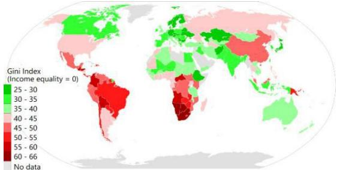

# 2018年美赛D题O奖论文（电动汽车充电基础设施布局与策略）

原件为竞赛论文。补充：文中的阅读练习及“参考解答”为整理时增加，原件图文保留出处。

## 2018 MCM/ICM Summary Sheet

As the tail of the heavy Falcon rocket dissipated in the atmosphere, Tesla should know that it is more difficult to hand over a reliable production to consumers than sending a car into outer space. How should Tesla find the development plan to meet the needs of customers and deliver Tesla electric cars to every family?

To solve the task 1, we make a regression analysis to the number of American cars and found that we need at least 1,463,222 charging stations after 15 years. Then, discuss the number of the charging stations by regression analysis. After calculating, we can easily know that it is impossible for Tesla to complete the switch to all-electricity in the US, even in 2030. Finally, in order to set up the charging pile more reasonably, we give the suburban space a definition. According to the research, we divide the data into three ratios of urban, suburban and rural area as 27.7%, 56.48% and 15.82%.

As for task 2, we choose South Korea as the research object and generalization of the first question model. We can calculate that they need at least 124,798 charging stations in 2018 and the distribution of urban, suburban and rural area. Then the optimal layout model of the charging station is established by using the maximum cover model and the central ground theory. The development plan of the layout for the charging station is set up at the same time. The key factor affecting the development model of our charging station is the charging demand in the future regions, which will directly determine the layout of the future charging station.

In the part of 2b, our conclusion is to build the charging stations in a balanced construction in each region, and the amount of construction is slightly larger than the demand.

When solving the problem 2c, we set up an competitive exclusion model for automobile and electric vehicle. The numerical solution of the equation is obtained by using the ode45 of Matlab. From the value, we can easily know that it takes about 13 years, 16 years, 18 years and 55 years for South Korea's electric car to reach the required percentages. The key factor that affect our competition model is the competitive advantage of the car to electric vehicles. By making sensitive analysis on these two parameters, we found that the inherent growth rate has little impact on the process of all-electricity and the competitive advantage of the automobile to electric vehicle has significant influence on the process of all-electricity.

The problem get a great change when it comes to task 3. The standard deviation elliptical method is used to get the index of population distribution equilibrium and Gini coefficient to measure the uneven distribution of wealth in countries. Discriminant analysis realizes the classification of equilibrium country and gives the criterion.

In task 4, through the calculation progress, we can find that when the fast replacement station replaced all the existing slow charging stations, the number of charging piles will be 97% less than before. So we think that the fast changing technology will significantly reduce the number of required charging stations

In the end, we write a handout for the leaders all over the world and hope to help them to determine the most suitable strategy for the successful completion of the electrification for their country.

Key Words: Balanced Development; Queuing Theory; Logistic Population Competition; Standard Deviation Ellipse; Discriminant Analysis

## Content

1 Introduction.... 1
1.1 Background.... 1
2 Problem Restatement.... 1
3 General Assumptions.... 1
4 Model Parameters.... 2
5 Model Construction.... 2
5.1 Installation of Charging Station Model.... 2
5.1.1 Total Number of Charging Station.... 2
5.1.2 Charging stations in urban, suburban, and rural areas.... 4
5.2 Use the Model in South Korea.... 5
5.2.1 Test the Model in South Korea.... 5
5.2.2 Build the General Layout Model of Charging Station.... 6
5.2.3 Taking South Korea as an Example to Solve the Model.... 7
5.2.4 Commercial Model of Electric Vehicle Charging Station.... 8
5.2.5 The Competitive Exclusion Model of Biological Groups.... 8
5.3 Consideration of regional differences.... 10
5.3.1 Use the Gini Coefficient to measure the degree of distribution imbalance.... 10
5.3.2 Standard Deviation Ellipse Algorithm.... 10
5.3.3 Discriminant Model.... 12
5.3.4 The Classification System.... 15
6 The Influence of High-tech on Electric Vehicles.... 15
6.1 The influence of new transportation methods on electric vehicles.... 16
6.1.1 Car-Share services:.... 16
6.1.2 Self-Driving Cars:.... 17
6.1.3 Flying Cars:.... 17
6.2 The influence of new technology on electric vehicles.... 17
6.3 Wireless Charging Technology.... 18
7 The Sensitivity Analysis.... 18
8 Strengths and Weaknesses.... 19
8.1 Strengths.... 19
8.2 Weaknesses.... 19
9 The handout for the leaders.... 20

# 2018年美赛D题O奖论文（电动汽车充电基础设施布局与策略）

本文档整理自《2018年美赛D题O奖论文》第2部分（共9部分），由识别工具读取后修正格式。

## 一、Introduction

### 1.1 Background

The modern way of life and the way of production are proud of human beings, and we have to face the reality of resource scarcity and ecological imbalance. The serious energy and environmental crisis caused by this situation is universal in all countries of the world. Therefore, governments are attaching more and more importance to the development of electric vehicles to effectively alleviate the energy crisis and promote social and economic development.

With the continuous development and progress of electric vehicles, it is necessary to consider the planning and construction of the charging station, and its right place to be built in the city.

## 二、Problem Restatement

The problems that we need to solve in this paper are:

To study the two different types of tesla charging stations in the United States, and determine that whether electric vehicles can have a full implementation in US. How many charging stations should be built to meet the needs, and try to find the best strategy to distribute them between urban, suburban, and other places.

Determine an optimal quantity and distribution for the charging station and choose the best place to build them if the cars in South Korea can all changed into electric vehicles. Give some advice for South Korea to invest the chargers, and work out whether should build the charger in city first, or doing the project both together. To install the charger first or it is better to buy a car before build up the charge station. Find out the key point that effect the plan most. Have a plan for the full evolution to electric vehicles in South Korea. Describe the timeline, and how the timeline will be changed by the key factors.

Is the plan still work in different countries with dissimilar conditions? Discover the key factors that stimulate the network become more consummate. Then discuss the practicability to set up a classification system in group.

Explain how do the new transportations and new science affect the analysis of the increasing Purchase and use of electric vehicles.

Write a page of guided paper which include the key factors that should be considered by the leaders from different countries who are attending an international energy summit.

## 三、General Assumptions

• Each charging station has 8 charging piles.

• Electric cars are equal to traditional cars when they reach the saturation.

• The idea of an electric car growth plan does not consider the political, military, and other effects of force majeure

## 四、Symbols

| Symbol | Definition | Unit |
| :--- | :--- | :--- |
| $N$ | Total number of cars in a country | - |
| $S_b$ | Available driving mileage once every charging | miles |
| $S_d$ | Average annual mileage per car. | miles |
| T | The number of driving days per year. | - |
| $\mu_1$ | Supercharger service efficiency | cars/h |
| $\mu_2$ | Destination charger service efficiency | cars/h |
| $B_0$ | The number of daily charging demand in a country | - |
| $N_{cp}$ | Total Demand of charging piles | - |
| $T_w$ | Average daily service time | hours |
| $D_m$ | The maximum number of cars that a station can serves every day | - |
| $r_1$ | The inherent growth rate of electric vehicles | - |
| $r_2$ | The inherent growth rate of traditional cars | - |
| $\alpha$ | The competitive advantage of traditional cars over electric vehicles | - |
| $\beta$ | The competitive advantage of electric vehicles over traditional cars | - |
| $N_1$ | The maximum number of electric vehicles allowed in a country | - |
| $N_2$ | The maximum number of traditional cars allowed in a country | - |
| $x_1$ | Evenness index of population distribution | - |
| $x_2$ | Gini index | - |

## 五、Model Construction

知识点：[问题重述与分析（Problem Restatement and Analysis）](../../../topics/数学建模/wenti_chongshu.md)、[一般假设及其合理性说明（Assumptions and Justifications）](../../../topics/数学建模/jiaben_shezhi.md)、[符号说明与术语定义（Nomenclature / Symbols and Definitions）](../../../topics/数学建模/fuhao_shuoming.md)

### 4.1 Installation of Charging Station Model

#### 4.1.1 Total Number of Charging Station

We assumed that every charging station have 8 chargers. Based on the population data of the years in the United States, we made a linear regression analysis of the population. Under the assumption that the US auto ownership rate has not changed considerably in the next 15 years, the total number of cars in the United States in 2030 is calculated. We supposed that the ownership in United States per capita passenger cars are 0.766, then we can easily calculate that the United States will have 271,561,340 cars in 2030.

Then we are going to get the data of the charging demand per day:

$$
B _ { 0 } = N \cdot \frac { 1 } { S _ { b } } \cdot \frac { S _ { y } } { T } \tag{5.1.1}
$$

Where:

• $B _ { 0 }$ : The number of daily charging demand in a country

● $\mathbf { \nabla } \cdot N :$ The total number of cars

$\cdot S _ { b }$ : Available driving mileage once every charging concerning the

# 2018年美赛D题O奖论文（电动汽车充电基础设施布局与策略）

本部分为习题内容，整理自《2018年美赛D题O奖论文》第3部分（共9部分），对应原稿第6-8页（识别工具输出）。

## 一、模型构建与参数计算

知识点：[模型参数的确定（基于数据拟合或实验选择）](../../../topics/数学建模/canshu_queding.md)、[一般假设及其合理性说明（Assumptions and Justifications）](../../../topics/数学建模/jiaben_shezhi.md)、[符号说明与术语定义（Nomenclature / Symbols and Definitions）](../../../topics/数学建模/fuhao_shuoming.md)

### 选择 1

**题干：**
根据美国每人的行驶距离、汽车数量以及每辆汽车每行驶170英里需要充电一次的数据，我们可以得出美国的总每日充电次数。已知：
- $S_y$: 每辆车年平均行驶里程 (Average annual mileage per car)
- $\nabla \cdot T$: 每年驾驶天数 (The number of driving days per year)
- $\frac{s_y}{T}$: 每辆车的日行驶里程 (The daily mileage of a car)
- 当前技术水平下，续航里程估值为 170 英里。

从数据中计算得出的美国总每日充电次数 $B_0$ 为多少？

**答案：**
$$ B_{0} = 51,676,526 \text{ times. } $$

**参考解答：**
根据原文描述，基于每人行驶距离、汽车数量及每170英里需充电一次的假设，直接给出计算结果如下：
$$ \text { States: } B _ {0} = 5 1, 6 7 6, 5 2 6 \text { times. } $$

知识点：[文献综述与研究背景撰写方法](../../../topics/数学建模/wenxian_zongshu.md)、[问题重述与分析（Problem Restatement and Analysis）](../../../topics/数学建模/wenti_chongshu.md)、[数学建模的基本步骤（问题分析、模型假设、建立、求解、检验、推广）](../../../topics/数学建模/jianmo_buzhou.md)

### 简答 1

**题干：**
在排队论 M/M/1/$\infty$/$\infty$ 模型中，如何建立充电桩数量 $N_{cp}$ 的计算公式？请列出关键参数定义及最终推导出的不等式。

**知识点：** 排队论, M/M/1模型

**参考解答：**

1. **参数定义：**
   - 超级充电桩服务率：$\mu_1 = 2 \text{ cars/h}$
   - 目的地充电桩服务率：$\mu_2 = \frac{\lessgtr /}{170} \text{ cars/h}$ （注：原文此处符号识别有误，通常指代与里程相关的服务效率）
   - 调查数据比例：$\alpha = 0.2907$
   - 等待时间约束：$W_q = \frac{\lambda}{\mu (\mu - \lambda)} \leq t_w$

2. **到达率 $\lambda$ 的计算：**
   $$ \lambda = \frac{B_{0} \cdot k_{1}}{N_{cp} \cdot T_{w}} \tag{5.1.2} $$
   其中：
   - $k_1$: 全天服务中非空置服务车辆的比例。取 $k_1 = 0.9$。
     （说明：充电站并非一直处于繁忙状态，服务台会有一定时间的闲置。客户到达服务阶段的等待时间包括无效服务时间。）
   - $N_{cp}$: 充电桩的数量。
   - $T_w$: 充电桩可运行的最长时间。

3. **充电桩数量下限推导：**
   由 (5.1.2) 和 (5.1.3) 可得：
   $$ N_{cp} \geq \left[ \frac{B_{0} k_{1}}{T_{w} \mu} \left(\frac{1}{\mu t_{w}}\right) + 1 \right] \tag{5.1.4} $$

4. **两种充电桩的通用公式：**
   考虑到有两种类型的充电桩，将公式 (5.1.4) 重写为：
   $$ N_{cpi} \geq \left[ \frac{B_{i} k_{1}}{T_{w} \mu_{i}} \left(\frac{1}{\mu_{i} t_{wi}}\right) + 1 \right], \quad i = 1, 2 $$

5. **简化系数设定：**
   设：
   $$ u_{i} = \frac{k_{1}}{\mu_{i} T_{w}} \left(\frac{1}{\mu_{i} t_{w}}\right) + 1 \tag{5.1.6} $$
   则：
   $$ N_{cpi} = B_{i} u_{i} \tag{5.1.7} $$

6. **各类充电需求分配：**
   根据方程 (5.1.7) 可得：
   $$ B_{i} = \frac{B_{0}}{1 + \frac{u_{1} \rho_{2}}{u_{2} \rho_{1}}} \tag{5.1.8} $$
   其中 $\rho_1$ 是超级充电桩的比例，$\rho_2$ 是目的地充电桩的比例。

7. **总充电桩数量：**
   $$ N_{cp} = \sum_{i=1}^{2} N_{cpi}, \quad i = 1, 2 \tag{5.1.9} $$

**补充：**
根据上述公式及参数 $k_1$，计算得出 $N_{cp} = 11,705,777$，因此充电站数量为 1,463,222 个。

知识点：[文献综述与研究背景撰写方法](../../../topics/数学建模/wenxian_zongshu.md)、[数学建模的基本步骤（问题分析、模型假设、建立、求解、检验、推广）](../../../topics/数学建模/jianmo_buzhou.md)

### 简答 2

**题干：**
论文如何定义郊区（Suburb），并依据何种人口比例数据来划分美国的城市、郊区和农村地区的充电桩需求？

**参考解答：**

1. **郊区的定义：**
   由于城市、郊区和农村地区的定义往往不明确，论文开发了一个反映居民体验的郊区标准定义：
   - 郊区是一种混合用途或居住区，既可以是城市或市区的一部分，也可以是位于通勤距离内的独立居住社区。
   - 在大多数英语国家，郊区是与中心或内城区域相对定义的。
   - 在澳大利亚英语和南非英语中，“suburb”一词在很大程度上与其他国家的“neighborhood”同义，并扩展到内城区域。
   - 在一些地区（如澳大利亚、中国、新西兰、英国和部分美国州），新郊区通常被相邻城市吞并。
   - 在其他地区（如沙特阿拉伯、加拿大、法国和美国大部分地区），许多郊区保持独立的市政地位，或作为较大地方政府区域（如县）的一部分进行管理。

2. **人口感知与统计：**
   - 全国范围内，26% 的美国人认为自己住在城市，53% 认为住在郊区，21% 认为住在农村。
   - 这一数据接近人口普查估计的 81% 人口居住在城市（如果“城市”包括郊区区域）。[2]

3. **区域划分比例：**
   一旦知道农村人口，可以根据上述比例计算其他两部分人口。
   - 郊区人口 : 农村人口 = 53 : 21

4. **2030年美国人口预测及比例：**
   根据图1，得出2030年美国人口分布比例为：
   - Urban: 27.70%
   - Suburban: 56.48%
   - Rural: 15.82%

5. **各区域充电桩需求计算结果：**
   基于2030年的比例，得出各区域所需的充电桩数量：
   - Urban: 3,243,085
   - Suburban: 6,610,905
   - Rural: 1,851,787

   进而得出不同区域的充电站数量：
   - Urban: 405,386
   - Suburban: 826,363
   - Rural: 231,473

知识点：[文献综述与研究背景撰写方法](../../../topics/数学建模/wenxian_zongshu.md)、[问题重述与分析（Problem Restatement and Analysis）](../../../topics/数学建模/wenti_chongshu.md)

### 简答 3

**题干：**
如何将上述模型应用于韩国？请简述测试过程及最终得出的充电桩与充电站需求数据。

**参考解答：**

1. **模型应用方法：**
   使用第5.1节提到的方法。基于韩国的当前汽车数量、充电桩比例以及充电桩的服务强度 $\mu_1, \mu_2$，利用公式 (5.1.7) 和 (5.1.9) 计算 $N_{cp}$。

2. **总体计算结果：**
   - 韩国充电桩总数 $N_{cp} = 419,059$
   - 充电站数量 = 52,382

3. **区域分布数据：**
   根据图表获取韩国2018年人口及各区域人口比例，最终得出不同区域的充电桩和充电站需求，如下表所示：

**Table 1: The needs of the charging piles and charging stations**

| | Charging piles | Charging stations |
| :--- | :--- | :--- |
| The whole country | 998,380.01 | 124,797.50 |
| Urban | 272,097.73 | 34,012.22 |
| Suburban | 554,660.76 | 69,332.59 |
| Rural | 171,621.52 | 21,452.69 |

**知识点：** 模型迁移与应用

## 5.2.2 Charging Station Model

The model form of the theory of the center to divide the service area, the primary site method by gravity in every service area, and we supposed that we have $m$ rechargeable charging stations, $n$ demand points and going to build $p$ stations. Set up the requirement at $j$ as $d_j$, and take $r_{ij}$ to express the distance from the station $i$ to the demand point $j$.

Then we set up the decision variables as:

$$
X_{ij} = \begin{cases} 
1 \\ 
0 
\end{cases}
$$

Where 1 indicates that the $i$ alternative is building a charging station and providing service at the $j$ demand point of the charging station. On the contrary, 0 means that build the station at $i$ but do not provide service at the $j$ demand point of the charging station.

Then we can get:

$$
\sum_{j=1}^{n} \sum_{i=1}^{m} x_{ij} \cdot d_j \tag{5.2.2}
$$

Our goal is to work out the formula and get the maximum.

$$
\left\{ \begin{array}{l} 
\sum_{j=1}^{n} d_{j} x_{i j} \leq D_{m} \quad (j = 1, 2, 3, \dots n) \\ 
\sum_{i=1}^{m} x_{i j} \leq 1 \quad (i = 1, 2, 3, \dots m) \\ 
\sum_{i=1}^{m} \emptyset \left(\sum_{j=1}^{n} x_{i j}\right) \leq p \\ 
r_{i j} \emptyset (x_{i j}) \leq r_{m} 
\end{array} \right. \tag{5.2.3}
$$

Where:

*   $D_m$ is the maximum number of cars that a charging station can serves in one day.
*   $P$ is the maximum number of charging stations that can only be built on the alternative address.
*   $r_m$ refers to service radius.

In our model, each of the demand point can only serve for one charging station, and the indicative function in the above formula is:

$$
\varnothing (\mathrm{x}) = \begin{cases} 
1, & x > 0 \\ 
0, & x = 0 
\end{cases}
$$

知识点：[文献综述与研究背景撰写方法](../../../topics/数学建模/wenxian_zongshu.md)

### The Central Ground Theory

The determination of the scope of service is in fact the maximum service radius of the charging station. It should be aimed at the convenience of electric vehicle users charging.

In the initial stage of promoting the use of electric vehicles, the number of pure electric vehicles is relatively small. At this time, the service scope of charging stations is larger, and the number of charging facilities is infrequency. With the increasing number of electric vehicles, the service radius of the charging station will be gradually shortened, and the number of charging stations should be increased to meet the needs of the users. [3]

We assumed that the maximum time for a driver to find a charging station is 10 minutes. When the driver finds that the battery is not enough, he tries to find a charging station near the nearest minute to recharge the vehicle.

Based on the central ground theory, we can get:

$$
r _ {m} = \frac {V _ {c a r} \cdot t _ {f}}{\lambda_ {s}} \tag{5.2.5}
$$

Where:

*   $V_{car}$: The speed of a vehicle (km/h)
*   $t_f$: The longest searching time that the customers use.
*   $\lambda_s$: The curvature coefficient of the road. The ratio between the actual traffic distance and the linear distance between two points.

$D_m$ can be calculated in the equation shown below:

$$
D _ {m} = 16 \cdot 8 \cdot [ \alpha \mu_ {1} + (1 - \alpha) \mu_ {2} ] \tag{5.2.6}
$$

So, we can get $D_m \approx 94.18$. Thus, the maximum number of cars that a charging station can serves in one day is almost 95.

## 5.2.3 Taking South Korea as an Example to Solve the Model

Our paper starts with the model of network layout theory to divide the service area, and we can choose the service area by this theory. Because the site of the center of gravity method may not be achieved in reality, we need to choose a coordinate near feasible site as an alternative site.

Then calculate the distance matrix of each demand point and each alternative charging station.

We can use the Lingo software to solve the equations (5.2.3) and (5.2.4), and get the optimal charging station layout according to the General Layout Model.

知识点：[文献综述与研究背景撰写方法](../../../topics/数学建模/wenxian_zongshu.md)、[一般假设及其合理性说明（Assumptions and Justifications）](../../../topics/数学建模/jiaben_shezhi.md)、[模型参数的确定（基于数据拟合或实验选择）](../../../topics/数学建模/canshu_queding.md)

### 5.2.4 Commercial Model of Electric Vehicle Charging Station

Due to the short range of electric vehicles and the lack of charging stations, it is difficult for consumers to use electric vehicles to complete all their travel needs and this make them feel nervous and generate anxiety.

According to the literature "The Commercial Model of Electric Vehicle Charging Station", we can get the anxiety $\lambda ( t )$ as:

$$
\lambda (t) = \frac {t}{d _ {c}} \lambda\tag{5.2.7}
$$

Where:

- $\lambda$: is an exogenous parameter that represents the initial anxiety of the consumer.
- $d _ {c}$ is the length of a linear city.
- $t$: is the average distance between two charging stations.

Then we can get the consumer purchase benefit:

$$
[ 1 - \lambda (t) ] \theta - p + b\tag{5.2.8}
$$

Where:

- $\theta$: A random variable. A consumer can get a value if he uses an electric car to complete all his travel needs.
- $p$: The sale price of an electric car.
- $b$: Government subsidies.

We can know from the above equations that build the charging station first can reduce people's anxiety effectively.

Without the charging station: $t = d _ { c } , \lambda ( t ) = \lambda$.

Have a charging station: $t = \frac { 1 } { 2 } d _ { c } , \lambda ( t ) = \frac { 1 } { 2 } \lambda$. Then it lowers the anxiety of people and raises the enthusiasm to buy the electric vehicles of consumers.

In summary, the economically developed areas government or companies should build more charging stations according to the amount of car purchases by consumers. This is mainly because that the relatively high economic level of the users who with their own garage value the convenience of products more than the costs of small, pure electric cars.

知识点：[模型参数的确定（基于数据拟合或实验选择）](../../../topics/数学建模/canshu_queding.md)、[一般假设及其合理性说明（Assumptions and Justifications）](../../../topics/数学建模/jiaben_shezhi.md)、[文献综述与研究背景撰写方法](../../../topics/数学建模/wenxian_zongshu.md)

### 5.2.4 The Competitive Exclusion Model of Biological Groups

Choosing the competitive exclusion model of biological groups to simulate the market competition of electric vehicles and traditional automobiles. We assumed $x _ { 1 } ( t )$ as the number of electric vehicles on the change of time variable $t$, and $x _ { 2 } ( t )$ as the traditional automobiles on the change of time variable $t$.

Then we can write the competitive exclusion model of electric vehicles and traditional automobiles:

$$
\left\{ \begin{array}{l} \frac {d x _ {1}}{d t} = r _ {1} x _ {1} \left(1 - \frac{x _ {1}}{N _ {1}} - \frac {\alpha x _ {2}}{N _ {1}}\right) \\ \frac {d x _ {2}}{d t} = r _ {2} x _ {2} \left(1 - \frac {x _ {2}}{N _ {2}} - \frac {\beta x _ {1}}{N _ {2}}\right) \end{array} \right.\tag{5.2.9}
$$

Where:

- $r _ { 1 }$: The inherent growth rate of electric vehicles.
- $r _ { 2 }$: The inherent growth rate of traditional cars.
- $N _ { 1 }$: The maximum number of electric vehicles allowed in the country.
- $N _ { 2 }$: The maximum number of traditional cars allowed in the country.
- $\beta$: The competitive advantage of electric vehicles over traditional cars.
- $\alpha$: The competitive advantage of traditional cars over electric vehicles.

To make electric cars completely replace traditional cars, we need to let the autonomous equation above to reach the balance point $P _ { 1 } ( N _ { 1 } , 0 )$. According to the equilibrium stability criterion of the autonomous equation, if and only if $N _ { 1 } > \frac { N _ { 2 } } { \beta }$ and $N _ { 2 } < \frac { N _ { 1 } } { \alpha }$ established, we assumed that $N _ { 1 } = N _ { 2 }$. Then we get:

$$
\beta > 1, \alpha < 1\tag{5.2.10}
$$

So, we can rewrite the formula (5.2.4.2) as: $\beta > 1 > \alpha$, and only when the data turned into this, can electric vehicles replace the traditional automobiles.

Because of the autonomous equation above is very hard to work out, we make use of numerical solution function Ode45 in MATLAB to solve the problem. Where the inherent growth rate in the model $r _ { 1 } = 0 . 3 , r _ { 2 } = 4 . 7$. We hope the value that r be obtained can calculated and has a very small error with the historical data.

Where the red line is for the traditional cars, the blue line is for the electric vehicles, and the green line is the peak value that the cars can get. When the blue line reach the green line, it means that everyone switched to all-electric vehicles in the country.

From the first point we can know that it needs 13.03 years to turn cars to be 10% electric vehicles. The second point tells that getting 30% electric vehicles needs 16.07 years. Third point means that we need 18.43 years to get 50% electric vehicles.

知识点：[确定模型的定点与稳定性分析](../../../topics/数学建模/dingdian_wending.md)、[模型参数的确定（基于数据拟合或实验选择）](../../../topics/数学建模/canshu_queding.md)、[一般假设及其合理性说明（Assumptions and Justifications）](../../../topics/数学建模/jiaben_shezhi.md)

### 5.3 Consideration of regional differences

We established a model to find out the regional difference coefficient of each country, and based on this coefficient, we analyzed the different countries.

#### 5.3.1 Use the Gini Coefficient to measure the degree of distribution imbalance.

According to the data given by the World Regional Wealth Statistics Bureau, we can get the two types of countries’ Gini coefficient.

#### 5.3.2 Standard Deviation Ellipse Algorithm

If the data of the country is hard to know well, we can build another model to solve this problem. We assumed that $X 1$ is the proportion of the land area that contains 50% population account to the whole country’s. The land area is set up as $\varsigma _ { \mathrm { w } }$. We can get the two kinds of country’s population distribution by standard deviation ellipse algorithm.

According to the equation of standard deviation ellipse:

$$
\left(\frac {x}{\sigma_ {x}}\right) ^ {2} + \left(\frac {y}{\sigma_ {y}}\right) ^ {2} = s\tag{5.3.6}
$$

Because one point on a plane can be expressed by only 2 coordinates, we can use the determined confidence coefficient, such as 95%, and search the chi square distribution table with 2 freedom degrees to calculate equation (5.3.5) to get the value of S.

The standard equation after converting to an ellipse:

$$
\frac {x ^ {2}}{s \sigma_ {x} ^ {2}} + \frac {y ^ {2}}{s \sigma_ {y} ^ {2}} = 1\tag{5.3.7}
$$

As we know that the data of the major axis semidiameter “a" and minor axis semidiameter “b" of the ellipse is:

$$
a = \sqrt {s} \sigma_ {x}, b = \sqrt {s} \sigma_ {y}\tag{5.3.8}
$$

Finally, we get the data about the standard deviation ellipse:

$$
S _ {c} = \pi a b = \pi s \sigma_ {x} \sigma_ {y}\tag{5.3.9}
$$

Where $S _ { c }$ is the population concentrative area in coordinate.

$$
S _ {r} = \eta^ {2} \cdot \pi \cdot s \sigma_ {x} \sigma_ {y}\tag{5.3.10}
$$

Where $S _ { r }$ is the real value of the area, and η is the map scale. From the map we researched that η equals 100

Thus, we can calculate $x _ { 1 }$

$$
x _ {1} = \frac {S _ {r}}{S _ {w}}\tag{5.3.11}
$$

Then we get the evenness index $x _ { 1 }$

Select some typical countries as test samples. According to fisher discriminant method and distance discrimination, we can use the software R to analysis the test sample. Then use the data we analyzed from R to check the return accuracy and draw some intuitionistic figures for people to have a clear visual perception.

Unbalanced country:

The red cross in the figure is not in the 50% circle, and the blue point have the opposite meaning. You can see in the figure above that there are some areas in the ellipse that are not in the land of Australia, it do have some error in the calculation of the index 1. But considering that the area of this part accounts for a small percentage of the total area of Australia, it can be ignored when doing analysis.

Team # 80386

Page 12 of 21

Balanced Country：

知识点：[符号说明与术语定义（Nomenclature / Symbols and Definitions）](../../../topics/数学建模/fuhao_shuoming.md)、[敏感性分析方法（Sensitivity Analysis，单参数与多参数变动）](../../../topics/数学建模/minganxing_fenxi.md)

### 5.3.3 Discriminant Model

Because of the large regional differences in different countries, we assumed $\mathbf { X } _ { 1 }$ as evenness index of population distribution. Based on the population density from high to low, we can $\mathrm { g e t } \mathbf { x } _ { 1 }$ from the proportion of the population concentrated area accounted for the proportion of land in the country. The smaller the $\mathbf { X } 1 .$ , the more concentrated the population.

Next, we consider about the distribution of wealth and ordered the province from high to low. Then we can get ${ \bf X } 2$ as the proportion of 90% place that concentrate on wealth with the land area. The smaller the $\mathbf { X } 2 .$ , the more concentrated the wealth.

Finally, we can get the regional difference coefficient:

$$
P _ {i} (x _ {1}, x _ {2}), i = 1, 2, 3 \dots n\tag{5.3.1}
$$

Where i means the number of countries.

We can use formula (5.3.1) to calculate the coefficient of regional difference in some typical countries:

Table 3:Regional difference coefficient of typical countries
<table><tr><td></td><td>Country</td><td>Evenness Index of Population Distribution</td><td>Gini Coefficient</td></tr><tr><td>1</td><td>China</td><td>0.2991</td><td>0.422</td></tr><tr><td>2</td><td>Indonesia</td><td>0.2541</td><td>0.395</td></tr><tr><td>3</td><td>Australia</td><td>0.2268</td><td>0.349</td></tr><tr><td>4</td><td>Saudi Arabia</td><td>0.3633</td><td>0.459</td></tr><tr><td>5</td><td>Singapore</td><td>0.3808</td><td>0.464</td></tr><tr><td>6</td><td>Russia</td><td>0.0967</td><td>0.377</td></tr><tr><td>7</td><td>United States</td><td>0.3409</td><td>0.41</td></tr><tr><td>8</td><td>South Korea</td><td>0.4248</td><td>0.313</td></tr><tr><td>9</td><td>Ireland</td><td>0.2475</td><td>0.319</td></tr><tr><td>10</td><td>Uruguay</td><td>0.4002</td><td>0.417</td></tr><tr><td>11</td><td>Japan</td><td>0.2922</td><td>0.321</td></tr><tr><td>12</td><td>German</td><td>0.3205</td><td>0.314</td></tr></table>

Team # 80386

Page 13 of 21

First of all, China, Indonesia, Australia, Saudi Arabia, Singapore and Russia are regarded as unbalanced countries. United States, South Korea, Ireland, Uruguay, Japan, German are on the contrary. According to the national development balance standard, this classification is reasonable.

The countries above will be represented by Numbers 1\~12. In order to test the accuracy of our discriminant model, Australia and Saudi Arabia, are randomly selected from the sample function of the R software, and select Ireland as a test sample of the balanced country, the rest were used as training samples.

The discriminant result:

Table4: The result of equilibrium country discriminant
<table><tr><td>Unbalanced Country</td><td>Balanced Country</td></tr><tr><td>China</td><td>South Korea</td></tr><tr><td>Indonesia</td><td>Ireland</td></tr><tr><td>Australia</td><td>Uruguay</td></tr><tr><td>Saudi Arabia</td><td>Japan</td></tr><tr><td>Singapore</td><td>German</td></tr><tr><td>Russia</td><td></td></tr><tr><td>United States</td><td></td></tr></table>

It was found that three randomly selected samples were all correct, and the rest of the training samples are correct except for the United States, and the total correct rate is greater than 91%.

Thus, according to the Evenness Index of Population Distribution and Gini coefficient, the distance discrimination can be used to judge whether a country is balanced. But the United States, which was supposed to be a balanced country, was identified as an unbalanced country. To go further study, comparing the two indicators of United States, Evenness Index of Population Distribution and Gini coefficient with unbalanced countries, it is found that the two indicators of United States are indeed close to the mean of unbalanced countries. In particular, the Gini coefficient of 0.41 has exceeded the "warning line" of income distribution gap and the relative error is less than 3% with the Gini coefficient in unbalanced countries. This may be that our model does not consider more balanced indicators. If we have more time, we will further select the appropriate indicators to better measure the balance of the country.

Team # 80386

Page 14 of 21

## 5.3.4 The Classification System

The classification system is established according to the two types that we described before. Then we can discuss the two different ways in those countries.

知识点：[人口密度修正系数与新公式](../../../topics/数学建模/renkou_midu.md)、[影响因素评估指标体系构建（温度、湿度、经济、教育等）](../../../topics/数学建模/yingxiang_zhibiao.md)

### Overall growth model

The overall growth model is being used in the first group. The countries in first group are all facing the same problems: Uneven population distribution and unequal distribution of wealth.

We can divide the people from first group by have the charging conditions or not. The purchase intention of small pure electric vehicles with rechargeable conditions is most affected by the convenience of charging and maintenance services. This is mainly due to the fact that the users of their own garage have relatively high economic level. The convenience of their products is more important than the cost of electric vehicles. Therefore, the corresponding countermeasures are taken to improve the convenience of the pure electric vehicle, which can improve the consumer's willingness to buy electric vehicles.

On the contrary, the other part of people do not have charging conditions, their purchase intention of pure electric vehicles is most affected by economic and policy preferences. Therefore, on the basis of establishing and perfecting the charging conditions of electric vehicles, reducing the cost of buying and using electric vehicles can effectively improve the purchase intention of these consumers.

知识点：[任务分解与目标明确](../../../topics/数学建模/renwu_fenjie.md)、[问题重述与分析（Problem Restatement and Analysis）](../../../topics/数学建模/wenti_chongshu.md)

### Service fee dissimilation model

This model is being used in second kinds of countries. The population is evenly distributed and the wealth distributed equally in these countries. We design a service fee dissimilation model to meet the needs of people in different areas.

We assumed that current charge service fees are $k$ dollars per kilowatt-hour. The economic development level and population density of area A to D are decreasing, so we consider that the charge of service fee is consistent with the decline trend of economic development and population density. Then we set up an area C to be the datum point, the charging fee in area C is $k$, and the change of the floating proportion of each step on both sides of the K element is 20%.

To sum up, based on the partition of the battery charge up service differentiation rate is greater than the current economic benefit brought by the overall charging. This is a great improvement in the shortening of the rechargeable operator's investment recovery period, and also can increase the return on investment. In this model design, it will also greatly increase the investment confidence of charging pile operators and get them to invest more.

## 6 The Influence of High-tech on Electric Vehicles

With the rapid development of science and technology, our life is becoming more and more inseparable from the support and progress of science and technology. Fossil fuels have been gradually replaced by the new energy sources, and auto sharing and self-driving cars are emerging. Electric vehicles have become the most energy-efficient and environmentally-friendly means of transportation nowadays.

知识点：[问题重述与分析（Problem Restatement and Analysis）](../../../topics/数学建模/wenti_chongshu.md)、[符号说明与术语定义（Nomenclature / Symbols and Definitions）](../../../topics/数学建模/fuhao_shuoming.md)、[一般假设及其合理性说明（Assumptions and Justifications）](../../../topics/数学建模/jiaben_shezhi.md)

### 6.1 The influence of new transportation methods on electric vehicles

First, the three technologies of car-share and ride-share services, self-driving cars, and even flying cars are analyzed. They are expected to lead to an increase in daily charging. We take South Korea as an example to recalculate the required number of charging piles for different degrees of daily recharging. The result is shown in figure below:

These three technologies are considered to lead an increase in the number of charging stations.

Secondly, the number of charging piles is calculated using fast changing technology. When the fast replacement station replaced all the existing slow charging stations, the number of charging piles will be less than 3%. So we think that the fast changing technology will significantly reduce the number of required charging stations.

The influence of new transportation methods on electric vehicles is various:

#### 6.1.1 Car-Share services

According to formula:

$$
(1 + a) B _ {0}, \quad a \in [ 0, 1 ]\tag{6.1.1}
$$

Where $B_0$ is the number of cars that need to be charged. The sharing mode increases the number of cars that need to be charged per day. This makes it possible for people who can't afford to buy a car to spend less money and travel with the service fee per vehicle. This must increase the daily use of electric vehicles and also increase the need for charging.

# 2018年美赛D题O奖论文（电动汽车充电基础设施布局与策略）（习题）

本资料整理自《2018年美赛D题O奖论文》第 8 部分，主要涵盖新技术对电动汽车的影响、无线充电技术以及敏感性分析等内容。

## 6.1.2 Self-Driving Cars:

The maturity of technology in self-driving cars field can help people who have no driving skills to get cheap “drivers”, this can lower the threshold for people to buy cars. Also, it can raise the need of electric vehicles and the number of B0.

知识点：[任务分解与目标明确](../../../topics/数学建模/renwu_fenjie.md)、[文献综述与研究背景撰写方法](../../../topics/数学建模/wenxian_zongshu.md)、[一般假设及其合理性说明（Assumptions and Justifications）](../../../topics/数学建模/jiaben_shezhi.md)

### 选择 1

题干：Self-Driving Cars 的影响是什么？

- A. 提高驾驶技能门槛
- B. 降低购买汽车的门槛并增加对电动汽车的需求
- C. 减少电动汽车的数量
- D. 对电动汽车无影响

答案：B。

## 6.1.3 Flying Cars:

Because it is not restricted by the terrain, road, traffic and other factors, the flying cars will greatly reduce the cost of people's travel. This mode of travel also can raise B0 because it still requires batteries with rich energy.

Thus, the new transportation methods can raise the number of cars that need to be charged, and encourage people to travel with electric products.

知识点：[文献综述与研究背景撰写方法](../../../topics/数学建模/wenxian_zongshu.md)、[问题重述与分析（Problem Restatement and Analysis）](../../../topics/数学建模/wenti_chongshu.md)、[数学建模的基本步骤（问题分析、模型假设、建立、求解、检验、推广）](../../../topics/数学建模/jianmo_buzhou.md)

### 简答 1

题干：Flying Cars 如何影响电动汽车市场？

知识点：[文献综述与研究背景撰写方法](../../../topics/数学建模/wenxian_zongshu.md)、[数学建模的基本步骤（问题分析、模型假设、建立、求解、检验、推广）](../../../topics/数学建模/jianmo_buzhou.md)

### 简答 2

题干：新技术如何影响电动汽车的发展？请列举主要方面。

知识点：[文献综述与研究背景撰写方法](../../../topics/数学建模/wenxian_zongshu.md)、[问题重述与分析（Problem Restatement and Analysis）](../../../topics/数学建模/wenti_chongshu.md)

### 简答 3

题干：无线充电技术对电动汽车用户的主要优势是什么？

知识点：[文献综述与研究背景撰写方法](../../../topics/数学建模/wenxian_zongshu.md)

### 计算 1

题干：根据表5，分析最长等待时间对所需充电站数量的影响。

知识点：[敏感性分析方法（Sensitivity Analysis，单参数与多参数变动）](../../../topics/数学建模/minganxing_fenxi.md)

### 计算 2

题干：根据表6，分析内在增长率 $r_1$ 对电动汽车普及时间（$t_{50}$ 和 $t_{100}$）的影响。

知识点：[敏感性分析方法（Sensitivity Analysis，单参数与多参数变动）](../../../topics/数学建模/minganxing_fenxi.md)

### 8.1 Strengths

This paper related to engineering, management, statistics, and many other study fields. It covers many knowledge, such as Electric vehicle, Regression analysis of statistics, consumer purchase behavior, population competition and discriminant analysis are typical interdisciplinary frontier research.

We propose the differentiated charging method but the design scheme of this differential charge is one of our design ideas, and it is still at a very early stage. Research and analysis only make rough plans through observable and available limited data. Its rationality and effectiveness have not been proved in practice, so the scientific of the scheme needs to be discuss.

A more advanced wireless charging method is envisaged to make the future of electric vehicles more diversified.

Sensitivity analysis was performed on the parameters that could not be found or estimated correctly in each model to quantify their influence on the result of the model.

- It is an innovative use of the standard deviation ellipse to measure the equilibrium of population distribution.

知识点：[模型优缺点分析（Strengths and Weaknesses）](../../../topics/数学建模/youque_dian.md)、[敏感性分析方法（Sensitivity Analysis，单参数与多参数变动）](../../../topics/数学建模/minganxing_fenxi.md)、[文献综述与研究背景撰写方法](../../../topics/数学建模/wenxian_zongshu.md)

### 8.2 Weaknesses

The sources of data sources are not wide enough so that models are difficult to solve effectively. However, the optimality of the models are always established, in other words, the model always solves the correct optimal result based on the given data. That way, the final solution will be adjusted quickly with data that are more accurate.

- Lack of sufficient support material for building the charging stations in cities, suburbs, and rural areas.

## 9 The handout for the leaders

Future development initiatives for electric vehicles.

Welcome to this international energy summit, and this page will help you learn more about the future trends of electric vehicles and the key factors that should be considered when you return to your country.

First of all, we hope you can do a classification based on the discriminant analysis in our thesis. According to the national conditions of your country, you can tell whether your country is a balanced country or an unbalanced one. For these two different types, we will give you some suggestions in a more accurate and specific way.

As for the balanced country, the development of electric cars has been in steady progress. In these countries, population distribution and wealth distribution are relatively uniform. Because of this, we need to increase the support of encouraging preferential policies to improve the user's enthusiasm for the use and purchase of electric vehicles. Speed up scientific research on electric vehicle is very important too. Setting a 30 to 45 years’ time to implement the policy of gas vehicle-ban can stimulates people to turn gasoline cars into electric cars.

About the countries with unbalanced national conditions, we’d better to create conditions for the use of electric vehicles for users. This can dispel consumer concerns about electric cars and improve their desire to buy. Then, improve the level of after-sales service. Give consumers a better service and make them feel free to worry about the hidden danger. Raising the subsidies next and support the purchase of electric vehicles in backward areas, so as to promote the conversion of cars to electric vehicles. Also, increasing the investment in infrastructure construction, such as charging stations, power supply networks and so on. This can help to realizing the national equalization of basic electric vehicle services, and gradually narrowing the gap between regions and the gap between urban and rural areas. We suggest that this kind of countries can set up a 60 to 75 years’ time to ban the oil car. People can know more about electric vehicles and gradually discover the benefits of electric cars in this period.

Second, we have three great suggestions for all the countries in the world. One is to set up a district charging system, and the second one is to explore the talents in electric field and develop the charging technology. Third, hold the regular international electric vehicle development and promote the technology exchange.

In the end, hope you enjoy the current international energy summit and bring more useful methods to your country.

Thanks for reading.

## Reference

[1] Yanfei Wang. Market economy analysis of charging pile in BJ City [D].Beijing: Beijing Jiaotong University,2016:23-28.

[2] Jed Kolko. How Suburban Are Big American Cities?. Five Thirty-Eight[J/OL]. https://fivethirtyeight.com/features/how-suburban-are-big-american-cities/,2015.

[3] SA Papaioannou. Electric Vehicles: A future projection. Electronic Projects Collection[J/OL]. https://web.wpi.edu/Pubs/E-project/Available/E-project-010416-075442/,2016.

[4] https://en.wikipedia.org/wiki/Gini\_coefficient

[5] Yahui Song, Research on the Layout Planning of Electric Vehicle Charging Station in the City[D].Beijing: Beijing Jiaotong University,2011.

[6] Jing Wang. Present Situation and Prospect Analysis of Electric Vehicles[J]. Automobile application,2000.

[7] Shengnan Wu. Study on Influence Factors of the Purchase Intention of the Small-Electric Vehicles[D].Hunan University,2012.

[8] Tian Wang.Building Charging Network for Electric Vehicles in Automobile Supply Chains[D].Huazhong University of Science and Technology,2015.

知识点：[文献综述与研究背景撰写方法](../../../topics/数学建模/wenxian_zongshu.md)、[模型优缺点分析（Strengths and Weaknesses）](../../../topics/数学建模/youque_dian.md)、[非技术性文稿撰写（如致世界医学会的信函、新闻发布会声明）](../../../topics/数学建模/fei_jishu_wengao.md)
