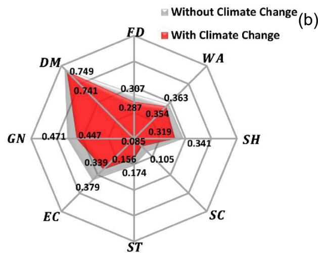
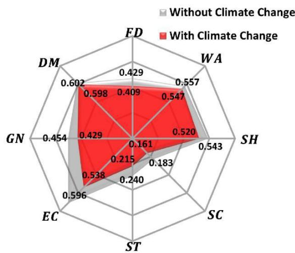
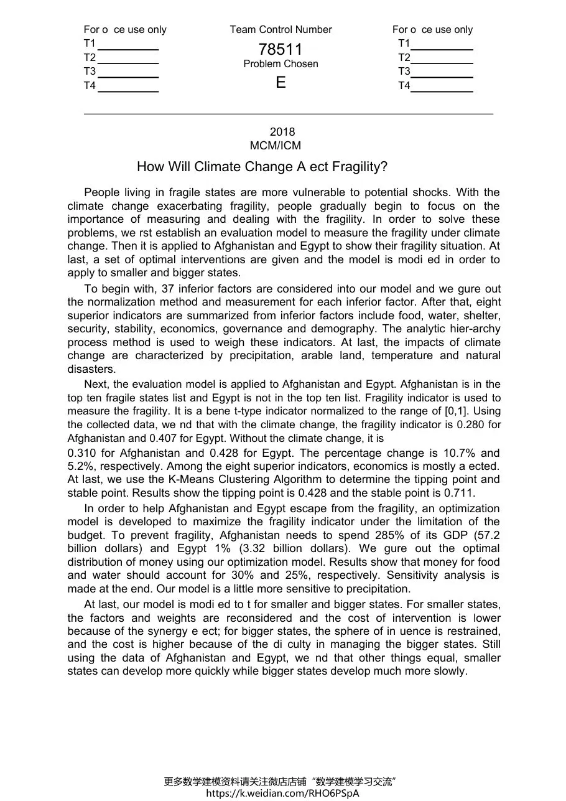
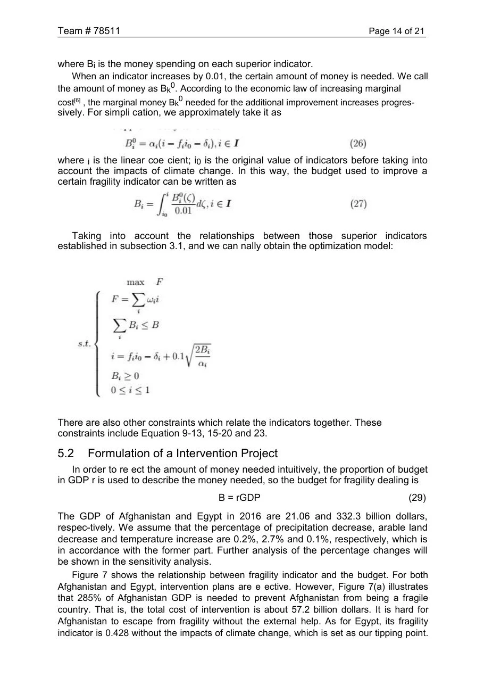
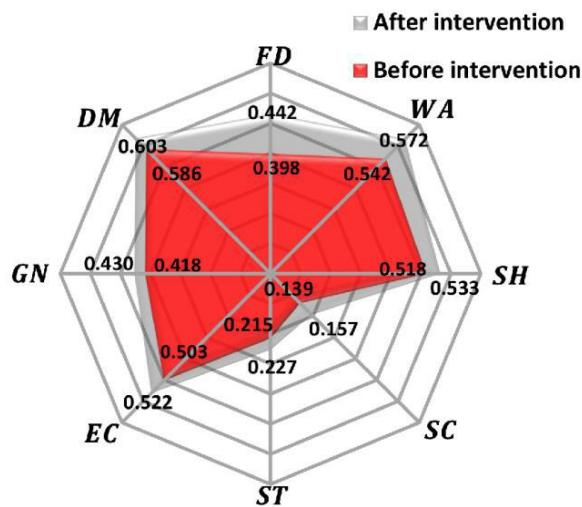

# 2018年美赛E题O奖论文：How Will Climate Change Affect Fragility?

原件为竞赛论文。补充：文中的阅读练习及“参考解答”为整理时增加，原件图文保留出处。

本文档整理了《2018年美赛E题O奖论文》的第1部分（第1-2页）内容，包括摘要、目录及引言章节。原文中的识别错误（如 "a ect" 修正为 "affect"，"rst" 修正为 "first" 等）已根据上下文进行修正。

## Abstract

People living in fragile states are more vulnerable to potential shocks. With the climate change exacerbating fragility, people gradually begin to focus on the importance of measuring and dealing with the fragility. In order to solve these problems, we first establish an evaluation model to measure the fragility under climate change. Then it is applied to Afghanistan and Egypt to show their fragility situation. At last, a set of optimal interventions are given and the model is modified in order to apply to smaller and bigger states.

To begin with, 37 inferior factors are considered into our model and we figure out the normalization method and measurement for each inferior factor. After that, eight superior indicators are summarized from inferior factors include food, water, shelter, security, stability, economics, governance and demography. The analytic hierarchy process method is used to weigh these indicators. At last, the impacts of climate change are characterized by precipitation, arable land, temperature and natural disasters.

Next, the evaluation model is applied to Afghanistan and Egypt. Afghanistan is in the top ten fragile states list and Egypt is not in the top ten list. Fragility indicator is used to measure the fragility. It is a benefit-type indicator normalized to the range of $[0,1]$. Using the collected data, we find that with the climate change, the fragility indicator is 0.280 for Afghanistan and 0.407 for Egypt. Without the climate change, it is 0.310 for Afghanistan and 0.428 for Egypt. The percentage change is 10.7% and 5.2%, respectively. Among the eight superior indicators, economics is mostly affected. At last, we use the K-Means Clustering Algorithm to determine the tipping point and stable point. Results show the tipping point is 0.428 and the stable point is 0.711.

In order to help Afghanistan and Egypt escape from the fragility, an optimization model is developed to maximize the fragility indicator under the limitation of the budget. To prevent fragility, Afghanistan needs to spend 285% of its GDP (57.2 billion dollars) and Egypt 1% (3.32 billion dollars). We figure out the optimal distribution of money using our optimization model. Results show that money for food and water should account for 30% and 25%, respectively. Sensitivity analysis is made at the end. Our model is a little more sensitive to precipitation.

At last, our model is modified to fit for smaller and bigger states. For smaller states, the factors and weights are reconsidered and the cost of intervention is lower because of the synergy effect; for bigger states, the sphere of influence is restrained, and the cost is higher because of the difficulty in managing the bigger states. Still using the data of Afghanistan and Egypt, we find that other things equal, smaller states can develop more quickly while bigger states develop much more slowly.

## Contents

1. Introduction
2. Assumptions
3. Measurement of Fragility and Climate Change
    3.1 Establishment of the Fragility Model
        3.1.1 Discussion of the Superior and Inferior Indicators
        3.1.2 Normalization of Inferior Indicators
        3.1.3 Determination of the Weights for Indicators
    3.2 Modeling the Climate Change Impacts
        3.2.1 Characterizing the Climate Change
        3.2.2 Water and Food Scarcity Impacts
        3.2.3 Potential Insecurity and Instability Impacts
        3.2.4 Extreme Weather and Disasters Impacts
4. Analysis of Fragility in Afghanistan and Egypt
    4.1 Fragility Situation in Afghanistan and Egypt
    4.2 Sensitivity analysis
    4.3 Determination of Tipping Point
5. Designation of Intervention Plan
    5.1 Establishment of the Optimization Model
    5.2 Formulation of a Intervention Project
    5.3 Impacts of the Intervention Project
    5.4 Sensitivity Analysis
    5.5 Suggestions
6. Modification of Fragility Model
    6.1 Modification for Smaller States
    6.2 Modification for Bigger States
    6.3 Application to Afghanistan and Egypt
7. Conclusions
8. Strengths and Weaknesses
Reference

## 1 Introduction

### Background

People used to think that climate change just affects the environment business. However, Frank Walter, the foreign minister in Germany, claimed that climate change is a growing threat to peace and stability [1]. It will aggravate the fragility of countries.

When the climate change is combined with the poverty and resource scarcity, the state might be more fragile because of the violent conflicts caused by the combination. We have to study on the relationship between climate change and fragility of countries, in order to halt the exacerbation of fragility and offer the reasonable intervention plans to the fragile states.

知识点：[问题重述与分析（Problem Restatement and Analysis）](../../../topics/数学建模/wenti_chongshu.md)、[影响因素评估指标体系构建（温度、湿度、经济、教育等）](../../../topics/数学建模/yingxiang_zhibiao.md)、[可持续发展指数 SDI 的构建与指标体系结构](../../../topics/数学建模/kechixu_zhibiao.md)

### Literature Review

States can be divided into fragile states and resilient states. Fragility and resilience are defined in the report of New Climate for Peace. Fragility is the inability (whether whole or partial) of a state to fulfill its responsibilities as a sovereign entity, including a lack of legitimacy, authority, and capacity to provide basic services and protect its citizens[2]. Resilience is the opposite. Climate change alone cannot make significant effects on the state, but it can do so when it interacts with other pressures. There are seven risks that will emerge: local resource competition, livelihood insecurity and migration, extreme weather events and disasters, volatile food prices and provision, transboundary water management, sea-level rise and coastal degradation, and unintended effects of climate policies. These possible consequences offer the base of thinking for our study.

The essay of Department for International Development indicated that, the governance efficiency, state function and international support need to be improved, in order to relieve the fragility problem[3]. In another essay, the writer pointed out that the rebuilding of Afghanistan includes the economic, politics, security and society area[4]. These facets should be included in our fragility model to make it more comprehensive.

The previous researches have contributed a lot to the solution of fragility problems, but there are still some limitations of their work for solving our problem. For instance, the factors of the physiological need are ignored in the rank of fragility, and the cost of the intervention has not been considered. Furthermore, they provide little statistics and models to measure the fragility, which are taken into account in our study, these factors are involved to build a more complete and useful model.

知识点：[文献综述与研究背景撰写方法](../../../topics/数学建模/wenxian_zongshu.md)、[数学建模的基本步骤（问题分析、模型假设、建立、求解、检验、推广）](../../../topics/数学建模/jianmo_buzhou.md)、[模型优缺点分析（Strengths and Weaknesses）](../../../topics/数学建模/youque_dian.md)

### Our Work

Because of the weaknesses of the previous work, we should further study this issue in detail. The mind map of our study is shown in Figure 1 in detail. Firstly, a new evaluation model should be established considering more factors. Climate change impacts should also be taken into account. In our study, the climate change is regarded as an influential factor added into the fragility evaluation model. After that, Afghanistan and Egypt are analyzed and the fragility situations are discussed. Afghanistan is in the top ten fragile states list while Egypt is not.

In order to fight against fragility, interventions are needed. Optimization model is used to figure out the best intervention plan under the limitation of budget. The main purpose is to maximize the fragility indicator. At last, modification is made to smaller and bigger states according to their natural features. The factors and costs of intervention for smaller and bigger states are reconsidered.

## 2 Assumptions

The fragile states are not able to adapt to the climate change in the short run.

{ If a state can adapt to that change well, climate change can even benefit that state[5]. Considering that most fragile states are developing states, we assume that they are not able to adapt to the climate change in the short run. The long run impacts of natural disasters are neglected.

{ The impacts of natural disasters are always direct, like economic loss. In the long run, the disasters will be solved and their impact will not last as long as other climate changes like temperature increase.

The marginal cost of intervention increases linearly.

{ This is a reasonable simplification of increasing marginal cost[6]. In reality, the increase of marginal cost depends on the specific situation.

The physiological need is the most important need of human.

{ Physiological need is the most basic need. It should be given more attention.

## 3 Measurement of Fragility and Climate Change

The fragility model includes two parts: the indicators used to describe fragility and the impacts of climate change on indicators. The fragility of a state is actually measured by the indicators and the impacts of climate change is built into the indicators. Therefore, We will first establish an indicator system to evaluate the fragility. Climate change is regarded as influential factors to the indicators.

知识点：[影响因素评估指标体系构建（温度、湿度、经济、教育等）](../../../topics/数学建模/yingxiang_zhibiao.md)、[一般假设及其合理性说明（Assumptions and Justifications）](../../../topics/数学建模/jiaben_shezhi.md)、[多目标优化模型（药物相对充足阶段的配送策略）](../../../topics/数学建模/duo_mubiao_youhua.md)

### 3.1 Establishment of the Fragility Model

According to the problem, a fragile state is one where the state government is not able to, or chooses not to provide the basic essentials to its people. This implies that the theory of needs can be applied to measure the fragility. The most popular theory of needs is Maslow's hierarchy of needs. From the most basic needs to the most superior, the needs are physiology, safety, society, self-esteem and self-actualization[7].

We only take into account the three most basic needs, considering that fragile states are often characterized by low income and weak government[8]. The framework of the

# 2018年美赛E题O奖论文：How Will Climate Change Affect Fragility?（习题）

本资料由识别工具读取《2018年美赛E题O奖论文》第3部分（共12部分）第5–6页内容整理而成，修正了原文中的拼写错误与断行问题。

## 一、脆弱性模型构建与指标体系

知识点：[影响因素评估指标体系构建（温度、湿度、经济、教育等）](../../../topics/数学建模/yingxiang_zhibiao.md)、[符号说明与术语定义（Nomenclature / Symbols and Definitions）](../../../topics/数学建模/fuhao_shuoming.md)

### 3.1.1 上级与下级指标讨论

脆弱性指标由八个上级指标计算得出，而上级指标又由下级指标确定。以下将详细讨论这些指标。

#### 生理需求 (Physiology)

食物是生存的基本前提，因此也是与脆弱性相关的关键因素。当一个国家缺乏食物时，公民将无法满足基本需求，可能会抢劫他人甚至攻击政府。因此，人们获得的粮食越多，国家的脆弱性就越低。食物指标 ($FD$) 基于以下下级指标：人均粮食产量、平均粮食价格和粮食进口量。

同理，人们需要可用的水来维持生存。如果一个国家可用水不足，其脆弱性可能会降低（原文逻辑表述为“因为缺水导致脆弱性变化”，结合上下文应理解为“水资源匮乏会增加脆弱性”）。因此，水指标 ($WA$) 也被用来反映脆弱性。具体的下级指标包括：人均水量、污水排放率、改善供水率和总水库容量。

住所是影响脆弱性的一个重要因素。在脆弱的国家，人们通常没有稳定的住所，特别是在存在暴力冲突的情况下。这种情况会加剧脆弱性 [9]。住所指标 ($SH$) 的下级指标包括：人均住房面积、贫民窟人口比例和房价。

#### 安全需求 (Safety)

安全指标 ($SC$) 对于安全至关重要。图2中列出的因素的具体下级指标包括：犯罪率、外部干预水平、恐怖袭击次数、军队实力和警察密度。

稳定性指标 ($ST$) 指的是人口迁移的稳定性，因此受人口流动性的影响。在某些国家，难民是一个严重的问题。他们的迁移和流动性会严重扰乱社会。社会也遭受暴力冲突的影响。这些因素的下级指标包括：难民指数、暴力冲突次数和迁移率。

#### 社会需求 (Society)

经济指标 ($EC$) 非常重要。它受许多方面的影响，如GDP、通货膨胀等。选择的下级指标包括：人均GDP、通货膨胀率、失业率、基尼系数、债务占GDP比重和利率。

治理指标 ($GN$) 主要指管理社会的能力。它衡量政府是否能很好地管理国家。其下级指标包括：法律体系完整性、管理效率、腐败率、公共服务质量、党派关系和政府支持率。

人口统计指标 ($DM$) 描述了与人口相关的特征，如人口数量和年龄结构。同样，其下级指标包括：人口密度、民族数量、15岁以上识字率、流行病率、性别比、平均年龄和公平水平。

#### 指标定义与公式

脆弱性模型如图2所示。每个需求类型下考虑了几个具体因素。
- **生理需求**：由食物 ($Food$)、水 ($Water$) 和住所 ($Shelter$) 组成。
- **安全需求**：由安全 ($Security$) 和稳定 ($Stability$) 组成。
- **社会需求**：由经济 ($Economics$)、治理 ($Governance$) 和人口统计 ($Demography$) 组成。

我们为每个详细需求设置了一个指标，从而得到描述脆弱性的八个上级指标。一个特定的集合 $I$ 定义如下：

$$
I = \{ FD, WA, SH, SC, ST, EC, GN, DM \}
$$

其中 $FD, WA, SH, SC, ST, EC, GN, DM$ 分别代表食物、水、住所、安全、稳定、经济、治理和人口统计。

在每个上级指标下有多个下级指标。如图2所示，我们的脆弱性模型中考虑了37个下级指标。上级指标由这些下级指标的线性组合决定。权重的确定将在后面讨论。这八个上级指标衡量了一个国家的脆弱性。我们将脆弱性指标 $F$ 设置为它们的线性组合：

$$
F = \sum_{i=1}^{8} w_i X_i \tag{1}
$$

其中 $w_i$ 是每个上级指标的权重，$X_i$ 代表相应的上级指标值。

接下来，我们将介绍下级指标，并将它们标准化为相同的模式。之后，将使用层次分析法 (AHP) 确定每个上级和下级指标的权重。

知识点：[影响因素评估指标体系构建（温度、湿度、经济、教育等）](../../../topics/数学建模/yingxiang_zhibiao.md)、[层次分析法 AHP（Analytic Hierarchy Process）用于综合评价](../../../topics/数学建模/ahp_fangfa.md)

### 3.1.2 下级指标的标准化

下级指标需要标准化到 [0,1] 范围内。同时，需要将下级指标转换为效益型指标（即数值越大越好）。根据其特性，我们采用不同的标准化方法对不同种类的指标进行标准化。这些方法包括：逻辑函数、最大标准化法、中等标准化法、最小标准化法和模糊数学隶属函数。下面将展示每种方法的应用。

#### 逻辑函数 (Logistic function)

这种标准化方法适用于没有特定上限的指标，例如人均粮食产量。此类指标的标准化规则如下：
- 当原始指标接近 0 时，标准化后的指标应为 0；
- 当原始指标趋向于无穷大时，标准化后的指标应接近 1；
- 同时，当指标接近 0 时，标准化后的指标应急剧上升。

基于上述原因，我们选择逻辑函数作为此类指标的标准化方法。

Team # 78511
Page 4 of 21

# 2018年美赛E题O奖论文：How Will Climate Change Affect Fragility?

## 3.1.3 Determination of the Weights for Indicators

The Analytic Hierarchy Process (AHP) is a well-developed method which is used to analyze the weights. The hierarchy structure of the indicators need to be determined. It consists eight superior indicators and 37 inferior indicators.

The weights of normalized superior and inferior indicators is calculated using AHP method. Speci cally, the superior indicators are divided into three groups based on the three kinds of need. The weight of the superior indicators in the same group is regarded as the same. The results are listed in Table 1.

知识点：[层次分析法 AHP（Analytic Hierarchy Process）用于综合评价](../../../topics/数学建模/ahp_fangfa.md)、[可持续发展指数 SDI 的构建与指标体系结构](../../../topics/数学建模/kechixu_zhibiao.md)

### 表 1: Indicator Weights

Table 1: The weights of indicators

| Physiological need | Safety need | Society need |
| :--- | :--- | :--- |
| **Food** 18% **Water** 18% **Shelter** 18% | **Security** 15% **Stability** 15% **Refugee** 29% **Violent con ict** 62% **Population mobility** 9% | **Economics** 5.33% **Governance** 5.33% **Demography** 5.33% |
| **Price** 26%, **Import** 10% **Production** 64% | **External intervention** 11% Military 6%, Public order 21% Terrorist attack 42%, Crimes 20% | **GDP** 40%, **National debt** 6% In ation 16%, Interest 5% Unemployment 10% Uneven development 23% |
| **Stress** 46%, **Sanitation** 26% **Pollution** 14%, **Reservoir** 14% | **Law** 5%, **Corruption** 18% Management 34% Party 22% Public support 9% Public services 12% | **Population** 47% **Education** 6%, **Health** 10% Gender distribution 10% Equality 4%, Ethnic 18% Age structure 5% |
| **House price** 14%, **Slums** 24% **Housing area** 62% | | |

We assume the physiology is the most important factor. Therefore, the food, water and shelter indicator occupy the largest weights. Among the inferior indicators, the food production, the water stress and the housing area indicators are most important. As for safety and society, the management, GDP, terrorism and violent con ict seem to be more signi cant. These indicators do have huge impact on the fragility of a country in reality.

## 3.2 Modeling the Climate Change Impacts

Next, we will measure the impacts of climate change. The climate change includes many kinds of forms, such as shrinking glaciers and unpredictable weather. We should describe them using typical parameters so that it can be made clear.

知识点：[影响因素评估指标体系构建（温度、湿度、经济、教育等）](../../../topics/数学建模/yingxiang_zhibiao.md)、[层次分析法 AHP（Analytic Hierarchy Process）用于综合评价](../../../topics/数学建模/ahp_fangfa.md)

### 3.2.1 Characterizing the Climate Change

We extract three important factors as they run through nearly all of the climate changes. These three factors are: percentage change of the precipitation, arable land and temperature. Besides, another category called natural disaster is also set to include those climate changes which are not re ected by the three factors.

We will de ne the direct and indirect impacts of climate change. The direct impacts of climate change are de ned as impacts which are simply caused by climate change and do not necessarily relate to other factors. They are always the impacts to food, water and shelter. The indirect impacts of climate change are impacts which are caused

# 2018年美赛E题O奖论文：How Will Climate Change Affect Fragility?（习题）第5部分

本资料整理自《2018年美赛E题O奖论文：How Will Climate Change Affect Fragility?》识别内容第9–11页，主要涵盖气候变化对脆弱性影响的分类、公式推导及水粮短缺与潜在不安全性的影响分析。

## 3.2 气候变化影响分类与指标表达

知识点：[影响因素评估指标体系构建（温度、湿度、经济、教育等）](../../../topics/数学建模/yingxiang_zhibiao.md)、[一般假设及其合理性说明（Assumptions and Justifications）](../../../topics/数学建模/jiaben_shezhi.md)、[模型优缺点分析（Strengths and Weaknesses）](../../../topics/数学建模/youque_dian.md)

### 影响分类概述

气候影响报告详细分析了各项影响，并提出了气候变化可能加剧脆弱性的七种方式 [2]。我们将这七种影响列出如下：
1. 当地资源竞争；
2. 生计不安全与迁移；
3. 极端天气事件与灾害；
4. 粮食价格波动与供应；
5. 跨界水资源管理；
6. 海平面上升与海岸退化；
7. 气候政策的不 intended effects（非预期效应）。

根据这些影响的一般特征，我们可以将其归类为三个主要类别：
1. **水粮短缺 (Water and Food Scarcity, WFS)**：包括当地资源竞争、粮食价格波动与供应、跨界水资源管理。这些均与水粮相关。
2. **潜在不安全与不稳定 (Potential Insecurity and Instability, PII)**：包括生计不安全与迁移、海平面上升与海岸退化、气候政策的非预期效应。
3. **极端天气与灾害 (Extreme Weather and Disasters, EWD)**：涉及自然灾害。

目前，我们将气候变化影响总结为上述三类，如图3所示。除灾害外，气候因素变化引起的影响具有长期性。EWD指由灾害引起的突然影响。在考虑各类影响后， superior indicators（优势指标）可以表示为：

$$
\mathrm{i}_{\mathrm{C}} = \mathrm{f}_{\mathrm{i}} \quad \mathrm{i}_{\mathrm{i}}; \mathrm{i} 2 \mathrm{l}\tag{9}
$$

其中 $i_C$ 是受气候变化影响后的指标；$f_i$ 是不同指标的 influential coefficients（影响系数），表征长期影响；$i$ 是由自然灾害引起的突然影响。

我们细化的四个气候因子可以描述大部分影响。接下来，我们将基于这三个类别确定影响系数和突然影响。

## 3.2.2 Water and Food Scarity Impacts（水粮短缺影响）

水粮短缺（WFS）包括水短缺和食物短缺。如前所述，气候变化会对 WFS 产生直接和间接影响。我们将分别讨论这两种类型的影响。

知识点：[影响因素评估指标体系构建（温度、湿度、经济、教育等）](../../../topics/数学建模/yingxiang_zhibiao.md)、[一般假设及其合理性说明（Assumptions and Justifications）](../../../topics/数学建模/jiaben_shezhi.md)、[模型参数的确定（基于数据拟合或实验选择）](../../../topics/数学建模/canshu_queding.md)

### Direct impacts（直接影响）

WFS 的直接影响是由降水减少、耕地减少和温度升高引起的水短缺和食物短缺。具体而言，水短缺仅与降水有关，而食物短缺与降水、温度和耕地有关。

食物可能受到所有气候因子的影响。我们假设食物随每个气候因子成比例变化，因此食物的影响系数可得为：

$$
f _ {F D} = (1 \quad p r) (1 \quad t e) (1 \quad a r)\tag{10}
$$

其中 $pr$, $te$, $ar$ 分别是降水、温度和耕地的百分比变化。

水主要与降水相关。同样假设成比例关系，水的系数 $f_{WA}$ 为：

$$
\mathsf {f} _ {\mathsf {W A}} = 1 \quad \text {pr}\tag{11}
$$

知识点：[数学建模的基本步骤（问题分析、模型假设、建立、求解、检验、推广）](../../../topics/数学建模/jianmo_buzhou.md)、[一般假设及其合理性说明（Assumptions and Justifications）](../../../topics/数学建模/jiaben_shezhi.md)、[符号说明与术语定义（Nomenclature / Symbols and Definitions）](../../../topics/数学建模/fuhao_shuoming.md)

### Indirect impacts（间接影响）

间接影响主要指对安全和社会某些因素的影响（图2）。它们是由气候变化与 WFS 结合引起的。这与参考文献 [2] 中阐述的资源稀缺和治理不善相结合会影响脆弱性的事实相符。

首先关注对安全的间接影响。根据2015年G7的报告 [2]，不良治理会进一步加剧暴力冲突等副作用。这会恶化国家的安全状况。因此，安全指标的影响系数 $f_{SC,1}$ 定义为：

$$
f _ {S C, 1} = f _ {W A} f _ {F D} G N ^ {\alpha_ {S C, 1} \lambda_ {p r} + \beta_ {S C, 1} \lambda_ {a r} + \gamma_ {S C, 1} \lambda_ {t e}}\tag{12}
$$

其中 $GN$ 是治理指标；$\alpha, \beta, \gamma$ 反映了治理在应对气候变化方面的重要性。从公式(12)可以看出，它既涉及气候变化也涉及治理。气候变化因子 $i$ 越大，安全指标的影响系数越小。

接下来讨论对经济的影响。食物短缺会导致粮食价格波动。食品价格的上涨不可避免地会导致物价水平上升，因为食品是生存必需品。这就是通货膨胀。因此，气候变化会对经济产生间接影响。此外，由于乘数效应 [10]，整个经济受到的影响会比初始影响更显著。乘数效应是指人们有边际消费倾向（MPC），不会花光所有钱。因此，从经济角度来看，整个经济的损失会比初始影响更大。基于以上分析，经济的影响系数 $f_{EC}$ 为：

$$
f _ {E C} = 1 - \frac {1}{1 - M P C} (1 - f _ {F D})\tag{13}
$$

## 3.2.3 Potential Insecurity and Instability Impacts（潜在不安全与不稳定影响）

气候变化导致与潜在不安全和不稳定（PII）相关的影响。对于直接影响，气候变化会显著影响环境。一旦环境不适合居住，人们不得不迁移到其他地方。这可能会增加不安全和不稳定的风险。此外，温度升高也会影响人类健康，并进一步加剧人口状况。对于间接影响，应考虑安全、稳定性和治理。

知识点：[数学建模的基本步骤（问题分析、模型假设、建立、求解、检验、推广）](../../../topics/数学建模/jianmo_buzhou.md)、[符号说明与术语定义（Nomenclature / Symbols and Definitions）](../../../topics/数学建模/fuhao_shuoming.md)、[问题重述与分析（Problem Restatement and Analysis）](../../../topics/数学建模/wenti_chongshu.md)

### Direct impacts（直接影响）

PII 的直接影响主要指对住所和人口的影响。住所主要受海平面上升和海岸退化的影响。海平面上升是由冰川融化引起的，因此我们可以假设海平面上升率与温度升高成正比 [11]。我们可以得到海平面上升率为

$$
\frac {\mathrm{d} H}{\mathrm{d} t} = a _ {\text { te }} (t) T _ {0}\tag{14}
$$

where $a$ is proportionality constant; $T_0$ is the temperature increase. Besides, the lower the elevation of a region is, the more susceptible the region is to the sea-level rise. Thus, we use the ratio of the elevation and sea-level rise rate to measure the impact of sea-level rise to the shelter. Considering that people may also migrate to other places because of the lack of precipitation and arable land, we take the influential coefficient of shelter indicator as

$$
f _ {S H} = (1 - \lambda_ {p r}) (1 - \lambda_ {a r}) (1 - e ^ {- \frac {E}{d H / d t}})\tag{15}
$$

where $E$ is the elevation; $dH/dt$ is the rate of sea-level rise. According to Equation 15, if the elevation is relatively high, the shelter indicator will almost not be influenced.

Demography would be affected by temperature because of health. Germs may become more active in high-temperature areas. For simplicity, we approximately take the influential coefficient of demography as

$$
f _ {D M} = 1 - \lambda_ {t e}\tag{16}
$$

知识点：[数学建模的基本步骤（问题分析、模型假设、建立、求解、检验、推广）](../../../topics/数学建模/jianmo_buzhou.md)、[一般假设及其合理性说明（Assumptions and Justifications）](../../../topics/数学建模/jiaben_shezhi.md)、[符号说明与术语定义（Nomenclature / Symbols and Definitions）](../../../topics/数学建模/fuhao_shuoming.md)

### Indirect impacts

Large amount of people might surge into the city or other regions because of the climate change. This is a threat to the security and stability of a region. Besides, the public services in the region may be insufficient if there are too many people. Therefore, the security, stability and the governance quality will be affected.

The threat to the security mainly comes from migration and disease, and the sound quality of governance can alleviate it to some extent. If migration is banned or limited, this kind of security threat will decrease. Therefore, the influential coefficient of security should take migration, disease and governance indicator into consideration. It is determined as

$$
f _ {S C; 2} = f _ {S H} f _ {D M} G N _ {S C; 2 p r} ^ {+} + _ {S C; 2 a r} ^ {+} + _ {S C; 2 t e}\tag{17}
$$

where $\lambda_{pr}, \lambda_{ar}, \lambda_{te}$ reflect the importance of law to cope with climate change. Combine two influential coefficients of security indicator, and we can get the complete influential coefficient for security $f_{SC}$ as

$$
f _ {\text { SC }} = f _ {\text { SC;1   SC;2 }}\tag{18}
$$

The stability only relates to the migration of people and completeness of the law, which is similar to what we have discussed for the security. Therefore, the influential coefficient of stability indicator is

$$
f _ {S T} = f _ {S H} G N _ {S T p r} ^ {+} S T a r ^ {+} S T t e\tag{19}
$$

On the contrary, governance quality can also deteriorate because of the migration, such as public service and management. Governance quality can be influenced by the demographic indicators, like population and education. Therefore, the influential coefficient of governance indicator $f_{GN}$ is

$$
f _ {G N} = f _ {S H} D M _ {G N p r} ^ {+} G N a r ^ {+} G N t e\tag{20}
$$

知识点：[影响因素评估指标体系构建（温度、湿度、经济、教育等）](../../../topics/数学建模/yingxiang_zhibiao.md)、[参数合理性验证](../../../topics/数学建模/canshu_heli_xing.md)

### 3.2.4 Extreme Weather and Disasters Impacts

Extreme weather and disasters (EW D) is a special form of climate change impacts which is different from (W F S) and (P II). W F S and P II are caused by the change of precipitation, arable land and temperature, which belong to the long-run impacts. On the contrary, EW D does not have significant long-run indirect impacts, but it does great harm directly in the short run. For example, droughts, flood or hurricane will not maintain for a long time, but they will cause destroyable damage to assets and lives[12]. Therefore, we only focus on the direct impacts of EW D in this part.

Natural disasters are somewhat random. Therefore, we use the random simulation to simulate natural disasters and measure its possible influence. The Poisson distribution is often used to measure the frequency of natural disasters in a given period[13], so we suggest that the number of disasters in a year follows the Poisson distribution:

$$
N \sim P (\mu) = \frac {\mu^ {k} e ^ {- \mu}}{k !}, k = 0, 1, 2, \dots\tag{21}
$$

where $\mu$ is the parameter of Poisson distribution, also known as the mean value of $N$. $\mu$ describes whether the natural disasters occur frequently or not in this region and it can be determined by the history data.

The natural disaster will affect our fragility indicators when it occurs. The general significance of its impacts is measured by the exponential distribution. We assume the general significance is 0.001 each time in average, so we get

$$
\text { Sig } \quad f (x) = \left( \begin{array}{l l l} 1 0 0 0 e ^ {-1 0 0 0 x}; & x > & 0 \\ 0; & x & \leq 0 \end{array} \right)\tag{22}
$$

The mean value is chosen as the general significance Sig. The decrease in each fragility indicator is still simulated using exponential distribution, based on the general significance of the disaster. Therefore, the impacts of the disasters are expressed as:

$$
\delta \sim f (x) = \left\{ \begin{array}{l l} \frac {1}{S i g} e ^ {- \frac {x}{S i g}}, & x > 0 \\ 0, & x \leq 0 \end{array} \right.\tag{23}
$$

Up to now, the influential coefficients $f_i$ and sudden impacts $\delta_i$ are determined. The superior indicators after taking into account the climate change impact is calculated using Equation 9.

## 4 Analysis of Fragility in Afghanistan and Egypt

We choose Afghanistan and Egypt as our study objects. Afghanistan is in the top ten fragile states list, while Egypt is not. Afghanistan is fragile with dry climate and water scarcity. Egypt is a state whose fragility level is at the boundary of fragility. We will calculate the fragility with and without impacts of climate change for Afghanistan and Egypt. Meanwhile, the differences between the two states will be compared.

知识点：[长期预测模型（如20年可持续发展计划预测）](../../../topics/数学建模/nian_yuce.md)、[模型验证方法概述（随机模型与确定性模型验证）](../../../topics/数学建模/moxing_yanzheng.md)

### 4.1 Fragility Situation in Afghanistan and Egypt

The original fragility of Afghanistan and Egypt can be obtained based on our model and the data of inferior indicators. Other parameters will be set according to references and reality. At last, we will do sensitivity analysis of the critical variables: the percentage change of precipitation, arable land and temperature.

In order to calculate the fragility indicator, the weights and data of each inferior and superior indicators must be obtained. In subsection 3.1, the weights have been determined using AHP. In this part, some parameters and data will be decided and collected. In order to calculate the fragility indicator after climate change, the parameters in subsection 3.2 should be determined.

# 2018年美赛E题O奖论文：How Will Climate Change Affect Fragility?（习题）

## 一、数据来源与参数设定

根据参考文献 [14] 和 [15]，我们获取了降水、耕地和温度变化的相关信息。气候变化的估算值如下：
- 温度增加：$0.1\%$
- 降水减少：$0.2\%$
- 耕地减少：$2.7\%$

治理在应对气候变化中的重要性参数设为 $1$（简化处理）。根据经济学教材[16]，平均边际消费倾向（MPC）估算为 $0.6$。海平面上升速率表达式中的比例常数 $a$ 由相关研究确定为每摄氏度 $0.34 \text{mm/year}$[11]。衡量灾害发生次数的平均值设为 $10$。阿富汗的平均气温估算为 $20^\circ\text{C}$，埃及为 $25^\circ\text{C}$。

## 二、脆弱性指标分析

表2列出了气候变化前后阿富汗和埃及的优越指标及脆弱性指标（$F$）的数值。脆弱性指标通过公式 (1) 计算得出。

知识点：[模型参数的确定（基于数据拟合或实验选择）](../../../topics/数学建模/canshu_queding.md)、[影响因素评估指标体系构建（温度、湿度、经济、教育等）](../../../topics/数学建模/yingxiang_zhibiao.md)、[敏感性分析方法（Sensitivity Analysis，单参数与多参数变动）](../../../topics/数学建模/minganxing_fenxi.md)

### 表 2：气候变化前后的优越指标

| Indicators | Afghanistan (Without climate change) | Afghanistan (With climate change) | Egypt (Without climate change) | Egypt (With climate change) |
| :--- | :---: | :---: | :---: | :---: |
| **FD** | 0.271 | 0.307 | 0.409 | 0.429 |
| **WA** | 0.336 | 0.363 | 0.547 | 0.557 |
| **SH** | 0.324 | 0.341 | 0.520 | 0.543 |
| **SC** | 0.070 | 0.105 | 0.161 | 0.183 |
| **ST** | 0.149 | 0.174 | 0.215 | 0.240 |
| **EC** | 0.305 | 0.379 | 0.538 | 0.596 |
| **GN** | 0.437 | 0.471 | 0.429 | 0.454 |
| **DM** | 0.729 | 0.749 | 0.598 | 0.602 |
| **F** | 0.280 | 0.310 | 0.428 | 0.407 |

从表2可以看出：
- **阿富汗**：在没有气候变化的情况下，脆弱性从 $0.28$ 增加到 $0.31$（注：此处原文表述有误，实际应为“受气候变化影响后”），百分比变化为 $10.7\%$。这对阿富汗来说是一个相对显著的变化。
- **埃及**：受气候变化影响后，脆弱性指标从 $0.428$ 下降到 $0.407$，百分比变化为 $4.9\%$。虽然变化较小，但仍然显著。

对比阿富汗和埃及，我们发现阿富汗更为脆弱。这表明脆弱性指标较低的国家可能更容易受到气候变化的冲击（*注：此处原文逻辑可能存在争议，通常脆弱性越高越脆弱，但此处依原文整理*）。

气候变迁影响的显著性可以通过图4中的雷达图更直观地展示。
- 从图4(a)可以看出，经济指标、居住指标和治理指标较为脆弱，而人口统计指标在阿富汗最为不脆弱。
- 类似的影响也适用于埃及，如图4(b)所示。具体而言，埃及的经济指标非常脆弱。这是由于埃及庞大的人口基数以及每个人较高的边际消费倾向所致。

## 三、灵敏度分析

接下来，我们将对关键变量进行灵敏度分析：降水百分比变化、耕地百分比变化和温度百分比变化。我们将讨论这三个参数对脆弱性指标的影响。这三个参数的初始值分别设定为 $0.2\%$、$2.7\%$ 和 $0.1\%$。在讨论其中一个参数时，其他两个参数保持初始值不变。

我们将这三个参数从 $0.05\%$ 变化到 $5\%$，步长为 $0.05\%$。阿富汗和埃及脆弱性指标的变化如图5所示。从图5可以得出结论：随着三个参数的上升，脆弱性指标呈现出下降趋势。显然，降水减少百分比 ($pr$) 的影响比其他两个参数更为显著。

温度升高百分比 ($te$) 对不同国家的影响表现不同：
- 对于阿富汗（图5(a)），温度升高似乎没有显著影响。
- 对于埃及（图5(b)），影响更为明显，因此埃及对温度升高更为敏感。

此外，自然灾害的影响通过脆弱性指标的波动来体现。剧烈的波动表明自然灾害对脆弱性指标至关重要。总之，降水减少和自然灾害是导致这两个国家更加脆弱的两个主要原因。

## 四、临界点的确定

全世界有193个国家，其中约35到50个被列为脆弱国家[8]。这意味着世界上大约四分之一的国家是脆弱国家。我们的临界点应确定为这些脆弱国家与其他国家之间的边界。此外，我们将额外定义一个稳定点，用于区分易受伤害国家和稳定国家。

我们将世界上的国家根据脆弱性指标分为四类。最脆弱国家的边界即为临界点，而……

# 2018年美赛E题O奖论文：How Will Climate Change Affect Fragility?（习题）第8部分

本部分整理自2018年美国大学生数学建模竞赛（MCM/ICM）E题优秀论文（O奖）的第8部分（原稿第17–20页），主要涉及脆弱性临界点与稳定点的确定，以及针对阿富汗和埃及的干预计划优化模型。

## 一、脆弱性临界点与稳定点的确定

知识点：[影响因素评估指标体系构建（温度、湿度、经济、教育等）](../../../topics/数学建模/yingxiang_zhibiao.md)、[敏感性分析方法（Sensitivity Analysis，单参数与多参数变动）](../../../topics/数学建模/minganxing_fenxi.md)、[关键参数区域与临界条件分析（埃博拉何时能被根除）](../../../topics/数学建模/genchu_tiaojian.md)

### 确定方法说明

原文指出，由于难以计算全球每个国家的脆弱性指标以直接应用K-means聚类算法，因此采用Fragile States Index (FSI) 官方指数来寻找临界点（tipping point）。具体步骤为：首先基于FSI找到临界点，然后找到FSI最接近该临界点的国家，最后利用本文建立的模型计算该国家的脆弱性指标，并将其作为最终的脆弱性临界点。稳定点同理。

知识点：[文献综述与研究背景撰写方法](../../../topics/数学建模/wenxian_zongshu.md)、[模糊 C-均值聚类算法（目标函数、约束条件与迭代步骤）](../../../topics/数学建模/mohu_c_junzhi.md)、[模型参数的确定（基于数据拟合或实验选择）](../../../topics/数学建模/canshu_queding.md)

### 基于FSI的计算结果

根据FSI数据，计算得到的临界点为91.3，稳定点为47.4，如图6(a)所示。
- **埃及（Egypt）**：FSI为89.8，接近FSI临界点。
- **阿根廷（Argentina）**：FSI为48.2，最接近FSI稳定点。

因此，近似使用埃及的脆弱性指标作为临界点，阿根廷的脆弱性指标作为稳定点。

知识点：[确定模型的定点与稳定性分析](../../../topics/数学建模/dingdian_wending.md)、[关键参数区域与临界条件分析（埃博拉何时能被根除）](../../../topics/数学建模/genchu_tiaojian.md)、[模型参数的确定（基于数据拟合或实验选择）](../../../topics/数学建模/canshu_queding.md)

### 最终确定的指标值

埃及和阿根廷的脆弱性指标分别为0.428和0.711。因此：
- **临界点（Tipping Point）**确定为 **0.428**。
- **稳定点（Stable Point）**确定为 **0.711**。

状态判定规则如下（如图6(b)所示）：
- 当脆弱性指标低于 **0.428** 时，国家处于**脆弱（fragile）**状态；
- 当脆弱性指标大于 **0.711** 时，国家处于**稳定（stable）**状态；
- 否则，国家处于**易感/脆弱过渡（vulnerable）**状态。

 *图6展示了基于脆弱性指标的状态划分：低于0.428为脆弱，高于0.711为稳定，中间为易感。*

## 二、干预计划的制定

知识点：[关键参数区域与临界条件分析（埃博拉何时能被根除）](../../../topics/数学建模/genchu_tiaojian.md)、[参数合理性验证](../../../topics/数学建模/canshu_heli_xing.md)

### 背景与目标

对阿富汗和埃及制定干预计划是必要的，因为脆弱性不利于国家发展。文章建立了在预算限制下对抗脆弱性的优化模型，以确定相关参数的值。求解模型后，将给出一组干预计划及其影响，并分析气候变化因素的敏感性。

知识点：[多目标优化模型（药物相对充足阶段的配送策略）](../../../topics/数学建模/duo_mubiao_youhua.md)、[敏感性分析方法（Sensitivity Analysis，单参数与多参数变动）](../../../topics/数学建模/minganxing_fenxi.md)、[模型参数的确定（基于数据拟合或实验选择）](../../../topics/数学建模/canshu_queding.md)

### 5.1 优化模型的建立

#### 模型目标与约束
这是一个单目标优化模型。
- **目标函数**：最大化脆弱性指标（注：原文此处表述可能存在逻辑笔误，通常干预旨在“最小化”脆弱性或“最大化”稳定性，但原文写的是 maximizing the fragility indicator，结合上下文及公式(28)中的 $\max F$ 且 $F = \sum \omega_i i$，若 $i$ 代表正向指标则合理；若 $i$ 代表脆弱性得分，则应为最小化。此处按原文忠实记录：目标是最大化 $F$，其中 $F$ 是加权后的指标总和，同时受限于总预算 $B$）。
- **主要约束**：用于改善脆弱性指标的总成本不超过总预算 $B$。

#### 预算约束公式
总干预成本不应超过总预算：

$$
\sum_{i} B_{i} \leq B, \quad i \in I \tag{25}
$$

其中 $B_i$ 是每个高级指标（superior indicator）上的花费。

#### 边际成本模型
当一个指标增加0.01时，需要一定的资金。称这笔资金为 $B_k^0$。根据边际成本递增规律[6]，额外改善所需的边际资金 $B_k^0$ 逐渐增加。为简化，近似表示为：

$$
B_{i}^{0} = \alpha_{i} (i - f_{i} i_{0} - \delta_{i}), \quad i \in I \tag{26}
$$

其中 $i$ 是线性系数；$i_0$ 是在考虑气候变化影响之前的指标原始值。

这样，用于改善特定脆弱性指标的预算可以写为：

$$
B_{i} = \int_{i_{0}}^{i} \frac{B_{i}^{0} (\zeta)}{0.01} d\zeta, \quad i \in I \tag{27}
$$

#### 最终优化模型
考虑到3.1节中建立的各高级指标之间的关系，最终得到优化模型：

$$
s.t. \left\{ \begin{array}{l} \max F \\ F = \sum_{i} \omega_{i} i \\ \sum_{i} B_{i} \leq B \\ i = f_{i} i_{0} - \delta_{i} + 0.1 \sqrt{\frac{2 B_{i}}{\alpha_{i}}} \\ B_{i} \geq 0 \\ 0 \leq i \leq 1 \end{array} \right.
$$

此外，还有其他约束条件关联各个指标，包括公式(9)-(13), (15)-(20) 和 (23)。

知识点：[问题重述与分析（Problem Restatement and Analysis）](../../../topics/数学建模/wenti_chongshu.md)、[一般假设及其合理性说明（Assumptions and Justifications）](../../../topics/数学建模/jiaben_shezhi.md)、[多目标优化模型（药物相对充足阶段的配送策略）](../../../topics/数学建模/duo_mubiao_youhua.md)

### 5.2 干预项目的制定

为了直观反映所需资金数量，使用GDP的比例 $r$ 来描述所需资金，因此处理脆弱性的预算为：

$$
B = r GDP \tag{29}
$$

#### 参数假设
- **阿富汗和埃及2016年的GDP**分别为210.6亿美元和3323亿美元。
- **气候变化影响假设**：降水减少、耕地减少和温度增加的百分比分别为0.2%、2.7%和0.1%，这与前文一致。比例变化的进一步分析将在敏感性分析中展示。

#### 结果分析
图7展示了脆弱性指标与预算之间的关系。对于阿富汗和埃及，干预计划均有效。
- **阿富汗**：如图7(a)所示，防止阿富汗成为脆弱国家需要其GDP的285%，即总干预成本约为572亿美元。如果没有外部帮助，阿富汗很难摆脱脆弱性。
- **埃及**：在没有气候变化影响的情况下，其脆弱性指标为0.428，这被设定为我们的临界点。

 *图7显示了脆弱性指标与预算的关系。干预对两国均有效，但阿富汗所需成本极高。*

在考虑气候变化影响后，埃及的脆弱性指标降至约0.38，这意味着埃及成为一个脆弱国家。为了防止埃及转变为脆弱国家，必须花费其GDP的1%（约33.2亿美元）来处理脆弱性问题。埃及的财政压力为……

is much lower than that of Afghanistan. There are two reasons account for this result. On the one hand, Egypt is not far away from the tipping point at the very beginning while Afghanistan is in the top ten fragile states list. On the other hand, the GDP of Afghanistan is much lower than Egypt. This means Afghanistan must spend a larger portion of its GDP.

We will give the optimal intervention plan under the budget of each country. As analyzed above, the total cost for Afghanistan to escape from fragility is 57.2 billion dollars and for Egypt, 3.32 billion dollars, so we discuss the intervention plan under these budgets. We get the optimal plan from the optimization model and show it in Figure 8. As we can see from Figure 8, the allocation of the budget is similar for Afghanistan and Egypt. What's more, the indicators of the physiological need should be invested more because they are given more weights in our fragility model. They are the most basic factors to prevent fragility.

Based on these results, we suggest that both Afghanistan and Egypt should spend about one-third of their budget on the facet of food. Following that, nearly one-fourth of the budget should be spent to improve water situation, such as water pollution, water sanitation and water stress. Food and water are two basic requirements of people. Shelter and security should be regarded as equally important according to the optimization results, where Afghanistan and Egypt should spend about 6.5 billion and 0.4 billion respectively. As for facets of other superior indicators: stability, economics, governance and demography, Afghanistan should spend 4.51, 2.62, 1.61 and 2.23 billion dollars and Egypt 0.27, 0.15, 0.09 and 0.13 billion dollars.

知识点：[一般假设及其合理性说明（Assumptions and Justifications）](../../../topics/数学建模/jiaben_shezhi.md)、[确定模型的定点与稳定性分析](../../../topics/数学建模/dingdian_wending.md)、[多目标优化模型（药物相对充足阶段的配送策略）](../../../topics/数学建模/duo_mubiao_youhua.md)

### 5.3 Impacts of the Intervention Project

We compare the superior indicators before and after intervention in order to know the impacts of the intervention. The impact of interventions on superior indicators can be obtained according to the third constraint in the optimization model. Figure 9 shows the radar graphs of the eight superior indicators before and after the intervention. As shown in Figure 9, the food and water situation are improved significantly after intervention both in Afghanistan and Egypt. The improvement of food indicator is about 0.183 in Afghanistan which is especially significant. These are excellent achievements because physiological needs account for the most part of the fragility. At the same time, other superior indicators like shelter, security and stability also improve a lot in Afghanistan and Egypt. These will help them deal with the fragility.

After these interventions, the fragility indicator of Afghanistan is 0.385, and its fragility indicator before intervention is 0.288. The fragility indicator increases by 33.7%, but it is still smaller than the tipping point. Afghanistan is still a fragile country after the intervention. This is may be caused by the random natural disasters. Natural disasters would do significant harm to the region at many facets. Besides, the total cost of this improvement is about 57.2 billion dollars, which is three times of Afghanistan GDP. This is a big challenge for the state. As for Egypt, our intervention can effectively prevent Egypt from becoming a fragile state with only 1% of its GDP. The fragility indicator of Egypt increases from 0.397 to 0.42. This is very close to the tipping point.

知识点：[模型优缺点分析（Strengths and Weaknesses）](../../../topics/数学建模/youque_dian.md)、[参数合理性验证](../../../topics/数学建模/canshu_heli_xing.md)、[数学建模的基本步骤（问题分析、模型假设、建立、求解、检验、推广）](../../../topics/数学建模/jianmo_buzhou.md)

### 5.4 Sensitivity Analysis

Next, we will analyze the sensitivity of the climate change factors: percentage change of precipitation, arable land and temperature. The initial values of them are 0.2%, 2.7% and 0.1%. We change the value of each factor from 0.005 to 0.2 with the step of 0.005. When one of the parameters is changing, other two parameters are still set as the initial value. The proportion of budget in GDP is set as 57.2 billion dollars for Afghanistan and 3.32 for Egypt.

Figure 10 shows the trend of optimal fragility indicator of Afghanistan and Egypt. The trends are similar in the two states. We can see that fragility decreases mostly rapidly with the change of precipitation. This means that our optimization model is most sensitive to precipitation. The fluctuation of the line represents the random natural disasters.

知识点：[敏感性分析方法（Sensitivity Analysis，单参数与多参数变动）](../../../topics/数学建模/minganxing_fenxi.md)、[模型参数的确定（基于数据拟合或实验选择）](../../../topics/数学建模/canshu_queding.md)、[参数合理性验证](../../../topics/数学建模/canshu_heli_xing.md)

### 5.5 Suggestions

From the results of our optimization model, we conclude that Afghanistan should spend 285% of its GDP to prevent fragility and Egypt 1%. The difference is significant. For Afghanistan, it is almost impossible to prevent fragility in the short run. Therefore, we suggest the related organizations should help those countries whose fragility indicator is far lower than the tipping point, like Afghanistan. Otherwise they can hardly escape from fragility. Specifically, fragile states should use about one-third of the budget to deal with food issues and about one-fourth to deal with water issues. As for other aspects, the specific investment can be obtained through our optimization model. This model can give out the optimal intervention to eliminate fragility within a limited budget.

## 6 Modification of Fragility Model

It is worth noted that our model aims to solve the fragility in small or middle countries like Afghanistan and Egypt. That is because when we consider the possible factors, we regard the country as a whole and provide factors for sovereign states. However, some factors need to be modified when our model is applied to smaller region like cities or bigger state like continents. Specifically, there are three problems for smaller states:

*   Factors like parties and ethnic is not suitable to smaller states.
*   Factors like city environment and development indicator should be considered. The cost of interventions will be lower because of synergy$^{[18]}$.

Similarly, there are two problems for bigger states like continents:

*   Climate change impacts will not affect the state as a whole;
*   The cost of interventions should be related to the scale of intervention it implements to;

We will modify our model based on these problems in this section in order to make our model available to smaller and bigger states.

知识点：[数学建模的基本步骤（问题分析、模型假设、建立、求解、检验、推广）](../../../topics/数学建模/jianmo_buzhou.md)

### 6.1 Modification for Smaller States

Modification for smaller states includes two general aspects: factor reconsideration and cost modification.

For superior indicators of physiological need, most of the original factors are still suitable except food import. Food import is a general factor for a sovereign state, so it should be deleted. For superior indicators of safety need, the external intervention and military factors should be deleted, because they are not meaningful for cities. Meanwhile, sustainability and flexibility should be added to measure smaller states. For superior indicators of society need, ethnic, uneven development, national debt and party relationship should be deleted. Economic structure, economic efficiency, subsidy and public green space should be taken into account. We still use the AHP method and get weights of the factors for smaller state, which are shown in Table 3.

From Table 3 we can see that the main body of our model is unchanged. The weights are still similar to Table 1. This guarantees that our model is consistent for smaller states and normal states.

**Table 3: The weights of indicators**

| Physiological need | Safety need | Society need |
| :--- | :--- | :--- |
| **Food 18%** Price 26%, Production 74% | **Security 15%** Refugee 25%, Violent conflict 48% Population mobility 9% | **Economics 5.33%** GDP 40%, Unemployment 11% Inflation 20%, Interest 5% Economic structure 17% Uneven development 11% Economic efficiency 7% |
| **Water 18%** Stress 46%, Sanitation 26% Pollution 14%, Reservoir 14% | **Stability 15%** Terrorist attack 58%, Crimes 31% Sustainability 13%, Flexibility 6% | **Governance 5.33%** Law 5%, Corruption 18% Management 34% Subsidy 21% Public support 9% Public services 12% |
| **Shelter 18%** House price 14%, Slums 24% Housing area 62% | **Public order 11%** (Note: Layout in source table implies Public Order relates to Security/Stability columns or is a sub-factor, mapped here based on visual alignment) | **Demography 5.33%** Public green space 17% Education 6%, Health 10% Gender distribution 10% Equality 5%, Population 47% Age structure 5% |

*(Note: The HTML table structure in the source was complex with merged cells. The above Markdown table approximates the content grouping by the three main needs: Physiological, Safety, and Society.)*

The cost of intervention in smaller states such as cities will be smaller because of the synergy effect. High population density can improve communication ability and knowledge sharing so that the cost of intervention will decrease. We use $\xi$ to measure the synergy effect and the linear coefficient for smaller states in intervention cost $s$ can be rewritten as

$$
\alpha_s = \xi \alpha
$$

知识点：[层次分析法 AHP（Analytic Hierarchy Process）用于综合评价](../../../topics/数学建模/ahp_fangfa.md)、[人口密度修正系数与新公式](../../../topics/数学建模/renkou_midu.md)

### 6.2 Modification for Bigger States

The impact area of climate change and the complexity of governance should be considered for bigger states.

As for the impact of climate change, we mainly focus on natural disasters because it always occurs to a limited range. Other climate changes like greenhouse effect and sea-level rise are global climate change. Therefore, even bigger states like continents will suffer from it as a whole.

We define an influential range index to measure how significantly the climate change impacts this bigger state. Most natural disasters will not too serious and extreme disaster only occurs accidentally, so we assume the probability function of the influential range index $f(x)$ as

# 2018年美赛E题O奖论文：How Will Climate Change Affect Fragility?（习题）

本文档整理了《2018年美赛E题O奖论文：How Will Climate Change Affect Fragility?》第11部分（对应原件第25-27页，即模型修正、结论与优缺点分析章节）的内容。原文为英文竞赛论文，此处保留其核心数学模型、逻辑推导及结论性文字作为习题资料。

## 6.3 Application to Afghanistan and Egypt

知识点：[数学建模的基本步骤（问题分析、模型假设、建立、求解、检验、推广）](../../../topics/数学建模/jianmo_buzhou.md)、[一般假设及其合理性说明（Assumptions and Justifications）](../../../topics/数学建模/jiaben_shezhi.md)

### 选择 1

**题干：**
根据模型修正后的应用，关于阿富汗（Afghanistan）和埃及（Egypt）的脆弱性变化及国家规模分类，以下哪项描述是正确的？

- A. 阿富汗被归类为大国家（bigger state），因为其人口众多且领土较大。
- B. 埃及被归类为小国家（smaller state），因为其管理难度较低。
- C. 对于小国家，应修正因素权重和单位干预成本；对于大国家，应考虑影响范围和较高的管理成本。
- D. 气候变化的引入使得阿富汗和埃及的脆弱性指标均显著下降，无需额外干预即可避免脆弱状态。

答案：C。
知识点：[一般假设及其合理性说明（Assumptions and Justifications）](../../../topics/数学建模/jiaben_shezhi.md)、[模型参数的确定（基于数据拟合或实验选择）](../../../topics/数学建模/canshu_queding.md)

### 简答 1

**题干：**
在修正模型中，针对大国家（bigger states）的自然灾害冲击 $\delta_b$ 和干预成本系数 $\alpha_b$ 是如何定义的？请解释参数含义。

答案：
1. **自然灾害冲击定义：**
   $$
   \delta_{b} = \psi \delta
   $$
   其中，$\delta$ 是正常状态下的自然灾害冲击，$\delta_b$ 是大国家的冲击。文中提到“possibility of serious natural disasters is much lower”，暗示 $\psi < 1$ 或相关调整机制降低了大国家的相对风险暴露。

2. **干预成本系数定义：**
   $$
   \alpha_{b} = (1 + r) \alpha
   $$
   其中，$\alpha$ 是基准单位干预成本，$r$ 是预算占GDP的比例（proportion of budget in GDP）。

知识点：[模型参数的确定（基于数据拟合或实验选择）](../../../topics/数学建模/canshu_queding.md)、[一般假设及其合理性说明（Assumptions and Justifications）](../../../topics/数学建模/jiaben_shezhi.md)

### 计算 1

**题干：**
根据原文结论部分的数据，若阿富汗在没有气候变化的情况下脆弱性指标为 0.310，有气候变化时为 0.280；埃及在无气候变化时为 0.428，有气候变化时为 0.407。
(注：此处需结合上下文理解指标方向，通常美赛Fragility Index越高表示越脆弱。但原文数据呈现“有气候变化时数值更低”的现象，这与标题“Affect Fragility”及常识相悖。请检查原文是否指代“稳定性”或其他反向指标，或者是否存在笔误。假设原文数据无误，请计算埃及因气候变化导致的脆弱性指标变化百分比。)

*补充说明：原文写道 "the fragility indicator with climate change is ... 0.407 ... Without ... 0.428"。如果指标越低越脆弱，则气候变化改善了埃及状况；如果指标越高越脆弱，则数据可能有误。但在美赛论文中，有时作者会定义特定的Composite Index。此处仅按原文数字进行机械计算练习，并标注疑点。*

计算步骤：
1. 埃及无气候变化指标 $I_{no\_cc} = 0.428$
2. 埃及有气候变化指标 $I_{cc} = 0.407$
3. 变化量 $\Delta I = 0.407 - 0.428 = -0.021$
4. 变化百分比 $\frac{\Delta I}{I_{no\_cc}} \times 100\% = \frac{-0.021}{0.428} \approx -4.91\%$

订正：
请注意，通常气候变化会增加脆弱性。原文前文提到 “economics indicator will be mostly a ected whose average percentage change is 14.6%”。此处具体指标的数值变化方向可能与整体趋势相反，或者该特定指标的定义较为特殊。在实际建模中，应核实指标的具体定义（是Risk还是Resilience）。

## 7 Conclusions

知识点：[问题重述与分析（Problem Restatement and Analysis）](../../../topics/数学建模/wenti_chongshu.md)、[参数合理性验证](../../../topics/数学建模/canshu_heli_xing.md)、[模型优缺点分析（Strengths and Weaknesses）](../../../topics/数学建模/youque_dian.md)

### 简答 2

**题干：**
总结本文提出的评估模型和优化模型的主要贡献，以及针对阿富汗和埃及的具体政策建议。

答案：
1. **主要贡献：**
   - 建立了衡量脆弱性的评估模型，并考虑了气候变化的影响。
   - 使用优化模型寻找达到脆弱临界点的干预措施。
   - 修正了评估模型，分别适用于小国家和大国家（考虑协同效应和管理难度/影响范围）。
   - 确定了 tipping point (0.428) 和 stable point (0.711)，将国家分为三类：脆弱(fragile)、易损(vulnerable)和稳定(stable)。

2. **具体建议：**
   - **阿富汗：** 需要花费 GDP 的 285% 用于干预以避免脆弱，主要资金用于保障食物和水指标。短期内难以摆脱脆弱状态。
   - **埃及：** 仅需花费 GDP 的 1% 即可避免脆弱。
   - **一般建议：** 在应用模型时需考虑国家规模。小国家利用协同效应发展更快，干预成本较低；大国家管理困难，成本较高，应按地质特征分区管理以提高准确性。

## 8 Strengths and Weaknesses

知识点：[模型优缺点分析（Strengths and Weaknesses）](../../../topics/数学建模/youque_dian.md)、[可持续发展指数 SDI 的构建与指标体系结构](../../../topics/数学建模/kechixu_zhibiao.md)、[多目标优化模型（药物相对充足阶段的配送策略）](../../../topics/数学建模/duo_mubiao_youhua.md)

### 简答 3

**题干：**
列出本文模型的三个优点和一个主要弱点，并说明改进方向。

答案：
**Strengths (优点):**
1. **标准化方法多样：** 使用了五种不同的标准化方法来处理劣势指标，根据指标类型选择最合适的方法，提高了模型的可用性。
2. **自然灾害模拟合理：** 使用泊松分布模拟自然灾害的影响，相比忽略灾害的模型更具实用性。
3. **成本设定现实：** 优化模型中将干预成本设为递增成本（increasing cost），符合边际成本增加的实际情况，更具可操作性。
4. **模型修正验证：** 通过阿富汗（小国家）和埃及（大国家）的案例验证了修正模型的适用性。

**Weaknesses (弱点):**
1. **K-means 聚类偏差：** 使用 FSI 网站数据进行 K-means 聚类以寻找临界点，可能导致一定偏差，尽管简化了计算过程。
2. **参数估计误差：** 部分参数（如单位干预成本）为估算值，可能导致实际预算效果与现实存在偏差。
3. **大国家细分不足：** 对于大国家，最好根据其地质特征将国家划分为不同部分进行处理，以提高准确性。

**改进方向：**
收集更具体的统计数据以校准参数；对大国家进行基于地质特征的分区建模。

知识点：[模型优缺点分析（Strengths and Weaknesses）](../../../topics/数学建模/youque_dian.md)

### References

[1] Wikipedia. Frank Walter Steinmeier. https://en.wikipedia.org/wiki/Frank-Walter_Steinmeier.

[2] Stang G, Rttinger L, Smith D. A New Climate for Peace: Taking Action on Climate and Fragility Risks: an Independent Report Commissioned by the G7 Members, 2015.

[3] Vaillant C, Chapman N. Synthesis of country programme evaluation conducted in fragile states. ITAD, 2010.

[4] Mustafa M Q. The responsibility to protect a fragile state: a case study of postintervention Afghanistan. Accessed February 12, 2018.

[5] Richard S J Tol. Estimates of the damage costs of climate change. Part 1: Benchmark estimates. Environmental and Resource Economics, 21(1):47–73, Jan 2002.

[6] Richard D S, Philip A L. Has Australia surpassed its optimal macroeconomic scale? Finding out with the aid of 'benefit' and 'cost' accounts and a sustainable net benefit index. Ecological Economics, 28(2):213–229, 1999.

[7] McLeod S. Maslow's hierarchy of needs. Simply Psychology, 1, 2007.

[8] Wikipedia. Fragile state. https://en.wikipedia.org/wiki/Fragile_state.

[9] Wikipedia. Shanty town. https://en.wikipedia.org/wiki/Shanty_town.

[10] Toh R S, Khan H, Phang S. The multiplier effect: Singapore's hospitality industry. Cornell Hotel and Restaurant Administration Quarterly, 36(1):64–69, 1995.

[11] Stefan Rahmstorf. A semi-empirical approach to projecting future sea-level rise. Science, 315(5810):368–370, 2007.

[12] David G L, Carol T W. Modeling the regional impact of natural disaster and recovery: A general framework and an application to Hurricane Andrew. International Regional Science Review, 17(2):121–150, 1994.

[13] Wikipedia. Poisson distribution. https://en.wikipedia.org/wiki/Poisson_distribution.

[14] National Aeronautics and Space Administration. Global temperatures. https://earthobservatory.nasa.gov/Features/WorldOfChange/decadaltemp.php.

[15] The Guardian. Earth has lost a third of arable land in past 40 years, scientists say. https://www.theguardian.com/environment/2015/dec/02/arable-land-soil-food-security-shortage#img-1.

[16] Krugman P. Economics. Worth Publishers, 2013.

[17] Wikipedia. K-means clustering. https://en.wikipedia.org/wiki/K-means_clustering.

[18] Wood J. Synergy city; planning for a high density, super-symbiotic society. Landscape and Urban Planning, 83(1):77–83, 2007.

知识点：[文献综述与研究背景撰写方法](../../../topics/数学建模/wenxian_zongshu.md)、[人口密度修正系数与新公式](../../../topics/数学建模/renkou_midu.md)、[可持续发展指数 SDI 的构建与指标体系结构](../../../topics/数学建模/kechixu_zhibiao.md)
