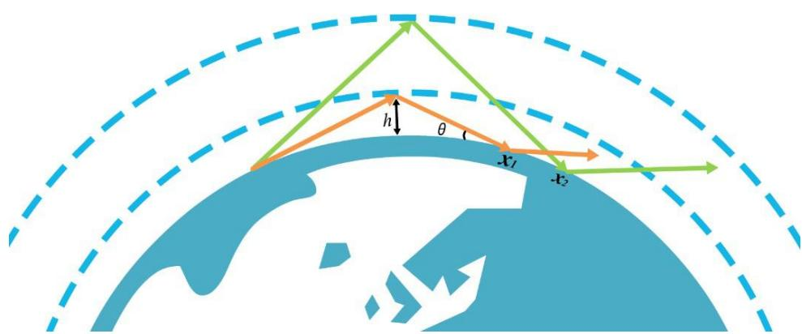
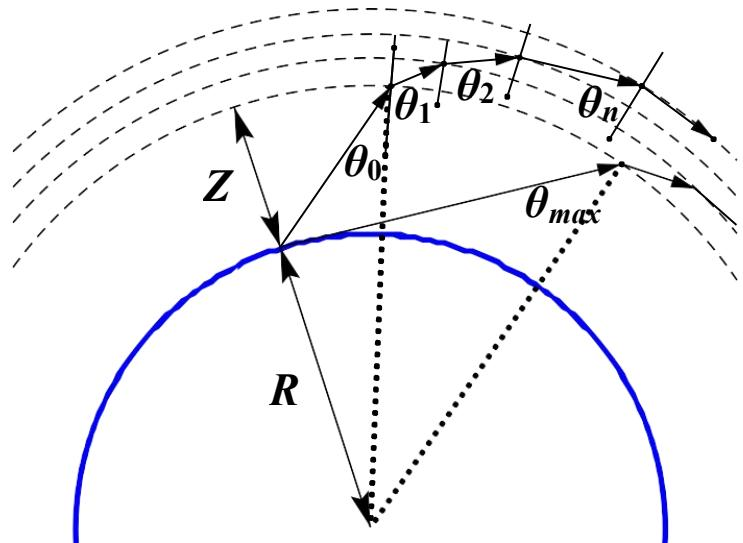
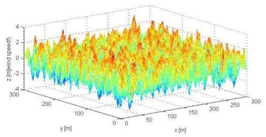
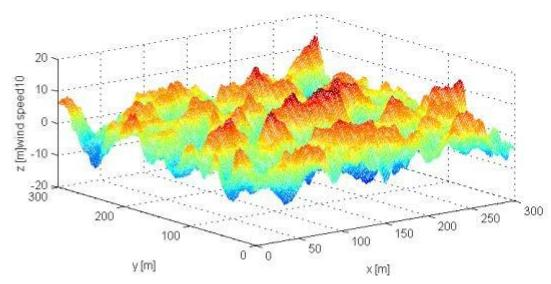
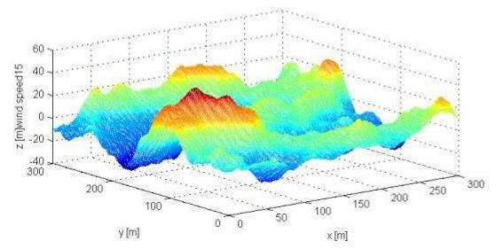
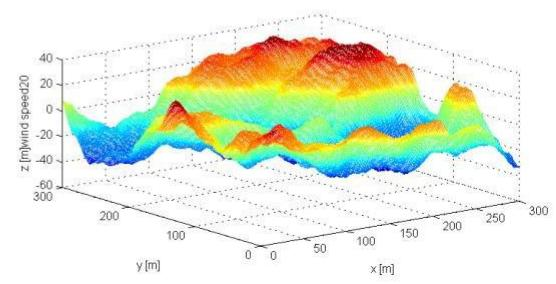
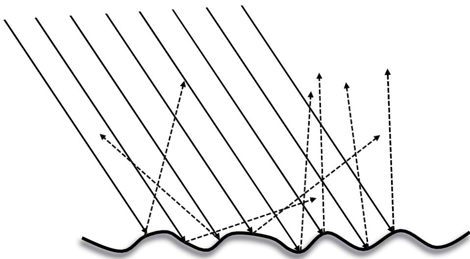

# 2018年美赛O奖论文 A88255 (高频无线电传播建模)

原件经识别和整理；“参考解答”是我们补的。

# 2018 MCM/ICM Summary Sheet

The traditional communication methods of high frequency (HF) radio are still widely used worldwide, which has longer propagation distance than other kinds of radio communication systems, and can cover mountainous, deserts and oceans. At present, the study of high frequency radio multi-hop propagation mode has been relatively systematic, which provide various methods to simulate its trajectory and attenuation in the air, ionosphere and earth surface. In this paper, we mainly focus on the reflection properties on the ocean surface, including calm and turbulent conditions. What’s more, the overall propagation process and practical application of HF radio are also involved.

For part one, on the basis of calm surface reflection model proved in the relative literature, we can calculate the reflection coefficient and the attenuation $L _ { c a l } \ ( d B )$ by using relative permittivity $\varepsilon _ { r }$ and electrical conductivity $\sigma$, then we estimate the first reflection strength off the calm ocean is from 0.5- 5.5mW. Next, a P-M spectrum was used to simulate the distribution of sea wave, which is related to wind speed. Based on it, we use finite element analysis to calculate the correction factor $\rho$ of rough surface. An alternative way is using the international general standard published by CCIR to calculate $\rho$ in the condition of different wind speed, and the attenuation $L _ { t u r } ( d B )$. The estimation of the first reflection strength off the turbulent ocean is 0.2 -2.5mW. Afterwards, according to the analysis of the air and ionosphere, we can get the Path Transmission Loss $L _ { b } \left( d B \right)$ and the attenuation in the ionosphere $L _ { i o n } ( d B )$. The total loss $L _ { t } ( d B )$ of the overall propagation process is the sum of $L _ { b } , L _ { i o n } , L _ { c a l } \mathrm { o r } L _ { t u r } .$ Given the source power is 100-watt and the SNR threshold is 10dB, by estimating the external noises of receiver, we calculated that the maximal attenuation in the propagation path have to be lower than 151dB. For $f { = } 3 M H z .$, our model shows that the signal will take 6 to 7 hops before the total loss $L _ { t }$ reach 151dB. With the increase of frequency, the number of hops will decrease gradually.

For part two, the difference between land and oceans including different $\varepsilon _ { r }$ and $\sigma .$ In addition, the amplitude of fluctuation of land is much larger than the sea surface, which is relatively stable and not related to wind speed. By putting the different parameters to the turbulent surface reflection model, we can calculate the reflection attenuation and estimate the first reflected power is respectively 0.4-4.8mW and 0.2- 2.4mW for rugged terrain and smooth terrain. The estimation of number of hops is 3 reflected by the rugged terrain, and 5 to 6 for smooth terrain. Generally, the attenuation of ground is much larger than ocean.

For part three, for a moving or shaky object, generally we take the circular polarization ways to maintain the stability of signal, which means that there must be a Mismatch Factor v as a part of loss. For a sailing ship, we calculated the coverage area of each hop of signal when the frequency is 24MHz, between 1900-2676 km (1st hop)、3894-5535 km (2nd hop)、5768-8302 km $( 3 ^ { \mathrm { r d } } \mathrm { h o p } )$、8682-11070 km $( 4 ^ { \mathrm { t h } }$ hop), the ship could receive effective signal. The time that can receive the signal could be calculated if the direction and speed of the ship is known.

Key words: high frequency radio, ocean surface reflection, multi-hop propagation

## Contents

1 Introductions....3
2 General Assumptions and Variable Description....3
2.1 General Assumptions....3
2.2 Variable Description....4
3 Model Establishment and Analysis....4
3.1 Ocean Surface Reflection Attenuation....4
3.1.1 Reflection Properties of Seawater....4
3.1.2 Calm Oceans Reflection....5
3.1.3 Turbulent Oceans Reflection....6
3.1.3.1 The Sea Surface Simulation By $P - M$ Spectrum....6
3.1.3.2 Finite Element Analysis on Rough Surface....6
3.1.3.3 International Standard of Sea Surface Roughness....8
3.1.4 The Reflection Attenuation Difference Between Calm and Turbulent Sea Surface....8
3.2 The Maximum Number of Hops....10
3.2.1 Free Space Transmission Loss and Path Transmission Loss....10
3.2.2 The Properties of Ionosphere Reflection....11
3.2.2.1 Physical Properties of Ionosphere....11
3.2.2.2 The Absorption of Ionosphere....12
3.2.3 The Calculation of Maximum Hops....13
3.3 The Reflection Loss of rugged and smooth terrain....14
3.4 Model Improvement About Shipboard Receiver....15
3.4.1 The Properties of Moving Receiver....15
3.4.2 The range of the communication area of the same multi-hop path....15
4 Stability and Sensitivity Analysis....16
5 Strengths and Weakness....18
5.1 Strengths....18
5.2 Weakness....18
6 Short note in IEEE Communication magazine....19
7 Reference....20

# 2018 年美赛 O 奖论文 A88255 (高频无线电传播建模)

本节内容整理自《2018 年美赛 O 奖论文 A88255》第 4–5 页，主要介绍高频无线电传播的基本原理、模型假设及变量定义。

## 一、引言

对于频率在 3MHz~30MHz 的高频无线电波，电离层可以将电磁波反射回地球或海洋，并再次反射回天空，如此反复，从而实现远距离通信。图 1 展示了这一过程。跳距（hop distance）可达数千公里，因此广泛应用于国际短波通信业务[1]。这种传播模式也被称为天波（sky wave）。

电离层的折射率取决于其电子密度，而电子密度是由太阳辐射产生的。通常，当频率超过最大可用频率（MUF）时，无线电波将穿透电离层而无法返回地球。同样地，如果无线电频率低于最低可用频率（LUF），信噪比（SNR）将低于可用阈值。

地面反射点可能位于陆地或海洋，它们的反射特性有所不同。它们的共同之处在于，反射主要取决于介质的电磁特性和表面形状。关于粗糙海面的反射，已有大量研究和国际标准。

经过多次跳跃后，信号将被接收机接收。为了获得最高的 SNR 信号，我们需要减少传输过程中的衰减和损耗。通常，最频繁使用的频率约为 0.85 MUF[1]。

## 二、一般假设与变量描述

### 2.1 一般假设

- 不考虑大气中无线电传播中的衰落、多径延迟和色散效应。也就是说，即使接收到的信号高于 SNR 阈值，仍有可能发生失真。
- 部分区域的海水电参数是恒定的，不受海浪或其他因素的影响。
- 假设地球表面各接收点的背景噪声相同，且不考虑信号接收机的内部噪声。

### 2.2 变量描述

| Abbreviation | Full Name |
| :--- | :--- |
| $R_h$ | Reflection Coefficient Of Horizontal Polarized Wave |
| $\widetilde{\varepsilon}$ | Complex Permittivity of Sea Surface |
| $S(\omega)$ | Pierson-Moskowitz Spectrum |
| $\rho$ | Correction Factor |
| $\sigma$ | Electrical Conductivity |
| $L_{cal}$ | The Attenuation of Calm Ocean |
| $L_{tur}$ | The Attenuation Factor of Turbulent Surface |
| $f$ | Frequency |
| $L_{bf}$ | Free Space Transmission Loss |
| $L_b$ | Path Transmission Loss |
| $\varepsilon_r$ | Relative Permittivity |
| $A_{ion}$ | The Attenuation Factor of Ionosphere |
| $L_t$ | Total Loss |
| $L_{ship}$ | Constant Attenuation |

## 三、模型建立与分析

### 3.1 海面反射衰减

为了估算平静海面和湍流海面的反射损耗，我们需要了解海水的反射特性以及平静表面与粗糙表面之间的差异。

#### 3.1.1 海水的反射特性

海洋的电磁特性会影响无线电波的反射，这主要取决于海水的温度、盐度以及无线电频率。定义海洋表面电磁特性的参数是复介电常数，它由相对介电常数 $\varepsilon_r$、电导率 $\sigma$ 和波长 $\lambda$ 组成，表达式如下：

$$
\tilde {\varepsilon} = \varepsilon_ {r} + i 60 \lambda \sigma \tag{1}
$$

对于 $\varepsilon_r$ 和 $\sigma$，国际无线电咨询委员会（International Radio Consultative Committee）已在实际应用中发布了国际标准。在 3~30MHz 的频率范围内，近似估计为：$\varepsilon_r = 7$, $\sigma = 5.12$。

根据斯涅尔定律（Snell's law），我们可以得到水平极化波和垂直极化波的菲涅耳反射系数[3]：

$$
\begin{array}{l} R _ {h} = \frac {\sin \theta - \sqrt {\tilde {\varepsilon} - \cos^ {2} \theta}}{\sin \theta + \sqrt {\tilde {\varepsilon} - \cos^ {2} \theta}} \\ R _ {v} = \frac {\tilde {\varepsilon} \sin \theta - \sqrt {\tilde {\varepsilon} - \cos^ {2} \theta}}{\tilde {\varepsilon} \sin \theta + \sqrt {\tilde {\varepsilon} - \cos^ {2} \theta}} \end{array}\tag{2}
$$

根据海面反射特性，水平极化波的损耗小于垂直极化波，因此我们使用水平极化波作为发射信号，计算中将使用水平反射系数 $R_h$。

# 2018年美赛O奖论文 A88255 (高频无线电传播建模)

本资料为《2018年美赛O奖论文 A88255》第3部分（共7部分）的内容整理，涵盖平静海面反射、湍流海面模拟及粗糙表面有限元分析等知识点。

## 3.1.2 Calm Oceans Reflection

在理想条件下，我们将平静的海面视为一个完全平坦的平面，无线电在此平面上的反射遵循斯涅尔定律[3]。同时，我们采用水平极化以尽可能减少反射损耗，衰减因子可通过以下公式计算：

$$
L_{cal} (dB) = - 10 \lg \int_{\theta_{\min}}^{\theta_{\max}} R_h d\theta \tag{3}
$$

为了定义 $\theta_{\max}$ 和 $\theta_{\min}$，由于无线电被电离层反射，我们必须从电离层的折射特性进行分析。

其中 $R$ 为地球半径，$Z$ 为电离层高度，$N_n$ 为第 $n$ 个反射点的电子密度。

根据折射定律：

$$
n_0 \sin \theta_0 = n_1 \sin \theta_1 = n_2 \sin \theta_2 = \dots = n_n \sin \theta_n \tag{4}
$$

无线电能够从电离层反射出来的边界条件为：

$$
n_0 = 1, \theta_n = 90^\circ \tag{5}
$$

将边界条件代入公式(4)：

$$
\begin{array}{l} 
\sin \theta_0 = \sqrt{\varepsilon_n} = \sqrt{1 - \frac{80.8 N_n}{f^2}} \\ 
\theta_{\max} = \sin^{-1} \sqrt{1 - \frac{80.8 N_n}{f^2}} 
\end{array} \tag{6}
$$

由于地球曲率的影响，$\theta_0$ 无法达到 $90^\circ$。当无线电的水平投影处于水平位置时，它达到最大入射角 $\theta_{\min}$。

$$
\theta_{\min} = \sin^{-1} \frac{R}{R + Z} \tag{7}
$$

显然，自然界中不存在这种理想条件，只要有一点风或洋流，海面就必须是波纹状的。我们可以将波纹表面视为稍显湍流的海洋表面，这将在下一段中进行考虑。

## 3.1.3 Turbulent Oceans Reflection

### 3.1.3.1 The Sea Surface Simulation By P-M Spectrum

湍流海洋可以被视为由具有不同振幅、频率、方向和相位的无限谐波波组合而成，这些谐波波的贡献构成了海谱。海谱是一个随机过程的统计特性，包含每个谐波分量关于频率和方向的分布。

之前有很多关于海谱的研究，其中 Pierson-Moscowitz 谱、JONSWAP 谱和 Elfouhaily 谱被广泛使用。现在我们使用前一种作为我们的海洋反射表面。

Moscowitz[4] 通过平均观测到的 54 个谱，评估了北大西洋风波的谱，从而得到了 Pierson-Moscowitz 谱（P-M 谱）：

$$
S(\omega) = \alpha \frac{g^2}{\omega} \exp \left[ - \beta \left(\frac{g}{U_{19.5} \omega}\right)^{-4} \right] \tag{8}
$$

其中 $\alpha = 8.1 \times 10^{-3}$，$\beta = 0.74$，$U^{19.5}$ 是距海面 19.5 米处的风速。

图 3 展示了由 P-M 谱分布的波浪模拟，很容易发现随着风速的增加，波浪的峰值和粗糙度也随之增加。

### 3.1.3.2 Finite Element Analysis on Rough Surface

湍流海洋与平静海洋的区别在于波高、形状和频率，电磁波可以向各个方向反射。图 4 显示了反射特性：

我们可以通过有限元分析来模拟反射模型，然后计算相对较大海洋表面的反射系数。通过将海洋表面划分为有限的微平面，每个微平面关于其自身法向量的反射组合决定了漫反射的特性。

该模型由两部分组成：一部分是表面的分布表达式，另一部分是描述每个微平面反射特性的反射模型，后者已在 3.1.1 节中讨论过。

Blinn (1977) 给出了微平面法向量分布的指数衰减模型[5]。在该模型中，概率密度最高的微平面是水平的，因此标准法向量是垂直的。反射波应随法向量角度的减小而衰减，直到变为水平。

对于光滑表面，衰减很快；而对于粗糙表面，衰减是渐进的。Blinn 模型的分布函数与半向量 $\boldsymbol{\omega}_h$ 和标准法向量因子 $\boldsymbol{n}$ 的点积成正比。

$$
D(\boldsymbol{\omega}_h) \propto (\boldsymbol{\omega}_h \cdot \boldsymbol{n})^e \tag{9}
$$

为了保证物理效应，微平面的分布必须标准化。也就是说，必须存在一个具有 $D(\omega_n)$ 分布的高度场。高度场中每个微平面的总投影面积等于 1。

$$
\int_{\mathcal{H}^2(n)} D(\omega_h) \cos \theta_h d\omega_h = 1 \tag{10}
$$

因此，归一化的 Blinn 微平面分布为：

$$
D(\omega_n) = \frac{e + 2}{2 \pi} \cdot (\omega_n \cdot n) \tag{11}
$$

此外，由于有一部分微平面被遮蔽或处于阴影中，需要添加几何衰减项 $G$：

$$
D(\omega_n) = G \cdot \frac{e + 2}{2 \pi} \cdot (\omega_n \cdot n) \tag{12}
$$

校正因子 $\rho$ 可以通过以下公式计算：

$$
\rho = \int_{\frac{\pi}{4} + \frac{\theta}{2}}^{\pi} D(\omega_n) d\omega_n \tag{13}
$$

# 2018年美赛O奖论文 A88255 (高频无线电传播建模)

整理自《2018年美赛O奖论文 A88255》第4部分（共7部分），由识别工具读取的第9–12页内容。

## 3.1.3.3 International Standard of Sea Surface Roughness

针对粗糙海表面的反射，国际无线电咨询委员会（CCIR）给出了修正因子 $\rho$ 的表达式 [6]：

$$
\begin{array}{l} 
\rho = \frac {1}{\sqrt {3 . 2 g - 2 + \sqrt {(3 . 2 g) ^ {2} - 7 g + 9}}} \\ 
g = 0. 5 (\frac {4 \pi h _ {w} f \sin \theta}{c}) ^ {2}, h _ {w} = 0. 0 0 5 1 U ^ {2} 
\end{array}\tag{14}
$$

其中 $c$ 为光速，$h _ { w }$ 为海表面均方根高度，可由海表面附近的风速 $U$ 表示。

将修正因子 $\rho$ 加入湍流表面的衰减因子 $L _ { t u r }$ 和反射系数 $R _ { h }$ ，可得：

$$
R _ {t u r} = \rho \cdot R _ {h}, L _ {t u r} (d B) = - 1 0 \lg \int_ {\theta_ {\min}} ^ {\theta_ {\max}} \rho \cdot R _ {h} d \theta\tag{15}
$$

## 3.1.4 The Reflection Attenuation Difference Between Calm and Turbulent Sea Surface

将数据代入公式 (14) 和 (15)，取风速 $U$ 为 20m/s，图 5 展示了当频率 $f = 3 M H z$ 时，入射角 $\theta$ 与不同海表面（平静海面 $L _ { c a l }$ 和湍流海面 $L _ { t u r }$）的衰减之间的关系。图 5 还展示了频率与衰减之间的关系。

从图 5 中可以发现，在平静表面上，无论入射角如何，衰减都非常小，可以忽略不计；而在湍流表面上，衰减随 $\theta$ 的增加而增加，当 $\theta$ 接近 90° 时，衰减可达 10.578 dB。

从图 6 中可以发现，无论频率如何，平静表面上的衰减几乎不变且非常小，低于 1dB。而湍流表面上的衰减随频率的增加而增加，当频率接近 30MHz 时，衰减可达 4 dB。

信号经电离层第一次反射后，再由平静和湍流海表面反射。空气和电离层中的损耗将在下一节 3.2 中提及。如图 7 所示，信号强度随频率的增加而降低。对于平静海洋，反射信号强度的范围是 0.5 到 5.5mW。对于湍流海洋，范围是 0.2 到 2.5mW。在最常用的频率 0.85MUF 处，信号功率约为 0.5062mW。

## 3.2 The Maximum Number of Hops

为了计算最大跳数，有必要估算不同过程中的信号衰减，包括路径传输损耗、电离层反射衰减和海表面反射衰减。

### 3.2.1 Free Space Transmission Loss and Path Transmission Loss

自由空间是指充满均匀无耗介质的无限空间，具有各向同性、电导率 $\sigma = 0$ 、相对介电常数 $\varepsilon _ { r } = 1$ 和相对磁导率 $\mu _ { r } = 1$ 的特性。

假设两个理想的点信号源天线（增益：$G _ { t } = G _ { r } = 1$）分别为发射天线和接收天线，$P _ { t }$ 为输入（发射）功率，$P _ { r }$ 为输出（接收）功率，则自由空间传输损耗 $L _ { b f }$ 可定义为：

$$
L _ {b f} = \frac {P _ {t}}{P _ {r}} \Bigg | _ {G _ {t} = G _ {r} = 1}\tag{16}
$$

如果发射天线的最大方向与接收天线的最大方向一致，在极化匹配和负载阻抗匹配的条件下，接收功率为：

$$
P _ {r} = \frac {P _ {t}}{4 \pi d ^ {2}} \cdot \frac {\lambda^ {2}}{4 \pi} = \left(\frac {\lambda}{4 \pi d}\right) ^ {2} P _ {t}\tag{17}
$$

$$
L _ {b f} = 1 0 \lg \frac {P _ {t}}{P _ {r}} = 2 0 \lg \left(\frac {4 \pi d}{\lambda}\right) (d B)\tag{18}
$$

$$
L _ {b f} = 3 2. 4 5 + 2 0 \lg f (M H z) + 2 0 \lg d (k m) \quad (d B)\tag{19}
$$

因此，当无线电频率或传播距离加倍时，自由空间传输损耗将增加 6 dB。

图 8 展示了在不同频率下，传输距离与衰减 $L _ { b f }$ 之间的关系。频率越高，自由空间传输损耗越大。

在大气环境中，除了自由空间传输损耗外，电磁波还可能遭受衰减、衰落、去极化、时域和频域失真等影响，从而导致复杂的变化。

假设天线设置在自由空间中，最大方向的场强 $E_0$ 可定义为：

$$
\mid E _ {0} \mid = \frac {\sqrt {6 0 P _ {t} G _ {t}}}{d} (V / m)\tag{20}
$$

接收点的场强为：

$$
\mid E \mid = \mid E _ {0} \mid A _ {\text {air}} = \frac {\sqrt {6 0 P _ {t} (W) G _ {t}}}{d (m)} A _ {\text {air}} \quad (V / m)\tag{21}
$$

$A _ { a i r }$ 是大气中的衰减因子，它与频率、距离、介质的电参数、传播模式等有关。我们也可以将 $A _ { a i r }$ 转换为 dB 形式：

$$
A _ {a i r} (d B) = 1 0 \lg A _ {a i r} ^ {2} = 2 0 \lg \frac {| E |}{| E _ {0} |}\tag{22}
$$

$$
L _ {b} = 2 0 \lg \left(\frac {4 \pi d}{\lambda}\right) - A _ {\text {air}} (d B) = L _ {b f} - A _ {\text {air}} (d B) \quad (d B)\tag{23}
$$

显然，$L _ { b }$ 描述了介质中的功率传播情况，因此 $L _ { b }$ 被称为路径传输损耗或基本传输损耗。

因此，我们可以使用 $L _ { b }$ 来定义大气中的传输损耗（不包括电离层），它与传播距离 $d$ 、波长 $\lambda$ 和衰减因子 $A _ { a i r }$ 有关。

### 3.2.2 The Properties of Ionosphere Reflection

#### 3.2.2.1 Physical Properties of Ionosphere

电离层是地球高层大气的电离部分，海拔高度约从 60 km 到 1,000 km[7]，包含电子以及围绕地球的带电原子和分子。通常，我们使用电子密度（电子数量/m³）来描述其电离程度。

电离层是一种随机、色散和各向异性的半导体介质，其参数（厚度、电子密度和分布）随机变化。

## 3.2.2.1 电离层的分层

电离层内部还可分为四层[8]：

- D 层：距地表 60～90 km。随着夜晚来临，D 层厚度逐渐减小；深夜间 D 层几乎消失。
- E 层：90～150 km，在 110 km 高度处相对稳定。夜间电子密度下降。
- F1 层：170～220 km，常在夏季白天出现，夜间与冬季消失。
- F2 层：225～450 km，白天电子密度高于夜间，冬季高于夏季。

## 3.2.2.2 电离层的吸收

电离层的吸收包括偏移吸收与非偏移吸收。

非偏移区是折射率 $n$ 接近 $1^{[9]}$ 的区域，无线电几乎沿直线传播。非偏移吸收主要发生在 D 层，该层含有大量中性分子和离子，碰撞频率 $v$ 很高。E 层及 F 层下部也属于非偏移区，但相比 D 层可以忽略。

为计算 D 层的非偏移吸收，根据电磁理论，已知无耗介质的 $\varepsilon_r$ 与 $\sigma$，衰减因子 $A_{ion}$ 为：

$$
A_{ion} = \omega \sqrt{\frac{\mu_0 \varepsilon_0}{2}\left[\sqrt{\varepsilon_r^2 + (60\lambda\sigma)^2} - \varepsilon_r\right]} \tag{24}
$$

其中 $\varepsilon_0$ 为真空介电常数，近似值为 $8.854187817 \times 10^{-12}\ \mathrm{F/m}$；真空磁导率 $\mu_0$ 为 $4\pi \times 10^{-7}\ \mathrm{H/m}$。

对于高频波传播，满足条件 $\sigma/(\omega\varepsilon) \ll 1$，于是：

$$
A_{ion} \approx \frac{60\pi\sigma}{\sqrt{\varepsilon_r}} = \frac{60\pi N e^2 v}{\sqrt{\varepsilon_r}\, m(\omega^2 + v^2)} \tag{25}
$$

偏移区是折射率 $n$ 很小的区域，无线电会沿曲线改变传播方向并返回地面。一般有 $\varepsilon_r \approx 1^{[10]}$，电离层中的总衰减 $L_{ion}$ 可由 $e^{-\int A_2\,dl}$ 计算，$l$ 为无线电在电离层中的路径。一般吸收相当小，通常低于 $10\ \mathrm{dB}^{[11]}$。

## 3.2.3 最大跳数的计算

影响信噪比的主要因素包括内部噪声与外部噪声。内部噪声来自接收系统本身，在此情形下可以忽略。

外部噪声源自宇宙、大气与地球表面，其中宇宙背景辐射[12]最为重要，可表示为：

$$
P_{noise} = kTB \approx 8.0 \times 10^{-15}\ \mathrm{W} \tag{26}
$$

其中 $k$ 为玻尔兹曼常数，取值 $1.3806505 \times 10^{-23}\ \mathrm{J/K}$；$T$ 为背景温度，一般取 290 K；$B$ 为信号带宽，取决于信号质量，计算中取 2 MHz。

信噪比阈值为 10 dB，即

$$
\begin{array}{c}
SNR = 10\lg\dfrac{P_{signal}}{P_{noise}} = 10\ \mathrm{dB} \\
P_{signal\_\min} = 8 \times 10^{-14}\ \mathrm{W}
\end{array} \tag{27}
$$

信号源给定功率为 100 W，因此传输过程中允许的最大衰减为：

$$
L_{\max} = -10\lg\frac{100}{P_{signal\_\min}} = 150.969\ \mathrm{dB} \tag{28}
$$

通过计算总损耗 $L_t$ 并与 $L_{\max}$ 比较，可以估计信号在强度降到信噪比阈值以下之前能够经过的跳数。

根据 3.1、3.2.1 与 3.2.2 的结论，无线电在传输过程中会遭受若干种损耗与衰减，包括路径传输损耗 $L_b$、电离层衰减 $L_{ion}$、海面衰减 $L_{cal}$ 或 $L_{tur}$。

总损耗可表示为：

$$
L_t = L_b + L_{ion} + L_{cal/tur} \tag{29}
$$

由图 10 可见，若信号经平静海面反射，在第 6、7 跳时，部分信号的衰减已超过 151 dB，而第 8 跳的信号几乎全部衰减到阈值。因此在 3 MHz 频率下，信号可达到 6 至 7 跳，传输距离可达 15,000 km。

此外，随着频率的增加，总跳数将逐渐减少，最终降至只有一跳。

## 3.3 崎岖与平坦地形的反射损耗

与海面相比，地表的相对介电常数 $\varepsilon_r$ 与电导率 $\sigma$ 完全不同。下表给出不同地质条件下的 $\varepsilon_r$ 与 $\sigma$。

表 1：不同地质条件下的 $\varepsilon_r$ 与 $\sigma$。[13]

| 地质 | $\varepsilon_r$ 范围 | $\varepsilon_r$ 平均值 | $\sigma$ 范围 | $\sigma$ 平均值 |
|---|---|---|---|---|
| 海水 | 70 | 70 | 0.66~6.6 | 5 |
| 淡水 | 80 | 80 | $10^{-3} \sim 2.4 \times 10^{-2}$ | $10^{-3}$ |
| 湿土 | 10~30 | 20 | $3 \times 10^{-3} \sim 3 \times 10^{-2}$ | $10^{-2}$ |
| 干土 | 2~6 | 4 | $1.1 \times 10^{-3} \sim 2 \times 10^{-3}$ | $10^{-3}$ |

此外，地表起伏幅度远大于海面，无线电还会向各个方向散射。以丘陵地形（起伏幅度 500 m 以下、丘陵稀疏）为例，对 3.1.3.2 中的模型进行修正。我们可以使用 3.1.1 中的反射系数公式 (1)(2)，替换 $\varepsilon_r$ 与 $\sigma$，计算地面的反射系数 $R_g$。

值得注意的是，山地或崎岖地形的反射与风速无关，这一点与海面不同。若已知地表的地形分布，就不难算出 $R_g$，从而地面的衰减也可由 3.1.2 中给出的公式 (3) 计算。

## 3.4 Model Improvement About Shipboard Receiver

### 3.4.1 The Properties of Moving Receiver

In the process of sailing, to the receiver on the ship, we should not only consider SNR of receiving signal, but also the stability of receiving signal. Usually, in a shaky or moving subject, using the circular polarization antenna can keep the signal as stable as possible.

There are two ways of circular polarization, one is linear polarization transmitting and circular polarization receiver, another is on the contrary. No matter what kind of polarization way we take, the Mismatch Factor $v$ is always 1/2.

So our model need to add a constant attenuation:

$$
\begin{array}{l} L _ {s h i p} = - 1 0 \lg 0. 5 = 3. 0 1 d B \\ L _ {t} = L _ {b} + L _ {\text {ion}} + L _ {\text {cal / tur}} + L _ {\text {ship}} \end{array}\tag{30}
$$

### 3.4.2 The Range of The Communication Area of The Same Multi-Hop Path

Figure 13 displays the attenuation degree of the signal reflected by the turbulent ocean and received by a shipboard receiver, it’s not hard to find the signal will take 3 to 4 hops before attenuated to 151dB. On this basis, we can also calculate the distance range among which the ship can receive the effective signal. The result was displayed in figure 14.

$d _ { r }$ is the relative distance, suppose that the earth is a regular sphere, every reflected point on the earth must not in the same plane, so we use $d _ { r }$ to describe the curve distance that the ship move on the earth. In figure 14, the red lines are the ranges that could receive the signal, that is to say within the red ranges, the SNR of signals >10dB.

The specific ranges are between 1900-2676 km $( 1 ^ { \mathrm { s t } } \mathrm { h o p } )$ 、3894-5535 km $( 2 ^ { \mathrm { n d } }$ hop)、5768- 8302 km $( 3 ^ { \mathrm { r d } } \mathrm { h o p } )$ 、8682-11070 km $( 4 ^ { \mathrm { t h } } \mathrm { h o p } )$ . Between each range, there are areas like “exclusion zone” where cannot receive the effective signal.

Known the ranges, as long as we know the direction and speed of the ship, it’s quite easy to calculate the time that could receive the signal.

## 4 Stability and Sensitivity Analysis

In the reflection model we established in 3.1, the changes of height, shape of sea surface are mainly caused by wind speed. What’s more, in different sea areas, the temperature and salinity of seawater couldn't be the same, which could change $\varepsilon _ { r }$ and $\sigma$ of seawater. So, we mainly analyze the influence of wind speed, $\varepsilon _ { r }$ and $\sigma$ to the stability and sensitivity of our model.

We considered the wind speed near the sea surface from 5m/s to 20m/s, and compare them:

From figure 15 we can find that wind speed has a relatively larger influence on the reflection attenuation of sea surface, the attenuation increased following the increase of wind speed, as well as the worse communication effect.

Consider the 20% rise and fall of $\varepsilon _ { r }$ and $\sigma$, the results are:

The four curves of figure 16 are almost overlapped. Therefore, the small change within 20 percent of $\varepsilon _ { r }$ and $\sigma$ has very little influence on the attenuation on sea surface. We can almost ignore the differences.

However, when there are large changes of reflecting medium, such as the seawater versus the ground. The attenuation of ground is obviously much more than seawater. Figure 17 shows the difference.

## 5 Strengths and weakness

### 5.1 Strengths

*   There have been systematic previous researches about sky wave. About the sea surface reflection model, most of them were calculated by the empirical model about frequency and incident angle. Our model used P-M model to simulate the wave of sea surface, Finite Element Analysis is also used to calculate the reflection coefficient, which is more accurate and universal.
*   To the receiving problem of shipboard receiver, we know the particularity of the moving and shaky objects, in the condition of circular polarization only half of the signal could be received. To calculate the effective range of reflection, we can display the useable receiving area and attenuation.

### 5.2 Weakness

*   In the model of ground reflection, we only change the relative parameters of the sea surface reflection model, there may be some inapplicable places and some errors.
*   To part Ⅲ, the weaknesses are due to the complexity of ionosphere, the calculation is very difficult, it’s not very accurate to represent the transmission path in the ionosphere by the function about incident angle, which may affect the result.

## 6 Short note in IEEE Communication magazine

The background of our research is that to the high frequency radio ($3\text{MHz} \sim 30\text{MHz}$), the ionosphere can reflect the transmission electromagnetic wave back to the earth or oceans, signal could be reflected for several times until get attenuated under the lowest SNR. The propagation mode is also called sky wave.

Our team have finished the model about four aspects: estimating the sea surface reflection properties, calculating the maximal hops of a given power signal source, comparing the land reflecting situation with sea, considering the influence of a shipboard receiver to our model. The four aspects contain the overall process of the propagation of the sky wave, but the key point is to solve the reflection problem off a turbulent sea surface.

To estimate the reflection loss off calm oceans and turbulent oceans, we have to figure out the reflection properties of seawater as well as the difference between calm surface and tough surface. Suppose that the surface of calm oceans is a flat plane, we can use Snell's law to calculate the reflection coefficient $R_h$. The integral of $R_h$ among all the possible angle is the attenuation coefficient of calm oceans. To turbulent oceans, we used the P-M spectrum to estimate the distribution of wave height, and then take the finite element analysis, by integrating all of the reflected wave of each microplane in a relative large surface, by normalizing the result, we can get the strength distribution of reflected wave. It is also feasible to use the international general standard of tough sea surface correction factor $\rho$ to calculate the reflection attenuation.

To calculate the maximum number of hops, it’s necessary to estimate the signal attenuation in different processes, including path transmission loss, ionosphere reflection attenuation and sea surface reflection attenuation. Considering the external noises, to a given signal source of 100-watt power, the maximum attenuation in the propagation path has to under 151dB to satisfy the lowest SNR 10dB. In the frequency of 3MHz and reflected by clam oceans, the hops of signal could reach 6 to 7 times, along with the propagation distance reach 15,000 km. With the increase of frequency, the total number of hops will decrease gradually.

Compared with the reflection off calm oceans, the surface of the ground have totally different relative permittivity $\varepsilon_r$ and electrical conductivity $\sigma$. In addition, the amplitude of fluctuation is much larger than the sea surface so that the land reflection has more attenuation and less reflecting times, it’s also correspond to the smaller $\varepsilon_r$ and $\sigma$ of soil than seawater.

To a shipboard receiver, using the circular polarization antenna can keep the signal as stable as possible. The Mismatch Factor v is 1/2, which means that there has to be an additional 3dB attenuation when received. We calculated the receiving ranges of a sailing ship, every hop has its own radiation range, the areas between ranges are so called “exclusion zone” where cannot the effective signal.

The significance of our model is that solving the problem about the reflection off a turbulent surface, meanwhile combining the loss and attenuation in the process of the whole propagation of sky wave. The previous researches also provide us some methods to solve the problem. The model could be used in long-distance or overseas communication transmitted by high frequency electromagnetic wave.

Team #88255

## 7 Reference

[1] Lee W C Y.Mobile Communication Design Fundamentals[M].1993.

[2] Barrios A E, Patterson W L, San S. Advanced Propagation Model (APM) Ver. 1.3. 1 Computer Software Configuration Item (CSCI) Documents[J]. 2002.

[3] Dockery D, Kuttler J R. An improved impedance-boundary algorithm for Fourier split-step solutions of the parabolic wave equation[J]. IEEE Transactions on Antennas & Propagation, 1996, 44(12):1592-1599.

[4] Jr W J P, Moskowitz L. A proposed spectral form for fully developed wind seas based on the similarity theory of S. A. Kitaigorodskii[J]. Journal of Geophysical Research, 1964, 69(24):5181–5190.

[5] Zhang S R, Foster J C, Holt J M, et al. Magnetic declination and zonal wind effects on longitudinal differences of ionospheric electron density at midlatitudes[J]. Journal of Geophysical Research Space Physics, 2012, 117(A8).

[6] Yokoyama A, King R W P, Sandler S S. Comments on "The electromagnetic field of a vertical electric dipole over the Earth or sea" [with reply][J]. IEEE Transactions on Antennas & Propagation, 1995, 43(5):541-544.

[7] Brahmanandam P S, Chu Y H, Wu K H, et al. Vertical and longitudinal electron density structures of equatorial E- and F-regions[J]. Annales Geophysicae, 2011, 29(1):81-89.

[8]Patterson W L, Hattan C P, Hitney H V, et al. Engineer's Refractive Effects Prediction System (EREPS), revision 2.0[J]. Interim Report Naval Ocean Systems Center San Diego Ca, 1994,95.

[9]Zhang S R, Chen Z, Coster A J, et al. Ionospheric symmetry caused by geomagnetic declination over North America[J]. Geophysical Research Letters, 2013, 40(20):5350-5354.

[10]Ridley A J, Deng Y,Tóth G. The global ionosphere–thermosphere model[J]. Journal of Atmospheric and Solar-Terrestrial Physics, 2015, 68(8):839-864.

[11] Wu T T, King R W P. Lateral electromagnetic pulses generated by a vertical dipole on the boundary between two dielectrics[J]. Journal of Electromagnetic Waves & Applications, 1987, 62(11):4345-4355.

[12] Cooray V,Ming Y.Propagation effects on the lightning‐generated electromagnetic fields for homogeneous and mixed sea‐land paths[J]. Journal of Geophysical Research Atmospheres, 1994, 99(D5):10641-10652.

[13] Mazur V, Ruhnke L H. Common physical processes in natural and artificially triggered lightning[J]. Journal of Geophysical Research Atmospheres, 1993, 98(D7):12913-12930.
