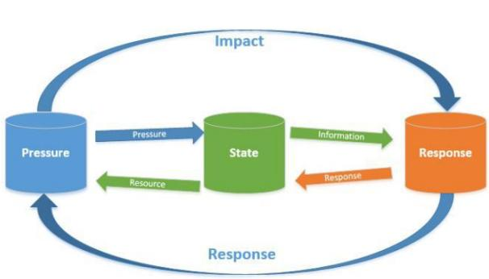
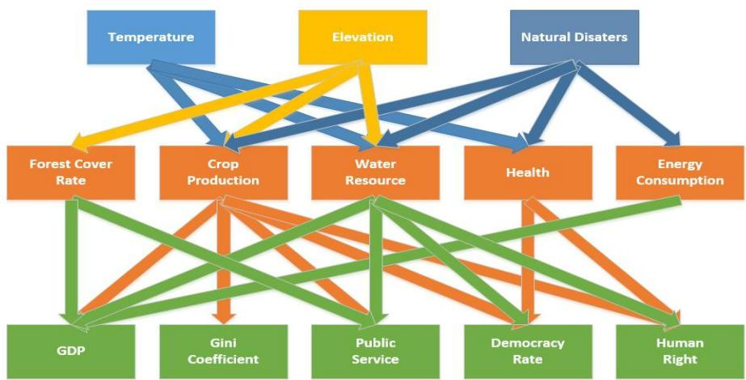

# 2018年美赛O奖论文 E73119（气候变化与脆弱国家预测）

原件为竞赛论文。补充：文中的阅读练习及“参考解答”为整理时增加，原件图文保留出处。

## 2018 MCM/ICM Summary Sheet

In the past two decades, regional instability caused by some fragile state(s) has become more and more concerned by the whole world. Among the various factors, climate changes usually lead to high frequency of extreme weather events, which significantly exacerbate the fragility of a certain state. How to mitigate the impact of climate changes and prevent a state from becoming a fragile one has been widely recognized as a very important and urgent issue.

As a response, in order to predict a state's fragility accurately, we develop a novel model called PSA (Pressure Sensitivity Adaptability), which is significantly extended from the well-known PSR (Pressure State Response) model. Specifically, our model contains three dimensions whose weights are obtained by combining AHP (Analytic Hierarchy Process) and EWM (Entropy Weight Method). Notice that FI (Fragile Index) is a weighted sum of the three dimensions denoting the fragility of a certain state. In our empirical studies, we verify the effectiveness of our model via the ground truth of the public fragile state index. Meanwhile, we use a regression analysis method to get functional relationship between nonclimatic indicators and climatic indicators. We choose DRC (Democratic Republic of the Congo) and BD (Bangladesh) in our case studies. Specifically, we use the values of the indicators of a decade as the input data fed to our model, and obtain the FI curve. For DRC, the FI curve without the effect of climate changes is modeled by keeping the values of the corresponding climate indicators constant. For BD, we use GM (1,1) to draw the prediction curve of FI and find that the time that BD is likely to become a stable state is around 2076.

Furthermore, we study six major intervention policies of BD for climate changes. We find that natural disasters in BD are serious and suggest investing more fiscal expenditure in intervention2 (intervention2: Comprehensive Disaster Management). It is estimated that this expenditure will increase by 35% every 5 years. We can then get other policies' fiscal expenditures through GM (1,1), and finally get the total expenditure in 5 years, 10 years and even 20 years.

We select Asia, Europe and Africa so as to study the portability of our proposed model. For continents, the fragile indexes of several representative countries are selected and averaged in order to estimate the continent fragile index. The results are very promising, which clearly showcases the effectiveness of our model on continents.

Finally, we conduct a sensitivity analysis in order to gain some deep understanding of our model, and conclude the report via discussing the strengths and weaknesses of our proposed model.

Keywords: Fragile State, Climate Change, PSA, GM (1,1)

### Contents

1 Introduction
1.1 Background ..... 2
1.2 Restatement of Problems ..... 2
1.3 Our Work ..... 3

2 Assumptions and Symbol Table
2.1 Assumptions ..... 3
2.2 Symbol Table ..... 4

3 Model PSA
3.1 PSR ..... 4
3.2 PSA ..... 4
3.2.1 Identify indicators ..... 5
3.2.2 Data Pre-processing ..... 6
3.2.3 Data Normalization ..... 6
3.2.4 Calculate weight by AHP ..... 7
3.2.5 Calculate weight by EWM ..... 7
3.2.6 Weighted average ..... 8
3.3 Analyze direct and indirect impacts of climate change ..... 8
3.4 Test PSA ..... 10

4 Case Study
4.1 Study 1: Democratic Republic Of the Congo ..... 12
4.1.1 Climate change effects of Congo ..... 12
4.1.2 The FI without climate change effects ..... 12
4.2 Study 2: People's Republic of Bangladesh ..... 13
4.2.1 Climate change effects of Bangladesh ..... 13
4.2.2 Prediction ..... 15
4.2.3 Effect of Human Intervention ..... 15
4.2.4 Total cost ..... 16

5 Further Exploration
6 Sensitivity Analysis
7 Strengths and Weaknesses
7.1 Strengths ..... 18
7.2 Weaknesses ..... 19

8 Conclusions
Appendices
Appendix A FI of Country
19

知识点：[文献综述与研究背景撰写方法](../../../topics/数学建模/wenxian_zongshu.md)、[一般假设及其合理性说明（Assumptions and Justifications）](../../../topics/数学建模/jiaben_shezhi.md)、[符号说明与术语定义（Nomenclature / Symbols and Definitions）](../../../topics/数学建模/fuhao_shuoming.md)

### 1 Introduction

#### 1.1 Background

In the past 20 years, there have been local wars and conflicts in the world and the fragile states have been a threat to the world security. Therefore, fragile states become a major issue for the world’s development. OECD (Organization for Economic Co-operation and Development) defines "States are fragile when state structures lack political will and/or capacity to provide the basic functions needed for poverty reduction, develop-ment and to safeguard the security and human rights of their populations."[1] Many universities and research institutes start to research centers to specialize in problems of fragile states. To measure fragility of a state, many evaluation indexes have been put forward, such as World Bank’s Country Policy and Institutional Assessment (CPIA) [2], Carton University’s Country Indicators for Foreign Policy Fragility Index (CIFP)[3]and The Fund for Peace’s Fragile States Index (FSI)[4]. Nowadays, due to the rapid devel-opment of industries and the rapid increase of population, large amount of energy consumption and greenhouse gases emission like carbon dioxide cause global warm-ing, then the frequent extreme weather and even the more extreme phenomena like a colder winter and a hotter summer. The climate change leads to more frequent and more serious drought, flood, storm, coldness and hotness, and leads to decline of wa-ter, food and energy[5], and then even leads to the wide spread of famine and diseases. If the government is unable to solve the problem of famine and diseases for people, there will be local violent conflicts. If the foreign government interferes in internal af-fairs, there will be wars and regional instability. Without effective measures to solve these problems, there will be disasters which bring threats to the world’s peace and de-velopment. Hence, reducing the fragility of a state has its unprecedented significance in today’s world.

#### 1.2 Restatement of Problems

To create a more stable world, fragile state should be studied first and the following tasks are to be accomplished:

An evaluation index system to evaluate a state’s fragility and measure the influences of climate change on fragility is needed. By considering various factors like economy, society, politics and local climate, the model should clearly extinguish the state is fragile, vulnerable or stable. Meanwhile the model can identify how climate change increases fragility through direct means or indirectly as it influences other indicators. (Refer to Task1)

The influence of climate change on state should be evaluated, which help find out some definitive indicators. (Refer to Task2 and Task 3)

The risks of current national policies about reducing climate change, the effect of protecting the state from being fragile as well as the total cost should be evaluat-ed. (Refer to Task4)

Adjust the model and make it adaptable to cities and continents.(Refer to Task5)

#### 1.3 Our Work

First we build our basic model PSA(Pressure Sensitivity Adaptability) based on PSR Model. Then we utilize its FI(Fragility Index)to measure a state’s fragility. Afterwards, we compare the result with the FSI’s ranking and discover that our model is rational. Moreover, we show the relations between indexes through regression analysis.

We choose Democratic Republic of the Congo in our case study, and analyze how cli-mate change influences its fragility in details. By adjusting the model appropriately, we simulate the state without fragility. Next we analyze Bangladesh through several aspects: fragility, influences of climate change on fragility and related indicators. According to range in task 1, we define a tipping point 0.6 and forecast the time taken for Bangladesh’s fragility to reach that point using GM (1, 1).

In task 4, we continue to discuss about Bangladesh further. We collect Bangladesh policies about climate change and fiscal expenditure data in recent years. Through analysis of the data and events about climate change, we can show the influences of these human interventions on this state’s fragility. Finally, the fiscal expenditure in 5 years will be estimated based on the current one.

Then we expend the PSA and analyze other regions. After respective analysis on cities and continents, we find that our model is portable.

Finally we do sensitivity analysis on related parameters of our model, and discuss strengths and weaknesses.

知识点：[文献综述与研究背景撰写方法](../../../topics/数学建模/wenxian_zongshu.md)、[问题重述与分析（Problem Restatement and Analysis）](../../../topics/数学建模/wenti_chongshu.md)、[影响因素评估指标体系构建（温度、湿度、经济、教育等）](../../../topics/数学建模/yingxiang_zhibiao.md)

### 2 Assumptions and Symbol Table

#### 2.1 Assumptions

We assume the countries we studied are regular.

Almost every country’ development conforms to certain regular patterns, which is based on facts.

We assume the countries we studied are stable.

Though countries’ political stabilities are different, we focus more on climate change. Thus, this assumption is reasonable and helps avoid unnecessary trou-bles when building the model.

We assume that indicators except those we have studied have few influences on the system.

In the model, we consider several crucial indicators. However, there are large numbers of indicators. Thus, we assume that other indicators except those men-tioned above are uninfluential.

We assume that the statistics we captured from websites are precise and reli-able.

The statistics we collected are from different websites which are authoritative. Therefore, this assumption is reasonable.

#### 2.2 Symbol Table

Symbol that we use in the model are shown in the following table :

Table 1: Symbol table

| Symbol | Description |
| :--- | :--- |
| $FI$ | Fragile Index |
| $P$ | Pressure |
| $S$ | Sensitivity |
| $A$ | Adaptability |
| DRC | Democratic Republic of the Congo |
| BD | Bangladesh |
| $x_i$ | The i-th indicator |

Note: $P_i$ means the i-th indicator, e.g.temperature anomalies is the first indicator. Hence, it can be denoted as $x_1$.

知识点：[一般假设及其合理性说明（Assumptions and Justifications）](../../../topics/数学建模/jiaben_shezhi.md)、[符号说明与术语定义（Nomenclature / Symbols and Definitions）](../../../topics/数学建模/fuhao_shuoming.md)、[文献综述与研究背景撰写方法](../../../topics/数学建模/wenxian_zongshu.md)

### 3 Model PSA

According to previous work, we are going to build our model base on the PSR model.

#### 3.1 PSR

Currently the PSR model (Pressure State Response) are frequently applied among research on fragility. In P-SR, ‘P’ represents the pressure dimension, which indicates the pressure that are brought to the system. Here, we suppose that climate change and human activites are the ‘pressure’. Moreover, ‘S’ represents the state dimension, which shows the states that are influenced by the pressure. ‘R’ represents the Response dimension, which reflects the response of the system.

#### 3.2 PSA

We will do the following steps to build our PSA model.

# 2018年美赛O奖论文 E73119（气候变化与脆弱国家预测）习题

本文档整理了2018年美国大学生数学建模竞赛O奖论文（Team #73119）中关于“气候变化与脆弱国家预测”部分的内容，主要涉及指标识别、数据预处理、归一化及权重计算等方法。

## 一、指标识别

知识点：[数学建模的基本步骤（问题分析、模型假设、建立、求解、检验、推广）](../../../topics/数学建模/jianmo_buzhou.md)、[Summary Sheet（摘要页）的撰写规范](../../../topics/数学建模/zhaiyao_xiezuo.md)

### 选择 1

**题目内容：**
根据压力-状态-响应（PSR）模型框架，将脆弱性指数（Fragility Index）划分为三个维度：压力（Pressure）、敏感性（Sensitivity）和适应性（Adaptability）。请根据下表所示的层级结构，识别各维度下的具体指标及其影响方向（+表示正向影响/越大越好，-表示负向影响/越小越好，*表示越接近特定值越好）。

**表格内容：**

| Target Layer | Dimension Layer | Theme Layer | Indicator Layer | Direction |
| :--- | :--- | :--- | :--- | :--- |
| Fragility Index | Pressure | Nature | temperature anomalies | * |
| | | | average elevation | + |
| | | | natural disaster risk index | - |
| | | Human | population density | - |
| | | | CO2 emission | - |
| | | | energy consumption per capita | - |
| | Sensitivity | Nature | forest cover rate | + |
| | | | crop production index | + |
| | | | percentage of people using basic drinking water services | + |
| | | Social | health index | + |
| | | | GDP unit energy consumption | - |
| | Adaptability | Economic | GDP per capita | + |
| | | Social | Gini coefficient | - |
| | | | public service | + |
| | | Political | democracy index | + |
| | | | human right | + |

**参考解答：**
该部分通过文献综述和专家判断确定了上述指标体系。
1.  **压力（Pressure）**：分为自然因素和人为因素。
    *   自然因素包括温度异常、平均海拔、自然灾害风险指数。
    *   人为因素包括人口密度、二氧化碳排放量、人均能源消耗。
2.  **敏感性（Sensitivity）**：分为自然和社会因素。
    *   自然因素包括森林覆盖率、农作物生产指数、基本饮用水服务使用率。
    *   社会因素包括健康指数、单位GDP能耗。
3.  **适应性（Adaptability）**：分为经济、社会和政治因素。
    *   经济因素为人均GDP。
    *   社会因素为基尼系数、公共服务。
    *   政治因素为民主指数、人权状况。

**知识点：** 指标体系构建, PSR模型

知识点：[模型参数的确定（基于数据拟合或实验选择）](../../../topics/数学建模/canshu_queding.md)、[参数合理性验证](../../../topics/数学建模/canshu_heli_xing.md)、[数学建模的基本步骤（问题分析、模型假设、建立、求解、检验、推广）](../../../topics/数学建模/jianmo_buzhou.md)

### 简答 1

**题目内容：**
简述文中对“压力（Pressure）”维度下各指标选取的依据和解释。

**参考答案：**
*   **温度偏离值（Temperature departure value）**：反映当年温度与通常平均温度的差异。
*   **平均海拔（Average altitude）**：平均海拔越高，受海平面上升的影响越小。
*   **自然灾害风险指数（Natural disaster risk index）**：衡量一个国家面临地震、暴雨、洪水、干旱等自然灾害的危险程度（参考Wikipedia定义：由脆弱性和地震、火山爆发、风暴、洪水、干旱和海平面上升等自然危害共同决定）。
*   **人口密度（Population density）**：人口密度越高，水资源、食物、能源等国家资源以及国家公共基础设施的负担越重。
*   **二氧化碳排放（CO2 emissions）**：反映污染程度。排放量越大，污染越严重，对环境的压力越大。
*   **人均能源消耗（Energy consumption per capita）**：间接反映一个国家能源的丰富程度。

**知识点：** 指标选取依据

知识点：[影响因素评估指标体系构建（温度、湿度、经济、教育等）](../../../topics/数学建模/yingxiang_zhibiao.md)、[问题重述与分析（Problem Restatement and Analysis）](../../../topics/数学建模/wenti_chongshu.md)、[数学建模的基本步骤（问题分析、模型假设、建立、求解、检验、推广）](../../../topics/数学建模/jianmo_buzhou.md)

### 简答 2

**题目内容：**
简述文中对“敏感性（Sensitivity）”维度下各指标选取的依据和解释。

**参考答案：**
*   **森林覆盖率（Forest cover rate）**：森林覆盖率越大，对气候变化的敏感性越低。
*   **农作物生产指数（Crop production index）**：粮食生产和储备越多，人们就不会挨饿，从而在某种程度上避免动乱，减少应对外部干涉和内部冲突时的敏感性。
*   **基本饮用水服务使用率（Percentage of people using basic drinking water services）**：世界上的许多冲突源于缺水。
*   **健康指数（Health index）**：人民越健康，疾病越少，对气候变化影响的敏感性越低。
*   **单位GDP能耗（GDP unit energy consumption）**：反映一个国家的经济效率。效率越高，经济越繁荣。

**知识点：** 敏感性评估

知识点：[文献综述与研究背景撰写方法](../../../topics/数学建模/wenxian_zongshu.md)、[一般假设及其合理性说明（Assumptions and Justifications）](../../../topics/数学建模/jiaben_shezhi.md)、[模型优缺点分析（Strengths and Weaknesses）](../../../topics/数学建模/youque_dian.md)

### 简答 3

**题目内容：**
简述文中对“适应性（Adaptability）”维度下各指标选取的依据和解释。

**参考答案：**
*   **人均GDP（GDP per capita）**：经济可以反映国家经济的繁荣程度。经济越繁荣，基础设施越好，应对气候变化的能力越强。
*   **基尼系数（Gini coefficient）**：反映一个国家贫富差距的状况。差距越大，冲突越大，适应外部威胁的能力越弱。
*   **公共服务（Public service）**：指公共融资和社区服务，是公共卫生的基本保障。社会福利越好，适应性越强。
*   **民主指数（Democracy index）**：不民主会导致社会动荡和地区不稳定。
*   **人权（Human right）**：保障人权，确保人的基本权利得到保障，使人更幸福，社会更稳定。

**知识点：** 适应性评估

## 二、数据预处理

知识点：[影响因素评估指标体系构建（温度、湿度、经济、教育等）](../../../topics/数学建模/yingxiang_zhibiao.md)、[可持续发展指数 SDI 的构建与指标体系结构](../../../topics/数学建模/kechixu_zhibiao.md)

### 选择 1

**题目内容：**
在处理20个国家的16个指标数据时，针对缺失值的处理采用了什么方法？为什么采用这种方法？

**参考答案：**
*   **方法**：利用SPSS的多重插补法（Multiple Imputation）填充缺失值。
*   **原因**：并非所有统计数据都能在网络上找到，存在缺失。多重插补法可以确保数据处理的流畅性和分析的准确性。

**知识点：** 缺失值处理

## 三、数据归一化

知识点：[模型参数的确定（基于数据拟合或实验选择）](../../../topics/数学建模/canshu_queding.md)、[参数合理性验证](../../../topics/数学建模/canshu_heli_xing.md)、[数学建模的基本步骤（问题分析、模型假设、建立、求解、检验、推广）](../../../topics/数学建模/jianmo_buzhou.md)

### 计算 1

**题目内容：**
文中将指标分为三类：越大越好（+）、越小越好（-）和越接近特定值越好（*）。请写出这三类指标的归一化公式。

**参考答案：**

1.  **越大越好（Bigger is better）**：
    $$
    r_i = \frac{r_i - r_{\min}}{r_{\max} - r_{\min}} \tag{1}
    $$
    *(注：原文公式排版有误，$r _ {i} = \frac {r r _ {i \min}}{r _ {\max} r _ {\min}}$ 明显为识别错误，标准极差变换公式应为减去最小值除以极差)*

2.  **越小越好（Smaller is better）**：
    $$
    r_i = \frac{r_{\max} - r_i}{r_{\max} - r_{\min}} \tag{2}
    $$
    *(注：原文公式 $r _ {i} = \frac {r _ {\text { max   i }}}{r _ {\text { max   min }}}$ 为识别错误，标准公式应为最大值减当前值除以极差)*

3.  **特殊类型（Special type，如温度异常）**：
    $$
    r_{ta} = 1 - \frac{|ta|}{|ta|_{\max}} \tag{3}
    $$
    其中 $|ta|$ 表示温度异常的原始绝对值，$|ta|_{\max}$ 表示最大绝对值。

**知识点：** 数据归一化

## 四、基于AHP的权重计算

知识点：[层次分析法 AHP（Analytic Hierarchy Process）用于综合评价](../../../topics/数学建模/ahp_fangfa.md)、[模型参数的确定（基于数据拟合或实验选择）](../../../topics/数学建模/canshu_queding.md)

### 计算 2

**题目内容：**
文中定义了脆弱性指数（FI）及各维度的加权求和公式，请写出这些表达式并说明符号含义。

**参考答案：**

1.  **脆弱性指数公式**：
    $$
    FI = \alpha_1 P + \alpha_2 S + \alpha_3 A \tag{4}
    $$

2.  **压力维度（P）公式**：
    $$
    P = \sum_{i=1}^{n} \alpha_i P_i \tag{5}
    $$
    其中 $n$ 表示指标数量，$\alpha_i$ 代表压力的指标。

3.  **敏感性维度（S）公式**：
    $$
    S = \sum_{i=1}^{n} \beta_i S_i
    $$
    其中 $S_i$ 代表敏感性的指标。

4.  **适应性维度（A）公式**：
    $$
    A = \sum_{i=1}^{n} \gamma_i A_i
    $$
    其中 $A_i$ 代表适应性的指标。

*(注：原文公式中的 `!` 和 `_` 为识别乱码，根据上下文推断分别为希腊字母 $\alpha, \beta, \gamma$ 和下标标记)*

**知识点：** 层次分析法(AHP)

## 五、基于熵权法（EWM）的权重计算

知识点：[符号说明与术语定义（Nomenclature / Symbols and Definitions）](../../../topics/数学建模/fuhao_shuoming.md)、[层次分析法 AHP（Analytic Hierarchy Process）用于综合评价](../../../topics/数学建模/ahp_fangfa.md)

### 计算 3

**题目内容：**
为了消除AHP的主观性，文中引入了熵权法（EWM）。请写出计算第 $i$ 个国家第 $j$ 个指标的比例 $p_{ij}$ 的公式。

**参考答案：**

$$
p_{ij} = \frac{r_{ij}}{\sum_{i=1}^{m} r_{ij}}
$$

其中 $r_{ij}$ 表示相应指标的值，$m$ 表示国家的数量。

*(注：原文公式 $p _ {i j} = \overline {{P _ {m (8) i = 1}}} r _ {i j}$ 为严重识别错误，标准熵权法第一步标准化后的比例计算公式应为当前值除以该列总和)*

**知识点：** 熵权法(EWM)

# 2018年美赛O奖论文 E73119（气候变化与脆弱国家预测）习题

## 一、计算与建模题

知识点：[层次分析法 AHP（Analytic Hierarchy Process）用于综合评价](../../../topics/数学建模/ahp_fangfa.md)

### 计算 1

**题干：**
根据熵值法（EWM）和层次分析法（AHP）确定指标权重的过程如下：

首先，得到第 $j$ 个指标的熵值：

$$
E _ {j} = - k \sum_ {i = 1} ^ {m} (p _ {i j} \ln p _ {i j})\tag{9}
$$

其中 $k = \ln m$。

最后，得到第 $j$ 个指标的权重：

$$
W _ {j} = \frac {1 - E _ {j}} {\sum_ {j = 1} ^ {n} (1 - E _ {j})}\tag{10}
$$

*(注：原文此处公式(9)重复出现且符号有误，根据上下文“Finally, we get the weight...”及标准熵值法逻辑，第二个公式应为权重计算公式，且原文OCR识别存在乱码 `E_j = - k sum...` 实为熵值公式，而权重公式在原文中未明确写出标准形式，但给出了组合权重的方法。根据原文文本 "Since we want to reduce the subjectivity of AHP... we get the final weight by calculating the weighted average"，我们重点整理其组合权重的定义。)*

为了减少层次分析法（AHP）的主观性，可以通过熵值法（EWM）进行补充。我们通过计算上述结果的加权平均值得到最终权重。

定义方程如下：

$$
\mathsf {W} _ {\text { i }} = \mathsf {W} _ { \mathsf { a i } } \cdot \alpha + \mathsf {W} _ { \mathsf { e i } } \cdot \beta\tag{11}
$$

*(注：原文OCR识别为 `W_i = W_1 ai 2 ei + W`，结合下文 `where W_ai represents... W_ei represents... Here we suppose alpha = 0.8 and beta = 0.2`，修正为标准加权平均形式。原文公式编号可能因排版错误导致混乱，此处按逻辑修正公式表达，保留原意。)*

其中 $\mathsf { W } _ { \mathsf { a i } }$ 表示通过 AHP 计算的第 $i$ 个指标的权重，$\mathsf { W } _ { \mathsf { e i } }$ 表示通过 EWM 计算的权重。这里假设 $\alpha = 0.8$ 和 $\beta = 0.2$。

最后得到所有指标的权重。

答案：无（此为模型构建步骤描述）

知识点：[层次分析法 AHP（Analytic Hierarchy Process）用于综合评价](../../../topics/数学建模/ahp_fangfa.md)、[模型参数的确定（基于数据拟合或实验选择）](../../../topics/数学建模/canshu_queding.md)

### 简答 1

**题干：**
在任务1中，要求识别气候变化如何直接和间接地增加国家的脆弱性。请根据论文内容，列出通过直接手段和间接手段影响脆弱性的具体指标及其机制。

知识点：[影响因素评估指标体系构建（温度、湿度、经济、教育等）](../../../topics/数学建模/yingxiang_zhibiao.md)、[问题重述与分析（Problem Restatement and Analysis）](../../../topics/数学建模/wenti_chongshu.md)、[数学建模的基本步骤（问题分析、模型假设、建立、求解、检验、推广）](../../../topics/数学建模/jianmo_buzhou.md)

### 简答 2

**题干：**
在建立基本模型 PSA 后，对其进行测试。通过分析 FSI 排名，从不同层级选取了 20 个国家。比较 PSA 计算的 FI 与 FSI 的排名，并分析结果。此外，根据相关报告设置阈值。请说明 PSA 模型的分类标准及验证结果。

知识点：[文献综述与研究背景撰写方法](../../../topics/数学建模/wenxian_zongshu.md)、[一般假设及其合理性说明（Assumptions and Justifications）](../../../topics/数学建模/jiaben_shezhi.md)、[模型优缺点分析（Strengths and Weaknesses）](../../../topics/数学建模/youque_dian.md)

### 4 Case Study

知识点：[传统 SEIR 流行病模型（Susceptible-Exposed-Infectious-Recovered）](../../../topics/数学建模/seir_moxing.md)、[确定模型的定点与稳定性分析](../../../topics/数学建模/dingdian_wending.md)、[敏感性分析方法（Sensitivity Analysis，单参数与多参数变动）](../../../topics/数学建模/minganxing_fenxi.md)

### 4.1 Study 1: Democratic Republic Of the Congo

We choose the Democratic Republic Of the Congo as our research object. The reason is that this country is top10 in Fragile State Index, with distinct climate change, clear dry and rainy seasons. Climate change has great influences on this state’s fragility.

#### 4.1.1 Climate change effects of Congo

We collect ten years data of Congo and draw the curve as follow:

The reason for the decrease of its fragile index during 2009 to 2010 is the cholera at the end of 2008, which causes 1million people at risk for water-borne diseases.[9] The reason for occurrence of cholera is that the heavy rainstorm created an environment of high temperature and high humidity, and water was polluted by stools.

Then the Bacillus comma bred rapidly and people drank the polluted water without any sanitization. At last, cholera broke out and further caught local riots and wars and the state became more fragile. In 2012, Congo suffered the severe drought in 60 years.[10] In some regions, not only rivers, grass dried up but also some basic food like cassava and vegetables were in shortage.[11] It destroyed public service and human right and hence the state became more fragile.

#### 4.1.2 The FI without climate change effects

According to Task 2, we are required to analyze the situation without considering climate change.

According to Task 2, we are required to analyze DRC’s situation without considering climate change. Details are as followed:

In the Figure 6, the red curve represents the FI curve without effects of climate change and is denoted as FI-1; the blue curve represents the FI curve with effects of climate change and is denoted as FI-2.

We adjust the climate indicator value (temperature anomalies and average elevation) to be consistent to that in 2006, then calculate the values of other non-climatic indica-tors without effects of climate change through regression equation, and finally gain the FI-1 curve through PSR model. The FI-1 curve shows a slow uptrend, which suggest that DRC will be less fragile without effects of climate change. However, without con-sidering the heavy rainstorm during 2008 to 2010, fragile index still rises slowly and even stagnates. It is possible that DRC is affected by other factors like earthquake and refugees.

知识点：[问题重述与分析（Problem Restatement and Analysis）](../../../topics/数学建模/wenti_chongshu.md)、[影响因素评估指标体系构建（温度、湿度、经济、教育等）](../../../topics/数学建模/yingxiang_zhibiao.md)、[一般假设及其合理性说明（Assumptions and Justifications）](../../../topics/数学建模/jiaben_shezhi.md)

### 4.2 Study 2: People’s Republic of Bangladesh

#### 4.2.1 Climate change effects of Bangladesh

As for Task 3, we select Bangladesh as our study state. Reasons are as followed: BD is a fragile state. Occasional climate change in some years makes it more fragile. Nonethe-less, with political stability and government’s interventions to deal with threats of cli-mate change, BD is gradually becoming stable for development.

As the chart above shows, the general trend of BD is upward. It is mainly the priva-tization policy that BD’s government actively promotes that helps infrastructure con-struction, investment environment’s improvement and economic development. How-ever, the sharp decline of fragile index in 2008 is mainly caused by the Cyclone Sidr in November, 2007, which attacked the southeast coast of BD and badly affected about 1 million families’ life. It was estimated 3406 deaths, 1001 missing and over 55,000 injuries.[12]

Gale and flood destroyed housing and infrastructure including roads and bridges. Tide water made water polluted by salt sea water and sanitary fixture was destroyed, which directly gave rise to the soar of natural disaster risk index and sharp decline of public service. In the following years the government took active measures of disaster recov-ery and reconstruction. It is not until 2010 that the country recovered from the hit of Cyclone Sidr in 2007.

In June, 2012, rainstorm gave rise to flood and landslide, caught deaths and destruction, and seriously influenced ten regions in norther and southeastern BD.[13]In December, a cold wave once in 40 years hit the northern BD. Hospital reports in affected areas showed larger numbers of people suffered from the relative diseases. The weath-er also caught loss of crops and other natural resources. [14]Climate change in these regions makes BD more fragile.

As the BD fragile index curve show, there is obvious decline from 2007 to 2009 and from 2011 to 2012. According to the original statistics, the increases of temperature anoma-lies and natural disaster risk index suggest that both of them (temperature anomalies and natural disaster risk index) are key identify definitive indicators that influence BD’s fragility.

#### 4.2.2 Prediction

We referred to FSI’s ranking and define the three c: stable, vulnerable, fragile, when validating our model in Section 3. BD is in the interval of Frafile.

According to definition of intervals of fragility in Task 1, BD’s FI is 0.38, meaning it is fragile. Based on the trend of BD’s FI in recent years, we predict its FI predict curve in 80 years through Gray Prediction Model (GM(1,1),Gray Prediction Model). As Figure 8 shows, BD will be stable in 60 years, namely 2076.

#### 4.2.3 Effect of Human Intervention

We continue to take Bangladesh as our research target. According to the report of the Bangladesh government on climate security and development over the past few years[], they have made some countermeasures against climate change and can be broadly classified into six categories:

Intervention1:Food Security Social Protection and Health
Intervention2:Comprehensive Disaster Management
Intervention3:Climate Resilient Infrastructure
Intervention4:Research and Knowledge Management
Intervention5:Mitigation and Low Carbon Development
Intervention6:Capacity Building and Institutional Strengthening

We analyzed the impact of these interventions on our model, as shown in the following table:

# 2018年美赛O奖论文 E73119（气候变化与脆弱国家预测）第6部分

本资料由识别工具读取《2018年美赛O奖论文 E73119》第21–24页内容整理而成，修正了部分断行、拼写及格式错误，保留了原文核心逻辑与数据。

## 一、干预总成本预测 (Total cost)

知识点：[长期预测模型（如20年可持续发展计划预测）](../../../topics/数学建模/nian_yuce.md)、[一般假设及其合理性说明（Assumptions and Justifications）](../../../topics/数学建模/jiaben_shezhi.md)

### 干预总成本预测模型构建

为了预测气候变化干预的总成本，首先查阅了2014年至2017年间六项干预措施的预算分配及总成本。

从2014年到2017年，除“干预2：综合灾害管理”（Intervention2 Comprehensive Disaster Management）外，其他干预措施的预算相对稳步增长；而干预2的预算下降，导致脆弱性指数降低，脆弱性状况改善。

因此，在预测孟加拉国政府（BD government）干预气候变化的总成本时，设定了以下约束条件：

- **总体增长限制**：未来几年，孟加拉国政府在气候变化方面的干预总成本将仅以近年来的增长率增长，而非无限增加。
- **常规干预预测**：除干预2外，其他支出预算将根据现状通过灰色预测模型（Gray Prediction Model）进行预测。
- **干预2特定增长**：干预2（综合灾害管理）的财政支出每五年增加35%。

下表列出了预计的5年、10年和20年的总支出及预算分配：

| program | Current | in 5 years | in 10 years | in 20years |
| :--- | :--- | :--- | :--- | :--- |
| Intervention1 | 1735.9 | 2076.4 | 2487.5 | 3570 |
| Intervention2 | 3467.2 | 4680.72 | 6318.972 | 8530.6122 |
| Intervention3 | 2474.39 | 2890.4 | 3378.4 | 4615.2 |
| Intervention4 | 365.87 | 522.7 | 786.9 | 1783.2 |
| Intervention5 | 169.92 | 185.95 | 205.58 | 251.3 |
| Intervention6 | 6420.84 | 8230 | 10443 | 16813 |

## 二、进一步探索 (Further Exploration)

根据任务5的要求，我们需要将模型扩展到更广泛的范围。首先，我们使用PSA（脆弱性评估模型）分析各大洲的脆弱性。我们选择了亚洲、欧洲和非洲。由于大洲由国家组成，我们将统计所有国家的指标取平均值。在此，我们选取每个大陆的几个典型国家进行分析。

PSA计算结果如下表所示：

**表4：不同大陆的脆弱性指数 (FI)**

| Continents | Europe | Asia | Africa |
| :--- | :--- | :--- | :--- |
| FI | 0.8176 | 0.3218 | 0.2849 |

从表4可以清楚地看到，欧洲得分最高，非洲得分最低。通过分析FSI（脆弱国家指数）地图，我们可以看到我们的结果是合理的。几乎所有欧洲国家都是稳定的，而非洲大多数国家是脆弱的。因此，我们可以得出结论：我们的模型在大洲层面上工作良好。

接下来，我们将模型应用于城市分析。我们发现某些指标（如二氧化碳排放量和农作物生产指数）难以获取特定城市的数据。因此，我们需要修改PSA使其适用于城市。

解决方案是用类似的指标替换那些不适合城市的指标。

例如，很难评估许多城市的森林覆盖率，我们可以使用绿地率（greenland rate）代替。此外，农作物生产指数可能是一个障碍，我们可以用当地食品安全指数（local food safety index）来代替它。

## 三、敏感性分析 (Sensitivity Analysis)

当我们结合层次分析法（AHP）和熵权法（EWM）的结果以获得每个指标的最终权重时，我们设定 $\alpha_1 = 0.8$ 和 $\alpha_2 = 0.2$。此处，我们将分析 $\alpha_1$ 和 $\alpha_2$ 的敏感性。

我们分别设置 $\alpha_1 = 0.2, 0.3, 0.5, 0.7, 0.8$，得到如下结果：

**总成本预测结果**

| $\alpha_1$ | Total Cost |
| :--- | :--- |
| 0.2 | 14633.61 |
| 0.3 | 18586.17 |
| 0.5 | 23620.352 |
| 0.7 | 35563.3122 |
| 0.8 | (参考前文基准值) |

图9表明，当 $\alpha_1$ 的值发生变化时，趋势变化不大，这意味着PSA模型是稳定的。

## 四、优缺点分析 (Strengths and Weaknesses)

知识点：[敏感性分析方法（Sensitivity Analysis，单参数与多参数变动）](../../../topics/数学建模/minganxing_fenxi.md)、[模型优缺点分析（Strengths and Weaknesses）](../../../topics/数学建模/youque_dian.md)

### 优点 (Strengths)

**1. 继承优势**
我们的模型继承了层次分析法（AHP, Analytic Hierarchy Process）和熵权法（EWM, Entropy Weight Method）的优点。

**2. 权重计算方法有效**
在权衡指标时，我们利用加权平均法结合了AHP和EWM。在一定程度上，这种方法不仅提供了指标横向比较的补充（通过EWM），还弥补了EWM中指标权重随样本变化且甚至过度依赖样本的不足。此外，该方法减少了AHP的主观性。

**3. 模型经过验证有效**
脆弱国家指数（Fragile State Index）的结果作为基准来验证我们的模型。我们发现，无论是对国家脆弱性的分类还是排名，我们模型的结果都接近事实，这表明我们的模型是合理的。

**4. 模型具有良好的适应性**
经验研究表明，我们的模型可以适应更大的区域（如大洲），从而对脆弱性进行有效分析。

知识点：[模型优缺点分析（Strengths and Weaknesses）](../../../topics/数学建模/youque_dian.md)、[层次分析法 AHP（Analytic Hierarchy Process）用于综合评价](../../../topics/数学建模/ahp_fangfa.md)

### 缺点 (Weaknesses)

**1. 大洲数据的近似处理**
在我们的模型中，由于时间限制，我们在计算大洲指数时，仅选择了一些国家的平均脆弱指数来代表该大洲的脆弱指数。因此，这会产生一定的偏差。

**2. 未包含地区动荡和暴力冲突**
在我们的模型中，排除了地区不稳定和暴力冲突。我们没有考虑骚乱和战争。因此，在面对发生大规模战争的国家时，我们的模型并不可靠。

## 五、结论 (Conclusions)

通过建立指标体系，我们选择一个领先指标FI（脆弱性指数）来衡量一个地区的脆弱性。我们的PSA模型经检验是合理的。我们结合气候变化分别分析了刚果和孟加拉国。根据我们的模型，我们估算了一个国家对气候变化干预的财政支出。随后，我们将PSA模型的应用扩展到城市和大陆的分析，证明我们的模型具有可扩展性。最后，通过敏感性分析，我们可以看到我们的模型是稳定的。

# 2018年美赛O奖论文 E73119（气候变化与脆弱国家预测）习题 第7部分

整理自《2018年美赛O奖论文 E73119》第 25–26 页内容，主要包含参考文献列表及附录中的脆弱性指数数据表格。

## 一、参考文献

知识点：[模型优缺点分析（Strengths and Weaknesses）](../../../topics/数学建模/youque_dian.md)、[敏感性分析方法（Sensitivity Analysis，单参数与多参数变动）](../../../topics/数学建模/minganxing_fenxi.md)、[可持续发展指数 SDI 的构建与指标体系结构](../../../topics/数学建模/kechixu_zhibiao.md)

### 参考文献 1

[1] Mcloughlin, C.. Topic guide on fragile states. Birmingham:University of Birmingham, UK. 2012: 5

知识点：[文献综述与研究背景撰写方法](../../../topics/数学建模/wenxian_zongshu.md)

### 参考文献 2

[2] CPIA: https://data.worldbank.org/data-catalog/CPIA

知识点：[文献综述与研究背景撰写方法](../../../topics/数学建模/wenxian_zongshu.md)、[模型参数的确定（基于数据拟合或实验选择）](../../../topics/数学建模/canshu_queding.md)、[人类发展指数 HDI 的局限性与社会经济调整指数的构建](../../../topics/数学建模/hdi_zhibiao.md)

### 参考文献 3

[3] CIFP: https://carleton.ca/cifp/

知识点：[文献综述与研究背景撰写方法](../../../topics/数学建模/wenxian_zongshu.md)、[问题重述与分析（Problem Restatement and Analysis）](../../../topics/数学建模/wenti_chongshu.md)、[数学建模的基本步骤（问题分析、模型假设、建立、求解、检验、推广）](../../../topics/数学建模/jianmo_buzhou.md)

### 参考文献 4

[4] FSI: http://fundforpeace.org/fsi/

知识点：[文献综述与研究背景撰写方法](../../../topics/数学建模/wenxian_zongshu.md)

### 参考文献 5

[5] Schwartz, P. and Randall, D. ‘An Abrupt Climate Change Scenario and Its Implication for United States National Security’, October 2003.

知识点：[文献综述与研究背景撰写方法](../../../topics/数学建模/wenxian_zongshu.md)、[数学建模的基本步骤（问题分析、模型假设、建立、求解、检验、推广）](../../../topics/数学建模/jianmo_buzhou.md)

### 参考文献 6

[6] Climate Change Is Draining Protein Out Of Staple Crops: http://www.iflscience.com/environment/climate-change-draining-proteinstaple-crops/

知识点：[文献综述与研究背景撰写方法](../../../topics/数学建模/wenxian_zongshu.md)

### 参考文献 7

[7] Climate Change And Infectious Diseases - World Health Organization http://www.who.int/globalchange/publications/climatechangechap6.pdf

知识点：[文献综述与研究背景撰写方法](../../../topics/数学建模/wenxian_zongshu.md)、[问题重述与分析（Problem Restatement and Analysis）](../../../topics/数学建模/wenti_chongshu.md)

### 参考文献 8

[8] Human Rights and Climate Change http://www.ohchr.org/EN/Issues/HRAndClimate-Change/Pages/HRClimateChangeIndex.aspx

知识点：[文献综述与研究背景撰写方法](../../../topics/数学建模/wenxian_zongshu.md)、[数学建模的基本步骤（问题分析、模型假设、建立、求解、检验、推广）](../../../topics/数学建模/jianmo_buzhou.md)、[影响因素评估指标体系构建（温度、湿度、经济、教育等）](../../../topics/数学建模/yingxiang_zhibiao.md)

### 参考文献 9

[9] Cholera in the Congo: Fighting could cause disease outbreak https://blogs.scientificamerican.com/news-blog/cholera-in-the-congo-fightingcould-2008-11-11/

知识点：[数学建模的基本步骤（问题分析、模型假设、建立、求解、检验、推广）](../../../topics/数学建模/jianmo_buzhou.md)、[文献综述与研究背景撰写方法](../../../topics/数学建模/wenxian_zongshu.md)

### 参考文献 10

[10] Horn of Africa sees ’worst drought in 60 years’ http://www.bbc.com/news/world-africa-13944550

知识点：[文献综述与研究背景撰写方法](../../../topics/数学建模/wenxian_zongshu.md)、[问题重述与分析（Problem Restatement and Analysis）](../../../topics/数学建模/wenti_chongshu.md)、[数学建模的基本步骤（问题分析、模型假设、建立、求解、检验、推广）](../../../topics/数学建模/jianmo_buzhou.md)

### 参考文献 11

[11] Parts of DR Congo hit by unusual drought http://www.africareview.com/news/Unusual-drought-hits-parts-of-DRC/979180-1104984-ovfxcqz/index.html

知识点：[文献综述与研究背景撰写方法](../../../topics/数学建模/wenxian_zongshu.md)

### 参考文献 12

[12] de Bangladesh G. Cyclone Sidr in Bangladesh: Damage, Loss and Needs Assess-ment for Disaster Recovery and Reconstruction[J]. 2008.

知识点：[文献综述与研究背景撰写方法](../../../topics/数学建模/wenxian_zongshu.md)

### 参考文献 13

[13] Bangladesh: Floods and Landslides Emergency appeal n MDRBD010 Operation update n2 https://reliefweb.int/report/bangladesh/bangladesh-floods-andlandslides-emergency-appeal-n%C2%B0-mdrbd010-operation-updaten%C2%B02

知识点：[文献综述与研究背景撰写方法](../../../topics/数学建模/wenxian_zongshu.md)

### 参考文献 14

[14] Bangladesh: Cold Wave - Dec 2012 https://reliefweb.int/disaster/cw-2013-000001-bgd

知识点：[文献综述与研究背景撰写方法](../../../topics/数学建模/wenxian_zongshu.md)

### 参考文献 15

[15] Liu Zhi, et al. "Application of Entropy Weight Method in Comprehensive Evaluation of Enterprise Performance" Journal of Sinopec Management Institute 10.4 (2008): 63-65.

知识点：[文献综述与研究背景撰写方法](../../../topics/数学建模/wenxian_zongshu.md)、[影响因素评估指标体系构建（温度、湿度、经济、教育等）](../../../topics/数学建模/yingxiang_zhibiao.md)

### 参考文献 16

[16] Xu Ting-ting, et al. Research on Shanghai Comprehensive Vulnerability Assess-ment of Climate Change – Based on PSR Model[J]. Resource Development & Mar-ket 2015, 31(3): 288-292.

知识点：[文献综述与研究背景撰写方法](../../../topics/数学建模/wenxian_zongshu.md)、[影响因素评估指标体系构建（温度、湿度、经济、教育等）](../../../topics/数学建模/yingxiang_zhibiao.md)、[可持续发展指数 SDI 的构建与指标体系结构](../../../topics/数学建模/kechixu_zhibiao.md)

### 参考文献 17

[17] Climate Protection and Development Budget Report 2017-18.Finance Division,Ministry of Finance Government of the People’s Republic of Bangladesh

## 二、附录 A：国家脆弱性指数（FI）

知识点：[文献综述与研究背景撰写方法](../../../topics/数学建模/wenxian_zongshu.md)、[可持续发展指数 SDI 的构建与指标体系结构](../../../topics/数学建模/kechixu_zhibiao.md)、[影响因素评估指标体系构建（温度、湿度、经济、教育等）](../../../topics/数学建模/yingxiang_zhibiao.md)

### 附录 1

表 1 展示了所选国家的脆弱性指数（FI）及其在 Fragile States Index (FSI) 中的排名。

| No. | Country | FI | FSI Ranking |
| :--- | :--- | :--- | :--- |
| 1 | Congo, Dem. Rep. | 0.3366 | 7 |
| 2 | Egypt | 0.3762 | 36 |
| 3 | Bangladesh | 0.4047 | 39 |
| 4 | Jamaica | 0.5416 | 117 |
| 5 | Turkey | 0.4788 | 64 |
| 6 | Philippines | 0.4454 | 54 |
| 7 | India | 0.5504 | 72 |
| 8 | Haiti | 0.3099 | 11 |
| 9 | China | 0.5288 | 85 |
| 10 | South Africa | 0.5244 | 96 |
| 11 | Malaysia | 0.544 | 116 |
| 12 | Brazil | 0.5649 | 110 |
| 13 | Argentina | 0.619 | 140 |
| 14 | Kenya | 0.3746 | 22 |
| 15 | United States | 0.7602 | 158 |
| 16 | United Kingdom | 0.7666 | 160 |
| 17 | France | 0.7842 | 159 |
| 18 | New Zealand | 0.8472 | 170 |
| 19 | Mexico | 0.5376 | 88 |
| 20 | Greece | 0.6615 | 127 |

知识点：[符号说明与术语定义（Nomenclature / Symbols and Definitions）](../../../topics/数学建模/fuhao_shuoming.md)、[影响因素评估指标体系构建（温度、湿度、经济、教育等）](../../../topics/数学建模/yingxiang_zhibiao.md)

### 附录 2

表 2 展示了各国代码对应的 PSA 指数、PSA 排名、FSI 指数及 FSI 排名。由于数据较长，分为两部分展示。

**第一部分：**

| Country Code | DRC | EG | BD | JM | TR | PH | IN | HT | CN | ZA |
| :--- | :--- | :--- | :--- | :--- | :--- | :--- | :--- | :--- | :--- | :--- |
| **PSA** | 0.337 | 0.376 | 0.396 | 0.542 | 0.479 | 0.445 | 0.550 | 0.310 | 0.529 | 0.524 |
| **Rank** | 19 | 17 | 16 | 10 | 14 | 15 | 8 | 20 | 12 | 13 |
| **FSI** | 0.1839 | 0.348 | 0.365 | 0.594 | 0.456 | 0.399 | 0.501 | 0.207 | 0.525 | 0.537 |
| **Rank** | 20 | 17 | 16 | 7 | 14 | 15 | 13 | 19 | 12 | 11 |

**第二部分：**

| Country Code | MY | BR | AR | KE | US | UK | FR | NZ | MX | GR |
| :--- | :--- | :--- | :--- | :--- | :--- | :--- | :--- | :--- | :--- | :--- |
| **PSA** | 0.544 | 0.565 | 0.619 | 0.375 | 0.760 | 0.767 | 0.784 | 0.847 | 0.538 | 0.662 |
| **Rank** | 9 | 7 | 6 | 18 | 4 | 3 | 2 | 1 | 11 | 5 |
| **FSI** | 0.590 | 0.566 | 0.685 | 0.269 | 0.787 | 0.798 | 0.793 | 0.855 | 0.542 | 0.612 |
| **Rank** | 8 | 9 | 5 | 18 | 4 | 2 | 3 | 1 | 10 | 6 |

# 附录 B 孟加拉国气候支出

本节整理了孟加拉国气候支出的相关数据，包含主题领域支出表、部委预算分配及图表说明。数据来源包括 iBAS、ADP、BCCSAP-2009、CPEIR（2012）以及财政部金融司。

## 一、按主题领域的气候支出 (Table 2.6)

下表展示了孟加拉国在不同主题领域（Thematic Areas）的气候发展计划（Climate ADP）支出、非发展类气候支出以及总气候支出。金额单位为百万塔卡（Crore taka/BDT 10 million）。

知识点：[可持续发展指数 SDI 的构建与指标体系结构](../../../topics/数学建模/kechixu_zhibiao.md)、[人类发展指数 HDI 的局限性与社会经济调整指数的构建](../../../topics/数学建模/hdi_zhibiao.md)

### Table 2.6: Climate Expenditure by Thematic Areas

| Thematic Area | Revised 2010/11 | Revised 2011/12 | Revised 2012/13 | Budget 2013/14 | Revised 2010/11 (Non-dev) | Revised 2011/12 (Non-dev) | Revised 2012/13 (Non-dev) | Budget 2013/14 (Non-dev) | Revised 2010/11 (Total) | Revised 2011/12 (Total) | Revised 2012/13 (Total) | Budget 2013/14 (Total) |
| :--- | :--- | :--- | :--- | :--- | :--- | :--- | :--- | :--- | :--- | :--- | :--- | :--- |
| **Theme 1** | 926.42 | 869.12 | 2,276.12 | 2,439.63 | 1,292.86 | 1,312.06 | 1,921.69 | 1,801.38 | 2,219.28 | 2,181.18 | 4,197.81 | 4,241.02 |
| **Theme 2** | 891.08 | 964.60 | 1,459.97 | 1,403.56 | 650.07 | 670.34 | 978.19 | 873.81 | 1,541.15 | 1,634.94 | 2,438.17 | 2,277.37 |
| **Theme 3** | 1,492.62 | 1,396.09 | 2,111.95 | 2,167.66 | 94.24 | 87.53 | 76.95 | 98.69 | 1,586.85 | 1,483.62 | 2,188.89 | 2,266.35 |
| **Theme 4** | 351.73 | 271.65 | 555.88 | 636.68 | 381.05 | 407.32 | 567.35 | 416.23 | 732.78 | 678.97 | 1,123.24 | 1,052.91 |
| **Theme 5** | 178.84 | 68.14 | 609.76 | 682.38 | 144.57 | 142.09 | 77.67 | 38.50 | 323.40 | 210.23 | 687.43 | 720.89 |
| **Theme 6** | 1,350.98 | 1,277.47 | 2,077.53 | 2,154.81 | 1,102.11 | 1,088.75 | 1,479.19 | 1,443.20 | 2,453.09 | 2,366.22 | 3,556.72 | 3,597.99 |
| **Total** | 5,191.66 | 4,847.08 | 9,091.20 | 9,484.73 | 3,664.90 | 3,708.09 | 5,101.05 | 4,671.79 | 8,856.56 | 8,555.17 | 14,192.26 | 14,156.51 |

> **注**：原文中 Theme 6 在 2012/13 年的数值为 `2,077.528`，此处已根据上下文逻辑修约为两位小数 `2,077.53`；其他数值保留原样。

**Sources**: iBAS, ADP, BCCSAP-2009 and CPEIR, 2012

## 二、BCCSAP 主题领域的部委预算分配 (Figure 10)

下表展示了选定部委预算中气候相关（CC relevant）的分配情况，金额单位为千塔卡（thousand taka）。

知识点：[数学建模的基本步骤（问题分析、模型假设、建立、求解、检验、推广）](../../../topics/数学建模/jianmo_buzhou.md)、[任务分解与目标明确](../../../topics/数学建模/renwu_fenjie.md)

### Figure 10: Climate Expenditure: 2011-2014 & Table 2: Allocation in BCCSAP Thematic Areas in Selected Ministry Budget

| BCCSAP Themes | 2017-18 | 2016-17 | 2015-16 | 2014-15 |
| :--- | :--- | :--- | :--- | :--- |
| **Food Security Social Protection and Health** | 17,353,924 | 16,678,265 | 16,146,944 | 13,304,421 |
| % of total CC relevant allocation | 11.86 | 12.11 | 13.04 | 14.15 |
| % of Ministry budget | 2.28 | 2.19 | 2.12 | 1.75 |
| **Comprehensive Disaster Management** | 34,671,966 | 29,434,227 | 30,318,387 | 20,687,257 |
| % of total CC relevant allocation | 23.69 | 21.37 | 24.49 | 22.00 |
| % Ministry budget | 4.55 | 3.86 | 3.98 | 2.71 |
| **Climate Resilient Infrastructure** | 24,743,940 | 23,947,171 | 13,248,641 | 6,559,625 |
| % of total CC relevant allocation | 16.91 | 17.39 | 10.70 | 6.97 |
| % of Ministry budget | 3.25 | 3.14 | 1.74 | 0.86 |
| **Research and Knowledge Management** | 3,658,676 | 2,804,454 | 4,165,926 | 2,631,410 |
| % of total CC relevant allocation | 2.50 | 2.04 | 3.37 | 2.80 |
| % of Ministry budget | 0.48 | 0.37 | 0.55 | 0.35 |
| **Mitigation and Low Carbon Development** | 1,699,220 | 1,613,205 | 1,653,730 | 1,639,602 |
| % of total CC relevant allocation | 1.16 | 1.17 | 1.34 | 1.74 |
| % of Ministry budget | 0.22 | 0.21 | 0.22 | 0.22 |
| **Capacity Building and Institutional Strengthening** | 64,208,380 | 63,261,544 | 58,246,322 | 49,226,953 |
| % of total CC relevant allocation | 43.88 | 45.93 | 47.06 | 52.34 |
| % of Ministry budget | 8.43 | 8.30 | 7.64 | 6.46 |
| **Total CC Relevance (Tk)** | 146,336,106 | 137,738,867 | 123,779,950 | 94,049,267 |
| % of Total Budget - 6 Ministries | 19.20 | 20.88 | 20.71 | 17.95 |

**Source**: Finance Division, Ministry of Finance

## 三、图表说明

*   **Figure 10**: 展示了 2011-2014 年间的气候支出情况。
*   **Figure 11**: 展示了 2015-2017 年间的气候支出情况。

知识点：[TOPSIS 模型构建步骤（逼近理想解排序法）](../../../topics/数学建模/topsis_moxing.md)、[影响因素评估指标体系构建（温度、湿度、经济、教育等）](../../../topics/数学建模/yingxiang_zhibiao.md)、[可持续发展指数 SDI 的构建与指标体系结构](../../../topics/数学建模/kechixu_zhibiao.md)
