# 2018年美赛O奖论文（B题）

按原件顺序阅读，文字可对照页图。

## 第1页

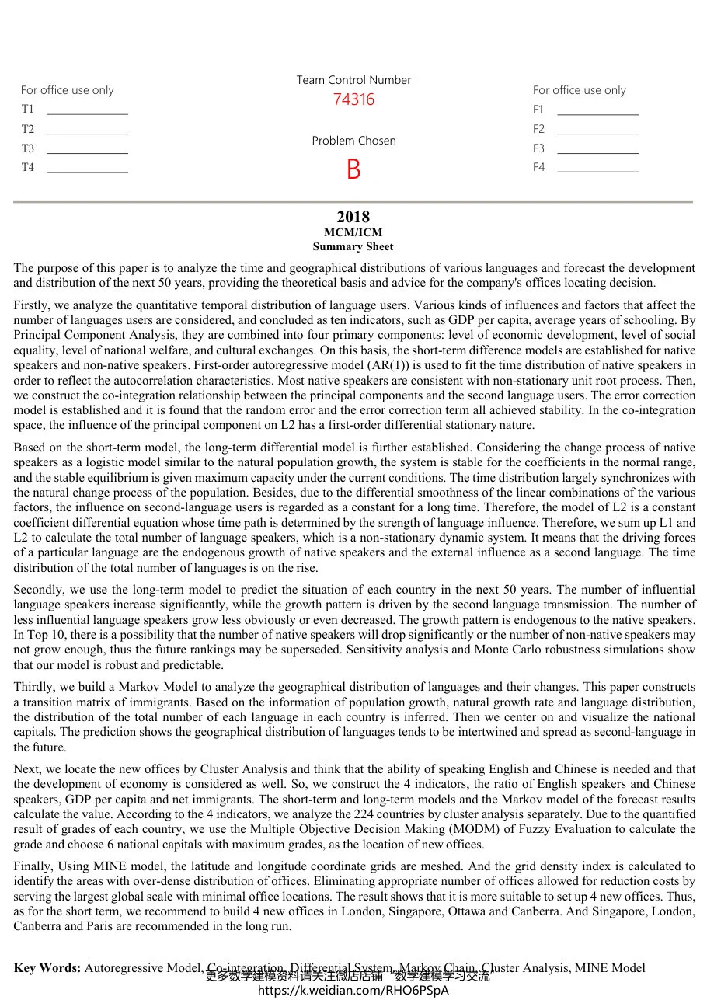

For office use only

Team Control Number 74316

For office use only

T1

F1

T2

Problem Chosen

F2

T3

F3

T4

B

F4

### 2018

### MCM/ICM Summary Sheet

The purpose of this paper is to analyze the time and geographical distributions of various languages and forecast the development and distribution of the next 50 years, providing the theoretical basis and advice for the company's offices locating decision.

Firstly, we analyze the quantitative temporal distribution of language users. Various kinds of influences and factors that affect the number of languages users are considered, and concluded as ten indicators, such as GDP per capita, average years of schooling. By Principal Component Analysis, they are combined into four primary components: level of economic development, level of social equality, level of national welfare, and cultural exchanges. On this basis, the short-term difference models are established for native speakers and non-native speakers. First-order autoregressive model (AR(1)) is used to fit the time distribution of native speakers in order to reflect the autocorrelation characteristics. Most native speakers are consistent with non-stationary unit root process. Then, we construct the co-integration relationship between the principal components and the second language users. The error correction model is established and it is found that the random error and the error correction term all achieved stability. In the co-integration space, the influence of the principal component on L2 has a first-order differential stationary nature.

Based on the short-term model, the long-term differential model is further established. Considering the change process of native speakers as a logistic model similar to the natural population growth, the system is stable for the coefficients in the normal range, and the stable equilibrium is given maximum capacity under the current conditions. The time distribution largely synchronizes with the natural change process of the population. Besides, due to the differential smoothness of the linear combinations of the various factors, the influence on second-language users is regarded as a constant for a long time. Therefore, the model of L2 is a constant coefficient differential equation whose time path is determined by the strength of language influence. Therefore, we sum up L1 and L2 to calculate the total number of language speakers, which is a non-stationary dynamic system. It means that the driving forces of a particular language are the endogenous growth of native speakers and the external influence as a second language. The time distribution of the total number of languages is on the rise.

Secondly, we use the long-term model to predict the situation of each country in the next 50 years. The number of influential language speakers increase significantly, while the growth pattern is driven by the second language transmission. The number of less influential language speakers grow less obviously or even decreased. The growth pattern is endogenous to the native speakers. In Top 10, there is a possibility that the number of native speakers will drop significantly or the number of non-native speakers may not grow enough, thus the future rankings may be superseded. Sensitivity analysis and Monte Carlo robustness simulations show that our model is robust and predictable.

Thirdly, we build a Markov Model to analyze the geographical distribution of languages and their changes. This paper constructs a transition matrix of immigrants. Based on the information of population growth, natural growth rate and language distribution, the distribution of the total number of each language in each country is inferred. Then we center on and visualize the national capitals. The prediction shows the geographical distribution of languages tends to be intertwined and spread as second-language in the future.

Next, we locate the new offices by Cluster Analysis and think that the ability of speaking English and Chinese is needed and that the development of economy is considered as well. So, we construct the 4 indicators, the ratio of English speakers and Chinese speakers, GDP per capita and net immigrants. The short-term and long-term models and the Markov model of the forecast results calculate the value. According to the 4 indicators, we analyze the 224 countries by cluster analysis separately. Due to the quantified result of grades of each country, we use the Multiple Objective Decision Making (MODM) of Fuzzy Evaluation to calculate the grade and choose 6 national capitals with maximum grades, as the location of new offices.

Finally, Using MINE model, the latitude and longitude coordinate grids are meshed. And the grid density index is calculated to identify the areas with over-dense distribution of offices. Eliminating appropriate number of offices allowed for reduction costs by serving the largest global scale with minimal office locations. The result shows that it is more suitable to set up 4 new offices. Thus, as for the short term, we recommend to build 4 new offices in London, Singapore, Ottawa and Canberra. And Singapore, London, Canberra and Paris are recommended in the long run.

https://k.weidian.com/RHO6PSpA

## 第2页

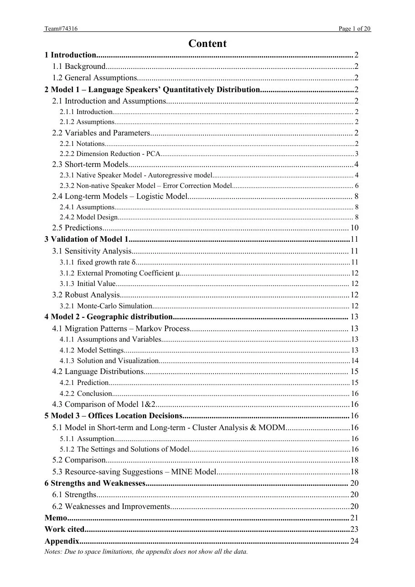

### Content

1 Introduction......2
1.1 Background......2
1.2 General Assumptions......2
2 Model 1 – Language Speakers’ Quantitatively Distribution......2
2.1 Introduction and Assumptions......2
2.1.1 Introduction......2
2.1.2 Assumptions......2
2.2 Variables and Parameters......2
2.2.1 Notations......2
2.2.2 Dimension Reduction - PCA......3
2.3 Short-term Models......4
2.3.1 Native Speaker Model - Autoregressive model......4
2.3.2 Non-native Speaker Model – Error Correction Model......6
2.4 Long-term Models – Logistic Model......8
2.4.1 Assumptions......8
2.4.2 Model Design......8
2.5 Predictions......10
3 Validation of Model 1......11
3.1 Sensitivity Analysis......11
3.1.1 fixed growth rate δ......11
3.1.2 External Promoting Coefficient μ......12
3.1.3 Initial Value......12
3.2 Robust Analysis......12
3.2.1 Monte-Carlo Simulation......12
4 Model 2 - Geographic distribution......13
4.1 Migration Patterns – Markov Process......13
4.1.1 Assumptions and Variables......13
4.1.2 Model Settings......13
4.1.3 Solution and Visualization......14
4.2 Language Distributions......15
4.2.1 Prediction......15
4.2.2 Conclusion......16
4.3 Comparison of Model 1&2......16
5 Model 3 – Offices Location Decisions......16
5.1 Model in Short-term and Long-term - Cluster Analysis & MODM......16
5.1.1 Assumption......16
5.1.2 The Settings and Solutions of Model......16
5.2 Comparison......18
5.3 Resource-saving Suggestions – MINE Model......18
6 Strengths and Weaknesses......20
6.1 Strengths......20
6.2 Weaknesses and Improvements......20
Memo......21
Work cited......23
Appendix......24

Notes: Due to space limitations, the appendix does not show all the data.

Team#74316

Page 1 of 20

## 第3页

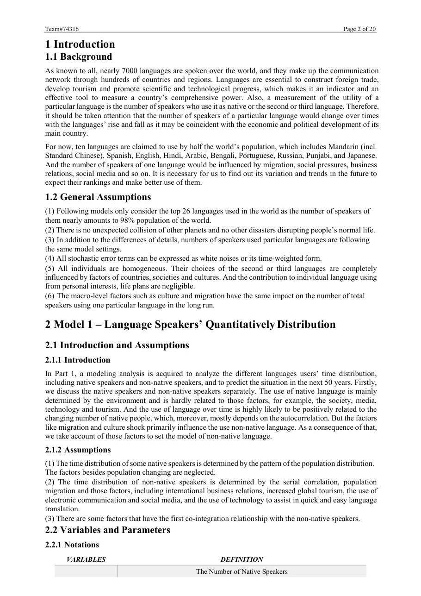

### 1 Introduction

### 1.1 Background

As known to all, nearly 7000 languages are spoken over the world, and they make up the communication network through hundreds of countries and regions. Languages are essential to construct foreign trade, develop tourism and promote scientific and technological progress, which makes it an indicator and an effective tool to measure a country’s comprehensive power. Also, a measurement of the utility of a particular language is the number of speakers who use it as native or the second or third language. Therefore, it should be taken attention that the number of speakers of a particular language would change over times with the languages’ rise and fall as it may be coincident with the economic and political development of its main country.

For now, ten languages are claimed to use by half the world’s population, which includes Mandarin (incl. Standard Chinese), Spanish, English, Hindi, Arabic, Bengali, Portuguese, Russian, Punjabi, and Japanese. And the number of speakers of one language would be influenced by migration, social pressures, business relations, social media and so on. It is necessary for us to find out its variation and trends in the future to expect their rankings and make better use of them.

### 1.2 General Assumptions

(1) Following models only consider the top 26 languages used in the world as the number of speakers of them nearly amounts to 98% population of the world.

(2) There is no unexpected collision of other planets and no other disasters disrupting people’s normal life. (3) In addition to the differences of details, numbers of speakers used particular languages are following the same model settings.

(4) All stochastic error terms can be expressed as white noises or its time-weighted form.

(5) All individuals are homogeneous. Their choices of the second or third languages are completely influenced by factors of countries, societies and cultures. And the contribution to individual language using from personal interests, life plans are negligible.

(6) The macro-level factors such as culture and migration have the same impact on the number of total speakers using one particular language in the long run.

### 2 Model 1 – Language Speakers’ Quantitatively Distribution

### 2.1 Introduction and Assumptions

### 2.1.1 Introduction

In Part 1, a modeling analysis is acquired to analyze the different languages users’ time distribution, including native speakers and non-native speakers, and to predict the situation in the next 50 years. Firstly, we discuss the native speakers and non-native speakers separately. The use of native language is mainly determined by the environment and is hardly related to those factors, for example, the society, media, technology and tourism. And the use of language over time is highly likely to be positively related to the changing number of native people, which, moreover, mostly depends on the autocorrelation. But the factors like migration and culture shock primarily influence the use non-native language. As a consequence of that, we take account of those factors to set the model of non-native language.

### 2.1.2 Assumptions

(1) The time distribution ofsome native speakers is determined by the pattern ofthe population distribution. The factors besides population changing are neglected.

(2) The time distribution of non-native speakers is determined by the serial correlation, population migration and those factors, including international business relations, increased global tourism, the use of electronic communication and social media, and the use of technology to assist in quick and easy language translation.

(3) There are some factors that have the first co-integration relationship with the non-native speakers.

### 2.2 Variables and Parameters

### 2.2.1 Notations

<table><tr><td>VARIABLES</td><td>DEFINITION</td></tr><tr><td></td><td>The Number of Native Speakers</td></tr><tr><td></td><td>The Number of Non-native Speakers</td></tr><tr><td> $N_{T}$ </td><td>The Number of Total Speakers</td></tr><tr><td> $\Delta S_{t}$ </td><td> $S_{t}-S_{t-1}$ </td></tr><tr><td> $X_{1t},\ldots X_{10t}$ </td><td>Variables as following</td></tr><tr><td> $Y_{1t},\ldots,Y_{4t}$ </td><td>Primary Components</td></tr><tr><td> $\Delta Y_{t}$ </td><td> $Y_{t}-Y_{t-1}$ </td></tr><tr><td></td><td>Stochastic Error Term</td></tr><tr><td> $ECM_{t-1}$ </td><td>Error Correction Model term, which indicates the extent to which the explained variables deviate from the long-term equilibrium in the previous period</td></tr><tr><td> $N_{M}$ </td><td>Maximum population</td></tr><tr><td></td><td>One-step Transition Matrix</td></tr><tr><td>P</td><td>Possibility from One Statement to Another</td></tr><tr><td></td><td>Steady-state probabilities</td></tr><tr><td>PARAMETERS</td><td>DEFINITION</td></tr><tr><td></td><td>Parameters for AR(p)</td></tr><tr><td></td><td>Parameter for long-term model</td></tr><tr><td></td><td>Parameter of variable ECM</td></tr><tr><td></td><td>Natural Growth Rate of the Number of Native Speakers</td></tr></table>

Team#74316

Page 2 of 20

## 第4页

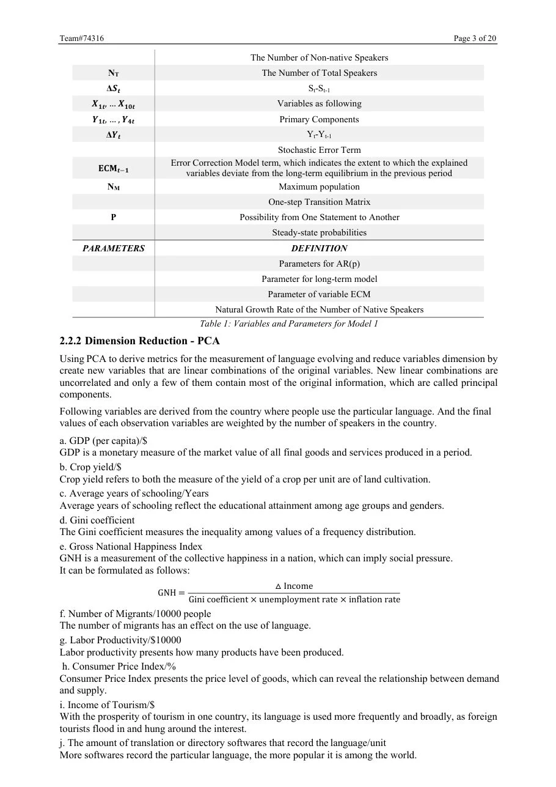

Table 1: Variables and Parameters for Model 1

### 2.2.2 Dimension Reduction - PCA

Using PCA to derive metrics for the measurement of language evolving and reduce variables dimension by create new variables that are linear combinations of the original variables. New linear combinations are uncorrelated and only a few of them contain most of the original information, which are called principal components.

Following variables are derived from the country where people use the particular language. And the final values of each observation variables are weighted by the number of speakers in the country.

a. GDP (per capita)/\$

GDP is a monetary measure of the market value of all final goods and services produced in a period.

b. Crop yield/\$

Crop yield refers to both the measure of the yield of a crop per unit are of land cultivation.

c. Average years of schooling/Years

Average years of schooling reflect the educational attainment among age groups and genders.

d. Gini coefficient

The Gini coefficient measures the inequality among values of a frequency distribution.

e. Gross National Happiness Index

GNH is a measurement of the collective happiness in a nation, which can imply social pressure.

It can be formulated as follows:

$$
\mathrm{GNH} = \frac {\Delta \text {Income}}{\text {Gini coefficient} \times \text {unemployment rate} \times \text {inflation rate}}
$$

f. Number of Migrants/10000 people

The number of migrants has an effect on the use of language.

g. Labor Productivity/\$10000

Labor productivity presents how many products have been produced.

h. Consumer Price Index/%

Consumer Price Index presents the price level of goods, which can reveal the relationship between demand and supply.

i. Income of Tourism/\$

With the prosperity of tourism in one country, its language is used more frequently and broadly, as foreign tourists flood in and hung around the interest.

j. The amount of translation or directory softwares that record the language/unit

More softwares record the particular language, the more popular it is among the world.

Team#74316

Page 3 of 20

## 第5页

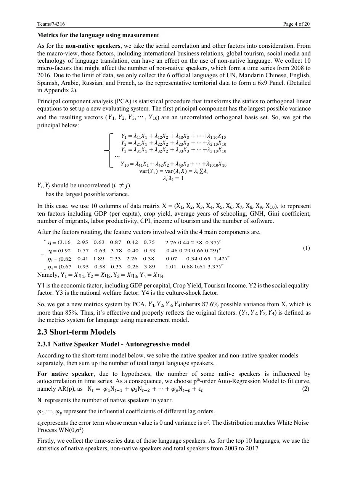

### Metrics for the language using measurement

As for the non-native speakers, we take the serial correlation and other factors into consideration. From the macro-view, those factors, including international business relations, global tourism, social media and technology of language translation, can have an effect on the use of non-native language. We collect 10 micro-factors that might affect the number of non-native speakers, which form a time series from 2008 to 2016. Due to the limit of data, we only collect the 6 official languages of UN, Mandarin Chinese, English, Spanish, Arabic, Russian, and French, as the representative territorial data to form a 6x9 Panel. (Detailed in Appendix 2).

Principal component analysis (PCA) is statistical procedure that transforms the statics to orthogonal linear equations to set up a new evaluating system. The first principal component has the largest possible variance and the resulting vectors $( Y _ { 1 } , Y _ { 2 } , Y _ { 3 } , \cdots , Y _ { 1 0 } )$ are an uncorrelated orthogonal basis set. So, we got the principal below:

$$
\left\{ \begin{array}{l} Y _ {1} = \lambda_ {1 1} X _ {1} + \lambda_ {1 2} X _ {2} + \lambda_ {1 3} X _ {3} + \dots + \lambda_ {1   1 0} X _ {1 0} \\ Y _ {2} = \lambda_ {2 1} X _ {1} + \lambda_ {2 2} X _ {2} + \lambda_ {2 3} X _ {3} + \dots + \lambda_ {2   1 0} X _ {1 0} \\ Y _ {3} = \lambda_ {3 1} X _ {1} + \lambda_ {3 2} X _ {2} + \lambda_ {3 3} X _ {3} + \dots + \lambda_ {3   1 0} X _ {1 0} \\ \dots \\ Y _ {1 0} = \lambda_ {4 1} X _ {1} + \lambda_ {4 2} X _ {2} + \lambda_ {4 3} X _ {3} + \dots + \lambda_ {1 0 1 0} X _ {1 0} \\ \operatorname{var} (Y _ {i}) = \operatorname{var} (\lambda_ {i} X) = \lambda_ {i} ^ {'} \sum \lambda_ {i} \\ \lambda_ {i} ^ {'} \lambda_ {i} = 1 \end{array} \right.
$$

$Y _ { i } , Y _ { j }$ should be uncorrelated $( i \neq j )$

has the largest possible variance.

In this case, we use 10 columns of data matrix $\mathrm { X } = ( { \mathrm { X } } _ { 1 } , { \mathrm { X } } _ { 2 } , { \mathrm { X } } _ { 3 } , { \mathrm { X } } _ { 4 } , { \mathrm { X } } _ { 5 } , { \mathrm { X } } _ { 6 } , { \mathrm { X } } _ { 7 } , { \mathrm { X } } _ { 8 } , { \mathrm { X } } _ { 9 } , { \mathrm { X } } _ { 1 0 } )$ , to represent ten factors including GDP (per capita), crop yield, average years of schooling, GNH, Gini coefficient, number of migrants, labor productivity, CPI, income of tourism and the number of software.

After the factors rotating, the feature vectors involved with the 4 main components are,

$$
\left\{ \begin{array}{l l} \eta = (3. 1 6 & 2. 9 5 & 0. 6 3 & 0. 8 7 & 0. 4 2 & 0. 7 5 & 2. 7 6   0. 4 4   2. 5 8   0. 3 7) ^ {T} \\ \eta_ {t} = (0. 9 2 & 0. 7 7 & 0. 6 3 & 3. 7 8 & 0. 4 0 & 0. 5 3 & 0. 4 6   0. 2 9   0. 6 6   0. 2 9) ^ {T} \\ \eta_ {3} = (0. 8 2 & 0. 4 1 & 1. 8 9 & 2. 3 3 & 2. 2 6 & 0. 3 8 & - 0. 0 7 & - 0. 3 4   0. 6 5 & 1. 4 2) ^ {T} \\ \eta_ {4} = (0. 6 7 & 0. 9 5 & 0. 5 8 & 0. 3 3 & 0. 2 6 & 3. 8 9 & 1. 0 1 & - 0. 8 8   0. 6 1 & 3. 3 7) ^ {T} \end{array} \right.\tag{1}
$$

Namely, $\mathrm { Y } _ { 1 } = X \eta _ { 1 } , \mathrm { Y } _ { 2 } = X \eta _ { 2 } , \mathrm { Y } _ { 3 } = X \eta _ { 3 } , \mathrm { Y } _ { 4 } = X \eta _ { 4 }$

Y1 is the economic factor, including GDP per capital, Crop Yield, Tourism Income. Y2 is the social equality factor. Y3 is the national welfare factor. Y4 is the culture-shock factor.

So, we got a new metrics system by PCA, $Y _ { 1 } , Y _ { 2 } , Y _ { 3 } ,$ 4inherits 87.6% possible variance from X, which is more than 85%. Thus, it’s effective and properly reflects the original factors. $( Y _ { 1 } , Y _ { 2 } , Y _ { 3 } , Y _ { 4 } )$ is defined as the metrics system for language using measurement model.

### 2.3 Short-term Models

### 2.3.1 Native Speaker Model - Autoregressive model

According to the short-term model below, we solve the native speaker and non-native speaker models separately, then sum up the number of total target language speakers.

For native speaker, due to hypotheses, the number of some native speakers is influenced by autocorrelation in time series. As a consequence, we choose $\boldsymbol { \mathrm { p } } ^ { \mathrm { t h } } ,$ -order Auto-Regression Model to fit curve, namely AR(p), as $\mathrm { N } _ { t } = \varphi _ { 1 } \mathrm { N } _ { t - 1 } + \varphi _ { 2 } \mathrm { N } _ { t - 2 } + \cdots + \varphi _ { p } \mathrm { N } _ { t - p } + \varepsilon _ { t }$ (2)

N represents the number of native speakers in year t.

$\varphi _ { 1 } , \cdots , \varphi _ { p }$ represent the influential coefficients of different lag orders.

represents the error term whose mean value is 0 and variance is $\sigma ^ { 2 }$ . The distribution matches White Noise Process $\operatorname { W N } ( 0 , \sigma ^ { 2 } )$

Firstly, we collect the time-series data of those language speakers. As for the top 10 languages, we use the statistics of native speakers, non-native speakers and total speakers from 2003 to 2017

Team#74316

Page 4 of 20

## 第6页

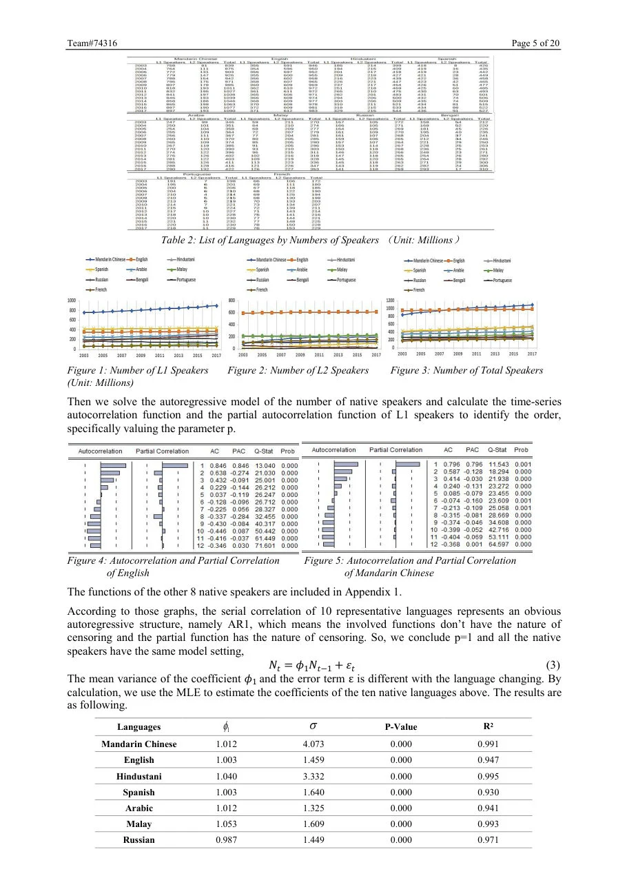

<table><tr><td rowspan="2"></td><td colspan="3">Mandarin Chinese</td><td colspan="3">English</td><td colspan="3">Hindustani</td><td colspan="3">Spanish</td></tr><tr><td>L1 Speakers</td><td>L2 Speakers</td><td>Total</td><td>L1 Speakers</td><td>L2 Speakers</td><td>Total</td><td>L1 Speakers</td><td>L2 Speakers</td><td>Total</td><td>L1 Speakers</td><td>L2 Speakers</td><td>Total</td></tr><tr><td>2003</td><td>768</td><td>81</td><td>839</td><td>355</td><td>591</td><td>946</td><td>185</td><td>214</td><td>399</td><td>418</td><td>8</td><td>426</td></tr><tr><td>2004</td><td>764</td><td>111</td><td>875</td><td>354</td><td>596</td><td>950</td><td>194</td><td>215</td><td>409</td><td>419</td><td>16</td><td>435</td></tr><tr><td>2005</td><td>772</td><td>131</td><td>903</td><td>355</td><td>597</td><td>952</td><td>201</td><td>217</td><td>418</td><td>419</td><td>23</td><td>442</td></tr><tr><td>2006</td><td>779</td><td>147</td><td>926</td><td>355</td><td>600</td><td>955</td><td>209</td><td>218</td><td>427</td><td>421</td><td>28</td><td>449</td></tr><tr><td>2007</td><td>788</td><td>154</td><td>942</td><td>356</td><td>602</td><td>958</td><td>216</td><td>223</td><td>439</td><td>422</td><td>36</td><td>458</td></tr><tr><td>2008</td><td>796</td><td>175</td><td>971</td><td>358</td><td>607</td><td>965</td><td>226</td><td>221</td><td>447</td><td>423</td><td>42</td><td>465</td></tr><tr><td>2009</td><td>807</td><td>178</td><td>985</td><td>360</td><td>609</td><td>969</td><td>237</td><td>217</td><td>454</td><td>426</td><td>51</td><td>477</td></tr><tr><td>2010</td><td>818</td><td>193</td><td>1011</td><td>362</td><td>610</td><td>972</td><td>251</td><td>218</td><td>469</td><td>425</td><td>60</td><td>485</td></tr><tr><td>2011</td><td>832</td><td>195</td><td>1027</td><td>361</td><td>611</td><td>972</td><td>265</td><td>210</td><td>475</td><td>430</td><td>63</td><td>493</td></tr><tr><td>2012</td><td>841</td><td>197</td><td>1038</td><td>365</td><td>606</td><td>971</td><td>282</td><td>201</td><td>483</td><td>431</td><td>70</td><td>501</td></tr><tr><td>2013</td><td>846</td><td>193</td><td>1039</td><td>366</td><td>608</td><td>974</td><td>294</td><td>206</td><td>500</td><td>432</td><td>74</td><td>506</td></tr><tr><td>2014</td><td>858</td><td>188</td><td>1046</td><td>368</td><td>609</td><td>977</td><td>303</td><td>206</td><td>509</td><td>435</td><td>74</td><td>509</td></tr><tr><td>2015</td><td>865</td><td>198</td><td>1053</td><td>370</td><td>608</td><td>978</td><td>310</td><td>211</td><td>521</td><td>434</td><td>81</td><td>515</td></tr><tr><td>2016</td><td>887</td><td>190</td><td>1077</td><td>372</td><td>609</td><td>981</td><td>318</td><td>215</td><td>533</td><td>434</td><td>88</td><td>522</td></tr><tr><td>2017</td><td>897</td><td>193</td><td>1090</td><td>371</td><td>612</td><td>983</td><td>329</td><td>215</td><td>544</td><td>436</td><td>91</td><td>527</td></tr></table>

<table><tr><td></td><td>L1 Speakers</td><td>L2 Speakers</td><td>Total</td><td>L1 Speakers</td><td>L2 Speakers</td><td>Total</td><td>L1 Speakers</td><td>L2 Speakers</td><td>Total</td><td>L1 Speakers</td><td>L2 Speakers</td><td>Total</td></tr><tr><td>2003</td><td>247</td><td>99</td><td>346</td><td>59</td><td>211</td><td>270</td><td>167</td><td>105</td><td>272</td><td>158</td><td>54</td><td>212</td></tr><tr><td>2004</td><td>250</td><td>101</td><td>351</td><td>64</td><td>210</td><td>274</td><td>166</td><td>105</td><td>271</td><td>168</td><td>62</td><td>220</td></tr><tr><td>2005</td><td>254</td><td>104</td><td>358</td><td>68</td><td>209</td><td>277</td><td>164</td><td>105</td><td>269</td><td>181</td><td>45</td><td>226</td></tr><tr><td>2006</td><td>255</td><td>109</td><td>364</td><td>72</td><td>207</td><td>279</td><td>161</td><td>109</td><td>270</td><td>195</td><td>40</td><td>235</td></tr><tr><td>2007</td><td>256</td><td>111</td><td>367</td><td>77</td><td>204</td><td>281</td><td>161</td><td>107</td><td>268</td><td>204</td><td>37</td><td>241</td></tr><tr><td>2008</td><td>260</td><td>110</td><td>370</td><td>80</td><td>205</td><td>285</td><td>159</td><td>106</td><td>265</td><td>212</td><td>34</td><td>246</td></tr><tr><td>2009</td><td>265</td><td>109</td><td>374</td><td>85</td><td>205</td><td>290</td><td>157</td><td>107</td><td>264</td><td>221</td><td>29</td><td>250</td></tr><tr><td>2010</td><td>267</td><td>118</td><td>385</td><td>91</td><td>205</td><td>296</td><td>153</td><td>114</td><td>267</td><td>228</td><td>25</td><td>253</td></tr><tr><td>2011</td><td>270</td><td>120</td><td>390</td><td>93</td><td>210</td><td>303</td><td>150</td><td>118</td><td>268</td><td>236</td><td>25</td><td>261</td></tr><tr><td>2012</td><td>274</td><td>122</td><td>396</td><td>96</td><td>215</td><td>311</td><td>146</td><td>120</td><td>266</td><td>248</td><td>23</td><td>271</td></tr><tr><td>2013</td><td>276</td><td>126</td><td>402</td><td>102</td><td>216</td><td>318</td><td>147</td><td>118</td><td>265</td><td>254</td><td>26</td><td>280</td></tr><tr><td>2014</td><td>281</td><td>122</td><td>403</td><td>109</td><td>219</td><td>328</td><td>145</td><td>120</td><td>265</td><td>264</td><td>28</td><td>292</td></tr><tr><td>2015</td><td>285</td><td>126</td><td>411</td><td>113</td><td>223</td><td>336</td><td>145</td><td>118</td><td>263</td><td>271</td><td>29</td><td>300</td></tr><tr><td>2016</td><td>288</td><td>128</td><td>416</td><td>121</td><td>226</td><td>347</td><td>143</td><td>119</td><td>262</td><td>282</td><td>24</td><td>306</td></tr><tr><td>2017</td><td>290</td><td>132</td><td>422</td><td>126</td><td>227</td><td>353</td><td>141</td><td>118</td><td>259</td><td>293</td><td>17</td><td>310</td></tr></table>

Table 2: List of Languages by Numbers of Speakers （Unit: Millions ）
<table><tr><td></td><td>L1 Speakers</td><td>L2 Speakers</td><td>Total</td><td>L1 Speakers</td><td>L2 Speakers</td><td>Total</td></tr><tr><td>2003</td><td>191</td><td>7</td><td>198</td><td>66</td><td>106</td><td>172</td></tr><tr><td>2004</td><td>195</td><td>6</td><td>201</td><td>69</td><td>111</td><td>180</td></tr><tr><td>2005</td><td>200</td><td>5</td><td>205</td><td>67</td><td>118</td><td>185</td></tr><tr><td>2006</td><td>204</td><td>6</td><td>210</td><td>68</td><td>122</td><td>190</td></tr><tr><td>2007</td><td>210</td><td>4</td><td>214</td><td>69</td><td>125</td><td>194</td></tr><tr><td>2008</td><td>210</td><td>6</td><td>215</td><td>68</td><td>130</td><td>198</td></tr><tr><td>2009</td><td>213</td><td>6</td><td>219</td><td>70</td><td>133</td><td>203</td></tr><tr><td>2010</td><td>214</td><td>7</td><td>221</td><td>73</td><td>134</td><td>207</td></tr><tr><td>2011</td><td>215</td><td>9</td><td>224</td><td>72</td><td>139</td><td>211</td></tr><tr><td>2012</td><td>217</td><td>10</td><td>227</td><td>71</td><td>143</td><td>214</td></tr><tr><td>2013</td><td>218</td><td>10</td><td>228</td><td>75</td><td>141</td><td>216</td></tr><tr><td>2014</td><td>220</td><td>10</td><td>230</td><td>77</td><td>144</td><td>221</td></tr><tr><td>2015</td><td>221</td><td>11</td><td>232</td><td>77</td><td>148</td><td>225</td></tr><tr><td>2016</td><td>220</td><td>10</td><td>230</td><td>78</td><td>150</td><td>228</td></tr><tr><td>2017</td><td>218</td><td>11</td><td>229</td><td>76</td><td>153</td><td>229</td></tr></table>

Then we solve the autoregressive model of the number of native speakers and calculate the time-series autocorrelation function and the partial autocorrelation function of L1 speakers to identify the order, specifically valuing the parameter p.

Figure 4: Autocorrelation and Partial Correlation of English
<table><tr><td>Autocorrelation</td><td>Partial Correlation</td><td>AC</td><td>PAC</td><td>Q-Stat</td><td>Prob</td></tr><tr><td></td><td></td><td>1</td><td>0.846</td><td>0.846</td><td>13.040</td></tr><tr><td></td><td></td><td>2</td><td>0.638</td><td>-0.274</td><td>21.030</td></tr><tr><td></td><td></td><td>3</td><td>0.432</td><td>-0.091</td><td>25.001</td></tr><tr><td></td><td></td><td>4</td><td>0.229</td><td>-0.144</td><td>26.212</td></tr><tr><td></td><td></td><td>5</td><td>0.037</td><td>-0.119</td><td>26.247</td></tr><tr><td></td><td></td><td>6</td><td>-0.128</td><td>-0.096</td><td>26.712</td></tr><tr><td></td><td></td><td>7</td><td>-0.225</td><td>0.056</td><td>28.327</td></tr><tr><td></td><td></td><td>8</td><td>-0.337</td><td>-0.284</td><td>32.455</td></tr><tr><td></td><td></td><td>9</td><td>-0.430</td><td>-0.084</td><td>40.317</td></tr><tr><td></td><td></td><td>10</td><td>-0.446</td><td>0.087</td><td>50.442</td></tr><tr><td></td><td></td><td>11</td><td>-0.416</td><td>-0.037</td><td>61.449</td></tr><tr><td></td><td></td><td>12</td><td>-0.346</td><td>0.030</td><td>71.601</td></tr></table>

Figure 5: Autocorrelation and Partial Correlation of Mandarin Chinese The functions of the other 8 native speakers are included in Appendix 1.
<table><tr><td>Autocorrelation</td><td>Partial Correlation</td><td>AC</td><td>PAC</td><td>Q-Stat</td><td>Prob</td></tr><tr><td></td><td></td><td>1</td><td>0.796</td><td>0.796</td><td>11.543</td></tr><tr><td></td><td></td><td>2</td><td>0.587</td><td>-0.128</td><td>18.294</td></tr><tr><td></td><td></td><td>3</td><td>0.414</td><td>-0.030</td><td>21.938</td></tr><tr><td></td><td></td><td>4</td><td>0.240</td><td>-0.131</td><td>23.272</td></tr><tr><td></td><td></td><td>5</td><td>0.085</td><td>-0.079</td><td>23.455</td></tr><tr><td></td><td></td><td>6</td><td>-0.074</td><td>-0.160</td><td>23.609</td></tr><tr><td></td><td></td><td>7</td><td>-0.213</td><td>-0.109</td><td>25.058</td></tr><tr><td></td><td></td><td>8</td><td>-0.315</td><td>-0.081</td><td>28.669</td></tr><tr><td></td><td></td><td>9</td><td>-0.374</td><td>-0.046</td><td>34.608</td></tr><tr><td></td><td></td><td>10</td><td>-0.399</td><td>-0.052</td><td>42.716</td></tr><tr><td></td><td></td><td>11</td><td>-0.404</td><td>-0.069</td><td>53.111</td></tr><tr><td></td><td></td><td>12</td><td>-0.368</td><td>0.001</td><td>64.597</td></tr></table>

According to those graphs, the serial correlation of 10 representative languages represents an obvious autoregressive structure, namely AR1, which means the involved functions don’t have the nature of censoring and the partial function has the nature of censoring. So, we conclude p=1 and all the native speakers have the same model setting,

$$
N _ {t} = \phi_ {1} N _ {t - 1} + \varepsilon_ {t}\tag{3}
$$

The mean variance of the coefficient $\phi _ { 1 }$ and the error term ε is different with the language changing. By calculation, we use the MLE to estimate the coefficients of the ten native languages above. The results are as following.

<table><tr><td>Languages</td><td> $\phi_1$ </td><td> $\sigma$ </td><td>P-Value</td><td>R2</td></tr><tr><td>Mandarin Chinese</td><td>1.012</td><td>4.073</td><td>0.000</td><td>0.991</td></tr><tr><td>English</td><td>1.003</td><td>1.459</td><td>0.000</td><td>0.947</td></tr><tr><td>Hindustani</td><td>1.040</td><td>3.332</td><td>0.000</td><td>0.995</td></tr><tr><td>Spanish</td><td>1.003</td><td>1.640</td><td>0.000</td><td>0.930</td></tr><tr><td>Arabic</td><td>1.012</td><td>1.325</td><td>0.000</td><td>0.941</td></tr><tr><td>Malay</td><td>1.053</td><td>1.609</td><td>0.000</td><td>0.993</td></tr><tr><td>Russian</td><td>0.987</td><td>1.449</td><td>0.000</td><td>0.971</td></tr><tr><td>Bengali</td><td>1.041</td><td>1.254</td><td>0.000</td><td>0.943</td></tr><tr><td>Portuguese</td><td>1.009</td><td>1.988</td><td>0.000</td><td>0.951</td></tr><tr><td>French</td><td>1.010</td><td>1.951</td><td>0.000</td><td>0.962</td></tr></table>

Team#74316

Page 5 of 20

## 第7页

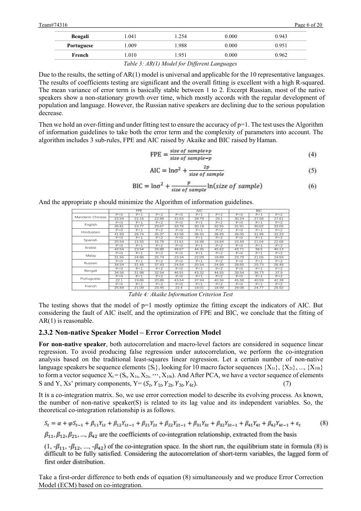

Table 3: AR(1) Model for Different Languages

Due to the results, the setting ofAR(1) model is universal and applicable for the 10 representative languages. The results of coefficients testing are significant and the overall fitting is excellent with a high R-squared. The mean variance of error term is basically stable between 1 to 2. Excerpt Russian, most of the native speakers show a non-stationary growth over time, which mostly accords with the regular development of population and language. However, the Russian native speakers are declining due to the serious population decrease.

Then we hold an over-fitting and under fitting test to ensure the accuracy ofp=1. The test uses the Algorithm of information guidelines to take both the error term and the complexity of parameters into account. The algorithm includes 3 sub-rules, FPE and AIC raised by Akaike and BIC raised by Haman.

$$
\mathrm{FPE} = \frac {\text { size   of   sample } + p}{\text { size   of   sample } - p}\tag{4}
$$

$$
\mathrm{AIC} = \ln \sigma^ {2} + \frac {2 p}{s i z e o f s a m p l e}\tag{5}
$$

$$
\mathrm{BIC} = \ln \sigma^ {2} + \frac {p}{s i z e o f s a m p l e} \ln (s i z e o f s a m p l e)\tag{6}
$$

And the appropriate p should minimize the Algorithm of information guidelines.

Table 4: Akaike Information Criterion Test
<table><tr><td></td><td colspan="3">FPE</td><td colspan="3">AIC</td><td colspan="3">BIC</td></tr><tr><td rowspan="2">Mandarin Chinese</td><td>P=0</td><td>P=1</td><td>P=2</td><td>P=0</td><td>P=1</td><td>P=2</td><td>P=0</td><td>P=1</td><td>P=2</td></tr><tr><td>23.54</td><td>22.16</td><td>22.88</td><td>31.63</td><td>28.79</td><td>29.1</td><td>30.24</td><td>27.58</td><td>27.61</td></tr><tr><td rowspan="2">English</td><td>P=0</td><td>P=1</td><td>P=2</td><td>P=0</td><td>P=1</td><td>P=2</td><td>P=0</td><td>P=1</td><td>P=2</td></tr><tr><td>26.81</td><td>23.77</td><td>29.67</td><td>33.78</td><td>30.19</td><td>32.55</td><td>31.91</td><td>30.02</td><td>33.05</td></tr><tr><td rowspan="2">Hindustani</td><td>P=0</td><td>P=1</td><td>P=2</td><td>P=0</td><td>P=1</td><td>P=2</td><td>P=0</td><td>P=1</td><td>P=2</td></tr><tr><td>41.69</td><td>26.74</td><td>35.37</td><td>43.58</td><td>36.55</td><td>38.49</td><td>36.05</td><td>31.98</td><td>32.33</td></tr><tr><td rowspan="2">Spanish</td><td>P=0</td><td>P=1</td><td>P=2</td><td>P=0</td><td>P=1</td><td>P=2</td><td>P=0</td><td>P=1</td><td>P=2</td></tr><tr><td>20.54</td><td>15.55</td><td>16.78</td><td>21.61</td><td>16.98</td><td>19.84</td><td>23.49</td><td>21.04</td><td>22.66</td></tr><tr><td rowspan="2">Arabie</td><td>P=0</td><td>P=1</td><td>P=2</td><td>P=0</td><td>P=1</td><td>P=2</td><td>P=0</td><td>P=1</td><td>P=2</td></tr><tr><td>43.54</td><td>23.54</td><td>33.88</td><td>48.67</td><td>44.35</td><td>45.62</td><td>43.71</td><td>38.5</td><td>40.13</td></tr><tr><td rowspan="2">Malay</td><td>P=0</td><td>P=1</td><td>P=2</td><td>P=0</td><td>P=1</td><td>P=2</td><td>P=0</td><td>P=1</td><td>P=2</td></tr><tr><td>31.56</td><td>24.86</td><td>25.74</td><td>23.34</td><td>22.09</td><td>18.89</td><td>23.79</td><td>21.05</td><td>19.93</td></tr><tr><td rowspan="2">Russian</td><td>P=0</td><td>P=1</td><td>P=2</td><td>P=0</td><td>P=1</td><td>P=2</td><td>P=0</td><td>P=1</td><td>P=2</td></tr><tr><td>34.54</td><td>31.45</td><td>37.43</td><td>24.54</td><td>20.54</td><td>24.99</td><td>28.65</td><td>25.73</td><td>26.49</td></tr><tr><td rowspan="2">Bengali</td><td>P=0</td><td>P=1</td><td>P=2</td><td>P=0</td><td>P=1</td><td>P=2</td><td>P=0</td><td>P=1</td><td>P=2</td></tr><tr><td>34.56</td><td>31.98</td><td>32.54</td><td>46.91</td><td>43.32</td><td>44.55</td><td>39.54</td><td>36.73</td><td>37.9</td></tr><tr><td rowspan="2">Portuguese</td><td>P=0</td><td>P=1</td><td>P=2</td><td>P=0</td><td>P=1</td><td>P=2</td><td>P=0</td><td>P=1</td><td>P=2</td></tr><tr><td>22.1</td><td>19.86</td><td>20.88</td><td>43.54</td><td>37.94</td><td>40.56</td><td>45.58</td><td>40.59</td><td>42.38</td></tr><tr><td rowspan="2">French</td><td>P=0</td><td>P=1</td><td>P=2</td><td>P=0</td><td>P=1</td><td>P=2</td><td>P=0</td><td>P=1</td><td>P=2</td></tr><tr><td>25.84</td><td>21.09</td><td>23.45</td><td>22.4</td><td>19.01</td><td>18.99</td><td>29.08</td><td>24.77</td><td>25.92</td></tr></table>

The testing shows that the model of p=1 mostly optimize the fitting except the indicators of AIC. But considering the fault of AIC itself, and the optimization of FPE and BIC, we conclude that the fitting of AR(1) is reasonable.

### 2.3.2 Non-native Speaker Model – Error Correction Model

For non-native speaker, both autocorrelation and macro-level factors are considered in sequence linear regression. To avoid producing false regression under autocorrelation, we perform the co-integration analysis based on the traditional least-squares linear regression. Let a certain number of non-native language speakers be sequence elements {St}, looking for 10 macro factor sequences $\{ \mathrm { X _ { l t } } \} , \{ \mathrm { X _ { 2 t } } \} , . . . , \{ \mathrm { X _ { 1 0 t } } \}$ to form a vector sequence $\mathrm { X _ { t } } \mathrm { = } \left( \mathrm { S _ { t } } , \mathrm { X _ { l t } } , \mathrm { X _ { 2 t } } , \cdots , \mathrm { X _ { l 0 t } } \right)$ . And After PCA, we have a vector sequence ofelements S and Y, Xs’ primary components, $\mathrm { Y } { = } \left( S _ { t } , Y _ { 1 t } , Y _ { 2 t } , Y _ { 3 t } , Y _ { 4 t } \right)$ (7)

It is a co-integration matrix. So, we use error correction model to describe its evolving process. As known, the number of non-native speaker(S) is related to its lag value and its independent variables. So, the theoretical co-integration relationship is as follows.

$$
S _ {t} = \alpha + \varphi S _ {t - 1} + \beta_ {1 1} Y _ {1 t} + \beta_ {1 2} Y _ {1 t - 1} + \beta_ {2 1} Y _ {2 t} + \beta_ {2 2} Y _ {2 t - 1} + \beta_ {3 1} Y _ {3 t} + \beta_ {3 2} Y _ {3 t - 1} + \beta_ {4 1} Y _ {4 t} + \beta_ {4 2} Y _ {4 t - 1} + \varepsilon_ {t}\tag{8}
$$

$\beta _ { 1 1 } , \beta _ { 1 2 } , \beta _ { 2 1 } , . . . , \beta _ { 4 2 }$ are the coefficients of co-integration relationship, extracted from the basis

$( 1 , - \beta _ { 1 1 } , - \beta _ { 1 2 } , . . . , - \beta _ { 4 2 } )$ of the co-integration space. In the short run, the equilibrium state in formula (8) is difficult to be fully satisfied. Considering the autocorrelation of short-term variables, the lagged form of first order distribution.

Take a first-order difference to both ends of equation (8) simultaneously and we produce Error Correction Model (ECM) based on co-integration.

Team#74316

Page 6 of 20

## 第8页

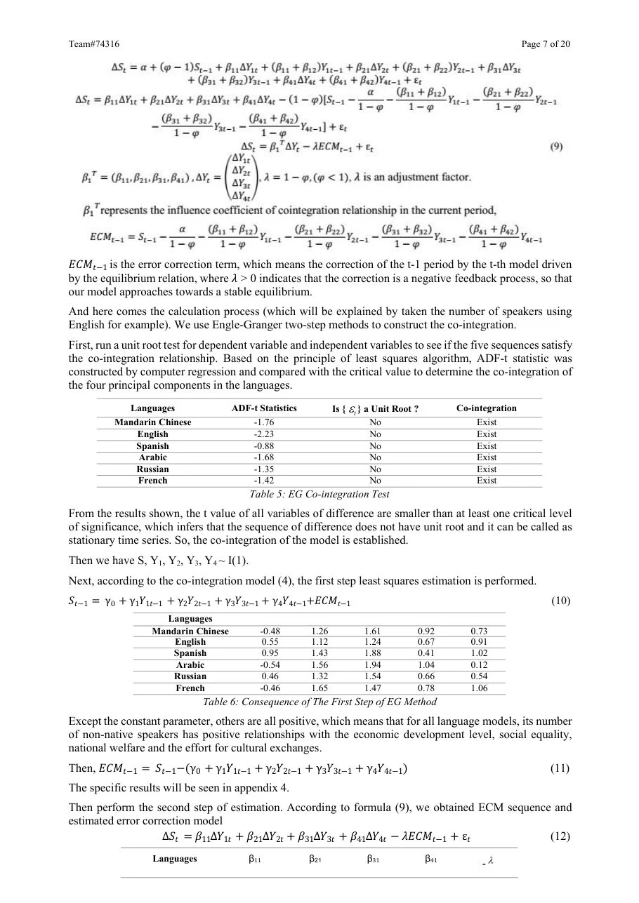

$$
\begin{array}{r l} \Delta S _ {t} & = \alpha + (\varphi - 1) S _ {t - 1} + \beta_ {1 1} \Delta Y _ {1 t} + (\beta_ {1 1} + \beta_ {1 2}) Y _ {1 t - 1} + \beta_ {2 1} \Delta Y _ {2 t} + (\beta_ {2 1} + \beta_ {2 2}) Y _ {2 t - 1} + \beta_ {3 1} \Delta Y _ {3 t} \\ & \quad + (\beta_ {3 1} + \beta_ {3 2}) Y _ {3 t - 1} + \beta_ {4 1} \Delta Y _ {4 t} + (\beta_ {4 1} + \beta_ {4 2}) Y _ {4 t - 1} + \varepsilon_ {t} \\ \Delta S _ {t} & = \beta_ {1 1} \Delta Y _ {1 t} + \beta_ {2 1} \Delta Y _ {2 t} + \beta_ {3 1} \Delta Y _ {3 t} + \beta_ {4 1} \Delta Y _ {4 t} - (1 - \varphi) [ S _ {t - 1} - \frac {\alpha}{1 - \varphi} - \frac {(\beta_ {1 1} + \beta_ {1 2})}{1 - \varphi} Y _ {1 t - 1} - \frac {(\beta_ {2 1} + \beta_ {2 2})}{1 - \varphi} Y _ {2 t - 1} \\ & \quad - \frac {(\beta_ {3 1} + \beta_ {3 2})}{1 - \varphi} Y _ {3 t - 1} - \frac {(\beta_ {4 1} + \beta_ {4 2})}{1 - \varphi} Y _ {4 t - 1} ] + \varepsilon_ {t} \\ \Delta S _ {t} & = \beta_ {1} ^ {T} \Delta Y _ {t} - \lambda E C M _ {t - 1} + \varepsilon_ {t} \\ \beta_ {1} ^ {T} & = (\beta_ {1 1}, \beta_ {2 1}, \beta_ {3 1}, \beta_ {4 1}), \Delta Y _ {t} = \left( \begin{array}{c} \Delta Y _ {1 t} \\ \Delta Y _ {2 t} \\ \Delta Y _ {3 t} \\ \Delta Y _ {4 t} \end{array} \right), \lambda = 1 - \varphi , (\varphi <   1), \lambda \text {is an adjustment factor}. \end{array} \tag {9}
$$

${ \beta _ { 1 } } ^ { T }$ represents the influence coefficient of cointegration relationship in the current period,

$$
E C M _ {t - 1} = S _ {t - 1} - \frac {\alpha}{1 - \varphi} - \frac {(\beta_ {1 1} + \beta_ {1 2})}{1 - \varphi} Y _ {1 t - 1} - \frac {(\beta_ {2 1} + \beta_ {2 2})}{1 - \varphi} Y _ {2 t - 1} - \frac {(\beta_ {3 1} + \beta_ {3 2})}{1 - \varphi} Y _ {3 t - 1} - \frac {(\beta_ {4 1} + \beta_ {4 2})}{1 - \varphi} Y _ {4 t - 1}
$$

$E C M _ { t - 1 }$ is the error correction term, which means the correction of the t-1 period by the t-th model driven by the equilibrium relation, where $\lambda > 0$ indicates that the correction is a negative feedback process, so that our model approaches towards a stable equilibrium.

And here comes the calculation process (which will be explained by taken the number of speakers using English for example). We use Engle-Granger two-step methods to construct the co-integration.

First, run a unit root test for dependent variable and independent variables to see ifthe five sequences satisfy the co-integration relationship. Based on the principle of least squares algorithm, ADF-t statistic was constructed by computer regression and compared with the critical value to determine the co-integration of the four principal components in the languages.

Table 5: EG Co-integration Test
<table><tr><td>Languages</td><td>ADF-t Statistics</td><td>Is {  $\mathcal{E}_{t}$  } a Unit Root ?</td><td>Co-integration</td></tr><tr><td>Mandarin Chinese</td><td>-1.76</td><td>No</td><td>Exist</td></tr><tr><td>English</td><td>-2.23</td><td>No</td><td>Exist</td></tr><tr><td>Spanish</td><td>-0.88</td><td>No</td><td>Exist</td></tr><tr><td>Arabic</td><td>-1.68</td><td>No</td><td>Exist</td></tr><tr><td>Russian</td><td>-1.35</td><td>No</td><td>Exist</td></tr><tr><td>French</td><td>-1.42</td><td>No</td><td>Exist</td></tr></table>

From the results shown, the t value of all variables of difference are smaller than at least one critical level of significance, which infers that the sequence of difference does not have unit root and it can be called as stationary time series. $\mathrm { S o } ,$ the co-integration of the model is established.

Then we have S, $\mathrm { Y } _ { 1 } , \mathrm { Y } _ { 2 } , \mathrm { Y } _ { 3 } , \mathrm { Y } _ { 4 } \mathrm { \sim } \mathrm { I } ( 1 )$

Next, according to the co-integration model (4), the first step least squares estimation is performed.

$$
S _ {t - 1} = \gamma_ {0} + \gamma_ {1} Y _ {1 t - 1} + \gamma_ {2} Y _ {2 t - 1} + \gamma_ {3} Y _ {3 t - 1} + \gamma_ {4} Y _ {4 t - 1} + E C M _ {t - 1}\tag{10}
$$

Table 6: Consequence of The First Step of EG Method
<table><tr><td colspan="6">Languages</td></tr><tr><td>Mandarin Chinese</td><td>-0.48</td><td>1.26</td><td>1.61</td><td>0.92</td><td>0.73</td></tr><tr><td>English</td><td>0.55</td><td>1.12</td><td>1.24</td><td>0.67</td><td>0.91</td></tr><tr><td>Spanish</td><td>0.95</td><td>1.43</td><td>1.88</td><td>0.41</td><td>1.02</td></tr><tr><td>Arabic</td><td>-0.54</td><td>1.56</td><td>1.94</td><td>1.04</td><td>0.12</td></tr><tr><td>Russian</td><td>0.46</td><td>1.32</td><td>1.54</td><td>0.66</td><td>0.54</td></tr><tr><td>French</td><td>-0.46</td><td>1.65</td><td>1.47</td><td>0.78</td><td>1.06</td></tr></table>

Except the constant parameter, others are all positive, which means that for all language models, its number of non-native speakers has positive relationships with the economic development level, social equality, national welfare and the effort for cultural exchanges.

$$
\mathrm{Then}, E C M _ {t - 1} = S _ {t - 1} - (\gamma_ {0} + \gamma_ {1} Y _ {1 t - 1} + \gamma_ {2} Y _ {2 t - 1} + \gamma_ {3} Y _ {3 t - 1} + \gamma_ {4} Y _ {4 t - 1})\tag{11}
$$

The specific results will be seen in appendix 4.

Then perform the second step of estimation. According to formula (9), we obtained ECM sequence and estimated error correction model

$$
\Delta S _ {t} = \beta_ {1 1} \Delta Y _ {1 t} + \beta_ {2 1} \Delta Y _ {2 t} + \beta_ {3 1} \Delta Y _ {3 t} + \beta_ {4 1} \Delta Y _ {4 t} - \lambda E C M _ {t - 1} + \varepsilon_ {t}\tag{12}
$$

Team#74316

Page 7 of 20

## 第9页

Team#74316

Page 8 of 20

## 第10页

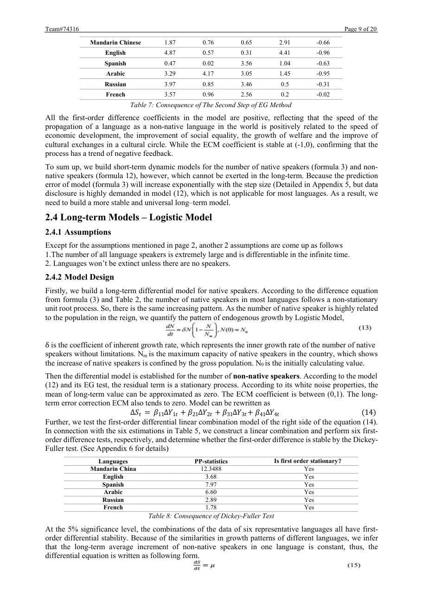

Table 7: Consequence of The Second Step of EG Method
<table><tr><td>Mandarin Chinese</td><td>1.87</td><td>0.76</td><td>0.65</td><td>2.91</td><td>-0.66</td></tr><tr><td>English</td><td>4.87</td><td>0.57</td><td>0.31</td><td>4.41</td><td>-0.96</td></tr><tr><td>Spanish</td><td>0.47</td><td>0.02</td><td>3.56</td><td>1.04</td><td>-0.63</td></tr><tr><td>Arabic</td><td>3.29</td><td>4.17</td><td>3.05</td><td>1.45</td><td>-0.95</td></tr><tr><td>Russian</td><td>3.97</td><td>0.85</td><td>3.46</td><td>0.5</td><td>-0.31</td></tr><tr><td>French</td><td>3.57</td><td>0.96</td><td>2.56</td><td>0.2</td><td>-0.02</td></tr></table>

All the first-order difference coefficients in the model are positive, reflecting that the speed of the propagation of a language as a non-native language in the world is positively related to the speed of economic development, the improvement of social equality, the growth of welfare and the improve of cultural exchanges in a cultural circle. While the ECM coefficient is stable at (-1,0), confirming that the process has a trend of negative feedback.

To sum up, we build short-term dynamic models for the number of native speakers (formula 3) and nonnative speakers (formula 12), however, which cannot be exerted in the long-term. Because the prediction error of model (formula 3) will increase exponentially with the step size (Detailed in Appendix 5, but data disclosure is highly demanded in model (12), which is not applicable for most languages. As a result, we need to build a more stable and universal long–term model.

### 2.4 Long-term Models – Logistic Model

### 2.4.1 Assumptions

Except for the assumptions mentioned in page 2, another 2 assumptions are come up as follows 1.The number of all language speakers is extremely large and is differentiable in the infinite time. 2. Languages won’t be extinct unless there are no speakers.

### 2.4.2 Model Design

Firstly, we build a long-term differential model for native speakers. According to the difference equation from formula (3) and Table 2, the number of native speakers in most languages follows a non-stationary unit root process. So, there is the same increasing pattern. As the number of native speaker is highly related to the population in the reign, we quantify the pattern of endogenous growth by Logistic Model,

$$
\frac {d N}{d t} = \delta N \left(1 - \frac {N}{N _ {m}}\right), N (0) = N _ {0}\tag{13}
$$

δ is the coefficient of inherent growth rate, which represents the inner growth rate of the number of native speakers without limitations. $N _ { \mathrm { m } }$ is the maximum capacity of native speakers in the country, which shows the increase of native speakers is confined by the gross population. $\mathrm { N } _ { 0 }$ is the initially calculating value.

Then the differential model is established for the number of non-native speakers. According to the model (12) and its EG test, the residual term is a stationary process. According to its white noise properties, the mean of long-term value can be approximated as zero. The ECM coefficient is between (0,1). The longterm error correction ECM also tends to zero. Model can be rewritten as

$$
\Delta S _ {t} = \beta_ {1 1} \Delta Y _ {1 t} + \beta_ {2 1} \Delta Y _ {2 t} + \beta_ {3 1} \Delta Y _ {3 t} + \beta_ {4 1} \Delta Y _ {4 t}\tag{14}
$$

Further, we test the first-order differential linear combination model of the right side of the equation (14). In connection with the six estimations in Table 5, we construct a linear combination and perform six firstorder difference tests, respectively, and determine whether the first-order difference is stable by the Dickey-Fuller test. (See Appendix 6 for details)

Table 8: Consequence of Dickey-Fuller Test
<table><tr><td>Languages</td><td>PP-statistics</td><td>Is first order stationary?</td></tr><tr><td>Mandarin China</td><td>12.3488</td><td>Yes</td></tr><tr><td>English</td><td>3.68</td><td>Yes</td></tr><tr><td>Spanish</td><td>7.97</td><td>Yes</td></tr><tr><td>Arabic</td><td>6.60</td><td>Yes</td></tr><tr><td>Russian</td><td>2.89</td><td>Yes</td></tr><tr><td>French</td><td>1.78</td><td>Yes</td></tr></table>

At the 5% significance level, the combinations of the data of six representative languages all have firstorder differential stability. Because of the similarities in growth patterns of different languages, we infer that the long-term average increment of non-native speakers in one language is constant, thus, the differential equation is written as following form.

$$
\frac {d S}{d t} = \mu\tag{15}
$$

Team#74316

Page 9 of 20

## 第11页

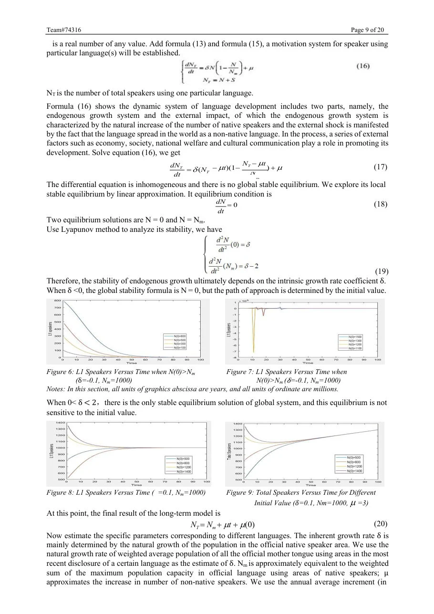

is a real number of any value. Add formula (13) and formula (15), a motivation system for speaker using particular language(s) will be established.

$$
\left\{ \begin{array}{c} \frac {d N _ {T}}{d t} = \delta N \left(1 - \frac {N}{N _ {m}}\right) + \mu \\ N _ {T} = N + S \end{array} \right.\tag{16}
$$

$N _ { \mathrm { T } }$ is the number of total speakers using one particular language.

Formula (16) shows the dynamic system of language development includes two parts, namely, the endogenous growth system and the external impact, of which the endogenous growth system is characterized by the natural increase of the number of native speakers and the external shock is manifested by the fact that the language spread in the world as a non-native language. In the process, a series ofexternal factors such as economy, society, national welfare and cultural communication play a role in promoting its development. Solve equation (16), we get

$$
\frac {d N _ {T}}{d t} = \delta (N _ {T} - \mu t) (1 - \frac {N _ {T} - \mu t}{I \nu}) + \mu\tag{17}
$$

The differential equation is inhomogeneous and there is no global stable equilibrium. We explore its local stable equilibrium by linear approximation. It equilibrium condition is

$$
\frac {d N}{d t} = 0\tag{18}
$$

Two equilibrium solutions are $N = 0$ and $N = N _ { \mathrm { m } }$

Use Lyapunov method to analyze its stability, we have

$$
\left\{ \begin{array}{c} \frac {d ^ {2} N}{d t ^ {2}} (0) = \delta \\ \frac {d ^ {2} N}{d t ^ {2}} (N _ {m}) = \delta - 2 \end{array} \right.\tag{19}
$$

Therefore, the stability of endogenous growth ultimately depends on the intrinsic growth rate coefficient δ. When $\delta { < } 0 _ { ; }$ , the global stability formula is $N = 0$ , but the path of approach is determined by the initial value.

When 0< $\delta < 2$ ，there is the only stable equilibrium solution of global system, and this equilibrium is not sensitive to the initial value.

At this point, the final result of the long-term model is

$$
N _ {T} = N _ {m} + \mu t + \mu (0)\tag{20}
$$

Now estimate the specific parameters corresponding to different languages. The inherent growth rate δ is mainly determined by the natural growth of the population in the official native speaker area. We use the natural growth rate of weighted average population of all the official mother tongue using areas in the most recent disclosure of a certain language as the estimate of δ. $\mathrm { N _ { m } }$ is approximately equivalent to the weighted sum of the maximum population capacity in official language using areas of native speakers; μ approximates the increase in number of non-native speakers. We use the annual average increment (in millions) ofnon-native speakers in the past 15 years as the estimate. The model shows that μ is, essentially, determined by economic, educational, political, cultural and other welfare factors.

Team#74316

Page 9 of 20

## 第12页

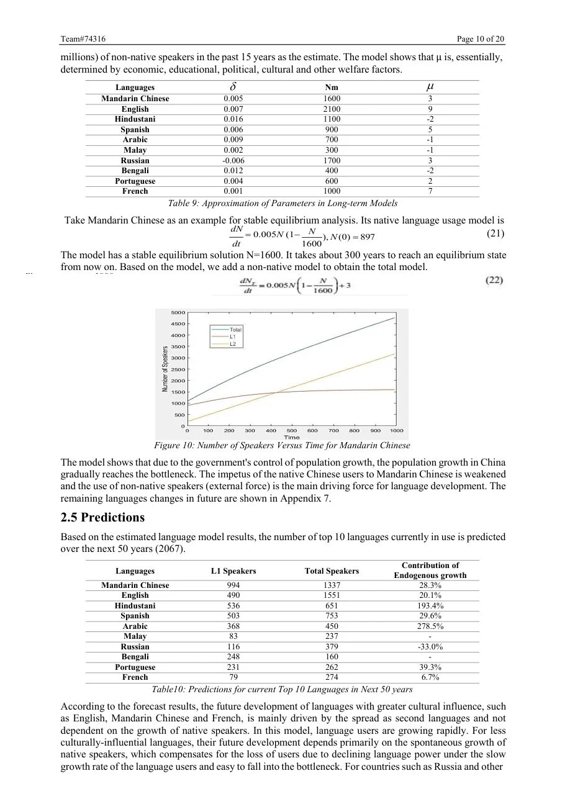

Table 9: Approximation ofParameters in Long-term Models
<table><tr><td>Languages</td><td>δ</td><td>Nm</td><td>μ</td></tr><tr><td>Mandarin Chinese</td><td>0.005</td><td>1600</td><td>3</td></tr><tr><td>English</td><td>0.007</td><td>2100</td><td>9</td></tr><tr><td>Hindustani</td><td>0.016</td><td>1100</td><td>-2</td></tr><tr><td>Spanish</td><td>0.006</td><td>900</td><td>5</td></tr><tr><td>Arabic</td><td>0.009</td><td>700</td><td>-1</td></tr><tr><td>Malay</td><td>0.002</td><td>300</td><td>-1</td></tr><tr><td>Russian</td><td>-0.006</td><td>1700</td><td>3</td></tr><tr><td>Bengali</td><td>0.012</td><td>400</td><td>-2</td></tr><tr><td>Portuguese</td><td>0.004</td><td>600</td><td>2</td></tr><tr><td>French</td><td>0.001</td><td>1000</td><td>7</td></tr></table>

Take Mandarin Chinese as an example for stable equilibrium analysis. Its native language usage model is

$$
\frac {d N}{d t} = 0. 0 0 5 N (1 - \frac {N}{1 6 0 0}), N (0) = 8 9 7\tag{21}
$$

The model has a stable equilibrium solution N=1600. It takes about 300 years to reach an equilibrium state from now on. Based on the model, we add a non-native model to obtain the total model

$$
\frac {d N _ {T}}{d t} = 0. 0 0 5 N \left(1 - \frac {N}{1 6 0 0}\right) + 3\tag{22}
$$

The model shows that due to the government's control of population growth, the population growth in China gradually reaches the bottleneck. The impetus ofthe native Chinese users to Mandarin Chinese is weakened and the use of non-native speakers (external force) is the main driving force for language development. The remaining languages changes in future are shown in Appendix 7.

### 2.5 Predictions

Based on the estimated language model results, the number oftop 10 languages currently in use is predicted over the next 50 years (2067).

Table10: Predictions for current Top 10 Languages in Next 50 years
<table><tr><td>Languages</td><td>L1 Speakers</td><td>Total Speakers</td><td>Contribution of Endogenous growth</td></tr><tr><td>Mandarin Chinese</td><td>994</td><td>1337</td><td>28.3%</td></tr><tr><td>English</td><td>490</td><td>1551</td><td>20.1%</td></tr><tr><td>Hindustani</td><td>536</td><td>651</td><td>193.4%</td></tr><tr><td>Spanish</td><td>503</td><td>753</td><td>29.6%</td></tr><tr><td>Arabic</td><td>368</td><td>450</td><td>278.5%</td></tr><tr><td>Malay</td><td>83</td><td>237</td><td>-</td></tr><tr><td>Russian</td><td>116</td><td>379</td><td>-33.0%</td></tr><tr><td>Bengali</td><td>248</td><td>160</td><td>-</td></tr><tr><td>Portuguese</td><td>231</td><td>262</td><td>39.3%</td></tr><tr><td>French</td><td>79</td><td>274</td><td>6.7%</td></tr></table>

According to the forecast results, the future development of languages with greater cultural influence, such as English, Mandarin Chinese and French, is mainly driven by the spread as second languages and not dependent on the growth of native speakers. In this model, language users are growing rapidly. For less culturally-influential languages, their future development depends primarily on the spontaneous growth of native speakers, which compensates for the loss of users due to declining language power under the slow growth rate ofthe language users and easy to fall into the bottleneck. For countries such as Russia and other countries with negative population growth, the growth of mother-tongue users stagnated, so the second language communication has become the only way of language development.

Team#74316

Page 10 of 20

## 第13页

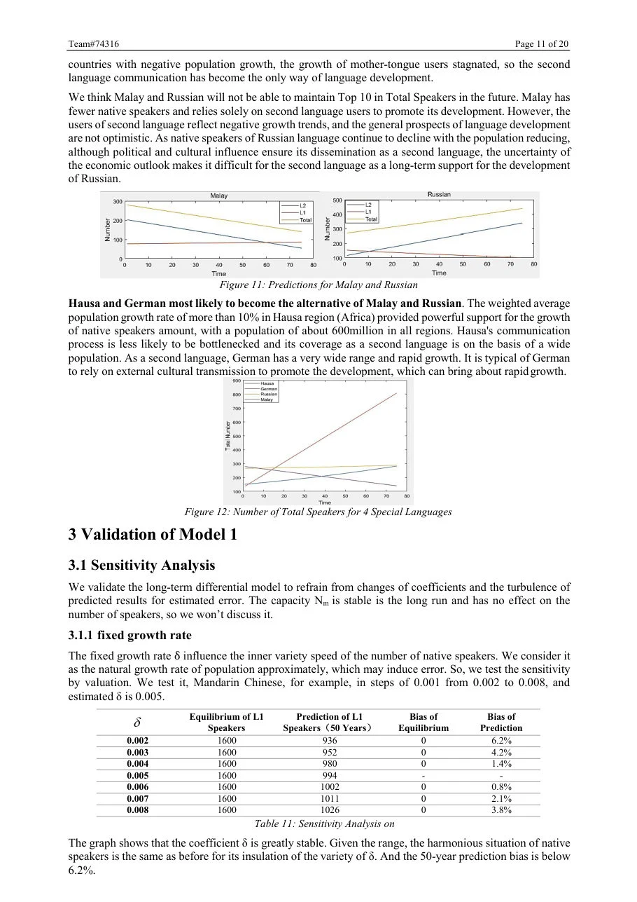

We think Malay and Russian will not be able to maintain Top 10 in Total Speakers in the future. Malay has fewer native speakers and relies solely on second language users to promote its development. However, the users of second language reflect negative growth trends, and the general prospects of language development are not optimistic. As native speakers of Russian language continue to decline with the population reducing, although political and cultural influence ensure its dissemination as a second language, the uncertainty of the economic outlook makes it difficult for the second language as a long-term support for the development of Russian.

Hausa and German most likely to become the alternative of Malay and Russian. The weighted average population growth rate of more than 10% in Hausa region (Africa) provided powerful support for the growth of native speakers amount, with a population of about 600million in all regions. Hausa's communication process is less likely to be bottlenecked and its coverage as a second language is on the basis of a wide population. As a second language, German has a very wide range and rapid growth. It is typical of German to rely on external cultural transmission to promote the development, which can bring about rapid growth.

### 3 Validation of Model 1

### 3.1 Sensitivity Analysis

We validate the long-term differential model to refrain from changes of coefficients and the turbulence of predicted results for estimated error. The capacity $\mathrm { N } _ { \mathrm { m } }$ is stable is the long run and has no effect on the number of speakers, so we won’t discuss it.

### 3.1.1 fixed growth rate

The fixed growth rate δ influence the inner variety speed of the number of native speakers. We consider it as the natural growth rate of population approximately, which may induce error. So, we test the sensitivity by valuation. We test it, Mandarin Chinese, for example, in steps of 0.001 from 0.002 to 0.008, and estimated δ is 0.005.

Table 11: Sensitivity Analysis on
<table><tr><td>δ</td><td>Equilibrium of L1 Speakers</td><td>Prediction of L1 Speakers (50 Years)</td><td>Bias of Equilibrium</td><td>Bias of Prediction</td></tr><tr><td>0.002</td><td>1600</td><td>936</td><td>0</td><td>6.2%</td></tr><tr><td>0.003</td><td>1600</td><td>952</td><td>0</td><td>4.2%</td></tr><tr><td>0.004</td><td>1600</td><td>980</td><td>0</td><td>1.4%</td></tr><tr><td>0.005</td><td>1600</td><td>994</td><td>-</td><td>-</td></tr><tr><td>0.006</td><td>1600</td><td>1002</td><td>0</td><td>0.8%</td></tr><tr><td>0.007</td><td>1600</td><td>1011</td><td>0</td><td>2.1%</td></tr><tr><td>0.008</td><td>1600</td><td>1026</td><td>0</td><td>3.8%</td></tr></table>

The graph shows that the coefficient δ is greatly stable. Given the range, the harmonious situation of native speakers is the same as before for its insulation of the variety of δ. And the 50-year prediction bias is below 6.2%.

Team#74316

Page 11 of 20

## 第14页

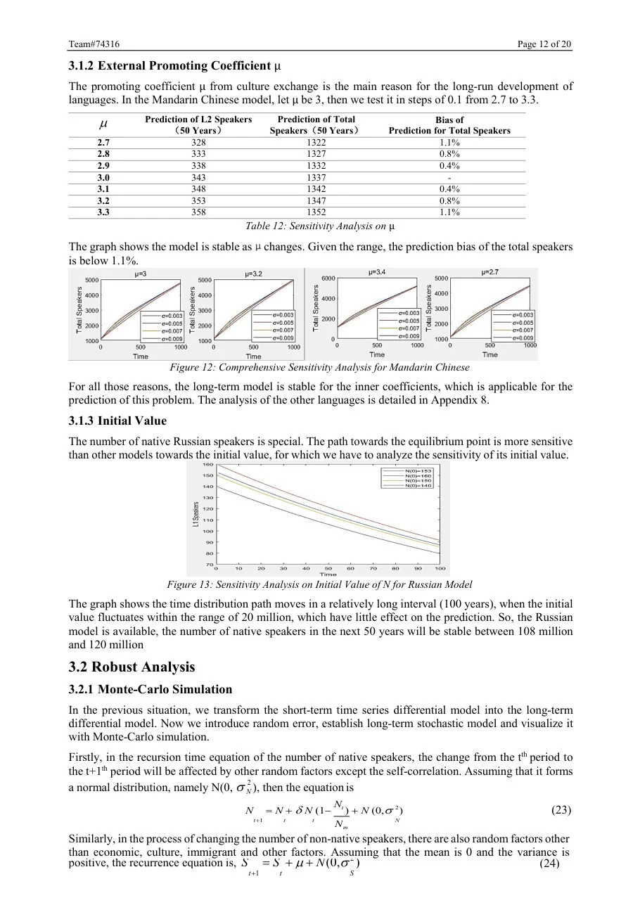

### 3.1.2 External Promoting Coefficient μ

The promoting coefficient μ from culture exchange is the main reason for the long-run development of languages. In the Mandarin Chinese model, let μ be 3, then we test it in steps of 0.1 from 2.7 to 3.3.

Table 12: Sensitivity Analysis on μ
<table><tr><td>μ</td><td>Prediction of L2 Speakers (50 Years)</td><td>Prediction of Total Speakers (50 Years)</td><td>Bias of Prediction for Total Speakers</td></tr><tr><td>2.7</td><td>328</td><td>1322</td><td>1.1%</td></tr><tr><td>2.8</td><td>333</td><td>1327</td><td>0.8%</td></tr><tr><td>2.9</td><td>338</td><td>1332</td><td>0.4%</td></tr><tr><td>3.0</td><td>343</td><td>1337</td><td>-</td></tr><tr><td>3.1</td><td>348</td><td>1342</td><td>0.4%</td></tr><tr><td>3.2</td><td>353</td><td>1347</td><td>0.8%</td></tr><tr><td>3.3</td><td>358</td><td>1352</td><td>1.1%</td></tr></table>

The graph shows the model is stable asμchanges. Given the range, the prediction bias of the total speakers is below 1.1%.

For all those reasons, the long-term model is stable for the inner coefficients, which is applicable for the prediction of this problem. The analysis of the other languages is detailed in Appendix 8.

### 3.1.3 Initial Value

The number of native Russian speakers is special. The path towards the equilibrium point is more sensitive than other models towards the initial value, for which we have to analyze the sensitivity of its initial value.

The graph shows the time distribution path moves in a relatively long interval (100 years), when the initial value fluctuates within the range of 20 million, which have little effect on the prediction. So, the Russian model is available, the number of native speakers in the next 50 years will be stable between 108 million and 120 million

### 3.2 Robust Analysis

### 3.2.1 Monte-Carlo Simulation

In the previous situation, we transform the short-term time series differential model into the long-term differential model. Now we introduce random error, establish long-term stochastic model and visualize it with Monte-Carlo simulation.

Firstly, in the recursion time equation of the number of native speakers, the change from the tth period to the t+1th period will be affected by other random factors except the self-correlation. Assuming that it forms a normal distribution, namely $\mathrm { N } ( 0 , \sigma _ { N } ^ { 2 } )$ , then the equation is

$$
N _ {t + 1} = N + \delta N (1 - \frac {N _ {t}}{N _ {m}}) + N (0, \sigma^ {2})\tag{23}
$$

Similarly, in the process ofchanging the number ofnon-native speakers, there are also random factors other than economic, culture, immigrant and other factors. Assuming that the mean is 0 and the variance is positive, the recurrence equation is, $\operatorname { \textbf { \textit { S } } } _ { t + 1 } = \operatorname { \textbf { \textit { S } } } _ { t } + \mu + \operatorname { \textit { N } } ( \operatorname { \textbf { 0 } } , \sigma _ { \mathrm { ~ s ~ } } ^ { - } )$ (24)

Team#74316

Page 12 of 20

## 第15页

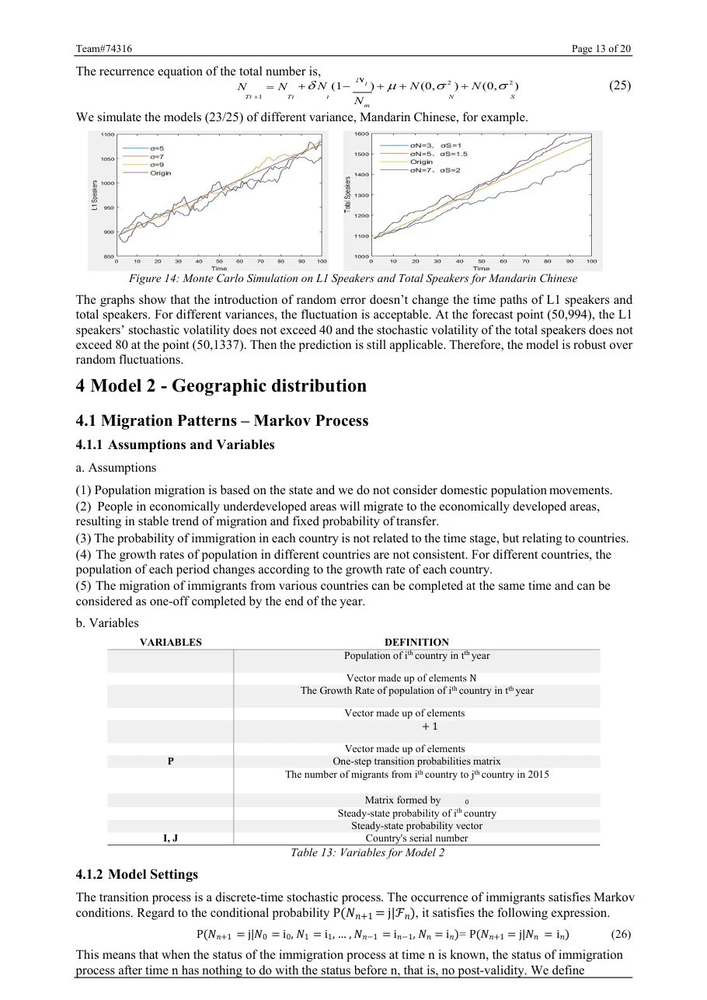

The recurrence equation of the total number is,

$$
N _ {T t + 1} = N _ {T t} + \delta N _ {t} (1 - \frac {I ^ {\mathbf {N}} {} _ {t}}{N _ {m}}) + \mu + N (0, \sigma_ {N} ^ {2}) + N (0, \sigma_ {S} ^ {2})\tag{25}
$$

We simulate the models (23/25) of different variance, Mandarin Chinese, for example.

The graphs show that the introduction of random error doesn’t change the time paths of L1 speakers and total speakers. For different variances, the fluctuation is acceptable. At the forecast point (50,994), the L1 speakers’ stochastic volatility does not exceed 40 and the stochastic volatility of the total speakers does not exceed 80 at the point (50,1337). Then the prediction is still applicable. Therefore, the model is robust over random fluctuations.

### 4 Model 2 - Geographic distribution

### 4.1 Migration Patterns – Markov Process

### 4.1.1 Assumptions and Variables

### a. Assumptions

(1) Population migration is based on the state and we do not consider domestic population movements.

(2) People in economically underdeveloped areas will migrate to the economically developed areas, resulting in stable trend of migration and fixed probability of transfer.

(3) The probability of immigration in each country is not related to the time stage, but relating to countries. (4) The growth rates of population in different countries are not consistent. For different countries, the population of each period changes according to the growth rate of each country.

(5) The migration of immigrants from various countries can be completed at the same time and can be considered as one-off completed by the end of the year.

### b. Variables

Table 13: Variables for Model 2
<table><tr><td>VARIABLES</td><td>DEFINITION</td></tr><tr><td></td><td>Population of  $i^{th}$  country in  $t^{th}$  year</td></tr><tr><td></td><td>Vector made up of elements NThe Growth Rate of population of  $i^{th}$  country in  $t^{th}$  year</td></tr><tr><td></td><td>Vector made up of elements+ 1</td></tr><tr><td></td><td>Vector made up of elements</td></tr><tr><td>P</td><td>One-step transition probabilities matrixThe number of migrants from  $i^{th}$  country to  $j^{th}$  country in 2015</td></tr><tr><td></td><td>Matrix formed by 0Steady-state probability of  $i^{th}$  country</td></tr><tr><td></td><td>Steady-state probability vector</td></tr><tr><td>I, J</td><td>Country&#x27;s serial number</td></tr></table>

### 4.1.2 Model Settings

The transition process is a discrete-time stochastic process. The occurrence of immigrants satisfies Markov conditions. Regard to the conditional probability $\mathrm { P } ( N _ { n + 1 } = \mathrm { j } | \mathcal { F } _ { n } )$ , it satisfies the following expression.

$$
\mathrm{P} (N _ {n + 1} = \mathrm{j} | N _ {0} = \mathrm{i} _ {0}, N _ {1} = \mathrm{i} _ {1}, \ldots , N _ {n - 1} = \mathrm{i} _ {n - 1}, N _ {n} = \mathrm{i} _ {n}) = \mathrm{P} (N _ {n + 1} = \mathrm{j} | N _ {n} = \mathrm{i} _ {n})\tag{26}
$$

This means that when the status of the immigration process at time n is known, the status of immigration process after time n has nothing to do with the status before ${ \mathfrak { n } } ,$ that is, no post-validity. We define

Team#74316

Page 13 of 20

## 第16页

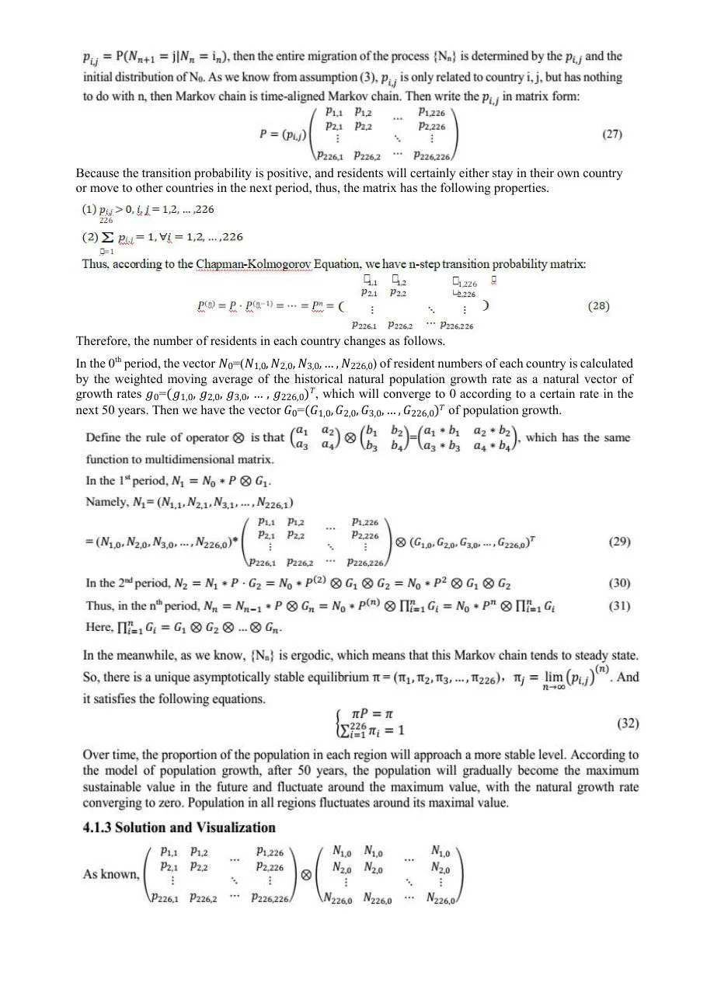

$p _ { i , j } = \mathrm { P } ( N _ { n + 1 } = \mathrm { j } | N _ { n } = \mathrm { i } _ { n } )$ ), then the entire migration of the process $\{ \mathrm { N } _ { \mathrm { n } } \}$ is determined by the $p _ { i , j }$ and the initial distribution of $\mathrm { N } _ { 0 } .$ As we know from assumption (3), $p _ { i , j }$ is only related to country $\mathrm { i , j , }$ , but has nothing to do with ${ \mathfrak { n } } ,$ then Markov chain is time-aligned Markov chain. Then write the $p _ { i , j }$ in matrix form

$$
P = (p _ {i, j}) \left( \begin{array}{c c c c} p _ {1, 1} & p _ {1, 2} & \dots & p _ {1, 2 2 6} \\ p _ {2, 1} & p _ {2, 2} & & p _ {2, 2 2 6} \\ \vdots & & \ddots & \vdots \\ p _ {2 2 6, 1} & p _ {2 2 6, 2} & \dots & p _ {2 2 6, 2 2 6} \end{array} \right)\tag{27}
$$

Because the transition probability is positive, and residents will certainly either stay in their own country or move to other countries in the next period, thus, the matrix has the following properties.

(1) $p _ { i , j , > 0 , i , j , = 1 , 2 , \ldots , 2 2 6 }$

(2) Σ pii = 1, ∀i = 1,2, ..,226

Thus, according to the Chapman-Kolmogorov Equation, we have n-step transition probability matrix

$$
P _ {\text {   }} ^ {(n)} = P \cdot P _ {\text {   }} ^ {(n - 1)} = \dots = P ^ {n} = ( \begin{array}{c c c c c} \square_ {1, 1} & \square_ {1, 2} & & \square_ {1, 2 2 6} & \square \\ p _ {2, 1} & p _ {2, 2} & & \square_ {2, 2 2 6} & \\ \vdots & & \ddots & \vdots & \\ p _ {2 2 6, 1} & p _ {2 2 6, 2} & \dots & p _ {2 2 6, 2 2 6} & \end{array} )\tag{28}
$$

Therefore, the number of residents in each country changes as follows.

In the $0 ^ { \mathrm { t h } }$ period, the vector $N _ { 0 } \mathrm { = } ( N _ { 1 , 0 } , N _ { 2 , 0 } , N _ { 3 , 0 } , \ldots , N _ { 2 2 6 , 0 } )$ ofresident numbers of each country is calculated by the weighted moving average of the historical natural population growth rate as a natural vector of growth rates $g _ { 0 } \mathrm { = } ( g _ { 1 , 0 } , g _ { 2 , 0 } , g _ { 3 , 0 } , \ldots , g _ { 2 2 6 , 0 } ) ^ { T }$ , which will converge to 0 according to a certain rate in the next 50 years. Then we have the vector $G _ { 0 } { = } ( G _ { 1 , 0 } , G _ { 2 , 0 } , G _ { 3 , 0 } , \ldots , G _ { 2 2 6 , 0 } ) ^ { T }$ of population growth.

Define the rule of operator © is that $\left( { \begin{array} { c c } { a _ { 1 } } & { a _ { 2 } } \\ { a _ { 3 } } & { a _ { 4 } } \end{array} } \right) \otimes \left( { \begin{array} { c c } { b _ { 1 } } & { b _ { 2 } } \\ { b _ { 3 } } & { b _ { 4 } } \end{array} } \right) = \left( { \begin{array} { c c } { a _ { 1 } * b _ { 1 } } & { a _ { 2 } * b _ { 2 } } \\ { a _ { 3 } * b _ { 3 } } & { a _ { 4 } * b _ { 4 } } \end{array} } \right)$ , which has the same function to multidimensional matrix.

In the $1 ^ { \mathrm { s t } }$ period, $N _ { 1 } = N _ { 0 } * P \otimes G _ { 1 }$

Namely, $N _ { 1 } { = } ( N _ { 1 , 1 } , N _ { 2 , 1 } , N _ { 3 , 1 } , \ldots , N _ { 2 2 6 , 1 } )$

$$
= (N _ {1, 0}, N _ {2, 0}, N _ {3, 0}, \dots , N _ {2 2 6, 0}) ^ {*} \left( \begin{array}{c c c c} p _ {1, 1} & p _ {1, 2} & \dots & p _ {1, 2 2 6} \\ p _ {2, 1} & p _ {2, 2} & & p _ {2, 2 2 6} \\ \vdots & & \ddots & \vdots \\ p _ {2 2 6, 1} & p _ {2 2 6, 2} & \dots & p _ {2 2 6, 2 2 6} \end{array} \right) \otimes (G _ {1, 0}, G _ {2, 0}, G _ {3, 0}, \dots , G _ {2 2 6, 0}) ^ {T}\tag{29}
$$

$$
\text {In the 2^{nd} period}, N _ {2} = N _ {1} * P \cdot G _ {2} = N _ {0} * P ^ {(2)} \otimes G _ {1} \otimes G _ {2} = N _ {0} * P ^ {2} \otimes G _ {1} \otimes G _ {2}\tag{30}
$$

$$
\text { Thus,   in   the   n } ^ {\text { th }} \text { period }, N _ {n} = N _ {n - 1} * P \otimes G _ {n} = N _ {0} * P ^ {(n)} \otimes \prod_ {i = 1} ^ {n} G _ {i} = N _ {0} * P ^ {n} \otimes \prod_ {i = 1} ^ {n} G _ {i}\tag{31}
$$

Here, $\begin{array} { r } { \prod _ { i = 1 } ^ { n } G _ { i } = G _ { 1 } \otimes G _ { 2 } \otimes \ldots \otimes G _ { n } . } \end{array}$

In the meanwhile, as we know, $\{ \mathrm { N _ { n } } \}$ is ergodic, which means that this Markov chain tends to steady state. ${ \mathrm { S o } } ,$ , there is a unique asymptotically stable equilibrium $\pi = ( \pi _ { 1 } , \pi _ { 2 } , \pi _ { 3 } , \hdots , \pi _ { 2 2 6 } ) , \ \pi _ { j } = \operatorname* { l i m } _ { n  \infty } ( p _ { i , j } ) ^ { ( n ) }$ .And it satisfies the following equations.

$$
\left\{ \begin{array}{c} \pi P = \pi \\ \sum_ {i = 1} ^ {2 2 6} \pi_ {i} = 1 \end{array} \right.\tag{32}
$$

Over time, the proportion of the population in each region will approach a more stable level. According to the model of population growth, after 50 years, the population will gradually become the maximum sustainable value in the future and fluctuate around the maximum value, with the natural growth rate converging to zero. Population in all regions fluctuates around its maximal value

### 4.1.3 Solution and Visualization

$$
\text {As known,} \left( \begin{array}{c c c c} p _ {1, 1} & p _ {1, 2} & \dots & p _ {1, 2 2 6} \\ p _ {2, 1} & p _ {2, 2} & & p _ {2, 2 2 6} \\ \vdots & & \ddots & \vdots \\ p _ {2 2 6, 1} & p _ {2 2 6, 2} & \dots & p _ {2 2 6, 2 2 6} \end{array} \right) \otimes \left( \begin{array}{c c c c} N _ {1, 0} & N _ {1, 0} & \dots & N _ {1, 0} \\ N _ {2, 0} & N _ {2, 0} & & N _ {2, 0} \\ \vdots & & \ddots & \vdots \\ N _ {2 2 6, 0} & N _ {2 2 6, 0} & \dots & N _ {2 2 6, 0} \end{array} \right)
$$

## 第17页

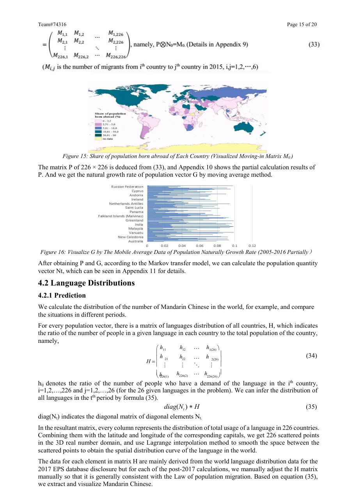

Team#74316

$$
= \left( \begin{array}{c c c c} M _ {1, 1} & M _ {1, 2} & \dots & M _ {1, 2 2 6} \\ M _ {2, 1} & M _ {2, 2} & & M _ {2, 2 2 6} \\ \vdots & & \ddots & \vdots \\ M _ {2 2 6, 1} & M _ {2 2 6, 2} & \dots & M _ {2 2 6, 2 2 6} \end{array} \right), \text {namely, P\otimes N_{0} = M_{0}. (Details in Appendix 9)}\tag{33}
$$

$( M _ { i , j }$ is the number of migrants from $\mathrm { i } ^ { \mathrm { t h } }$ country $\mathrm { \ t o \ j ^ { \mathrm { t h } } }$ country in 2015, i,j=1,2,…,6)

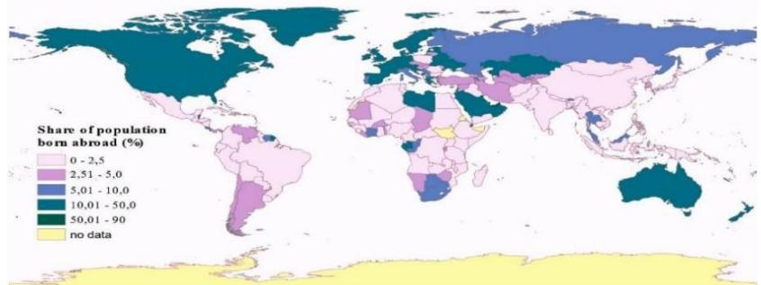

The matrix P of $2 2 6 \times 2 2 6$ is deduced from (33), and Appendix 10 shows the partial calculation results of P. And we get the natural growth rate of population vector G by moving average method.

After obtaining P and ${ \mathrm { G } } ,$ according to the Markov transfer model, we can calculate the population quantity vector Nt, which can be seen in Appendix 11 for details

### 4.2 Language Distributions

### 4.2.1 Prediction

We calculate the distribution of the number of Mandarin Chinese in the world, for example, and compare the situations in different periods.

For every population vector, there is a matrix of languages distribution of all countries, H, which indicates the ratio of the number of people in a given language in each country to the total population of the country, namely,

$$
H = \left( \begin{array}{c c c c} h _ {1 1} & h _ {1 2} & \dots & h _ {1 (2 6)} \\ h _ {2 1} & h _ {2 2} & \dots & h _ {2 (2 6)} \\ \vdots & \vdots & \ddots & \vdots \\ h _ {2 6 (1)} & h _ {2 2 6 (2)} & \dots & h _ {2 2 6 (2 6)} \end{array} \right)\tag{34}
$$

$\mathrm { h _ { i j } }$ denotes the ratio of the number of people who have a demand of the language in the $\mathrm { i ^ { t h } }$ country, $\scriptstyle \mathrm { i = 1 , 2 , \ldots , 2 2 6 }$ and $\mathrm { j } { = } 1 , 2 , . . . , 2 6$ (for the 26 given languages in the problem). We can infer the distribution of all languages in the ${ \mathfrak { t } } ^ { \mathrm { { t h } } }$ period by formula (35).

$$
d i a g (N _ {t}) * H\tag{35}
$$

diag(Nt) indicates the diagonal matrix of diagonal elements $\mathrm { N _ { t } }$

In the resultant matrix, every column represents the distribution oftotal usage ofa language in 226 countries. Combining them with the latitude and longitude of the corresponding capitals, we get 226 scattered points in the 3D real number domain, and use Lagrange interpolation method to smooth the space between the scattered points to obtain the spatial distribution curve of the language in the world.

The data for each element in matrix H are mainly derived from the world language distribution data for the 2017 EPS database disclosure but for each of the post-2017 calculations, we manually adjust the H matrix manually so that it is generally consistent with the Law of population migration. Based on equation (35), we extract and visualize Mandarin Chinese.

Page 15 of 20

## 第18页

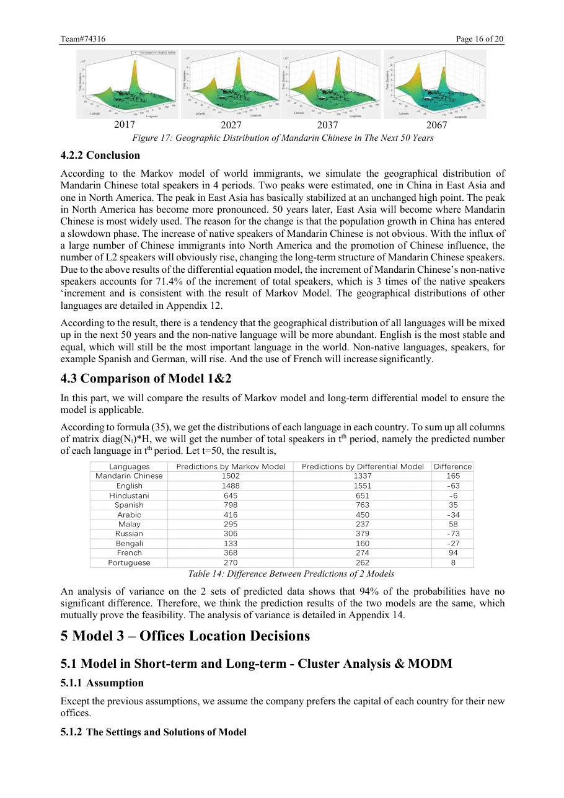

### 4.2.2 Conclusion

According to the Markov model of world immigrants, we simulate the geographical distribution of Mandarin Chinese total speakers in 4 periods. Two peaks were estimated, one in China in East Asia and one in North America. The peak in East Asia has basically stabilized at an unchanged high point. The peak in North America has become more pronounced. 50 years later, East Asia will become where Mandarin Chinese is most widely used. The reason for the change is that the population growth in China has entered a slowdown phase. The increase of native speakers of Mandarin Chinese is not obvious. With the influx of a large number of Chinese immigrants into North America and the promotion of Chinese influence, the number of L2 speakers will obviously rise, changing the long-term structure of Mandarin Chinese speakers. Due to the above results ofthe differential equation model, the increment ofMandarin Chinese’s non-native speakers accounts for 71.4% of the increment of total speakers, which is 3 times of the native speakers ‘increment and is consistent with the result of Markov Model. The geographical distributions of other languages are detailed in Appendix 12.

According to the result, there is a tendency that the geographical distribution of all languages will be mixed up in the next 50 years and the non-native language will be more abundant. English is the most stable and equal, which will still be the most important language in the world. Non-native languages, speakers, for example Spanish and German, will rise. And the use of French will increase significantly.

### 4.3 Comparison of Model 1&2

In this part, we will compare the results of Markov model and long-term differential model to ensure the model is applicable.

According to formula (35), we get the distributions of each language in each country. To sum up all columns of matrix diag(Nt)\*H, we will get the number of total speakers in tth period, namely the predicted number of each language in tth period. Let t=50, the result is,

Table 14: Difference Between Predictions of 2 Models
<table><tr><td>Languages</td><td>Predictions by Markov Model</td><td>Predictions by Differential Model</td><td>Difference</td></tr><tr><td>Mandarin Chinese</td><td>1502</td><td>1337</td><td>165</td></tr><tr><td>English</td><td>1488</td><td>1551</td><td>-63</td></tr><tr><td>Hindustani</td><td>645</td><td>651</td><td>-6</td></tr><tr><td>Spanish</td><td>798</td><td>763</td><td>35</td></tr><tr><td>Arabic</td><td>416</td><td>450</td><td>-34</td></tr><tr><td>Malay</td><td>295</td><td>237</td><td>58</td></tr><tr><td>Russian</td><td>306</td><td>379</td><td>-73</td></tr><tr><td>Bengali</td><td>133</td><td>160</td><td>-27</td></tr><tr><td>French</td><td>368</td><td>274</td><td>94</td></tr><tr><td>Portuguese</td><td>270</td><td>262</td><td>8</td></tr></table>

An analysis of variance on the 2 sets of predicted data shows that 94% of the probabilities have no significant difference. Therefore, we think the prediction results of the two models are the same, which mutually prove the feasibility. The analysis of variance is detailed in Appendix 14.

### 5 Model 3 – Offices Location Decisions

### 5.1 Model in Short-term and Long-term - Cluster Analysis & MODM

### 5.1.1 Assumption

Except the previous assumptions, we assume the company prefers the capital of each country for their new offices.

### 5.1.2 The Settings and Solutions of Model

Team#74316

Page 16 of 20

## 第19页

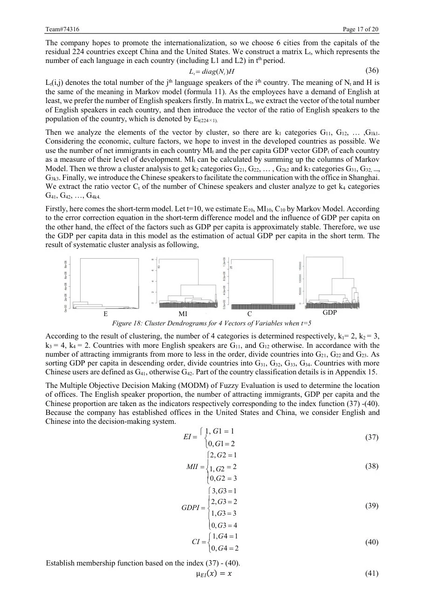

The company hopes to promote the internationalization, so we choose 6 cities from the capitals of the residual 224 countries except China and the United States. We construct a matrix $\mathrm { L } _ { \mathrm { t } } ,$ which represents the number of each language in each country (including L1 and L2) in ${ \mathfrak { t } } ^ { \mathrm { { t h } } }$ period.

$$
L _ {t} = \operatorname{diag} \left(N _ {t}\right) H\tag{36}
$$

Lt(i,j) denotes the total number of the $\mathrm { j } ^ { \mathrm { t h } }$ language speakers of the $\mathrm { i ^ { t h } }$ country. The meaning of $\mathrm { N _ { t } }$ and H is the same of the meaning in Markov model (formula 11). As the employees have a demand of English at least, we prefer the number ofEnglish speakers firstly. In matrix $\mathrm { L } _ { \mathrm { t } } ,$ we extract the vector ofthe total number of English speakers in each country, and then introduce the vector of the ratio of English speakers to the population of the country, which is denoted by $\mathrm { E } _ { \mathrm { t } ( 2 2 4 \times 1 ) }$

Then we analyze the elements of the vector by cluster, so there are k1 categories $\mathbf { G } _ { 1 1 } , \mathbf { G } _ { 1 2 } , \dots , \mathbf { G } _ { 1 \mathrm { k l } }$ Considering the economic, culture factors, we hope to invest in the developed countries as possible. We use the number of net immigrants in each country $\mathrm { M I } _ { \mathrm { t } }$ and the per capita GDP vector GDPt of each country as a measure of their level of development. MIt can be calculated by summing up the columns of Markov Model. Then we throw a cluster analysis to get k2 categories $\mathrm { G } _ { 2 1 } , \mathrm { G } _ { 2 2 } , \dots , \mathrm { G } _ { 2 \mathrm { k } 2 }$ and k3 categories $\mathrm { G } _ { 3 1 } , \mathrm { G } _ { 3 2 } , .$ .. G3k3. Finally, we introduce the Chinese speakers to facilitate the communication with the office in Shanghai. We extract the ratio vector $\mathrm { C _ { t } }$ of the number of Chinese speakers and cluster analyze to get k4 categories $\mathrm { G } _ { 4 1 } , \mathrm { G } _ { 4 2 } , . . . , \mathrm { G } _ { 4 \mathrm { k } 4 }$

Firstly, here comes the short-term model. Let t=10, we estimate $\mathrm { E } _ { 1 0 } , \mathrm { M I } _ { 1 0 } , \mathrm { C } _ { 1 0 }$ by Markov Model. According to the error correction equation in the short-term difference model and the influence of GDP per capita on the other hand, the effect of the factors such as GDP per capita is approximately stable. Therefore, we use the GDP per capita data in this model as the estimation of actual GDP per capita in the short term. The result of systematic cluster analysis as following,

According to the result of clustering, the number of 4 categories is determined respectively, $\mathbf { k } _ { 1 } = 2 , \mathbf { k } _ { 2 } = 3 .$ $\mathbf { k } _ { 3 } = 4 , \mathbf { k } _ { 4 } = 2$ . Countries with more English speakers are $\mathrm { G } _ { 1 1 }$ , and $\mathbf { G } _ { 1 2 }$ otherwise. In accordance with the number of attracting immigrants from more to less in the order, divide countries into $\mathrm { G } _ { 2 1 } , \mathrm { G } _ { 2 2 }$ and $\mathbf { G } _ { 2 3 }$ . As sorting GDP per capita in descending order, divide countries into $\mathrm { G } _ { 3 1 } , \mathrm { G } _ { 3 2 } , \mathrm { G } _ { 3 3 } , \mathrm { G } _ { 3 4 }$ . Countries with more Chinese users are defined as $\mathrm { G } _ { 4 1 }$ , otherwise $\mathrm { G } _ { 4 2 }$ . Part of the country classification details is in Appendix 15.

The Multiple Objective Decision Making (MODM) of Fuzzy Evaluation is used to determine the location of offices. The English speaker proportion, the number of attracting immigrants, GDP per capita and the Chinese proportion are taken as the indicators respectively corresponding to the index function (37) -(40). Because the company has established offices in the United States and China, we consider English and Chinese into the decision-making system.

$$
E I = \left\{ \begin{array}{l} 1, G 1 = 1 \\ 0, G 1 = 2 \end{array} \right.\tag{37}
$$

$$
M I I = \left\{ \begin{array}{l} 1, G 2 = 2 \\ 0, G 2 = 3 \end{array} \right.\tag{38}
$$

$$
G D P I = \left\{ \begin{array}{l} 3, G 3 = 1 \\ 2, G 3 = 2 \\ 1, G 3 = 3 \\ 0, G 3 = 4 \end{array} \right.\tag{39}
$$

$$
C I = \left\{ \begin{array}{l} 1, G 4 = 1 \\ 0, G 4 = 2 \end{array} \right.\tag{40}
$$

Establish membership function based on the index (37) - (40).

$$
\mu_ {E I} (x) = x\tag{41}
$$

Team#74316

Page 17 of 20

## 第20页

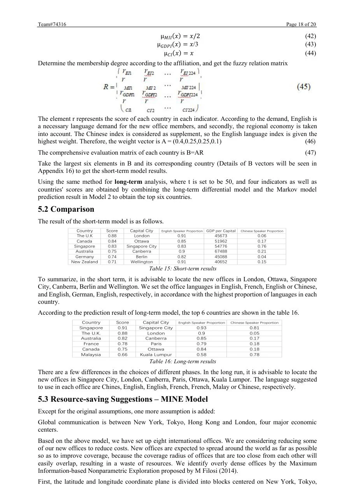

$$
\mu_ {M I I} (x) = x / 2
$$

$$
\mu_ {G D P I} (x) = x / 3\tag{42}
$$

(43)

$$
\mu_ {C I} (x) = x\tag{44}
$$

Determine the membership degree according to the affiliation, and get the fuzzy relation matrix

$$
R = \left| \begin{array}{c c c c} r _ {E I 1} & r _ {E I 2} & \dots & r _ {E I 2 2 4} \\ r & r & & r \\ r _ {M I 1} & r _ {M I 2} & \dots & r _ {M I 2 2 4} \\ r _ {G D P I 1} & r _ {G D P I 2} & \dots & r _ {G D P I 2 2 4} \\ r & r & & r \\ C I 1 & C I 2 & \dots & C I 2 2 4 \end{array} \right|\tag{45}
$$

The element r represents the score of each country in each indicator. According to the demand, English is a necessary language demand for the new office members, and secondly, the regional economy is taken into account. The Chinese index is considered as supplement, so the English language index is given the highest weight. Therefore, the weight vector is A = (0.4,0.25,0.25,0.1) (46)

The comprehensive evaluation matrix of each country is B=AR

(47)

Take the largest six elements in B and its corresponding country (Details of B vectors will be seen in Appendix 16) to get the short-term model results.

Using the same method for long-term analysis, where t is set to be 50, and four indicators as well as countries' scores are obtained by combining the long-term differential model and the Markov model prediction result in Model 2 to obtain the top six countries.

### 5.2 Comparison

The result of the short-term model is as follows.

Table 15: Short-term results
<table><tr><td>Country</td><td>Score</td><td>Capital City</td><td>English Speaker Proportion</td><td>GDP per Capital</td><td>Chinese Speaker Proportion</td></tr><tr><td>The U.K</td><td>0.88</td><td>London</td><td>0.91</td><td>45673</td><td>0.06</td></tr><tr><td>Canada</td><td>0.84</td><td>Ottawa</td><td>0.85</td><td>51962</td><td>0.17</td></tr><tr><td>Singapore</td><td>0.83</td><td>Singapore City</td><td>0.83</td><td>54776</td><td>0.76</td></tr><tr><td>Australia</td><td>0.75</td><td>Canberra</td><td>0.9</td><td>67488</td><td>0.21</td></tr><tr><td>Germany</td><td>0.74</td><td>Berlin</td><td>0.82</td><td>45088</td><td>0.04</td></tr><tr><td>New Zealand</td><td>0.71</td><td>Wellington</td><td>0.91</td><td>40652</td><td>0.15</td></tr></table>

To summarize, in the short term, it is advisable to locate the new offices in London, Ottawa, Singapore City, Canberra, Berlin and Wellington. We set the office languages in English, French, English or Chinese, and English, German, English, respectively, in accordance with the highest proportion of languages in each country.

According to the prediction result of long-term model, the top 6 countries are shown in the table 16. Table 16: Long-term results
<table><tr><td>Country</td><td>Score</td><td>Capital City</td><td>English Speaker Proportion</td><td>Chinese Speaker Proportion</td></tr><tr><td>Singapore</td><td>0.91</td><td>Singapore City</td><td>0.93</td><td>0.81</td></tr><tr><td>The U.K.</td><td>0.88</td><td>London</td><td>0.9</td><td>0.05</td></tr><tr><td>Australia</td><td>0.82</td><td>Canberra</td><td>0.85</td><td>0.17</td></tr><tr><td>France</td><td>0.78</td><td>Paris</td><td>0.79</td><td>0.18</td></tr><tr><td>Canada</td><td>0.75</td><td>Ottawa</td><td>0.84</td><td>0.18</td></tr><tr><td>Malaysia</td><td>0.66</td><td>Kuala Lumpur</td><td>0.58</td><td>0.78</td></tr></table>

There are a few differences in the choices of different phases. In the long run, it is advisable to locate the new offices in Singapore City, London, Canberra, Paris, Ottawa, Kuala Lumpor. The language suggested to use in each office are Chines, English, English, French, French, Malay or Chinese, respectively.

### 5.3 Resource-saving Suggestions – MINE Model

Except for the original assumptions, one more assumption is added:

Global communication is between New York, Tokyo, Hong Kong and London, four major economic centers.

Based on the above model, we have set up eight international offices. We are considering reducing some of our new offices to reduce costs. New offices are expected to spread around the world as far as possible so as to improve coverage, because the coverage radius of offices that are too close from each other will easily overlap, resulting in a waste of resources. We identify overly dense offices by the Maximum Information-based Nonparametric Exploration proposed by M Filosi (2014).

First, the latitude and longitude coordinate plane is divided into blocks centered on New York, Tokyo,

Team#74316

Page 18 of 20

## 第21页

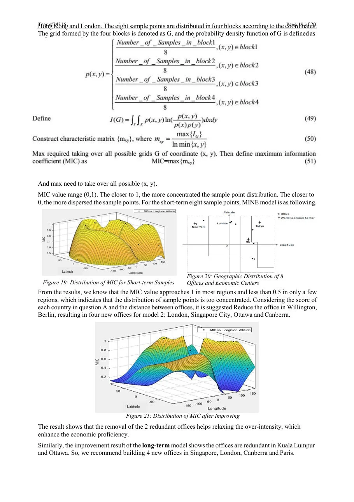

Hong Kong and London. The eight sample points are distributed in four blocks according to the coordinates.Team#74316 Page 19 of 20 The grid formed by the four blocks is denoted as G, and the probability density function of G is defined as

$$
p (x, y) = \left\{ \begin{array}{l} \frac {\text { Number } _ {-} \text { of } _ {-} \text { Samples } _ {-} \text { in } _ {-} \text { block1 }}{8}, (x, y) \in \text { block1 } \\ \frac {\text { Number } _ {-} \text { of } _ {-} \text { Samples } _ {-} \text { in } _ {-} \text { block2 }}{8}, (x, y) \in \text { block2 } \\ \frac {\text { Number } _ {-} \text { of } _ {-} \text { Samples } _ {-} \text { in } _ {-} \text { block3 }}{8}, (x, y) \in \text { block3 } \\ \frac {\text { Number } _ {-} \text { of } _ {-} \text { Samples } _ {-} \text { in } _ {-} \text { block4 }}{8}, (x, y) \in \text { block4 } \end{array} \right.\tag{48}
$$

Define

$$
I (G) = \int_ {Y} \int_ {X} p (x, y) \ln (\frac {p (x , y)}{p (x) p (y)}) d x d y\tag{49}
$$

Construct characteristic matrix $\{ \mathbf { m } _ { \mathbf { x y } } \}$ , where $m _ { x y } = \frac { \operatorname* { m a x } \{ I _ { G } \} } { \ln \operatorname* { m i n } \{ x , y \} }$

(50)

Max required taking over all possible grids G of coordinate (x, y). Then define maximum information coefficient (MIC) as MIC=max{mxy} (51)

And max need to take over all possible (x, y).

MIC value range (0,1). The closer to 1, the more concentrated the sample point distribution. The closer to 0, the more dispersed the sample points. For the short-term eight sample points, MINE model is as following.

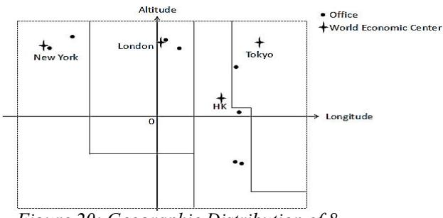

From the results, we know that the MIC value approaches 1 in most regions and less than 0.5 in only a few regions, which indicates that the distribution of sample points is too concentrated. Considering the score of each country in question A and the distance between offices, it is suggested Reduce the office in Willington, Berlin, resulting in four new offices for model 2: London, Singapore City, Ottawa and Canberra.

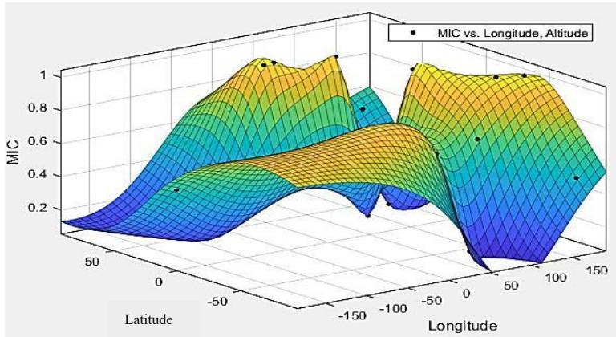

The result shows that the removal of the 2 redundant offices helps relaxing the over-intensity, which enhance the economic proficiency.

Similarly, the improvement result of the long-term model shows the offices are redundant in Kuala Lumpur and Ottawa. So, we recommend building 4 new offices in Singapore, London, Canberra and Paris.

## 第22页

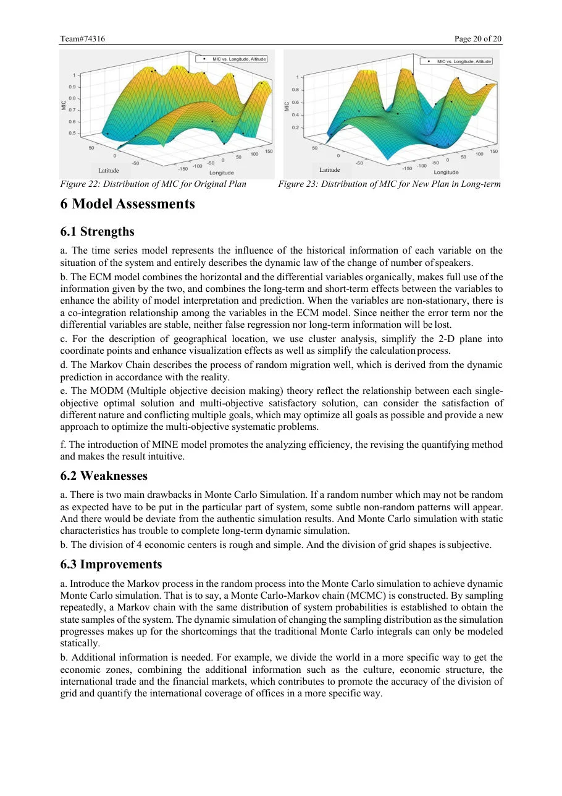

### 6 Model Assessments

### 6.1 Strengths

a. The time series model represents the influence of the historical information of each variable on the situation of the system and entirely describes the dynamic law of the change of number ofspeakers

b. The ECM model combines the horizontal and the differential variables organically, makes full use of the information given by the two, and combines the long-term and short-term effects between the variables to enhance the ability of model interpretation and prediction. When the variables are non-stationary, there is a co-integration relationship among the variables in the ECM model. Since neither the error term nor the differential variables are stable, neither false regression nor long-term information will be lost.

c. For the description of geographical location, we use cluster analysis, simplify the 2-D plane into coordinate points and enhance visualization effects as well as simplify the calculation process.

d. The Markov Chain describes the process of random migration well, which is derived from the dynamic prediction in accordance with the reality.

e. The MODM (Multiple objective decision making) theory reflect the relationship between each singleobjective optimal solution and multi-objective satisfactory solution, can consider the satisfaction of different nature and conflicting multiple goals, which may optimize all goals as possible and provide a new approach to optimize the multi-objective systematic problems.

f. The introduction of MINE model promotes the analyzing efficiency, the revising the quantifying method and makes the result intuitive.

### 6.2 Weaknesses

a. There is two main drawbacks in Monte Carlo Simulation. If a random number which may not be random as expected have to be put in the particular part of system, some subtle non-random patterns will appear. And there would be deviate from the authentic simulation results. And Monte Carlo simulation with static characteristics has trouble to complete long-term dynamic simulation.

b. The division of 4 economic centers is rough and simple. And the division of grid shapes is subjective.

### 6.3 Improvements

a. Introduce the Markov process in the random process into the Monte Carlo simulation to achieve dynamic Monte Carlo simulation. That is to say, a Monte Carlo-Markov chain (MCMC) is constructed. By sampling repeatedly, a Markov chain with the same distribution of system probabilities is established to obtain the state samples ofthe system. The dynamic simulation ofchanging the sampling distribution as the simulation progresses makes up for the shortcomings that the traditional Monte Carlo integrals can only be modeled statically.

b. Additional information is needed. For example, we divide the world in a more specific way to get the economic zones, combining the additional information such as the culture, economic structure, the international trade and the financial markets, which contributes to promote the accuracy of the division of grid and quantify the international coverage of offices in a more specific way.

Team#74316

Page 20 of 20

## 第23页

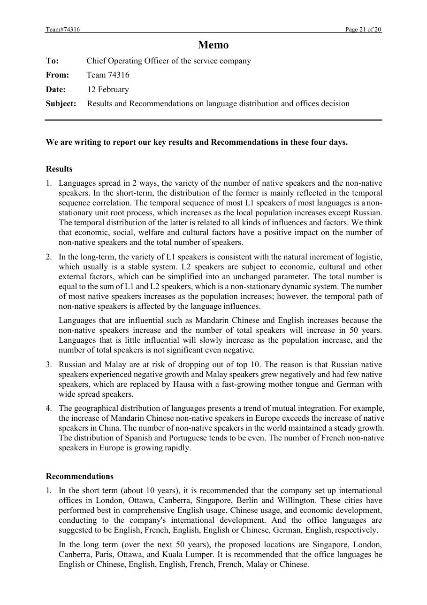

### Memo

To: Chief Operating Officer of the service company

From: Team 74316

Date: 12 February

Subject: Results and Recommendations on language distribution and offices decision

We are writing to report our key results and Recommendations in these four days.

### Results

1. Languages spread in 2 ways, the variety of the number of native speakers and the non-native speakers. In the short-term, the distribution of the former is mainly reflected in the temporal sequence correlation. The temporal sequence of most L1 speakers of most languages is a nonstationary unit root process, which increases as the local population increases except Russian. The temporal distribution of the latter is related to all kinds of influences and factors. We think that economic, social, welfare and cultural factors have a positive impact on the number of non-native speakers and the total number of speakers.

2. In the long-term, the variety of L1 speakers is consistent with the natural increment of logistic, which usually is a stable system. L2 speakers are subject to economic, cultural and other external factors, which can be simplified into an unchanged parameter. The total number is equal to the sum of L1 and L2 speakers, which is a non-stationary dynamic system. The number of most native speakers increases as the population increases; however, the temporal path of non-native speakers is affected by the language influences.

Languages that are influential such as Mandarin Chinese and English increases because the non-native speakers increase and the number of total speakers will increase in 50 years. Languages that is little influential will slowly increase as the population increase, and the number of total speakers is not significant even negative.

3. Russian and Malay are at risk of dropping out of top 10. The reason is that Russian native speakers experienced negative growth and Malay speakers grew negatively and had few native speakers, which are replaced by Hausa with a fast-growing mother tongue and German with wide spread speakers.

4. The geographical distribution of languages presents a trend of mutual integration. For example, the increase of Mandarin Chinese non-native speakers in Europe exceeds the increase of native speakers in China. The number of non-native speakers in the world maintained a steady growth. The distribution of Spanish and Portuguese tends to be even. The number of French non-native speakers in Europe is growing rapidly.

### Recommendations

1. In the short term (about 10 years), it is recommended that the company set up international offices in London, Ottawa, Canberra, Singapore, Berlin and Willington. These cities have performed best in comprehensive English usage, Chinese usage, and economic development, conducting to the company's international development. And the office languages are suggested to be English, French, English, English or Chinese, German, English, respectively.

In the long term (over the next 50 years), the proposed locations are Singapore, London, Canberra, Paris, Ottawa, and Kuala Lumper. It is recommended that the office languages be English or Chinese, English, English, French, French, Malay or Chinese.

Team#74316

Page 21 of 20

## 第24页

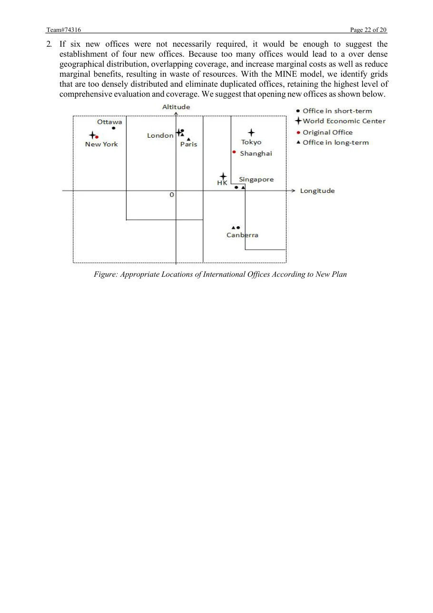

2. If six new offices were not necessarily required, it would be enough to suggest the establishment of four new offices. Because too many offices would lead to a over dense geographical distribution, overlapping coverage, and increase marginal costs as well as reduce marginal benefits, resulting in waste of resources. With the MINE model, we identify grids that are too densely distributed and eliminate duplicated offices, retaining the highest level of comprehensive evaluation and coverage. We suggest that opening new offices as shown below.

Team#74316

Page 22 of 20

## 第25页

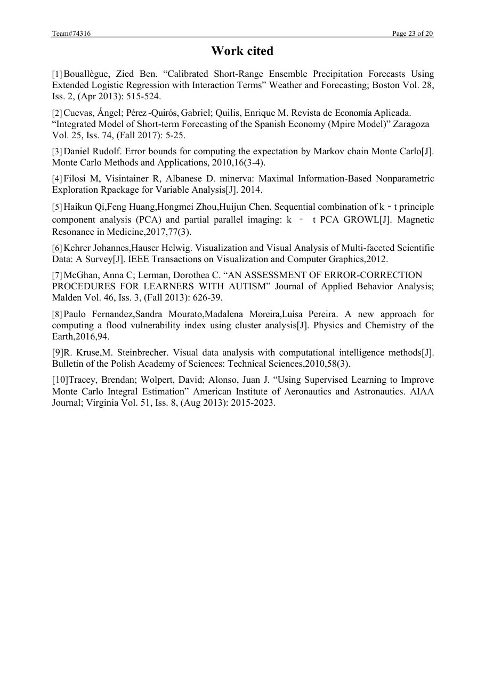

### Work cited

[1] Bouallègue, Zied Ben. “Calibrated Short-Range Ensemble Precipitation Forecasts Using Extended Logistic Regression with Interaction Terms” Weather and Forecasting; Boston Vol. 28, Iss. 2, (Apr 2013): 515-524.

[2] Cuevas, Ángel; Pérez -Quirós, Gabriel; Quilis, Enrique M. Revista de Economía Aplicada.

“Integrated Model of Short-term Forecasting of the Spanish Economy (Mpire Model)” Zaragoza Vol. 25, Iss. 74, (Fall 2017): 5-25.

[3] Daniel Rudolf. Error bounds for computing the expectation by Markov chain Monte Carlo[J]. Monte Carlo Methods and Applications, 2010,16(3-4).

[4] Filosi M, Visintainer R, Albanese D. minerva: Maximal Information-Based Nonparametric Exploration Rpackage for Variable Analysis[J]. 2014.

[5] Haikun Qi,Feng Huang,Hongmei Zhou,Huijun Chen. Sequential combination of k‐t principle component analysis (PCA) and partial parallel imaging: k ‐ t PCA GROWL[J]. Magnetic Resonance in Medicine,2017,77(3).

[6] Kehrer Johannes,Hauser Helwig. Visualization and Visual Analysis of Multi-faceted Scientific Data: A Survey[J]. IEEE Transactions on Visualization and Computer Graphics,2012.

[7] McGhan, Anna C; Lerman, Dorothea C. “AN ASSESSMENT OF ERROR-CORRECTION PROCEDURES FOR LEARNERS WITH AUTISM” Journal of Applied Behavior Analysis; Malden Vol. 46, Iss. 3, (Fall 2013): 626-39.

[8] Paulo Fernandez,Sandra Mourato,Madalena Moreira,Luísa Pereira. A new approach for computing a flood vulnerability index using cluster analysis[J]. Physics and Chemistry of the Earth,2016,94.

[9]R. Kruse,M. Steinbrecher. Visual data analysis with computational intelligence methods[J]. Bulletin of the Polish Academy of Sciences: Technical Sciences,2010,58(3).

[10]Tracey, Brendan; Wolpert, David; Alonso, Juan J. “Using Supervised Learning to Improve Monte Carlo Integral Estimation” American Institute of Aeronautics and Astronautics. AIAA Journal; Virginia Vol. 51, Iss. 8, (Aug 2013): 2015-2023.

Team#74316

Page 23 of 20

## 第26页

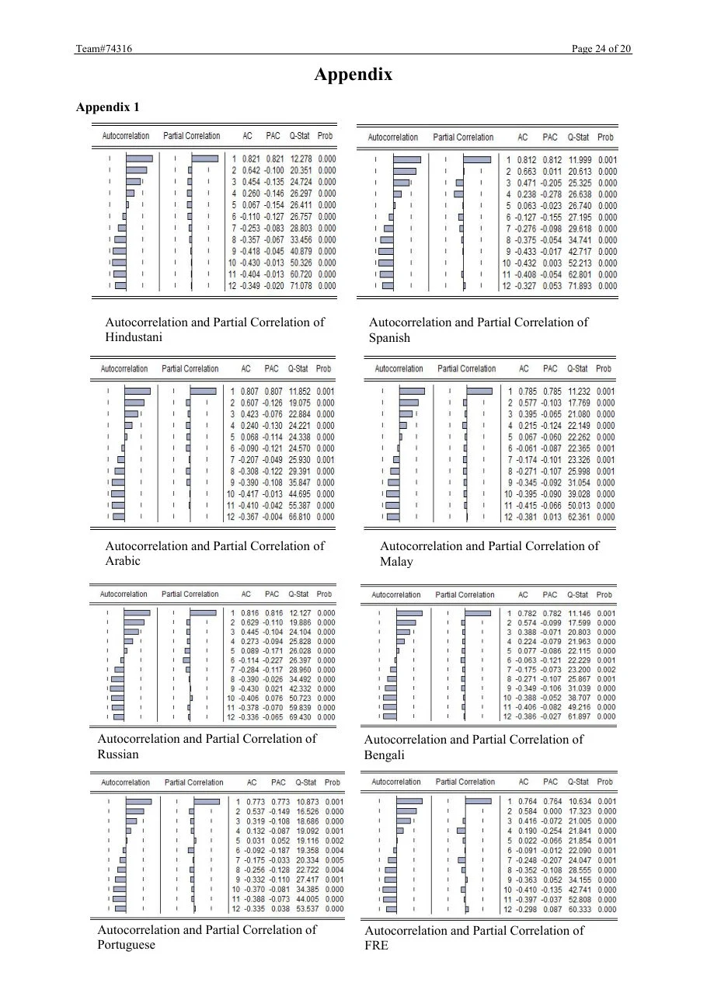

Appendix Appendix 1
<table><tr><td>Autocorrelation</td><td>Partial Correlation</td><td>AC</td><td>PAC</td><td>Q-Stat</td><td>Prob</td></tr><tr><td></td><td></td><td>1</td><td>0.821</td><td>0.821</td><td>12.278</td></tr><tr><td></td><td></td><td>2</td><td>0.642</td><td>-0.100</td><td>20.351</td></tr><tr><td></td><td></td><td>3</td><td>0.454</td><td>-0.135</td><td>24.724</td></tr><tr><td></td><td></td><td>4</td><td>0.260</td><td>-0.146</td><td>26.297</td></tr><tr><td></td><td></td><td>5</td><td>0.067</td><td>-0.154</td><td>26.411</td></tr><tr><td></td><td></td><td>6</td><td>-0.110</td><td>-0.127</td><td>26.757</td></tr><tr><td></td><td></td><td>7</td><td>-0.253</td><td>-0.083</td><td>28.803</td></tr><tr><td></td><td></td><td>8</td><td>-0.357</td><td>-0.067</td><td>33.456</td></tr><tr><td></td><td></td><td>9</td><td>-0.418</td><td>-0.045</td><td>40.879</td></tr><tr><td></td><td></td><td>10</td><td>-0.430</td><td>-0.013</td><td>50.326</td></tr><tr><td></td><td></td><td>11</td><td>-0.404</td><td>-0.013</td><td>60.720</td></tr><tr><td></td><td></td><td>12</td><td>-0.349</td><td>-0.020</td><td>71.078</td></tr></table>

Autocorrelation and Partial Correlation of Spanish
<table><tr><td>Autocorrelation</td><td>Partial Correlation</td><td>AC</td><td>PAC</td><td>Q-Stat</td><td>Prob</td></tr><tr><td></td><td></td><td>1</td><td>0.812</td><td>0.812</td><td>11.999</td></tr><tr><td></td><td></td><td>2</td><td>0.663</td><td>0.011</td><td>20.613</td></tr><tr><td></td><td></td><td>3</td><td>0.471</td><td>-0.205</td><td>25.325</td></tr><tr><td></td><td></td><td>4</td><td>0.238</td><td>-0.278</td><td>26.638</td></tr><tr><td></td><td></td><td>5</td><td>0.063</td><td>-0.023</td><td>26.740</td></tr><tr><td></td><td></td><td>6</td><td>-0.127</td><td>-0.155</td><td>27.195</td></tr><tr><td></td><td></td><td>7</td><td>-0.276</td><td>-0.098</td><td>29.618</td></tr><tr><td></td><td></td><td>8</td><td>-0.375</td><td>-0.054</td><td>34.741</td></tr><tr><td></td><td></td><td>9</td><td>-0.433</td><td>-0.017</td><td>42.717</td></tr><tr><td></td><td></td><td>10</td><td>-0.432</td><td>0.003</td><td>52.213</td></tr><tr><td></td><td></td><td>11</td><td>-0.408</td><td>-0.054</td><td>62.801</td></tr><tr><td></td><td></td><td>12</td><td>-0.327</td><td>0.053</td><td>71.893</td></tr></table>

Autocorrelation and Partial Correlation of Hindustani Autocorrelation and Partial Correlation of Arabic
<table><tr><td>Autocorrelation</td><td>Partial Correlation</td><td>AC</td><td>PAC</td><td>Q-Stat</td><td>Prob</td></tr><tr><td></td><td></td><td>1</td><td>0.807</td><td>0.807</td><td>11.852</td></tr><tr><td></td><td></td><td>2</td><td>0.607</td><td>-0.126</td><td>19.075</td></tr><tr><td></td><td></td><td>3</td><td>0.423</td><td>-0.076</td><td>22.884</td></tr><tr><td></td><td></td><td>4</td><td>0.240</td><td>-0.130</td><td>24.221</td></tr><tr><td></td><td></td><td>5</td><td>0.068</td><td>-0.114</td><td>24.338</td></tr><tr><td></td><td></td><td>6</td><td>-0.090</td><td>-0.121</td><td>24.570</td></tr><tr><td></td><td></td><td>7</td><td>-0.207</td><td>-0.049</td><td>25.930</td></tr><tr><td></td><td></td><td>8</td><td>-0.308</td><td>-0.122</td><td>29.391</td></tr><tr><td></td><td></td><td>9</td><td>-0.390</td><td>-0.108</td><td>35.847</td></tr><tr><td></td><td></td><td>10</td><td>-0.417</td><td>-0.013</td><td>44.695</td></tr><tr><td></td><td></td><td>11</td><td>-0.410</td><td>-0.042</td><td>55.387</td></tr><tr><td></td><td></td><td>12</td><td>-0.367</td><td>-0.004</td><td>66.810</td></tr></table>

Autocorrelation and Partial Correlation of Malay
<table><tr><td>Autocorrelation</td><td>Partial Correlation</td><td>AC</td><td>PAC</td><td>Q-Stat</td><td>Prob</td></tr><tr><td></td><td></td><td>1</td><td>0.785</td><td>0.785</td><td>11.232</td></tr><tr><td></td><td></td><td>2</td><td>0.577</td><td>-0.103</td><td>17.769</td></tr><tr><td></td><td></td><td>3</td><td>0.395</td><td>-0.065</td><td>21.080</td></tr><tr><td></td><td></td><td>4</td><td>0.215</td><td>-0.124</td><td>22.149</td></tr><tr><td></td><td></td><td>5</td><td>0.067</td><td>-0.060</td><td>22.262</td></tr><tr><td></td><td></td><td>6</td><td>-0.061</td><td>-0.087</td><td>22.365</td></tr><tr><td></td><td></td><td>7</td><td>-0.174</td><td>-0.101</td><td>23.326</td></tr><tr><td></td><td></td><td>8</td><td>-0.271</td><td>-0.107</td><td>25.998</td></tr><tr><td></td><td></td><td>9</td><td>-0.345</td><td>-0.092</td><td>31.054</td></tr><tr><td></td><td></td><td>10</td><td>-0.395</td><td>-0.090</td><td>39.028</td></tr><tr><td></td><td></td><td>11</td><td>-0.415</td><td>-0.066</td><td>50.013</td></tr><tr><td></td><td></td><td>12</td><td>-0.381</td><td>0.013</td><td>62.361</td></tr></table>

Autocorrelation and Partial Correlation of Russian
<table><tr><td>Autocorrelation</td><td>Partial Correlation</td><td>AC</td><td>PAC</td><td>Q-Stat</td><td>Prob</td><td></td></tr><tr><td></td><td></td><td>1</td><td>0.816</td><td>0.816</td><td>12.127</td><td>0.000</td></tr><tr><td></td><td></td><td>2</td><td>0.629</td><td>-0.110</td><td>19.886</td><td>0.000</td></tr><tr><td></td><td></td><td>3</td><td>0.445</td><td>-0.104</td><td>24.104</td><td>0.000</td></tr><tr><td></td><td></td><td>4</td><td>0.273</td><td>-0.094</td><td>25.828</td><td>0.000</td></tr><tr><td></td><td></td><td>5</td><td>0.089</td><td>-0.171</td><td>26.028</td><td>0.000</td></tr><tr><td></td><td></td><td>6</td><td>-0.114</td><td>-0.227</td><td>26.397</td><td>0.000</td></tr><tr><td></td><td></td><td>7</td><td>-0.284</td><td>-0.117</td><td>28.960</td><td>0.000</td></tr><tr><td></td><td></td><td>8</td><td>-0.390</td><td>-0.026</td><td>34.492</td><td>0.000</td></tr><tr><td></td><td></td><td>9</td><td>-0.430</td><td>0.021</td><td>42.332</td><td>0.000</td></tr><tr><td></td><td></td><td>10</td><td>-0.406</td><td>0.076</td><td>50.723</td><td>0.000</td></tr><tr><td></td><td></td><td>11</td><td>-0.378</td><td>-0.070</td><td>59.839</td><td>0.000</td></tr><tr><td></td><td></td><td>12</td><td>-0.336</td><td>-0.065</td><td>69.430</td><td>0.000</td></tr></table>

<table><tr><td>Autocorrelation</td><td>Partial Correlation</td><td>AC</td><td>PAC</td><td>Q-Stat</td><td>Prob</td></tr><tr><td></td><td></td><td>1</td><td>0.782</td><td>0.782</td><td>11.146</td></tr><tr><td></td><td></td><td>2</td><td>0.574</td><td>-0.099</td><td>17.599</td></tr><tr><td></td><td></td><td>3</td><td>0.388</td><td>-0.071</td><td>20.803</td></tr><tr><td></td><td></td><td>4</td><td>0.224</td><td>-0.079</td><td>21.963</td></tr><tr><td></td><td></td><td>5</td><td>0.077</td><td>-0.086</td><td>22.115</td></tr><tr><td></td><td></td><td>6</td><td>-0.063</td><td>-0.121</td><td>22.229</td></tr><tr><td></td><td></td><td>7</td><td>-0.175</td><td>-0.073</td><td>23.200</td></tr><tr><td></td><td></td><td>8</td><td>-0.271</td><td>-0.107</td><td>25.867</td></tr><tr><td></td><td></td><td>9</td><td>-0.349</td><td>-0.106</td><td>31.039</td></tr><tr><td></td><td></td><td>10</td><td>-0.388</td><td>-0.052</td><td>38.707</td></tr><tr><td></td><td></td><td>11</td><td>-0.406</td><td>-0.082</td><td>49.216</td></tr><tr><td></td><td></td><td>12</td><td>-0.386</td><td>-0.027</td><td>61.897</td></tr></table>

Autocorrelation and Partial Correlation of Portuguese
<table><tr><td>Autocorrelation</td><td>Partial Correlation</td><td>AC</td><td>PAC</td><td>Q-Stat</td><td>Prob</td></tr><tr><td></td><td></td><td>1</td><td>0.773</td><td>0.773</td><td>10.873</td></tr><tr><td></td><td></td><td>2</td><td>0.537</td><td>-0.149</td><td>16.526</td></tr><tr><td></td><td></td><td>3</td><td>0.319</td><td>-0.108</td><td>18.686</td></tr><tr><td></td><td></td><td>4</td><td>0.132</td><td>-0.087</td><td>19.092</td></tr><tr><td></td><td></td><td>5</td><td>0.031</td><td>0.052</td><td>19.116</td></tr><tr><td></td><td></td><td>6</td><td>-0.092</td><td>-0.187</td><td>19.358</td></tr><tr><td></td><td></td><td>7</td><td>-0.175</td><td>-0.033</td><td>20.334</td></tr><tr><td></td><td></td><td>8</td><td>-0.256</td><td>-0.128</td><td>22.722</td></tr><tr><td></td><td></td><td>9</td><td>-0.332</td><td>-0.110</td><td>27.417</td></tr><tr><td></td><td></td><td>10</td><td>-0.370</td><td>-0.081</td><td>34.385</td></tr><tr><td></td><td></td><td>11</td><td>-0.388</td><td>-0.073</td><td>44.005</td></tr><tr><td></td><td></td><td>12</td><td>-0.335</td><td>0.038</td><td>53.537</td></tr></table>

Autocorrelation and Partial Correlation of Bengali Autocorrelation and Partial Correlation of FRE
<table><tr><td>Autocorrelation</td><td>Partial Correlation</td><td>AC</td><td>PAC</td><td>Q-Stat</td><td>Prob</td></tr><tr><td></td><td></td><td>1</td><td>0.764</td><td>0.764</td><td>10.634</td></tr><tr><td></td><td></td><td>2</td><td>0.584</td><td>0.000</td><td>17.323</td></tr><tr><td></td><td></td><td>3</td><td>0.416</td><td>-0.072</td><td>21.005</td></tr><tr><td></td><td></td><td>4</td><td>0.190</td><td>-0.254</td><td>21.841</td></tr><tr><td></td><td></td><td>5</td><td>0.022</td><td>-0.066</td><td>21.854</td></tr><tr><td></td><td></td><td>6</td><td>-0.091</td><td>-0.012</td><td>22.090</td></tr><tr><td></td><td></td><td>7</td><td>-0.248</td><td>-0.207</td><td>24.047</td></tr><tr><td></td><td></td><td>8</td><td>-0.352</td><td>-0.108</td><td>28.555</td></tr><tr><td></td><td></td><td>9</td><td>-0.363</td><td>0.052</td><td>34.155</td></tr><tr><td></td><td></td><td>10</td><td>-0.410</td><td>-0.135</td><td>42.741</td></tr><tr><td></td><td></td><td>11</td><td>-0.397</td><td>-0.037</td><td>52.808</td></tr><tr><td></td><td></td><td>12</td><td>-0.298</td><td>0.087</td><td>60.333</td></tr></table>

Team#74316

Page 24 of 20

## 第27页

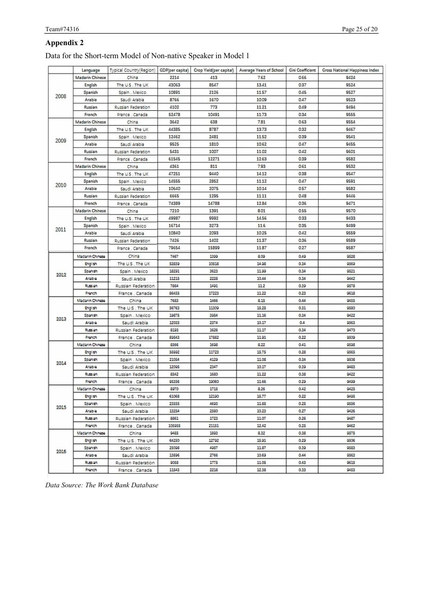

Appendix 2 Data for the Short-term Model of Non-native Speaker in Model 1
<table><tr><td></td><td>Language</td><td>Typical Country(Region)</td><td>GDP(per capita)</td><td>Crop Yield(per capita)</td><td>Average Years of School</td><td>Gini Coefficient</td><td>Gross National Happiness Index</td></tr><tr><td rowspan="6">2008</td><td>Madarin Chinese</td><td>China</td><td>2214</td><td>413</td><td>7.62</td><td>0.66</td><td>9424</td></tr><tr><td>English</td><td>The U.S., The UK</td><td>43063</td><td>8547</td><td>13.41</td><td>0.37</td><td>9524</td></tr><tr><td>Spanish</td><td>Spain, Mexico</td><td>10891</td><td>2126</td><td>11.57</td><td>0.45</td><td>9527</td></tr><tr><td>Arable</td><td>Saudi Arabia</td><td>8766</td><td>1670</td><td>10.09</td><td>0.47</td><td>9523</td></tr><tr><td>Russian</td><td>Russian Federation</td><td>4102</td><td>773</td><td>11.21</td><td>0.49</td><td>9494</td></tr><tr><td>French</td><td>France, Canada</td><td>52478</td><td>10491</td><td>11.73</td><td>0.34</td><td>9555</td></tr><tr><td rowspan="6">2009</td><td>Madarin Chinese</td><td>China</td><td>3642</td><td>638</td><td>7.81</td><td>0.63</td><td>9554</td></tr><tr><td>English</td><td>The U.S., The UK</td><td>44385</td><td>8787</td><td>13.73</td><td>0.32</td><td>9467</td></tr><tr><td>Spanish</td><td>Spain, Mexico</td><td>12462</td><td>2481</td><td>11.52</td><td>0.39</td><td>9541</td></tr><tr><td>Arable</td><td>Saudi Arabia</td><td>9525</td><td>1810</td><td>10.62</td><td>0.47</td><td>9455</td></tr><tr><td>Russian</td><td>Russian Federation</td><td>5431</td><td>1007</td><td>11.02</td><td>0.42</td><td>9601</td></tr><tr><td>French</td><td>France, Canada</td><td>61545</td><td>12271</td><td>12.63</td><td>0.39</td><td>9582</td></tr><tr><td rowspan="6">2010</td><td>Madarin Chinese</td><td>China</td><td>4361</td><td>811</td><td>7.93</td><td>0.61</td><td>9532</td></tr><tr><td>English</td><td>The U.S., The UK</td><td>47251</td><td>9440</td><td>14.12</td><td>0.38</td><td>9547</td></tr><tr><td>Spanish</td><td>Spain, Mexico</td><td>14555</td><td>2852</td><td>11.12</td><td>0.47</td><td>9591</td></tr><tr><td>Arable</td><td>Saudi Arabia</td><td>10640</td><td>2075</td><td>10.14</td><td>0.57</td><td>9582</td></tr><tr><td>Russian</td><td>Russian Federation</td><td>6665</td><td>1295</td><td>11.11</td><td>0.48</td><td>9446</td></tr><tr><td>French</td><td>France, Canada</td><td>74389</td><td>14788</td><td>12.84</td><td>0.36</td><td>9471</td></tr><tr><td rowspan="6">2011</td><td>Madarin Chinese</td><td>China</td><td>7210</td><td>1391</td><td>8.01</td><td>0.55</td><td>9570</td></tr><tr><td>English</td><td>The U.S., The UK</td><td>49987</td><td>9992</td><td>14.56</td><td>0.33</td><td>9433</td></tr><tr><td>Spanish</td><td>Spain, Mexico</td><td>16714</td><td>3273</td><td>11.6</td><td>0.35</td><td>9499</td></tr><tr><td>Arable</td><td>Saudi Arabia</td><td>10840</td><td>2093</td><td>10.25</td><td>0.42</td><td>9559</td></tr><tr><td>Russian</td><td>Russian Federation</td><td>7426</td><td>1402</td><td>11.37</td><td>0.36</td><td>9589</td></tr><tr><td>French</td><td>France, Canada</td><td>79654</td><td>15899</td><td>11.87</td><td>0.27</td><td>9587</td></tr><tr><td rowspan="6">2012</td><td>Madarin Chinese</td><td>China</td><td>7467</td><td>1399</td><td>8.09</td><td>0.49</td><td>9528</td></tr><tr><td>English</td><td>The U.S., The UK</td><td>52839</td><td>10518</td><td>14.98</td><td>0.34</td><td>9569</td></tr><tr><td>Spanish</td><td>Spain, Mexico</td><td>18291</td><td>3623</td><td>11.99</td><td>0.34</td><td>9521</td></tr><tr><td>Arable</td><td>Saudi Arabia</td><td>11215</td><td>2228</td><td>10.44</td><td>0.34</td><td>9442</td></tr><tr><td>Russian</td><td>Russian Federation</td><td>7864</td><td>1491</td><td>11.2</td><td>0.39</td><td>9578</td></tr><tr><td>French</td><td>France, Canada</td><td>86455</td><td>17223</td><td>11.22</td><td>0.23</td><td>9618</td></tr><tr><td rowspan="6">2013</td><td>Madarin Chinese</td><td>China</td><td>7683</td><td>1466</td><td>8.15</td><td>0.44</td><td>9455</td></tr><tr><td>English</td><td>The U.S., The UK</td><td>56763</td><td>11309</td><td>15.25</td><td>0.31</td><td>9580</td></tr><tr><td>Spanish</td><td>Spain, Mexico</td><td>10875</td><td>3954</td><td>11.16</td><td>0.34</td><td>9422</td></tr><tr><td>Arable</td><td>Saudi Arabia</td><td>12033</td><td>2374</td><td>10.17</td><td>0.4</td><td>9563</td></tr><tr><td>Russian</td><td>Russian Federation</td><td>8193</td><td>1626</td><td>11.17</td><td>0.34</td><td>9470</td></tr><tr><td>French</td><td>France, Canada</td><td>89543</td><td>17882</td><td>11.91</td><td>0.22</td><td>9509</td></tr><tr><td rowspan="6">2014</td><td>Madarin Chinese</td><td>China</td><td>8566</td><td>1698</td><td>8.22</td><td>0.41</td><td>9598</td></tr><tr><td>English</td><td>The U.S., The UK</td><td>58992</td><td>11723</td><td>15.75</td><td>0.28</td><td>9565</td></tr><tr><td>Spanish</td><td>Spain, Mexico</td><td>21054</td><td>4129</td><td>11.08</td><td>0.34</td><td>9508</td></tr><tr><td>Arable</td><td>Saudi Arabia</td><td>12095</td><td>2347</td><td>10.17</td><td>0.39</td><td>9483</td></tr><tr><td>Russian</td><td>Russian Federation</td><td>8542</td><td>1680</td><td>11.22</td><td>0.38</td><td>9422</td></tr><tr><td>French</td><td>France, Canada</td><td>95356</td><td>19060</td><td>11.66</td><td>0.29</td><td>9499</td></tr><tr><td rowspan="6">2015</td><td>Madarin Chinese</td><td>China</td><td>8970</td><td>1715</td><td>8.26</td><td>0.42</td><td>9425</td></tr><tr><td>English</td><td>The U.S., The UK</td><td>61068</td><td>12190</td><td>15.77</td><td>0.22</td><td>9495</td></tr><tr><td>Spanish</td><td>Spain, Mexico</td><td>23555</td><td>4603</td><td>11.85</td><td>0.25</td><td>9556</td></tr><tr><td>Arable</td><td>Saudi Arabia</td><td>13254</td><td>2580</td><td>10.23</td><td>0.27</td><td>9426</td></tr><tr><td>Russian</td><td>Russian Federation</td><td>8861</td><td>1723</td><td>11.07</td><td>0.26</td><td>9487</td></tr><tr><td>French</td><td>France, Canada</td><td>105955</td><td>21151</td><td>12.42</td><td>0.25</td><td>9452</td></tr><tr><td rowspan="6">2016</td><td>Madarin Chinese</td><td>China</td><td>9485</td><td>1893</td><td>8.32</td><td>0.38</td><td>9575</td></tr><tr><td>English</td><td>The U.S., The UK</td><td>64250</td><td>12792</td><td>15.91</td><td>0.29</td><td>9506</td></tr><tr><td>Spanish</td><td>Spain, Mexico</td><td>25098</td><td>4957</td><td>11.87</td><td>0.39</td><td>9583</td></tr><tr><td>Arable</td><td>Saudi Arabia</td><td>13896</td><td>2766</td><td>10.69</td><td>0.44</td><td>9563</td></tr><tr><td>Russian</td><td>Russian Federation</td><td>9058</td><td>1775</td><td>11.05</td><td>0.43</td><td>9615</td></tr><tr><td>French</td><td>France, Canada</td><td>11543</td><td>2218</td><td>12.38</td><td>0.33</td><td>9453</td></tr></table>
Data Source: The Work Bank Database

Team#74316

Page 25 of 20

## 第28页

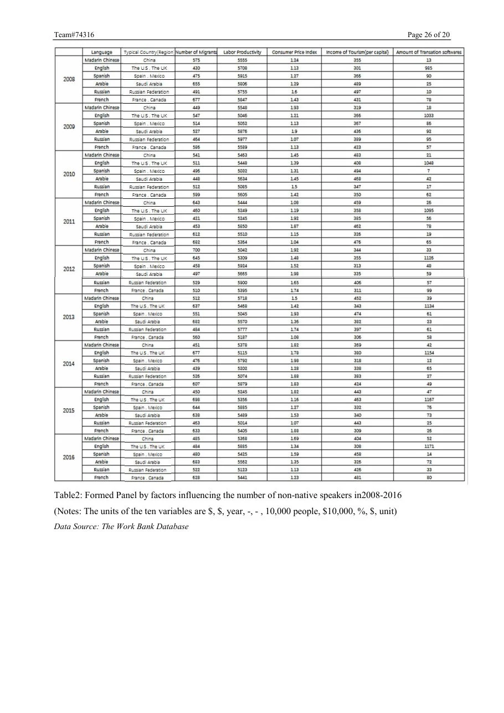

Table2: Formed Panel by factors influencing the number of non-native speakers in2008-2016 (Notes: The units of the ten variables are \$, \$, year, -, - , 10,000 people, \$10,000, %, \$, unit) Data Source: The Work Bank Database
<table><tr><td></td><td>Language</td><td>Typical Country(Region)</td><td>Number of Migrants</td><td>Labor Productivity</td><td>Consumer Price Index</td><td>Income of Tourism(per capital)</td><td>Amount of Translation softwares</td></tr><tr><td rowspan="6">2008</td><td>Madarin Chinese</td><td>China</td><td>575</td><td>5555</td><td>1.24</td><td>355</td><td>13</td></tr><tr><td>English</td><td>The U.S., The UK</td><td>430</td><td>5708</td><td>1.13</td><td>301</td><td>985</td></tr><tr><td>Spanish</td><td>Spain, Mexico</td><td>475</td><td>5915</td><td>1.27</td><td>366</td><td>90</td></tr><tr><td>Arabie</td><td>Saudi Arabia</td><td>655</td><td>5806</td><td>1.29</td><td>489</td><td>25</td></tr><tr><td>Russian</td><td>Russian Federation</td><td>491</td><td>5755</td><td>1.6</td><td>497</td><td>10</td></tr><tr><td>French</td><td>France, Canada</td><td>677</td><td>5847</td><td>1.43</td><td>431</td><td>78</td></tr><tr><td rowspan="6">2009</td><td>Madarin Chinese</td><td>China</td><td>449</td><td>5548</td><td>1.93</td><td>319</td><td>18</td></tr><tr><td>English</td><td>The U.S., The UK</td><td>547</td><td>5046</td><td>1.21</td><td>366</td><td>1033</td></tr><tr><td>Spanish</td><td>Spain, Mexico</td><td>514</td><td>5052</td><td>1.13</td><td>367</td><td>86</td></tr><tr><td>Arabie</td><td>Saudi Arabia</td><td>527</td><td>5876</td><td>1.9</td><td>436</td><td>92</td></tr><tr><td>Russian</td><td>Russian Federation</td><td>464</td><td>5977</td><td>1.07</td><td>389</td><td>95</td></tr><tr><td>French</td><td>France, Canada</td><td>586</td><td>5589</td><td>1.13</td><td>423</td><td>57</td></tr><tr><td rowspan="6">2010</td><td>Madarin Chinese</td><td>China</td><td>541</td><td>5463</td><td>1.45</td><td>483</td><td>21</td></tr><tr><td>English</td><td>The U.S., The UK</td><td>511</td><td>5448</td><td>1.39</td><td>408</td><td>1048</td></tr><tr><td>Spanish</td><td>Spain, Mexico</td><td>496</td><td>5032</td><td>1.31</td><td>494</td><td>7</td></tr><tr><td>Arabie</td><td>Saudi Arabia</td><td>448</td><td>5634</td><td>1.45</td><td>468</td><td>42</td></tr><tr><td>Russian</td><td>Russian Federation</td><td>512</td><td>5085</td><td>1.5</td><td>347</td><td>17</td></tr><tr><td>French</td><td>France, Canada</td><td>599</td><td>5605</td><td>1.42</td><td>350</td><td>62</td></tr><tr><td rowspan="6">2011</td><td>Madarin Chinese</td><td>China</td><td>643</td><td>5444</td><td>1.08</td><td>459</td><td>26</td></tr><tr><td>English</td><td>The U.S., The UK</td><td>460</td><td>5249</td><td>1.19</td><td>358</td><td>1095</td></tr><tr><td>Spanish</td><td>Spain, Mexico</td><td>421</td><td>5245</td><td>1.92</td><td>385</td><td>56</td></tr><tr><td>Arabie</td><td>Saudi Arabia</td><td>453</td><td>5850</td><td>1.87</td><td>462</td><td>78</td></tr><tr><td>Russian</td><td>Russian Federation</td><td>612</td><td>5510</td><td>1.15</td><td>326</td><td>19</td></tr><tr><td>French</td><td>France, Canada</td><td>682</td><td>5364</td><td>1.04</td><td>476</td><td>65</td></tr><tr><td rowspan="6">2012</td><td>Madarin Chinese</td><td>China</td><td>700</td><td>5042</td><td>1.92</td><td>344</td><td>33</td></tr><tr><td>English</td><td>The U.S., The UK</td><td>645</td><td>5309</td><td>1.48</td><td>355</td><td>1126</td></tr><tr><td>Spanish</td><td>Spain, Mexico</td><td>458</td><td>5924</td><td>1.52</td><td>313</td><td>48</td></tr><tr><td>Arabie</td><td>Saudi Arabia</td><td>497</td><td>5665</td><td>1.98</td><td>335</td><td>59</td></tr><tr><td>Russian</td><td>Russian Federation</td><td>529</td><td>5900</td><td>1.65</td><td>406</td><td>57</td></tr><tr><td>French</td><td>France, Canada</td><td>510</td><td>5395</td><td>1.74</td><td>311</td><td>99</td></tr><tr><td rowspan="6">2013</td><td>Madarin Chinese</td><td>China</td><td>512</td><td>5718</td><td>1.5</td><td>452</td><td>39</td></tr><tr><td>English</td><td>The U.S., The UK</td><td>637</td><td>5468</td><td>1.42</td><td>343</td><td>1134</td></tr><tr><td>Spanish</td><td>Spain, Mexico</td><td>551</td><td>5045</td><td>1.93</td><td>474</td><td>61</td></tr><tr><td>Arabie</td><td>Saudi Arabia</td><td>682</td><td>5570</td><td>1.36</td><td>382</td><td>23</td></tr><tr><td>Russian</td><td>Russian Federation</td><td>484</td><td>5777</td><td>1.74</td><td>397</td><td>61</td></tr><tr><td>French</td><td>France, Canada</td><td>560</td><td>5187</td><td>1.08</td><td>306</td><td>58</td></tr><tr><td rowspan="6">2014</td><td>Madarin Chinese</td><td>China</td><td>451</td><td>5378</td><td>1.82</td><td>369</td><td>42</td></tr><tr><td>English</td><td>The U.S., The UK</td><td>677</td><td>5115</td><td>1.78</td><td>380</td><td>1154</td></tr><tr><td>Spanish</td><td>Spain, Mexico</td><td>476</td><td>5792</td><td>1.98</td><td>318</td><td>12</td></tr><tr><td>Arabie</td><td>Saudi Arabia</td><td>439</td><td>5202</td><td>1.28</td><td>338</td><td>65</td></tr><tr><td>Russian</td><td>Russian Federation</td><td>526</td><td>5074</td><td>1.88</td><td>383</td><td>27</td></tr><tr><td>French</td><td>France, Canada</td><td>607</td><td>5879</td><td>1.83</td><td>424</td><td>49</td></tr><tr><td rowspan="6">2015</td><td>Madarin Chinese</td><td>China</td><td>450</td><td>5245</td><td>1.82</td><td>443</td><td>47</td></tr><tr><td>English</td><td>The U.S., The UK</td><td>698</td><td>5356</td><td>1.16</td><td>463</td><td>1167</td></tr><tr><td>Spanish</td><td>Spain, Mexico</td><td>644</td><td>5885</td><td>1.27</td><td>332</td><td>76</td></tr><tr><td>Arabie</td><td>Saudi Arabia</td><td>638</td><td>5489</td><td>1.53</td><td>340</td><td>73</td></tr><tr><td>Russian</td><td>Russian Federation</td><td>463</td><td>5014</td><td>1.07</td><td>443</td><td>25</td></tr><tr><td>French</td><td>France, Canada</td><td>633</td><td>5405</td><td>1.88</td><td>309</td><td>26</td></tr><tr><td rowspan="6">2016</td><td>Madarin Chinese</td><td>China</td><td>485</td><td>5368</td><td>1.69</td><td>404</td><td>52</td></tr><tr><td>English</td><td>The U.S., The UK</td><td>484</td><td>5885</td><td>1.34</td><td>308</td><td>1171</td></tr><tr><td>Spanish</td><td>Spain, Mexico</td><td>480</td><td>5425</td><td>1.59</td><td>458</td><td>14</td></tr><tr><td>Arabie</td><td>Saudi Arabia</td><td>683</td><td>5562</td><td>1.35</td><td>326</td><td>72</td></tr><tr><td>Russian</td><td>Russian Federation</td><td>522</td><td>5123</td><td>1.13</td><td>426</td><td>33</td></tr><tr><td>French</td><td>France, Canada</td><td>628</td><td>5441</td><td>1.23</td><td>481</td><td>80</td></tr></table>

Team#74316

Page 26 of 20

## 第29页

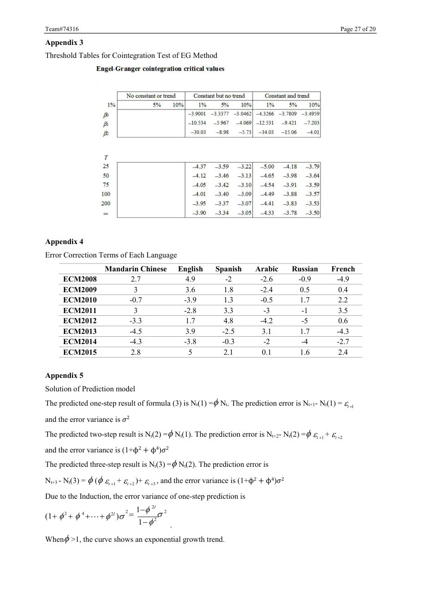

### Appendix 3

Threshold Tables for Cointegration Test of EG Method Engel-Granger cointegration critical values
<table><tr><td></td><td colspan="2">No constant or trend</td><td colspan="3">Constant but no trend</td><td colspan="3">Constant and trend</td></tr><tr><td>1%</td><td>5%</td><td>10%</td><td>1%</td><td>5%</td><td>10%</td><td>1%</td><td>5%</td><td>10%</td></tr><tr><td> $\beta_0$ </td><td></td><td></td><td>-3.9001</td><td>-3.3377</td><td>-3.0462</td><td>-4.3266</td><td>-3.7809</td><td>-3.4959</td></tr><tr><td> $\beta_1$ </td><td></td><td></td><td>-10.534</td><td>-5.967</td><td>-4.069</td><td>-12.531</td><td>-9.421</td><td>-7.203</td></tr><tr><td> $\beta_2$ </td><td></td><td></td><td>-30.03</td><td>-8.98</td><td>-5.73</td><td>-34.03</td><td>-15.06</td><td>-4.01</td></tr></table>

<table><tr><td>25</td><td></td><td>-4.37</td><td>-3.59</td><td>-3.22</td><td>-5.00</td><td>-4.18</td><td>-3.79</td></tr><tr><td>50</td><td></td><td>-4.12</td><td>-3.46</td><td>-3.13</td><td>-4.65</td><td>-3.98</td><td>-3.64</td></tr><tr><td>75</td><td></td><td>-4.05</td><td>-3.42</td><td>-3.10</td><td>-4.54</td><td>-3.91</td><td>-3.59</td></tr><tr><td>100</td><td></td><td>-4.01</td><td>-3.40</td><td>-3.09</td><td>-4.49</td><td>-3.88</td><td>-3.57</td></tr><tr><td>200</td><td></td><td>-3.95</td><td>-3.37</td><td>-3.07</td><td>-4.41</td><td>-3.83</td><td>-3.53</td></tr><tr><td>∞</td><td></td><td>-3.90</td><td>-3.34</td><td>-3.05</td><td>-4.33</td><td>-3.78</td><td>-3.50</td></tr></table>

### Appendix 4

Error Correction Terms of Each Language
<table><tr><td></td><td>Mandarin Chinese</td><td>English</td><td>Spanish</td><td>Arabic</td><td>Russian</td><td>French</td></tr><tr><td>ECM2008</td><td>2.7</td><td>4.9</td><td>-2</td><td>-2.6</td><td>-0.9</td><td>-4.9</td></tr><tr><td>ECM2009</td><td>3</td><td>3.6</td><td>1.8</td><td>-2.4</td><td>0.5</td><td>0.4</td></tr><tr><td>ECM2010</td><td>-0.7</td><td>-3.9</td><td>1.3</td><td>-0.5</td><td>1.7</td><td>2.2</td></tr><tr><td>ECM2011</td><td>3</td><td>-2.8</td><td>3.3</td><td>-3</td><td>-1</td><td>3.5</td></tr><tr><td>ECM2012</td><td>-3.3</td><td>1.7</td><td>4.8</td><td>-4.2</td><td>-5</td><td>0.6</td></tr><tr><td>ECM2013</td><td>-4.5</td><td>3.9</td><td>-2.5</td><td>3.1</td><td>1.7</td><td>-4.3</td></tr><tr><td>ECM2014</td><td>-4.3</td><td>-3.8</td><td>-0.3</td><td>-2</td><td>-4</td><td>-2.7</td></tr><tr><td>ECM2015</td><td>2.8</td><td>5</td><td>2.1</td><td>0.1</td><td>1.6</td><td>2.4</td></tr></table>

### Appendix 5

Solution of Prediction model

The predicted one-step result of formula (3) is $\mathrm { N } _ { \mathrm { t } } ( 1 ) { = } \phi \mathrm { N } _ { \mathrm { t } }$ . The prediction error is $\mathrm { N } _ { \mathrm { t + 1 } } - \mathrm { N } _ { \mathrm { t } } ( 1 ) = \mathcal { E } _ { t + 1 }$ 1

and the error variance is $\sigma ^ { 2 }$

The predicted two-step result is $\mathrm { N } _ { \mathrm { t } } ( 2 ) { = } \phi \mathrm { N } _ { \mathrm { t } } ( 1 )$ . The prediction error is $\mathrm { N } _ { { \mathrm { t } } + 2 ^ { - } } \mathrm { N } _ { \mathrm { t } } ( 2 ) { = } \phi \ \varepsilon _ { t + 1 } + \varepsilon _ { t + 2 }$

and the error variance is $( 1 { + } \Phi ^ { 2 } + \Phi ^ { 4 } ) \sigma ^ { 2 }$

The predicted three-step result is $\mathrm { N } _ { \mathrm { t } } ( 3 ) { = } \phi \mathrm { N } _ { \mathrm { t } } ( 2 )$ . The prediction error is

$\mathrm { N } _ { { \mathrm { t } } + 3 } - \mathrm { N } _ { \mathrm { t } } ( 3 ) = \phi ( \phi \varepsilon _ { t + 1 } + \varepsilon _ { t + 2 } ) + \varepsilon _ { t + 3 }$ , and the error variance is $( 1 { + } \Phi ^ { 2 } + \Phi ^ { 4 } ) \sigma ^ { 2 }$

Due to the Induction, the error variance of one-step prediction is

$$
(1 + \phi^ {2} + \phi^ {4} + \dots + \phi^ {2 l}) \sigma^ {2} = \frac {1 - \phi^ {2 l}}{1 - \phi^ {2}} \sigma^ {2}
$$

When $| \phi > 1$ , the curve shows an exponential growth trend.

Team#74316

Page 27 of 20

## 第30页

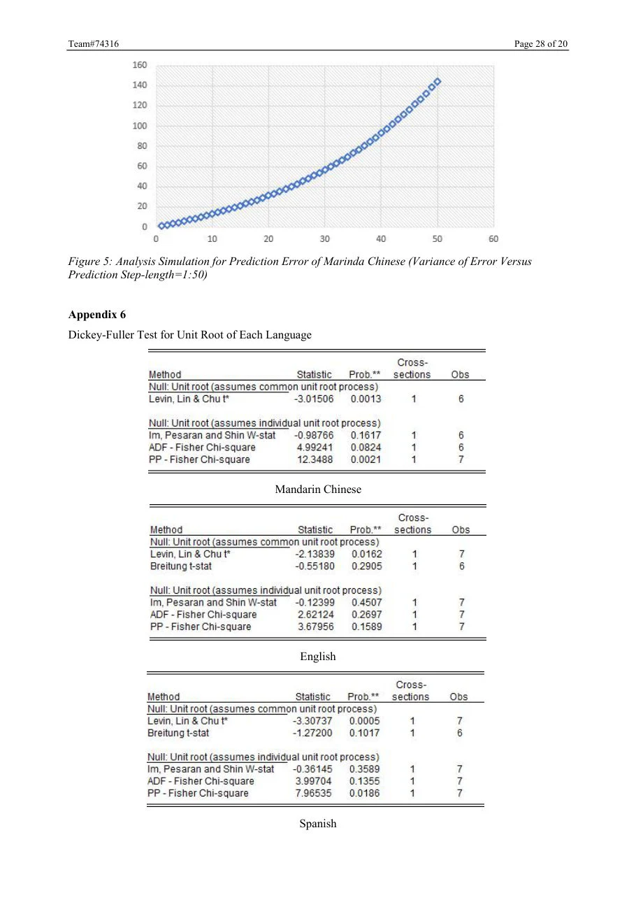

### Appendix 6

Dickey-Fuller Test for Unit Root of Each Language
<table><tr><td>Method</td><td>Statistic</td><td>Prob.**</td><td>Cross-sections</td><td>Obs</td></tr><tr><td colspan="5">Null: Unit root (assumes common unit root process)</td></tr><tr><td>Levin, Lin &amp; Chu t*</td><td>-3.01506</td><td>0.0013</td><td>1</td><td>6</td></tr><tr><td colspan="5">Null: Unit root (assumes individual unit root process)</td></tr><tr><td>Im, Pesaran and Shin W-stat</td><td>-0.98766</td><td>0.1617</td><td>1</td><td>6</td></tr><tr><td>ADF - Fisher Chi-square</td><td>4.99241</td><td>0.0824</td><td>1</td><td>6</td></tr><tr><td>PP - Fisher Chi-square</td><td>12.3488</td><td>0.0021</td><td>1</td><td>7</td></tr></table>

Mandarin Chinese
<table><tr><td>Method</td><td>Statistic</td><td>Prob.**</td><td>Cross-sections</td><td>Obs</td></tr><tr><td colspan="5">Null: Unit root (assumes common unit root process)</td></tr><tr><td>Levin, Lin &amp; Chu t*</td><td>-2.13839</td><td>0.0162</td><td>1</td><td>7</td></tr><tr><td>Breitung t-stat</td><td>-0.55180</td><td>0.2905</td><td>1</td><td>6</td></tr><tr><td colspan="5">Null: Unit root (assumes individual unit root process)</td></tr><tr><td>Im, Pesaran and Shin W-stat</td><td>-0.12399</td><td>0.4507</td><td>1</td><td>7</td></tr><tr><td>ADF - Fisher Chi-square</td><td>2.62124</td><td>0.2697</td><td>1</td><td>7</td></tr><tr><td>PP - Fisher Chi-square</td><td>3.67956</td><td>0.1589</td><td>1</td><td>7</td></tr></table>

English
<table><tr><td>Method</td><td>Statistic</td><td>Prob.**</td><td>Cross-sections</td><td>Obs</td></tr><tr><td colspan="5">Null: Unit root (assumes common unit root process)</td></tr><tr><td>Levin, Lin &amp; Chu t*</td><td>-3.30737</td><td>0.0005</td><td>1</td><td>7</td></tr><tr><td>Breitung t-stat</td><td>-1.27200</td><td>0.1017</td><td>1</td><td>6</td></tr><tr><td colspan="5">Null: Unit root (assumes individual unit root process)</td></tr><tr><td>Im, Pesaran and Shin W-stat</td><td>-0.36145</td><td>0.3589</td><td>1</td><td>7</td></tr><tr><td>ADF - Fisher Chi-square</td><td>3.99704</td><td>0.1355</td><td>1</td><td>7</td></tr><tr><td>PP - Fisher Chi-square</td><td>7.96535</td><td>0.0186</td><td>1</td><td>7</td></tr><tr><td>Levin, Lin &amp; Chu t*</td><td>-2.71761</td><td>0.0033</td><td>1</td><td>7</td></tr><tr><td>Breitung t-stat</td><td>-1.67909</td><td>0.0466</td><td>1</td><td>6</td></tr><tr><td colspan="5">Null: Unit root (assumes individual unit root process)</td></tr><tr><td>Im, Pesaran and Shin W-stat</td><td>-0.82871</td><td>0.2036</td><td>1</td><td>7</td></tr><tr><td>ADF - Fisher Chi-square</td><td>6.60071</td><td>0.0369</td><td>1</td><td>7</td></tr><tr><td>PP - Fisher Chi-square</td><td>12.6712</td><td>0.0018</td><td>1</td><td>7</td></tr><tr><td colspan="5">Arabia</td></tr><tr><td>Method</td><td>Statistic</td><td>Prob.**</td><td>Cross-sections</td><td>Obs</td></tr><tr><td colspan="5">Null: Unit root (assumes common unit root process)</td></tr><tr><td>Levin, Lin &amp; Chu t*</td><td>-2.53077</td><td>0.0057</td><td>1</td><td>7</td></tr><tr><td>Breitung t-stat</td><td>-0.63201</td><td>0.2637</td><td>1</td><td>6</td></tr><tr><td colspan="5">Null: Unit root (assumes individual unit root process)</td></tr><tr><td>Im, Pesaran and Shin W-stat</td><td>-0.17826</td><td>0.4293</td><td>1</td><td>7</td></tr><tr><td>ADF - Fisher Chi-square</td><td>2.88458</td><td>0.2364</td><td>1</td><td>7</td></tr><tr><td>PP - Fisher Chi-square</td><td>5.80578</td><td>0.0549</td><td>1</td><td>7</td></tr><tr><td colspan="5">Russian</td></tr><tr><td>Method</td><td>Statistic</td><td>Prob.**</td><td>Cross-sections</td><td>Obs</td></tr><tr><td colspan="5">Null: Unit root (assumes common unit root process)</td></tr><tr><td>Levin, Lin &amp; Chu t*</td><td>-1.79931</td><td>0.0360</td><td>1</td><td>7</td></tr><tr><td>Breitung t-stat</td><td>-0.40939</td><td>0.3411</td><td>1</td><td>6</td></tr><tr><td colspan="5">Null: Unit root (assumes individual unit root process)</td></tr><tr><td>Im, Pesaran and Shin W-stat</td><td>0.03607</td><td>0.5144</td><td>1</td><td>7</td></tr><tr><td>ADF - Fisher Chi-square</td><td>1.77352</td><td>0.4120</td><td>1</td><td>7</td></tr><tr><td>PP - Fisher Chi-square</td><td>1.67350</td><td>0.4331</td><td>1</td><td>7</td></tr></table>

Team#74316

Page 28 of 20

Spanish

## 第31页

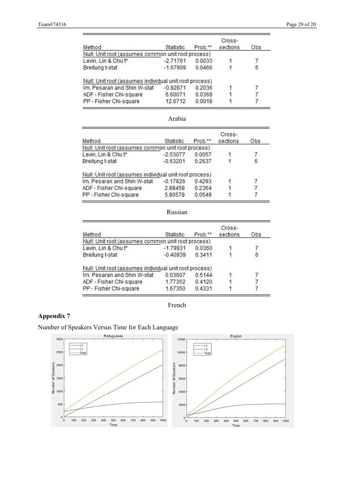

French

Team#74316

Page 29 of 20

## 第32页

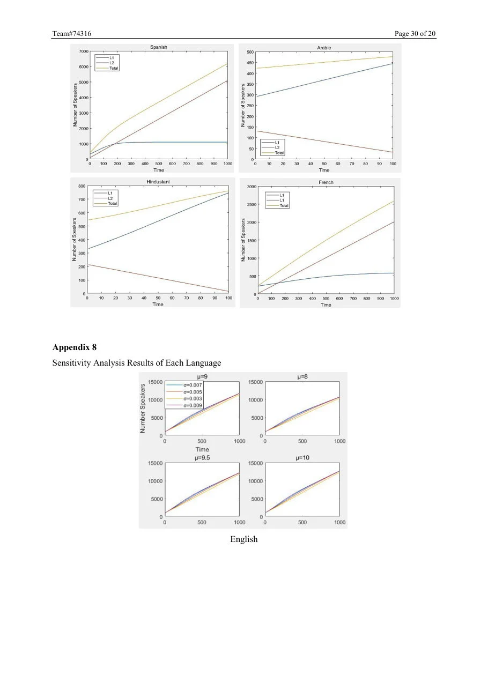

Team#74316

Page 30 of 20

## 第33页

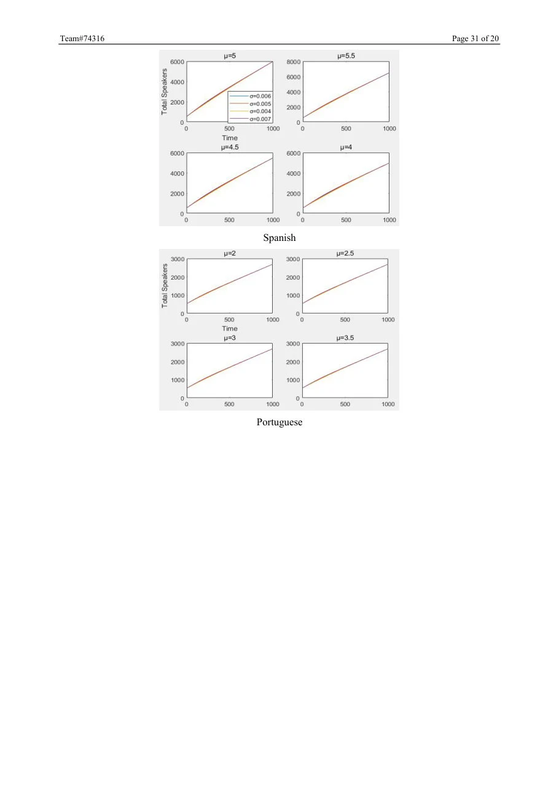

Team#74316

Page 31 of 20

## 第34页

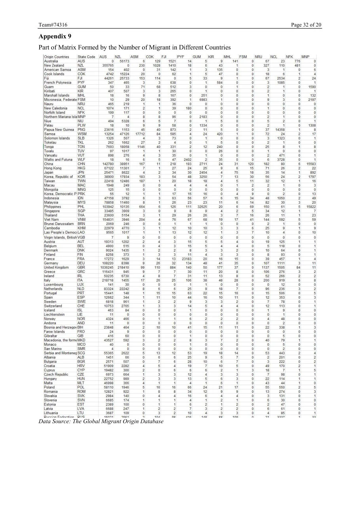

### Appendix 9

Part of Matrix Formed by the Number of Migrant in Different Countries
<table><tr><td>Origin Countries</td><td>State Code</td><td>AUS</td><td>NZL</td><td>ASM</td><td>COK</td><td>FJI</td><td>PYF</td><td>GUM</td><td>KIR</td><td>MHL</td><td>FSM</td><td>NRU</td><td>NCL</td><td>NFK</td><td>MNP</td></tr><tr><td>Australia</td><td>AUS</td><td>0</td><td>56173</td><td>6</td><td>129</td><td>1521</td><td>14</td><td>5</td><td>9</td><td>141</td><td>0</td><td>67</td><td>23</td><td>776</td><td>0</td></tr><tr><td>New Zealand</td><td>NZL</td><td>355765</td><td>0</td><td>230</td><td>1028</td><td>1410</td><td>18</td><td>6</td><td>43</td><td>1</td><td>0</td><td>327</td><td>110</td><td>481</td><td>0</td></tr><tr><td>American Samoa</td><td>ASM</td><td>154</td><td>402</td><td>0</td><td>31</td><td>142</td><td>1</td><td>3</td><td>135</td><td>0</td><td>0</td><td>3</td><td>1</td><td>0</td><td>6</td></tr><tr><td>Cook Islands</td><td>COK</td><td>4742</td><td>15224</td><td>20</td><td>0</td><td>62</td><td>1</td><td>5</td><td>47</td><td>0</td><td>0</td><td>18</td><td>6</td><td>1</td><td>4</td></tr><tr><td>Fiji</td><td>FJI</td><td>44261</td><td>25733</td><td>153</td><td>114</td><td>0</td><td>5</td><td>33</td><td>9</td><td>1</td><td>0</td><td>67</td><td>2534</td><td>2</td><td>24</td></tr><tr><td>French Polynesia</td><td>PYF</td><td>347</td><td>465</td><td>3</td><td>3</td><td>638</td><td>0</td><td>1</td><td>584</td><td>0</td><td>0</td><td>3</td><td>1085</td><td>0</td><td>1</td></tr><tr><td>Guam</td><td>GUM</td><td>50</td><td>33</td><td>71</td><td>68</td><td>512</td><td>3</td><td>0</td><td>0</td><td>1</td><td>0</td><td>2</td><td>1</td><td>0</td><td>1590</td></tr><tr><td>Kiribati</td><td>KIR</td><td>407</td><td>507</td><td>3</td><td>3</td><td>265</td><td>0</td><td>1</td><td>0</td><td>0</td><td>0</td><td>2</td><td>1</td><td>0</td><td>1</td></tr><tr><td>Marshall Islands</td><td>MHL</td><td>18</td><td>16</td><td>9</td><td>8</td><td>167</td><td>0</td><td>251</td><td>0</td><td>0</td><td>0</td><td>1</td><td>0</td><td>0</td><td>132</td></tr><tr><td>Micronesia, Federate</td><td>FSM</td><td>10</td><td>29</td><td>20</td><td>18</td><td>392</td><td>1</td><td>6983</td><td>1</td><td>0</td><td>0</td><td>9</td><td>3</td><td>0</td><td>2197</td></tr><tr><td>Nauru</td><td>NRU</td><td>465</td><td>219</td><td>1</td><td>1</td><td>36</td><td>0</td><td>0</td><td>0</td><td>0</td><td>0</td><td>0</td><td>0</td><td>0</td><td>0</td></tr><tr><td>New Caledonia</td><td>NCL</td><td>1074</td><td>171</td><td>2</td><td>1</td><td>39</td><td>180</td><td>0</td><td>0</td><td>0</td><td>0</td><td>1</td><td>0</td><td>0</td><td>0</td></tr><tr><td>Norfolk Island</td><td>NFK</td><td>199</td><td>117</td><td>0</td><td>0</td><td>0</td><td>0</td><td>0</td><td>0</td><td>0</td><td>0</td><td>0</td><td>0</td><td>0</td><td>0</td></tr><tr><td>Northern Mariana Isla</td><td>MNP</td><td>7</td><td>4</td><td>8</td><td>8</td><td>96</td><td>0</td><td>2183</td><td>0</td><td>0</td><td>0</td><td>2</td><td>1</td><td>0</td><td>0</td></tr><tr><td>Niue</td><td>NIU</td><td>494</td><td>5328</td><td>6</td><td>5</td><td>7</td><td>0</td><td>1</td><td>5</td><td>0</td><td>0</td><td>5</td><td>2</td><td>0</td><td>1</td></tr><tr><td>Palau</td><td>PLW</td><td>18</td><td>10</td><td>9</td><td>9</td><td>58</td><td>0</td><td>1334</td><td>0</td><td>0</td><td>0</td><td>2</td><td>1</td><td>0</td><td>1308</td></tr><tr><td>Papua New Guinea</td><td>PNG</td><td>23616</td><td>1153</td><td>45</td><td>40</td><td>873</td><td>2</td><td>11</td><td>5</td><td>0</td><td>0</td><td>37</td><td>14358</td><td>1</td><td>8</td></tr><tr><td>Samoa</td><td>WSM</td><td>13254</td><td>47126</td><td>17712</td><td>84</td><td>585</td><td>4</td><td>24</td><td>420</td><td>1</td><td>0</td><td>72</td><td>24</td><td>2</td><td>17</td></tr><tr><td>Solomon Islands</td><td>SLB</td><td>1326</td><td>507</td><td>4</td><td>3</td><td>73</td><td>0</td><td>1</td><td>0</td><td>0</td><td>0</td><td>3</td><td>1323</td><td>0</td><td>1</td></tr><tr><td>Tokelau</td><td>TKL</td><td>262</td><td>1662</td><td>27</td><td>2</td><td>4</td><td>0</td><td>1</td><td>5</td><td>0</td><td>0</td><td>2</td><td>1</td><td>0</td><td>0</td></tr><tr><td>Tonga</td><td>TON</td><td>7693</td><td>18058</td><td>1146</td><td>40</td><td>331</td><td>2</td><td>12</td><td>240</td><td>0</td><td>0</td><td>25</td><td>8</td><td>1</td><td>8</td></tr><tr><td>Tuvalu</td><td>TUV</td><td>97</td><td>1017</td><td>1</td><td>1</td><td>30</td><td>0</td><td>0</td><td>26</td><td>0</td><td>0</td><td>1</td><td>0</td><td>0</td><td>0</td></tr><tr><td>Vanuatu</td><td>VUT</td><td>898</td><td>276</td><td>4</td><td>3</td><td>35</td><td>0</td><td>1</td><td>0</td><td>0</td><td>0</td><td>2</td><td>471</td><td>0</td><td>1</td></tr><tr><td>Wallis and Futuna</td><td>WLF</td><td>18</td><td>16</td><td>6</td><td>5</td><td>47</td><td>2402</td><td>2</td><td>35</td><td>0</td><td>0</td><td>6</td><td>3728</td><td>0</td><td>1</td></tr><tr><td>China</td><td>CHN</td><td>142780</td><td>38951</td><td>167</td><td>11</td><td>218</td><td>193</td><td>2711</td><td>24</td><td>31</td><td>120</td><td>182</td><td>80</td><td>6</td><td>15583</td></tr><tr><td>Hong Kong</td><td>HKG</td><td>67122</td><td>11301</td><td>7</td><td>1</td><td>27</td><td>24</td><td>25</td><td>9</td><td>6</td><td>15</td><td>71</td><td>26</td><td>2</td><td>22</td></tr><tr><td>Japan</td><td>JPN</td><td>25471</td><td>8622</td><td>4</td><td>2</td><td>34</td><td>30</td><td>2454</td><td>4</td><td>75</td><td>18</td><td>35</td><td>14</td><td>1</td><td>892</td></tr><tr><td>Korea, Republic of</td><td>KOR</td><td>38900</td><td>17934</td><td>183</td><td>3</td><td>54</td><td>48</td><td>3250</td><td>7</td><td>13</td><td>30</td><td>56</td><td>24</td><td>2</td><td>1797</td></tr><tr><td>Taiwan</td><td>TVN</td><td>22418</td><td>12486</td><td>187</td><td>1</td><td>20</td><td>18</td><td>18</td><td>4</td><td>5</td><td>11</td><td>32</td><td>12</td><td>1</td><td>16</td></tr><tr><td>Macau</td><td>MAC</td><td>1948</td><td>249</td><td>0</td><td>0</td><td>4</td><td>4</td><td>4</td><td>0</td><td>1</td><td>2</td><td>2</td><td>1</td><td>0</td><td>3</td></tr><tr><td>Mongolia</td><td>MNG</td><td>125</td><td>15</td><td>0</td><td>0</td><td>0</td><td>0</td><td>0</td><td>0</td><td>0</td><td>0</td><td>0</td><td>0</td><td>0</td><td>0</td></tr><tr><td>Korea, Democratic P</td><td>PRK</td><td>55</td><td>12</td><td>1</td><td>1</td><td>17</td><td>15</td><td>16</td><td>0</td><td>4</td><td>9</td><td>0</td><td>2</td><td>0</td><td>13</td></tr><tr><td>Indonesia</td><td>IDN</td><td>47158</td><td>3792</td><td>6</td><td>3</td><td>63</td><td>56</td><td>57</td><td>6</td><td>15</td><td>34</td><td>48</td><td>1050</td><td>2</td><td>49</td></tr><tr><td>Malaysia</td><td>MYS</td><td>78858</td><td>11460</td><td>8</td><td>1</td><td>26</td><td>23</td><td>23</td><td>11</td><td>6</td><td>14</td><td>82</td><td>30</td><td>3</td><td>20</td></tr><tr><td>Philippines</td><td>PHL</td><td>103942</td><td>10135</td><td>664</td><td>6</td><td>126</td><td>111</td><td>32625</td><td>20</td><td>6</td><td>69</td><td>150</td><td>61</td><td>5</td><td>15822</td></tr><tr><td>Singapore</td><td>SGP</td><td>33485</td><td>3909</td><td>3</td><td>0</td><td>9</td><td>8</td><td>9</td><td>4</td><td>2</td><td>5</td><td>34</td><td>12</td><td>1</td><td>7</td></tr><tr><td>Thailand</td><td>THA</td><td>23600</td><td>5154</td><td>3</td><td>1</td><td>29</td><td>26</td><td>26</td><td>3</td><td>7</td><td>16</td><td>26</td><td>11</td><td>1</td><td>23</td></tr><tr><td>Viet Nam</td><td>VNM</td><td>154831</td><td>3946</td><td>204</td><td>4</td><td>76</td><td>67</td><td>68</td><td>19</td><td>17</td><td>41</td><td>144</td><td>592</td><td>5</td><td>59</td></tr><tr><td>Brunei Darussalam</td><td>BRN</td><td>2069</td><td>246</td><td>0</td><td>0</td><td>1</td><td>1</td><td>1</td><td>0</td><td>0</td><td>0</td><td>2</td><td>1</td><td>0</td><td>0</td></tr><tr><td>Cambodia</td><td>KHM</td><td>22979</td><td>4770</td><td>3</td><td>1</td><td>12</td><td>10</td><td>10</td><td>3</td><td>3</td><td>6</td><td>25</td><td>9</td><td>1</td><td>9</td></tr><tr><td>Lao People&#x27;s Democil</td><td>LAO</td><td>9565</td><td>1017</td><td>1</td><td>1</td><td>13</td><td>12</td><td>12</td><td>1</td><td>3</td><td>7</td><td>10</td><td>4</td><td>0</td><td>10</td></tr><tr><td>Virgin Islands, British VGB</td><td></td><td>7</td><td>9</td><td>0</td><td>0</td><td>0</td><td>0</td><td>0</td><td>0</td><td>0</td><td>0</td><td>0</td><td>0</td><td>0</td><td>0</td></tr><tr><td>Austria</td><td>AUT</td><td>19313</td><td>1202</td><td>2</td><td>4</td><td>3</td><td>15</td><td>5</td><td>5</td><td>4</td><td>0</td><td>19</td><td>125</td><td>1</td><td>1</td></tr><tr><td>Belgium</td><td>BEL</td><td>4900</td><td>515</td><td>0</td><td>4</td><td>3</td><td>15</td><td>5</td><td>4</td><td>4</td><td>0</td><td>5</td><td>118</td><td>0</td><td>1</td></tr><tr><td>Denmark</td><td>DNK</td><td>9024</td><td>1435</td><td>1</td><td>2</td><td>2</td><td>8</td><td>3</td><td>3</td><td>2</td><td>0</td><td>10</td><td>64</td><td>0</td><td>1</td></tr><tr><td>Finland</td><td>FIN</td><td>8258</td><td>373</td><td>1</td><td>3</td><td>3</td><td>11</td><td>4</td><td>3</td><td>3</td><td>0</td><td>8</td><td>93</td><td>0</td><td>1</td></tr><tr><td>France</td><td>FRA</td><td>17272</td><td>1629</td><td>3</td><td>14</td><td>13</td><td>23183</td><td>20</td><td>16</td><td>15</td><td>0</td><td>39</td><td>457</td><td>1</td><td>4</td></tr><tr><td>Germany</td><td>DEU</td><td>108220</td><td>8398</td><td>9</td><td>26</td><td>32</td><td>134</td><td>48</td><td>41</td><td>35</td><td>0</td><td>107</td><td>1111</td><td>3</td><td>11</td></tr><tr><td>United Kingdom</td><td>GBR</td><td>1036245</td><td>218410</td><td>99</td><td>110</td><td>884</td><td>140</td><td>50</td><td>177</td><td>37</td><td>0</td><td>1137</td><td>1505</td><td>84</td><td>11</td></tr><tr><td>Greece</td><td>GRC</td><td>116431</td><td>945</td><td>9</td><td>7</td><td>7</td><td>30</td><td>11</td><td>20</td><td>8</td><td>0</td><td>106</td><td>276</td><td>3</td><td>2</td></tr><tr><td>Ireland</td><td>IRL</td><td>50235</td><td>6730</td><td>4</td><td>8</td><td>7</td><td>31</td><td>11</td><td>13</td><td>8</td><td>0</td><td>52</td><td>266</td><td>2</td><td>2</td></tr><tr><td>Italy</td><td>ITA</td><td>218718</td><td>1455</td><td>17</td><td>26</td><td>25</td><td>106</td><td>38</td><td>48</td><td>28</td><td>0</td><td>200</td><td>919</td><td>6</td><td>8</td></tr><tr><td>Luxembourg</td><td>LUX</td><td>141</td><td>30</td><td>0</td><td>0</td><td>0</td><td>1</td><td>1</td><td>0</td><td>0</td><td>0</td><td>0</td><td>12</td><td>0</td><td>0</td></tr><tr><td>Netherlands</td><td>NLD</td><td>83324</td><td>22242</td><td>8</td><td>6</td><td>6</td><td>25</td><td>9</td><td>18</td><td>7</td><td>0</td><td>96</td><td>236</td><td>3</td><td>2</td></tr><tr><td>Portugal</td><td>PRT</td><td>15441</td><td>148</td><td>1</td><td>15</td><td>15</td><td>63</td><td>22</td><td>15</td><td>16</td><td>0</td><td>15</td><td>506</td><td>0</td><td>5</td></tr><tr><td>Spain</td><td>ESP</td><td>12662</td><td>344</td><td>1</td><td>11</td><td>10</td><td>44</td><td>16</td><td>10</td><td>11</td><td>0</td><td>12</td><td>353</td><td>0</td><td>3</td></tr><tr><td>Sweden</td><td>SWE</td><td>6818</td><td>961</td><td>1</td><td>2</td><td>2</td><td>9</td><td>3</td><td>3</td><td>2</td><td>0</td><td>7</td><td>78</td><td>0</td><td>1</td></tr><tr><td>Switzerland</td><td>CHE</td><td>10753</td><td>2765</td><td>1</td><td>3</td><td>3</td><td>14</td><td>5</td><td>4</td><td>4</td><td>0</td><td>12</td><td>113</td><td>0</td><td>1</td></tr><tr><td>Iceland</td><td>ISL</td><td>463</td><td>84</td><td>0</td><td>0</td><td>0</td><td>1</td><td>0</td><td>0</td><td>0</td><td>0</td><td>1</td><td>9</td><td>0</td><td>0</td></tr><tr><td>Liechtenstein</td><td>LIE</td><td>11</td><td>0</td><td>0</td><td>0</td><td>0</td><td>0</td><td>0</td><td>0</td><td>0</td><td>0</td><td>0</td><td>1</td><td>0</td><td>0</td></tr><tr><td>Norway</td><td>NOR</td><td>4324</td><td>466</td><td>0</td><td>1</td><td>1</td><td>6</td><td>2</td><td>2</td><td>2</td><td>0</td><td>4</td><td>48</td><td>0</td><td>0</td></tr><tr><td>Andorra</td><td>AND</td><td>11</td><td>0</td><td>0</td><td>0</td><td>0</td><td>0</td><td>0</td><td>0</td><td>0</td><td>0</td><td>0</td><td>2</td><td>0</td><td>0</td></tr><tr><td>Bosnia and Herzegovina</td><td>BIH</td><td>23848</td><td>464</td><td>2</td><td>10</td><td>10</td><td>41</td><td>15</td><td>11</td><td>11</td><td>0</td><td>22</td><td>338</td><td>1</td><td>3</td></tr><tr><td>Faroe Islands</td><td>FRO</td><td>24</td><td>9</td><td>0</td><td>0</td><td>0</td><td>0</td><td>0</td><td>0</td><td>0</td><td>0</td><td>0</td><td>0</td><td>0</td><td>0</td></tr><tr><td>Gibraltar</td><td>GIB</td><td>416</td><td>60</td><td>0</td><td>0</td><td>0</td><td>1</td><td>0</td><td>0</td><td>0</td><td>0</td><td>0</td><td>5</td><td>0</td><td>0</td></tr><tr><td>Macedonia, the formemekoikod. MKD</td><td></td><td>43527</td><td>592</td><td>3</td><td>2</td><td>2</td><td>8</td><td>3</td><td>7</td><td>2</td><td>0</td><td>40</td><td>79</td><td>1</td><td>1</td></tr><tr><td>Monaco</td><td></td><td></td><td></td><td></td><td></td><td></td><td></td><td></td><td></td><td></td><td></td><td></td><td></td><td></td><td></td></tr></table>
Data Source: The Global Migrant Origin Database

Team#74316

Page 32 of 20

## 第35页

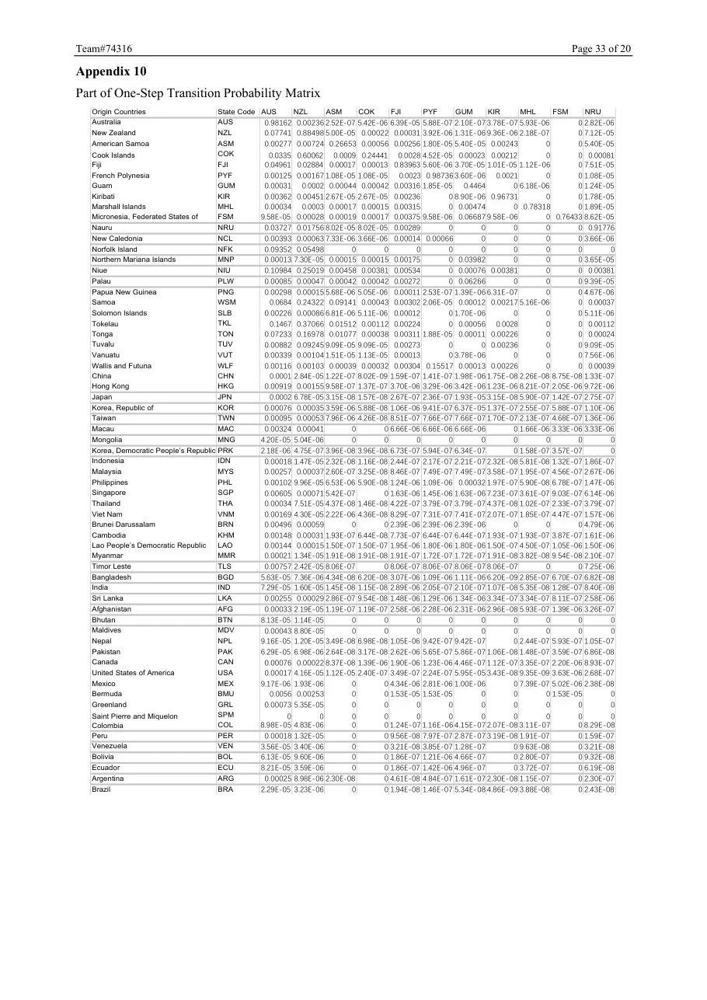

### Appendix 10

Part of One-Step Transition Probability Matrix
<table><tr><td>Origin Countries</td><td>State Code</td><td>AUS</td><td>NZL</td><td>ASM</td><td>COK</td><td>FJI</td><td>PYF</td><td>GUM</td><td>KIR</td><td>MHL</td><td>FSM</td><td>NRU</td></tr><tr><td>Australia</td><td>AUS</td><td>0.98162</td><td>0.00236</td><td>2.52E-07</td><td>5.42E-06</td><td>6.39E-05</td><td>5.88E-07</td><td>2.10E-07</td><td>3.78E-07</td><td>5.93E-06</td><td></td><td>0 2.82E-06</td></tr><tr><td>New Zealand</td><td>NZL</td><td>0.07741</td><td>0.88498</td><td>5.00E-05</td><td>0.00022</td><td>0.00031</td><td>3.92E-06</td><td>1.31E-06</td><td>9.36E-06</td><td>2.18E-07</td><td></td><td>0 7.12E-05</td></tr><tr><td>American Samoa</td><td>ASM</td><td>0.00277</td><td>0.00724</td><td>0.26653</td><td>0.00056</td><td>0.00256</td><td>1.80E-05</td><td>5.40E-05</td><td>0.00243</td><td>0</td><td></td><td>0 5.40E-05</td></tr><tr><td>Cook Islands</td><td>COK</td><td>0.0335</td><td>0.60062</td><td>0.0009</td><td>0.24441</td><td>0.0028</td><td>4.52E-05</td><td>0.00023</td><td>0.00212</td><td>0</td><td></td><td>0 0.00081</td></tr><tr><td>Fiji</td><td>FJI</td><td>0.04961</td><td>0.02884</td><td>0.00017</td><td>0.00013</td><td>0.83963</td><td>5.60E-06</td><td>3.70E-05</td><td>1.01E-05</td><td>1.12E-06</td><td></td><td>0 7.51E-05</td></tr><tr><td>French Polynesia</td><td>PYF</td><td>0.00125</td><td>0.00167</td><td>1.08E-05</td><td>1.08E-05</td><td>0.0023</td><td>0.98736</td><td>3.60E-06</td><td>0.0021</td><td>0</td><td></td><td>0 1.08E-05</td></tr><tr><td>Guam</td><td>GUM</td><td>0.00031</td><td>0.0002</td><td>0.00044</td><td>0.00042</td><td>0.00316</td><td>1.85E-05</td><td>0.4464</td><td>0</td><td>6.18E-06</td><td></td><td>0 1.24E-05</td></tr><tr><td>Kiribati</td><td>KIR</td><td>0.00362</td><td>0.00451</td><td>2.67E-05</td><td>2.67E-05</td><td>0.00236</td><td>0</td><td>8.90E-06</td><td>0.96731</td><td>0</td><td></td><td>0 1.78E-05</td></tr><tr><td>Marshall Islands</td><td>MHL</td><td>0.00034</td><td>0.0003</td><td>0.00017</td><td>0.00015</td><td>0.00315</td><td>0</td><td>0.00474</td><td>0</td><td>0.78318</td><td></td><td>0 1.89E-05</td></tr><tr><td>Micronesia, Federated States of</td><td>FSM</td><td>9.58E-05</td><td>0.00028</td><td>0.00019</td><td>0.00017</td><td>0.00375</td><td>9.58E-06</td><td>0.06687</td><td>9.58E-06</td><td>0</td><td>0.76433</td><td>8.62E-05</td></tr><tr><td>Nauru</td><td>NRU</td><td>0.03727</td><td>0.01756</td><td>8.02E-05</td><td>8.02E-05</td><td>0.00289</td><td>0</td><td>0</td><td>0</td><td>0</td><td></td><td>0 0.91776</td></tr><tr><td>New Caledonia</td><td>NCL</td><td>0.00393</td><td>0.00063</td><td>7.33E-06</td><td>3.66E-06</td><td>0.00014</td><td>0.00066</td><td>0</td><td>0</td><td>0</td><td></td><td>0 3.66E-06</td></tr><tr><td>Norfolk Island</td><td>NFK</td><td>0.09352</td><td>0.05498</td><td>0</td><td>0</td><td>0</td><td>0</td><td>0</td><td>0</td><td>0</td><td></td><td>0</td></tr><tr><td>Northern Mariana Islands</td><td>MNP</td><td>0.00013</td><td>7.30E-05</td><td>0.00015</td><td>0.00015</td><td>0.00175</td><td>0</td><td>0.03982</td><td>0</td><td>0</td><td></td><td>0 3.65E-05</td></tr><tr><td>Niue</td><td>NIU</td><td>0.10984</td><td>0.25019</td><td>0.00458</td><td>0.00381</td><td>0.00534</td><td>0</td><td>0.00076</td><td>0.00381</td><td>0</td><td></td><td>0 0.00381</td></tr><tr><td>Palau</td><td>PLW</td><td>0.00085</td><td>0.00047</td><td>0.00042</td><td>0.00042</td><td>0.00272</td><td>0</td><td>0.06266</td><td>0</td><td>0</td><td></td><td>0 9.39E-05</td></tr><tr><td>Papua New Guinea</td><td>PNG</td><td>0.00298</td><td>0.00015</td><td>5.68E-06</td><td>5.05E-06</td><td>0.00011</td><td>2.53E-07</td><td>1.39E-06</td><td>6.31E-07</td><td>0</td><td></td><td>0 4.67E-06</td></tr><tr><td>Samoa</td><td>WSM</td><td>0.0684</td><td>0.24322</td><td>0.09141</td><td>0.00043</td><td>0.00302</td><td>2.06E-05</td><td>0.00012</td><td>0.00217</td><td>5.16E-06</td><td></td><td>0 0.00037</td></tr><tr><td>Solomon Islands</td><td>SLB</td><td>0.00226</td><td>0.00086</td><td>6.81E-06</td><td>5.11E-06</td><td>0.00012</td><td>0</td><td>1.70E-06</td><td>0</td><td>0</td><td></td><td>0 5.11E-06</td></tr><tr><td>Tokelau</td><td>TKL</td><td>0.1467</td><td>0.37066</td><td>0.01512</td><td>0.00112</td><td>0.00224</td><td>0</td><td>0.00056</td><td>0.0028</td><td>0</td><td></td><td>0 0.00112</td></tr><tr><td>Tonga</td><td>TON</td><td>0.07233</td><td>0.16978</td><td>0.01077</td><td>0.00038</td><td>0.00311</td><td>1.88E-05</td><td>0.00011</td><td>0.00226</td><td>0</td><td></td><td>0 0.00024</td></tr><tr><td>Tuvalu</td><td>TUV</td><td>0.00882</td><td>0.09245</td><td>9.09E-05</td><td>9.09E-05</td><td>0.00273</td><td>0</td><td>0</td><td>0.00236</td><td>0</td><td></td><td>0 9.09E-05</td></tr><tr><td>Vanuatu</td><td>VUT</td><td>0.00339</td><td>0.00104</td><td>1.51E-05</td><td>1.13E-05</td><td>0.00013</td><td>0</td><td>3.78E-06</td><td>0</td><td>0</td><td></td><td>0 7.56E-06</td></tr><tr><td>Wallis and Futuna</td><td>WLF</td><td>0.00116</td><td>0.00103</td><td>0.00039</td><td>0.00032</td><td>0.00304</td><td>0.15517</td><td>0.00013</td><td>0.00226</td><td>0</td><td></td><td>0 0.00039</td></tr><tr><td>China</td><td>CHN</td><td>0.0001</td><td>2.84E-05</td><td>1.22E-07</td><td>8.02E-09</td><td>1.59E-07</td><td>1.41E-07</td><td>1.98E-06</td><td>1.75E-08</td><td>2.26E-08</td><td>8.75E-08</td><td>1.33E-07</td></tr><tr><td>Hong Kong</td><td>HKG</td><td>0.00919</td><td>0.00155</td><td>9.58E-07</td><td>1.37E-07</td><td>3.70E-06</td><td>3.29E-06</td><td>3.42E-06</td><td>1.23E-06</td><td>8.21E-07</td><td>2.05E-06</td><td>9.72E-06</td></tr><tr><td>Japan</td><td>JPN</td><td>0.0002</td><td>6.78E-05</td><td>3.15E-08</td><td>1.57E-08</td><td>2.67E-07</td><td>2.36E-07</td><td>1.93E-05</td><td>3.15E-08</td><td>5.90E-07</td><td>1.42E-07</td><td>2.75E-07</td></tr><tr><td>Korea, Republic of</td><td>KOR</td><td>0.00076</td><td>0.00035</td><td>3.59E-06</td><td>5.88E-08</td><td>1.06E-06</td><td>9.41E-07</td><td>6.37E-05</td><td>1.37E-07</td><td>2.55E-07</td><td>5.88E-07</td><td>1.10E-06</td></tr><tr><td>Taiwan</td><td>TWN</td><td>0.00095</td><td>0.00053</td><td>7.96E-06</td><td>4.26E-08</td><td>8.51E-07</td><td>7.66E-07</td><td>7.66E-07</td><td>1.70E-07</td><td>2.13E-07</td><td>4.68E-07</td><td>1.36E-06</td></tr><tr><td>Macau</td><td>MAC</td><td>0.00324</td><td>0.00041</td><td>0</td><td>0</td><td>6.66E-06</td><td>6.66E-06</td><td>6.66E-06</td><td>0</td><td>1.66E-06</td><td>3.33E-06</td><td>3.33E-06</td></tr><tr><td>Mongolia</td><td>MNG</td><td>4.20E-05</td><td>5.04E-06</td><td>0</td><td>0</td><td>0</td><td>0</td><td>0</td><td>0</td><td>0</td><td></td><td>0</td></tr><tr><td>Korea, Democratic People&#x27;s Republic</td><td>PRK</td><td>2.18E-06</td><td>4.75E-07</td><td>3.96E-08</td><td>3.96E-08</td><td>6.73E-07</td><td>5.94E-07</td><td>6.34E-07</td><td>0</td><td>1.58E-07</td><td>3.57E-07</td><td>0</td></tr><tr><td>Indonesia</td><td>IDN</td><td>0.00018</td><td>1.47E-05</td><td>2.32E-08</td><td>1.16E-08</td><td>2.44E-07</td><td>2.17E-07</td><td>2.21E-07</td><td>2.32E-08</td><td>5.81E-08</td><td>1.32E-07</td><td>1.86E-07</td></tr><tr><td>Malaysia</td><td>MYS</td><td>0.00257</td><td>0.00037</td><td>2.60E-07</td><td>3.25E-08</td><td>8.46E-07</td><td>7.49E-07</td><td>7.49E-07</td><td>3.58E-07</td><td>1.95E-07</td><td>4.56E-07</td><td>2.67E-06</td></tr><tr><td>Philippines</td><td>PHL</td><td>0.00102</td><td>9.96E-05</td><td>6.53E-06</td><td>5.90E-08</td><td>1.24E-06</td><td>1.09E-06</td><td>0.00032</td><td>1.97E-07</td><td>5.90E-08</td><td>6.78E-07</td><td>1.47E-06</td></tr><tr><td>Singapore</td><td>SGP</td><td>0.00605</td><td>0.00071</td><td>5.42E-07</td><td>0</td><td>1.63E-06</td><td>1.45E-06</td><td>1.63E-06</td><td>7.23E-07</td><td>3.61E-07</td><td>9.03E-07</td><td>6.14E-06</td></tr><tr><td>Thailand</td><td>THA</td><td>0.00034</td><td>7.51E-05</td><td>4.37E-08</td><td>1.46E-08</td><td>4.22E-07</td><td>3.79E-07</td><td>3.79E-07</td><td>4.37E-08</td><td>1.02E-07</td><td>2.33E-07</td><td>3.79E-07</td></tr><tr><td>Viet Nam</td><td>VNM</td><td>0.00169</td><td>4.30E-05</td><td>2.22E-06</td><td>4.36E-08</td><td>8.29E-07</td><td>7.31E-07</td><td>7.41E-07</td><td>2.07E-07</td><td>1.85E-07</td><td>4.47E-07</td><td>1.57E-06</td></tr><tr><td>Brunei Darussalam</td><td>BRN</td><td>0.00496</td><td>0.00059</td><td>0</td><td>0</td><td>2.39E-06</td><td>2.39E-06</td><td>2.39E-06</td><td>0</td><td>0</td><td></td><td>0 4.79E-06</td></tr><tr><td>Cambodia</td><td>KHM</td><td>0.00148</td><td>0.00031</td><td>1.93E-07</td><td>6.44E-08</td><td>7.73E-07</td><td>6.44E-07</td><td>6.44E-07</td><td>1.93E-07</td><td>1.93E-07</td><td>3.87E-07</td><td>1.61E-06</td></tr><tr><td>Lao People&#x27;s Democratic Republic</td><td>LAO</td><td>0.00144</td><td>0.00015</td><td>1.50E-07</td><td>1.50E-07</td><td>1.95E-06</td><td>1.80E-06</td><td>1.80E-06</td><td>1.50E-07</td><td>4.50E-07</td><td>1.05E-06</td><td>1.50E-06</td></tr><tr><td>Myanmar</td><td>MMR</td><td>0.00021</td><td>1.34E-05</td><td>1.91E-08</td><td>1.91E-08</td><td>1.91E-07</td><td>1.72E-07</td><td>1.72E-07</td><td>1.91E-08</td><td>3.82E-08</td><td>9.54E-08</td><td>2.10E-07</td></tr><tr><td>Timor Leste</td><td>TLS</td><td>0.00757</td><td>2.42E-05</td><td>8.06E-07</td><td>0</td><td>8.06E-07</td><td>8.06E-07</td><td>8.06E-07</td><td>8.06E-07</td><td>0</td><td></td><td>0 7.25E-06</td></tr><tr><td>Bangladesh</td><td>BGD</td><td>5.63E-05</td><td>7.36E-06</td><td>4.34E-08</td><td>6.20E-08</td><td>3.07E-06</td><td>1.09E-06</td><td>1.11E-06</td><td>6.20E-09</td><td>2.85E-07</td><td>6.70E-07</td><td>6.82E-08</td></tr><tr><td>India</td><td>IND</td><td>7.29E-05</td><td>1.60E-05</td><td>1.45E-08</td><td>1.15E-08</td><td>2.89E-06</td><td>2.05E-07</td><td>2.10E-07</td><td>1.07E-08</td><td>5.35E-08</td><td>1.28E-07</td><td>8.40E-08</td></tr><tr><td>Sri Lanka</td><td>LKA</td><td>0.00255</td><td>0.00029</td><td>2.86E-07</td><td>9.54E-08</td><td>1.48E-06</td><td>1.29E-06</td><td>1.34E-06</td><td>3.34E-07</td><td>3.34E-07</td><td>8.11E-07</td><td>2.58E-06</td></tr><tr><td>Afghanistan</td><td>AFG</td><td>0.00033</td><td>2.19E-05</td><td>1.19E-07</td><td>1.19E-07</td><td>2.58E-06</td><td>2.28E-06</td><td>2.31E-06</td><td>2.96E-08</td><td>5.93E-07</td><td>1.39E-06</td><td>3.26E-07</td></tr><tr><td>Bhutan</td><td>BTN</td><td>8.13E-05</td><td>1.14E-05</td><td>0</td><td>0</td><td>0</td><td>0</td><td>0</td><td>0</td><td>0</td><td></td><td>0</td></tr><tr><td>Maldives</td><td>MDV</td><td>0.00043</td><td>8.80E-05</td><td>0</td><td>0</td><td>0</td><td>0</td><td>0</td><td>0</td><td>0</td><td></td><td>0</td></tr><tr><td>Nepal</td><td>NPL</td><td>9.16E-05</td><td>1.20E-05</td><td>3.49E-08</td><td>6.98E-08</td><td>1.05E-06</td><td>9.42E-07</td><td>9.42E-07</td><td>0</td><td>2.44E-07</td><td>5.93E-07</td><td>1.05E-07</td></tr><tr><td>Pakistan</td><td>PAK</td><td>6.29E-05</td><td>6.98E-06</td><td>2.64E-08</td><td>3.17E-08</td><td>2.62E-06</td><td>5.65E-07</td><td>5.86E-07</td><td>1.06E-08</td><td>1.48E-07</td><td>3.59E-07</td><td>6.86E-08</td></tr><tr><td>Canada</td><td>CAN</td><td>0.00076</td><td>0.00022</td><td>8.37E-08</td><td>1.39E-06</td><td>1.90E-06</td><td>1.23E-06</td><td>4.46E-07</td><td>1.12E-07</td><td>3.35E-07</td><td>2.20E-06</td><td>8.93E-07</td></tr><tr><td>United States of America</td><td>USA</td><td>0.00017</td><td>4.16E-05</td><td>1.12E-05</td><td>2.40E-07</td><td>3.49E-07</td><td>2.24E-07</td><td>5.95E-05</td><td>3.43E-08</td><td>9.35E-09</td><td>3.63E-06</td><td>2.68E-07</td></tr><tr><td>Mexico</td><td>MEX</td><td>9.17E-06</td><td>1.93E-06</td><td>0</td><td>0</td><td>4.34E-06</td><td>2.81E-06</td><td>1.00E-06</td><td>0</td><td>7.39E-07</td><td>5.02E-06</td><td>2.38E-08</td></tr><tr><td>Bermuda</td><td>BMU</td><td>0.0056</td><td>0.00253</td><td>0</td><td>0</td><td>1.53E-05</td><td>1.53E-05</td><td>0</td><td>0</td><td></td><td></td><td></td></tr><tr><td>Greenland</td><td>GRL</td><td>0.00073</td><td>5.35E-05</td><td>0</td><td>0</td><td></td><td></td><td></td><td></td><td></td><td></td><td></td></tr></table>

Team#74316

Page 33 of 20

## 第36页

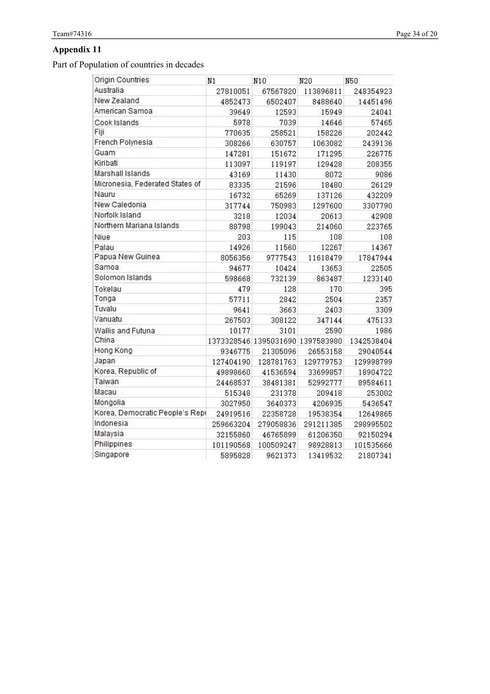

### Appendix 11

Part of Population of countries in decades
<table><tr><td>Origin Countries</td><td>N1</td><td>N10</td><td>N20</td><td>N50</td></tr><tr><td>Australia</td><td>27810051</td><td>67567820</td><td>113896811</td><td>248354923</td></tr><tr><td>New Zealand</td><td>4852473</td><td>6502407</td><td>8488640</td><td>14451496</td></tr><tr><td>American Samoa</td><td>39649</td><td>12593</td><td>15949</td><td>24041</td></tr><tr><td>Cook Islands</td><td>5978</td><td>7039</td><td>14646</td><td>57465</td></tr><tr><td>Fiji</td><td>770635</td><td>258521</td><td>158226</td><td>202442</td></tr><tr><td>French Polynesia</td><td>308266</td><td>630757</td><td>1063082</td><td>2439136</td></tr><tr><td>Guam</td><td>147281</td><td>151672</td><td>171295</td><td>226775</td></tr><tr><td>Kiribati</td><td>113097</td><td>119197</td><td>129428</td><td>208355</td></tr><tr><td>Marshall Islands</td><td>43169</td><td>11430</td><td>8072</td><td>9086</td></tr><tr><td>Micronesia, Federated States of</td><td>83335</td><td>21596</td><td>18480</td><td>26129</td></tr><tr><td>Nauru</td><td>16732</td><td>65269</td><td>137126</td><td>432209</td></tr><tr><td>New Caledonia</td><td>317744</td><td>750983</td><td>1297600</td><td>3307790</td></tr><tr><td>Norfolk Island</td><td>3218</td><td>12034</td><td>20613</td><td>42908</td></tr><tr><td>Northern Mariana Islands</td><td>88798</td><td>199043</td><td>214060</td><td>223765</td></tr><tr><td>Niue</td><td>203</td><td>115</td><td>108</td><td>108</td></tr><tr><td>Palau</td><td>14926</td><td>11560</td><td>12267</td><td>14367</td></tr><tr><td>Papua New Guinea</td><td>8056356</td><td>9777543</td><td>11618479</td><td>17847944</td></tr><tr><td>Samoa</td><td>94677</td><td>10424</td><td>13653</td><td>22505</td></tr><tr><td>Solomon Islands</td><td>598668</td><td>732139</td><td>863487</td><td>1233140</td></tr><tr><td>Tokelau</td><td>479</td><td>128</td><td>170</td><td>395</td></tr><tr><td>Tonga</td><td>57711</td><td>2842</td><td>2504</td><td>2357</td></tr><tr><td>Tuvalu</td><td>9641</td><td>3663</td><td>2403</td><td>3309</td></tr><tr><td>Vanuatu</td><td>267503</td><td>308122</td><td>347144</td><td>475133</td></tr><tr><td>Wallis and Futuna</td><td>10177</td><td>3101</td><td>2590</td><td>1986</td></tr><tr><td>China</td><td>1373328546</td><td>1395031690</td><td>1397583980</td><td>1342538404</td></tr><tr><td>Hong Kong</td><td>9346775</td><td>21305096</td><td>26553158</td><td>29040544</td></tr><tr><td>Japan</td><td>127404190</td><td>128781763</td><td>129779753</td><td>129998799</td></tr><tr><td>Korea, Republic of</td><td>49898660</td><td>41536594</td><td>33699857</td><td>18904722</td></tr><tr><td>Taiwan</td><td>24468537</td><td>38481381</td><td>52992777</td><td>89584611</td></tr><tr><td>Macau</td><td>515348</td><td>231378</td><td>209418</td><td>253002</td></tr><tr><td>Mongolia</td><td>3027950</td><td>3640373</td><td>4206935</td><td>5436547</td></tr><tr><td>Korea, Democratic People&#x27;s Repi</td><td>24919516</td><td>22358728</td><td>19538354</td><td>12649865</td></tr><tr><td>Indonesia</td><td>259663204</td><td>279058836</td><td>291211385</td><td>298995502</td></tr><tr><td>Malaysia</td><td>32155860</td><td>46765899</td><td>61206350</td><td>92150294</td></tr><tr><td>Philippines</td><td>101190568</td><td>100509247</td><td>98928813</td><td>101535666</td></tr><tr><td>Singapore</td><td>5895828</td><td>9621373</td><td>13419532</td><td>21807341</td></tr></table>

Team#74316

Page 34 of 20

## 第37页

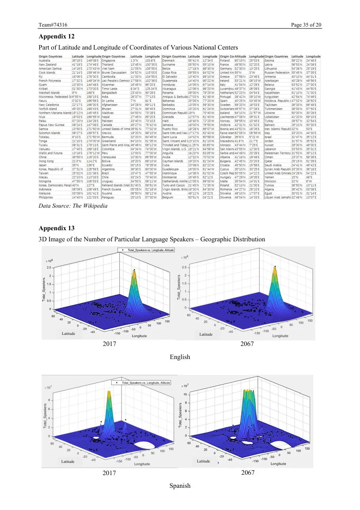

### Appendix 12

2067 Part of Latitude and Longitude of Coordinates of Various National Centers
<table><tr><td>Origin Countries</td><td>Latitude</td><td>Longitude</td><td>Origin Countries</td><td>Latitude</td><td>Longitude</td><td>Origin Countries</td><td>Latitude</td><td>Longitude</td><td>Origin Coi</td><td>Altitude</td><td>Longitude</td><td>Origin Countries</td><td>Latitude</td><td>Longitude</td></tr><tr><td>Australia</td><td>35°15′S</td><td>149°08′E</td><td>Singapore</td><td>1.3°N</td><td>103.8°E</td><td>Denmark</td><td>55°41′N</td><td>12°34′E</td><td>Finland</td><td>60°15′N</td><td>25°03′E</td><td>Estonia</td><td>59°22′N</td><td>24°48′E</td></tr><tr><td>New Zealand</td><td>41°19′S</td><td>174°46′E</td><td>Thailand</td><td>13°45′N</td><td>100°35′E</td><td>Suriname</td><td>05°50′N</td><td>55°10′W</td><td>France</td><td>48°50′N</td><td>02°20′E</td><td>Latvia</td><td>56°53′N</td><td>24°08′E</td></tr><tr><td>American Samoa</td><td>14°16′S</td><td>170°43′W</td><td>Viet Nam</td><td>21°05′N</td><td>105°55′E</td><td>Belize</td><td>17°18′N</td><td>88°30′W</td><td>Germany</td><td>52°30′N</td><td>13°25′E</td><td>Lithuania</td><td>54°38′N</td><td>25°19′E</td></tr><tr><td>Cook Islands</td><td>21°14′S</td><td>159°46′W</td><td>Brunei Darussalam</td><td>04°52′N</td><td>115°00′E</td><td>Costa Rica</td><td>09°55′N</td><td>84°02′W</td><td>United Kin</td><td>55°N</td><td>3°W</td><td>Russian Federation</td><td>55°45′N</td><td>37°35′E</td></tr><tr><td>Fiji</td><td>18°06′S</td><td>178°30′E</td><td>Cambodia</td><td>11°33′N</td><td>104°55′E</td><td>El Salvador</td><td>13°40′N</td><td>89°10′W</td><td>Greece</td><td>37°58′N</td><td>23°46′E</td><td>Armenia</td><td>40°10′N</td><td>44°31′E</td></tr><tr><td>French Polynesia</td><td>17°32′S</td><td>149°34′W</td><td>Lao People&#x27;s Democracy</td><td>17°58′N</td><td>102°36′E</td><td>Guatemala</td><td>14°40′N</td><td>90°22′W</td><td>Ireland</td><td>53°21′N</td><td>06°15′W</td><td>Azerbaijan</td><td>40°29′N</td><td>49°56′E</td></tr><tr><td>Guam</td><td>13°30′N</td><td>144°48′E</td><td>Myanmar</td><td>16°45′N</td><td>96°20′E</td><td>Honduras</td><td>14°05′N</td><td>87°14′W</td><td>Italy</td><td>41°54′N</td><td>12°29′E</td><td>Belarus</td><td>53°52′N</td><td>27°30′E</td></tr><tr><td>Kiribati</td><td>01°30′N</td><td>173°00′E</td><td>Timor Leste</td><td>8.34°S</td><td>125.34°E</td><td>Nicaragua</td><td>12°06′N</td><td>86°20′W</td><td>Luxembou</td><td>49°37′N</td><td>06°09′E</td><td>Georgia</td><td>41°43′N</td><td>44°50′E</td></tr><tr><td>Marshall Islands</td><td>9°N</td><td>168°E</td><td>Bangladesh</td><td>23°43′N</td><td>90°26′E</td><td>Panama</td><td>09°00′N</td><td>79°25′W</td><td>Netherland</td><td>52°23′N</td><td>04°54′E</td><td>Kazakhstan</td><td>51°10′N</td><td>71°30′E</td></tr><tr><td>Micronesia, Federated States</td><td>6°55′N</td><td>158°15′E</td><td>India</td><td>28°37′N</td><td>77°13′E</td><td>Antigua &amp; Barbuda</td><td>17°03′N</td><td>61°48′W</td><td>Portugal</td><td>38°42′N</td><td>09°10′W</td><td>Kyrgyzstan</td><td>42°54′N</td><td>74°46′E</td></tr><tr><td>Nauru</td><td>0°32′S</td><td>166°56′E</td><td>Sri Lanka</td><td>7°N</td><td>81°E</td><td>Bahamas</td><td>25°05′N</td><td>77°20′W</td><td>Spain</td><td>40°25′N</td><td>03°45′W</td><td>Moldova, Republic of the United Kingdom</td><td>47°02′N</td><td>28°50′E</td></tr><tr><td>New Caledonia</td><td>22°17′S</td><td>166°30′E</td><td>Afghanistan</td><td>34°28′N</td><td>69°11′E</td><td>Barbados</td><td>13°05′N</td><td>59°30′W</td><td>Sweden</td><td>59°20′N</td><td>18°03′E</td><td>Tajikistan</td><td>38°33′N</td><td>68°48′E</td></tr><tr><td>Norfolk Island</td><td>45°20′S</td><td>168°43′E</td><td>Bhutan</td><td>27°31′N</td><td>89°45′E</td><td>Dominica</td><td>15°20′N</td><td>61°24′W</td><td>Switzerland</td><td>46°57′N</td><td>07°28′E</td><td>Turkmenistan</td><td>38°00′N</td><td>57°50′E</td></tr><tr><td>Northern Mariana Islands</td><td>15°12′N</td><td>145°45′E</td><td>Maldives</td><td>04°00′N</td><td>73°28′E</td><td>Dominican Republic</td><td>19°N</td><td>70°40′W</td><td>Iceland</td><td>64°10′N</td><td>21°57′W</td><td>Ukraine</td><td>50°30′N</td><td>30°28′E</td></tr><tr><td>Niue</td><td>19°03′S</td><td>169°55′W</td><td>Nepal</td><td>27°45′N</td><td>85°20′E</td><td>Grenada</td><td>12°07′N</td><td>61°40′W</td><td>Liechtenstein</td><td>47°08′N</td><td>09°31′E</td><td>Uzbekistan</td><td>41°20′N</td><td>69°10′E</td></tr><tr><td>Palau</td><td>07°20′N</td><td>134°28′E</td><td>Pakistan</td><td>33°40′N</td><td>73°10′E</td><td>Haiti</td><td>18°40′N</td><td>72°20′W</td><td>Norway</td><td>59°55′N</td><td>10°45′E</td><td>Turkey</td><td>39°57′N</td><td>32°54′E</td></tr><tr><td>Papua New Guinea</td><td>09°24′S</td><td>147°08′E</td><td>Canada</td><td>45°27′N</td><td>75°42′W</td><td>Jamaica</td><td>18°00′N</td><td>76°50′W</td><td>Andorra</td><td>42°31′N</td><td>01°32′E</td><td>Bahrain</td><td>26°10′N</td><td>50°30′E</td></tr><tr><td>Samoa</td><td>13°50′S</td><td>171°50′W</td><td>United States of America</td><td>39°91′N</td><td>77°02′W</td><td>Puerto Rico</td><td>18°28′N</td><td>66°07′W</td><td>Bosnia and Herzegovina</td><td>43°52′N</td><td>18°26′E</td><td>Iran, Islamic Republic</td><td>32°N</td><td>53°E</td></tr><tr><td>Solomon Islands</td><td>09°27′S</td><td>159°57′E</td><td>Mexico</td><td>19°20′N</td><td>99°10′W</td><td>Saint Kitts and Nevis</td><td>17°17′N</td><td>62°43′W</td><td>Faroe Islan</td><td>62°05′N</td><td>06°56′W</td><td>Iraq</td><td>33°20′N</td><td>44°30′E</td></tr><tr><td>Tokelau</td><td>9°10′S</td><td>171°50′W</td><td>Bermuda</td><td>32°20′N</td><td>64°45′W</td><td>Saint Lucia</td><td>14°02′N</td><td>60°58′W</td><td>Gibraltar</td><td>36°8′N</td><td>5°21′W</td><td>Israel</td><td>31°47′N</td><td>35°12′E</td></tr><tr><td>Tonga</td><td>21°10′S</td><td>174°00′W</td><td>Greenland</td><td>64°10′N</td><td>51°35′W</td><td>Saint Vincent and Toulouse</td><td>13°10′N</td><td>61°10′W</td><td>Macedonia</td><td>41.6°N</td><td>21.7°E</td><td>Jordan</td><td>31°57′N</td><td>35°52′E</td></tr><tr><td>Tuvalu</td><td>08°31′S</td><td>179°13′E</td><td>Saint Pierre and Miquelon</td><td>46°46′N</td><td>56°12′W</td><td>Trinidad and Tobago</td><td>11.25°N</td><td>60.65°W</td><td>Monaco</td><td>43°44′N</td><td>7°25′E</td><td>Kuwait</td><td>29°30′N</td><td>48°00′E</td></tr><tr><td>Vanuatu</td><td>17°45′S</td><td>168°18′E</td><td>Colombia</td><td>04°34′N</td><td>74°00′W</td><td>Virgin Islands, U.S.</td><td>18°21′N</td><td>64°56′W</td><td>San Marino</td><td>43°55′N</td><td>12°30′E</td><td>Lebanon</td><td>33°53′N</td><td>35°31′E</td></tr><tr><td>Wallis and Futuna</td><td>13°18′S</td><td>176°12′W</td><td>Peru</td><td>12°00′S</td><td>77°00′W</td><td>Anguilla</td><td>18.23°N</td><td>63.05°W</td><td>Serbia and Herzegovina</td><td>44°49′N</td><td>20°28′E</td><td>Palestinian Territory</td><td>31°53′N</td><td>35°12′E</td></tr><tr><td>China</td><td>39°55′N</td><td>116°20′E</td><td>Venezuela</td><td>10°30′N</td><td>66°55′W</td><td>Aruba</td><td>12°32′N</td><td>70°02′W</td><td>Albania</td><td>41°18′N</td><td>19°49′E</td><td>Oman</td><td>23°37′N</td><td>58°36′E</td></tr><tr><td>Hong Kong</td><td>22.3°N</td><td>114.2°E</td><td>Bolivia</td><td>16°20′S</td><td>68°10′W</td><td>Cayman Islands</td><td>19°20′N</td><td>81°24′W</td><td>Bulgaria</td><td>42°45′N</td><td>23°20′E</td><td>Qatar</td><td>25°15′N</td><td>51°35′E</td></tr><tr><td>Japan</td><td>35°N</td><td>136°E</td><td>Ecuador</td><td>00°15′S</td><td>78°35′W</td><td>Cuba</td><td>23°08′N</td><td>82°22′W</td><td>Croatia</td><td>45°50′N</td><td>15°58′E</td><td>Saudi Arabia</td><td>24°41′N</td><td>46°42′E</td></tr><tr><td>Korea, Republic of</td><td>37°31′N</td><td>126°58′E</td><td>Argentina</td><td>36°30′S</td><td>60°00′W</td><td>Guadeloupe</td><td>16°00′N</td><td>61°44′W</td><td>Cyprus</td><td>35°10′N</td><td>33°25′E</td><td>Syrian Arab Republic</td><td>33°30′N</td><td>36°18′E</td></tr><tr><td>Taiwan</td><td>25°02′N</td><td>121°38′E</td><td>Brazil</td><td>15°47′S</td><td>47°55′W</td><td>Martinique</td><td>14°36′N</td><td>61°02′W</td><td>Czech Rep.</td><td>50°05′N</td><td>14°22′E</td><td>United Arab Emirates</td><td>24°28′N</td><td>54°22′E</td></tr><tr><td>Macau</td><td>22°10′N</td><td>113°33′E</td><td>Chile</td><td>33°24′S</td><td>70°40′W</td><td>Montserrat</td><td>16°45′N</td><td>62°12′E</td><td>Hungary</td><td>47°29′N</td><td>19°05′E</td><td>Yemen</td><td>15°N</td><td>48°E</td></tr><tr><td>Mongolia</td><td>47°55′N</td><td>106°53′E</td><td>Uruguay</td><td>34°50′S</td><td>56°11′W</td><td>Netherlands Antilles</td><td>12°05′N</td><td>69°00′W</td><td>Malta</td><td>35°54′N</td><td>14°31′E</td><td>Morocco</td><td>32°N</td><td>6°W</td></tr><tr><td>Korea, Democratic Peopit</td><td>40°N</td><td>127°E</td><td>Falkland Islands (Malaysia)</td><td>51°40′S</td><td>59°51′W</td><td>Turks and Caicos</td><td>21°45′N</td><td>71°35′W</td><td>Poland</td><td>52°13′N</td><td>21°00′E</td><td>Tunisia</td><td>36°50′N</td><td>10°11′E</td></tr><tr><td>Indonesia</td><td>06°09′S</td><td>106°49′E</td><td>French Guiana</td><td>05°05′N</td><td>52°18′W</td><td>Virgin Islands, Britta</td><td>18°30′N</td><td>64°30′W</td><td>Romania</td><td>44°27′N</td><td>26°10′E</td><td>Algeria</td><td>36°42′N</td><td>03°08′E</td></tr><tr><td>Malaysia</td><td>03°09′N</td><td>101°41′E</td><td>Guyana</td><td>06°50′N</td><td>58°12′W</td><td>Austria</td><td>48°12′N</td><td>16°22′E</td><td>Slovakia</td><td>48°10′N</td><td>17°07′E</td><td>Egypt</td><td>30°01′N</td><td>31°14′E</td></tr><tr><td>Philippines</td><td>14°40′N</td><td>121°03′E</td><td>Paraguay</td><td>25°10′S</td><td>57°30′W</td><td>Belgium</td><td>50°51′N</td><td>04°21′E</td><td>Slovenia</td><td>46°04′N</td><td>14°33′E</td><td>Libyan Arab Jamahii</td><td>32°49′N</td><td>13°07′E</td></tr></table>
Data Source: The Wikipedia

### Appendix 13

Team#74316

Page 35 of 20

## 第38页

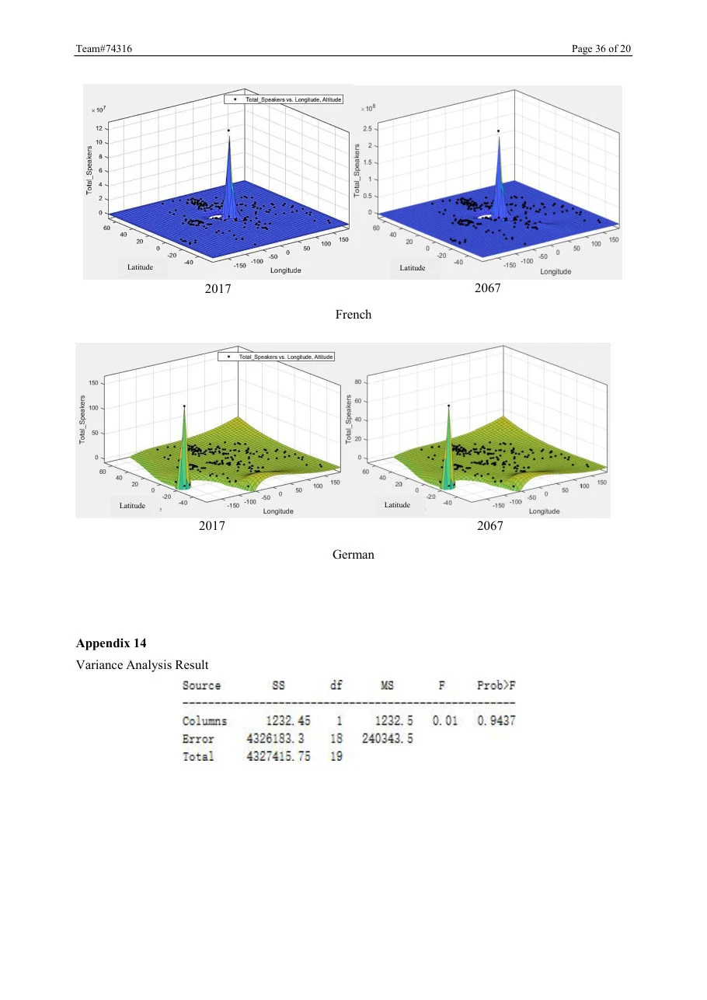

Appendix 14 Variance Analysis Result
<table><tr><td>Source</td><td>SS</td><td>df</td><td>MS</td><td>F</td><td>Prob&gt;F</td></tr><tr><td>Columns</td><td>1232.45</td><td>1</td><td>1232.5</td><td>0.01</td><td>0.9437</td></tr><tr><td>Error</td><td>4326183.3</td><td>18</td><td>240343.5</td><td></td><td></td></tr><tr><td>Total</td><td>4327415.75</td><td>19</td><td></td><td></td><td></td></tr></table>

Team#74316

Page 36 of 20

## 第39页

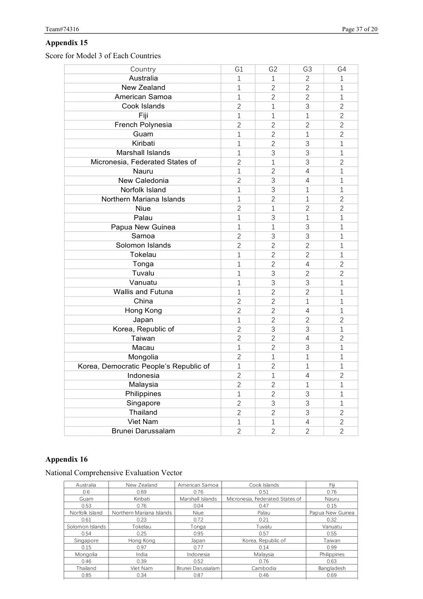

### Appendix 15

Score for Model 3 of Each Countries
<table><tr><td>Country</td><td>G1</td><td>G2</td><td>G3</td><td>G4</td></tr><tr><td>Australia</td><td>1</td><td>1</td><td>2</td><td>1</td></tr><tr><td>New Zealand</td><td>1</td><td>2</td><td>2</td><td>1</td></tr><tr><td>American Samoa</td><td>1</td><td>2</td><td>2</td><td>1</td></tr><tr><td>Cook Islands</td><td>2</td><td>1</td><td>3</td><td>2</td></tr><tr><td>Fiji</td><td>1</td><td>1</td><td>1</td><td>2</td></tr><tr><td>French Polynesia</td><td>2</td><td>2</td><td>2</td><td>2</td></tr><tr><td>Guam</td><td>1</td><td>2</td><td>1</td><td>2</td></tr><tr><td>Kiribati</td><td>1</td><td>2</td><td>3</td><td>1</td></tr><tr><td>Marshall Islands</td><td>1</td><td>3</td><td>3</td><td>1</td></tr><tr><td>Micronesia, Federated States of</td><td>2</td><td>1</td><td>3</td><td>2</td></tr><tr><td>Nauru</td><td>1</td><td>2</td><td>4</td><td>1</td></tr><tr><td>New Caledonia</td><td>2</td><td>3</td><td>4</td><td>1</td></tr><tr><td>Norfolk Island</td><td>1</td><td>3</td><td>1</td><td>1</td></tr><tr><td>Northern Mariana Islands</td><td>1</td><td>2</td><td>1</td><td>2</td></tr><tr><td>Niue</td><td>2</td><td>1</td><td>2</td><td>2</td></tr><tr><td>Palau</td><td>1</td><td>3</td><td>1</td><td>1</td></tr><tr><td>Papua New Guinea</td><td>1</td><td>1</td><td>3</td><td>1</td></tr><tr><td>Samoa</td><td>2</td><td>3</td><td>3</td><td>1</td></tr><tr><td>Solomon Islands</td><td>2</td><td>2</td><td>2</td><td>1</td></tr><tr><td>Tokelau</td><td>1</td><td>2</td><td>2</td><td>1</td></tr><tr><td>Tonga</td><td>1</td><td>2</td><td>4</td><td>2</td></tr><tr><td>Tuvalu</td><td>1</td><td>3</td><td>2</td><td>2</td></tr><tr><td>Vanuatu</td><td>1</td><td>3</td><td>3</td><td>1</td></tr><tr><td>Wallis and Futuna</td><td>1</td><td>2</td><td>2</td><td>1</td></tr><tr><td>China</td><td>2</td><td>2</td><td>1</td><td>1</td></tr><tr><td>Hong Kong</td><td>2</td><td>2</td><td>4</td><td>1</td></tr><tr><td>Japan</td><td>1</td><td>2</td><td>2</td><td>2</td></tr><tr><td>Korea, Republic of</td><td>2</td><td>3</td><td>3</td><td>1</td></tr><tr><td>Taiwan</td><td>2</td><td>2</td><td>4</td><td>2</td></tr><tr><td>Macau</td><td>1</td><td>2</td><td>3</td><td>1</td></tr><tr><td>Mongolia</td><td>2</td><td>1</td><td>1</td><td>1</td></tr><tr><td>Korea, Democratic People&#x27;s Republic of</td><td>1</td><td>2</td><td>1</td><td>1</td></tr><tr><td>Indonesia</td><td>2</td><td>1</td><td>4</td><td>2</td></tr><tr><td>Malaysia</td><td>2</td><td>2</td><td>1</td><td>1</td></tr><tr><td>Philippines</td><td>1</td><td>2</td><td>3</td><td>1</td></tr><tr><td>Singapore</td><td>2</td><td>3</td><td>3</td><td>1</td></tr><tr><td>Thailand</td><td>2</td><td>2</td><td>3</td><td>2</td></tr><tr><td>Viet Nam</td><td>1</td><td>1</td><td>4</td><td>2</td></tr><tr><td>Brunei Darussalam</td><td>2</td><td>2</td><td>2</td><td>2</td></tr></table>

### Appendix 16

National Comprehensive Evaluation Vector
<table><tr><td>Australia</td><td>New Zealand</td><td>American Samoa</td><td>Cook Islands</td><td>Fiji</td></tr><tr><td>0.6</td><td>0.69</td><td>0.76</td><td>0.51</td><td>0.76</td></tr><tr><td>Guam</td><td>Kiribati</td><td>Marshall Islands</td><td>Micronesia, Federated States of</td><td>Nauru</td></tr><tr><td>0.53</td><td>0.76</td><td>0.04</td><td>0.47</td><td>0.15</td></tr><tr><td>Norfolk Island</td><td>Northern Mariana Islands</td><td>Niue</td><td>Palau</td><td>Papua New Guinea</td></tr><tr><td>0.61</td><td>0.23</td><td>0.72</td><td>0.21</td><td>0.32</td></tr><tr><td>Solomon Islands</td><td>Tokelau</td><td>Tonga</td><td>Tuvalu</td><td>Vanuatu</td></tr><tr><td>0.54</td><td>0.25</td><td>0.95</td><td>0.57</td><td>0.55</td></tr><tr><td>Singapore</td><td>Hong Kong</td><td>Japan</td><td>Korea, Republic of</td><td>Taiwan</td></tr><tr><td>0.15</td><td>0.97</td><td>0.77</td><td>0.14</td><td>0.99</td></tr><tr><td>Mongolia</td><td>India</td><td>Indonesia</td><td>Malaysia</td><td>Philippines</td></tr><tr><td>0.46</td><td>0.39</td><td>0.52</td><td>0.76</td><td>0.63</td></tr><tr><td>Thailand</td><td>Viet Nam</td><td>Brunei Darussalam</td><td>Cambodia</td><td>Bangladesh</td></tr><tr><td>0.85</td><td>0.34</td><td>0.87</td><td>0.46</td><td>0.69</td></tr></table>

Team#74316

Page 37 of 20
