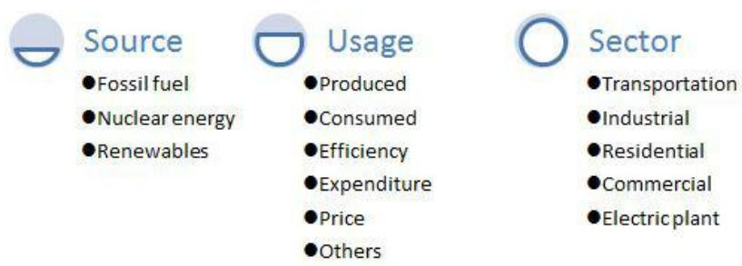
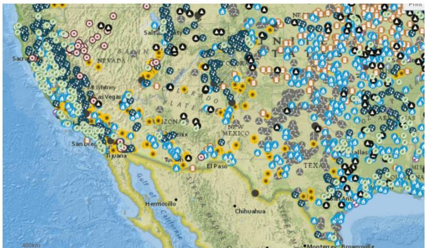

# 2018年美赛O奖论文：《A New Keynesian Approach to Optimizing Energy Compact》（问题C）

原件为竞赛论文。补充：文中的阅读练习及“参考解答”为整理时增加，原件图文保留出处。

## Summary

### A New Keynesian Approach to Optimizing Energy Compact

In our paper, we construct an EROI evaluation system for the four states using data science and succeed in determining optimal goals for the interstate energy compact.

First, we operate on the data. Data are screened according to their integrity and usefulness of the information. Then we select and merge different variables using Cointegration and Multiple Dimensional Scaling (MDS) based on the independence and representativeness of the attributes. For the reserved variables and statistics by year, we use Mean Substitution to conduct data imputation. Then, we classify the processed database by usage, sources and sectors. Classification on the energy sources is eventually made according to the corresponding environmental impact.

Second, we construct a EROI evaluation system, which is an improvement of Return on Investment (ROI). We classify various kinds of energies into 10 distinct groups. All variables of prices are adjusted in order to offset the influence by inflation and geographical differences. After that, we find that the external cost is related to the intensity of pollution, so it is used to measure the influence on environment. Also, we take sector influence and electric energy loss into consideration. Our data shows that California has the best profile for use of cleaner energy since 1974.

Third, our predicting models feature both Mathematical and Economic models. Since the data given are not stable in Time Series, we do not take ARMA or ARCH model into consideration. A linear model is initially adopted to regress the data, but it turns out to have limited accuracy and fails to fit short-term fluctuations or long-term trends. As a result, we adopt a dynamic New Keynesian IS-LM model and include forward-looking expectations in the model. We can therefore predict future energy consumption and structure with better accuracy. What's more, to simulate policy effects, demand shocks and supply shocks are added to the enhanced model, so that we are able to provide governors with quantitative prediction of policies.

Finally, sensitivity analysis is added to test and verify our models. The satisfying results allow us to put models into real situations and to solve real problems. We determine the renewable energy usage targets that in 2025, California may reach 42% of clean, renewable energy to the total consumption. Other states can reach 35%. And in 2050 All states may reach different from 38% to 51%. Four states' government should subsidize clean and renewable energy and impose pollution tax on others. Other kinds of direct investment and long-term policy can also be used to meet the energy goals.

**Keywords:** New Keynesian; IS-LM Model; Linear Regression; Time Series; MDS

更多数学建模资料请关注微店店铺“数学建模学习交流” https://k.weidian.com/RHO6PSpA

## Contents

1 Introduction
1.1 Problem Background ..... 1
1.2 Overview of Our Work ..... 1
1.3 Assumptions ..... 2
2 Data Processing
2.1 Data Screening ..... 2
2.2 Data Imputation ..... 3
2.3 Data Classification ..... 3
3 Energy Profile
3.1 Overview Profile of the Four States ..... 4
3.2 Characterize the energy profile ..... 4
4 EROI Evaluation System
4.1 EROI Definition ..... 5
4.2 The Revised EROI Evaluation System ..... 6
4.3 Results of EROI Evaluation System ..... 7
5 Predictive Modeling
5.1 Linear Regression Model ..... 9
5.2 Dynamic New Keynesian IS-LM Model ..... 10
5.3 Enhanced NK IS-LM Model with Demand and Supply Shock ..... 12
5.4 Climate Change Compact in Action ..... 16
6 Sensitivity Analysis
7 Strength and Weakness
7.1 Weakness ..... 18
8 Conclusions 18
9 Memo 21
Appendices 22

## 1 Introduction

知识点：[一般假设及其合理性说明（Assumptions and Justifications）](../../../topics/数学建模/jiaben_shezhi.md)、[敏感性分析方法（Sensitivity Analysis，单参数与多参数变动）](../../../topics/数学建模/minganxing_fenxi.md)、[模型验证方法概述（随机模型与确定性模型验证）](../../../topics/数学建模/moxing_yanzheng.md)

### 1.1 Problem Background

Energy production lays a solid foundation for the development of the whole nation and serves as the essential impetus for the function of the entire society. The utilization of cleaner and green energy is a growing trend worldwide for purpose of the sustainable development. There are masses of clean energy oriented contracts being signed all over the world, while very few of those are carried out due largely part to their unrealistic and far-fetched goals. Therefore, setting goals reasonable enough contributes a lot to the optimal reconstruction of the energy structure regarding various countries or states.

The past years have witnessed unprecedented boom in the development of big data. Data science has penetrated into every aspects of our life, and plays a significant role in statistics, market intelligence, business analysis and so on. Moreover, data science can be applied to offer a feasible solution and set a realistic goal and thus facilitates the decision-making process. Therefore we give full play to the data science in addressing the optimal issue.

Now there are four states along the US border with Mexico, California (CA), Arizona (AZ), New Mexico (NM), and Texas (TX) that wish to form a realistic and practical new energy compact focused on increased usage of cleaner, renewable energy sources. With 50 years of data in 605 variables on each of these four states' energy production and consumption collected, we can perform data analysis and modeling to figure out a series of reasonable goals for the interstate energy compact.

知识点：[数学建模的基本步骤（问题分析、模型假设、建立、求解、检验、推广）](../../../topics/数学建模/jianmo_buzhou.md)、[文献综述与研究背景撰写方法](../../../topics/数学建模/wenxian_zongshu.md)、[模型参数的确定（基于数据拟合或实验选择）](../../../topics/数学建模/canshu_queding.md)

### 1.2 Overview of Our Work

First, we find a few key points in this question:

Create an energy profile for the four states respectively.

Characterize the energy profile based on the time series model.

Develop an evaluation system to judge the level of the energy profile.

How to predict the energy profile of the four states.

Determine future renewable energy usage targets and how to achieve them.

On the basis of above discussion, to determine the optimal energy goals, we may boil down the tasks to the following steps:

First, we do data screening according to the integrity and usefulness of the information. For the retention of the dataset we use Cointegration and Multiple Dimensional Scaling to perform data imputation. And classify the data.

Second, we use knowledge of finance to construct EROI evaluation system. And we use the EROI concept to evaluate the energy profile evolved from 1960–2009.

知识点：[数学建模的基本步骤（问题分析、模型假设、建立、求解、检验、推广）](../../../topics/数学建模/jianmo_buzhou.md)、[模型参数的确定（基于数据拟合或实验选择）](../../../topics/数学建模/canshu_queding.md)、[模型优缺点分析（Strengths and Weaknesses）](../../../topics/数学建模/youque_dian.md)

### 1.3 Assumptions

The data after screening and imputation are correct and robust for further analysis.

Natural resources in the four states are abundant and will not be exhausted before 2050.

All energy, no matter clean or not, are identical in total costs after 2009 (production cost + possible environmental cost).

Inflation (i.e. GDP deflator) will not change in future years.

We mainly focus on the performance of macro-economy and energy structure, including renewable and clean energy.

## 2 Data Processing

知识点：[一般假设及其合理性说明（Assumptions and Justifications）](../../../topics/数学建模/jiaben_shezhi.md)、[参数合理性验证](../../../topics/数学建模/canshu_heli_xing.md)、[文献综述与研究背景撰写方法](../../../topics/数学建模/wenxian_zongshu.md)

### 2.1 Data Screening

Given that we have 50 years of data in 605 variables of the four states, the original database is quite large. Therefore, we should do data screening according to the integrity and usefulness of the information. We first delete some variables manually, and then we use Cointegration and MDS to further narrow down the variables.

#### Cointegration

We randomly choose two variables and each of them establishes a time series $x_{1}, x_{2}$.

First we construct a regression model:

$$
x _ {2 t} = \beta_ {0} + x _ {1 t} + \epsilon_ {t}\tag{1}
$$

If the residual series $\epsilon_{t}$ is stationary, then $x_{1t}, x_{2t}$ have cointegration. Based on Augmented Dickey-Fuller Test(ADF Test), if the P-value is lower than 0.05, then $x_{1t}, x_{2t}$ have correlation. Similarly, we can obtain the correlation between any two of these variables and thus in this way we can find the variables that any two of which don't have correlation. Therefore, we reduce the large amounts of variables to ten major Categories for further scaling.

#### Multiple Dimensional Scaling

Multidimensional scaling (MDS) is a means of visualizing the level of similarity of individual cases of a dataset. It refers to a set of related ordination techniques used in information visualization, in particular to display the information contained in a distance matrix.

We then utilize this method to further narrow down the variables.

知识点：[模型参数的确定（基于数据拟合或实验选择）](../../../topics/数学建模/canshu_queding.md)、[敏感性分析方法（Sensitivity Analysis，单参数与多参数变动）](../../../topics/数学建模/minganxing_fenxi.md)

### 2.2 Data Imputation

In statistics, missing data is quite common in the dataset and may cause certain bias in the final conclusion. Therefore data imputation, which means replacing missing data with substituted values, is of great necessity in eliminating such bias and obtaining more authentic results.

Through preliminary observation on the raw dataset, we discover that the statistics of some variables remain zero for several years in a row. Some are missing data while under some circumstances the true value is zero. Therefore, firstly we should distinguish the abnormal statistics from the database and then deal with the missing data.

By far there are several ways to do data imputation, including Listwise deletion, Mean substitution, Multiple Imputation and so on. Here we use Mean substitution.

知识点：[模型参数的确定（基于数据拟合或实验选择）](../../../topics/数学建模/canshu_queding.md)

### 2.3 Data Classification

We classify the energy production database by three aspects – usage, source and sector. The specific classification is listed as follows.

Further we make a classification on different kinds of energy sources in terms of their environmental impact:

## 3 Energy Profile

知识点：[任务分解与目标明确](../../../topics/数学建模/renwu_fenjie.md)

### 3.1 Overview Profile of the Four States

Figure 3: Overview Profile of the Four States

| | AZ | CA | NM | TX |
| :--- | :--- | :--- | :--- | :--- |
| Percentage of total energy consumed by end-use sector. | 57.90% | 82.06% | 62.91% | 76.06% |
| Percentage of total energy loss. | 36.25% | 23.28% | 23.19% | 21.94% |
| Percentage of Clean and Renewable Energy Consumption in End-use Sector | 3.51% | 2.01% | 1.06% | 0.90% |
| Percentage of Clean Energy Consumption in Electric Plant Sector | 61.56% | 93.28% | 22.70% | 45.59% |
| Average Price of fossil energy* (dollar per million Btu) | 8.63 | 11.98 | 7.66 | 8.94 |

\*Average price of fossil energy is important data because some states, such as Texas, have plenty of oil reserves. These states' low price of fossil energy can't reflect its advantage in energy consumption. As long as we are learning about the energy consumption in various states, the effect of energy exploitation should be removed.

知识点：[问题重述与分析（Problem Restatement and Analysis）](../../../topics/数学建模/wenti_chongshu.md)、[任务分解与目标明确](../../../topics/数学建模/renwu_fenjie.md)、[符号说明与术语定义（Nomenclature / Symbols and Definitions）](../../../topics/数学建模/fuhao_shuoming.md)

### 3.2 Characterize the energy profile

Energy structure depends excessively on a state's population, economy and industry. The table below briefly summarizes the demographical, climatic and industrial feature of these four states:

Geography plays an important role in the distribution of energy plants across the four states. Due to similar geographical character, natural gas plants and petroleum plants locate sparsely in their terrain. However, their difference outweighs similarities. While California and Texas have various energy plants, such distributions in Arizona and New Mexico are relatively monotonous. In addition, California is the only state to own geothermal plants. Coal power plants, however, mainly locate in Arizona and Texas. While solar power are more abundant in California and Arizona, Texas has more wind power plants. Finally, California and Texas have the largest number of hydroelectric power plants

# 2018年美赛O奖论文：《A New Keynesian Approach to Optimizing Energy Compact》（问题C）

本资料为2018年美国大学生数学建模竞赛（MCM/ICM）O奖论文第3部分（共8部分）的识别整理，主要涉及能源结构分析、EROI评估系统定义及修正。

## 一、能源结构背景分析

知识点：[影响因素评估指标体系构建（温度、湿度、经济、教育等）](../../../topics/数学建模/yingxiang_zhibiao.md)、[可持续发展指数 SDI 的构建与指标体系结构](../../../topics/数学建模/kechixu_zhibiao.md)、[一般假设及其合理性说明（Assumptions and Justifications）](../../../topics/数学建模/jiaben_shezhi.md)

### 选择 1

题干：以下表格简要总结了加利福尼亚州、亚利桑那州、德克萨斯州和新墨西哥州的人口、气候和工业特征，说明能源结构过度依赖于各州的人口、经济和工业。

| 指标 | California | Arizona | Texas | New Mexico | Source |
| :--- | :--- | :--- | :--- | :--- | :--- |
| Population (in July, 2016) (in Million) | 29.2965 | 6.9086 | 27.9049 | 2.0854 | Data from U.S. Census Bureau |
| GDP (million USD in 2016) | 2,622,731 | 305,849 | 1,599,283 | 93,594 | Bureau of Economic Analysis. Retrieved 8 December 2017. |
| Climate (Avg °F) | 59.4 | 60.3 | 64.8 | 53.4 | www.currentresults.com |
| Major Industry | Industry, agriculture, technology, tourism, and the motion picture industry | Manufacturing, mining (gold and silver, but mostly cooper, and tourism) | Petroleum, natural gas, farming, steel, banking and tourism | Mining and Oil and Gas Extraction, manufacturing | Various sources |

Energy structure depends excessively on a state's population, economy and industry. The table below briefly summarizes the demographical, climatic and industrial feature of these four states:

## 二、EROI评估系统

知识点：[符号说明与术语定义（Nomenclature / Symbols and Definitions）](../../../topics/数学建模/fuhao_shuoming.md)

### 简答 1

题干：简述EROI（能量投资回报率）的定义及其计算公式。

知识点：[文献综述与研究背景撰写方法](../../../topics/数学建模/wenxian_zongshu.md)、[影响因素评估指标体系构建（温度、湿度、经济、教育等）](../../../topics/数学建模/yingxiang_zhibiao.md)

### 简答 2

题干：解释为什么在评估能源时需要同时考虑内部成本（EIC）和外部支出（EEE），并简述净能量产量（Net Energy Yield）的概念。

知识点：[影响因素评估指标体系构建（温度、湿度、经济、教育等）](../../../topics/数学建模/yingxiang_zhibiao.md)、[模型参数的确定（基于数据拟合或实验选择）](../../../topics/数学建模/canshu_queding.md)、[文献综述与研究背景撰写方法](../../../topics/数学建模/wenxian_zongshu.md)

### 选择 1

题干：下表列出了修订后EROI评估系统中的符号定义，请指出“PEE”的含义。

| Denotation | Definition |
| :--- | :--- |
| i | quality factor |
| Eo | the output energy |
| El | the input energy |
| EIC | energy production internal cost |
| EEE | energy production external expenditure |
| PEE | Percentage of total energy consumed by Electric power plant |
| I | energy intensity |
| i | Sector influence rate |

答案：Percentage of total energy consumed by Electric power plant

知识点：[符号说明与术语定义（Nomenclature / Symbols and Definitions）](../../../topics/数学建模/fuhao_shuoming.md)

### 简答 1

题干：在EIC修正中，如何处理以货币形式统计的能量投资？请写出调整美元价值的公式。

知识点：[文献综述与研究背景撰写方法](../../../topics/数学建模/wenxian_zongshu.md)、[影响因素评估指标体系构建（温度、湿度、经济、教育等）](../../../topics/数学建模/yingxiang_zhibiao.md)

### 选择 1

题干：为了应对能源质量问题，研究人员构建了各种指数来汇总各类能源。本文采用最早的测量方法，即能源质量因子 $\alpha_i$。其中 $P_1$ 表示某种能源的国家标准价格，$P_i$ 表示第 $i$ 种能源的州价格。该比率即为第 $i$ 种能源的质量因子。请问该质量因子的计算公式是？

- A. $\alpha_{i} = \frac {P _ {1}}{P _ {i}}$
- B. $\alpha_{i} = P _ {i} * P _ {1}$
- C. $\alpha_{i} = \frac {P _ {i}}{P _ {1}}$
- D. $\alpha_{i} = P _ {i} - P _ {1}$

答案：C。
知识点：[符号说明与术语定义（Nomenclature / Symbols and Definitions）](../../../topics/数学建模/fuhao_shuoming.md)

### 简答 1

题干：请简述什么是外部性（Externality），并说明在能源消费背景下，污染如何被量化为货币成本？

知识点：[文献综述与研究背景撰写方法](../../../topics/数学建模/wenxian_zongshu.md)、[影响因素评估指标体系构建（温度、湿度、经济、教育等）](../../../topics/数学建模/yingxiang_zhibiao.md)

### 填空 1

题干：根据原文表7（Figure 7），煤炭（Coal）的外部成本为 \_\_\_\_\_\_ 美元/百万英热单位（dollar in 2005/million Bru）。

答案：20.367。
知识点：[文献综述与研究背景撰写方法](../../../topics/数学建模/wenxian_zongshu.md)、[数学建模的基本步骤（问题分析、模型假设、建立、求解、检验、推广）](../../../topics/数学建模/jianmo_buzhou.md)

### 简答 2

题干：原文提到不同部门对环境污染的影响不同，请列出住宅区、商业区、工业区、交通部门的行业影响率（Influence Rate），并解释为何要引入这一指标？

答案：
住宅区 (Residential): 1.2
商业区 (Commercial): 1.1
工业区 (Industrial): 0.8
交通部门 (Transportation): 1.3

知识点：[影响因素评估指标体系构建（温度、湿度、经济、教育等）](../../../topics/数学建模/yingxiang_zhibiao.md)、[模型参数的确定（基于数据拟合或实验选择）](../../../topics/数学建模/canshu_queding.md)、[文献综述与研究背景撰写方法](../../../topics/数学建模/wenxian_zongshu.md)

### 计算 1

题干：基于上述修正，原文提出了新的终端使用能源回报率（End-use EROI）计算公式。请写出该公式，并解释公式中各符号的含义。

知识点：[符号说明与术语定义（Nomenclature / Symbols and Definitions）](../../../topics/数学建模/fuhao_shuoming.md)、[模型参数的确定（基于数据拟合或实验选择）](../../../topics/数学建模/canshu_queding.md)

### 计算 2

题干：请写出发电厂能源回报率（Electric power plant EROI）和总能源回报率（Total EROI）的计算公式。

知识点：[模型参数的确定（基于数据拟合或实验选择）](../../../topics/数学建模/canshu_queding.md)、[符号说明与术语定义（Nomenclature / Symbols and Definitions）](../../../topics/数学建模/fuhao_shuoming.md)、[数学建模的基本步骤（问题分析、模型假设、建立、求解、检验、推广）](../../../topics/数学建模/jianmo_buzhou.md)

### 简答 3

题干：根据原文描述，亚利桑那州、加利福尼亚州、新墨西哥州和德克萨斯州这四个州的EROI总体趋势如何？哪个州在EROI方面具有明显优势？

答案：
四个州的总EROI都经历了显著下降。其中，加利福尼亚州在EROI方面具有明显的优势。

知识点：[文献综述与研究背景撰写方法](../../../topics/数学建模/wenxian_zongshu.md)

### 简答 4

题干：在终端使用部门（end-use sectors）和发电厂部门（electric power plant），清洁能源的使用情况有何不同？请具体说明加州和新墨西哥州的情况。

答案：
在终端使用部门，清洁可再生能源占总消费量的比例很小（2009年加州为2%，亚利桑那州为3.5%，其他两州约为1%）。而在发电厂部门，大量使用清洁能源。

加州：自1985年以来，约90%的发电能源来源为清洁能源。
新墨西哥州：清洁能源未被广泛使用。

知识点：[文献综述与研究背景撰写方法](../../../topics/数学建模/wenxian_zongshu.md)

### 表格 1

题干：请将原文图13（Figure 13）中2009年四个州的总EROI数据整理为Markdown表格。

知识点：[数学建模的基本步骤（问题分析、模型假设、建立、求解、检验、推广）](../../../topics/数学建模/jianmo_buzhou.md)

### 简答 5

题干：根据2009年的总EROI数据，四个州的排名顺序是怎样的？

答案：
加利福尼亚州 > 德克萨斯州 > 亚利桑那州 > 新墨西哥州。

知识点：[文献综述与研究背景撰写方法](../../../topics/数学建模/wenxian_zongshu.md)、[符号说明与术语定义（Nomenclature / Symbols and Definitions）](../../../topics/数学建模/fuhao_shuoming.md)、[数学建模的基本步骤（问题分析、模型假设、建立、求解、检验、推广）](../../../topics/数学建模/jianmo_buzhou.md)

### 引言与背景

在长期来看，“我们都已死去”（Keynes, 1923）。由于之前的线性模型在预测长期和短期未来方面存在低效性，本文引入了一种适应性的经济模型，该模型专注于期间波动（period-to-period fluctuation），以便在短期内做出更准确、更深入的预测，并最终模拟长期动态过程。

传统的凯恩斯主义 IS-LM 曲线衡量了短期经济波动中价格波动、利率和产出水平之间的关系。该模型的初衷是推导出产出和利率，以达到短期均衡。基于 David Aadland (2014) 的研究，应用动态 IS-LM 模型来解决能源预测问题。

知识点：[数学建模的基本步骤（问题分析、模型假设、建立、求解、检验、推广）](../../../topics/数学建模/jianmo_buzhou.md)、[文献综述与研究背景撰写方法](../../../topics/数学建模/wenxian_zongshu.md)

### 模型参数

| 符号 | 定义 |
| :--- | :--- |
| $c_t$ | t年的消费 |
| $\tau_t$ | 趋势产出 |
| $x_t = c_t - \tau_t$ | 产出缺口 |
| $i_t$ | 投资特定能源的回报率 (ROI) |
| $\pi_t$ | 价格上涨 |
| $r_t = i_t - E_t\pi_{t+1}$ | 实际回报率 |
| $\nu_t$ | 需求冲击 |
| $\mu_t$ | 供给冲击 |
| $\alpha$ | 移动平均参数 |
| $i$ | 无风险投资率 |

*(注：原文表格中 "Detotation" 应为 "Notation"，"Return on investing(ROI)certain energy" 整理为“投资特定能源的回报率”，"risk free investment rate" 整理为“无风险投资率”。)*

知识点：[符号说明与术语定义（Nomenclature / Symbols and Definitions）](../../../topics/数学建模/fuhao_shuoming.md)

### IS 曲线

IS 曲线总结了公众对能源的需求，其形式为：

$$
x _ {t} = - \phi [ i _ {t} - E _ {t} \pi_ {t + 1} ] + E _ {t} x _ {t + 1}\tag{8}
$$

该方程表明，t年的产出缺口由实际收益率加上对t+1年产出缺口的预期所引起。

**直觉解释：**
产出缺口与实际利率呈负相关，因为较高的回报诱导投资者今天进行更多投资，从而减少产出需求。产出缺口与t+1期产出缺口的预期呈正相关，因为更好的未来和高预期在经济中往往是自我实现的。

知识点：[数学建模的基本步骤（问题分析、模型假设、建立、求解、检验、推广）](../../../topics/数学建模/jianmo_buzhou.md)

### LM 曲线

LM 曲线衡量公众的供给。传统上，其形式为 $M/P = L(r, Y)$，其中考虑了价格水平、货币供应和利率对产出的决定作用。然而，在这种情况下，衡量能源消费的货币供应量是非常不切实际的。因此，引入了两条独立的 LM 曲线来衡量价格波动。

#### LM 曲线 I

LM 曲线 I 总结了公众对能源的供给，其形式为：

$$
\pi_ {t} = \lambda x _ {t} + \gamma E _ {t} \pi_ {t + 1}\tag{9}
$$

该函数表明，t期某种能源价格的上涨等于同期的产出缺口加上下一期的预期价格波动。

**直觉解释：**
一方面，价格波动由产出缺口正向决定；另一方面，由意外实际产出超过趋势产出决定。此外，预期的价格变化是自我实现的，并与当期的价格变化呈正相关。

#### LM 曲线 II

在现实情况中，世界各地的中央银行开始使用利率作为调节国家经济的政策工具。基于 John Taylor (2010) 的政策规则，我们推导出了确定 ROI 率的函数，其形式为：

$$
I _ {t} = I + \theta_ {x} E _ {t} x _ {t + 1} + \theta_ {\pi} E _ {t} \pi_ {t + 1}\tag{10}
$$

*(注：原文公式左边为 $I_t$，结合上下文及通常符号习惯，此处指代利率或投资回报率 $i_t$，但为忠实原文保留大写 $I_t$，定义中对应小写 $i_t$ 概念。)*

该函数表明，ROI 率是无风险投资率、预期产出缺口和预期价格波动的总和。

**直觉解释：**
能源生产的投资取决于行业可能的未来发展以及可能的价格波动。根据泰勒规则，能源部门的货币供应被假定为响应 ROI 率进行调整。

知识点：[传统 SEIR 流行病模型（Susceptible-Exposed-Infectious-Recovered）](../../../topics/数学建模/seir_moxing.md)、[确定模型的定点与稳定性分析](../../../topics/数学建模/dingdian_wending.md)、[模型参数的确定（基于数据拟合或实验选择）](../../../topics/数学建模/canshu_queding.md)

### 处理预期

为了简化，预期产出缺口 $E_t x_{t+1}$ 和预期价格上涨 $E_t \pi_{t+1}$ 被设定为移动平均：

$$
E _ {t} x _ {t + 1} = [ x _ {t - 1}, x _ {t - 2}, x _ {t - 3}, x _ {t - 4}, x _ {t - 5} ] * \alpha\tag{11}
$$

$$
E _ {t} \pi_ {t + 1} = [ \pi_ {t - 1}, \pi_ {t - 2}, \pi_ {t - 3}, \pi_ {t - 4}, \pi_ {t - 5} ] * \alpha\tag{12}
$$

在此情况下，alpha 向量被设置为权重 $[0.5, 0.15, 0.1, 0.1, 0.1, 0.05]^{T}$，并能够得出令人满意的结论。

*(注：原文权重向量有6个元素，但移动平均只列出了5个滞后项 $t-1$ 到 $t-5$。此处按原文数字罗列，未做实质修改以忠实于识别内容，但指出维度不匹配的可能错误。)*

知识点：[一般假设及其合理性说明（Assumptions and Justifications）](../../../topics/数学建模/jiaben_shezhi.md)、[模型参数的确定（基于数据拟合或实验选择）](../../../topics/数学建模/canshu_queding.md)、[文献综述与研究背景撰写方法](../../../topics/数学建模/wenxian_zongshu.md)

### 动态新凯恩斯主义模型的全貌

将所有部分整合在一起，动态新凯恩斯主义模型的全貌形式为：

$$
\begin{array}{r} x _ {t} = - \phi [ i _ {t} - E _ {t} \pi_ {t + 1} ] + E _ {t} x _ {t + 1} \\ \pi_ {t} = \lambda x _ {t} + \gamma E _ {t} \pi_ {t + 1} \end{array}
$$

The parameters $(\phi, \lambda, \gamma, \theta_{x}, \theta_{\pi}, \theta_{i})$ are therefore set to fit the historical data from 1970 to 2009 in four states.

To further avoid redundancy we have chosen 10 MSNs, one for each energetic category to describe trait of consumption. The chosen factors are not co-integrated with each other, and thus are efficient to work in the model.

**Results of New Keynesian Model**

The results of four states are shown in the table (billion Btu): Nan in the table are caused by insufficient data, so that we cannot predict their development.

Table 2: Energy Profile Prediction of the Four States

| Energy | California 2025 | California 2050 | Arizona 2025 | Arizona 2050 | New Mexico 2025 | New Mexico 2050 | Texas 2025 | Texas 2050 |
| :--- | :--- | :--- | :--- | :--- | :--- | :--- | :--- | :--- |
| Coal | 36866.9 | 35683.5 | 16417.8 | 25531.1 | 2264.58 | 3528.00 | 49054.4 | 76271.9 |
| Natural gas | 2140457 | 3327307 | 152071.1 | 236390.8 | 240575 | 373975.3 | 2854761 | 4437663 |
| Petroleum | 5015969 | 7797268 | 768174.4 | 1194120 | 353683.6 | 549798.5 | 7751729 | 12049965 |
| Solar | 30205.5 | 46956.8 | 5396.95 | 8390.99 | 349.566 | 552.735 | 972.084 | 1517.60 |
| Geothermal | 2858.37 | 4453.88 | 437.865 | 680.018 | 629.529 | 988.719 | 2345.83 | 3656.23 |
| Fuel ethanol | 110091.4 | 171142.4 | 23910.05 | 37170.75 | 3770.696 | 5866.872 | 74755.37 | 116205.3 |
| Wood and Waste | 190232.2 | 295717.8 | 16613.63 | 25826.09 | 15323.07 | 23829.41 | 109979.4 | 170968.8 |
| Hydroelectricity | 289547.7 | 280278.1 | 89182.22 | 138641.7 | 3488.702 | 5431.955 | 14813.36 | 23032.46 |
| Nuclear | 464845.2 | 722602.1 | 406072.7 | 631221.7 | nan | nan | 580634.3 | 902591.2 |
| Wind | 72724.7 | 113052.7 | nan | nan | 19172.92 | 29813.04 | 194650 | 302556.1 |

We've also visualized our findings in Figure 9-12. These figures show the energy consumption from 1970 to 2050, and the figure between 2009 to 2050 are predicted with New Keynesian IS-LM Model. The results show intuitively but quantitatively that, without any inference of policies, the economy tends to use such energy that has a higher proportion before. In addition, those energy with less prior usage slowly grow up, as to the effect of the expansion of aggregated demand and supply. However, their percentage tends to drop and gradually lose competition with energies like coals and petroleum.

These findings are quite consistent with real world situation. Suppliers of coal and petroleum tend to maximize their profit and expand their business, so they are very likely to hinder new technology breakthrough, for fear of the shrinkage of their own benefit. These phenomena slow the pace of renewable and clean energy development and call for the inference of governmental policy to encourage and promote the growth of green technology. In the next section, we're going to introduce an adapted model to analyze and predict the effect of various policies.

## 5.3 Enhanced NK IS-LM Model with Demand and Supply Shock

To better indicate the effect of policies, we then introduced the demand and supply shock to IS-LM model. The enhanced model takes the form:

$$
x _ {t} = - \phi [ i _ {t} - E _ {t} \pi_ {t + 1} ] + E _ {t} x _ {t + 1} + \nu_ {t}\tag{13}
$$

$$
\pi_ {t} = \lambda x _ {t} + \gamma E _ {t} \pi_ {t + 1} + \mu_ {t}\tag{14}
$$

$$
I _ {t} = I + \theta_ {x} E _ {t} x _ {t + 1} + \theta_ {\pi} E _ {t} \pi_ {t + 1}\tag{15}
$$

The enhanced model provides us with a better way to simulate the effect of policies. It inspired us to think quantitatively and logically on this topic and shed light on the way policies work so that we could come up with better solutions to promote renewable energies.

We have considered various composition of policies. Here are some of the results we would like to share with governors and policy makers.

知识点：[长期预测模型（如20年可持续发展计划预测）](../../../topics/数学建模/nian_yuce.md)、[模型参数的确定（基于数据拟合或实验选择）](../../../topics/数学建模/canshu_queding.md)、[数学建模的基本步骤（问题分析、模型假设、建立、求解、检验、推广）](../../../topics/数学建模/jianmo_buzhou.md)

### 1. Demand Side Policies

The first aspect of energy policy is to insert demand shock to the public. These policies are intended to increase the demand of clean energy and decrease that of unclean energy. Such policies include:

*   Subsidies for clean energy and extra taxes for unclean energy.
*   Construction of better facilities and infrastructures for access to clean energy.

When we insert a demand shock on California natural gas consumption in 2009, the instant effect is significant $\hat{a}A,S$ consumption shoots high in the first year. It decreases a little bit in the following year, and fluctuates in two more years. After that, the effect of demand shock dies down, and consumption starts to grow at its previous rate.

知识点：[模型参数的确定（基于数据拟合或实验选择）](../../../topics/数学建模/canshu_queding.md)、[数学建模的基本步骤（问题分析、模型假设、建立、求解、检验、推广）](../../../topics/数学建模/jianmo_buzhou.md)、[敏感性分析方法（Sensitivity Analysis，单参数与多参数变动）](../../../topics/数学建模/minganxing_fenxi.md)

### 2. Supply Side Policies

Unlike demand shock, we have mathematically two ways to control supply in IS-LM model. The first one would be to insert a supply shock, which is similar to demand side. Another method would be to change the interest rate and thus the ROI rate by cutting cost for renewable energy plants. In real situations, governmental policies have larger effect on supply rather than demand, thus making supply side very important. Such policies include:

*   Higher taxes on unrenewable energy supply and subsidies for renewable energy.
*   Easier access and lower interest rate in renewable energy industry, as lower interest rate promotes larger investment for investors and allows loaners to fund their program easier.
*   Direct governmental investment on renewable energy plants.

知识点：[任务分解与目标明确](../../../topics/数学建模/renwu_fenjie.md)、[数学建模的基本步骤（问题分析、模型假设、建立、求解、检验、推广）](../../../topics/数学建模/jianmo_buzhou.md)

### 3. Long term Policy outweigh its short counterpart

Politicians are always limited to establish only short-term policies. However, giving demand shock for longer periods will lead to a significant better outcome than only giving demand shock for one period. Intuitive as it may sound, it does have a quantitative support by using the enhanced model.

In the case of California Solar Consumption. A 3-year demand shock and a 1-year demand shock are simulated on 2009. In the successive year after 2009, two successive policies increased the consumption. Despite a downward after each policy is implemented, the add-up effect is way higher than only short-term policies. To our surprise, 3-year policies have a nearly 200% higher promotion in consumption of solar energy than that of 1-year policies! The result shows that a policy in force for two more years will lead to nearly half of the better results. Thus, we believe that long-term policy outweigh its short counterpart.

## 4. Cross-state cooperation

So far, we have analyzed various energy policies and their effect under IS-LM Model, but these policies are still limited within state. In order to have a knowledge for the state contract, we dug deeper into the cross-state cooperation for renewable energies. Such policies are:

- Extension of energy transmission between states.
- Investment of technology.
- Construction of cross border natural gas tube.

## 5.4 Climate Change Compact in Action

Based on our models, local governments need to implement multiple actions in order to reach our goals. We consider following actions as necessary for development of renewable energy.

WHEREAS, there is consensus among state leaders that energetic problem is among the most significant problems facing the four states; and

WHEREAS, collaboration of the four states will lead to a better energy structure with less pollution to the environment and more efficient usage of energy; and

WHEREAS, all parties recognize that coordinated and collective action on energetic problem will best serve the citizens of the region;

THEREFORE, EACH STATE SHALL:

Provide easy loans and low interest rates to investors in the field of renewable energy, while promoting banks and institutions invest on such programs.

Governmental subsidies to renewable demanders and suppliers, with taxes to unrenewable energy users and producers.

Easy loan and low interest rate to investors at renewable technologies and plants. Actions across the border:

States with higher technological capabilities help other states build plants of high efficiency and low environmental cost.

Construct more energy pipelines and transmission cables across states' border.

## 6 Sensitivity Analysis

We have tested the max or min value of our IS-LM model, and the results are satisfying. Since it's the dynamic IS-LM model does not take natural resources and technological factors into consideration, so it does not always have equilibrium. Most of the parameters have economical meanings so that they are limited to a certain range. For example $x$ is limited to $[-1,1]$. The following graph is based on the sensitivity test of Arizona Natural Gas consumption, and the results are shown as follow:

## 7 Strength and Weakness

知识点：[敏感性分析方法（Sensitivity Analysis，单参数与多参数变动）](../../../topics/数学建模/minganxing_fenxi.md)、[长期预测模型（如20年可持续发展计划预测）](../../../topics/数学建模/nian_yuce.md)、[数学建模的基本步骤（问题分析、模型假设、建立、求解、检验、推广）](../../../topics/数学建模/jianmo_buzhou.md)

### 7.1 Strength

Integrity. All the data in the given dataset have been screened and checked carefully, for either missing information or incorrect information.

Fair evaluation system. Our evaluation criteria oriented from the return on earnings (ROI) rate. Thus, it has very clear meanings on the cost and earnings of certain energy.

Mathematical and Economical Model: Our models and parameters have direct economic meanings, while subjecting to mathematics laws at the same time.

Dynamic Models and Programming: sophisticated economical models and Time Series programming is included as to simulate the growth of energy consumption and price.

Science for Policy. We have added supply and demand shocks in models in order to simulate the effect of policies. Thus, the policy makers can use our model for quantitative analysis and clearly observe market dynamics.

知识点：[模型优缺点分析（Strengths and Weaknesses）](../../../topics/数学建模/youque_dian.md)

### 7.2 Weakness

Simplifying Assumptions. Simplified assumptions are adopted for a solvable model, so the result may slightly digress from the ground truth.

Lack of possible cost. We did not have time to take construction costs of plants into consideration and nor did we add into the model the constraints of technology and natural resources.

Local maxima or minima. Our model have considerable amount of parameters. Although it fits good to predict the future, it is inevitable that local maxima or minima is reached in predicting some factors.

## 8 Conclusions

Energy Profile

Based on our energy profile and EROI model, California had boasted the best profile for use of clean and renewable energy since 1974. Texas is listed the second in 2009 AZs profile. By using NK IS-LM models, we predict that in 2025, the rank of four states is likely to remain the same as 2009, in the absence of any policy change. Furthermore, in 2050, Texas is likely to lose its leading position, plummeting to the fourth. California, as everyone has expected, will still be the best state in overall energy use.

Predictions& Goals

Our models have set targets for the four states in 2025 and 2050. These figures are listed below, which takes into consideration the situation during the past decades and current price fluctuations, thus denoting the percentage of clean energy consumption to total energy consumption.

| | AZ | CA | NM | TX |
| :--- | :--- | :--- | :--- | :--- |
| **2025** | 40.64% | 42.90% | 36.69% | 35.47% |
| **2050** | 51.58% | 46.83% | 48.18% | 38.85% |

We also fit the targets into our EROI model, and computed the Total EROI in 2025 and 2050 as follows:

| | AZ | CA | NM | TX |
| :--- | :--- | :--- | :--- | :--- |
| **Total EROI in 2025** | 36.01% | 53.02% | 36.29% | 39.82% |
| **Total EROI in 2050** | 48.81% | 56.85% | 47.86% | 45.21% |

Intuition of models for Politicians

As our models are mostly based on economic models, it has further economic meanings that the four states might take into consideration to meet their energy compact goals:

- Subsidies for clean and renewable energy and collect pollution fee or tax from un-clean energy.
- Easier access and lower interest rate in renewable energy industry, as lower interest rate promotes larger investment for investors and allows loaners to fund their program easier.
- Direct governmental investment on renewable energy plants, such as construction of better facilities and infrastructures for access to clean energy.
- Long term policy has a larger impact on the energy situation.

# 2018年美赛O奖论文：《A New Keynesian Approach to Optimizing Energy Compact》（问题C）

本文档整理自2018年美国大学生数学建模竞赛（MCM/ICM）获得特等奖（Outstanding Winner）的论文第8部分（共8部分，对应原稿第23–27页）。内容主要包含参考文献、致州长备忘录、政策建议及附录说明。

## 一、参考文献

知识点：[模型优缺点分析（Strengths and Weaknesses）](../../../topics/数学建模/youque_dian.md)、[一般假设及其合理性说明（Assumptions and Justifications）](../../../topics/数学建模/jiaben_shezhi.md)、[文献综述与研究背景撰写方法](../../../topics/数学建模/wenxian_zongshu.md)

### 参考文献列表

以下列出论文中引用的相关文献：

- [1] Yan Hu, Lianyong Feng, Dong Tian. (2011). New approach to evaluating energy production – Energy Return On Investment. *Energy*.
- [2] New Keynesian; IS-LM Model; Linear Regression; Time Series; MDS.
- [3] Macroeconomics Mankiw 9th edition By N. Gregory Mankiw *Macroeconomics* (Ninth Edition) (2015-06-06).
- [4] C. Groth, Lecture Notes in Macroeconomics, (Mimeo) 2011.
- [5] University of Wyoming College of Business Department of Economics and Finance ECON 5110 Macroeconomics II Lecture Note 4, 2014.
- [6] OECD, 2005, *Environmentally Harmful Subsidies: Challenges for Reform*, Paris: OECD.
- [7] European Environment Agency (EEA), 2004, *Energy Subsidies in the European Union: A Brief Overview*, Copenhagen: EEA.
- [8] The Pew Center on Global Climate Challenge, 2009. *Wind and Solar Electricity: Challenge and Opportunities*.

## 二、致州长备忘录

知识点：[文献综述与研究背景撰写方法](../../../topics/数学建模/wenxian_zongshu.md)、[数学建模的基本步骤（问题分析、模型假设、建立、求解、检验、推广）](../../../topics/数学建模/jianmo_buzhou.md)、[模型优缺点分析（Strengths and Weaknesses）](../../../topics/数学建模/youque_dian.md)

### 备忘录引言

**Dear governors,**

We are reaching out to you because we can offer you reasonable goals for the interstate energy contract. And our definition of Energy Return on Investment is based on profit maximization with both economic and ecologic benefits taken into consideration.

To begin with, we establish an energy profile for each of the four states and construct EROI evaluation system to rate the energy profile. We can conclude that California has the best profile, followed by Texas, Arizona and New Mexico in 2009.

Additionally, we adopt Dynamic New Keynesian IS-LM Model to predict the energy usage in 2025 and 2050. We determine the renewable energy usage targets that in 2025, California may reach 42% of clean, renewable energy to the total consumption. Other states can reach 35%. And in 2050 All states may reach different from 38% to 51%.

Last but not lease, we propose several realistic goals for the compact and feasible actions to achieve them.

知识点：[长期预测模型（如20年可持续发展计划预测）](../../../topics/数学建模/nian_yuce.md)、[可持续发展指数 SDI 的构建与指标体系结构](../../../topics/数学建模/kechixu_zhibiao.md)、[模型参数的确定（基于数据拟合或实验选择）](../../../topics/数学建模/canshu_queding.md)

### 目标设定

**Goals**

1. Governmental subsidies to renewable demanders and suppliers, with taxes to unrenewable energy users and producers.
2. Loan and low interest rate to investors at renewable technologies and plants.
3. Actions across the border: States with higher technological capabilities help other states build plants of high efficiency and low environmental cost.
4. Construct more energy pipelines and transmission cables across states' border.

## 三、气候变化协定的实施

知识点：[数学建模的基本步骤（问题分析、模型假设、建立、求解、检验、推广）](../../../topics/数学建模/jianmo_buzhou.md)、[多目标优化模型（药物相对充足阶段的配送策略）](../../../topics/数学建模/duo_mubiao_youhua.md)

### 具体行动措施

**Climate Change Compact in Action**

1. Work in close collaboration on construction of energy plants, including coal, natural gas, all petroleum products, solar, geothermal, fuel ethanol, wood and waste, hydroelectricity, nuclear and wind production.
2. Work in close collaboration on construction of infrastructures and energy transmission system, including but not limited to underground pipelines, electric cables and energetic production material.
3. Work in close collaboration on streamlining certification process across border and simplifying approval process, including land certificate, operation certificate and safety checks.
4. Use available fiscal and monetary policies, including providing reasonable subsidies to re-newable demanders and suppliers in each state and levying taxes on unrenewable energy users and producers.
5. Provide easy loans and low interest rates to investors in the field of renewable energy, while promoting banks and institutions invest on such programs.

Wish our proposal can inspire you in pursuit of a more environmental friendly society. We are looking forward to hearing from you.

Yours sincerely,

A team of modelers who are enthusiastic about environmental preservation

2/12/2018

## 四、附录

知识点：[非技术性文稿撰写（如致世界医学会的信函、新闻发布会声明）](../../../topics/数学建模/fei_jishu_wengao.md)

### 程序代码说明

**Appendices**

Here are programmes we used in our model as follow.

1. calculation of EROI Evaluation System Python source:
   *(此处原文未提供具体代码，仅作为占位)*

2. calculation of weight by the entropy method matlab source:
   *(此处原文未提供具体代码，仅作为占位)*

知识点：[模型参数的确定（基于数据拟合或实验选择）](../../../topics/数学建模/canshu_queding.md)、[任务分解与目标明确](../../../topics/数学建模/renwu_fenjie.md)
