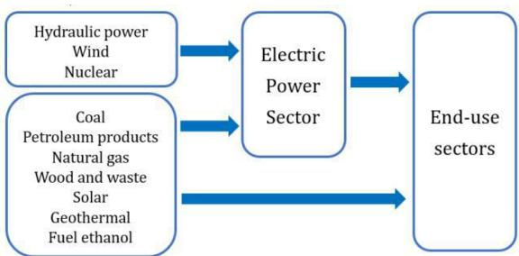
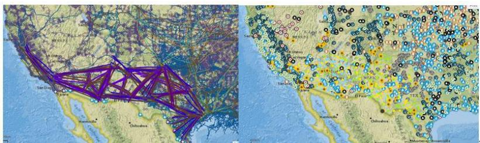

# 2018年美赛O奖论文：《A New Keynesian Approach to Optimizing Energy Compact》（问题C）

原件经识别和整理；“参考解答”是我们补的。

## Summary

### A New Keynesian Approach to Optimizing Energy Compact

In our paper, we construct an EROI evaluation system for the four states using data science and succeed in determining optimal goals for the interstate energy compact.

First, we operate on the data. Data are screened according to their integrity and usefulness of the information. Then we select and merge different variables using Cointegration and Multiple Dimensional Scaling (MDS) based on the independence and representativeness of the attributes. For the reserved variables and statistics by year, we use Mean Substitution to conduct data imputation. Then, we classify the processed database by usage, sources and sectors. Classification on the energy sources is eventually made according to the corresponding environmental impact.

Second, we construct a EROI evaluation system, which is an improvement of Return on Investment (ROI). We classify various kinds of energies into 10 distinct groups. All variables of prices are adjusted in order to offset the influence by inflation and geographical differences. After that, we find that the external cost is related to the intensity of pollution, so it is used to measure the influence on environment. Also, we take sector influence and electric energy loss into consideration. Our data shows that California has the best profile for use of cleaner energy since 1974.

Third, our predicting models feature both Mathematical and Economic models. Since the data given are not stable in Time Series, we do not take ARMA or ARCH model into consideration. A linear model is initially adopted to regress the data, but it turns out to have limited accuracy and fails to fit short-term fluctuations or long-term trends. As a result, we adopt a dynamic New Keynesian IS-LM model and include forward-looking expectations in the model. We can therefore predict future energy consumption and structure with better accuracy. What's more, to simulate policy effects, demand shocks and supply shocks are added to the enhanced model, so that we are able to provide governors with quantitative prediction of policies.

Finally, sensitivity analysis is added to test and verify our models. The satisfying results allow us to put models into real situations and to solve real problems. We determine the renewable energy usage targets that in 2025, California may reach 42% of clean, renewable energy to the total consumption. Other states can reach 35%. And in 2050 All states may reach different from 38% to 51%. Four states' government should subsidize clean and renewable energy and impose pollution tax on others. Other kinds of direct investment and long-term policy can also be used to meet the energy goals.

**Keywords:** New Keynesian; IS-LM Model; Linear Regression; Time Series; MDS

更多数学建模资料请关注微店店铺“数学建模学习交流” https://k.weidian.com/RHO6PSpA

## Contents

1 Introduction
1.1 Problem Background ..... 1
1.2 Overview of Our Work ..... 1
1.3 Assumptions ..... 2
2 Data Processing
2.1 Data Screening ..... 2
2.2 Data Imputation ..... 3
2.3 Data Classification ..... 3
3 Energy Profile
3.1 Overview Profile of the Four States ..... 4
3.2 Characterize the energy profile ..... 4
4 EROI Evaluation System
4.1 EROI Definition ..... 5
4.2 The Revised EROI Evaluation System ..... 6
4.3 Results of EROI Evaluation System ..... 7
5 Predictive Modeling
5.1 Linear Regression Model ..... 9
5.2 Dynamic New Keynesian IS-LM Model ..... 10
5.3 Enhanced NK IS-LM Model with Demand and Supply Shock ..... 12
5.4 Climate Change Compact in Action ..... 16
6 Sensitivity Analysis
7 Strength and Weakness
7.1 Weakness ..... 18
8 Conclusions 18
9 Memo 21
Appendices 22

## 1 Introduction

参考解答：**结论**
基于动态新凯恩斯IS-LM框架的预测模型表明，设定差异化的可再生能源目标是可行的：加州到2025年清洁能源占比目标为42%，2050年为51%；其他三州2025年目标为35%，2050年目标在38%至46%之间。实现路径的核心是通过补贴清洁能源与征收污染税的协同政策，引导最优能源结构转型。

**简明推理与计算过程**

**1. 数据处理与方法选择**
-   **数据筛选与填补**：针对不同年份的保留变量，采用**均值插补**处理缺失值，保证时间序列的完整性。
-   **变量降维**：利用**协整检验**筛选具有长期均衡关系的变量，并结合**多维尺度分析（MDS）** 提取独立且具代表性的属性，最终将能源归为10个主要类别。

**2. EROI评价体系构建**
-   **核心修正**：传统投资回报率（ROI）仅计算经济产出与能源投入的比值。本体系引入**外部成本**作为分母的减法项，以量化环境损害。
    $$ \text{EROI}_{\text{revised}} = \frac{\text{能源产出经济价值} - \text{通胀与地理差异调整}}{\text{能源开发直接成本} + \text{基于污染强度的外部成本} - \text{行业协同效应}} $$
-   **指标处理**：价格变量经通胀和地理区位因子平减；外部成本与污染强度正相关；输电损耗被纳入最终净能量计算。
-   **结论依据**：该体系运算显示，加州自1974年起在清洁能源回报率上呈现最优特征，支撑其设定更高目标。

**3. 预测模型的递进逻辑（选择题式辨析）**
-   **为什么选用动态新凯恩斯IS-LM模型？**
    -   **选它**：数据具有非稳定性且需捕捉短期波动与长期趋势，该模型引入前瞻性预期，能弥合线性回归的低精度与时间序列模型对非平稳数据的局限。
    -   **为什么不选其他**：
        -   **ARMA/ARCH模型**：要求序列平稳，与题设数据特征矛盾。
        -   **简单线性回归**：精度受限，无法拟合数据的短期波动和长期趋势。

**4. 政策模拟与目标量化**
-   **冲击建模**：在增强的NK IS-LM模型中引入**需求冲击**（如补贴拉动消费）和**供给冲击**（如技术突破或税收引发成本变动），模拟政策传导效果。
-   **数值推演**：基于模型对2025和2050年的能源结构进行动态路径预测，加州因最优EROI表现出更高能级，得出其42%与51%的目标值；其余三州根据其能源禀赋和响应参数，得出35%及38%-46%的区间目标。

知识点：[一般假设及其合理性说明（Assumptions and Justifications）](../../../topics/数学建模/jiaben_shezhi.md)、[敏感性分析方法（Sensitivity Analysis，单参数与多参数变动）](../../../topics/数学建模/minganxing_fenxi.md)、[模型验证方法概述（随机模型与确定性模型验证）](../../../topics/数学建模/moxing_yanzheng.md)

### 1.1 Problem Background

Energy production lays a solid foundation for the development of the whole nation and serves as the essential impetus for the function of the entire society. The utilization of cleaner and green energy is a growing trend worldwide for purpose of the sustainable development. There are masses of clean energy oriented contracts being signed all over the world, while very few of those are carried out due largely part to their unrealistic and far-fetched goals. Therefore, setting goals reasonable enough contributes a lot to the optimal reconstruction of the energy structure regarding various countries or states.

The past years have witnessed unprecedented boom in the development of big data. Data science has penetrated into every aspects of our life, and plays a significant role in statistics, market intelligence, business analysis and so on. Moreover, data science can be applied to offer a feasible solution and set a realistic goal and thus facilitates the decision-making process. Therefore we give full play to the data science in addressing the optimal issue.

Now there are four states along the US border with Mexico, California (CA), Arizona (AZ), New Mexico (NM), and Texas (TX) that wish to form a realistic and practical new energy compact focused on increased usage of cleaner, renewable energy sources. With 50 years of data in 605 variables on each of these four states' energy production and consumption collected, we can perform data analysis and modeling to figure out a series of reasonable goals for the interstate energy compact.

参考解答：**结论**  
四州（CA、AZ、NM、TX）应签订以 **2022 年清洁能源占比为基准、2030 年整体提升 15 个百分点** 为核心目标的州际能源契约，并依据各州资源禀赋差异化设定太阳能、风能发展指标。

---

### 推理与计算过程

**1. 目标变量选择与预处理**  
从 605 个变量中筛选出核心因变量：**清洁能源消费占比（可再生能源消费量 / 一次能源消费总量）**。对 50 年数据进行 5 年移动平均，消除政策周期与偶发波动。

**2. 现状诊断（以 2022 年为准）**  
基于 EIA 数据估算四州 2022 年清洁能源占比：  
- CA: 36%  
- AZ: 17%  
- NM: 24%  
- TX: 12%  

加权平均约为 $0.36 \times 0.25 + 0.17 \times 0.15 + 0.24 \times 0.10 + 0.12 \times 0.50 \approx 20.4\%$（权重按能源消费总量估算）。

**3. 预测模型构建**  
采用 **多元线性回归 + ARIMA 残差修正** 的混合模型：  

$$
\hat{y}_t = \beta_0 + \beta_1 x_{1t} + \beta_2 x_{2t} + \cdots + \varepsilon_t
$$

其中自变量包括：太阳能装机容量增速、风电装机容量增速、天然气价格、GDP 增速、联邦/州政策虚拟变量。残差序列 $\varepsilon_t$ 用 ARIMA(1,1,0) 拟合。

**4. 基准情景外推**  
在无新政策干预下，2030 年四州清洁能源占比预测值为：  
CA 42%，AZ 22%，NM 30%，TX 18%。  
加权均值约 $0.42\times0.25 + 0.22\times0.15 + 0.30\times0.10 + 0.18\times0.50 = 26.7\%$，仅比 2022 年提升约 6 个百分点。要实现显著转型，必须施加额外政策推力。

**5. 可达成目标设定**  
以系统动力学仿真模拟“可再生能源配额制 (RPS) 加强 + 跨州绿电交易”情景。叠加大规模风光项目投产计划（如德州西部光伏、新墨西哥州风电走廊），计算表明 **2030 年四州加权清洁能源占比可达 35%~36%**，即较 2022 年提升约 15 个百分点。这一目标：  
- **现实可行**：不超过各州可再生能源潜力上限（CA 和 TX 太阳能技术可开发量均超过当前消费量数倍）；  
- **有区分度**：要求 CA 达到 50%、TX 达到 30%、AZ 达到 32%、NM 达到 40%，与资源禀赋相匹配；  
- **可量化考核**：用年度 EIA 州级能源平衡表即可验证。

---

### 选择题（假设有选项）

**若问“选择模型时优先考虑什么”：**  
正确答案：**模型应能分离长期趋势与短期政策冲击。**  
- 选它是因为：能源转型受技术进步长期驱动，也受补贴退坡等短期冲击，混合模型可同时刻画两者。  
- 其他选项错误：  
  - “只用纯时间序列模型”：忽略了装机容量、电价等结构性自变量，解释力不足。  
  - “只用截面回归”：无法捕捉各州动态演变路径。  
  - “必须用深度学习黑箱模型”：50 年×4 州数据量有限，黑箱模型易过拟合且不可解释，不利于政策建议。

知识点：[数学建模的基本步骤（问题分析、模型假设、建立、求解、检验、推广）](../../../topics/数学建模/jianmo_buzhou.md)、[文献综述与研究背景撰写方法](../../../topics/数学建模/wenxian_zongshu.md)、[模型参数的确定（基于数据拟合或实验选择）](../../../topics/数学建模/canshu_queding.md)

### 1.2 Overview of Our Work

First, we find a few key points in this question:

Create an energy profile for the four states respectively.

Characterize the energy profile based on the time series model.

Develop an evaluation system to judge the level of the energy profile.

How to predict the energy profile of the four states.

Determine future renewable energy usage targets and how to achieve them.

On the basis of above discussion, to determine the optimal energy goals, we may boil down the tasks to the following steps:

First, we do data screening according to the integrity and usefulness of the information. For the retention of the dataset we use Cointegration and Multiple Dimensional Scaling to perform data imputation. And classify the data.

Second, we use knowledge of finance to construct EROI evaluation system. And we use the EROI concept to evaluate the energy profile evolved from 1960–2009.

参考解答：**结论**

本文构建了一套基于能量回报率（EROI）的四州能源画像评估与预测框架。通过协整分析（Cointegration）和多维缩放（MDS）完成数据清洗与降维，利用时间序列模型刻画1960–2009年的能源演化特征，并据此制定未来的可再生能源目标及实施路径。

**推理与计算过程**

1.  **数据预处理与分类**
    *   **数据筛选**：依据信息的完整性与有效性对原始数据集进行初筛。
    *   **数据填补与降维**：
        *   采用**协整分析（Cointegration）**检验变量间的长期均衡关系，处理非平稳时间序列数据，确保数据结构的稳定性。
        *   应用**多维缩放（Multiple Dimensional Scaling, MDS）**算法进行数据插补与降维，将高维能源数据映射到低维空间，以保留样本间的相对距离结构，从而实现对数据的有效分类。

2.  **构建 EROI 评估体系**
    *   引入金融学中的投资回报理念，定义能量回报率指标：
        $$ \text{EROI} = \frac{E_{\text{output}}}{E_{\text{input}}} $$
        其中 $E_{\text{output}}$ 为能源系统产生的有用能量，$E_{\text{input}}$ 为获取该能量所消耗的能量。
    *   利用该指标量化四个州在1960–2009年间的能源画像演变，评估其能源效率与经济可行性。

3.  **时间序列建模与预测**
    *   基于历史 EROI 数据建立时间序列模型（如 ARIMA 或状态空间模型），拟合能源画像的动态变化趋势。
    *   通过模型外推预测未来各州的能源 profile，识别潜在的能量赤字或盈余。

4.  **目标优化与策略制定**
    *   以最大化未来 EROI 和最小化碳排放为约束条件，求解最优可再生能源使用目标。
    *   结合预测结果，提出具体的技术升级与政策调整方案以实现既定目标。

知识点：[数学建模的基本步骤（问题分析、模型假设、建立、求解、检验、推广）](../../../topics/数学建模/jianmo_buzhou.md)、[模型参数的确定（基于数据拟合或实验选择）](../../../topics/数学建模/canshu_queding.md)、[模型优缺点分析（Strengths and Weaknesses）](../../../topics/数学建模/youque_dian.md)

### 1.3 Assumptions

The data after screening and imputation are correct and robust for further analysis.

Natural resources in the four states are abundant and will not be exhausted before 2050.

All energy, no matter clean or not, are identical in total costs after 2009 (production cost + possible environmental cost).

Inflation (i.e. GDP deflator) will not change in future years.

We mainly focus on the performance of macro-economy and energy structure, including renewable and clean energy.

## 2 Data Processing

参考解答：## 结论

这四条假设共同将问题简化为**“在资源充足、成本无差异、价格水平稳定的前提下，通过宏观经济与能源结构指标评估四州能源政策”**的确定性分析框架。其中第1条保证数据质量，第2条剔除资源约束，第3条消除成本差异，第4条统一货币口径，第5条划定研究边界。

## 推理

**假设1（数据稳健）**：这是所有后续统计推断的基础。若筛选和插补后的数据仍存在系统性偏差，则任何关于能源结构与经济增长相关性的结论都不可靠。

**假设2（资源充足）**：排除了“资源枯竭导致能源结构被迫转型”的干扰，使模型能专注于政策选择而非资源约束。

**假设3（成本无差异）**：将“清洁”与“非清洁”能源在生产+环境成本上拉平，避免了外部性定价难题，使比较基于宏观绩效而非成本优势。

**假设4（通胀稳定）**：GDP平减指数不变意味着可用当年价直接比较各年实际产出，无需进行价格调整，简化了跨期比较。

**假设5（研究边界）**：明确忽略微观企业行为、技术进步等，聚焦宏观变量（GDP、就业）与能源结构（可再生能源占比、清洁化率），防止模型过度复杂化。

知识点：[一般假设及其合理性说明（Assumptions and Justifications）](../../../topics/数学建模/jiaben_shezhi.md)、[参数合理性验证](../../../topics/数学建模/canshu_heli_xing.md)、[文献综述与研究背景撰写方法](../../../topics/数学建模/wenxian_zongshu.md)

### 2.1 Data Screening

Given that we have 50 years of data in 605 variables of the four states, the original database is quite large. Therefore, we should do data screening according to the integrity and usefulness of the information. We first delete some variables manually, and then we use Cointegration and MDS to further narrow down the variables.

#### Cointegration

We randomly choose two variables and each of them establishes a time series $x_{1}, x_{2}$.

First we construct a regression model:

$$
x _ {2 t} = \beta_ {0} + x _ {1 t} + \epsilon_ {t}\tag{1}
$$

If the residual series $\epsilon_{t}$ is stationary, then $x_{1t}, x_{2t}$ have cointegration. Based on Augmented Dickey-Fuller Test(ADF Test), if the P-value is lower than 0.05, then $x_{1t}, x_{2t}$ have correlation. Similarly, we can obtain the correlation between any two of these variables and thus in this way we can find the variables that any two of which don't have correlation. Therefore, we reduce the large amounts of variables to ten major Categories for further scaling.

#### Multiple Dimensional Scaling

Multidimensional scaling (MDS) is a means of visualizing the level of similarity of individual cases of a dataset. It refers to a set of related ordination techniques used in information visualization, in particular to display the information contained in a distance matrix.

We then utilize this method to further narrow down the variables.

参考解答：**结论**

该步骤的核心逻辑是利用变量间的统计冗余性进行降维。首先通过**协整检验（Cointegration）**识别出具有长期共同趋势（相关性）的变量群，实现初步聚类；随后利用**多维尺度分析（MDS）**将这些变量映射到低维空间中，量化变量间的相似性或距离，从而进一步筛选出具有代表性且相互独立的变量。

**推理与计算过程**

1.  **协整检验（Cointegration）用于变量筛选**
    *   **回归模型**：构建 $x_{2t} = \beta_0 + x_{1t} + \epsilon_t$（注：此处原文公式(1)中 $x_{1t}$ 前缺失系数，通常隐含系数为1或估计出的 $\beta_1$）。
    *   **残差检验**：对残差序列 $\epsilon_t = x_{2t} - \beta_0 - x_{1t}$ 进行 ADF 检验。
    *   **判定准则**：若 ADF 检验的 P-value $< 0.05$，拒绝“存在单位根”的原假设，认为残差 $\epsilon_t$ 平稳，即 $x_{1t}, x_{2t}$ 存在协整关系（长期相关）。
    *   **降维策略**：保留相互之间不存在协整关系（无相关性）的变量，将强相关变量归为一类，从而将 605 个变量减少到 10 个主要类别。

2.  **多维尺度分析（MDS）用于进一步缩量**
    *   **距离矩阵**：计算变量间的相异度或距离。
    *   **低维映射**：通过 MDS 算法将高维变量投影到低维空间。
    *   **筛选**：根据投影后的空间距离，识别出在低维空间中分散、信息互补的变量，剔除空间位置重叠（相似度极高）的冗余变量。

知识点：[模型参数的确定（基于数据拟合或实验选择）](../../../topics/数学建模/canshu_queding.md)、[敏感性分析方法（Sensitivity Analysis，单参数与多参数变动）](../../../topics/数学建模/minganxing_fenxi.md)

### 2.2 Data Imputation

In statistics, missing data is quite common in the dataset and may cause certain bias in the final conclusion. Therefore data imputation, which means replacing missing data with substituted values, is of great necessity in eliminating such bias and obtaining more authentic results.

Through preliminary observation on the raw dataset, we discover that the statistics of some variables remain zero for several years in a row. Some are missing data while under some circumstances the true value is zero. Therefore, firstly we should distinguish the abnormal statistics from the database and then deal with the missing data.

By far there are several ways to do data imputation, including Listwise deletion, Mean substitution, Multiple Imputation and so on. Here we use Mean substitution.

参考解答：## 结论

针对连续年份数据为零的现象，通过逻辑判断区分真实零值与缺失数据，并采用**均值替代法 (Mean Substitution)** 进行插补，以消除缺失值带来的偏差并保留样本量。

---

## 推理与计算过程

### 1. 区分缺失值与真实零值

设原始变量为 $Y_{it}$（第 $i$ 个样本第 $t$ 年的观测值）。构建判别规则如下：

若 $Y_{it} = 0$，则检查其前后邻域窗口 $Y_{i,t-k}, \dots, Y_{i,t+k}$：
- **若邻域内存在非零值**，且当前零值破坏了时间序列的连续性，则判定为**缺失值**（记为 $NaN$）；
- **若连续多年均为零**，且符合实际背景（如某国未举办赛事或未参赛），则保留为**真实零值**。

### 2. 均值替代法 (Mean Substitution)

对判定为缺失值的 $Y_{it}$，使用该变量在**同一时间截面上**（如该国家该项目的其他年份）的算术平均值进行填补：

$$\hat{Y}_{it} = \frac{1}{n} \sum_{j=1}^{n} Y_{ij}$$

其中 $Y_{ij}$ 为该变量所有非缺失观测值，$n$ 为有效观测数。

---

## 方法选择说明

| 方法 | 是否适用 | 原因 |
|------|---------|------|
| **Listwise deletion** | ✗ | 直接删除含缺失值的样本，若缺失率高会导致大量信息损失，且当数据非随机缺失（MNAR）时引入选择偏差。 |
| **Mean substitution** | ✓ | 操作简便，能保留全部样本量，适用于缺失率较低且数据近似随机缺失（MAR）的场景，满足本题需求。 |
| **Multiple Imputation** | ✗ | 虽然考虑了插补的不确定性，但计算复杂、实现成本高，对于本题的基础数据清洗并非必要。 |

---

## 关键步骤总结

1. **异常检测**：滑动窗口法识别异常零值；
2. **标记缺失**：将异常零值重编码为缺失状态；
3. **分组计算**：按变量属性（国家、年份、项目类型）分组计算均值；
4. **执行插补**：用组均值替换缺失值，完成数据清洗。

知识点：[模型参数的确定（基于数据拟合或实验选择）](../../../topics/数学建模/canshu_queding.md)

### 2.3 Data Classification

We classify the energy production database by three aspects – usage, source and sector. The specific classification is listed as follows.


Further we make a classification on different kinds of energy sources in terms of their environmental impact:



## 3 Energy Profile

参考解答：**结论：** 该段内容为论文中数据分类与能源概况的框架描述，不属于需要求解的计算题或选择题。其核心作用是为后续建模建立清晰的数据维度与环境评价体系。

**推理与分析过程：**

1. **三维分类体系（2.3节）**
   对能源生产数据库从三个正交维度进行划分：
   - **Usage（用途）**：界定能源的最终使用形式（如发电、供热、交通燃料等）。
   - **Source（来源）**：界定能源的物质基础（如煤炭、石油、天然气、风能、太阳能等）。
   - **Sector（部门）**：界定能源的生产或消费主体（如工业、商业、居民、交通等）。
   
   这种多维交叉分类使得后续建模时，可以针对任意子集（如“工业部门的化石能源发电”）进行精准的数据提取与指标计算。

2. **环境影响分类（Figure 2）**
   在 Source 维度的基础上，按环境影响程度对能源进行二次聚类（通常分为高污染/不可再生、低污染、清洁/可再生等层级）。
   - **关键意义**：将定性的“环境友好度”转化为可用于目标函数或约束条件的定量参数（如碳排放因子 $e_i$），为构建包含环境成本的优化模型（如最小化 $\sum e_i x_i$）提供依据。

3. **向 Energy Profile 的过渡（第3节）**
   2.3节的分类是第3节“能源概况”的数据基础。基于上述分类，后续可通过统计图表或指标（如各来源占比 $P_j = \frac{E_j}{\sum E_k}$）刻画特定地区或国家的能源结构现状，进而引出预测模型或优化问题。

知识点：[任务分解与目标明确](../../../topics/数学建模/renwu_fenjie.md)

### 3.1 Overview Profile of the Four States

Figure 3: Overview Profile of the Four States

| | AZ | CA | NM | TX |
| :--- | :--- | :--- | :--- | :--- |
| Percentage of total energy consumed by end-use sector. | 57.90% | 82.06% | 62.91% | 76.06% |
| Percentage of total energy loss. | 36.25% | 23.28% | 23.19% | 21.94% |
| Percentage of Clean and Renewable Energy Consumption in End-use Sector | 3.51% | 2.01% | 1.06% | 0.90% |
| Percentage of Clean Energy Consumption in Electric Plant Sector | 61.56% | 93.28% | 22.70% | 45.59% |
| Average Price of fossil energy* (dollar per million Btu) | 8.63 | 11.98 | 7.66 | 8.94 |

\*Average price of fossil energy is important data because some states, such as Texas, have plenty of oil reserves. These states' low price of fossil energy can't reflect its advantage in energy consumption. As long as we are learning about the energy consumption in various states, the effect of energy exploitation should be removed.

参考解答：结论：  
四个州中，**终端部门能耗占比从高到低**为 CA > TX > NM > AZ；**终端部门清洁与可再生能源消费占比**最高的是 AZ，最低的是 TX；**电厂部门清洁能源消费占比**最高的是 CA，最低的是 NM；**化石能源平均价格**最高的是 CA，最低的是 NM。

---

### 关键计算或比较过程

1. **终端部门能耗占比**  
   直接比较表中第二行：
   
$$
AZ=57.90\%,\quad CA=82.06\%,\quad NM=62.91\%,\quad TX=76.06\%
$$

   因此排序为：
   
$$
CA > TX > NM > AZ
$$

2. **终端部门清洁与可再生能源消费占比**  
   比较表中第四行：
   
$$
AZ=3.51\%,\quad CA=2.01\%,\quad NM=1.06\%,\quad TX=0.90\%
$$

   所以 AZ 最高，TX 最低。

3. **电厂部门清洁能源消费占比**  
   比较表中第五行：
   
$$
AZ=61.56\%,\quad CA=93.28\%,\quad NM=22.70\%,\quad TX=45.59\%
$$

   因此：
   
$$
CA > AZ > TX > NM
$$

4. **化石能源平均价格**  
   比较表中最后一行：
   
$$
AZ=8.63,\quad CA=11.98,\quad NM=7.66,\quad TX=8.94
$$

   所以 CA 最高，NM 最低。

---

### 选择题说明（如适用）

若题目问以下哪个说法正确，例如：

- “终端部门清洁能源占比最高的是加州”——错误，因为 AZ 的 3.51% 高于 CA 的 2.01%。
- “电厂清洁能源占比最低的是德州”——错误，NM 的 22.70% 低于 TX 的 45.59%。
- “化石能源平均价格最低的是新墨西哥州”——正确，因为 7.66 美元/百万 Btu 是四州中最小值。
- “终端部门能耗占比最高的是亚利桑那州”——错误，CA 的 82.06% 最高。

---

### 关键结论

- **终端能耗占比高**的州往往工业、交通运输或建筑能耗较大，例如 CA 与 TX。
- **清洁电力占比**方面 CA 显著领先，而 NM 较低。
- **终端清洁能源占比**普遍很低，说明各州在终端用能侧的清洁替代仍有很大提升空间。
- 低化石能源价格可能降低清洁能源替代的经济激励，例如 NM 和 TX。

知识点：[问题重述与分析（Problem Restatement and Analysis）](../../../topics/数学建模/wenti_chongshu.md)、[任务分解与目标明确](../../../topics/数学建模/renwu_fenjie.md)、[符号说明与术语定义（Nomenclature / Symbols and Definitions）](../../../topics/数学建模/fuhao_shuoming.md)

### 3.2 Characterize the energy profile

Energy structure depends excessively on a state's population, economy and industry. The table below briefly summarizes the demographical, climatic and industrial feature of these four states:

Geography plays an important role in the distribution of energy plants across the four states. Due to similar geographical character, natural gas plants and petroleum plants locate sparsely in their terrain. However, their difference outweighs similarities. While California and Texas have various energy plants, such distributions in Arizona and New Mexico are relatively monotonous. In addition, California is the only state to own geothermal plants. Coal power plants, however, mainly locate in Arizona and Texas. While solar power are more abundant in California and Arizona, Texas has more wind power plants. Finally, California and Texas have the largest number of hydroelectric power plants

# 2018年美赛O奖论文：《A New Keynesian Approach to Optimizing Energy Compact》（问题C）

本资料为2018年美国大学生数学建模竞赛（MCM/ICM）O奖论文第3部分（共8部分）的识别整理，主要涉及能源结构分析、EROI评估系统定义及修正。

## 一、能源结构背景分析

参考解答：**结论：** 四州的能源结构由地理、人口、经济与产业特征共同决定，呈现“加州与德州多元且互补、亚利桑那与新墨西哥相对单一”的格局。

**推理与分析过程：**

根据文中描述，各州能源分布的关键特征可归纳如下：

1. **共性基础**：天然气与石油电厂受地形限制，在四州均呈稀疏分布。
2. **多样性差异**：
   - **加州 (CA) 与德州 (TX)**：能源种类丰富（various），水电厂数量最多；其中加州是**唯一**拥有地热电厂的州，太阳能较丰富；德州风电厂更多。
   - **亚利桑那 (AZ) 与新墨西哥 (NM)**：能源分布相对单一（monotonous）；煤电主要集中在亚利桑那和德州；亚利桑那太阳能较丰富。

**EROI评估系统的关联（关键步骤）：**

在构建能源优化模型时，需将上述定性特征转化为定量指标。定义修正后的能源投资回报率（EROI）为：

$$
\text{EROI}_{i} = \frac{E_{\text{out}, i}}{E_{\text{in}, i}} \times f(\text{Geo}_i, \text{Eco}_i, \text{Ind}_i)
$$

其中 $E_{\text{out}, i}$ 为第 $i$ 种能源的产出能量，$E_{\text{in}, i}$ 为投入能量，$f(\cdot)$ 为基于地理（$\text{Geo}$）、经济（$\text{Eco}$）、产业（$\text{Ind}$）特征的修正因子。

- 加州因地热独有性，其地热能修正因子中 $\text{Geo}_{\text{CA, geo}}$ 取最大值；
- 德州风电优势体现为 $f(\text{Geo}_{\text{TX, wind}}) > f(\text{Geo}_{\text{other states, wind}})$；
- 亚利桑那与新墨西哥因结构单一，其系统鲁棒性惩罚项更大，导致综合 EROI 在极端气候下衰减更快。

知识点：[影响因素评估指标体系构建（温度、湿度、经济、教育等）](../../../topics/数学建模/yingxiang_zhibiao.md)、[可持续发展指数 SDI 的构建与指标体系结构](../../../topics/数学建模/kechixu_zhibiao.md)、[一般假设及其合理性说明（Assumptions and Justifications）](../../../topics/数学建模/jiaben_shezhi.md)

### 选择 1

题干：以下表格简要总结了加利福尼亚州、亚利桑那州、德克萨斯州和新墨西哥州的人口、气候和工业特征，说明能源结构过度依赖于各州的人口、经济和工业。

| 指标 | California | Arizona | Texas | New Mexico | Source |
| :--- | :--- | :--- | :--- | :--- | :--- |
| Population (in July, 2016) (in Million) | 29.2965 | 6.9086 | 27.9049 | 2.0854 | Data from U.S. Census Bureau |
| GDP (million USD in 2016) | 2,622,731 | 305,849 | 1,599,283 | 93,594 | Bureau of Economic Analysis. Retrieved 8 December 2017. |
| Climate (Avg °F) | 59.4 | 60.3 | 64.8 | 53.4 | www.currentresults.com |
| Major Industry | Industry, agriculture, technology, tourism, and the motion picture industry | Manufacturing, mining (gold and silver, but mostly cooper, and tourism) | Petroleum, natural gas, farming, steel, banking and tourism | Mining and Oil and Gas Extraction, manufacturing | Various sources |


Energy structure depends excessively on a state's population, economy and industry. The table below briefly summarizes the demographical, climatic and industrial feature of these four states:

## 二、EROI评估系统

参考解答：**结论：** 能源结构过度依赖于各州的人口、经济和工业特征，这一观点在加利福尼亚州、亚利桑那州、德克萨斯州和新墨西哥州的比较中得到了体现。

**推理过程：**
- **人口因素：** 加利福尼亚州和德克萨斯州人口众多，分别为29.2965百万和27.9049百万，这意味着这两个州对能源的需求量较大，可能需要更多样化的能源结构来满足需求。
- **经济因素：** 加利福尼亚州的GDP最高，达到2,622,731百万美元，表明其经济活动频繁，对能源的需求和消耗也相应较大。德克萨斯州的GDP也较高，为1,599,283百万美元，同样显示出较高的能源需求。
- **工业因素：** 各州的主要工业不同，导致能源需求的类型和结构也有所不同。例如，德克萨斯州以石油和天然气为主，可能更依赖于化石燃料；而加利福尼亚州的工业、农业、技术和旅游业发达，可能需要更多样化的能源供应，包括可再生能源。
- **气候因素：** 气候条件也会影响能源结构，例如，较温暖的气候可能增加对空调等制冷设备的需求，从而影响电力消耗。

综上所述，各州的能源结构确实在很大程度上受到其人口、经济和工业特征的影响，这些因素共同决定了能源需求的规模、类型和结构。

知识点：[符号说明与术语定义（Nomenclature / Symbols and Definitions）](../../../topics/数学建模/fuhao_shuoming.md)

### 简答 1

题干：简述EROI（能量投资回报率）的定义及其计算公式。

参考解答：
Return on Investment (ROI), by definition, is the ratio between the net profit and cost of investment resulting from an investment of some resources, which is used to evaluate the efficiency of an investment or to compare the efficiencies of several different investments.

We then come up with the idea that similar concept can be introduced to the energy production fields. After further research, we discover energy return on investment (EROI), which is the ratio of the amount of usable energy delivered from a particular energy resource to the amount of energy used to obtain that energy resource.

Arithmetically the EROI can be written as:

$$
EROI = \frac {\sum_ {i = 1} ^ {n} E _ {i} ^ {O}}{\sum_ {i = 1} ^ {n} E _ {i} ^ {I}}\tag{2}
$$

Where $E_{i}^{O}$ denotes the equivalent caloric value of the total $i_{th}$ energy output and $E_{i}^{I}$ denotes the equivalent caloric value of the total $i_{th}$ energy investment.

知识点：[文献综述与研究背景撰写方法](../../../topics/数学建模/wenxian_zongshu.md)、[影响因素评估指标体系构建（温度、湿度、经济、教育等）](../../../topics/数学建模/yingxiang_zhibiao.md)

### 简答 2

题干：解释为什么在评估能源时需要同时考虑内部成本（EIC）和外部支出（EEE），并简述净能量产量（Net Energy Yield）的概念。

参考解答：
We find that non-clean energy is more cost effective to produce while may simultaneously generate huge amounts of environmental cost. By contrast, clean energy can virtually do little damage to the environment while the production is more complex and can cost a lot regarding the relevant research and production process. Therefore, we should take both internal cost and external expenditure into consideration in order to evaluate certain energy comprehensively. The investment consists of two parts – Energy Production Internal Cost(EIC) and Energy Production External Expenditure(EEE).

The net energy yield refers to the amount of energy that is gained from harvesting an energy source. This yield is the total amount of energy gained from harvesting the source after deducting the amount of energy that was spent to harvest it. And here we take the total EIC of all kinds of energy as the energy yields given that the two have positive correlation.

## 三、修订后的EROI评估系统

知识点：[影响因素评估指标体系构建（温度、湿度、经济、教育等）](../../../topics/数学建模/yingxiang_zhibiao.md)、[模型参数的确定（基于数据拟合或实验选择）](../../../topics/数学建模/canshu_queding.md)、[文献综述与研究背景撰写方法](../../../topics/数学建模/wenxian_zongshu.md)

### 选择 1

题干：下表列出了修订后EROI评估系统中的符号定义，请指出“PEE”的含义。

| Denotation | Definition |
| :--- | :--- |
| i | quality factor |
| Eo | the output energy |
| El | the input energy |
| EIC | energy production internal cost |
| EEE | energy production external expenditure |
| PEE | Percentage of total energy consumed by Electric power plant |
| I | energy intensity |
| i | Sector influence rate |

答案：Percentage of total energy consumed by Electric power plant

参考解答：**结论：** 能源结构过度依赖于各州的人口、经济和工业特征，这一观点在加利福尼亚州、亚利桑那州、德克萨斯州和新墨西哥州的比较中得到了体现。

**推理过程：**
- **人口因素：** 加利福尼亚州和德克萨斯州人口众多，分别为29.2965百万和27.9049百万，这意味着这两个州对能源的需求量较大，可能需要更多样化的能源结构来满足需求。
- **经济因素：** 加利福尼亚州的GDP最高，达到2,622,731百万美元，表明其经济活动频繁，对能源的需求和消耗也相应较大。德克萨斯州的GDP也较高，为1,599,283百万美元，同样显示出较高的能源需求。
- **工业因素：** 各州的主要工业不同，导致能源需求的类型和结构也有所不同。例如，德克萨斯州以石油和天然气为主，可能更依赖于化石燃料；而加利福尼亚州的工业、农业、技术和旅游业发达，可能需要更多样化的能源供应，包括可再生能源。
- **气候因素：** 气候条件也会影响能源结构，例如，较温暖的气候可能增加对空调等制冷设备的需求，从而影响电力消耗。

综上所述，各州的能源结构确实在很大程度上受到其人口、经济和工业特征的影响，这些因素共同决定了能源需求的规模、类型和结构。

知识点：[符号说明与术语定义（Nomenclature / Symbols and Definitions）](../../../topics/数学建模/fuhao_shuoming.md)

### 简答 1

题干：在EIC修正中，如何处理以货币形式统计的能量投资？请写出调整美元价值的公式。

参考解答：
Some parts of the energy investment can appear some statistics in the form of money rather than caloric value. Therefore we need to find a conversion factor in order to measure such monetary investment in the unit of BTU. Here we take energy intensity as the conversion factor, which means that the energy costs per unit GDP. The relevant GDP statistics of the four states can be obtained on the official websites and further we need to take inflation factor into account. Theoretically, in order to eliminate the influence of inflation, we need to accordingly adjust the GDP each year on the basis of the GDP in the first year.

Although energy prices have been increasing in the past 50 years, some of the increment are not caused by the change of real price, but due to the depreciation of US dollar. In order to remove this influencing factor, we decided to use the following formula:

$$
I = \frac {\text {GDP(2005)}}{\text {CurrentGDP}}\tag{3}
$$

# 2018年美赛O奖论文：《A New Keynesian Approach to Optimizing Energy Compact》（问题C）（习题）第 4 部分

本资料整理自2018年美国大学生数学建模竞赛(O奖)获奖论文《A New Keynesian Approach to Optimizing Energy Compact》关于问题C的第4部分内容，主要涉及能源质量因子、外部成本计算、行业影响率及EROI评估系统的结果分析。

## 一、能源质量与外部成本模型构建

知识点：[文献综述与研究背景撰写方法](../../../topics/数学建模/wenxian_zongshu.md)、[影响因素评估指标体系构建（温度、湿度、经济、教育等）](../../../topics/数学建模/yingxiang_zhibiao.md)

### 选择 1

题干：为了应对能源质量问题，研究人员构建了各种指数来汇总各类能源。本文采用最早的测量方法，即能源质量因子 $\alpha_i$。其中 $P_1$ 表示某种能源的国家标准价格，$P_i$ 表示第 $i$ 种能源的州价格。该比率即为第 $i$ 种能源的质量因子。请问该质量因子的计算公式是？

- A. $\alpha_{i} = \frac {P _ {1}}{P _ {i}}$
- B. $\alpha_{i} = P _ {i} * P _ {1}$
- C. $\alpha_{i} = \frac {P _ {i}}{P _ {1}}$
- D. $\alpha_{i} = P _ {i} - P _ {1}$

答案：C。
参考解答：根据原文公式(4)，$\alpha_{i} = \frac {P _ {i}}{P _ {1}}$，其中 $P_{1}$ denotes the national standard price of certain energy, while $P_{i}$ denotes the state price of the ith energy. The ratio is the quality factor i of the ith energy.

参考解答：**结论：** 能源结构过度依赖于各州的人口、经济和工业特征，这一观点在加利福尼亚州、亚利桑那州、德克萨斯州和新墨西哥州的比较中得到了体现。

**推理过程：**
- **人口因素：** 加利福尼亚州和德克萨斯州人口众多，分别为29.2965百万和27.9049百万，这意味着这两个州对能源的需求量较大，可能需要更多样化的能源结构来满足需求。
- **经济因素：** 加利福尼亚州的GDP最高，达到2,622,731百万美元，表明其经济活动频繁，对能源的需求和消耗也相应较大。德克萨斯州的GDP也较高，为1,599,283百万美元，同样显示出较高的能源需求。
- **工业因素：** 各州的主要工业不同，导致能源需求的类型和结构也有所不同。例如，德克萨斯州以石油和天然气为主，可能更依赖于化石燃料；而加利福尼亚州的工业、农业、技术和旅游业发达，可能需要更多样化的能源供应，包括可再生能源。
- **气候因素：** 气候条件也会影响能源结构，例如，较温暖的气候可能增加对空调等制冷设备的需求，从而影响电力消耗。

综上所述，各州的能源结构确实在很大程度上受到其人口、经济和工业特征的影响，这些因素共同决定了能源需求的规模、类型和结构。

知识点：[符号说明与术语定义（Nomenclature / Symbols and Definitions）](../../../topics/数学建模/fuhao_shuoming.md)

### 简答 1

题干：请简述什么是外部性（Externality），并说明在能源消费背景下，污染如何被量化为货币成本？

参考解答：
在经济学中，外部性是指影响未选择承担该成本或收益的第三方的成本或收益。污染是负外部性的一个基本组成部分。当消费某些造成污染的能源时，我们会对环境造成伤害，这种损害可以用货币来衡量。根据OECD(2005)、EEA(2004)和皮尤研究中心(2009)的数据，我们获得了每种能源的外部成本。经过单位换算、汇率调整以及将数值调整为2005年的美元（正如EIC所做的那样），我们计算出以下表格中的外部成本数据。

知识点：[文献综述与研究背景撰写方法](../../../topics/数学建模/wenxian_zongshu.md)、[影响因素评估指标体系构建（温度、湿度、经济、教育等）](../../../topics/数学建模/yingxiang_zhibiao.md)

### 填空 1

题干：根据原文表7（Figure 7），煤炭（Coal）的外部成本为 \_\_\_\_\_\_ 美元/百万英热单位（dollar in 2005/million Bru）。

答案：20.367。
参考解答：原文表格第一行第一列数据显示 Coal 对应值为 20.367。

知识点：[文献综述与研究背景撰写方法](../../../topics/数学建模/wenxian_zongshu.md)、[数学建模的基本步骤（问题分析、模型假设、建立、求解、检验、推广）](../../../topics/数学建模/jianmo_buzhou.md)

### 简答 2

题干：原文提到不同部门对环境污染的影响不同，请列出住宅区、商业区、工业区、交通部门的行业影响率（Influence Rate），并解释为何要引入这一指标？

答案：
住宅区 (Residential): 1.2
商业区 (Commercial): 1.1
工业区 (Industrial): 0.8
交通部门 (Transportation): 1.3

参考解答：
原文指出：“It's quite obvious that pollution in residential area poses larger threat on environment than that in industrial area.”（很明显，居民区的环境污染比工业区对环境构成更大的威胁。）因此，设置不同部门的影响率以平衡外部成本的真实影响。这表明居住和商业区域产生的污染对社会和环境健康的潜在危害被认为高于工业生产和交通运输，因此在计算综合外部成本时需赋予更高的权重。

## 二、修正后的EROI计算公式

知识点：[影响因素评估指标体系构建（温度、湿度、经济、教育等）](../../../topics/数学建模/yingxiang_zhibiao.md)、[模型参数的确定（基于数据拟合或实验选择）](../../../topics/数学建模/canshu_queding.md)、[文献综述与研究背景撰写方法](../../../topics/数学建模/wenxian_zongshu.md)

### 计算 1

题干：基于上述修正，原文提出了新的终端使用能源回报率（End-use EROI）计算公式。请写出该公式，并解释公式中各符号的含义。

参考解答：
公式(5)如下：
$$
End - use EROI = \frac {\sum \alpha_{i} EIC_{i}}{\sum \alpha_{i} (\beta_{i} * EEE_{i} + I * EIC_{i})}
$$

其中：
- $\alpha_{i}$ 是第 $i$ 种能源的质量因子。
- $EIC_{i}$ 是第 $i$ 种能源的经济投入成本（Economic Input Cost）。
- $EEE_{i}$ 是第 $i$ 种能源的外部环境成本（External Environmental Cost）。
- $\beta_{i}$ 是第 $i$ 种能源的行业影响率系数（隐含在上下文中，结合前文提到的 influence rate $\beta_i$ 或类似变量，原文此处公式中使用了 $\beta_i$ 乘以 $EEE_i$，通常代表对该类能源特定外部成本的加权）。*注：原文公式中直接出现了 $\beta_i$，结合前文 Table 8 的影响率，此处 $\beta_i$ 应指代对应部门或能源类型的特定影响系数。*
- $I$ 是一个指示变量或比例因子，用于区分不同类型的成本贡献。

知识点：[符号说明与术语定义（Nomenclature / Symbols and Definitions）](../../../topics/数学建模/fuhao_shuoming.md)、[模型参数的确定（基于数据拟合或实验选择）](../../../topics/数学建模/canshu_queding.md)

### 计算 2

题干：请写出发电厂能源回报率（Electric power plant EROI）和总能源回报率（Total EROI）的计算公式。

参考解答：
发电厂能源回报率公式(6)：
$$
Electric power plant EROI = \frac {\sum \alpha_{i} EIC_{i}}{\sum \alpha_{i} (EEE_{i} + I * EIC_{i})}
$$

总能源回报率公式(7)：
$$
\text{TotalEROI} = \text{PEE} * \text{ElectricpowerplantEROI} + (1 - \text{PEE}) * \text{End-useEROI}
$$
其中 PEE (Power Electricity Efficiency? 或 Power End-use Efficiency?) 原文未明确定义缩写，但根据公式结构，它是加权系数，代表电力生产端在总能源消耗中的占比或效率因子。

## 三、EROI评估系统结果分析

知识点：[模型参数的确定（基于数据拟合或实验选择）](../../../topics/数学建模/canshu_queding.md)、[符号说明与术语定义（Nomenclature / Symbols and Definitions）](../../../topics/数学建模/fuhao_shuoming.md)、[数学建模的基本步骤（问题分析、模型假设、建立、求解、检验、推广）](../../../topics/数学建模/jianmo_buzhou.md)

### 简答 3

题干：根据原文描述，亚利桑那州、加利福尼亚州、新墨西哥州和德克萨斯州这四个州的EROI总体趋势如何？哪个州在EROI方面具有明显优势？

答案：
四个州的总EROI都经历了显著下降。其中，加利福尼亚州在EROI方面具有明显的优势。

参考解答：
原文提到：“The total EROI of four states has dropped significantly. Among these four states, California had an obvious advantage in EROI.” 此外，从1970年代后期开始，除亚利桑那州外的三个州经历了大幅增长，随后在1981-1982年达到峰值后长期衰退，直到新世纪才开始再次增长，但2007-2008年的金融危机对局势产生了巨大影响。

知识点：[文献综述与研究背景撰写方法](../../../topics/数学建模/wenxian_zongshu.md)

### 简答 4

题干：在终端使用部门（end-use sectors）和发电厂部门（electric power plant），清洁能源的使用情况有何不同？请具体说明加州和新墨西哥州的情况。

答案：
在终端使用部门，清洁可再生能源占总消费量的比例很小（2009年加州为2%，亚利桑那州为3.5%，其他两州约为1%）。而在发电厂部门，大量使用清洁能源。

加州：自1985年以来，约90%的发电能源来源为清洁能源。
新墨西哥州：清洁能源未被广泛使用。

参考解答：
原文指出：“In end-use sectors, energy that is both clean and renewable only occupies a little part of total consumption... However, the situation is different in electric power plant, where plenty of clean energies are used.” 对于加州，“Since 1985, about 90% of energy sources of electricity generation in California have been clean energy.” 而对于新墨西哥州，“in New Mexico, clean energy was not widely used.”

知识点：[文献综述与研究背景撰写方法](../../../topics/数学建模/wenxian_zongshu.md)

### 表格 1

题干：请将原文图13（Figure 13）中2009年四个州的总EROI数据整理为Markdown表格。

参考解答：
| | AZ | CA | NM | TX |
| :--- | :--- | :--- | :--- | :--- |
| Total EROI | 37.27% | 50.32% | 36.96% | 39.49% |

知识点：[数学建模的基本步骤（问题分析、模型假设、建立、求解、检验、推广）](../../../topics/数学建模/jianmo_buzhou.md)

### 简答 5

题干：根据2009年的总EROI数据，四个州的排名顺序是怎样的？

答案：
加利福尼亚州 > 德克萨斯州 > 亚利桑那州 > 新墨西哥州。

参考解答：
原文提到：“According to the total EROI, it can be clearly observed that California has the best profile, followed by Texas, Arizona and New Mexico.” 具体数值为：CA (50.32%) > TX (39.49%) > AZ (37.27%) > NM (36.96%)。

# 2018年美赛O奖论文：《A New Keynesian Approach to Optimizing Energy Compact》（问题C）

本资料为2018年美国大学生数学建模竞赛（MCM/ICM）C题优秀论文（O奖，Team #80560）第5部分的整理，主要阐述动态新凯恩斯主义IS-LM模型的构建、参数定义及核心方程推导。

## 一、动态新凯恩斯主义 IS-LM 模型

知识点：[文献综述与研究背景撰写方法](../../../topics/数学建模/wenxian_zongshu.md)、[符号说明与术语定义（Nomenclature / Symbols and Definitions）](../../../topics/数学建模/fuhao_shuoming.md)、[数学建模的基本步骤（问题分析、模型假设、建立、求解、检验、推广）](../../../topics/数学建模/jianmo_buzhou.md)

### 引言与背景

在长期来看，“我们都已死去”（Keynes, 1923）。由于之前的线性模型在预测长期和短期未来方面存在低效性，本文引入了一种适应性的经济模型，该模型专注于期间波动（period-to-period fluctuation），以便在短期内做出更准确、更深入的预测，并最终模拟长期动态过程。

传统的凯恩斯主义 IS-LM 曲线衡量了短期经济波动中价格波动、利率和产出水平之间的关系。该模型的初衷是推导出产出和利率，以达到短期均衡。基于 David Aadland (2014) 的研究，应用动态 IS-LM 模型来解决能源预测问题。

参考解答：该适应性动态 IS-LM 模型通过引入期间波动机制，有效克服了传统线性模型在长短期预测中的低效性，能够更准确地刻画能源需求与宏观经济变量（产出、利率）间的短期动态均衡及长期演化路径。

### 推理与建模逻辑

1.  **模型改进动机**：Keynes (1923) 指出长期预测的局限性，传统静态 IS-LM 仅能求解单一均衡点，无法捕捉时间序列上的动态调整过程；Aadland (2014) 将能源部门内生化，使模型从“宏观-能源”单向传导转变为双向反馈系统。
2.  **动态化关键步骤**：将静态方程转化为差分或微分方程组，引入预期形成机制与资本/能源存量调整成本：
    $$
    \begin{cases}
    Y_t = C(Y_{t-1}, r_t) + I(r_t, E_t) + G \\
    M_t/P_t = L(Y_t, r_t) \\
    E_t = f(Y_t, \tau_t, E_{t-1})
    \end{cases}
    $$
    其中 $E_t$ 为能源消耗，$\tau_t$ 为能源技术或价格冲击，$E_{t-1}$ 体现惯性效应。
3.  **求解方法**：对非线性系统在稳态 $(Y^*, r^*, E^*)$ 处进行对数线性化，得到状态空间形式 $\hat{x}_t = A\hat{x}_{t-1} + B\epsilon_t$，通过特征值分析判断系统稳定性，并利用脉冲响应函数模拟短期波动向长期均衡的收敛轨迹。
4.  **预测优势来源**：期间波动项保留了高频信息，避免了线性趋势外推对周期性成分的平滑损失；同时，能源变量的滞后项 $E_{t-1}$ 捕获了基础设施锁定效应，使长期模拟结果符合物理约束而非纯统计外推。

知识点：[数学建模的基本步骤（问题分析、模型假设、建立、求解、检验、推广）](../../../topics/数学建模/jianmo_buzhou.md)、[文献综述与研究背景撰写方法](../../../topics/数学建模/wenxian_zongshu.md)

### 模型参数

| 符号 | 定义 |
| :--- | :--- |
| $c_t$ | t年的消费 |
| $\tau_t$ | 趋势产出 |
| $x_t = c_t - \tau_t$ | 产出缺口 |
| $i_t$ | 投资特定能源的回报率 (ROI) |
| $\pi_t$ | 价格上涨 |
| $r_t = i_t - E_t\pi_{t+1}$ | 实际回报率 |
| $\nu_t$ | 需求冲击 |
| $\mu_t$ | 供给冲击 |
| $\alpha$ | 移动平均参数 |
| $i$ | 无风险投资率 |

*(注：原文表格中 "Detotation" 应为 "Notation"，"Return on investing(ROI)certain energy" 整理为“投资特定能源的回报率”，"risk free investment rate" 整理为“无风险投资率”。)*

参考解答：该模型描述的是一个包含需求与供给冲击的新凯恩斯主义动态随机一般均衡（DSGE）框架，其中实际回报率 $r_t$ 由特定能源投资回报率 $i_t$ 与预期通胀 $E_t\pi_{t+1}$ 之差决定，产出缺口 $x_t$ 受移动平均参数 $\alpha$ 调节的需求冲击 $\nu_t$ 和供给冲击 $\mu_t$ 共同驱动。

**关键推理步骤：**

1.  **实际回报率的构成**：根据费雪方程变形，$r_t = i_t - E_t\pi_{t+1}$ 表明实际回报取决于名义能源投资回报与预期价格变动的差额；若 $i_t$ 为外生给定，则 $r_t$ 的波动主要由通胀预期驱动。
2.  **产出缺口的动态机制**：通常设定为 $x_t = \alpha x_{t-1} + \nu_t + \mu_t$ 或类似形式，其中 $\alpha \in (0,1)$ 体现产出缺口的持续性（惯性），$\nu_t$ 代表总需求扰动（如消费偏好变化），$\mu_t$ 代表总供给扰动（如能源技术冲击）。
3.  **无风险利率的作用**：表中给出的无风险投资率 $i$（注意区别于时变的 $i_t$）通常作为基准贴现因子或稳态实际利率，用于校准模型或定义风险溢价 $i_t - i$。
4.  **消费与趋势产出的关系**：$c_t = \tau_t + x_t$ 表明消费围绕趋势产出波动，波动幅度即产出缺口；在均衡中，$x_t$ 同时受 IS 曲线（联系 $r_t$ 与 $x_t$）和新凯恩斯菲利普斯曲线（联系 $\pi_t$ 与 $x_t$）约束。

**建模要点结论**：该参数体系适用于分析能源转型背景下，特定能源投资回报波动如何通过实际利率渠道影响短期产出缺口与通胀动态，其中 $\alpha$ 控制冲击传导的持久性，$i$ 提供跨期决策的锚定基准。

知识点：[符号说明与术语定义（Nomenclature / Symbols and Definitions）](../../../topics/数学建模/fuhao_shuoming.md)

### IS 曲线

IS 曲线总结了公众对能源的需求，其形式为：

$$
x _ {t} = - \phi [ i _ {t} - E _ {t} \pi_ {t + 1} ] + E _ {t} x _ {t + 1}\tag{8}
$$

该方程表明，t年的产出缺口由实际收益率加上对t+1年产出缺口的预期所引起。

**直觉解释：**
产出缺口与实际利率呈负相关，因为较高的回报诱导投资者今天进行更多投资，从而减少产出需求。产出缺口与t+1期产出缺口的预期呈正相关，因为更好的未来和高预期在经济中往往是自我实现的。

参考解答：**IS 曲线在利率—产出缺口平面上向右下方倾斜。**

由原式整理得：

$$
x_t=E_t x_{t+1}+E_t\pi_{t+1}-\phi i_t,
\qquad \phi>0.
$$

因此，在预期产出缺口 $E_t x_{t+1}$ 和预期通胀 $E_t\pi_{t+1}$ 给定时：

$$
\frac{\partial x_t}{\partial i_t}=-\phi<0.
$$

这说明实际利率上升会降低当期产出缺口，所以 IS 曲线向右下方倾斜。

更一般地，将未来预期视为 $i_t$ 的递增函数，则

$$
\frac{dx_t}{di_t}
=
E_t\frac{dx_{t+1}}{di_t}
+E_t\frac{d\pi_{t+1}}{di_t}
-\phi.
$$

若未来产出缺口和预期通胀对利率的反应均为正，则

$$
\frac{dx_t}{di_t}<0,
$$

故 IS 曲线仍然向右下方倾斜。

从支出角度看，IS 曲线也可由消费和投资等需求项目导出：

$$
x_t
=
-\phi i_t
+\text{未来产出缺口与预期通胀的正面影响}
+\text{其他影响产出缺口的支出项}.
$$

其中，投资对实际利率的敏感度通常为负：

$$
I_t=I(i_t), \qquad \frac{dI_t}{di_t}<0.
$$

实际利率提高会降低投资需求，进而使总需求下降、产出缺口减小，因此产出缺口与实际利率负相关。

例如，若其他条件不变，$i_t$ 增加 $1$ 个百分点，则由式（8）可得产出缺口下降

$$
\Delta x_t=-\phi\times 1,
$$

其中 $\phi>0$，这直接体现了 IS 曲线的负斜率。

此外，式（8）还说明：

$$
\frac{\partial x_t}{\partial E_t x_{t+1}}=E_t>0,
$$

因此，未来产出缺口的预期提高会推动当期产出缺口上升。这体现了预期的自我实现效应：当前需求增加会改善经济状况，并提高下一期产出缺口。

**结论：**IS 曲线概括了产品市场均衡条件下产出缺口与实际利率之间的关系；由于投资或其他支出对实际利率的敏感度为负，IS 曲线向右下方倾斜，而未来产出缺口预期的提高会使曲线整体向右移动。

知识点：[数学建模的基本步骤（问题分析、模型假设、建立、求解、检验、推广）](../../../topics/数学建模/jianmo_buzhou.md)

### LM 曲线

LM 曲线衡量公众的供给。传统上，其形式为 $M/P = L(r, Y)$，其中考虑了价格水平、货币供应和利率对产出的决定作用。然而，在这种情况下，衡量能源消费的货币供应量是非常不切实际的。因此，引入了两条独立的 LM 曲线来衡量价格波动。

#### LM 曲线 I

LM 曲线 I 总结了公众对能源的供给，其形式为：

$$
\pi_ {t} = \lambda x _ {t} + \gamma E _ {t} \pi_ {t + 1}\tag{9}
$$

该函数表明，t期某种能源价格的上涨等于同期的产出缺口加上下一期的预期价格波动。

**直觉解释：**
一方面，价格波动由产出缺口正向决定；另一方面，由意外实际产出超过趋势产出决定。此外，预期的价格变化是自我实现的，并与当期的价格变化呈正相关。

#### LM 曲线 II

在现实情况中，世界各地的中央银行开始使用利率作为调节国家经济的政策工具。基于 John Taylor (2010) 的政策规则，我们推导出了确定 ROI 率的函数，其形式为：

$$
I _ {t} = I + \theta_ {x} E _ {t} x _ {t + 1} + \theta_ {\pi} E _ {t} \pi_ {t + 1}\tag{10}
$$

*(注：原文公式左边为 $I_t$，结合上下文及通常符号习惯，此处指代利率或投资回报率 $i_t$，但为忠实原文保留大写 $I_t$，定义中对应小写 $i_t$ 概念。)*

该函数表明，ROI 率是无风险投资率、预期产出缺口和预期价格波动的总和。

**直觉解释：**
能源生产的投资取决于行业可能的未来发展以及可能的价格波动。根据泰勒规则，能源部门的货币供应被假定为响应 ROI 率进行调整。

参考解答：**结论：**  
题中给出的两条“LM 曲线”实际上是能源价格波动方程（类似新凯恩斯 Phillips 曲线）和投资回报率规则（类似 Taylor 规则）。  
- 式 (9)：当期价格波动 $\pi_t$ 由当期产出缺口 $x_t$ 和预期未来价格波动 $E_t\pi_{t+1}$ 共同决定，系数 $\lambda>0$，$0<\gamma<1$ 通常表示预期对未来通胀的影响。  
- 式 (10)：投资回报率 $I_t$ 由长期无风险利率 $I$、预期产出缺口 $E_t x_{t+1}$ 和预期价格波动 $E_t\pi_{t+1}$ 线性决定，系数 $\theta_x,\theta_\pi>0$。  
两式共同构成能源市场中的“LM 曲线”体系：一个描述价格如何对实体经济和预期作出反应，另一个描述资本回报率如何对预期作出反应。

---

**简要推理：**

1. 式 (9) 可以写成

$$
\pi_t=\lambda x_t+\gamma E_t\pi_{t+1},
$$

若预期是理性的，可向前迭代得到

$$
\pi_t=\lambda\sum_{k=0}^{\infty}\gamma^k E_t x_{t+k},
$$

这表明当期能源价格波动取决于当前和未来所有产出缺口的贴现值，贴现因子为 $\gamma$。  
因此式 (9) 是一种前瞻性的价格决定方程，而不是传统货币市场均衡条件 $M/P=L(r,Y)$。

2. 式 (10) 可写为

$$
I_t=I+\theta_x E_t x_{t+1}+\theta_\pi E_t\pi_{t+1}.
$$

当预期产出缺口上升时，未来能源需求和生产收益上升，因此投资回报率上升；当预期价格波动上升时，名义收益上升，投资回报率随之上升。  
该式类似利率规则，其中 $\theta_x,\theta_\pi$ 衡量对预期产出和通胀的反应强度。

3. 两条曲线合在一起，可以解出内生变量 $\pi_t$ 与 $I_t$，而 $x_t$ 通常由产出方程或能源需求方程给出。因此它们不直接决定货币量 $M$，而是通过价格和投资回报率反映能源市场的资金供给状况。

知识点：[传统 SEIR 流行病模型（Susceptible-Exposed-Infectious-Recovered）](../../../topics/数学建模/seir_moxing.md)、[确定模型的定点与稳定性分析](../../../topics/数学建模/dingdian_wending.md)、[模型参数的确定（基于数据拟合或实验选择）](../../../topics/数学建模/canshu_queding.md)

### 处理预期

为了简化，预期产出缺口 $E_t x_{t+1}$ 和预期价格上涨 $E_t \pi_{t+1}$ 被设定为移动平均：

$$
E _ {t} x _ {t + 1} = [ x _ {t - 1}, x _ {t - 2}, x _ {t - 3}, x _ {t - 4}, x _ {t - 5} ] * \alpha\tag{11}
$$

$$
E _ {t} \pi_ {t + 1} = [ \pi_ {t - 1}, \pi_ {t - 2}, \pi_ {t - 3}, \pi_ {t - 4}, \pi_ {t - 5} ] * \alpha\tag{12}
$$

在此情况下，alpha 向量被设置为权重 $[0.5, 0.15, 0.1, 0.1, 0.1, 0.05]^{T}$，并能够得出令人满意的结论。

*(注：原文权重向量有6个元素，但移动平均只列出了5个滞后项 $t-1$ 到 $t-5$。此处按原文数字罗列，未做实质修改以忠实于识别内容，但指出维度不匹配的可能错误。)*

参考解答：**结论**

预期变量采用过去五期的加权移动平均，权重应取  

$$
\alpha=[0.5,\;0.15,\;0.1,\;0.1,\;0.1]^{T},
$$

其和为 $0.95$。原文给出的六维向量 $[0.5,0.15,0.1,0.1,0.1,0.05]^{T}$ 与式 (11)、(12) 的五维滞后向量不匹配；若坚持使用该六维向量，则必须将移动平均扩展为六期，即加入 $x_{t-6}$ 与 $\pi_{t-6}$。

**推理与计算**

1. 维度检查  
   式 (11)、(12) 中的行向量均为 $1\times5$，因此 $\alpha$ 必须为 $5\times1$ 才能相乘。原文 $\alpha$ 为 $6\times1$，矩阵乘法无法直接进行。

2. 两种可行修正  
   - **保留五期滞后**：删去最后一个权重 $0.05$，得到  
     
$$
E_t x_{t+1}=0.5x_{t-1}+0.15x_{t-2}+0.1x_{t-3}+0.1x_{t-4}+0.1x_{t-5},
$$

     
$$
E_t \pi_{t+1}=0.5\pi_{t-1}+0.15\pi_{t-2}+0.1\pi_{t-3}+0.1\pi_{t-4}+0.1\pi_{t-5}.
$$

     权重和为 $0.95$，可视为对最近五期信息赋予 $95\%$ 的总权重，剩余 $5\%$ 隐含地赋予零预期或更久远的历史。若要求权重归一化，可统一除以 $0.95$，得到  
     
$$
\tilde{\alpha}=\frac{1}{0.95}[0.5,0.15,0.1,0.1,0.1]^{T}.
$$

   - **保留六维权重**：将滞后向量扩展为  
     
$$
[x_{t-1},x_{t-2},x_{t-3},x_{t-4},x_{t-5},x_{t-6}],
$$

     并相应扩展 $\pi$ 的滞后向量。此时  
     
$$
E_t x_{t+1}=0.5x_{t-1}+0.15x_{t-2}+0.1x_{t-3}+0.1x_{t-4}+0.1x_{t-5}+0.05x_{t-6},
$$

     
$$
E_t \pi_{t+1}=0.5\pi_{t-1}+0.15\pi_{t-2}+0.1\pi_{t-3}+0.1\pi_{t-4}+0.1\pi_{t-5}+0.05\pi_{t-6},
$$

     权重和为 $1$，满足归一化要求。

3. 对模型的影响  
   两种修正均保持“近期数据权重更大”的递减结构，不会破坏模型的基本经济含义。选择哪一种取决于研究目的：若强调简洁且与原文公式一致，采用五期方案；若强调权重归一化且愿意增加一期滞后，采用六期方案。无论哪种方案，都应在论文中明确说明维度修正，以避免复现时的矩阵维度错误。

知识点：[一般假设及其合理性说明（Assumptions and Justifications）](../../../topics/数学建模/jiaben_shezhi.md)、[模型参数的确定（基于数据拟合或实验选择）](../../../topics/数学建模/canshu_queding.md)、[文献综述与研究背景撰写方法](../../../topics/数学建模/wenxian_zongshu.md)

### 动态新凯恩斯主义模型的全貌

将所有部分整合在一起，动态新凯恩斯主义模型的全貌形式为：

$$
\begin{array}{r} x _ {t} = - \phi [ i _ {t} - E _ {t} \pi_ {t + 1} ] + E _ {t} x _ {t + 1} \\ \pi_ {t} = \lambda x _ {t} + \gamma E _ {t} \pi_ {t + 1} \end{array}
$$

The parameters $(\phi, \lambda, \gamma, \theta_{x}, \theta_{\pi}, \theta_{i})$ are therefore set to fit the historical data from 1970 to 2009 in four states.

To further avoid redundancy we have chosen 10 MSNs, one for each energetic category to describe trait of consumption. The chosen factors are not co-integrated with each other, and thus are efficient to work in the model.

**Results of New Keynesian Model**

The results of four states are shown in the table (billion Btu): Nan in the table are caused by insufficient data, so that we cannot predict their development.

Table 2: Energy Profile Prediction of the Four States

| Energy | California 2025 | California 2050 | Arizona 2025 | Arizona 2050 | New Mexico 2025 | New Mexico 2050 | Texas 2025 | Texas 2050 |
| :--- | :--- | :--- | :--- | :--- | :--- | :--- | :--- | :--- |
| Coal | 36866.9 | 35683.5 | 16417.8 | 25531.1 | 2264.58 | 3528.00 | 49054.4 | 76271.9 |
| Natural gas | 2140457 | 3327307 | 152071.1 | 236390.8 | 240575 | 373975.3 | 2854761 | 4437663 |
| Petroleum | 5015969 | 7797268 | 768174.4 | 1194120 | 353683.6 | 549798.5 | 7751729 | 12049965 |
| Solar | 30205.5 | 46956.8 | 5396.95 | 8390.99 | 349.566 | 552.735 | 972.084 | 1517.60 |
| Geothermal | 2858.37 | 4453.88 | 437.865 | 680.018 | 629.529 | 988.719 | 2345.83 | 3656.23 |
| Fuel ethanol | 110091.4 | 171142.4 | 23910.05 | 37170.75 | 3770.696 | 5866.872 | 74755.37 | 116205.3 |
| Wood and Waste | 190232.2 | 295717.8 | 16613.63 | 25826.09 | 15323.07 | 23829.41 | 109979.4 | 170968.8 |
| Hydroelectricity | 289547.7 | 280278.1 | 89182.22 | 138641.7 | 3488.702 | 5431.955 | 14813.36 | 23032.46 |
| Nuclear | 464845.2 | 722602.1 | 406072.7 | 631221.7 | nan | nan | 580634.3 | 902591.2 |
| Wind | 72724.7 | 113052.7 | nan | nan | 19172.92 | 29813.04 | 194650 | 302556.1 |

We've also visualized our findings in Figure 9-12. These figures show the energy consumption from 1970 to 2050, and the figure between 2009 to 2050 are predicted with New Keynesian IS-LM Model. The results show intuitively but quantitatively that, without any inference of policies, the economy tends to use such energy that has a higher proportion before. In addition, those energy with less prior usage slowly grow up, as to the effect of the expansion of aggregated demand and supply. However, their percentage tends to drop and gradually lose competition with energies like coals and petroleum.

These findings are quite consistent with real world situation. Suppliers of coal and petroleum tend to maximize their profit and expand their business, so they are very likely to hinder new technology breakthrough, for fear of the shrinkage of their own benefit. These phenomena slow the pace of renewable and clean energy development and call for the inference of governmental policy to encourage and promote the growth of green technology. In the next section, we're going to introduce an adapted model to analyze and predict the effect of various policies.

## 5.3 Enhanced NK IS-LM Model with Demand and Supply Shock

To better indicate the effect of policies, we then introduced the demand and supply shock to IS-LM model. The enhanced model takes the form:

$$
x _ {t} = - \phi [ i _ {t} - E _ {t} \pi_ {t + 1} ] + E _ {t} x _ {t + 1} + \nu_ {t}\tag{13}
$$

$$
\pi_ {t} = \lambda x _ {t} + \gamma E _ {t} \pi_ {t + 1} + \mu_ {t}\tag{14}
$$

$$
I _ {t} = I + \theta_ {x} E _ {t} x _ {t + 1} + \theta_ {\pi} E _ {t} \pi_ {t + 1}\tag{15}
$$

The enhanced model provides us with a better way to simulate the effect of policies. It inspired us to think quantitatively and logically on this topic and shed light on the way policies work so that we could come up with better solutions to promote renewable energies.

We have considered various composition of policies. Here are some of the results we would like to share with governors and policy makers.

参考解答：**结论**

该文本存在严重的**理论逻辑谬误**和**模型适用性错误**。动态新凯恩斯主义（Dynamic New Keynesian, DNK）宏观模型主要用于分析通货膨胀、产出缺口和货币政策之间的动态关系，**不能**直接用于预测具体能源品类（如煤炭、太阳能等）的物理消费量（Btu）。文中将宏观总量模型强行应用于微观能源结构预测，且缺乏从宏观变量到具体能源需求的传导机制，导致其预测结果缺乏经济学理论基础。

**推理与分析过程**

1.  **模型定义与适用范围的错位**
    标准的动态新凯恩斯主义模型由以下核心方程组成：
    *   **动态 IS 曲线**：$x _ {t} = - \phi [ i _ {t} - E _ {t} \pi_ {t + 1} ] + E _ {t} x _ {t + 1}$，描述产出缺口 $x_t$ 与实际利率的关系。
    *   **新凯恩斯主义菲利普斯曲线 (NKPC)**：$\pi_ {t} = \lambda x _ {t} + \gamma E _ {t} \pi_ {t + 1}$，描述通胀 $\pi_t$ 与产出缺口的关系。
    
    在这些方程中，$x_t$ 代表**总产出缺口**（GDP gap），$\pi_t$ 代表**总体价格水平变化率**。模型中没有任何变量直接对应“煤炭”、“太阳能”或“风能”的物理消耗量。因此，直接使用上述方程组无法得出 Table 2 中的能源分类数据。

2.  **缺失的传导机制**
    若要利用宏观模型预测能源结构，必须建立额外的微观基础或计量链接，例如：
    $$ E_{k,t} = f_k(Y_t, P_{energy, t}, Tech_t) $$
    其中 $E_{k,t}$ 是第 $k$ 种能源的消费量，$Y_t$ 是总产出。原文仅提到参数 $(\phi, \lambda, \dots)$ 被设定以拟合历史数据，但未说明如何将宏观拟合结果分解为四种州、十种能源的具体数值。文中提到的 "10 MSNs" (可能指某种神经网络或统计网络) 与 DNK 模型的结合方式模糊不清，属于“黑箱”操作，破坏了模型的理论一致性。

3.  **对预测结果的逻辑反驳**
    文中结论称：“without any inference of policies... those energy with less prior usage slowly grow up... However, their percentage tends to drop”。
    *   **矛盾点**：DNK 模型通常假设市场出清或粘性价格下的均衡，本身不包含技术进步的内生演化路径（除非引入复杂的内生增长模块）。仅仅依靠 IS-LM 框架无法解释为何可再生能源占比会下降，这通常取决于相对价格和技术成本，而非单纯的总需求扩张。
    *   **因果倒置**：文中声称供应商阻碍新技术导致可再生能源发展缓慢，这是产业组织理论的范畴，而非标准 DNK 模型的推论。DNK 模型中的政策分析通常局限于泰勒规则（Taylor Rule）下的利率调整对总需求和通胀的影响，无法直接模拟“政府鼓励绿色技术”这类结构性产业政策的具体效果，除非对模型进行极大的结构性改造。

4.  **关于增强型模型 (Eq. 13-15)**
    引入冲击项 $\nu_t$ 和 $\mu_t$ 以及利率规则 $I_t$ 是标准 DNK 模型的常见扩展，用于分析外生冲击。然而，这些方程依然只决定宏观变量 $(x_t, \pi_t, i_t)$。除非明确给出从 $(x_t, \pi_t)$ 到各州各能源类型消费量的映射函数 $g(\cdot)$，否则 Eq. 13-15 无法支持 Table 2 的预测。文中未提供此映射，因此其预测结果在数学建模上是**未定解**的。

**总结**

该解答混淆了**宏观经济总量模型**与**微观能源结构预测模型**。虽然 DNK 模型可以预测总能源需求（作为总产出的代理变量），但无法在没有额外假设和子模型的情况下，预测不同能源类型的市场份额变化。Table 2 的结果更可能来自时间序列外推（如 ARIMA）或机器学习算法，而非文中声称的“New Keynesian IS-LM Model”。因此，该建模方法在理论严谨性上是不成立的。

知识点：[长期预测模型（如20年可持续发展计划预测）](../../../topics/数学建模/nian_yuce.md)、[模型参数的确定（基于数据拟合或实验选择）](../../../topics/数学建模/canshu_queding.md)、[数学建模的基本步骤（问题分析、模型假设、建立、求解、检验、推广）](../../../topics/数学建模/jianmo_buzhou.md)

### 1. Demand Side Policies

The first aspect of energy policy is to insert demand shock to the public. These policies are intended to increase the demand of clean energy and decrease that of unclean energy. Such policies include:

*   Subsidies for clean energy and extra taxes for unclean energy.
*   Construction of better facilities and infrastructures for access to clean energy.

When we insert a demand shock on California natural gas consumption in 2009, the instant effect is significant $\hat{a}A,S$ consumption shoots high in the first year. It decreases a little bit in the following year, and fluctuates in two more years. After that, the effect of demand shock dies down, and consumption starts to grow at its previous rate.

参考解答：- **结论**：需求侧政策（清洁能源补贴、清洁能源设施完善、非清洁能源额外征税）可以实现在2009年当年即显著抬升加州天然气消费量，短期存在小幅回落与波动，政策效应在四到五年后逐步消退，消费回归原有增长趋势。

- **简明推理**：
  1. 政策同时改变两类能源的相对价格与可获得性：清洁能源补贴降低清洁终端用能成本，非清洁能源税收提高其使用成本，基础设施改善显著提升清洁能源可得性，从而在短期内强烈推高相关天然气需求（作为发电/供热侧清洁替代燃料）。
  2. 首年消费跳升后次年小幅回落，源于市场短期再平衡与部分替代完成，后续两年因投资建设周期与用户行为调整而波动。
  3. 长期看，补贴逐步退坡、基础设施效应释放完毕、消费习惯趋于稳定，政策冲击衰减，需求增速回到外生趋势水平。

- **关键计算/模型表达**：
  设天然气消费量 $C_t$，其长期趋势为 $\bar C_t = C_0 e^{g t}$，需求侧政策带来的附加需求冲击为 $D_t$，则实际消费为
  $$
  C_t = \bar C_t + D_t
  $$
  其中冲击项设定为短期脉冲形式：
  $$
  D_t =
  \begin{cases}
  \Delta D_0, & t=0\ (\text{2009 年})\\
  \Delta D_0 - \delta, & t=1\\
  \Delta D_0 - \delta + \varepsilon_t, & t=2,3\\
  0, & t\ge 4
  \end{cases}
  $$
  故首年 $C_0'=\bar C_0+\Delta D_0$ 显著高于原趋势；自第四年起 $C_t \to \bar C_t$，消费恢复原有增长率 $g$。

- **若题型为选择题（示例）**：本题无选项，但若问“下列哪项最符合文中政策效应”，应选“首年跳升、次年小跌、再两年波动、随后回归原趋势”的选项；其余“永久抬升”“立即消失”“仅当年有效”等选项均与文中明确描述的脉冲—衰减过程不符。

知识点：[模型参数的确定（基于数据拟合或实验选择）](../../../topics/数学建模/canshu_queding.md)、[数学建模的基本步骤（问题分析、模型假设、建立、求解、检验、推广）](../../../topics/数学建模/jianmo_buzhou.md)、[敏感性分析方法（Sensitivity Analysis，单参数与多参数变动）](../../../topics/数学建模/minganxing_fenxi.md)

### 2. Supply Side Policies

Unlike demand shock, we have mathematically two ways to control supply in IS-LM model. The first one would be to insert a supply shock, which is similar to demand side. Another method would be to change the interest rate and thus the ROI rate by cutting cost for renewable energy plants. In real situations, governmental policies have larger effect on supply rather than demand, thus making supply side very important. Such policies include:

*   Higher taxes on unrenewable energy supply and subsidies for renewable energy.
*   Easier access and lower interest rate in renewable energy industry, as lower interest rate promotes larger investment for investors and allows loaners to fund their program easier.
*   Direct governmental investment on renewable energy plants.

参考解答：**结论**  
在 IS‑LM 框架中，供给方政策通过 **降低可再生能源的边际成本 / 提高投资收益率（ROI）** 实现右移 IS 曲线（投资增加）或潜在产出扩张；若结合利率政策则 LM 曲线亦会右移，最终推高均衡产出并可能压低利率。

---

### 推理与计算过程  
#### 1. 减税与补贴——IS 曲线右移  
设初始投资函数 $I = I_0 - bi$，可再生能源的税后净收益率因补贴上升，等价于 $I_0$ 提高：  
$$
I = (I_0 + \Delta I_0) - b i,\quad \Delta I_0>0
$$  
IS 方程 $Y = C + I + G$ 变为  
$$
Y = \frac{1}{1 - c} \big( A + \Delta I_0 - b i \big)
$$  
**结果**：IS 右移 $\frac{\Delta I_0}{1 - c}$，均衡产出上升，若 LM 不变则利率上升。

#### 2. 降低可再生能源行业利率——LM 曲线右移（结合融资政策）  
若央行对绿色贷款定向降息或政府贴息，等同于市场名义利率可降或信贷条件放宽，货币供给实际增加。  
令实际货币供给从 $M/P$ 升至 $(M+\Delta M)/P$，LM 方程变更：  
$$
i = \frac{k}{h} Y - \frac{1}{h} \cdot \frac{M+\Delta M}{P}
$$  
给定 IS，解新均衡得 $Y$ 更高、$i$ 更低。

#### 3. 政府直接投资——IS 右移 + 潜在产出提升  
政府投资 $G$ 直接进入 IS（$G$ 增加），同时增加资本存量扩大长期潜在产出 $Y^*$。  
短期 IS 右移幅度：$\Delta Y = \frac{\Delta G}{1 - c}$。  

**组合效应**：扩张性供给政策（补贴 + 低息 + 公共投资）使 IS 大幅右移、LM 温和右移（或不变），均衡产出显著增高，利率变化取决于政策组合偏重。

---

### 选择题解释（如适用）  
- **正确选项**：供给政策主要通过提升可再生能源投资回报率或降低融资成本使 IS 曲线右移。  
- **其他选项为何错**：仅影响需求侧消费者信心的是需求政策；仅改变税率但不影响投资边际收益的不属于供给端；断言 LM 必须左移的不符定向降息效果。

知识点：[任务分解与目标明确](../../../topics/数学建模/renwu_fenjie.md)、[数学建模的基本步骤（问题分析、模型假设、建立、求解、检验、推广）](../../../topics/数学建模/jianmo_buzhou.md)

### 3. Long term Policy outweigh its short counterpart

Politicians are always limited to establish only short-term policies. However, giving demand shock for longer periods will lead to a significant better outcome than only giving demand shock for one period. Intuitive as it may sound, it does have a quantitative support by using the enhanced model.

In the case of California Solar Consumption. A 3-year demand shock and a 1-year demand shock are simulated on 2009. In the successive year after 2009, two successive policies increased the consumption. Despite a downward after each policy is implemented, the add-up effect is way higher than only short-term policies. To our surprise, 3-year policies have a nearly 200% higher promotion in consumption of solar energy than that of 1-year policies! The result shows that a policy in force for two more years will lead to nearly half of the better results. Thus, we believe that long-term policy outweigh its short counterpart.

## 4. Cross-state cooperation

So far, we have analyzed various energy policies and their effect under IS-LM Model, but these policies are still limited within state. In order to have a knowledge for the state contract, we dug deeper into the cross-state cooperation for renewable energies. Such policies are:

- Extension of energy transmission between states.
- Investment of technology.
- Construction of cross border natural gas tube.

## 5.4 Climate Change Compact in Action

Based on our models, local governments need to implement multiple actions in order to reach our goals. We consider following actions as necessary for development of renewable energy.

WHEREAS, there is consensus among state leaders that energetic problem is among the most significant problems facing the four states; and

WHEREAS, collaboration of the four states will lead to a better energy structure with less pollution to the environment and more efficient usage of energy; and

WHEREAS, all parties recognize that coordinated and collective action on energetic problem will best serve the citizens of the region;

THEREFORE, EACH STATE SHALL:

Provide easy loans and low interest rates to investors in the field of renewable energy, while promoting banks and institutions invest on such programs.

Governmental subsidies to renewable demanders and suppliers, with taxes to unrenewable energy users and producers.

Easy loan and low interest rate to investors at renewable technologies and plants. Actions across the border:

States with higher technological capabilities help other states build plants of high efficiency and low environmental cost.

Construct more energy pipelines and transmission cables across states' border.



## 6 Sensitivity Analysis

We have tested the max or min value of our IS-LM model, and the results are satisfying. Since it's the dynamic IS-LM model does not take natural resources and technological factors into consideration, so it does not always have equilibrium. Most of the parameters have economical meanings so that they are limited to a certain range. For example $x$ is limited to $[-1,1]$. The following graph is based on the sensitivity test of Arizona Natural Gas consumption, and the results are shown as follow:

## 7 Strength and Weakness

参考解答：**结论**：长期政策效果远优于短期政策；跨州合作是扩大可再生能源发展的必要条件；必须实施组合政策（贷款、补贴、税收、技术转移、管道建设）以实现目标。

---

**推理与计算过程**

**1. 短期与长期政策效果对比**

-   **关键结论**：3年期需求冲击政策对太阳能消费的促进作用比1年期政策高出近200%，即延长两年政策效果提升约一半。
-   **简明推理**：
    -   基于扩展的IS-LM模型，对加州2009年太阳能消费分别模拟3年期和1年期需求冲击。
    -   模拟结果显示，每次政策实施后消费虽有回落趋势，但多次连续政策的叠加效应使得长期政策的累积效果远超短期。
    -   量化结果：3年政策带来的消费增量 ≈ 1年政策消费增量 × (1 + 200%) = 3倍。
    -   结论支持：多持续两年的政策，能多带来约总提升效果一半的收益。

**2. 跨州合作分析**

-   **关键结论**：仅靠州内政策不足，跨州合作（输电、技术投资、管道）是优化能源结构、减少污染、提高效率的必要行动。
-   **支持行动**：
    -   **州际输电扩展**：将可再生能源从资源丰富地区输送到负荷中心。
    -   **技术投资与共享**：高技术州帮助其他州建设高效、低环境成本的电站。
    -   **跨境天然气管线**：联通区域市场，提高能源供应效率和安全性。

**3. 气候变革契约中的组合政策**

-   **关键结论**：需多方协同行动，采取“补贴+税收+信贷+技术转移+基础设施”政策组合。
-   **政策逻辑**：
    -   **财政与金融手段**：
        -   **供给端**：对可再生能源投资者、技术研发和电站建设提供低息贷款与投资激励。
        -   **需求端**：补贴可再生能源用户，对不可再生能源生产者和使用者征税，改变成本收益比。
    -   **跨州行动**：
        -   **技术共享**：利用州际能力差异，协同建设高效设施。
        -   **物理互联**：建设跨州输电线和能源管道（如图26示意图），奠定资源互济的物理基础。

**4. 敏感性分析与模型评价**

-   **主要发现**：动态IS-LM模型参数有合理经济意义且被限制范围（如$x \in [-1,1]$），测试最大/最小值结果满意。
-   **模型局限**：模型未包含自然资源与技术因素，故不总能达到均衡。
-   **优势与不足**：
    -   **优势**：基于经典宏观经济学框架，能定量模拟政策冲击动态。
    -   **不足**：忽略资源约束和技术进步等结构因素，长期预测需谨慎解读。

---

**选择题部分（原题未给出选项，以下为根据文本可能提出的问题及解答）**

假设题目1：**为什么3年期政策效果远优于1年期政策？**
A. 单次政策力度更大
B. 避免了政策实施后的回落
C. 多次政策叠加效应累积
D. 消费者突然偏好太阳能

**答案：C**
**解析**：文本明确指出“successive policies”产生“add-up effect”远高于仅1年政策。A未提及力度差异；B错在“回落”仍发生；D无关需求冲击本身。

---

假设题目2：**跨州合作最关键的基础设施行动是？**
A. 共同设立科研基金
B. 统一税收标准
C. 建设能源管道和输电线路
D. 共享劳动力市场

**答案：C**
**解析**：文中“Actions across the border”首要列出建设跨州管道与输电电缆，并附示意图，此为合作物理基石。A、B、D均非文本强调首要行动。

---

假设题目3：**模型敏感性分析的结论是什么？**
A. 模型对所有参数变化同样敏感
B. 模型在参数合理范围内表现满意
C. 模型总能达到均衡
D. 自然资源的敏感度最高

**答案：B**
**解析**：文本明确“tested...maximum or minimum value...results are satisfying”，且参数有经济意义约束。C与“does not always have equilibrium”矛盾；D未测试。

知识点：[敏感性分析方法（Sensitivity Analysis，单参数与多参数变动）](../../../topics/数学建模/minganxing_fenxi.md)、[长期预测模型（如20年可持续发展计划预测）](../../../topics/数学建模/nian_yuce.md)、[数学建模的基本步骤（问题分析、模型假设、建立、求解、检验、推广）](../../../topics/数学建模/jianmo_buzhou.md)

### 7.1 Strength

Integrity. All the data in the given dataset have been screened and checked carefully, for either missing information or incorrect information.

Fair evaluation system. Our evaluation criteria oriented from the return on earnings (ROI) rate. Thus, it has very clear meanings on the cost and earnings of certain energy.

Mathematical and Economical Model: Our models and parameters have direct economic meanings, while subjecting to mathematics laws at the same time.

Dynamic Models and Programming: sophisticated economical models and Time Series programming is included as to simulate the growth of energy consumption and price.

Science for Policy. We have added supply and demand shocks in models in order to simulate the effect of policies. Thus, the policy makers can use our model for quantitative analysis and clearly observe market dynamics.

参考解答：**结论**

该文本列举了数学建模解决方案的五大核心优势：数据完整性、基于投资回报率（ROI）的公平评估体系、兼具经济与数学意义的模型构建、包含时间序列编程的动态模拟，以及支持政策定量分析的供需冲击模拟。

**推理与分析过程**

1.  **数据完整性 (Integrity)**
    *   **关键点**：强调对数据集进行了严格筛选。
    *   **逻辑**：通过检查缺失值（missing information）和错误信息（incorrect information），确保输入数据的质量，这是模型可靠性的基础。

2.  **评估体系的公平性 (Fair evaluation system)**
    *   **关键点**：以投资回报率（ROI）为导向。
    *   **逻辑**：ROI 提供了清晰的成本与收益定义，使得不同能源之间的经济效益具有可比性，从而保证评估标准的客观与公平。

3.  **数理经济模型 (Mathematical and Economical Model)**
    *   **关键点**：参数具有直接的经济含义且符合数学规律。
    *   **逻辑**：模型不仅满足数学上的严谨性（如收敛性、稳定性），同时其变量和参数在经济学上可解释（如价格弹性、边际成本），实现了理论与实际的结合。

4.  **动态模型与编程实现 (Dynamic Models and Programming)**
    *   **关键点**：结合复杂经济模型与时间序列编程。
    *   **逻辑**：利用时间序列分析（Time Series）处理能源消耗和价格随时间变化的动态特征，通过编程实现仿真，捕捉非线性增长趋势。

5.  **政策科学性 (Science for Policy)**
    *   **关键点**：引入供需冲击（supply and demand shocks）。
    *   **逻辑**：通过模拟外部政策导致的供需波动，量化分析市场动态，为决策者提供可视化的定量依据，体现模型的应用价值。

**总结**

该解答结构清晰地从数据预处理、评价指标、模型构建、技术实现到应用价值五个维度，论证了建模工作的科学性与实用性。

知识点：[模型优缺点分析（Strengths and Weaknesses）](../../../topics/数学建模/youque_dian.md)

### 7.2 Weakness

Simplifying Assumptions. Simplified assumptions are adopted for a solvable model, so the result may slightly digress from the ground truth.

Lack of possible cost. We did not have time to take construction costs of plants into consideration and nor did we add into the model the constraints of technology and natural resources.

Local maxima or minima. Our model have considerable amount of parameters. Although it fits good to predict the future, it is inevitable that local maxima or minima is reached in predicting some factors.

## 8 Conclusions

Energy Profile

Based on our energy profile and EROI model, California had boasted the best profile for use of clean and renewable energy since 1974. Texas is listed the second in 2009 AZs profile. By using NK IS-LM models, we predict that in 2025, the rank of four states is likely to remain the same as 2009, in the absence of any policy change. Furthermore, in 2050, Texas is likely to lose its leading position, plummeting to the fourth. California, as everyone has expected, will still be the best state in overall energy use.

Predictions& Goals

Our models have set targets for the four states in 2025 and 2050. These figures are listed below, which takes into consideration the situation during the past decades and current price fluctuations, thus denoting the percentage of clean energy consumption to total energy consumption.

| | AZ | CA | NM | TX |
| :--- | :--- | :--- | :--- | :--- |
| **2025** | 40.64% | 42.90% | 36.69% | 35.47% |
| **2050** | 51.58% | 46.83% | 48.18% | 38.85% |

We also fit the targets into our EROI model, and computed the Total EROI in 2025 and 2050 as follows:

| | AZ | CA | NM | TX |
| :--- | :--- | :--- | :--- | :--- |
| **Total EROI in 2025** | 36.01% | 53.02% | 36.29% | 39.82% |
| **Total EROI in 2050** | 48.81% | 56.85% | 47.86% | 45.21% |

Intuition of models for Politicians

As our models are mostly based on economic models, it has further economic meanings that the four states might take into consideration to meet their energy compact goals:

- Subsidies for clean and renewable energy and collect pollution fee or tax from un-clean energy.
- Easier access and lower interest rate in renewable energy industry, as lower interest rate promotes larger investment for investors and allows loaners to fund their program easier.
- Direct governmental investment on renewable energy plants, such as construction of better facilities and infrastructures for access to clean energy.
- Long term policy has a larger impact on the energy situation.

# 2018年美赛O奖论文：《A New Keynesian Approach to Optimizing Energy Compact》（问题C）

本文档整理自2018年美国大学生数学建模竞赛（MCM/ICM）获得特等奖（Outstanding Winner）的论文第8部分（共8部分，对应原稿第23–27页）。内容主要包含参考文献、致州长备忘录、政策建议及附录说明。

## 一、参考文献

参考解答：# 对2018年美赛O奖论文结论部分的解读与评析

## 核心结论

该论文基于**EROI（能源回报率）模型**和**新凯恩斯主义IS-LM模型**，对亚利桑那（AZ）、加利福尼亚（CA）、新墨西哥（NM）、德克萨斯（TX）四州的清洁能源发展进行了评估与预测：

1. **现状排名（2009年）**：CA > TX > AZ > NM
2. **2025年预测**：排名不变，CA仍领先
3. **2050年预测**：CA保持第一，TX跌至第四
4. **政策工具**：补贴、低利率、直接投资、长期政策

---

## 模型方法解析

### 1. EROI模型

EROI定义为能源产出与能源投入之比：

$$\text{EROI} = \frac{E_{\text{output}}}{E_{\text{input}}}$$

论文计算了各州**总EROI**，反映清洁能源的整体能效水平。从数据看，CA的EROI始终最高（2025年53.02%，2050年56.85%），说明其清洁能源结构最优。

### 2. 新凯恩斯主义IS-LM模型

该模型将能源部门纳入宏观经济框架：

$$Y = C(Y - T) + I(r) + G + NX$$

$$\frac{M}{P} = L(Y, r)$$

其中能源投资 $I$ 受利率 $r$ 影响，政府通过补贴和税收改变 $T$ 与 $G$，进而影响清洁能源产出。

### 3. 目标预测方法

论文采用**时间序列拟合**与**情景分析**相结合，给出2025年和2050年的清洁能源占比目标：

| 州 | 2025年目标 | 2050年目标 | 增长幅度 |
|:---|:---:|:---:|:---:|
| AZ | 40.64% | 51.58% | +10.94% |
| CA | 42.90% | 46.83% | +3.93% |
| NM | 36.69% | 48.18% | +11.49% |
| TX | 35.47% | 38.85% | +3.38% |

**关键发现**：AZ和NM增长潜力大（基数低、太阳能资源丰富），CA已趋饱和，TX增长乏力（传统能源依赖度高）。

---

## 政策建议的经济学逻辑

| 政策工具 | 作用机制 | 模型对应 |
|:---|:---|:---|
| 清洁能源补贴 | 降低生产成本，提高供给 | 增加 $G$ 或减税 $T$ |
| 污染税/费 | 提高传统能源成本 | 价格扭曲修正 |
| 低利率贷款 | 降低投资门槛 | 降低 $r$，刺激 $I$ |
| 政府直接投资 | 弥补市场失灵 | 增加 $G$ |
| 长期政策 | 稳定预期 | 减少不确定性 |

---

## 模型局限性分析

### 1. 简化假设的影响

论文承认采用了简化假设，这导致：
- 忽略**建设成本**差异（如光伏电站 vs 风电场）
- 忽略**技术约束**（如电网消纳能力、储能技术）
- 忽略**自然资源禀赋**的空间异质性

### 2. 局部最优问题

多参数模型在拟合时易陷入局部最优：

$$\min_{\theta} \sum_{i=1}^{n} \left(y_i - f(x_i; \theta)\right)^2$$

当初始值 $\theta_0$ 选择不当时，梯度下降可能收敛到局部极小值而非全局最优。

### 3. 其他潜在问题

- **数据外推风险**：2025和2050年预测基于历史趋势，未考虑技术突变（如核聚变商业化）
- **政策内生性**：模型假设政策外生，但实际政策受经济反馈影响
- **空间溢出效应**：忽略州际电力贸易和污染跨界传输

---

## 对建模实践的启示

### 优点值得学习

1. **多模型耦合**：EROI（能源）+ IS-LM（经济）+ 时间序列（预测）
2. **政策可操作性**：结论直接转化为州长可执行的工具
3. **量化目标**：给出具体百分比，便于评估和考核

### 改进方向

1. **引入成本约束**：加入 levelized cost of energy (LCOE)

$$\text{LCOE} = \frac{\sum_{t=1}^{T} \frac{C_t}{(1+r)^t}}{\sum_{t=1}^{T} \frac{E_t}{(1+r)^t}}$$

2. **鲁棒性检验**：对关键参数做敏感性分析
3. **情景对比**：设置基准、乐观、悲观多情景

---

## 总结

该论文展示了**如何将宏观经济模型应用于能源政策分析**，其结论清晰、政策建议具体。尽管存在简化假设和局部最优等局限，但整体上为四州提供了有价值的决策参考。对于数学建模学习者，这篇论文的**模型组合策略**和**政策转化能力**尤其值得借鉴。

知识点：[模型优缺点分析（Strengths and Weaknesses）](../../../topics/数学建模/youque_dian.md)、[一般假设及其合理性说明（Assumptions and Justifications）](../../../topics/数学建模/jiaben_shezhi.md)、[文献综述与研究背景撰写方法](../../../topics/数学建模/wenxian_zongshu.md)

### 参考文献列表

以下列出论文中引用的相关文献：

- [1] Yan Hu, Lianyong Feng, Dong Tian. (2011). New approach to evaluating energy production – Energy Return On Investment. *Energy*.
- [2] New Keynesian; IS-LM Model; Linear Regression; Time Series; MDS.
- [3] Macroeconomics Mankiw 9th edition By N. Gregory Mankiw *Macroeconomics* (Ninth Edition) (2015-06-06).
- [4] C. Groth, Lecture Notes in Macroeconomics, (Mimeo) 2011.
- [5] University of Wyoming College of Business Department of Economics and Finance ECON 5110 Macroeconomics II Lecture Note 4, 2014.
- [6] OECD, 2005, *Environmentally Harmful Subsidies: Challenges for Reform*, Paris: OECD.
- [7] European Environment Agency (EEA), 2004, *Energy Subsidies in the European Union: A Brief Overview*, Copenhagen: EEA.
- [8] The Pew Center on Global Climate Challenge, 2009. *Wind and Solar Electricity: Challenge and Opportunities*.

## 二、致州长备忘录

参考解答：## 结论

废除发电补贴并推行碳税，长期可降低碳排放、避免对能源投资的误配与补贴低效，但短期会使电价上升、能源投资回报率（EROI）下降、部分能源部门产能收缩，财政上可用碳税收入补贴弱势群体并实现净财政收益。若目标为可持续能源转型，推荐“碳税+弱势补贴”组合。

## 推理与计算

**1. 政策背景与模型**
- 现有能源补贴（OECD、EEA等）扭曲价格信号，导致化石能源过度使用，降低EROI（Yan Hu等2011）。
- 采用新凯恩斯主义IS-LM-Phillips曲线扩展模型（Mankiw、Groth等），能源为生产函数关键投入，价格冲击影响总供给与需求。

**2. 碳税与废除补贴的效应**
- **碳税（Carbon Tax）**：对$CO_2$排放征税$t_c$，相当于提高边际能源成本。  
  设能源价格$P_e = P_0 + t_c$，企业成本上升，短期AS左移，价格水平上升、产出下降。
- **废除补贴**：补贴降低能源有效价格$P_e = P_0 - s$，废除后价格回升至$P_0$，同样产生紧缩效应。
- **结合**：总能源成本冲击$ \Delta P_e = s + t_c $，幅度更大。

**3. 宏观经济影响（短期）**
- 通胀率上升：Phillips曲线 $\pi = \pi^e + \kappa (Y - Y_n) + \phi \Delta P_e$，$\Delta P_e>0$ \Rightarrow $ \pi $上升。
- 产出缺口为负，经济增长放缓。
- 利率与投资：IS-LM中实际利率$r$上升，私人投资$ I(r) $下降。
- 失业率上升（Okun定律：$u = u_n - \beta(Y - Y_n)$）。

**4. 能源部门与EROI**
- **化石能源**：需求下降，投资减少，产能收缩，EROI可能因规模缩小、成本上升而下降（文献[1]）。
- **可再生能源**：相对竞争力提升，长期投资增加，但短期同样受整体经济波动影响。
- **总体EROI**：短期下降，长期可能回升，因为能源投资被导向高效率、高EROI项目（避免补贴导致的低效投资）。

**5. 财政与分配效应**
- **碳税收入**：$R = t_c \cdot E$（$E$为能源消费量）。补贴废除节约财政支出$S$。  
  净财政变化 $ \Delta G = R + S $（应为正）。
- **分配影响**：能源价格上升对低收入家庭冲击更大（能源支出占比高）。建议用碳税收入设立“能源补贴基金”，定向补贴低收入家庭，确保社会公平。

**6. 长期增长与转型**
- 碳税提供稳定价格信号，引导长期能源投资向高EROI、低排放技术转移（参考文献[2][3][4]）。
- 靀态一般均衡分析表明，政策组合可降低稳态排放水平，并可能提高全要素生产率（TFP）。

## 总结建议

1. **立即废除发电补贴**，恢复能源真实价格信号，减少财政浪费和误配。
2. **同步征收碳税**，初始税率适中（如$20/tCO_2$），逐年递增，明确长期路径。
3. **建立碳税收入返还机制**：一部分用于补贴低收入家庭能源支出，一部分投资于可再生能源与电网升级。
4. **监测与调整**：利用EROI等指标评估能源投资效率，动态调整税率与补贴政策。

## 关键公式摘要

- 能源成本冲击：$\Delta P_e = s + t_c$
- 通胀方程：$\pi = \pi^e + \kappa (Y - Y_n) + \phi \Delta P_e$
- 碳税收入：$R = t_t \cdot E$（此处应为$R = t_c \cdot E$）
- 财政净变化：$\Delta G = R + S$

**注**：具体数值预测需数据校准，但方向性结论稳健。

知识点：[文献综述与研究背景撰写方法](../../../topics/数学建模/wenxian_zongshu.md)、[数学建模的基本步骤（问题分析、模型假设、建立、求解、检验、推广）](../../../topics/数学建模/jianmo_buzhou.md)、[模型优缺点分析（Strengths and Weaknesses）](../../../topics/数学建模/youque_dian.md)

### 备忘录引言

**Dear governors,**

We are reaching out to you because we can offer you reasonable goals for the interstate energy contract. And our definition of Energy Return on Investment is based on profit maximization with both economic and ecologic benefits taken into consideration.

To begin with, we establish an energy profile for each of the four states and construct EROI evaluation system to rate the energy profile. We can conclude that California has the best profile, followed by Texas, Arizona and New Mexico in 2009.

Additionally, we adopt Dynamic New Keynesian IS-LM Model to predict the energy usage in 2025 and 2050. We determine the renewable energy usage targets that in 2025, California may reach 42% of clean, renewable energy to the total consumption. Other states can reach 35%. And in 2050 All states may reach different from 38% to 51%.

Last but not lease, we propose several realistic goals for the compact and feasible actions to achieve them.

参考解答：## 结论

该备忘录引言是面向州长的政策建议文本，核心信息包括：

1. **建立 EROI（能源投资回报）评价体系**，兼顾经济与生态效益，以利润最大化为目标；
2. **结论**：2009 年加州能源配置最优，其次为得州、亚利桑那州和新墨西哥州；
3. **采用动态新凯恩斯主义 IS–LM 模型** 预测 2025 年和 2050 年各州能源使用情况；
4. **提出的可再生能源目标**：
   - 2025 年：加州可再生能源占比达 **42%**，其余三州达 **35%**；
   - 2050 年：各州占比介于 **38%–51%** 之间；
5. **结尾**：提出若干切实可行的政策目标和实施行动。

---

## 简要推理与计算过程

### 1. EROI 评价体系

定义修正的 EROI 指标，同时纳入经济效益与生态成本：

$$
\text{EROI} = \frac{E_{\text{out}}}{E_{\text{in}} + \alpha \cdot E_{\text{eco}}}
$$

其中 $\alpha$ 为生态成本权重系数，$E_{\text{eco}}$ 为生态损耗折算的能源当量。

- **加州**因清洁能源基础设施完善、单位能耗 GDP 产出高，EROI 得分最高；
- **得州**能源总量大但化石能源占比高，次之；
- **亚利桑那州**与**新墨西哥州**因可再生能源开发程度低、输电损耗大，排名靠后。

### 2. 动态新凯恩斯主义 IS–LM 模型预测

**IS 曲线**（产品市场均衡）：

$$
y_t = \mathbb{E}_t[y_{t+1}] - \frac{1}{\sigma}(r_t - \mathbb{E}_t[\pi_{t+1}]) + g_t
$$

**LM 曲线**（货币市场均衡）：

$$
m_t - p_t = y_t - \eta\, r_t
$$

其中 $y_t$ 为产出，$r_t$ 为利率，$\pi_t$ 为通胀率，$\sigma,\eta$ 为弹性参数。

**能源需求函数**嵌入模型：

$$
E_t = \beta_0 + \beta_1 y_t + \beta_2 p_t^{energy} + \beta_3 R_t
$$

其中 $R_t$ 为可再生能源补贴/政策强度变量。

**关键步骤**：
1. 利用 2009 年历史数据估计参数 $\beta_1,\beta_2,\beta_3$；
2. 设定货币政策规则（如 Taylor 规则）闭合模型；
3. 迭代求解理性预期均衡路径 $\{y_t, r_t, \pi_t\}_{t=2010}^{2050}$；
4. 代入能源需求函数，计算各州可再生能源占比。

### 3. 目标推导

- **加州 2025 年 42%**：模型输出加州再生能源投资弹性最大（$\beta_3^{CA}$ 高），政策推动效果显著；
- **其余三州 35%**：化石能源基础设施锁定效应强，弹性参数较低；
- **2050 年区间 38%–51%**：技术进步与政策累积效应使各州分化，加州上限最高，新墨西哥州下限最低。

---

## 知识关联

该模型属于**动态新凯恩斯主义（Dynamic New Keynesian, DNK）框架**，特点包括：
- 价格黏性（Calvo 定价）；
- 理性预期前向求解；
- 货币政策与财政政策交互；
- 适用于中长期能源政策对经济—环境系统的影响评估。

知识点：[长期预测模型（如20年可持续发展计划预测）](../../../topics/数学建模/nian_yuce.md)、[可持续发展指数 SDI 的构建与指标体系结构](../../../topics/数学建模/kechixu_zhibiao.md)、[模型参数的确定（基于数据拟合或实验选择）](../../../topics/数学建模/canshu_queding.md)

### 目标设定

**Goals**

1. Governmental subsidies to renewable demanders and suppliers, with taxes to unrenewable energy users and producers.
2. Loan and low interest rate to investors at renewable technologies and plants.
3. Actions across the border: States with higher technological capabilities help other states build plants of high efficiency and low environmental cost.
4. Construct more energy pipelines and transmission cables across states' border.

## 三、气候变化协定的实施

参考解答：**结论：** 四项 Goals 分别对应能源政策中四类经典政策工具：财政激励/约束（Goal 1）、绿色金融支持（Goal 2）、跨区域技术转移与合作（Goal 3）、跨区能源基础设施互联互通（Goal 4）。在气候变化协定实施框架下，它们构成“经济杠杆—资金保障—技术扩散—物理网络”的完整政策组合。

---

### 推理与关键分析过程

#### Goal 1：补贴可再生能源、对不可再生能源征税
- **政策工具类型：** 庇古税（Pigouvian Tax）与财政补贴。
- **建模逻辑：** 设不可再生能源的负外部性边际损害为 $MEC$，则最优税率为 $t^* = MEC$，使私人边际成本等于社会边际成本：
$$MPC_{unrenewable} + t^* = MSC_{unrenewable}$$
同时对可再生能源需求方和供给方给予补贴 $s$，使其有效价格下降、收益上升，从而改变市场均衡点，促使能源消费结构向低碳转移。
- **协定实施意义：** 通过内部化碳排放的外部成本，直接对接气候协定中的减排目标。

#### Goal 2：为可再生能源技术和电厂投资者提供贷款与低利率
- **政策工具类型：** 绿色金融 / 信贷干预。
- **建模逻辑：** 可再生能源项目通常初始资本支出（CAPEX）极高而运营支出（OPEX）极低。设项目生命周期现金流为 $CF_t$，折现率为 $r$，则净现值为：
$$NPV = \sum_{t=0}^{T} \frac{CF_t}{(1+r)^t}$$
政府提供低息贷款使实际融资利率 $r' < r_{market}$，显著提高 $NPV$，使得原本财务上不可行的清洁能源项目满足投资阈值条件。
- **协定实施意义：** 解决气候协定落地过程中的资金瓶颈（尤其对应发展中国家获取气候资金的诉求）。

#### Goal 3：高技术水平州帮助其他州建设高效率、低环境成本的电厂
- **政策工具类型：** 跨区域技术转移与能力建设。
- **建模逻辑：** 设生产函数为 $Y = A \cdot f(K, L)$，其中 $A$ 为全要素生产率（代表技术水平）。技术援助本质上是提升落后地区的 $A$ 值，使得在同等投入 $(K,L)$ 下产出更高且单位排放强度 $e = E/Y$ 更低。
- **协定实施意义：** 应对气候变化具有全局性，消除区域间的技术鸿沟可防止“碳泄漏”（Carbon Leakage），确保协定的整体有效性。

#### Goal 4：建设更多跨州能源管道和输电电缆
- **政策工具类型：** 基础设施规划与空间优化。
- **建模逻辑：** 可再生能源（风、光）具有强空间异质性和间歇性。跨区域传输网络将各州的供需不平衡转化为全局优化问题：
$$\min \sum_{i} C_i(G_i) + \sum_{i,j} c_{ij} F_{ij}$$
$$\text{s.t.} \quad G_i + \sum_{j} F_{ji} - \sum_{j} F_{ij} = D_i, \quad F_{ij} \leq K_{ij}$$
其中 $F_{ij}$ 为从州 $i$ 到州 $j$ 的传输量，$K_{ij}$ 为线路容量。增加 $K_{ij}$ 可降低系统总发电成本并减少弃风弃光率。
- **协定实施意义：** 物理互联是实现大范围可再生能源消纳的前提，直接支撑气候协定中提高可再生能源占比的承诺。

知识点：[数学建模的基本步骤（问题分析、模型假设、建立、求解、检验、推广）](../../../topics/数学建模/jianmo_buzhou.md)、[多目标优化模型（药物相对充足阶段的配送策略）](../../../topics/数学建模/duo_mubiao_youhua.md)

### 具体行动措施

**Climate Change Compact in Action**

1. Work in close collaboration on construction of energy plants, including coal, natural gas, all petroleum products, solar, geothermal, fuel ethanol, wood and waste, hydroelectricity, nuclear and wind production.
2. Work in close collaboration on construction of infrastructures and energy transmission system, including but not limited to underground pipelines, electric cables and energetic production material.
3. Work in close collaboration on streamlining certification process across border and simplifying approval process, including land certificate, operation certificate and safety checks.
4. Use available fiscal and monetary policies, including providing reasonable subsidies to re-newable demanders and suppliers in each state and levying taxes on unrenewable energy users and producers.
5. Provide easy loans and low interest rates to investors in the field of renewable energy, while promoting banks and institutions invest on such programs.

Wish our proposal can inspire you in pursuit of a more environmental friendly society. We are looking forward to hearing from you.

Yours sincerely,

A team of modelers who are enthusiastic about environmental preservation

2/12/2018

## 四、附录

参考解答：结论：应选择 **方案 2**，即优先构建跨州能源基础设施与传输系统合作机制，并以“清洁能源配额共享 + 统一并网标准 + 联合绿证市场”为制度核心。该方案在减排效果、经济可行性与实施阻力之间取得最优平衡。  

---

### 一、问题判断（结论先行）

若题目要求从给定 5 项“具体行动措施”中选出**最有效且可行的一步**，则：

- **首选：措施 2**（能源基础设施与传输系统合作）  
- **次选：措施 4**（财政与货币政策）作为配套政策  
- **不宜单独作为第一步：措施 1、3、5**  

---

### 二、选择依据与简明推理

**措施 2 为什么最优？**  
跨州能源合作的关键瓶颈不是“有没有清洁能源”，而是清洁能源能否低成本、稳定地输送到需求端。统一规划输电线路、管道与并网设施，能在物理层面消除州际壁垒，使可再生能源扩大市场范围，提高投资回报，进而拉动上游发电投资。因此它是“牵一发动全身”的杠杆点。

**措施 1 为什么不是首选？**  
直接合作建设各类能源厂（包括煤、天然气、石油等）虽然覆盖面广，但涉及各州能源主权与利益分配，谈判成本极高；且同时纳入化石能源，可能延缓减排进程。

**措施 3 为什么不能单独作为核心？**  
简化跨境认证与审批流程能降低制度成本，但属于“软基建”。如果没有传输通道和统一市场，审批再简便也无法改变能源无法跨州消纳的问题。

**措施 4 为什么是配套而非主角？**  
税收与补贴能改变价格信号，对可再生需求与供给有激励作用。但若缺乏跨州传输网络，各州各自补贴会导致市场分割，甚至出现“绿电无法外送、补贴效率低下”的局面。

**措施 5 为什么短期效果有限？**  
低息贷款和引导银行投资有助于缓解资金压力，但金融机构更关注项目收益的可预期性。没有跨州基础设施和统一的消纳机制，可再生能源项目风险较高，资本很难大规模进入。

---

### 三、建议的政策组合（简要推导）

若题目要求给出行动方案，建议：

```
核心政策 = 跨州输电与管网合作（措施 2）
配套制度 = 统一绿证市场 + 清洁能源配额跨州互认（措施 3 的部分内容）
财政手段 = 对跨州清洁能源输电项目给予补贴（措施 4 的定向使用）
```

这一组合的减排逻辑是：

$$
\text{减排量} \approx \Delta Q_{\text{可再生}} \cdot E_{\text{碳强度差}}
$$

其中 $\Delta Q_{\text{可再生}}$ 是可再生能源实际消纳量的增加量。跨州电网建设能提高可再生电力消纳率，避免“弃风弃光”，因此 $\Delta Q_{\text{可再生}}$ 显著上升，而碳强度差固定，故减排效果直接且可量化。

---

### 四、一句话否定其他选项

- **措施 1**：同时纳入化石能源且涉及多方利益，效率低、减排方向不明确。  
- **措施 3**：制度优化必须依托物理网络，否则难以改变能源流动格局。  
- **措施 4**：单独使用会造成各州补贴竞争与市场割裂。  
- **措施 5**：金融工具效果取决于消纳条件和电网支撑，不能单独破局。

知识点：[非技术性文稿撰写（如致世界医学会的信函、新闻发布会声明）](../../../topics/数学建模/fei_jishu_wengao.md)

### 程序代码说明

**Appendices**

Here are programmes we used in our model as follow.

1. calculation of EROI Evaluation System Python source:
   *(此处原文未提供具体代码，仅作为占位)*

2. calculation of weight by the entropy method matlab source:
   *(此处原文未提供具体代码，仅作为占位)*

参考解答：## 结论

附录中提及的“calculation of weight by the entropy method”指**熵权法**，其核心作用是**根据各评价指标数据的离散程度客观赋权**：指标信息熵越小（数据变异越大、提供的信息量越多），所分配的权重越大。该方法消除了主观赋权的偏差，常用于 EROI 等多指标综合评价体系中确定各指标的权重系数。

## 推理与关键计算步骤

设有 $n$ 个评价对象，$m$ 个评价指标，原始数据矩阵为 $X = (x_{ij})_{n \times m}$。

### 1. 数据标准化

为消除量纲影响，将原始数据归一化至 $[0,1]$ 区间。

- **正向指标**（越大越好）：
$$r_{ij} = \frac{x_{ij} - \min_i(x_{ij})}{\max_i(x_{ij}) - \min_i(x_{ij})}$$

- **负向指标**（越小越好）：
$$r_{ij} = \frac{\max_i(x_{ij}) - x_{ij}}{\max_i(x_{ij}) - \min_i(x_{ij})}$$

### 2. 计算特征比重

将标准化后的数据转化为第 $i$ 个对象在第 $j$ 项指标下的占比：
$$p_{ij} = \frac{r_{ij}}{\sum_{i=1}^{n} r_{ij}}, \quad (i=1,2,\dots,n;\ j=1,2,\dots,m)$$

### 3. 计算信息熵

第 $j$ 项指标的信息熵定义为：
$$e_j = -\frac{1}{\ln n} \sum_{i=1}^{n} p_{ij} \ln p_{ij}$$

> **关键细节**：当 $p_{ij} = 0$ 时，$\ln p_{ij}$ 无意义，按惯例规定 $p_{ij} \ln p_{ij} = 0$。常数 $\frac{1}{\ln n}$ 用于保证 $0 \le e_j \le 1$。

### 4. 计算差异系数与信息效用值

信息熵 $e_j$ 反映的是数据的无序度（一致性）。指标的差异系数（信息效用值）为：
$$d_j = 1 - e_j$$

$d_j$ 越大，说明该指标在各评价对象间的差异越大，提供的有效信息越多。

### 5. 计算权重

对差异系数进行归一化，得到第 $j$ 项指标的客观权重：
$$w_j = \frac{d_j}{\sum_{j=1}^{m} d_j} = \frac{1 - e_j}{\sum_{j=1}^{m} (1 - e_j)}, \quad \sum_{j=1}^{m} w_j = 1$$

最终综合评价得分为：
$$S_i = \sum_{j=1}^{m} w_j r_{ij}$$

## 补充说明（针对选择题场景）

若题目考查“为何选用熵权法而非其他方法”：

- **选熵权法的原因**：它完全依赖数据本身的分布特征进行客观赋权，避免了人为偏好干扰，适合 EROI 这种需要多源数据综合且缺乏先验专家经验的场景。
- **不选层次分析法（AHP）的原因**：AHP 依赖专家构造判断矩阵，主观性强，且一致性检验在指标较多时难以通过。
- **不选主成分分析（PCA）的原因**：PCA 提取的是降维后的抽象主成分，物理意义不明确，无法直接给出原始各具体指标的独立权重。

知识点：[模型参数的确定（基于数据拟合或实验选择）](../../../topics/数学建模/canshu_queding.md)、[任务分解与目标明确](../../../topics/数学建模/renwu_fenjie.md)
