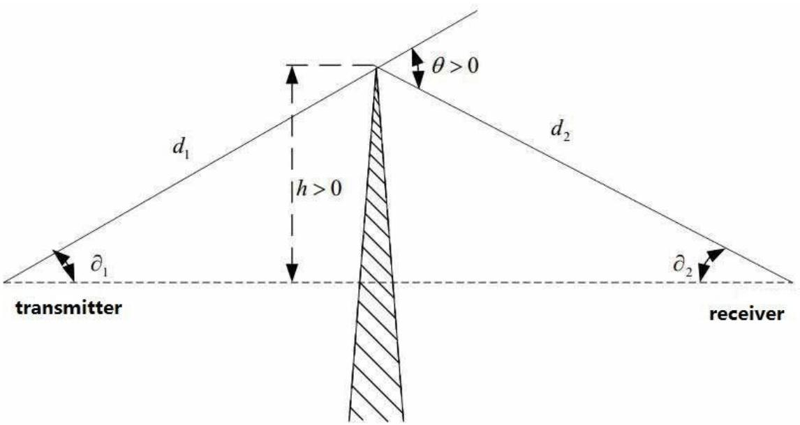
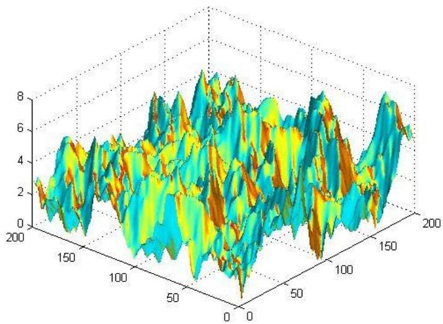
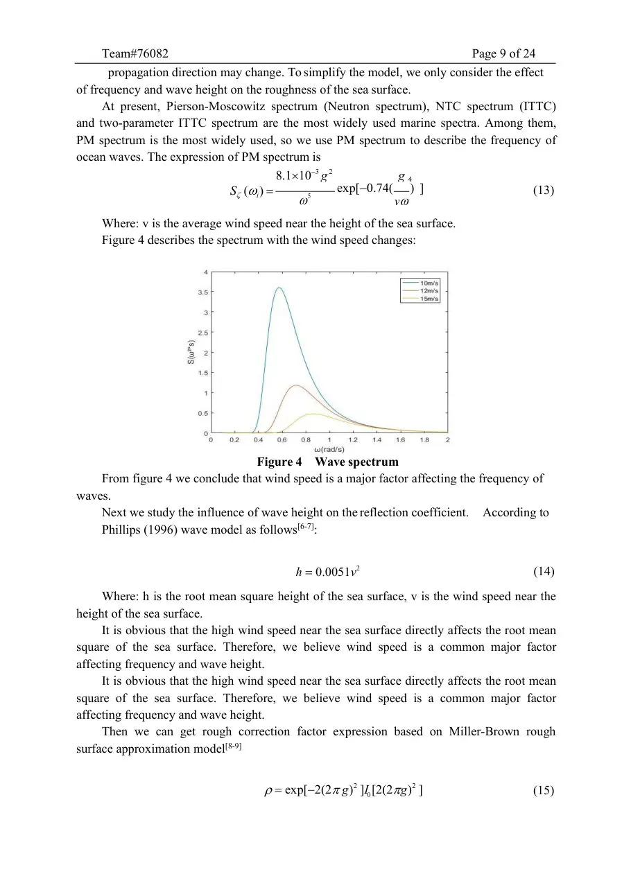
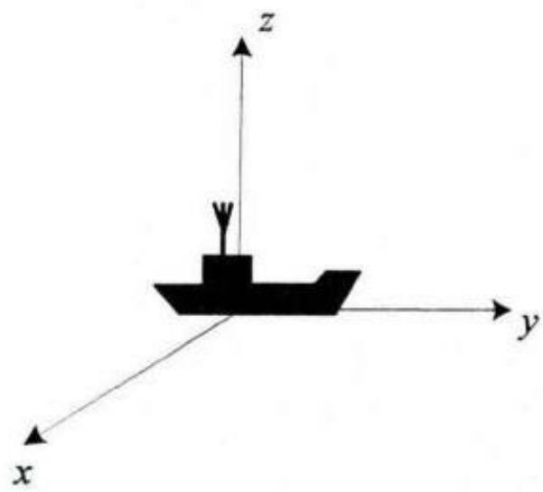

# 2018年美赛O奖论文：A76082-HF Radio Propagation under Different Terrains

原件为竞赛论文。补充：文中的阅读练习及“参考解答”为整理时增加，原件图文保留出处。

# 2018年美赛O奖论文：A76082-HF Radio Propagation under Different Terrains

本文档为《2018 MCM/ICM Summary Sheet》及正文第 1-3 页内容的整理，包含摘要、目录及引言部分。

## HF Radio Propagation under Different Terrains Summary

Even in the satellite era, high-frequency (HF) signal communication still plays an important role in everyday communications. In order to clearly understand the communication process of HF waves and its influencing factors, we first design a mathematical model of signal reflection off the ocean. Based on this model, we build the ground signal reflection model and compare the two. Besides, we study the communication process of vessel receivers on a turbulent sea.

We begin with the establishment of a mathematical model of signal reflection at sea from two aspects. On the one hand, we study the basic loss of the HF sky wave transmission process. On the other hand, we investigate the surface properties of the sea. We classify the ocean surface as a smooth and a rough sea. Based on the Fresnel reflection coefficient equation, we obtain the reflection intensity of rough and smooth sea surface. And their ratio equals to the square of the roughness correction factor. We select specific parameters for getting the specific value. Then we get the first reflection power of rough sea surface is $0.4378\text{mW}$, and the first reflection power of smooth sea surface is $0.2832\text{mW}$. The first reflection power of rough sea surface is $0.6469$ times smooth sea surface. As a result, using this model, we can easily simulate the multihop path of the signal. Taking the selected specific value as the parameter, we calculate the maximum number of hops to 8 times if the signal-noise ratio threshold is not exceeded.

Next, based on the above models, we set up the mathematical model of ground signal reflection. Similarly, we classify the terrain as a smooth terrain and a mountainous terrain. The propagation loss of mountainous terrain is classified as diffraction loss of the mountain and absorption loss of the vegetation. We use Epstein-Peterson method to study the typical double-edged peak diffraction problem. Through comparison of the two models, we conclude that the ocean surface is more suitable for the transmission of shortwave skywaves than land surfaces.

What’s more, we introduce the ship sway model to further establish the communication model of the ship receiver at sea. The ship can maintain communication while traveling in the signal coverage. We get the longest communication time by calculating the maximum travel time of the ship in the signal coverage area.

Finally, we prepare a synopsis of the results that are suitable as a short note in IEEE Communications Magazine.

We focus on the transmission process of shortwave skywaves off the ocean. The conclusion can help in the communications of maritime transport and fishing industries.

**Keywords:** Fresnel reflection coefficient equation, Sea signal reflection model, Transmission loss

## Content

1. Introduction
    1.1 Restatement of the problem
    1.2 Notations
2. Assumptions
3. Skywave basic transmission loss
    3.1 Loss model
    3.2 Calculation Results Analysis
4. The Mathematical Model of Ocean signal's Reflection
    4.1 Basic model
        4.1.1 Sea surface's plural dielectric constant
        4.1.2 Fresnel reflection coefficient of Sea
    4.2 Comparison of Reflection Intensity between Rough Sea and Smooth Sea
    4.3 Calculation of the maximum number of hops
        4.3.1 Signal to noise ratio calculation of shortwave sky wave communication
        4.3.2 Calculation results
5. The comparison of Ground Signal Transmission and Sea Signal Transmission
    5.1 The mathematical model of ground signal reflection
        5.1.1 Shortwave sky wave propagation loss in the smooth terrain
        5.1.2 Shortwave sky wave in mountainous terrain transmission loss
    5.2 Comparing results
6. The communication model of marine ship receiver
    6.1 The model of ship rocks
    6.2 Sea signal transmission model of combining ship swaying
    6.3 The same multi-hop path to maintain communication time
7. Sensitivity Analysis-Time factor
8. Conclusions
    8.1 Strengths
    8.2 Weaknesses
References

## 1. Introduction

### 1.1 Restatement of the problem

The high frequency (HF, defined to be $3\text{-}30\text{MHz}$) is the portion of the radio frequency spectrum. The HF band is a major part of the shortwave frequency band, so communication at these frequencies is often called shortwave radio. Shortwave propagation modes include groundwave and skywaves. For frequencies below the maximum usable frequency (MUF), HF radio waves can travel further through the multiple reflections of the ionosphere and the earth's surface (even to the world). This method of communication is called "skip" or "skywave".

Many factors affect the propagation of HF skywaves, of which the properties of the reflecting surface are important. The properties of the reflecting surface determine the strength of the reflected wave and how far the wave will propagate with the useful signal integrity. The most important issue is the reflections on the sea. We define the raging sea as a rough sea, and relatively speaking, we define a calm sea as a smooth sea.

The problems that we need to solve in this paper are:

*   Establish a mathematical model of ocean signal reflection.
*   Determine a first reflection intensity of a 100-watt HF constant carrier signal transmitted from a land-based source at the turbulent ocean level. In this paper, we use the size of power on behalf of the strength of the size.
*   Compare the above result with the first reflected intensity of the same signal on a calm ocean surface.
*   Based on the first issue, the remaining reflections of the radio signals occur on a calm sea surface. Determining the maximum number of hops the signal can reach before its strength falls below a usable signal-to-noise ratio (SNR) threshold of 10 dB.
*   Using the results obtained above compared with the results of high-frequency radiowave reflections on rugged versus smooth terrain.
*   There is a marine vessel that uses high frequencies to communicate and receive weather and traffic reports. Transforming the model to accommodate radio transmissions from the ship's receiver on a raging surface. Calculate the time that the boat keeps the signal communicating in the same multi-hop path.

# HF Radio Propagation under Different Terrains (Notations & Assumptions)

本文整理了2018年美赛O奖论文（Team #76082）第4-6页关于符号定义、假设条件及天波基本传输损耗模型的内容，修正了识别过程中的断行与乱码错误。

## 一、符号定义

知识点：[一般假设及其合理性说明（Assumptions and Justifications）](../../../topics/数学建模/jiaben_shezhi.md)、[符号说明与术语定义（Nomenclature / Symbols and Definitions）](../../../topics/数学建模/fuhao_shuoming.md)、[文献综述与研究背景撰写方法](../../../topics/数学建模/wenxian_zongshu.md)

### 符号表

| 符号 | 定义 |
| :--- | :--- |
| $\varepsilon_r$ | Sea water relative dielectric constant (海水相对介电常数) |
| $\sigma$ | Sea water conductivity (海水电导率) |
| $\lambda$ | Wavelength (波长) |
| $f$ | The best available radio frequency (最佳可用无线电频率) |
| $R$ | Smooth sea reflection coefficient (平滑海面反射系数) |
| $R'$ | Rough sea reflection coefficient (粗糙海面反射系数) |
| $\rho$ | Rough correction factor (粗糙度修正因子) |
| $\tilde{\varepsilon}$ | Sea surface dielectric constant (海表面介电常数) |
| $R_H$ | Horizontal polarized wave Fresnel reflection coefficient (水平极化波菲涅尔反射系数) |
| $R_v$ | Vertical polarization Fresnel reflection coefficient (垂直极化波菲涅尔反射系数) |
| SNR | Signal to noise ratio (信噪比) |
| $L_b$ | Skywave basic transmission loss (天波基本传输损耗) |
| $L_{bf}$ | Transmission loss of free space (自由空间传输损耗) |
| $L_i$ | Ionospheric absorption loss (电离层吸收损耗) |
| $Y_p$ | Extra system loss (额外系统损耗) |

## 二、基本假设

知识点：[符号说明与术语定义（Nomenclature / Symbols and Definitions）](../../../topics/数学建模/fuhao_shuoming.md)、[一般假设及其合理性说明（Assumptions and Justifications）](../../../topics/数学建模/jiaben_shezhi.md)

### 假设 1：海面状态
平静海面等同于平滑海面，因此平静海面的无线电波反射为镜面反射（specular reflection）。

知识点：[一般假设及其合理性说明（Assumptions and Justifications）](../../../topics/数学建模/jiaben_shezhi.md)

### 假设 2：工作频率
研究对象为高频段（3-30 MHz）。若波频率超过最高可用频率（MUF），电波将穿过电离层进入太空，且电离层变化频繁。因此，最佳可用频率通常为 MUF 的 0.8 - 0.9 倍。本模型保守假设最佳可用频率为：
$$ f = 20 \text{ MHz} $$

知识点：[一般假设及其合理性说明（Assumptions and Justifications）](../../../topics/数学建模/jiaben_shezhi.md)、[符号说明与术语定义（Nomenclature / Symbols and Definitions）](../../../topics/数学建模/fuhao_shuoming.md)

### 假设 3：阴影效应
当波长与波高相当甚至远小于波高时，需考虑阴影效应对无线电波传播的影响。但本论文不适用此情况，因此忽略阴影效应对无线电波传播的影响。

知识点：[一般假设及其合理性说明（Assumptions and Justifications）](../../../topics/数学建模/jiaben_shezhi.md)

### 假设 4：天线方向性
发射和接收天线的方向性系数假设为 1。

知识点：[一般假设及其合理性说明（Assumptions and Justifications）](../../../topics/数学建模/jiaben_shezhi.md)

### 假设 5：极化方式
假设发射的电磁波为圆极化波（circularly polarized wave）。

知识点：[数学建模的基本步骤（问题分析、模型假设、建立、求解、检验、推广）](../../../topics/数学建模/jianmo_buzhou.md)

### 假设 6：多径干扰
忽略多径干扰（multipath interference）。

## 三、天波基本传输损耗模型

知识点：[数学建模的基本步骤（问题分析、模型假设、建立、求解、检验、推广）](../../../topics/数学建模/jianmo_buzhou.md)、[一般假设及其合理性说明（Assumptions and Justifications）](../../../topics/数学建模/jiaben_shezhi.md)、[文献综述与研究背景撰写方法](../../../topics/数学建模/wenxian_zongshu.md)

### 3.1 损耗模型概述

为了清晰描述电波的传播，图 1 展示了其跳跃过程的简单表示：

由地面源发出的无线电波首先到达电离层，经电离层反射到达海面，这是第一次跳跃过程。经海面反射后返回电离层，再返回海面进行第二次跳跃，以此类推。

已知无线电波在传输过程中会产生能量损耗。根据传输损耗的原因，天波的基本传输损耗表示为 [1]：

$$ L_b = L_{bf} + L_i + L_g + Y_p \tag{1} $$

其中：
- $L_{bf}$：自由空间中的传输损耗；
- $L_i$：电离层吸收损耗；
- $L_g$：地面反射损耗；
- $Y_p$：额外的系统损耗。

本模型主要讨论电离层吸收损耗和空间传输损耗。

#### 1. 自由空间基本传输损耗 ($L_{bf}$)

自由空间基本传输损耗是指无线电波离开发射天线后，由于几何扩散造成的能量损失。公式如下 [2]：

$$ L_{bf} = 32.44 + 20 \lg f + 20 \lg r \tag{2} $$

其中：
- $L_{bf}$ 的单位为 dB；
- $f$ 为工作频率，单位为 MHz；
- $r$ 为无线电波传播的有效路径长度，单位为 km。

#### 2. 电离层吸收损耗 ($L_i$)

在大气层中，存在一个显著电离的区域。根据电子密度随高度的变化，电离层可分为 D 层、E 层、F1 层和 F2 层。F 层是反射层，因为它位置最高，允许无线电波传播最远的距离 [3]。因此，本文主要考虑高频信号主要在 F1 层（150km-200km）反射。

由于电离层吸收程度受多种因素影响，难以进行理论计算。因此，我们选择半经验公式 [3-4]：

$$ L_{bf} = \frac{677.2 I \sec i_{100}}{(f + f_H)^{1.98} + 10.2} \tag{5} $$

*注：原文此处公式编号可能存在排版错误，左侧变量应为 $L_i$ 而非 $L_{bf}$，但此处保留原文表述逻辑，实际物理意义为 $L_i$。*

相关参数计算公式如下：

$$ I = (1 + 0.0037 R) (\cos(0.881 \chi))^{1.3} \tag{4} $$

$$ i_{100} = \arcsin(0.985 \cos \Delta) \tag{5} $$

其中：
- $f_H$：高度为 100 km 处的磁摆动频率；
- $I$：吸收系数，代表电离层吸收与太阳天顶角 $\chi$ 和太阳黑子数 $R$ 的关系；
- $i_{100}$：100 km 高度处的入射角；
- $\Delta$：射线仰角。

在某些情况下，可以通过查阅数据获取这些参数的具体数值。

#### 3. 额外系统损耗 ($Y_p$)

额外系统损耗是为其他原因计算的损耗之和，精确计算较为困难。由于额外系统损耗基本上是地方时间的函数 [1]，我们可以通过查阅数据表来估算额外系统损耗。

#### 4. 地面反射损耗 ($L_g$)

地面损耗发生在无线电波通过地面反射时。在本模型中，电波在海面反射，因此不考虑地面反射损耗（即 $L_g = 0$）。

知识点：[问题重述与分析（Problem Restatement and Analysis）](../../../topics/数学建模/wenti_chongshu.md)、[模型参数的确定（基于数据拟合或实验选择）](../../../topics/数学建模/canshu_queding.md)、[符号说明与术语定义（Nomenclature / Symbols and Definitions）](../../../topics/数学建模/fuhao_shuoming.md)

### 3.2 计算结果分析

为了使计算简便，我们选取典型的数值进行模拟。

**选取的参数如下：**
- 射线仰角 $\Delta = 45^\circ$
- 电离层高度 $h = 200$ km
- 由此可得无线电波传播的有效路径 $r = 200\sqrt{2} \approx 282.8$ km
- 反射点位于 $(123^\circ E, 26^\circ N)$，地处东海
- $f_H = 1.24$ MHz
- 时间点为 7月1日 12:00，查得太阳黑子数 $R = 110$

太阳天顶角可通过以下公式计算 [4]：
*(注：原文此处截断，未给出具体公式)*

# 2018年美赛O奖论文：A76082-HF Radio Propagation under Different Terrains

## 一、数学模型与参数计算

知识点：[模型参数的确定（基于数据拟合或实验选择）](../../../topics/数学建模/canshu_queding.md)、[数学建模的基本步骤（问题分析、模型假设、建立、求解、检验、推广）](../../../topics/数学建模/jianmo_buzhou.md)

### 太阳位置计算公式

根据原文，太阳纬度 $S_x$ 和太阳经度 $S_y$ 的计算公式如下：

$$
\cos \chi = \sin a \sin S _ {x} + \cos a \cos S _ {x} \cos \gamma
$$

$$
\begin{array}{l} 
S _ {x} = 23.44 \sin [ 0.9856 (Y _ {n} - 80.7) ] \\ 
S _ {y} = \left\{ \begin{array}{ll} 
180 - 15 (24 + t - 8) & 0 \leq t < 8 \\ 
180 - 15 (t - 8) & 8 \leq t < 24 
\end{array} \right. 
\end{array}\tag{6}
$$

其中：
- $S _ { x }$ 是太阳的纬度点；
- $S _ { y }$ 是太阳的经度点；
- $Y _ { n }$ 是从每年1月1日开始的天数；
- $t$ 是北京时间；
- $a$ 是研究点的纬度；
- $\gamma$ 是研究点经度与 $S _ { y }$ 之间的差值。

知识点：[符号说明与术语定义（Nomenclature / Symbols and Definitions）](../../../topics/数学建模/fuhao_shuoming.md)

### 传输损耗与功率计算

通过仿真得到传输损耗 $L _ { f }$ 为 97.4597dB。

根据公式：

$$
L _ {b} = 10 \lg \frac {P _ {r}}{P _ {t}}\tag{7}
$$

已知发射源的高频恒定载波信号功率 $P _ { t }$ 为 100W，经过传输损耗后到达海面的入射功率 $P _ { r }$ 为 0.43248mW。

## 二、海洋信号反射的数学模型

知识点：[一般假设及其合理性说明（Assumptions and Justifications）](../../../topics/数学建模/jiaben_shezhi.md)、[符号说明与术语定义（Nomenclature / Symbols and Definitions）](../../../topics/数学建模/fuhao_shuoming.md)、[模型验证方法概述（随机模型与确定性模型验证）](../../../topics/数学建模/moxing_yanzheng.md)

### 4. 基本模型

海浪的反射系数主要代表海浪在海面上的反射特性。反射系数与海浪的入射角、海浪的大小、海表面的电磁参数等因素有关。

在研究反射特性之前，我们先研究海表面的电磁特性。海表面的电磁特性影响无线电波的海面反射强度，它与海水温度、盐度、电磁波频率等因素有关。海水的复介电常数是描述海面电磁特性的一个参数。

#### 4.1.1 海表面复介电常数

海表面的复介电常数由海水的相对介电常数 $\varepsilon _ { \mathrm { r } }$ 、海水电导率 $\sigma$ 和波长 $\lambda$ 决定，表达式如下[1]：

$$
\tilde {\varepsilon} = \varepsilon_ {\mathrm{r}} + i 60 \lambda \sigma\tag{8}
$$

我们可以基于国际无线电咨询委员会（CCIR）给出的多项式拟合函数来计算常数 $\mathcal { E } _ { \mathrm { r } }$ 和比值 $\sigma$。

** 海水的相对介电常数**

海水相对介电常数 $\varepsilon _ { \mathrm { r }}$ 的表达式为[5]：

$$
\varepsilon_ {\mathrm{r}} = \left\{ \begin{array}{c l} 
70 & \mathrm{f} \leq 2253.5895 \\ 
\dfrac{1}{\mathrm{a} + \mathrm{bf} + \mathrm{cf} ^ {2} + \mathrm{df} ^ {3} + \mathrm{ef} ^ {4}} & \mathrm{f} > 2253.5895 
\end{array} \right.
$$

其中：
- $f$ 是无线电频率，单位为 ${ \mathrm { M H z } }$。

系数值为：
$$
a = 1.4114535 \times 10 ^ {- 2}; \quad b = - 5.2122497 \times 10 ^ {- 8}; \quad c = 5.8547829 \times 10 ^ {- 11}
$$
$$
d = - 7.6717423 \times 10 ^ {- 16}; e = 2.9856318 \times 10 ^ {- 21}
$$

** 海水的电导率**

海水电导率 $\sigma$ 的表达式为[5]：

$$
\sigma = \left\{ \begin{array}{c c} 
5.0 & \mathrm{f} \leq 1106.207 \\ 
\dfrac{\mathrm{r} + \mathrm{sf} + t f ^ {2}}{1 + \mathrm{uf} + \mathrm{vf} ^ {2} + \mathrm{wf} ^ {3}} & \mathrm{f} > 1106.207 
\end{array} \right.\tag{10}
$$

其中：
- $f$ 是无线电频率，单位为 $\operatorname { M H z }$；

系数值为：
$$
r = 3.8586749; \quad s = 9.1253873 \times 10 ^ {- 4}; \quad t = 1.5309921 \times 10 ^ {- 8}
$$
$$
u = - 2.1179295 \times 10 ^ {- 5}; v = 6.5727504 \times 10 ^ {- 10}; w = - 1.9647664 \times 10 ^ {- 15}
$$

由于我们假设 $f$ 为 20MHz，因此可得：
- 海水相对介电常数 $\varepsilon _ { r } = 70$；
- 海水电导率 $\sigma = 5.0$；
- 海面介电常数 $\tilde { \boldsymbol { \varepsilon } } = 70 + 4500 \boldsymbol { i }$。

#### 4.1.2 海面的菲涅尔反射系数

** 平滑海面的菲涅尔反射系数**

根据斯涅尔定律，平滑海面上水平极化和垂直极化波的菲涅尔反射系数为[5]：

$$
R _ {H} = \frac {\sin \theta - \sqrt {\tilde {\varepsilon} - \cos^ {2}\theta}}{\sin \theta + \sqrt {\tilde {\varepsilon} - \cos^ {2}\theta}}\tag{11}
$$

$$
R _ {V} = \frac {\tilde {\varepsilon} \sin \theta - \sqrt {\tilde {\varepsilon} - \cos^ {2} \theta}}{\tilde {\varepsilon} \sin \theta + \sqrt {\tilde {\varepsilon} - \cos^ {2} \theta}}\tag{12}
$$

其中：$\theta$ 是掠射入射角。

图2中的曲线反映了功率反射系数与掠射入射角之间的关系。

观察可知，当掠射入射角为 $45 ^ { \circ } - 90 ^ { \circ }$ 时，功率反射系数的变化不明显。为了计算方便，我们将掠射入射角设为 $45 ^ { \circ }$。

** 粗糙海面的菲涅尔反射系数**

我们可以很容易地得到平滑海面的反射系数，但实际上海面是波涛汹涌的，所以我们继续研究粗糙海面的反射系数。波浪现象是随机且非线性的，因此很难建立准确的波浪模型。根据波浪谱理论和随机海洋波理论，我们可以将实际海洋波视为不同频率、不同初始相位、不同传播方向和不同波高的正弦波的叠加结果。

# 2018年美赛O奖论文：A76082-HF Radio Propagation under Different Terrains

## 海洋频谱与风速对波浪频率的影响

在简化模型中，仅考虑频率和波高对海表面粗糙度的影响。目前最常用的海洋频谱包括Pierson-Moscowitz (PM) 频谱、NTC频谱 (ITTC) 和两参数ITTC频谱。其中PM频谱应用最广，因此使用PM频谱描述海浪频率。

PM频谱表达式为：

$$
S _ {\zeta} \left(\omega_ {i}\right) = \frac {8 . 1 \times 1 0 ^ {- 3} g ^ {2}}{\omega^ {5}} \exp \left[ - 0. 7 4 \left(\frac {g _ {4}}{v \omega}\right) \right]\tag{13}
$$

其中：$v$ 是海面附近平均风速。

 描述了风速变化下的频谱情况。

从图4可以得出结论：**风速是影响波浪频率的主要因素**。

## 波高与反射系数的关系

接下来研究波高对反射系数的影响。根据Phillips (1996) 提出的波浪模型如下[6-7]：

$$
h = 0. 0 0 5 1 v ^ {2}\tag{14}
$$

其中：$h$ 是海表面的均方根高度，$v$ 是海面附近的风速。

显然，海面附近的高风速直接影响海表面的均方根值。因此，我们认为**风速是影响频率和波高的共同主要因素**。

## 米勒-布朗粗糙表面近似模型与粗糙修正因子

基于Miller-Brown粗糙表面近似模型[8-9]，可以得到粗糙修正因子的表达式：

$$
\rho = \exp [ - 2 (2 \pi g) ^ {2} ] I _ {0} [ 2 (2 \pi g) ^ {2} ]\tag{15}
$$

其中：
*   $I _ { 0 }$ 是第一类零阶修正贝塞尔函数；
*   $g$ 是海表面粗糙度，用于描述海表面波动的幅度。其公式为 $g = h \sin \theta / \lambda$。

 显示了风速对粗糙修正因子的影响。

图5表明，当风速超过一定水平时，粗糙修正因子随风速增加而迅速下降。

## 地球曲率对修正因子的影响

由于海上通信属于远距离通信，地球曲率对修正因子的影响不可忽视。设 $D$ 为地球曲率因子，其计算公式为[10]：

$$
D = \left(1 + \frac {2 G _ {1} G _ {2}}{R _ {e} \left(G _ {1} + G _ {2}\right) \sin \varphi}\right) ^ {- \frac {1}{2}}\tag{16}
$$

其中：
*   $G _ { 1 }$ 是从射频发射端到镜面反射点的距离；
*   $G _ { 2 }$ 是从镜面反射点到射频接收端的距离；
*   $R _ { e }$ 是地球半径（有效地球半径为6400km）。

因此，考虑地球曲率的粗糙修正因子取值为 $\boldsymbol { \rho } ^ { \prime } = \boldsymbol { \rho D }$。

## 粗糙海面的菲涅尔反射系数近似

使用粗糙修正因子来近似粗糙海面对水平和垂直极化波的菲涅尔反射系数：

$$
\begin{array}{l} R _ {H} ^ {\prime} = \rho R _ {H} \\ R _ {V} ^ {\prime} = \rho R _ {V} \end{array}\tag{17}
$$

根据波长与频率的关系 $c = \lambda \nu$。当频率 $f ~ = 2 0 M H z$ 时，波长 $\lambda = 1 5 m$。在这种情况下，波长与波高相当，可能会导致阴影效应。在本文中，为了简化模型，我们假设没有影响。

为了满足计算需求，取六个风速 $\nu = 1 5 m / s$，则 $h = 1 . 1 4 7 5$。因为 $\theta = 4 5 ^ { \circ }$，根据公式(15)可以得出 $\rho$ 的值。

知识点：[模型参数的确定（基于数据拟合或实验选择）](../../../topics/数学建模/canshu_queding.md)、[一般假设及其合理性说明（Assumptions and Justifications）](../../../topics/数学建模/jiaben_shezhi.md)、[文献综述与研究背景撰写方法](../../../topics/数学建模/wenxian_zongshu.md)

### 4.2 粗糙海面与平滑海面反射强度的比较

为了方便研究，我们用功率代替强度，因此功率比等于强度比。

设 $P _ { 1 }$ 为平滑海面上出射的无线电波功率。基于圆极化波的概念，可以得到公式：

$$
\frac {R _ {H} ^ {2} + R _ {V} ^ {2}}{2} = \frac {P _ {1}}{P _ {r}}\tag{18}
$$

其中：
*   $R _ { H }$ 是平滑海面上水平极化波的菲涅尔反射系数；
*   $R _ { V }$ 是平滑海面上垂直极化波的菲涅尔反射系数。

同样，设 $P _ { 2 }$ 为粗糙表面上出射的无线电功率。

我们可以得到：

$$
\frac {(\rho R _ {H}) ^ {2} + (\rho R _ {V}) ^ {2}}{2} = \frac {P _ {2}}{P _ {r}}\tag{19}
$$

当地面源发出的电波第一次反射时，无论在海面粗糙还是平滑情况下，入射电波功率相同，因此海表面反射系数决定了粗糙海面反射功率和平滑海面反射功率之间的差异。

利用方程(17)和(18)，我们可以轻松推导出方程(20)：

$$
\begin{array}{r l} \frac {P _ {3}}{P _ {1}} & = \frac {\frac {(\rho R _ {H}) ^ {2} + (\rho R _ {V}) ^ {2}}{2}}{\frac {R _ {H} ^ {2} + R _ {V} ^ {2}}{2}} \\ & = \frac {\rho^ {2} (R _ {H} ^ {2} + R _ {V} ^ {2})}{R _ {H} ^ {2} + R _ {V} ^ {2}} \\ & = \rho^ {2} \end{array}\tag{20}
$$

我们可以得出结论：**粗糙海面反射功率与平滑海面反射功率之比等于粗糙修正因子值的平方**。

我们已经计算出入射波功率 $P _ { r }$ 的值为 0.43248mW，根据公式(18)，我们可以得到平滑表面第一反射波的功率为 0.8043mW。

知识点：[符号说明与术语定义（Nomenclature / Symbols and Definitions）](../../../topics/数学建模/fuhao_shuoming.md)、[一般假设及其合理性说明（Assumptions and Justifications）](../../../topics/数学建模/jiaben_shezhi.md)、[模型参数的确定（基于数据拟合或实验选择）](../../../topics/数学建模/canshu_queding.md)

### 4.3 Calculation of the maximum number of hops

知识点：[确定模型的定点与稳定性分析](../../../topics/数学建模/dingdian_wending.md)、[稳定性分析（Stability Analysis）](../../../topics/数学建模/wending_xing.md)、[传统 SEIR 流行病模型（Susceptible-Exposed-Infectious-Recovered）](../../../topics/数学建模/seir_moxing.md)

### 4.3.1 Signal to noise ratio calculation of shortwave sky wave communication

#### The electric field strength of shortwave sky wave propagation

The field strength of the HF radio reception can be calculated using Equation 21 [11]

$$
E _ {t} = 1 3 7 . 2 + 2 0 \lg f + 1 0 \lg P + G _ {t} - L _ {b}\tag{21}
$$

Where: $E _ { t }$ is the signal strength of the receiving point in the skywave propagation, its unit is dB $( \mu \mathrm{V} / \mathrm{m} )$; $P$ is the transmitter transmit power, its unit is kW; $G _ { t }$ is the transmitter antenna radiation gain, its unit is dB; $L _ { b }$ is the day-wave transmission loss.

#### Atmospheric noise field strength

The maritime shortwave communication under natural conditions is mainly disturbed by atmospheric noise. The industrial and cosmic interferences are relatively small and will not be considered here.

Atmospheric radio noise field strength RMS calculation formula [11]

$$
E _ {n} = F _ {a} + 1 0 \lg B + 2 0 \lg f - 9 6 . 8\tag{22}
$$

Where: $E _ { n }$ is the atmospheric radio noise field strength in dB; $F _ { a }$ is the effective noise figure of the atmospheric radio in dB; $B$ is the effective noise bandwidth of the receiver, we check the data to set its value to 6dB.

#### Shortwave sky wave signal to noise ratio

According to the formula 21 of signal-to-noise ratio of sky wave communication and formula 22 of rms value of atmospheric noise field, we can get the formula of SNR

$$
S N R _ {t} = 2 0 1 . 5 6 + 1 0 \lg P _ {t} - 2 0 \lg f - 2 0 \lg r - 1 0 \lg B - L _ {i} - Y _ {p} - F _ {a}\tag{23}
$$

知识点：[模型参数的确定（基于数据拟合或实验选择）](../../../topics/数学建模/canshu_queding.md)、[模型验证方法概述（随机模型与确定性模型验证）](../../../topics/数学建模/moxing_yanzheng.md)

### 4.3.2 Calculation results

The 100-watt high-frequency constant-carrier signal transmitted by the land-based source experienced a power of 0.2832mW after the first reflection at the turbulent ocean surface.

Because the threshold of signal available noise ratio (SNR) is 10 dB, $S N R _ { t } { \geq } 1 0 ~ \mathrm { d B }$

Using the previously set parameters and the resulting data, we calculate the maximum number of hops we get by 8 and the horizontal distance for each jump is 400 km.

知识点：[模型参数的确定（基于数据拟合或实验选择）](../../../topics/数学建模/canshu_queding.md)、[确定模型的定点与稳定性分析](../../../topics/数学建模/dingdian_wending.md)

### 5. The comparison of Ground Signal Transmission and Sea Signal Transmission

知识点：[数学建模的基本步骤（问题分析、模型假设、建立、求解、检验、推广）](../../../topics/数学建模/jianmo_buzhou.md)

### 5.1 The mathematical model of ground signal reflection

We have learned from the above analysis that the loss of signal on different reflective surfaces is different. Next, we continue to discuss the comparison of the signals from different ground reflections. For ease of analysis, we classify the ground into smooth terrain and rough terrain.

知识点：[数学建模的基本步骤（问题分析、模型假设、建立、求解、检验、推广）](../../../topics/数学建模/jianmo_buzhou.md)、[问题重述与分析（Problem Restatement and Analysis）](../../../topics/数学建模/wenti_chongshu.md)、[任务分解与目标明确](../../../topics/数学建模/renwu_fenjie.md)

### 5.1.1 Shortwave sky wave propagation loss in the smooth terrain

We assume that dry terrain is a smooth terrain that has the least surface obstructions compared to other terrain. We think that mainly on the smooth terrains produce ground reflection loss. According to the data [12], we get the relative complex permittivity $\widetilde { \varepsilon }$ of dry earth equal to 4. According to the first question of Fresnel reflection coefficient formula and transmission loss formula, we can find a smooth terrain reflection loss of 9.1133dB.

知识点：[一般假设及其合理性说明（Assumptions and Justifications）](../../../topics/数学建模/jiaben_shezhi.md)、[模型参数的确定（基于数据拟合或实验选择）](../../../topics/数学建模/canshu_queding.md)

### 5.1.2 Shortwave sky wave in mountainous terrain transmission loss

In addition to the reflection loss, shortwave sky wave in the mountainous terrain has the jungle mountain diffraction loss and sky wave through the jungle leaf loss in the transmission process [13]

#### The diffraction loss of shortwave sky wave through the jungle mountain

In fact, the terrain of the jungle mountains is complex with many obstacles and it is difficult to accurately predict the diffraction loss of radio waves. In order to simplify the model, we study double-edged peak diffraction in this paper. According to literature [14], the Epstein-Peterson method using the equivalent method is an effective way to solve this problem. Figure 6 is a schematic of the Epstein-Peterson method.

$a$, $b$, $h _ { 1 } ^ { ' }$ and $b$, $c$, $h _ { 2 } ^ { ' }$ constitute a single-edged peak. We can use single-edged peak diffraction loss formula respectively calculate $a$, $b$, $h _ { 1 } ^ { ' }$ diffraction loss L1, and then find the diffraction loss between L2

$$
L _ {1} = 2 0 \lg (h _ {1} ^ {\prime} \sqrt {\frac {2}{\lambda} (\frac {1}{d _ {1}} + \frac {1}{d _ {2}})})\tag{24}
$$

$$
L _ {2} = 2 0 \lg \left(h _ {2} ^ { \prime} \sqrt {\frac {2}{\lambda} \left(\frac {1}{d _ {3}} + \frac {1}{d _ {4}}\right)}\right)\tag{25}
$$

The meaning of the parameters in the formula refer to Figure VI. After finding L1 and L2, a correction factor $\mathrm { L _ { c } }$ needs to be added

$$
L _ {c} = 1 0 \lg [ \frac {(a + b) (b + c)}{b (a + b + c)} ]\tag{26}
$$

Then the total diffraction loss is calculated as Equation 27

$$
L _ {a} = L _ {1} + L _ {2} + L _ {c}\tag{27}
$$

#### The loss of shortwave sky wave through the forest leaves

According to the literature [13], $L_s$ is the loss of radio waves passing through the jungle leaves, which is expressed as

$$
L _ {S} = a _ {L} \cdot s\tag{28}
$$

Where: $a_L$ is the jungle attenuation coefficient (dB/m) and $s$ is the thickness (m) of the electric wave passing through the bushes. The usual sky wave mode band ($3 <f <30\text{MHz}$), $a _ { L }$ is 0.01-0.1dB/m.

知识点：[模型参数的确定（基于数据拟合或实验选择）](../../../topics/数学建模/canshu_queding.md)、[一般假设及其合理性说明（Assumptions and Justifications）](../../../topics/数学建模/jiaben_shezhi.md)、[符号说明与术语定义（Nomenclature / Symbols and Definitions）](../../../topics/数学建模/fuhao_shuoming.md)

### 5.2 Comparing results

In order to compare the models, we take the parameters $h _ { 1 } ^ { ' } = h _ { 2 } ^ { ' } = 6 0$ m , $a = c = 1 0 0 \mathrm { m }$ ， $b=200\text{m}$, $s=10\text{m}$, $a _ { L } = 0 . 8$ . Substituting into the above formula, the maximum number of hops of a high-frequency radio wave transmitted on a smooth terrain is 3 and the maximum number of hops propagating in a mountainous area is two.

## 6. The communication model of marine ship receiver

Due to the fluctuation of the sea, the ship swaying and causing the antenna to change to radio wave angle will affect the radio loss of the receiving end. We apply the method of adding the sloshing loss of the ship to the ocean signal reflection model to improve the signal propagation model at sea.

Under normal conditions, the shipborne antenna and the ship are relatively stationary. We assume that the movement of the ship is the movement of the shipborne antenna.

At the same time, we can get smooth or rough sea and smooth or mountainous terrain wave reflection loss comparison chart, as shown in Figure 7.

Analyze the data, we get the following result:

1. The same radio transmission distance in the smooth ground is greater than the transmission distance in the mountainous terrain.

2. The same radio wave transmission loss in the smooth terrain is less than the transmission loss in the mountainous terrain.

3. The maximum number of hops transmitted by the same radio waves at sea is much larger than the maximum number of hops transmitted on land.

4. The same radio wave transmission loss in the sea is much smaller than the transmission loss of land.

As a result of the analysis, it is easy to obtain that the ocean surface is more suitable for the transmission of shortwave skywaves than land surfaces. This conclusion is consistent with experience.

知识点：[数学建模的基本步骤（问题分析、模型假设、建立、求解、检验、推广）](../../../topics/数学建模/jianmo_buzhou.md)、[问题重述与分析（Problem Restatement and Analysis）](../../../topics/数学建模/wenti_chongshu.md)、[模型优缺点分析（Strengths and Weaknesses）](../../../topics/数学建模/youque_dian.md)

### 6.1 The model of ship rocks

There are many factors that affect sea surface fluctuation. In this paper, only the influence of wind-induced sea waves is considered.

There are three types of ship shaking, including floating up and down, left and right roll, pitch before and after. This abstracts the ship's six-degree-of-freedom motion model[15]. As shown in Figure 8, we create a spherical reference frame that is the center of the Earth.

So the boat's movement can be expressed as:

a. Altitude changes up and down the Z axis;

b. Swaying around the X axis as the center of rotation;

c. tilt around the Y axis as the center of rotation;

Because there is no measured data of the movement of the vessel, we get the maximum value of the sway angle of the vessel $\theta_{\max}$ according to literature[15].

$$
\theta_{\max} = \arcsin\left(\frac{\pi H_{\max}}{\sqrt{\lambda_{sea}^{2} + \pi^{2} H_{\max}^{2}}}\right)\tag{29}
$$

Where: $H_{\max}$ is the maximum height of the waves, $\lambda_{sea}$ is Wavelength of the waves.

知识点：[一般假设及其合理性说明（Assumptions and Justifications）](../../../topics/数学建模/jiaben_shezhi.md)、[符号说明与术语定义（Nomenclature / Symbols and Definitions）](../../../topics/数学建模/fuhao_shuoming.md)

### 6.2 Sea signal transmission model of combining ship swaying

Radio waves at sea environment propagation model shown in Figure 8[15].

Radio waves at sea environment propagation model shown in Figure 8[15].

According to the receiving and dispatching end distance, the propagation distance is divided into three areas[15]:

Segment A: means from the transmitting antenna base station T to the base station visible point $R_{A}$, the distance is $d_{1}$;

Segment B: refers to the visual point from the base station $R_{A}$ to the line of sight from the visual point $R_{B}$, the distance is $d_{2}$;

Segment C: Refers to the shadow area of the earth beyond the visible range of line-of-sight $R_{B}$, the distance is $d_{3}$.

In the segment A, a dual-path model considering ship sway is described, and in the segment B, a single-path model considering ship sway is described, ie a direct path is considered. The formula is

$$
L_{a} = 147.5582 - 20\lg f + 20\lg\left|C_{DP} + C_{RP}\right|\tag{30}
$$

$$
L_{b} = 147.5582 - 20\lg f + 20\lg\left|C_{DF}\right|\tag{31}
$$

The data[13] shows that in section A, the up-and-down fluctuation has the greatest effect on sea surface propagation loss compared to the other two types of rocking. In section B, the influence of ship swaying on received power loss is negligible.

With the increase of transmitting and receiving distance, the impact of ship swaying on radio wave propagation loss is getting smaller and smaller. We assume that the signal will only float up and down when the signal is transmitted in section A only.

Through calculation, we get 1.5dB of ship sway loss in one sending and receiving process.

知识点：[人口密度修正系数与新公式](../../../topics/数学建模/renkou_midu.md)

### 6.3 The same multi-hop path to maintain communication time

It is assumed that the ionosphere consists of many parallel thin sheets of very thin thickness with uniform electron density in each sheet. Assuming that the refractive index in air is 1, the corresponding refractive index of each parallel sheet is

$$
n_{0} > n_{1} > n_{2} > n_{3} > \dots > n_{n}.
$$

The frequency of the waves, with a certain angle of incidence by the air into the ionosphere, will occur continuous refraction. According to the refraction theorem, we get

$$
n_{0}\sin\theta_{0} = n_{1}\sin\theta_{1} = n_{2}\sin\theta_{2} = \dots = n\sin\theta_{n}\tag{32}
$$

The ability of the ionosphere to reflect radio waves is related to the frequency of the waves. At a certain angle of incidence, the lower the frequency of the radio wave, the easier it is to reflect. When a bunch of high frequency electromagnetic wave with the frequency of 3-30MHz is injected into the ionosphere from the air at a certain angle of incidence, the waves of different frequencies will be reflected at different heights of the ionosphere. Its schematic diagram is shown in Figure 10.

Due to the refraction, the higher frequency electric waves return to the sea after the ionosphere has been subjected to a horizontal gliding pass. Although the radio waves of different frequencies spread at different distances, the grazing angles incident on the sea surface are the same.

The locus of the wave propagation is Equation 33.

$$
D = 2\int_{r_{0}}^{r_{b}}\frac{r\,dr}{\sqrt{r^{2} - r^{2}\cos\alpha^{2}}} + 2\int_{r_{b}}^{r}\frac{r_{0}^{2}\cos\alpha\,dr}{r\sqrt{r^{2}n^{2} - r^{2}\cos\alpha^{2}}}\tag{33}
$$

Where: $\alpha$ is initial incident elevation; $r_{0}$ is earth radius (6370km); the subscript of $r$……

知识点：[数学建模的基本步骤（问题分析、模型假设、建立、求解、检验、推广）](../../../topics/数学建模/jianmo_buzhou.md)、[符号说明与术语定义（Nomenclature / Symbols and Definitions）](../../../topics/数学建模/fuhao_shuoming.md)、[模型参数的确定（基于数据拟合或实验选择）](../../../topics/数学建模/canshu_queding.md)

### 7. Sensitivity Analysis-Time factor

Change the time, observe the influence of the changes of each parameter on ionospheric loss. The sensitivity of time by calculation is obtained, as shown in the following figures.

We can see that the grazing incidence is very sensitive to the parameters of time. It proves that the model we established is suitable for anytime.

On the other hand, the ionospheric loss is not very sensitive to the parameters of time. That is to say, the ionospheric loss cannot change too much.

知识点：[敏感性分析方法（Sensitivity Analysis，单参数与多参数变动）](../../../topics/数学建模/minganxing_fenxi.md)、[参数合理性验证](../../../topics/数学建模/canshu_heli_xing.md)、[模型验证方法概述（随机模型与确定性模型验证）](../../../topics/数学建模/moxing_yanzheng.md)

### 8 Conclusions

#### 8.1 Strengths

1. This model includes a large number of parameters. These parameters include the loss of radio transmission, the complex permittivity of the sea surface, and the rough correction factor and so on. They have great practical value and a wide range of application.
2. The model is fit for the complex problem of HF waves on different surfaces regarding loss and reflection. These fitting and approximation greatly reduce the difficulty of solving the model, and can get the results agree well with the real situation.
3. For the error analysis and sensitivity of the model, we discuss each parameter. Sensitivity analysis results show that our model parameters have a wide range of application.

#### 8.2 Weaknesses

1. This model takes into account too many factors, causing the solving process to be tedious.
2. The solution of the model is limited to the capacity of the computer, and it can't achieve higher accuracy.
3. A large number of assumptions reduce the accuracy of the model’s calculation results.

## HF Radio Propagation under Different Terrains

**Summary** We set up different models of HF radio propagation under different terrains.

**Keywords** Fresnel reflection coefficient equation, Sea signal reflection model

知识点：[模型优缺点分析（Strengths and Weaknesses）](../../../topics/数学建模/youque_dian.md)、[一般假设及其合理性说明（Assumptions and Justifications）](../../../topics/数学建模/jiaben_shezhi.md)、[敏感性分析方法（Sensitivity Analysis，单参数与多参数变动）](../../../topics/数学建模/minganxing_fenxi.md)

### Transmission loss

知识点：[文献综述与研究背景撰写方法](../../../topics/数学建模/wenxian_zongshu.md)、[问题重述与分析（Problem Restatement and Analysis）](../../../topics/数学建模/wenti_chongshu.md)、[数学建模的基本步骤（问题分析、模型假设、建立、求解、检验、推广）](../../../topics/数学建模/jianmo_buzhou.md)

### 1 Introduction

Even in the satellite era, high-frequency (HF) signal communication still plays an important role in everyday communications. In order to clearly understand the communication process of HF waves and its influencing factors, we first design a mathematical model of signal reflection off the ocean. Based on this model, we build the ground signal reflection model and compare the two. Besides, we study the communication process of vessel receivers on a turbulent sea.

知识点：[数学建模的基本步骤（问题分析、模型假设、建立、求解、检验、推广）](../../../topics/数学建模/jianmo_buzhou.md)、[问题重述与分析（Problem Restatement and Analysis）](../../../topics/数学建模/wenti_chongshu.md)、[一般假设及其合理性说明（Assumptions and Justifications）](../../../topics/数学建模/jiaben_shezhi.md)

### 2 Model

We begin with the establishment of a mathematical model of signal reflection at sea from two aspects. On the one hand, due to the energy loss in the transmission of electric waves in the atmosphere, we study the basic loss of the HF sky wave transmission process. On the other hand, we investigate the surface properties of the sea. We classify the ocean surface as a smooth and a rough sea. Then, based on the Fresnel reflection coefficient for both sea types and the Phillips (1996) wave model, we obtain the reflection intensity of rough and smooth sea surface. And their ratio equals to the square of the roughness correction factor. Taking the high-frequency carrier signal with the power of 100 watts as an example, we select specific parameters and calculate the specific values. The roughness correction factor is 0.8043, the first reflection power of rough sea surface is 0.4378mW, and the first reflection power of smooth sea surface is 0.2832mW. The ratio of the two is exactly equal to the square of the value of the roughness correction factor, which is consistent with the conclusion.

Using this model, we can easily simulate the multi-hop path of the signal. Taking the selected specific value as the parameter, we calculate the maximum number of hops to 8 times if the signal-noise ratio threshold is not exceeded.

Next, based on the above models, we set up the mathematical model of ground signal reflection. Depending on the surface characteristics of the ground, we simply divide the terrain into a smooth terrain and a mountainous terrain. The propagation loss of mountainous terrain is classified as diffraction loss of the mountain and absorption loss of the vegetation. We use Epstein-Peterson method to study the typical double-edged peak diffraction problem. In order to compare the two models, we still use the above-mentioned specific parameters to calculate the maximum number of hops and transmission loss of the same radio wave propagating on different ground. The results of the comparison are shown in Figure 7. We conclude that the ocean surface is more suitable for the transmission of shortwave skywaves than land surfaces, which is consistent with experience.

What’s more, we introduce the ship sway model to further establish the communication model of the ship receiver at sea. The ship can maintain communication while traveling in the signal coverage area. We get the longest communication time by calculating the maximum travel time of the ship in the signal coverage area.

知识点：[数学建模的基本步骤（问题分析、模型假设、建立、求解、检验、推广）](../../../topics/数学建模/jianmo_buzhou.md)、[模型参数的确定（基于数据拟合或实验选择）](../../../topics/数学建模/canshu_queding.md)、[模型验证方法概述（随机模型与确定性模型验证）](../../../topics/数学建模/moxing_yanzheng.md)

### 3 Conclusion

We focus on the transmission process of shortwave skywaves off the ocean. The conclusion can help in the communications of maritime transport and fishing industries.

# 2018年美赛O奖论文：A76082-HF Radio Propagation under Different Terrains（习题）第 8 部分

本资料为《2018年美赛O奖论文：A76082-HF Radio Propagation under Different Terrains》识别内容的第 8 部分（共 8 部分），页码为第 25–25 页。内容主要为参考文献列表。

## 参考文献

知识点：[模型优缺点分析（Strengths and Weaknesses）](../../../topics/数学建模/youque_dian.md)

### 参考文献 1

[1] Ren Z, Xu C, et al. Modeling and Simulation of SNR and SIR in HF Communication System [J]. Communication Countermeasures, 2010, 111(3): 29-33.

知识点：[文献综述与研究背景撰写方法](../../../topics/数学建模/wenxian_zongshu.md)

### 参考文献 2

[2] Zhao X.L, Huang J.Y, et al. Analysis of rader detection ability in evaporation duct environment [J]. Chinese Journal of Radio science, 2006, 21(6): 891-920.

知识点：[文献综述与研究背景撰写方法](../../../topics/数学建模/wenxian_zongshu.md)、[问题重述与分析（Problem Restatement and Analysis）](../../../topics/数学建模/wenti_chongshu.md)

### 参考文献 3

[3] Luo N, Wu W, et al. Simulation of Link Budget and Ionophere Characteristic [J]. Ship Electronic Engineering, 2007, 27(1): 132-134.

知识点：[数学建模的基本步骤（问题分析、模型假设、建立、求解、检验、推广）](../../../topics/数学建模/jianmo_buzhou.md)、[文献综述与研究背景撰写方法](../../../topics/数学建模/wenxian_zongshu.md)、[问题重述与分析（Problem Restatement and Analysis）](../../../topics/数学建模/wenti_chongshu.md)

### 参考文献 4

[4] Jia J, Sheng W, Chen H. Simulation and Analysis of Path Propagation Loss for Sky Wave Over the Horizon Radar [J]. Morden Defence Technology, 2013, 41(3): 138-143.

知识点：[文献综述与研究背景撰写方法](../../../topics/数学建模/wenxian_zongshu.md)

### 参考文献 5

[5] Wang Y, Gu J. Research and Simulation Analysis of Radio Reflection Characteristic over the Ocean [J]. Electronic Design Engineering, 2016, 24(5): 113-119.

知识点：[文献综述与研究背景撰写方法](../../../topics/数学建模/wenxian_zongshu.md)、[数学建模的基本步骤（问题分析、模型假设、建立、求解、检验、推广）](../../../topics/数学建模/jianmo_buzhou.md)、[问题重述与分析（Problem Restatement and Analysis）](../../../topics/数学建模/wenti_chongshu.md)

### 参考文献 6

[6] Jiang Z.H, Huang L.P, et al. One-cycle controller for parallel-connected interleaving critical continous conductionmode PFC converter[J]. Journal of TsingHua University,2007, 47(7):1197-1200.

知识点：[文献综述与研究背景撰写方法](../../../topics/数学建模/wenxian_zongshu.md)

### 参考文献 7

[7] Lu B，Dong W，Zhao Q．Performance evaluation of Cool MOST Mand Si Cdiod e for single--phase power factor correction applieations[C].APEC’03，2003,2：65 1-657

知识点：[文献综述与研究背景撰写方法](../../../topics/数学建模/wenxian_zongshu.md)

### 参考文献 8

[8] Miller A.R, Brown R.M, Vegh E. New derivation for the rough surface reflection coefficient and for the distribution of sea-wave elevations [C].IEEE Proc..1984:131,114-116.

知识点：[文献综述与研究背景撰写方法](../../../topics/数学建模/wenxian_zongshu.md)

### 参考文献 9

[9] Rui G.S, Guo Y, Tian W.B. Roughness Attenuation Factor in the Use of Electromagnetic Wave Propagation in Evaporation Duct Environment [J]. Journal of Naval Aeronautical and Astronautical University, 2012, 27(5): 545-548.

知识点：[文献综述与研究背景撰写方法](../../../topics/数学建模/wenxian_zongshu.md)

### 参考文献 10

[10] Huang F. Research on Characteristics of Maritime Wireless Radio Propagation and Channel Modeling [D]. Hai Nan, Hai Nan University, 2015: 24.

知识点：[文献综述与研究背景撰写方法](../../../topics/数学建模/wenxian_zongshu.md)、[一般假设及其合理性说明（Assumptions and Justifications）](../../../topics/数学建模/jiaben_shezhi.md)、[模型参数的确定（基于数据拟合或实验选择）](../../../topics/数学建模/canshu_queding.md)

### 参考文献 11

[11] Xiong H. Radio wave propagation. Bei jing: Electronic Industry Press,2000.2002:652-663

知识点：[文献综述与研究背景撰写方法](../../../topics/数学建模/wenxian_zongshu.md)、[数学建模的基本步骤（问题分析、模型假设、建立、求解、检验、推广）](../../../topics/数学建模/jianmo_buzhou.md)、[符号说明与术语定义（Nomenclature / Symbols and Definitions）](../../../topics/数学建模/fuhao_shuoming.md)

### 参考文献 12

[12] Zhuang Q.P, Sui F.G. Influence on Different Forms of Ground on Shortwave Communication [J]. China New Telecommunications, 2014, 9: 92.

知识点：[文献综述与研究背景撰写方法](../../../topics/数学建模/wenxian_zongshu.md)、[数学建模的基本步骤（问题分析、模型假设、建立、求解、检验、推广）](../../../topics/数学建模/jianmo_buzhou.md)

### 参考文献 13

[13] Jiang C.Y, Jiao P.N. Experimental Research of the Propagation Loss in the Forest Environment [J]. Journal of China Institute of Communications, 1992, 13(2): 73-78.

知识点：[文献综述与研究背景撰写方法](../../../topics/数学建模/wenxian_zongshu.md)

### 参考文献 14

[14] Cheng R.T. The Radio propagation model of ITU-R P.526 and diffraction of multiedged peak [J]. The Window of Industry: 51-53.

知识点：[文献综述与研究背景撰写方法](../../../topics/数学建模/wenxian_zongshu.md)

### 参考文献 15

[15] Huang F. Research on Characteristics of Maritime Wireless Radio Propagation and Channel Modeling [D]. Hai Nan, Hai Nan University, 2015: 24.

知识点：[坐标变换（经纬度坐标转换与搜索区域离散化网格）](../../../topics/数学建模/zuobiao_bianhuan.md)、[贝叶斯定理在搜索中的应用（Bayes' Theorem）](../../../topics/数学建模/beiyesi_dingli.md)、[POC（包含概率）更新算法确定搜索模式](../../../topics/数学建模/poc_gengxin.md)
