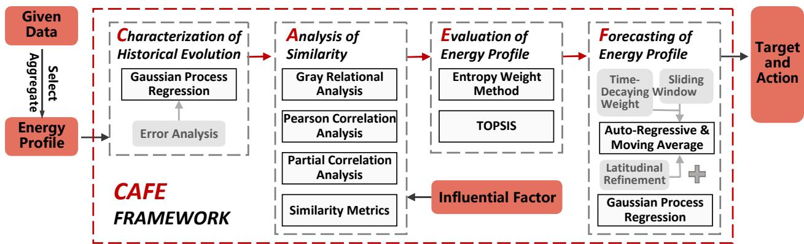
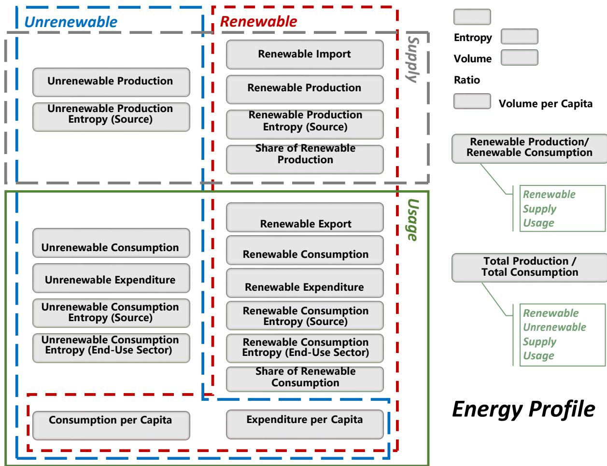
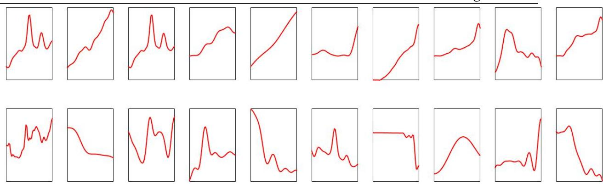
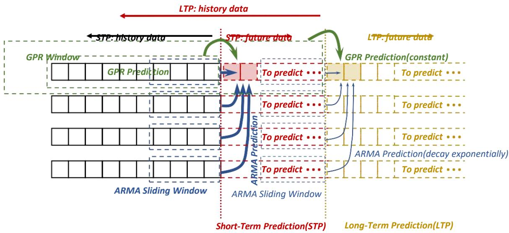
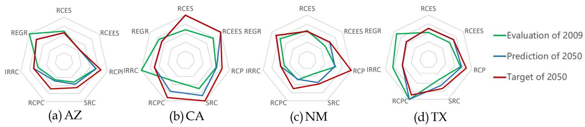

# 2018年美赛O奖论文：CAFE Characterization, Analysis, Forecasting, and Evaluation of Energy Profile

原件为竞赛论文。补充：文中的阅读练习及“参考解答”为整理时增加，原件图文保留出处。

## Summary

As sustainability comes in the spotlight, renewable energy receives extensive study. One fresh idea to it in U.S. is the Interstate Energy Compact, aiming at promoting collaboration for energy use among states. In this paper, we formulate concrete objectives and actions on the use of renewable energy for such a compact among California (CA), Arizona (AZ), New Mexico (NM) and Texas (TX).

We first build CAFE, a novel framework for Characterization, Analysis, Forecast and Evaluation on the energy profile (EP) of a state. We constitute EP with 20 items in a multifaceted manner selected and aggregated from the 605 variables in the provided data. We utilize the Gaussian Process Regression (GPR) model to characterize the basic evolving trends, strong fluctuations and random noise level of different EP time series in each state from 1960 to 2009. We combine Gray Relational Analysis and Kendall Rank to measure the similarity of EPs among states in value and tendency respectively, and use both Pearson Correlation Coefficient and Partial Relational Coefficient to unveil outer influential factors on the similarity. We consider 7 criteria concerning renewable energy, endow them with different importance by the Entropy Weight Method, integrate them into an ultimate score based on TOPSIS method, and finally judge CA having the ‘best’ profile. We pioneeringly formulate an ARMA-GPR Hybrid model for EP prediction of 2025 and 2050, which adaptively suits itself to short-term and long-term prediction. We further propose a sliding window mechanism and a ‘Look-Ahead’ refinement approach incorporating more information in prediction.

We then determine goals and approaches for renewable energy usage in 2025 and 2050. We discover the predominance of renewable energy consumption (RC) in its usage, and thus model the goal setting problem as a multi-objective optimization over RC. Results show that RC targets for 2025/2050 are respectively CA: 988787/1227217, AZ: 148028/175154, NM: 30120/36359, TX: 283871/371206 (billion Btu). We further propose three actions to stimulate RC in AZ, NM, and TX, and show that CA can export more renewable energy to help the other three states in enhancing RC.

We finally conduct sensitivity analysis, dissect pros and cons of our model and present a memo of our work to the state governors.

**Keywords:** CAFE; Energy Profile; Correlation Analysis; ARMA-GPR Model; Multi-Objective

### Contents

1 Introduction
2 Assumptions
3 Abbreviation and Definitions
4 CAFE: Characterization, Analysis, Forecasting, and Evaluation of Energy Profile
   4.1 Energy Profile Formulation
   4.2 Energy Profile Characterization and Analysis
      4.2.1 GPR model: Evolution of Energy Profile
      4.2.2 Similarity Analysis of Energy Profile
   4.3 Influential Factors of Similarities
   4.4 Energy Profile Evaluation
   4.5 Energy Profile Prediction
5 Targets and Actions for Interstate Energy Compact
   5.1 Targets: Total Renewable Consumption Based Optimization
   5.2 Actions: Motivating Renewable Energy Use in NM, TX, and AZ
6 Sensitivity Analysis
7 Strengths and Weaknesses
   7.1 Strengths
   7.2 Weaknesses
8 Conclusion

## 1 Introduction

With the mounting heterogeneity of energy infrastructures and demands in different regions, centralized regulation of energy can no longer meet the needs for economic development in every state in U.S. To confront this, two well-known interstate compacts: Western Interstate Energy Compact (1970) and South States Energy Compacts (1978), were proposed to make for state economic enhancement in a decentralized and cooperative manner[1].

In 21st century, as sustainability becomes under great concern, the same issue of decentralization falls upon the renewable energy management. Currently, the state governors of California, Arizona, New Mexico, and Texas are planning to formulate a renewable energy interstate compact. Specifically, they need

*   an energy profile[^1] for states to characterize and evaluate their renewable energy use, and make predictions for it in 2025 and 2050;
*   a list of goals written in the compact for renewable energy usage in 2025 and 2050, and at least three actions to achieve these goals.

A slew of prior arts have shed light on the energy prediction: Cammarano et. al [3] proposed Pro-Energy, a prediction model of future available energy for wireless sensor networks, Virote and Neves-Sirva [4] built an energy consumption model based on stochastic Markov models to forecast energy saving. However, above works zoomed in on prediction within days, far less than intervals of years as the compact requires. Moreover, no prior works have ever raised any quantified goal or action for renewable energy in an interstate energy compact.

In this work, we propose a novel framework, named CAFE (Characterization, Analysis, Forecasting, and Evaluation of Energy Profile), to fill in the gap above. The framework of CAFE is shown in Figure 1.

CAFE framework in Fig. 1 can be summarized as the following steps:

[^1]: The energy profile primarily consists of energy production, consumption, import, and exports [2].

# 2018年美赛O奖论文：CAFE Characterization, Analysis, Forecasting, and Evaluation of Energy Profile

本部分整理了第 5–7 页内容，涵盖模型核心步骤、假设条件、术语缩写及能量画像构建方法。

## 一、模型核心步骤概述

- **Characterization（表征）**：我们将每个状态的典型项目整合为能量画像，并建立高斯过程回归（GPR）模型以展示能量画像的演变。
- **Analysis（分析）**：利用相关性分析识别不同状态间能量画像的相似性及其潜在原因，包括地理、气候、产业等。
- **Evaluation（评估）**：我们应用理想解排序法（TOPSIS）基于七个细化标准形成综合准则。
- **Forecast（预测）**：我们创新性地提出了 ARMA-GPR 模型，该模型通过分配时间衰减权重自适应地适用于短期和长期能量画像预测。该模型不仅整合了 GPR 和 ARMA，还纳入了状态间的相似性。
- **Targets and Actions（目标与行动）**：我们利用多目标规划确定 2025 年和 2050 年四个州可再生能源消费的量化目标，并基于我们的预测提供刺激 AZ、NM 和 TX 使用可再生能源的行动建议。

## 二、假设条件

首先，我们做出一些基本假设并解释其合理性。

### 假设 1

每个州都非常重视可再生能源的使用，并设定共同的目标以加强可再生能源的管理和发展。

这一假设是我们工作的前提，因为只有当每个州都努力增加可再生能源的使用时，我们提出的目标和行动才有意义。

### 假设 2

不会出现带来革命性替代可再生能源的重大技术革命。

到目前为止，没有迹象表明会出现某种新的、具有革命性的替代能源，因此这一假设有助于消除小概率事件的影响。

### 假设 3

到 2050 年不会发生破坏性灾难（如大地震）和人为灾害（如战争）。

这类灾难在历史记录中很少发生，因此我们在模型中忽略其影响。

### 假设 4

提供的数据在一定程度上是真实和准确的。

尽管数据存在不完整性和统计上可容忍的错误，但我们做出此假设以保证一个有效解的存在。

## 三、缩写与定义

为了紧凑起见，我们在表 1 中定义了一系列关于能量画像概念的缩写。

**表 1：相关术语缩写**

| 缩写 | 全称 |
| :--- | :--- |
| RC | Renewable Consumption（可再生消费） |
| UC | Unrenewable Consumption（不可再生消费） |
| RP | Renewable Production（可再生生产） |
| UP | Unrenewable Production（不可再生生产） |
| RI | Renewable Import（可再生进口） |
| RE | Renewable Export（可再生出口） |
| RED | Renewable Expenditure（可再生支出） |
| UED | Unrenewable Expenditure（不可再生支出） |
| CPC | Consumption Per Capita（人均消费） |
| EPC | Expenditure Per Capita（人均支出） |
| RPES | Renewable Production Entropy by Source（按来源的可再生生产熵） |
| UPES | Unrenewable Production Entropy by Source（按来源的不可再生生产熵） |
| RCES | Renewable Consumption Entropy by Source（按来源的可再生消费熵） |
| UCES | Unrenewable Production Entropy by Source（按来源的不可再生生产熵） |
| SRP | Share of Renewable Production（可再生生产份额） |
| SRC | Share of Renewable Consumption（可再生消费份额） |
| RCPR | Renewable Consumption-Production Ratio（可再生消产比） |
| TCPR | Total Consumption-Production Ratio（总消产比） |
| RCEES | Renewable Consumption Entropy by End-use Sector（按终端用途部门的可再生消费熵） |
| UCEES | Unrenewable Consumption Entropy by End-use Sector（按终端用途部门的不可再生消费熵） |

## 四、CAFE：能量画像的特征化、分析、预测与评估

在本节中，我们首先基于提供的数据创建能量画像。然后，我们提出一个新模型：CAFE，用于全面表征、分析、预测和评估 CA、AZ、NM 和 TX 的能量画像，基于包含 1960 年至 2009 年 605 个变量的数据集 [5]。

### 4.1 能量画像构建

首先，我们为每个州构建一个能量画像。能量画像应呈现能源使用的全景视图。我们从宏观上将能源分为可再生（电力、乙醇燃料、核燃料、木材等）和不可再生（石油/汽油/石油、煤炭、天然气）。我们提取反映一个州不同方面能源全局信息的项目，主要涉及进口、出口、生产、消费和支出。具体而言，我们选择具有以下全局属性的项目：RC, UC, RP, UP, RI, RE, RED, UED, CPC, EPC。

为了探索这些项目内部的底层信息，我们进行了一些聚合以形成表 2 中列出的新项目。其中，RPES/UPES/RCES/UCES（以 RPES 为例）表征了不同种类来源之间的能源使用分布，而 RCEES/UCEES（以 RCEES 为例）展示了不同部门之间的分布，作为具有总体属性项目的补充；SRP/SRC 代表了可再生能源使用的普及程度；RCPR/TCPR 证明了该州能源使用的平衡性。所有这些聚合项目丰富了我们在能量画像特征化中的考量。

**表 2：能量画像中的聚合项目**

| 项目 | 定义 |
| :--- | :--- |
| RPES / UPES / RCES / UCES | $\sum_{j} p_j \log(1/p_j)$ |
| SRP | $RP/(RP+UP)$ |
| SRC | $RC/(RC+UC)$ |
| RCPR | $RC/RP$ |
| TCPR | $(RC+UC)/(RP+UP)$ |

> 注：$p_j$ 是第 $j$ 种（可再生/不可再生）能源在来源/部门中的相应比例。

# 2018年美赛O奖论文：CAFE Characterization, Analysis, Forecasting, and Evaluation of Energy Profile（第3部分）

整理自《2018年美赛O奖论文：CAFE Characterization, Analysis, Forecasting, and Evaluation of Energy Profile》教材第3部分（第8–9页，对应原稿第5-6页），由识别工具读取并整理。

## 一、能源画像特征分析与高斯过程回归模型

### 选择 1

题干：根据文中描述，以下哪项**不是**能源画像时间序列特征刻画中提出的挑战？

- A. 拟合模型应能表征时间序列的基本演变趋势
- B. 数值的大幅波动要求模型能够捕捉不稳定性
- C. 模型应适应时间序列中存在的随机噪声
- D. 模型必须输出确定性的单一预测值而不考虑置信区间

答案：D。
参考解答：文中4.2.1节明确列出了三个挑战：“The fitting model should characterize the basic evolving trend...”、“The strong fluctuations... requires a model to capture the instability”、“The model should accommodate the random noise...”。选项D与GPR作为概率模型提供置信区间的特性相反，且文中指出GPR并不输出确定性值（"Since GPR does not output a deterministic value..."）。

### 简答 1

题干：简述GPR（高斯过程回归）模型中核函数（Kernel）的选择及其物理意义。

正文：
在GPR模型中，协方差矩阵 $K_f$ 被称为核（kernel）。文中自然选择了高斯函数作为核函数：

$$
k_{f}(x_{i}, x_{j}) = c_{0} \exp \left(- \frac {(x_{i} - x_{j}) ^{2}}{2 \sigma_ {0} ^{2}}\right)
$$

其中：
- $c_{0}$ 是一个常数；
- $\sigma_{0}$ 代表自相关性的衰减速率（decaying rate of auto-correlation）。

该核函数使得时间上更接近的值具有更高的相关性，这与能源画像预测中“越近的信息对预测越重要”的事实相吻合。

### 计算 1

题干：假设已知观测数据向量 $\mathbf{y} \in \mathbf{R}^{n \times 1}$，对于新的时间点 $x^*$，请写出其对应预测值 $y^*$ 的条件分布公式，并解释均值 $\mu_*$ 和方差 $\sigma_*^2$ 的计算方式。

正文：
根据贝叶斯推断，给定观测数据 $\mathbf{y}$，新值 $y^*$ 的条件分布为：

$$
y^{*} | \mathbf{y} \sim N (K_{1} K_{0}^{-1} \mathbf{y}, K_{2} - K_{1} K_{0}^{-1} K_{1}^{T})
$$

其中各符号定义如下：
- $K_0 = K$，即观测数据的协方差矩阵；
- $K_1 = [ k(x^*, x_1), k(x^*, x_2), \cdots, k(x^*, x_n) ]$，即新点与所有观测点的协方差向量；
- $K_2 = k(x^*, x^*)$，即新点的自协方差。

因此，预测值 $y^*$ 服从正态分布 $N(\mu_*, \sigma_*^2)$，其参数为：

$$
\mu_* = K_{1} K_{0}^{-1} \mathbf{y}
$$

$$
\sigma_*^2 = K_{2} - K_{1} K_{0}^{-1} K_{1}^{T} + \sigma
$$

注意：原文公式(7)中方差部分最后一项写为 $+\sigma$，但通常标准GPR预测方差应为 $K_{2} - K_{1} K_{0}^{-1} K_{1}^{T}$，加上的 $\sigma$ 可能指代噪声项或原文笔误（通常噪声已在构建 $K$ 时考虑，见公式4）。但在本资料整理中，我们保留原文给出的公式形式。

补充：原文公式(7)中的 $\sigma$ 可能存在印刷错误，标准GPR预测不确定性通常不包含额外的 $\sigma$ 加法项，除非是指未平滑的噪声水平。此处依据原文记录。

### 简答 2

题干：文中如何通过GPR模型的输出结果来解释不同能源指标的可预测性？请以亚利桑那州为例说明。

正文：
GPR模型不仅输出预测值，还输出95%置信区间（Confidence Interval）。置信区间的大小反映了预测的不确定性和数据的波动性：

1. **可再生能源支出（Renewable Expenditure of Arizona, RED）**：
   - 趋势：呈现一致的增加趋势。
   - 置信区间：非常小。
   - 结论：表明其演化具有高稳定性和高预测可靠性。

2. **按来源划分的可再生能源消费熵（Renewable Consumption Entropy by Source, RCES）**：
   - 趋势：围绕某个值波动，波动幅度最大。
   - 置信区间：较大。
   - 结论：表明其演化具有高度随机性、低可预测性，且对外部影响因素高度敏感。

## 4.2.1 Regression Analysis of Energy Profile

We further apply our model into the remaining energy profile time series and present the regression parameters of AZ in Table 3 and the corresponding regression curve in Fig. 5 (the placing order is the same as Table 3). As we can see, $\beta$ reflects the general trend of the evolution, $\alpha$ represents the temporal fluctuation of measurements while $\sigma^2$ shows the noise error. Items (RC, UC, etc.) have $\alpha \gg \sigma^2$, which means that fluctuation takes the predominant part while random noise can be neglected; For those where $\alpha$ is close to $\sigma^2$ (UCES, SRC, etc.), it is not reasonable to omit the impact of random noises.

**Table 3: GPR regression results for energy profiles of Arizona (1960-2009)**
*(The arrow directions represent the basic evolving trends while L and S is the abbreviation of large and small respectively)*

| | RC | UC | RP | UP | RI | RE | RED | UED | CPC | EPC |
| :--- | :---: | :---: | :---: | :---: | :---: | :---: | :---: | :---: | :---: | :---: |
| **$\beta$** | 90679 | 782873 | 88454 | 298941 | 124 | 297 | 2657 | 3400 | 0.11 | 1328 |
| **Trend** | ↑ | ↑ | ↑ | ↑ | ↑ | ↑ | ↑ | ↑ | → | ↑ |
| **$\alpha$** | 10164 | 1.89 | 10161 | 3.33 | 190 | 82 | 52 | 4.8 | 5205 | 98 |
| **Fluctuation** | L | S | L | S | S | S | S | S | L | S |
| **$\sigma^2$** | 0.13 | 0.03 | 0.13 | 0.02 | 0.06 | 0.05 | 0.02 | 0.06 | 0.22 | 0.09 |
| **Noise** | L | S | L | S | S | S | S | S | L | S |
| **MAPE** | 0.05 | 0.02 | 0.05 | 0.63 | 0.23 | 0.35 | 0.17 | 0.08 | 0.01 | 0.02 |

| | RPES | UPES | RCES | UCES | RCEES | UCEES | SRP | SRC | RCPR | TCPR |
| :--- | :---: | :---: | :---: | :---: | :---: | :---: | :---: | :---: | :---: | :---: |
| **$\beta$** | 0.56 | -0.23 | 0.56 | 2.40 | -0.42 | -0.70 | -0.98 | 0.32 | 1.60 | 2.11 |
| **Trend** | ↑ | ↓ | → | ↑ | ↓ | ↓ | ↓ | ↑ | ↑ | ↓ |
| **$\alpha$** | 2234 | 0.17 | 412 | 710 | 458 | 1290 | 0.01 | 0.04 | 231 | 980 |
| **Fluctuation** | L | S | L | L | L | L | S | S | L | L |
| **$\sigma^2$** | 0.34 | 0.07 | 0.28 | 0.31 | 0.02 | 0.34 | 0.01 | 0.11 | 0.31 | 0.01 |
| **Noise** | L | S | L | L | S | L | S | S | L | S |
| **MAPE** | 0.02 | 0.25 | 0.04 | 0.01 | 0.07 | 0.05 | 0.01 | 0.08 | 0.01 | 0.01 |

Error Analysis: Table 3 also shows the Mean Absolute Percent Error (MAPE) between regression values and ground-truth values. The low MAPEs corroborate the regression precision of GPR model in fitting energy profile time series.

### 4.2.2 Similarity Analysis of Energy Profile

We take a step further to study the similarity of energy profile evolution among four states. Shown in Figure 4, the temporal fluctuation entangles accurate analysis of the relationship among four states over each item, due to the uncertain time-variation of each time series and our incomplete knowledge of other potential influential factors. For such an unclear situation, we adopt the Gray Relational Analysis (GRA) to unveil the relationship among energy profile in four states. GRA performs reliably under systems with information incompleteness and uncertainty, and with complicated multivariate interrelationships [6, 7], by pursuing an appropriate result acceptable in real cases instead of persisting in an optimum [8].

We conduct our GRA-based analysis as follows: For item $e$, suppose we consider the values of it for $T$ years, then we can obtain the time series $y_i = ( y_i(1), y_i(2), ..., y_i(T) )$ for state $i$. Then for two states $i$ and $j$, we define $\xi_{ij}$, which represents the relationship between comparability vector $y_i$ and reference vector $y_j$. Specifically,

$$
\xi_{ij} = \frac {\min_{t \in \{1 , 2 , \dots , T \}} \min_{i \neq j} | y_i(t) - y_j(t) | + \max_{t \in \{1 , 2 , \dots , T \}} \max_{i \neq j} | y_i(t) - y_j(t) |}{| y_i(t) - y_j(t) | + \max_{t \in \{1 , 2 , \dots , T \}} \max_{i \neq j} | y_i(t) - y_j(t) |}. \tag{8}
$$

Then the gray relational coefficient (GRC) is

$$
\rho_{ij} = \frac {\sum_{k = 1} ^ {T} \xi_{ij} (k)}{T}, \tag{9}
$$

which characterizes the correlation.

Nevertheless, conducting GRA only measures the similarity on totality property of each item, as shown in Eqn. (8), which cannot characterize the similarity on evolution tendency. In real cases, however, tendency similarity counts much as one can characterize the future trend of a profile more precisely. To tackle it, we harness the Kendall Rank Correlation Coefficient (KRCC) to model the tendency similarity. KRCC considers two random arrays $y_i = ( y_i(1), y_i(2), ..., y_i(T) )$ and $y_j = ( y_j(1), y_j(2), ..., y_j(T) )$. For a pair of observations $( y_i(t_1), y_j(t_1) )$ and $( y_i(t_2), y_j(t_2) )$ ($t_1 \neq t_2$), if $( y_i(t_1) - y_i(t_2) )( y_j(t_1) - y_j(t_2) ) > 0$ we call the pair is concordant, while if $( y_i(t_1) - y_i(t_2) )( y_j(t_1) - y_j(t_2) ) < 0$ means discordant. KRCC is then defined as

$$
\tau(X, Y) = \frac {N_c - N_d}{T (T - 1) / 2}. \tag{10}
$$

### 4.3 Influential Factors of Similarities

To understand the profile similarities and differences much in depth, we then explore the impacts of other possible influential factors including geography, climate, industry and population. Note that geography and climate can be viewed as constants while industry and population are evolving temporally. Therefore, for a constant factor $G$ we use Absolute Mean Error between two states $i$ and $j$, denoted as

$$
\gamma_ {i j} ^ {G} = \frac {| G _ {i} - G _ {j} |}{| G _ {i} |},\tag{13}
$$

to characterize the interstate similarity of factor $G$. For an evolving factor $H$ we use the Pearson Correlation Coefficient (PCC) of it in two states $i$ and $j$, whose definition is

$$
\rho_ {i j} ^ {H} = \frac {\sum_ {k} (H _ {k} ^ {i} - \bar {H} ^ {i}) (H _ {k} ^ {j} - \bar {H} ^ {j})}{\sqrt {\sum_ {l} (H _ {l} ^ {i} - \bar {H} ^ {i}) ^ {2} \sum_ {l} (H _ {l} ^ {j} - \bar {H} ^ {j}) ^ {2}}},\tag{14}
$$

where $H _ { i }$ and $H _ { j }$ are the arrays of $H$.

To study the influential factors, our empirical intuition is: if two states with a similar factor (like geography) share the similar energy profile, then we treat this factor is related to the interstate similarity of energy profile. In Figure 7, we plot the factor similarity v.s. IGRC for $2 C _ { 4 } ^ { 2 } = 1 2$ state pairs. As we can see, the scattered points appear to have a consistent trend, which indicates that the factor similarity is related to IGRC.

Then we probe into the influential factors for IKRCC. We adopt Pearson Correlation Coefficient (PCC) and Partial Relational Coefficient (PRC) to study the correlation. The advantage of PRC over PCC is that PRC takes the interdependence among different influential factors into considerations and capture the correlation excluding the impact from other factors. Table 4 shows the PCC and PRC between influential factors and IKRCC: PCC shows that all of the potential criteria have a negative correlation within the two states involved.

Table 4: Pearson Correlation Coefficient and Partial Relational Coefficient.

| | Area | Water Percentage | Altitude | Rainfall | Temperature | Population | GDP | GDP Per Capita |
| :--- | :---: | :---: | :---: | :---: | :---: | :---: | :---: | :---: |
| **PCC** | -0.45 | -0.26 | -0.39 | -0.44 | -0.61 | -0.28 | -0.21 | -0.42 |
| **PRC** | -0.57 | -0.14 | 0.27 | 0.34 | -0.71 | -0.72 | 0.80 | -0.37 |

### 4.4 Energy Profile Evaluation

Following the energy profile characterization, we will analyze which state turns out to have the best profile in terms of renewable energy usage. A good profile for renewable energy should be integratedly judged and ultimately indicate a positive tendency for its greater influence in society. In our work, we designate seven criteria based on different angles to measure how good a profile is in regards to renewable energy use, list in detail in Table 5. New criteria include: RCPC (Renewable Consumption Per Capita), IRRC (Increasing Rate of Renewable Consumption), and REGR (Renewable Expenditure-GDP Ratio). The proposed criteria synthetizes popularity, diversity, and economic potentials, ensuring higher social impact of renewable energy under a better energy profile for renewable energyuse.

Table 5: Criteria for Evaluating Energy Profile

| Abbreviation | Significance towards RE | Entropy weight |
| :--- | :--- | :---: |
| RCES | Consumption Variety | 0.183 |
| RCEES | Consumption Variety | 0.191 |
| RCPR | Economic Balance | 0.105 |
| SRC | Consumption Proportion | 0.120 |
| RCPC | Individual Consumption | 0.189 |
| IRRC | Consumption Trend | 0.107 |
| REGR | Expenditure Proportion | 0.101 |

Judging the best profile requires reasonably melting the above seven criteria into a synthetic one. Here we again adopt Entropy Weight Method to allocate weights to each criterion. In view of our objective to selecting the best profile, we utilize the TOPSIS method, whose core is to directly identify the best profile by minimizing the distance to the ‘virtual optimum’ where all criteria reach the optimum. To implement the method, we first normalize each criterion value to eliminate the problem of different scales. Use $Z _ { i j }$ to denote the value of the $j$-th criterion for state $i$ and its corresponding normalized value $Z _ { i j } ^ { 0 }$ can be calculated

$$
Z _ {i j} ^ {0} = \frac {Z _ {i j} - \min _ {i} Z _ {i j}}{\max _ {i} Z _ {i j} - \min _ {i} Z _ {i j}}.\tag{15}
$$

其次，我们计算到“虚拟最优值”的距离：

$$
D _ {i} ^ {+} = \sqrt {\sum_ {j = 1} ^ {7} W _ {j} \cdot (Z _ {i j} - Z _ {j} ^ {+}) ^ {2}},\tag{16}
$$

$$
D _ {i} ^ {-} = \sqrt {\sum_ {j = 1} ^ {7} W _ {j} \cdot (Z _ {i j} - Z _ {j} ^ {-}) ^ {2}},\tag{17}
$$

其中 $Z _ { j } ^ { + } , Z _ { j } ^ { - }$ 分别表示四个州在第 $j$ 个指标上的最优值与最差值；$W _ { j }$ 是第 $j$ 个指标的熵权。最后，我们可以导出州 $i$ 的评价得分：

$$
Score(i) = \frac {D _ {i} ^ {-}}{D _ {i} ^ {+} + D _ {i} ^ {-}},\tag{18}
$$

评价结果见表 6，其中前七列是归一化后的指标，最后一列是每个州的得分。可以看到，CA 在我们的最终指标中排名第一，TX 紧随其后，AZ 排名第三，NM 垫底。这与我们的直觉相符：CA 和 TX 更发达，相比欠发达的 AZ 和 NM，它们在可再生能源利用方面应该走得更远。

表 6：四个州可再生能源利用的评价结果

| | RCES | RCEES | RCPR | SRC | RCPC | IRRC | REGR | Score |
|---|---|---|---|---|---|---|---|---|
| AZ | 0.16 | 0 | 0.95 | 0.69 | 0.16 | 0 | 1 | 0.434 |
| CA | 1 | 1 | 0.56 | 1 | 0 | 1 | 0 | 0.628 |
| NM | 0.32 | 0.21 | 0 | 0.38 | 0.29 | 0.52 | 0.64 | 0.417 |
| TX | 0 | 0.21 | 1 | 0 | 1 | 0.83 | 0.88 | 0.534 |

### 4.5 能源画像预测

我们现在对四个州的每个能源画像进行预测。沿用画像刻画部分（4.1 节）中的 GPR 模型，我们首先用 GPR 进行预测，结果如图 8 所示。可以观察到，所有项目在 10 年后都转为稳定增长。这是因为从长期角度看，预测应反映总体趋势，并变得更为“保守”，尤其是在预测可能的波动时，因为不确定性会增加。因此，对于呈总体上升趋势的项目（如 RED 和 RE），长期预测表现为稳定上行；而对于波动剧烈的项目（如 RCES），预测只转为轻微上升。这一现象呼应了我们对项目值演化特征的刻画（4.1 节）：演化的可预测性越高，长期预测就越不保守。

然而，尽管 GPR 给出了全局预测，它未能关注局部信息，因而给出不合理的短期预测。例如，对于亚利桑那州的 RE（图 8(b)），我们可以发现，在 2009 年之后的一小段时间内出现了一个反直觉的下降，与 2009 年前几年内的急剧上升相反。这是因为 GPR 综合了所有历史数据，从而拉低了 2009 年之后的突增。

为改进短期预测，应采用局部预测模型。我们设计两种新技术来改进模型。

### 技术 1：滑动窗口机制

自回归滑动平均模型（ARMA）是一种在短期预测中具有优先地位的自回归预测方法[9]。其一般表示 ARMA(p,q) 如下：

$$
y (t) = c + \epsilon (t) + \sum_ {i = 1} ^ {p} \phi_ {i} y (t - i) + \sum_ {i = 1} ^ {q} \theta_ {i} \epsilon (t - i),\tag{19}
$$

其中 $s ( t )$ 是时刻 $t$ 的白噪声，$\varphi _ { i }$ 和 $\theta _ { i }$ 均为权重。滑动窗口机制将我们的考虑限制在当前时刻附近的一个小时间范围内，从而避开贡献较小、甚至在短期预测中带来有害偏移的“过时”数据。具体地，我们设当前时刻为 t，只考虑时间区间 [t k + 1, t]，其中 k t。图 9 给出了一个直观的例子。此外，由于我们的目标是在短期预测中以更高精度跟随当前时刻附近的趋势，我们需要精确刻画项目值变化了多少，即对项目值的增量应用 ARMA 模型，即：

# CAFE Characterization, Analysis, Forecasting, and Evaluation of Energy Profile

本文档整理自《2018年美赛O奖论文：CAFE Characterization, Analysis, Forecasting, and Evaluation of Energy Profile》第 7 部分（共 10 部分），由识别工具读取第 17–18 页内容并整理而成。

## 二、技术方法整合

### Technique 2: 'Look Aside' Latitudinal Refinement

鉴于第 4.2 节中讨论的四个州之间能源profile存在的相似性，仅对单个州的profile演化进行纵向研究是不够的。相反，应嵌入纬度视角，即将州间profile的相关性纳入特定州的预测中。其直观说明如图9所示。为了量化州间相关性的整合，我们在其他州的ARMA预测基础上添加权重 $\delta$，具体公式如下：

$$
\Delta \tilde {y} _ {i} (t) = b \Delta y _ {i} (t) + (1 - b) \sum_ {j \neq i} \Delta y _ {j} (t).\tag{21}
$$

在获得集成增量 $\Delta \tilde { y } _ { i } ( t )$ 后，我们通过以下公式预测项目值：

$$
y ^ {A} (t) = y (t - 1) + \Delta \tilde {y} _ {i} (t).\tag{22}
$$

### Incorporation of Techniques

现在我们将ARMA和GRP的预测相结合，形成一个新颖的混合模型，称为ARMA-GPR模型。需要注意的是，从短期到长期预测，局部因素的重要性降低，而全局因素的重要性增加。因此，我们为局部预测赋予指数衰减权重 $\kappa(t)$。具体来说，时间 $t$ 的预测应为：

$$
y ^ {*} (t) = \kappa (t) y ^ {A} (t) + (1 - \beta (t)) y ^ {G} (t),\tag{23}
$$

其中 $y ^ { G } ( t )$ 表示由GPR给出的预测，且 $\kappa ( t ) = \exp ( - a _ { 0 } ( t - t _ { 0 } ) )$ （$c _ { 0 } > 0$，在此问题中 $t _ { 0 } = 2009$）。

我们在图10中绘制了ARMA-GPR模型的预测结果。与GPR的预测相比，ARMA-GPR模型给出的预测值似乎比GPR预测值‘更高’。这是因为2009年之前的时间序列呈现上升趋势，ARMA模型的滑动窗口会捕捉到这一趋势并‘拉高’预测值。随着时间的推移，ARMA-GPR预测值倾向于收敛到GPR预测值，这是由于时间衰减权重的结果。

## 三、州际能源紧凑的目标与行动

在本节中，我们将用于能源profile的CAFE模型应用于实际政策。具体而言，我们确定了2025年和2050年可再生能源使用的量化目标，并为这四个州实现这些目标提出了具体措施。

### 5.1 目标：基于优化的总可再生能源消耗

基于我们对所提供数据的观察，我们确定可再生能源消耗（RC）占总可再生能源使用的主要比例。RC的主导地位启发我们在制定目标时专注于消耗问题，而将RP、RI和RE等其他方面放在一边。

在着手设定能源使用目标之前，我们基于第2节中的一般假设做出了一些进一步的假设。

**假设 5.** 该紧凑协议的最终目标是最大化各州之间的全球利益。

**假设 6.** 每个州的州长倾向于‘自私’，也就是说，他们不愿意在考虑协议的情况下牺牲自己的利益。

基于假设5，紧凑协议的目标应该是最大化各州之间的总可再生能源消耗（TRP）。然而，正如在第4.3节中分析的那样，仅考虑消耗量只能涵盖可再生能源使用的部分。因此，决定目标的更合理方式应源于我们提出的评估能源profile的标准（第4.3节）。因此，目标设定问题可以表述为多目标规划。为了整合四个州的评估（即目标函数），我们定义了总可再生能源消耗Profile（TRCP）并定义：

$$
T R C P = \sum_ {i = 1} ^ {4} b _ {i} \tilde {\text { Score}} _ {p} (i),\tag{24}
$$

其中 $S c o r e _ { p } ( i )$ 是实施紧凑协议后的评估分数。

在确定 $b _ { i }$ 时，我们应该注意到常识，即州际紧凑协议不应进一步扩大这些州之间可再生能源使用的差距，从而导致更严重的经济差异。因此，一种直观的方法是通过设置适当的 $w _ { i }$ 来抵消TRCP中具有较高profile分数的州的‘主导’地位。具体来说，我们设置 ${ w _ { i } } = 1 / S c o r e ( i )$，其中 Score(i) 是州 i 当前的profile分数。请注意，TRCP的最大化仅关注与RC相关的三个标准：SRC、RCPR和REGR。

此外，各州在追求TRC最大化时有两个限制：

## 二、模型优化与目标设定

### 约束条件分析

原文提出了两个主要约束：
- **RC Satisfaction（满意度）**：所有四个州都必须满足该约束，因此不应阻碍任何州的持续经济发展。
- **RC Limitation（限制）**：总可再生能源消费量（TRC）在每一年内不得超过四个州的总可再生能源产量（TRP）。

对于第一个约束，我们假设每个州每年的 RC 满意下限为第 4.4 节给出的预测值。数学上，设 RC 预测值为 $\tilde{RC}$，则 $RC_i \geq \tilde{RC}_i$ ($i = 1, 2, 3, 4$)。对于第二个约束，我们需要确保 $\sum_{i=1}^{4} RC_i \leq \sum_{i=1}^{4} RP_i$。结合我们的目标和约束，构建以下基本的 TRCP 最大化问题：

$$
\begin{array}{l} \max _ {R C _ {i}, i = 1, 2, 3, 4} T R C P = \sum_ {i = 1} ^ {4} \frac {\tilde {S c o r e} _ {p} (i)}{S c o r e (i)} \\ \text {s.t.} \quad \left\{ \begin{array}{l l} R C _ {i} \geq \tilde {R C} _ {i} & (i = 1, 2, 3, 4), \\ \sum_ {i = 1} ^ {4} R C _ {i} \leq \sum_ {i = 1} ^ {4} R P _ {i}. \end{array} \right. \end{array}
$$

显然，这是一个线性规划问题，易于求解。然而，我们发现原始 TRCP 最大化问题存在两个局限性：

1.  **非同质性（Inhomogenity）**：各州之间的 RC 分布严重倾斜。大部分 RC 增强被提供给新墨西哥州（NM），而其他三个州仅享受微小的增长。这种极端的非同质性抑制了 NM 以外州的 RC 发展，偏离了契约的互惠原则。
2.  **不可行性（Infeasibility）**：由于对 RC 的硬性约束，在最大化 TRCP 时可能不存在可行解。例如，当 RP 小于我们预测的 $\tilde{RC}$ 时，可行域可能为空集。

为此，我们将原始优化问题修改为以下改进版本：

$$
\begin{array}{r l} & {\underset {R C _ {i}, i = 1, 2, 3, 4} {\max} T R C P ^ {\prime} = \sum_ {i = 1} ^ {4} \frac {S c o r e _ {p} (i)}{S c o r e _ {i}} - \lambda (\sum_ {i = 1} ^ {4} R C _ {i} - \sum_ {i = 1} ^ {4} R P _ {i}) ^ {2}} \\ & {\quad s. t. \quad R C _ {i} \geq d _ {i} \cdot \tilde {R C} _ {i} \qquad (i = 1, 2, 3, 4),} \end{array}
$$

其中 $\lambda$ 是预定义的正参数，$d_i (i = 1, 2, 3, 4)$ 是每个州的预期收益系数，可由州长设定。

直观地看，新的优化问题有两个调整：
1.  引入了一个附加的 RC 要求项 $d_i$。它收紧了 RC 增强的限制，从而确保每个州都有可接受的增量，解决了非同质性问题。
2.  将 RC 限制约束转换为目标函数中的惩罚项，其中 $\lambda$ 为惩罚因子。该惩罚项限制了 TRC 和 TRP 之间较小的差异，符合实际中的平衡要求。同时，它放宽了基于所提供数据的不完整性以及除上述四个州外其他州可能的可再生能源转型所导致的硬性要求 $RC \leq RP$，解决了不可行性问题。

随后，我们将模型应用于 2025 年和 2050 年的目标设定。表 7 显示了 2025 年和 2050 年的可再生能源消费目标以及与预测 RC 相比的改善百分比。这里我们考虑 $d_i = 10\%$ (2025年)，$d_i = 20\%$ (2050年)，$i = 1, 2, 3, 4$，并设置 $\lambda = 0.015$。我们将在敏感性分析中进一步讨论这些参数的设定。

**表 7: 2025 年和 2050 年可再生能源消费目标 ($10^{14} \mathrm{Btu}$)**

| Year | AZ | CA | NM | TX |
| :--- | :--- | :--- | :--- | :--- |
| 2025 | 1.63 (24%) | 10.90 (10%) | 0.54 (81%) | 3.12 (10%) |
| 2050 | 2.10 (58%) | 14.73 (20%) | 0.77 (113%) | 4.45 (20%) |

### 目标对能源概况的影响研究

接着，我们研究了所提出的目标对能源概况的影响。具体而言，我们将预测的 RCPR、SRC 和 RCPC 值与有目标和无目标的情况进行了比较。结果如图 11 所示。我们注意到，对于这三项指标，2025 年和 2050 年带有目标的预测值均超过了无目标的预测值，显示出目标可能带来的促进作用。

此外，我们还根据 RC 目标计算了评估标准，并将结果展示在图 12 中。如图所示，在 RC 目标下，四个州的 SRC、RCPR 和 REGR 均取得了显著改善。

### 5.2 行动：激励 NM、TX 和 AZ 的可再生能源使用

**行动原则：**
(i) 由于我们的目标是基于可再生能源消费（RC），因此行动应首先有助于实现 RC 要求；

# 2018年美赛O奖论文：CAFE Characterization, Analysis, Forecasting, and Evaluation of Energy Profile（第9部分）

## 一、基于预测结果的行动建议

根据前述原则，我们提出以下三项行动，并定量解释其预期效果。

### 行动 1：短期内刺激 NM 和 TX 的可再生消费（RC）与可再生比例（RP）

根据我们对2025年的预测，我们发现 NM 和 TX 的可再生消费（RC）和可再生比例（RP）将出现下降，如表8所示。我们观察到，在短期内，NM 和 TX 的可再生能源呈现负面趋势，这表明这两个地区的政府应刺激可再生能源的使用。特别是 NM，因为预测显示到2025年，NM 的可再生能源进口（RI）仍比2009年增加约 $-(199-93)/93 = 114\%$。这显示出 NM 政府可能促进了不可再生能源的使用，跨州协议（interstate compact）应对此给予更多关注。

**表8：2025年 NM 和 TX 的 RC 和 RP 下降情况**

| | NM | TX |
| :--- | :--- | :--- |
| **RP** | $(35635 – 30119)/35635 = 15.5\%$ | $(356635 – 283870)/356635 = 20.4\%$ |
| **RC** | $(33785 – 26700)/33785 = 21.0\%$ | $(303697 – 245937)/303697 = 19.0\%$ |

### 行动 2：减少 AZ 的不可再生能源生产

当然，所有州都应减少包括机动车汽油、天然气和石油产品在内的不可再生能源的使用。这个问题在 AZ 尤为严重，因为其可再生生产份额（SRP）急剧下降：2025年为30%，2050年为87%。这种急剧下降与 AZ 不可再生能源生产的历史演变相呼应，从1960年的556十亿英热单位（Btu）到2009年的482,422十亿英热单位，增长了近800倍。这两点都强烈表明 AZ 对不可再生能源存在广泛的工业和社会需求。因此，为了实现 AZ 的目标，AZ 应限制不可再生能源的生产，特别是目前占主要部分的天然气（20.2%）和汽油（28.9%）。

### 行动 3：促进 NM 和 TX 更多种类可再生能源的多样化使用

我们从预测中注意到，NM 和 TX 的可再生消费能源结构多样性（RCES，即不同种类可再生能源消费的多样性）可能会下降。预测到的下降情况如表9所示，这可能是一个持续的下滑趋势。为了抑制这种恶化趋势，NM 和 TX 可以尝试其他可能的可再生能源，并扩大其消费多样性。目前，太阳能和地热能的可再生能源利用率最低，仅分别占1.3%和4.4%。因此，激励这些能源的使用对于提高可再生能源使用量具有巨大潜力。

综上所述，根据我们当前的能源概况评估和预测，CA（加利福尼亚州）表现最佳，可以按其当前趋势发展，无需施加更多的额外行动。因此，跨州协议可以让 CA 与其他三个州相互合作。例如，CA 可以向 AZ 提供更多可再生出口，以刺激那里的可再生能源消费；并向 NM 和 TX 提供出口，以阻碍其可再生能源消费下降的趋势。

**表9：2025年和2050年 NM 和 TX 的 RCES 下降情况**

| | NM | TX |
| :--- | :--- | :--- |
| **2025** | $(0.746 – 0.55)/0.746 = 26.3\%$ | $(0.614 – 0.38)/0.614 = 38.1\%$ |
| **2050** | $(0.746 – 0.43)/0.746 = 42.3\%$ | $(0.614 – 0.25)/0.614 = 59.3\%$ |

## 二、敏感性分析

我们探讨了 ARMA-GPR 模型中某些参数的敏感性。如图13(a)所示，当我们将参数 $b$ 从 0.1 改变为 0.9 时，预测曲线向上移动。2025年的预测变化很大，而2050年的预测保持不变。这表明短期预测对 $b$ 敏感，而长期预测不敏感。原因是 ARMA 预测在长期预测中占比很小。此外，图13(b)显示了当我们改变 $c_0$ 从 0.1 到 0.9 时的变化情况。我们可以看到，随着 $c_0$ 的增加，ARMA-GPR 预测曲线接近 GPR 预测曲线。这是因为较大的 $c_0$ 导致 ARMA 效应衰减更快，使曲线更快地收敛到 GPR 预测。

接着，我们探讨了第5.1节中优化模型的敏感性。设置不同的 $\lambda$，我们获得了目标函数的最优值，如表10所示。

**表10：优化模型中参数 $\lambda$ 的敏感性分析**

| $\lambda$ | 0.011 | 0.012 | 0.013 | 0.014 | 0.015 | 0.016 | 0.017 | 0.018 | 0.019 |
| :--- | :--- | :--- | :--- | :--- | :--- | :--- | :--- | :--- | :--- |
| **$TRCP^j$** | 3.11 | 4.25 | 6.45 | 7.43 | 9.23 | 11.25 | 14.50 | 16.34 | 18.33 |

表中的结果显示，不同的 $\lambda$ 会导致最优值的巨大变化。事实上，$\lambda$ 代表总可再生消费与生产之间差异的权重。如果这个权重较小，那么优化给出的目标 RC 将大幅增加。这为政府提供了更多的灵活性。具体来说，如果政府希望设定一个高且具有挑战性的目标，可以将 $\lambda$ 设置为相对较小的值。为了实现这一……

## 7 模型的优缺点

### 7.1 优点

- 特征与评价复杂度低：我们从总共 605 个特征中精选出 20 个，并进一步将 7 项准则综合为 1 项进行评价；
- 泛化能力强：由于 GPR 的非参数性质，我们将其用于刻画能源概况中所有具有不同趋势的条目；
- 双边相似性分析：我们首次通过结合 GRA 与 KRCC 来剖析不同州之间能源概况的相似性，分别关注数值相似性和趋势相似性；
- 时序自适应预测：我们率先提出适用于短期和长期预测的 ARMA-GPR 混合模型，通过自适应调整局部信息和全局信息的权重实现；
- 目标量化且合理：我们严格基于优化理论设定量化目标。

### 7.2 缺点

- 未验证原始数据：我们无法保证所给数据的准确性 [5]。
- 未涉及其他州：由于缺乏相关数据，我们未考虑 CA、AZ、NM、TX 以外的州。
- 未考虑各州自身利益：我们的目标基于可再生能源消费总量最大化设定，但事实上各州可能更关心自身发展而不顾其他州，从而不会遵循我们的共同目标。

## 8 结论

本文首先通过选取并聚合所给数据中的变量，构建了能源概况。随后我们提出一个名为 CAFE（能源概况的刻画、分析、预测与评价）的框架，用于刻画能源概况时间序列的演化、分析四个州之间能源概况的相似性、评价可再生能源使用情况，并预测能源概况的未来演化。基于 CAFE 的结果，我们采用多目标规划为 CA、AZ、NM 和 TX 设定可再生能源使用目标。此外，我们为每个州提出了一系列具体行动以满足目标。最后，我们对模型中的部分参数进行了灵敏度分析，并讨论了工作的优缺点。

## 备忘录

收件人：CA、AZ、NM、TX 四州州长

发件人：72969 队

日期：2018 年 2 月 12 日

主题：能源概况刻画、预测与未来目标

尊敬的 CA、AZ、NM、TX 四州州长：

目前四州有意缔结一项能源协定，重点是可再生能源使用政策。作为负责人，我们团队基于 1960 年至 2009 年的历史数据，对可再生能源使用进行了全面研究，包括刻画四州在该时期的能源概况、预测至 2050 年的能源使用，以及设定未来目标与行动。

能源概况：2009 年，所有州的可再生能源生产和消费相较 1960 年分别至少增长 100% 和 200%。主要差异存在于不可再生能源生产：CA 和 TX 分别下降 16.5% 和 3.4%，而 NM 和 AZ 分别增长 52% 和 800 倍。这使得 CA 和 TX 的可再生能源生产占比上升，而 AZ 下降 85%。总体而言，CA 被评为 2009 年能源概况最佳的州。

预测：我们对 2025 年和 2050 年的能源概况进行了预测。就可再生能源生产和消费而言，NM 和 TX 均在 2025 年前先下降、2050 年前后上升，而 CA 和 AZ 持续增长。其他因素呈现合理的未来趋势，但以下除外：(i) 可再生能源生产占比，预计 AZ 在 2025/2050 年相较 2009 年下降 30%/87%；(ii) 可再生能源消费的多样性，NM 和 TX 持续下降 37%/49% 和 38%/59%。

目标：可再生能源消费（RC）在全部可再生能源使用中占主导地位，是可再生能源推广的关键。因此各州未来应刺激 RC。基于我们的预测，RC 目标分别为 CA：988787/1227217、AZ：148028/175154、NM：30120/36359、TX：283871/371206（十亿 Btu），对应 2025/2050 年。

行动：我们提出的主要行动按重要性排序为：(i) 短期内刺激 NM 和 TX 的 RC 与 RP；(ii) 减少 AZ 的不可再生能源生产；(iii) 促进 NM 和 TX 更多种类可再生能源的多元化使用。以上均基于 2009 年的概况和我们的预测。同时，CA 无需额外行动即可表现良好，因此 CA 可以向其他三州出口更多可再生能源以刺激其 RC。

以上是我们研究的摘要。我们真诚希望它能为您提供有用的信息。

谢谢！

72969 队

## 参考文献

[1] J. F. Zimmerman, Interstate cooperation: Compacts and administrative agreements. SUNY Press, 2012.

[2] "Explanation of energy profiles." http://libguides.gatech.edu/c.php?g=54047p=349537.

[3] A. Cammarano, C. Petrioli, and D. Spenza, "Pro-energy: A novel energy prediction model for solar and wind energy-harvesting wireless sensor networks," in IEEE 9th International Conference on Mobile Adhoc and Sensor Systems (MASS), pp. 75–83, 2012.

[4] J. Virote and R. Neves-Silva, "Stochastic models for building energy prediction based on occupant behavior assessment," Energy and Buildings, vol. 53, pp. 183–193, 2012.

[5] "Dataset source." https://catalog.data.gov/dataset/state-energy-data-system-sedscomplete-dataset-through-2009sec-dates.

[6] U. Çaydas¸ and A. Hasçalık, "Use of the grey relational analysis to determine optimum laser cutting parameters with multi-performance characteristics," Optics & Laser Technology, vol. 40, no. 7, pp. 987–994, 2008.

[7] Y. Kuo, T. Yang, and G.-W. Huang, "The use of grey relational analysis in solving multiple attribute decision-making problems," Computers & industrial engineering, vol. 55, no. 1, pp. 80–93, 2008.

[8] "Grey relational analysis." https://en.wikipedia.org/wiki/Grey-relational-analysis.

[9] S. Akhtar and S. Rozi, "An autoregressive integrated moving average model for shortterm prediction of hepatitis c virus seropositivity among male volunteer blood donors in karachi, pakistan," World Journal of Gastroenterology (WJG), vol. 15, no. 13, pp. 1607–1612, 2009.

## 附录

### 附录 A：相似度计算 MATLAB 代码

### 附录 B：GPR 回归 MATLAB 代码

### 附录 C：ARMA-GPR 回归 MATLAB 代码
