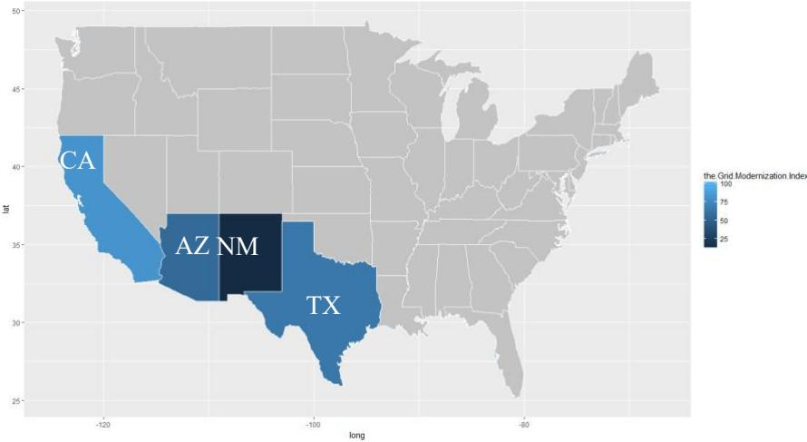
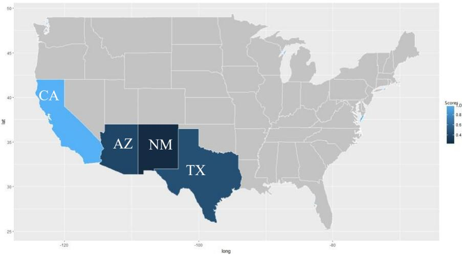
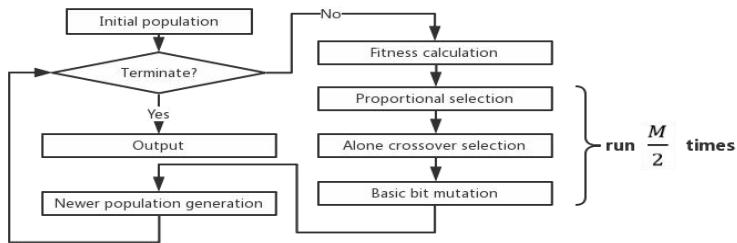

# 2018年美赛O奖论文：C题 能源联盟（Team #82150）

原件为竞赛论文。补充：文中的阅读练习及“参考解答”为整理时增加，原件图文保留出处。

# 2018年美赛O奖论文：C题 能源联盟（Team #82150）

## Summary Sheet

In order to set realistic and proper goals for the new four-state energy compact, our team makes an analysis and prediction on the energy profiles. Then, we propose three practical actions for the governors to meet these goals. Specifically,

For part I, we first explore the energy profiles from four aspects – Total Energy Production, Total Energy Consumption, Energy Price and Energy Structure. Secondly, regarding population, economy, modernization and geography as influential factors, we study the similarities and differences in the usage of cleaner, renewable energy quantitatively. Next, the EM-TOPSIS-PROMETHEE Evaluation Model is developed to determine the “best” profile in 2009. Following the 3E principle, we conclude that California excels in four aspects – Renewable Energy Potential, Energy Structure, Renewable Energy Proportion and Economic Conversion Rate. Finally, Vector Autoregression Model is utilized to predict each state’s energy profile.

For part II, combining Game Theory, we obtain the optimal energy allocation among four states through Genetic Algorithm. For one thing, the compact will reduce their import energy price, and thus improving their energy structure in New Mexico and Texas, the energy import-oriented states. For another, the energy efficiency will be boosted due to the growth of energy exports in Arizona, the energy export-oriented state. Hence, we set the promotion in Renewable Energy Proportion and Economic Conversion Rate as their energy compact goals. Afterwards, three actions, including cutting the export taxes, imposing subsides and strengthening interstate communication, are put forward to realize above-mentioned goals.

Finally, for the governors, we prepare a memo to introduce the energy profiles in 2009, the prediction on energy usage without any policy changes and our recommended goals for energy compact.

**Keywords:** Energy profile; VAR Model; Genetic Algorithm; Energy compact

## Table of Contents

1 Introduction.... 1
1.1 Restatement of the Problem.... 1
2 Assumptions and Nomenclature.... 1
2.1 Assumptions.... 1
2.2 Nomenclature.... 2
3 Date Processing.... 2
3.1 Delete the redundant data.... 2
3.2 Delete the invalid data.... 3
4 Part I Analysis, evaluation and prediction of energy profiles.... 3
4.1 The energy profiles.... 3
4.2 The evolution of the energy profile.... 4
4.3 The best profile for use of cleaner, renewable energy.... 8
4.4 The prediction based on VAR Model.... 12
5 Part II New energy compact.... 14
5.1 Goals for the new four-state energy compact.... 14
5.2 Three actions to meet their energy compact goals.... 17
6 Strengths and Weaknesses.... 18
6.1 Strengths.... 18
6.2 Weaknesses.... 19
7 Conclusion.... 19
References.... 20
Appendix.... 21

## Memo

**From:** MCM 2018 Team 82150
**To:** The group of Governors
**Date:** 12, February 2018
**Subject:** Goals for the energy compact

For your information, here we introduce our analysis of states’ profile, our prediction of energy usage and our recommended goals for compact. The details are as below:

*   **The analysis of states’ profile**
    *   Arizona, California, New Mexico and Texas are energy oversupplied state, energy oversupplied state, energy short-supplied state and energy supply & demand balance state respectively.
    *   The states whose energy prices are sorted from high to low are Arizona, California, New Mexico and Texas respectively.
    *   Among these four states, the proportion of petroleum products is the greatest, while that of renewable energy is the lowest.
    *   The maximum proportions of total energy consumption in different sectors vary from the states.

*   **The prediction of energy usage**
    *   Total energy usage will continue to rise, but growth rate will decline.
    *   Total renewable energy usage and its growth will continue to rise.
    *   Arizona will be renewable energy export-oriented, for the growth rate of energy production will exceed the rate of energy usage.
    *   Texas and New Mexico are likely to become renewable energy import-oriented.

*   **The recommended goals for compact**
    *   The first goal: Promotion in Renewable Energy Proportion.
    *   The second goal: Promotion in Economic Conversion Rate.
    *   These goals can be realized by strengthening interstate communication, cutting the export taxes and imposing renewable energy subsidies.

Please contact me if you have any problems.

## 1 Introduction

### 1.1 Restatement of the Problem

Nowadays, energy production and usage are a major portion of any economy. In the United States, many aspects of energy policy are decentralized to the state level. Additionally, the varying geographies and industries of different states affect energy usage and production.

Firstly, we make a comprehensive and obvious analysis of energy profile for each of the four states according to the data selected in attachments.

Then, we analyze the evolution of energy profile and make an understandable comparison about the usage of cleaner, renewable energy sources among four states.

Thirdly, we select proper criteria to evaluate and predict profiles of each state in 2009, 2025 and 2050. Then, under a four-state energy compact, we determine renewable energy usage targets according to the “best” profile criteria and prediction. At last, based on the models we build, we try to put forward the effective improvement in compacts and offer our models to the group of governors.

## 2 Assumptions and Nomenclature

知识点：[问题重述与分析（Problem Restatement and Analysis）](../../../topics/数学建模/wenti_chongshu.md)、[一般假设及其合理性说明（Assumptions and Justifications）](../../../topics/数学建模/jiaben_shezhi.md)、[符号说明与术语定义（Nomenclature / Symbols and Definitions）](../../../topics/数学建模/fuhao_shuoming.md)

### 2.1 Assumptions

In order to simplify our model, we make some assumption in our paper. The details are as below:

*   There's no difference in the statistic caliber of four states, and thus the data is completely reliable.
*   Only electricity is taken into account when we analyze the renewable energy, because we make an assumption that renewable energy is finally transformed into electricity.
*   Standard energy structure is the structure that each energy has the same proportion.
*   We assume that renewable energy consumption and petroleum consumption add up to the total energy consumption.
*   In the case of the new energy contact, no cooperation cost is accounted.
*   We assume that the contact exerts no effect on the total energy consumption in four states and only affects the renewable energy consumption.

知识点：[一般假设及其合理性说明（Assumptions and Justifications）](../../../topics/数学建模/jiaben_shezhi.md)、[数学建模的基本步骤（问题分析、模型假设、建立、求解、检验、推广）](../../../topics/数学建模/jianmo_buzhou.md)

### 2.2 Nomenclature

Table 2-1: the Nomenclature in our paper

| Symbol | Definition |
| :--- | :--- |
| $A_1$ | Renewable Energy Potential |
| $A_2$ | Energy Structure |
| $A_3$ | Renewable Energy Proportion |
| $A_4$ | Economic Conversion Rate |
| $RP_t$ | The renewable energy production in year $t$ |
| $EP_i$ | The proportion of origin $i$ in electricity |
| $TC_t$ | The total energy consumption in year $t$ |
| $RC_t$ | The total renewable energy consumption in year $t$ |
| $GDP_t$ | GDP in year $t$ |
| $RE_t$ | The expenditure of total renewable energy in year $t$ |
| $e_j$ | The entropy in the index $j$ |
| $g_j$ | The difference coefficient in the index $j$ |
| $w_j$ | The final weight in the index $j$ |
| $S_i^+$ | The final score of state $i$ |
| $\eta$ | The distrust coefficient |
| $p_e^i$ | The electricity import price |
| $p_e^n$ | The electricity export price |
| $p_p$ | The petroleum price |
| $\gamma$ | The pulling coefficient |
| $E_{TC}^e$ | The electricity exports |
| $E_{TC}^i$ | The electricity imports |
| $E_{TC}^n$ | The electricity production |
| $E_{TC}$ | The total electricity consumption |
| $P_{TC}$ | The total petroleum consumption |
| $p$ | The average price of energy |
| $P_{TC}^e$ | The export price of electricity |

First, we classify the data in the worksheet into three categories: redundant data, invalid data, and normal data. Then, as for redundant data, we remove them to make it more convenient for us to search the required data. As for invalid data, we delete them from the worksheet. As for normal data, we sort them and learn the meaning of their “msn”. The works we have done in data processing are as follows.

知识点：[符号说明与术语定义（Nomenclature / Symbols and Definitions）](../../../topics/数学建模/fuhao_shuoming.md)

### 3.1 Delete the redundant data

There is data redundancy in the worksheet “seseds”. As we can see in Table 3-1, NGACB and NNACB have the same content except their msn. So we delete the redundant data “MMACB”.

Table 3-1 : Examples of redundant data

| Code | Description | Unit |
| :--- | :--- | :--- |
| NGACB | Natural gas consumed by the transportation sector. | Billion Btu |
| NNACB | Natural ...... sector. (Code used in SEDS 2006.) | Billion Btu |

知识点：[数学建模的基本步骤（问题分析、模型假设、建立、求解、检验、推广）](../../../topics/数学建模/jianmo_buzhou.md)

### 3.2 Delete the invalid data

In the worksheet “seseds”, there is no data labeled with “PACCK”. So we define the data without content in the worksheet as invalid data. After screening all data, we remove the invalid data.

Table 3-2: Examples of invalid data

| Code | Description | Note | Unit |
| :--- | :--- | :--- | :--- |
| PACCK | Factor for converting ...... | United States only. | Million ...barrel |

知识点：[数学建模的基本步骤（问题分析、模型假设、建立、求解、检验、推广）](../../../topics/数学建模/jianmo_buzhou.md)

### 4 Part I Analysis, evaluation and prediction of energy profiles

知识点：[TOPSIS 模型构建步骤（逼近理想解排序法）](../../../topics/数学建模/topsis_moxing.md)、[可持续发展指数 SDI 的构建与指标体系结构](../../../topics/数学建模/kechixu_zhibiao.md)

### 4.1 The energy profiles

In order to explain the energy profiles, we subdivide the energy profiles into four aspects: Total Energy Production, Total Energy Consumption, Energy Price and Energy Structure. As the latest data can reflects the current energy profile in each state better, we select the data of each state in 2009.

**Total Energy Production and Total Energy Consumption**

Table 4-1: the table of TEP and TEC in four states

| State | TEP | TEC | State | TEP | TEC |
| :--- | :--- | :--- | :--- | :--- | :--- |
| Arizona | 570994.0459 | 1454313.457 | California | 2605311.838 | 8005515.051 |
| New Mexico | 2412219.049 | 670094.5064 | Texas | 11914996.72 | 11297410.59 |

Total Energy Production and Total Energy Consumption are important indicators for energy profile of each state. In order to describe the production and consumption better, we divide the states into three types: oversupplied, supply-and-demand balanced and short supplied. When Total Energy Production is obviously larger than Total Energy Consumption, the states are regarded as oversupplied, such as Arizona and California. When Total Energy Production is lower than Total Energy Consumption obviously, the states are regarded as short supply, such as New Mexico. When the states don’t satisfy two situations above, they are regarded as supply-and-demand balanced, such as Texas.

**Energy Price**

The price of commodity fluctuates with its supply and demand. To some extent, energy price can reflect the costs of source exploitation, transportation and distribution. At the same time, it can also reflect the economic benefits of energy use. In our opinion, when one state acquires similar resources, the lower the price is, the better the economic benefits it will get. As can be seen from the table in appendix, states’ unit price of energy from high to low are 19.664, 18.405, 17.179 and 15.380. The corresponding states are Arizona, California, New Mexico and Texas respectively.

**Energy Structure**

In the worksheet “seseds”, we can get total energy consumption in five sectors. The five sectors are transportation, commercial, electric power, industrial and residential sector. After processing the data, we can get the proportion of total energy consumption in these five sector. The proportion are as below and the table of the proportion are in appendix.

In Arizona and New Mexico, proportions of total energy consumption in the Electric power sector are the greatest respectively. In California, the proportion in the transportation sector is the greatest, while in Texas, the proportion in the industrial sector is the greatest. So we can conclude that the focus of development in four states and energy structure are different. As can be seen from the figure 4-2, the proportion of petroleum products consumption is the greatest among four state although they differ greatly in Total Energy Consumption, while the proportion of renewable energy is the lowest.

知识点：[影响因素评估指标体系构建（温度、湿度、经济、教育等）](../../../topics/数学建模/yingxiang_zhibiao.md)、[可持续发展指数 SDI 的构建与指标体系结构](../../../topics/数学建模/kechixu_zhibiao.md)、[文献综述与研究背景撰写方法](../../../topics/数学建模/wenxian_zongshu.md)

### 4.2 The evolution of the energy profile

知识点：[长期预测模型（如20年可持续发展计划预测）](../../../topics/数学建模/nian_yuce.md)、[模型优缺点分析（Strengths and Weaknesses）](../../../topics/数学建模/youque_dian.md)、[数学建模的基本步骤（问题分析、模型假设、建立、求解、检验、推广）](../../../topics/数学建模/jianmo_buzhou.md)

### 4.2.1 The growth of energy consumption

## 4.2.2 The evolution of energy structure

知识点：[数学建模的基本步骤（问题分析、模型假设、建立、求解、检验、推广）](../../../topics/数学建模/jianmo_buzhou.md)、[文献综述与研究背景撰写方法](../../../topics/数学建模/wenxian_zongshu.md)、[可持续发展指数 SDI 的构建与指标体系结构](../../../topics/数学建模/kechixu_zhibiao.md)

### Similarities in the energy structure

In general, the energy consumption structure of the four states is not balanced. Energy consumption mainly concentrates on petroleum products, and the consumption of coal is the second. In the world energy consumption structure, petroleum, natural gas and coal are the three most important types of consumer resources with roughly equal proportions[1].

Nevertheless, there is a drop in the consumption of petroleum and coal in Arizona, California and New Mexico, along with an increase in the proportion of renewable and natural gas. The first explanation is that economic development promotes the development of technology. Secondly, attaching importance to energy saving and environmental protection are also important reasons for their improvement in energy structure.

知识点：[文献综述与研究背景撰写方法](../../../topics/数学建模/wenxian_zongshu.md)、[问题重述与分析（Problem Restatement and Analysis）](../../../topics/数学建模/wenti_chongshu.md)

### Differences in the energy structure

Taking the continuity of the policy into account, we set a 10-year cycle to analyze the energy profiles of the four states at various time points, and then get the evolution of the energy structure. As is shown in this figure 4-6, the energy growth rate rose slightly in the commercial sector in each state from 1979 to 1989. In the next 20 years, however, there has been no significant changes in the proportion in this area, for the business is relatively mature.

In transportation and industrial sector, the proportion of energy consumption declined year by year. The reason is that with the development of science and technology, people are seeking a high-quality development in economy. In Electric power and residential sector, the proportion of energy consumption has a steady increase, while the growth rate also increase year by year and can be up to 1-2% yearly. In recent years, people have paid growing attention to the efficient and clean utilization of resources, and the electronic products represented by computers have been increasingly enriched. As a result, more energy flows to electricity industry.

## 4.2.3 The evolution of Renewable energy

知识点：[长期预测模型（如20年可持续发展计划预测）](../../../topics/数学建模/nian_yuce.md)

### Similarities in the trend of renewable energy usage

The share of renewable energy consumption peaked in 1997 or 1998 and then declined in different states. We reckon that Kyoto Protocol in 1997 serves as an effective incentive for state governments to use renewable energy. In the meantime, due to government's continuously increasing awareness of environmental protection, the gap between high-renewable energy use states and low-weight states narrows gradually.

知识点：[文献综述与研究背景撰写方法](../../../topics/数学建模/wenxian_zongshu.md)、[问题重述与分析（Problem Restatement and Analysis）](../../../topics/数学建模/wenti_chongshu.md)

### Differences in the application of renewable resource

#### The usage of renewable resource

In the analysis of their differences in the usage of renewable energy sources, we take factors of economy, geography, population and grid modernization into consideration. To be specific, there's nothing ambiguous that economic growth has boosted energy demand and promoted the technological level in energy utilization at the same time[2]. Besides, transformation in industrial structure affects the energy demand directly and changes the energy consumption structure, the second industry, the largest energy consumption intensity[3]. To some extent, the technology level of a state is revealed by the Grid Modernization Index (released by GridWise Alliance in Nov. 2017. Website of https://www.metering.com/news/2017-grid-modernisation-index-rankings/).

Moreover, the characteristics of their population and geography also play a prominent role in the development of their energy consumption.

Based on the useful information provided, we make regression with panel data that takes the time-fixed effects into account:

$$
y_{it} = \beta_{1} \ln x1_{it} + \beta_{2} \ln x2_{it} + \beta_{3} \ln x3_{it} + \beta_{4} \ln x4_{it} + \varepsilon_{it} \tag{1}
$$

In the equation (1), $y_{it}$ is the proportion of renewable energy consumption during the period of t in state i, and $x1_{it}$, $x2_{it}$ and $x3_{it}$ are the population during the period of t in state i, the growth rate of GDP and the Grid Modernization Index respectively. We assign $\alpha_{i} = 1$ when state i is close to the ocean. $\beta_{1}$, $\beta_{2}$, $\beta_{3}$ and $\beta_{4}$ are the coefficients and $\varepsilon_{it}$ is the residual term. Since the GDP data started in 1977, we all select the data after 1978 to get the result:

$$
y_{it} = 0.023^{***} \ln x1_{it} + 0.002 \ln x2_{it} + 0.026^{***} \ln x3_{it} - 0.038 \alpha_{i} - 0.073^{***}.
$$

We can conclude that the consumption rate of renewable energy has a significant positive correlation with the population and modernization level in a state. The economic growth and the geographical factor, however, have no significant effect.

The consumption of renewable energy could increase by 2.3% or 2.6% with a 1% increase in population or a 1% increase in the Grid Modernization Index respectively.

## 4.3 The best profile for use of cleaner, renewable energy

知识点：[问题重述与分析（Problem Restatement and Analysis）](../../../topics/数学建模/wenti_chongshu.md)、[影响因素评估指标体系构建（温度、湿度、经济、教育等）](../../../topics/数学建模/yingxiang_zhibiao.md)、[模型参数的确定（基于数据拟合或实验选择）](../../../topics/数学建模/canshu_queding.md)

### 4.3.1 Index Selection

Nowadays, since an increasingly number of people pay attention to sustainable development, the use of clean renewable energy becomes the focus of the government$^{[4]}$. Both ecological benefit and economic benefit should be taken into account when government carries out the energy policies$^{[5]}$. Thus, following the 3E principle - energy, environment and economy, we select four indexes: Renewable Energy Potential, Energy Structure, Proportion of Renewable Energy and Economic Conversion Rate.

#### Renewable Energy Potential $A_1$

In 1994, World Energy Council put forward the concept of renewable energy potential. Later in 2008, Hoogwijk and Graus perfected it$^{[6]}$. The potential of renewable energy reflects the speed and potential of utilizing renewable energy during a period. In this paper, the increase rate of renewable energy production is used to reflect the potential of renewable energy:

$$
\mathrm{A}_1 = \frac{\boldsymbol{R P}_{t} - \boldsymbol{R P}_{t-1}}{\boldsymbol{R P}_{t-1}},
$$

where $\scriptstyle { R P _ { t } }$ is the renewable energy production in year $t$ and $R P_{t-1}$ is the renewable energy production in year $t-1$.

#### Energy Structure $A_2$

Energy structure optimization refers to under certain technical and economic conditions, the proportion of various energy tends to be reasonable, so as to achieve the purpose of improving energy utilization and further improving the overall benefits. In this paper, electricity mainly consists of four origins - Geothermal, Nuclear, Photovoltaic and solar, Wind. Hamming value$^{[7]}$ is used to calculate the closeness degree between the real electricity structure and the standard structure.

$$
A _ {2} = 1 - \frac {1}{4} \sum_ {i = 1} ^ {4} \left| E P _ {i} - \frac {1}{4} \right|,
$$

where $E P _ { i }$ is the proportion of state $i$.

#### Proportion of Renewable Energy $A_3$

Higher proportion of renewable energy is more conducive to upgrading the energy supply system, and further to achieve a coordinated and sustainable development.

$$
A _ {3} = \frac {R C _ {t}}{T C _ {t}},
$$

where $T C _ { t }$ is total energy consumption in year $t$ and $R C _ { t }$ is total renewable energy consumption in year $t$.

#### Economic Conversion Rate $A_4$

Economic performance reflects the economic benefits of renewable energy utilization. The efficiency and potential of energy output are described by the expenditure ratio of GDP [8]

$$
A _ {4} = \frac {G D P _ {t}}{R E _ {t}},
$$

where ${ \bf G } { \bf D } { \bf P } _ { t }$ is GDP in year $t$ and $R E _ { t }$ is the expenditure of total renewable energy in year $t$.

知识点：[影响因素评估指标体系构建（温度、湿度、经济、教育等）](../../../topics/数学建模/yingxiang_zhibiao.md)、[可持续发展指数 SDI 的构建与指标体系结构](../../../topics/数学建模/kechixu_zhibiao.md)、[一般假设及其合理性说明（Assumptions and Justifications）](../../../topics/数学建模/jiaben_shezhi.md)

### 4.3.2 The EM-TOPSIS-PROMETHEE evaluation model

Due to the dynamic and complexity of clean renewable energy, a comprehensive evaluation model is developed for evaluating the usage of cleaner, renewable energy in combination of entropy method, TOPSIS method and PROMETHEE method $^{[5]}$.

The model mainly includes two parts. One is to define index weight and the other is to score each state. In the index weight definition part, we use the entropy method and in the scoring part, we combine the TOPSIS method and the PROMETHEE method, which can not only reflect the difference among clean renewable energy use in different states, but can also instruct what states can do to approach the ideal condition. Thus, we can evaluate and sort each states’ usage of renewable energy comprehensively.

Let $\pmb { S } = [ C A ~ A Z ~ N M ~ T X ]$ be the set of the states, $\boldsymbol { \mathrm { A } } = \left[ A _ { 1 } ~ A _ { 2 } ~ A _ { 3 } ~ A _ { 4 } \right]$ be the set of evaluation indexes, $\mathbf { X } = \left( x _ { i j } \right) _ { m \times n }$ be the decision matrix, where $x _ { i j }$ denotes the value of state $i$ in index $j$.

知识点：[TOPSIS 模型构建步骤（逼近理想解排序法）](../../../topics/数学建模/topsis_moxing.md)、[影响因素评估指标体系构建（温度、湿度、经济、教育等）](../../../topics/数学建模/yingxiang_zhibiao.md)、[可持续发展指数 SDI 的构建与指标体系结构](../../../topics/数学建模/kechixu_zhibiao.md)

### Step1. Standardized Processing

To eliminate different dimensions of different indexes, before data analysis, we first conduct Standardized Processing:

$$
x _ {i j} ^ {\prime} = \frac {x _ {i j} - \min x _ {i j}}{\max x _ {i j} - \min x _ {i j}}.
$$

The non-dimensional decision matrix is denoted as $\textbf { X } ^ { \prime } = \left( x ^ { \prime } _ { i j } \right) _ { m \times n } .$

知识点：[模型参数的确定（基于数据拟合或实验选择）](../../../topics/数学建模/canshu_queding.md)、[文献综述与研究背景撰写方法](../../../topics/数学建模/wenxian_zongshu.md)、[数学建模的基本步骤（问题分析、模型假设、建立、求解、检验、推广）](../../../topics/数学建模/jianmo_buzhou.md)

### Step2. Index weight definition based on entropy method

● Calculate the weight of $i$ in the index $j$:

$$
p _ { i j } = \frac { 1 + x _ { i j } } { \sum _ { i = 1 } ^ { m } \left( 1 + x _ { i j } \right) }.
$$

● Calculate the entropy and the difference coefficient in the index $j$:

$$
e _ {j} = - (\ln m) ^ {- 1} \sum_ {i = 1} ^ {m} p _ { i j} \ln p _ { i j}, \quad g _ {j} = 1 - e _ {j}.
$$

● Calculate the final weight of each index $w _ { j } = \frac { g _ { j } } { \sum _ { k = 1 } ^ { n } g _ { k } }$ and get the weight set

$$
\mathbf {W} = [ w _ {1} ~ w _ {2} ~ w _ {3} ~ w _ {4} ].
$$

知识点：[影响因素评估指标体系构建（温度、湿度、经济、教育等）](../../../topics/数学建模/yingxiang_zhibiao.md)、[TOPSIS 模型构建步骤（逼近理想解排序法）](../../../topics/数学建模/topsis_moxing.md)

### Step3. Evaluation based on the TOPSIS method and the PROMETHEE method

Calculate the weighted standardized decision matrix:

$$
\mathbf {Z} = \left(\mathbf {z} _ {i j}\right) _ {m \times n}, \quad z _ { i j } = w _ { j } \times x _ { i j } ^ { \prime }.
$$

● Determine the positive ideal solution ${ { \pmb z } ^ { + } }$ and the negative ideal solution $z ^ { - }$

$$
\mathbf {Z} ^ {+} = (z _ {1} ^ {+} ~ z _ {2} ^ {+} ~ z _ {3} ^ {+} ~ z _ {4} ^ {+}),
$$

$$
\mathbf {Z} ^ {-} = (z _ {1} ^ {-} ~ z _ {2} ^ {-} ~ z _ {3} ^ {-} ~ z _ {4} ^ {-}),
$$

where $z _ { j } ^ { + } = \operatorname* { m a x } _ { i } ( x ^ { \prime } { } _ { i j } ) , z _ { j } ^ { - } = \operatorname* { m i n } _ { i } \bigl ( x ^ { \prime } { } _ { i j } \bigr )$

● Calculate the Euclidean distance between each state's indexes and the positive ideal solution ${ { \pmb z } ^ { + } }$ , the negative ideal solution $z ^ { - }$ respectively:

$$
d _ {i} ^ {+} = \sqrt {\sum_ {j = 1} ^ {n} \left(z _ {i j} - z _ { j} ^ {+}\right) ^ {2}}, \quad d _ {i} ^ {-} = \sqrt {\sum_ {j = 1} ^ {n} \left(z _ {i j} - z _ { j} ^ {-}\right) ^ {2}}.
$$

● Determine the preference function and preference exponential relationship. We define $d _ { j } ( a , b ) = x ^ { \prime } { } _ { a j } - x ^ { \prime } { } _ { b j }$, preference function $P(d) = \begin{cases} 1, & d \geq 0 \\ 0, & d < 0 \end{cases}$, preference exponential relationship $\pi _ { ( d _ { a b } ) } = \sum _ { j = 1 } ^ { n } P _ { j } ( d _ { a b } ) w _ { j }$

● Calculate the positive flow and the negative flow of each evaluation objective, and the formulas are as follows:

$$
\Phi^ {+} (d _ {i}) = \frac {1}{m - 1} \sum_ {k = 1, k \neq i} ^ {m} \pi (d _ { i k }), \quad \Phi^ {-} (d _ {i}) = \frac {1}{m - 1} \sum_ {k = 1, k \neq i} ^ {m} \pi (d _ { k i })
$$

where $k = 1, 2 ..., m$, and $k \neq i .$

● For $d _ { i } ^ { + } , d _ { i } ^ { - } , \phi ^ { + } ( d _ { a } ) , \phi ^ { - } ( d _ { a } )$ , after normalization processing, we can obtain $D _ { i } ^ { + } , D _ { i } ^ { - } , \Phi _ { i } ^ { + } , \Phi _ { i } ^ { - }$

The larger the value of $\pmb { D } _ { i } ^ { - }$ and $\Phi _ { i } ^ { + }$ , the better the performance of the state. In contrast, the larger the value of $\pmb { D } _ { i } ^ { + }$ and $\Phi _ { i } ^ { - }$ , the worse the performance of the state. In this paper, we combine $\pmb { D } _ { i } ^ { - }$ and $\Phi _ { i } ^ { + }$ to evaluate each state's performance in the use of clean renewable energy: $S _ { i } ^ { + } = \varsigma \Phi _ { i } ^ { + } + \tau D _ { i } ^ { - }$ , where $\varsigma$ and $\tau$ depend on the preference of the decision maker and satisfy $\varsigma + \tau = 1 , \varsigma , \tau \in [ 0 , 1 ]$

In this paper, we define $\varsigma = \tau = \frac { 1 } { 2 } .$

知识点：[TOPSIS 模型构建步骤（逼近理想解排序法）](../../../topics/数学建模/topsis_moxing.md)、[数学建模的基本步骤（问题分析、模型假设、建立、求解、检验、推广）](../../../topics/数学建模/jianmo_buzhou.md)

### 4.3.2. The Final Ranks

Firstly, we calculate the index of each state according to our definitions.

**Table 4-2: the values of all indicators in all states**

| | $A_1$ | $A_2$ | $A_3$ | $A_4$ |
|---|---|---|---|---|
| AZ | -0.088 | 0.626 | 0.071 | 0.145 |
| CA | 0.055 | 0.806 | 0.089 | 0.180 |
| NM | -0.036 | 0.625 | 0.053 | 0.115 |
| TX | 0.018 | 0.750 | 0.032 | 0.099 |

After standardization, we obtain:

**Table 4-3: the standard values of all indicators in all states**

| | $A_1$ | $A_2$ | $A_3$ | $A_4$ |
|---|---|---|---|---|
| AZ | 0.000 | 0.004 | 0.689 | 0.566 |
| CA | 1.000 | 1.000 | 1.000 | 1.000 |
| NM | 0.368 | 0.000 | 0.376 | 0.200 |
| TX | 0.748 | 0.690 | 0.000 | 0.000 |

知识点：[TOPSIS 模型构建步骤（逼近理想解排序法）](../../../topics/数学建模/topsis_moxing.md)、[影响因素评估指标体系构建（温度、湿度、经济、教育等）](../../../topics/数学建模/yingxiang_zhibiao.md)

### 4.3 The evaluation based on TOPSIS and PROMETHEE

Then, we use entropy method and get the weight of each index: $W = [0.2209, 0.3256, 0.2136, 0.2399]$.

Afterwards, TOPSIS and PROMETHEE method are utilized and we calculate $t^+ = [0.4109, 1.0000, 0.2248, 0.3643]$, $t^- = [0.3944, 1.0000, 0.2440, 0.5490]$.

The final scores of four states (Arizona, California, New Mexico, Texas) are: $t_{S+t} = [0.4026, 1.0000, 0.2344, 0.4566]$ (refer to figure 4-10).

California excels in all respects and ranks first. Texas ranks second. Although its economic conversion rate and the proportion of renewable energy ranks the last four states, its potential for renewable energy is better and its energy structure is more reasonable. These factors are conducive to the increase of renewable energy proportion and the optimization of Energy structure, which can promote economic development. Besides, economic efficiency can be improved. Arizona and New Mexico come in third and fourth place. We find that their energy structure is the least reasonable. Although they have higher renewable energy proportions and economic conversion rates, the potential of renewable energy is explored slightly, which affects the overall ranking. Based on the four scores, we find that Arizona and New Mexico are in a better position now but their prospects are negative. The optimization of energy structure is very difficult. States in this type require to be determined to ensure a balanced and environmentally friendly energy structure. Texas, however, is in the worst shape but with promising and sustainable growth prospects. We suggest that Texas should continue to maintain its proportion of renewable energy consumption and optimize its energy structure.

知识点：[TOPSIS 模型构建步骤（逼近理想解排序法）](../../../topics/数学建模/topsis_moxing.md)、[影响因素评估指标体系构建（温度、湿度、经济、教育等）](../../../topics/数学建模/yingxiang_zhibiao.md)、[模型优缺点分析（Strengths and Weaknesses）](../../../topics/数学建模/youque_dian.md)

### 4.4 The prediction based on VAR Model

In order to predict energy consumption and sustainable development of each state, we predict the total energy consumption, the average energy price, the petroleum price, the electricity price, the electricity production and the electricity consumption in four states. The total energy consumption and the average energy price reflect the future trends of energy usage in each state. The petroleum and electricity price, electricity production and consumption can reflect the sustainable development trends of each state. In these two aspects, we set up Energy Consumption Prediction Model (ECPM) and Sustainability Development Prediction Model (SDPM) based on Vector Autoregression Model. Given economic and social factors, we take GDP growth rate and population into account in our models as well. We take ECPM of California as an example and the modeling process is as follows.

$TEC_t^{CA}$, $P_t^{CA}$, $V_{GDP(t)}^{CA}$ and $POP_t^{CA}$ denote total energy consumption, average energy price, GDP growth rate and population in California in year $t$. They can be predicted by lags of $TEC_t^{CA}$, $P_t^{CA}$, $V_{GDP(t)}^{CA}$ and $POP_t^{CA}$. In order to obtain stationary data, we first standardize and difference the four indexes. Afterwards, we calculate the lag phase $p$ according to the AIC criteria. The VAR model of energy usage prediction in California is as follows:

$$
\mathrm{TEC}_{t}^{CA} = w_0 + \sum_{i=1}^{p} \alpha_i \mathrm{TEC}_{t-i}^{CA} + \sum_{i=1}^{p} \beta_i P_{t-i}^{CA} + \sum_{i=1}^{p} \gamma_i V_{GDP(t-i)}^{CA} + \sum_{i=1}^{p} \mu_i \mathrm{POP}_{t-i}^{CA} + \varepsilon_t,
$$

where $w_0$ is constant, $\varepsilon_t$ is random disturbance term with zero mean, constant variance and no simultaneous correlation. The prediction formulas of $P_t^{CA}$, $V_{GDP(t)}^{CA}$ and $POP_t^{CA}$ can also be described in this way.

According to the AIC criteria, we calculate the lag phase $p = 1$ and we obtain the energy consumption prediction model:

$$
( TEC_t^{CA}, P_t^{CA}, V_t^{CA}, POP_t^{CA} ) = ( 1, TEC_{t-1}^{CA}, P_{t-1}^{CA}, V_{t-1}^{CA}, POP_{t-1}^{CA} ) \cdot \Omega,
$$

$$
\text { where } \Omega = \left( \begin{array}{cccc} 0.103 & 0.321 & 1.092 & 0.023 \\ 0.034 & 0.351 & -1.208 & 0.027 \\ -0.533 & -0.127 & -2.562 & 0.020 \\ 0.060 & -0.012 & -0.084 & -0.004 \\ 0.317 & -2.271 & -6.872 & 0.774 \end{array} \right).
$$

The prediction charts are as follows:

# 2018年美赛O奖论文：C题 能源联盟（Team #82150）

本部分为《2018年美赛O奖论文：C题 能源联盟》第7部分（共10部分），由识别工具读取第17–18页内容整理而成。原文包含表格数据预测及新能源联盟模型的建立过程，已转换为Markdown格式。

## 四、能源预测结果分析

知识点：[长期预测模型（如20年可持续发展计划预测）](../../../topics/数学建模/nian_yuce.md)、[可持续发展指数 SDI 的构建与指标体系结构](../../../topics/数学建模/kechixu_zhibiao.md)、[模型参数的确定（基于数据拟合或实验选择）](../../../topics/数学建模/canshu_queding.md)

### 预测模型精度验证

表4-4展示了ECPM（能源消耗预测模型）和SDPM（可持续发展预测模型）的预测准确率。

| 州名 | Energy Consumption Prediction Model | Sustainability Development Prediction Model |
| :--- | :--- | :--- |
| Arizona | 97.28% | 93.64% |
| California | 97.15% | 94.48% |
| New Mexico | 96.81% | 93.60% |
| Texas | 97.64% | 90.94% |

基于上述预测，在无政策干预的情况下，四个州在2025年和2050年的能源状况预测如表4-5和表4-6所示。

知识点：[模型验证方法概述（随机模型与确定性模型验证）](../../../topics/数学建模/moxing_yanzheng.md)、[长期预测模型（如20年可持续发展计划预测）](../../../topics/数学建模/nian_yuce.md)、[一般假设及其合理性说明（Assumptions and Justifications）](../../../topics/数学建模/jiaben_shezhi.md)

### 2025年能源状况预测

表4-5展示了四个州在2025年的能源状况预测值。

| 州名 | Total energy consumption | Total electricity consumption | Total electricity production | Average energy price | Average electricity price | Average petroleum price |
| :--- | :--- | :--- | :--- | :--- | :--- | :--- |
| Arizona | 1923218 | 347936.5 | 577838.4 | 25.03065 | 30.99559 | 24.19626 |
| California | 9389109 | 1100789 | 575461.7 | 26.57905 | 46.88564 | 28.01131 |
| New Mexico | 832192.8 | 100305.3 | 533703.2 | 23.86519 | 26.13365 | 26.7748 |
| Texas | 13271970 | 1525875 | 586494.5 | 22.81525 | 36.29519 | 23.22217 |

知识点：[长期预测模型（如20年可持续发展计划预测）](../../../topics/数学建模/nian_yuce.md)、[模型参数的确定（基于数据拟合或实验选择）](../../../topics/数学建模/canshu_queding.md)、[文献综述与研究背景撰写方法](../../../topics/数学建模/wenxian_zongshu.md)

### 2050年能源状况预测

表4-6展示了四个州在2050年的能源状况预测值。

| 州名 | Total energy consumption | Total electricity consumption | Total electricity production | Average energy price | Average electricity price | Average petroleum price |
| :--- | :--- | :--- | :--- | :--- | :--- | :--- |
| Arizona | 2558264 | 493663.8 | 841818.4 | 35.50622 | 39.36702 | 35.12232 |
| California | 10886977 | 1391365 | 843764 | 37.90532 | 65.47865 | 40.32907 |
| New Mexico | 1037193 | 138641 | 750917.2 | 33.47528 | 32.10451 | 38.56357 |
| Texas | 15625368 | 2044211 | 858801.2 | 32.8048 | 49.98144 | 33.20695 |

知识点：[长期预测模型（如20年可持续发展计划预测）](../../../topics/数学建模/nian_yuce.md)

### 预测结果分析

在未来，四个州的总能源消耗和平均能源价格均呈上升趋势。其中，各州的平均能源价格差异并不显著。然而，New Mexico的总能源消耗远低于其他三个州。因此，我们得出结论：New Mexico的工业发展仍然相对落后。同时，Texas和California的工业发展处于领先地位。

就可持续发展的未来趋势而言，清洁可再生能源（本文指电力）的消费量、产量和价格均呈上升趋势。然而，Texas和California的清洁可再生能源自给率较低，且未来的自给率将进一步降低。如上表所示，Arizona和New Mexico的清洁可再生能源产量增长速度快于能源消费量的增长，未来可能进一步面向出口。

## 五、第二部分：新能源联盟

知识点：[模型优缺点分析（Strengths and Weaknesses）](../../../topics/数学建模/youque_dian.md)、[长期预测模型（如20年可持续发展计划预测）](../../../topics/数学建模/nian_yuce.md)

### 5.1 新四州能源联盟的目标

#### 5.1.1 基于遗传优化算法的四州合作模式

通过比较四个州的能源状况，特别是可再生能源状况，我们可以得出以下结论：California是能源自给自足型，Arizona是能源出口导向型，而New Mexico和Texas是能源进口导向型。它们的可再生能源自给率分别为0.90、1.53、0.24和0.54。

基于上述评估模型，California排名最高，这揭示了其平衡的能源结构。考虑到其自给率接近1，可以安全地说California在可再生能源的使用上是自给自足的。因此，我们假设California在新能源联盟中获益甚微，仅能加强州际关系。

相比之下，其他三个州将获得显著的促进。一方面，联盟可以降低可再生能源的进口价格。相应地，它们的工业用电成本将降低，从而为能源进口导向型州带来可观的经济效益。在此基础上，较低的电力成本可以激励其使用电力能源并改善其能源结构。对于能源出口导向型州而言，另一方面，其可再生能源出口将得到推动。毫无疑问，更多的能源出口将促进其经济发展。

#### 新能源联盟的最优策略

对于New Mexico和Texas这两个能源进口导向型州，我们在最大化经济效益（即最小化能源成本）和优化州际关系的原则下建立了资源分配优化模型。供应链合作伙伴间信任的动态发展理论告诉我们，信任以动态方式发展，并与依赖性相互强化[9]。

在总能源消耗 $n$ 恒定的假设下，新能量联盟的形成只会影响每个州对可再生能源的使用。此外，出于能源安全和生态保护考虑，我们对各州的自给率和可再生能源比例做出了一些限制。基于3E模型，我们从能源效率、经济效益和生态效益三个方面构建了优化模型。

$$
\begin{array}{l} \min p _ {e} ^ {i} E _ {T C} ^ {i} + p _ {e} ^ {n} E _ {T C} ^ {n} + p _ {p} P _ {T C} + \frac {\eta}{E _ {T C} ^ {i}} \\ s. t. \left\{ \begin{array}{c} E _ {T C} ^ {i} + E _ {T C} ^ {n} + P _ {T C} = T E C \\ \frac {E _ {T C} ^ {i} + E _ {T C} ^ {n}}{T E C} > \alpha \\ \frac {E _ {T C} ^ {n}}{E _ {T C}} > \beta \\ E _ {T C} ^ {i} > 0 \end{array} \right. \end{array}
$$

其中 $\frac { \eta } { E _ { T C } ^ { i } }$ 表示不信任度指标（不信任系数 $\eta$ 的值越大，表明不信任威胁越严重）；$p _ { e } ^ { i } , p _ { e } ^ { n }$ 和 $p _ { p }$ 分别表示电力进口价格、电力出口价格和石油价格；$E _ { T C } ^ { i } , E _ { T C } ^ { n } , E _ { T C }$ 和 $P _ { T C }$ 分别表示电力进口、电力生产、总电力消耗和总石油消耗；$\alpha$ 和 $\beta$ 分别表示可再生能源比例和自给率的下限。应用遗传算法求解上述优化问题。

# 2018年美赛O奖论文：C题 能源联盟（Team #82150）

本资料整理自《2018年美赛O奖论文：C题 能源联盟（Team #82150）》习题部分第 8 部分（共 10 部分），由识别工具读出内容经校正后整理。

## 一、优化问题的求解与目标设定

知识点：[多目标优化模型（药物相对充足阶段的配送策略）](../../../topics/数学建模/duo_mubiao_youhua.md)、[遗传算法优化人力资本管理（染色体表示与适应度函数）](../../../topics/数学建模/yichuan_suanfa.md)

### 选择 1

**题干：**
Genetic Algorithm is used to solve optimal energy allocation strategy, for it is effective to solve combinatorial optimization problems[10]. The algorithm flow is as follows:

In the paper, we take Texas in 2025 and 2050 as an example to describe this problem. According to the predicted electricity price, we define that the price of electricity imported from Arizona in states’ compact are 32 and 45 in 2025 and 2050 respectively. Besides, we define $\alpha = 15\%$ and $\alpha = 20\%$ in 2025 and 2050 respectively. Both $\beta$ in 2025 and 2050 are defined as 25%.

Through calculation, we can obtain the optimal renewable energy imports of Texas. When $\pmb{\eta} < 5 \times 10^{12}$, that is, when the relationship between four states is relatively harmonious, the optimal renewable energy imports of Texas will be 1083997 and 1729084.8 Billion Btu respectively.

知识点：[遗传算法优化人力资本管理（染色体表示与适应度函数）](../../../topics/数学建模/yichuan_suanfa.md)

### 简答 1

**题干：**
Under the new energy compact, we can calculate the optimal renewable energy imports of New Mexico and Texas. Enjoying the lower price, New Mexico and Texas will be inclined to exploit more renewable energy, thus giving rise to a larger share of renewable energy $A_3$. Accordingly, the final target for New Mexico and Texas is a significant increase in the usage of cleaner, renewable energy sources because of lower import costs.

Table 5-1: The target renewable energy proportion $A_3$ of New Mexico and Texas under new energy compact

| | Optimal imports | A3(Target) | (Predicted) |
| :--- | :--- | :--- | :--- |
| New Mexico(2025) | 93424 | 0.14 | 0.12 |
| New Mexico(2050) | 119321.95 | 0.15 | 0.13 |
| Texas(2025) | 1083996.5 | 0.15 | 0.11 |
| Texas(2050) | 1729085 | 0.20 | 0.13 |

As for Arizona, the energy export-oriented state, the growth in energy exports stimulates their development of economy, which denotes higher energy efficiency. Such improvement is embodied by an increase in economic conversion rate $A_4$. Next, we define electricity pulling coefficient $\gamma$. $\gamma E_{TC}^e$ denotes the growth in GDP brought by one more unit of electricity export[11]. That is,

$$
\Delta GDP = \gamma p_{T C}^e \Delta E_{T C}^e
$$

In this cases, $\begin{array}{r} \Delta {A _ { 4 } } = \frac { { { \gamma \Delta { E _ { T C } ^ { e } } } } } { { ( p \cdot { T E C } ) } } \end{array}$ where $p$ is the average price of energy, TEC is the total energy consumption and $\pmb{p} \cdot \pmb{T} \pmb{E} \pmb{C}$ is the total energy expenditure.

Owing to the increase in electricity exports in Arizona, its economic conversion rate $A_4$ can be improved. The added value counts on its export pulling coefficient $\gamma$. The change of GDP increases with the increase of the pulling effect brought by electricity export. Generally speaking, $\gamma$ takes value of $0.667^{[12]}$

Table 5-2: The target economic conversion rate $A_4$ of Arizona under new energy compact

| | Optimal exports | A4(Target) | (Predicted) |
| :--- | :--- | :--- | :--- |
| Arizona (2025) | 1177421 | 0.22 | 0.15 |
| Arizona (2050) | 1848407 | 0.26 | 0.15 |

知识点：[任务分解与目标明确](../../../topics/数学建模/renwu_fenjie.md)、[模型参数的确定（基于数据拟合或实验选择）](../../../topics/数学建模/canshu_queding.md)

### 简答 2

**题干：**
In a bid to meet their energy compact goals, three policies are proposed, including export tax cut, renewable energy subsidies as well as inner relation building.

#### 5.2.1. Export tax cut

As is well known to all, export is one of three carriages to promote economic growth. And its growth can promote the growth of GDP[13]. We define $\Upsilon$ as the export coefficients to denote the export multiple. $\Upsilon$ indicates the contribution of unit electricity exports to the economy：

$$
\Delta \mathbf{GDP} = \gamma P_{T C}^e \Delta E_{T C}^e,
$$

where $P_{T C}^e$ is the export price of electricity, while $\Delta E_{T C}^e$ is the import price of electricity.

Via cutting export taxes, the interstate trading costs can be largely reduced, thus improving the value of $\Upsilon$. With a greater export multiple, the growth of economy pulled by energy export will be more conceivable. When the value of $\Upsilon$ of Arizona...

*(注：原文在此处截断)*

这是一份根据提供的 OCR 文本整理后的 Markdown 内容。

**说明：**
1.  **格式调整**：原文为论文正文（Strengths/Weaknesses/Conclusion），并非标准考试题结构。为了符合“资料整理员”的规范，我将章节标题转化为 `##` 和 `###` 层级，并将列举项（Bullet points）整理为清晰的列表或段落。
2.  **内容处理**：保留了所有实质性的数学公式、模型名称、数据结论和参考文献。去除了页眉（Team #82150）、页脚（Page X of 36）等无关信息。
3.  **纠错与润色**：修正了部分明显的识别错误（如 "subsides" -> "subsidies", "pairs" -> "Paris"），并优化了 LaTeX 公式的书写格式。
4.  **知识点链接**：由于这是 O 奖论文的特定分析内容，未强行添加通用课程知识点链接，但保持了结构的完整性。

---

# 2018年美赛O奖论文：C题 能源联盟（Team #82150）- 第9部分

本部分整理了《2018年美赛O奖论文：C题 能源联盟》（Team #82150）第 21–23 页（对应原稿 Page 18–20）的内容，主要包含敏感性分析结果、模型优缺点分析及结论。

## 5.2 敏感性分析与政策建议

知识点：[模型参数的确定（基于数据拟合或实验选择）](../../../topics/数学建模/canshu_queding.md)、[模型优缺点分析（Strengths and Weaknesses）](../../../topics/数学建模/youque_dian.md)、[数学建模的基本步骤（问题分析、模型假设、建立、求解、检验、推广）](../../../topics/数学建模/jianmo_buzhou.md)

### 5.2.2. Renewable energy subsidies

实施可再生能源使用补贴，无疑将提升可再生能源的比例 $\pmb{A}_3$。在相同的预算约束下，行业倾向于追求最大的经济效益。从以石油为主的能源结构向以新能源为主的能源结构转变的成本降低，刺激了这一转变。当德克萨斯州的能源支出预算增加 1% 时，其可再生能源比例 $\pmb{A}_3$ 将增加 9.9%。因此，政府必须实施能源补贴政策。

此外，出口税收每减少 $\mathbb{T}$，其经济转换率 $\pi$ 将增加 3.4%。由此可见，出口税削减在推动可再生能源经济转换效率方面发挥着突出作用。

知识点：[模型参数的确定（基于数据拟合或实验选择）](../../../topics/数学建模/canshu_queding.md)、[一般假设及其合理性说明（Assumptions and Justifications）](../../../topics/数学建模/jiaben_shezhi.md)、[参数合理性验证](../../../topics/数学建模/canshu_heli_xing.md)

### 5.2.3. Internal communication strengthening

我们将 $\frac{\eta}{E_{Tc}^i}$ 定义为不信任度指标，$\eta$ 为不信任系数。它们反映了紧凑体（compact）内部的紧密程度。固定电力进口量 $E_{TC}^i$，随着不信任系数 $\eta$ 的增加，紧凑体内各州之间的关系恶化。

因此，为了加强内部沟通并实现紧凑体的可持续发展，应采取行动以降低不信任系数 $\eta$。建议它们在政治、经济和文化方面加强关联性。例如，它们可以共同促进紧凑体内的基础设施建设。通过这样做，可以提供更多的就业机会，创造更多的经济增长点。此外，这一行动还可以促进四个州之间能源合作中资源的合理配置。

## 6 Strengths and Weaknesses

知识点：[模型优缺点分析（Strengths and Weaknesses）](../../../topics/数学建模/youque_dian.md)、[数学建模的基本步骤（问题分析、模型假设、建立、求解、检验、推广）](../../../topics/数学建模/jianmo_buzhou.md)

### 6.1 Strengths

在分析每个州能源格局的演变时，我们考虑了经济、人口、现代化和地理等因素。我们不仅全面地考虑了各项指标，还发现了它们之间的定量关系。

*   我们的评估模型遵循 3E 模型原则，涵盖能源、经济和环境三个方面。
*   结合 TOPSIS 和 PROMETHEE 方法，该评估模型不仅反映了不同州清洁能源、可再生能源使用量之间的关系，还将其与理想条件进行了比较。它允许我们在不同州全面评估和排序清洁能源、可再生能源的使用情况。
*   在能源格局预测中，我们考虑了不同变量的滞后效应。此外，向量自回归模型（Vector Autoregression Model）使我们能够对多维数据进行预测。
*   为了为新成立的能源紧凑体设定现实的目标，我们通过遗传算法获得了四个州之间的最优分配方案。鉴于四个州不同的自给率，我们为进口导向型和出口导向型州确定了不同的目标。

知识点：[模型优缺点分析（Strengths and Weaknesses）](../../../topics/数学建模/youque_dian.md)、[TOPSIS 模型构建步骤（逼近理想解排序法）](../../../topics/数学建模/topsis_moxing.md)

### 6.2 Weaknesses

*   我们假设电力代表了所有可再生能源，但实际上还有许多其他种类的可再生能源。
*   由于加利福尼亚州的自给率接近 1，我们认为加利福尼亚州将从能源紧凑体中获益甚微。然而，它也可能享受较低的进口价格或出口增长带来的好处。
*   当我们使用汉明值（Hamming value）计算电力来源结构与标准结构之间的贴近度时，我们将标准结构定义为地热、核能、光伏和太阳能、风能各占 1/4。然而，事实上，由于不同州的物质资源不同，不同州的标准结构不应相同。

## 7 Conclusion

在本文中，我们对能源格局进行了分析和预测，为新成立的四州能源紧凑体设定了现实且适当的目标。此外，我们提出了三项切实可行的行动供州长们实现这些目标。以下是我们的研究结论：

首先，关于选择哪个州在 2009 年拥有使用清洁能源、可再生能源的“最佳”格局，我们建立了 EM-TOPSIS-PROMETHEE 评估模型。亚利桑那州、加利福尼亚州、新墨西哥州和德克萨斯州的得分分别为 0.40、1.00、0.23 和 0.46。

其次，我们开发了能源消耗预测模型和可持续发展预测模型，并得出结论：整体能源使用和可持续发展均已得到改善。

然后，根据能源进口价格的变化，我们将可再生能源比例的提升和经济转换率的提高作为其能源紧凑体的目标。

最后，我们提出了三项行动来实现紧凑体的目标。各州可以加强内部沟通、削减出口税和实施补贴。

## References

[1] LIU Hao. Study on the Energy System Planning in Small and Medium-sized Towns - A Case Study of Guanzhong Region [D]. Xi'an University of Architecture and Technology, 2012.

[2] Luo Xuan. China's energy consumption of space-time characteristics and its influencing factors [D]. Hunan University, 2012.

[3] YAO Yong-ling: Analysis of Influencing Factors of Energy Consumption in Beijing Urban Development [J]. China Population Resources and Environment, 2011, (10): 40-45.

[4] Forsberg C W. Sustainability by combining nuclear, fossil, and renewable energy sources [J]. Progress in Nuclear Energy, 2009, 51(1): 192-200.

[5] Shen Y C, Lin G T R, Li K P, et al. An assessment of exploiting renewable energy sources with concerns of policy and technology [J]. Energy Policy, 2010, 38(8): 4604-4616.

[6] Hoogwijk M, Graus W. Global Potential of Renewable Energy Source: A Literature Assessment [R]. Report prepared for Renewable Energy Network (REN-21), Paris: 2008.

[7] DBS King. Hamming value determination and comparison [P]. United States, 6330702[P]. 2001.

[8] Zhang Long. Research on Performance Evaluation of Renewable Energy Development and Utilization. PhD thesis, 2017: 31.

[9] Niu Qianqian. Establishment of trust mechanism of supply chain cooperation and dynamic equilibrium of trust [D]. Xi'an University of Architecture and Technology, 2014.

[10] Yuen, Shiu y. ; Chow, Chi Kin. / A genetic algorithm that adaptively mutates and never revisits. In: IEEE Transactions on Evolutionary Computation. 2009 ; Vol. 13, No. 2. pp. 454-472.

[11] Xing Wei, Li Changying. Research on the pulling effect of export-added value of the whole industry based on the heterogeneity of factor density [J]. Economic Issues, 2016 (09): 92-100.

[12] Koopman R, Wang Z, Wei S J．Tracing Value: Added and Double Counting in Gross Exports [J]．American Economic Review, 2014, 104(2) : 459-494.

[13] Lisheng Shen. Evaluating the Contribution of Three Components of GDP [J]. The Journal of Quantitative & Technical Economics, 2009, 4: 139-151.

知识点：[模型优缺点分析（Strengths and Weaknesses）](../../../topics/数学建模/youque_dian.md)、[TOPSIS 模型构建步骤（逼近理想解排序法）](../../../topics/数学建模/topsis_moxing.md)、[可持续发展指数 SDI 的构建与指标体系结构](../../../topics/数学建模/kechixu_zhibiao.md)

### Appendix

**Table: The unit price in four states in 2009 Unit: Dollars per million Btu**

| | Arizona | California | New Mexico | Texas |
| :--- | :--- | :--- | :--- | :--- |
| **Unit price** | 19.66482 | 18.40528 | 17.17897 | 15.37925 |

**Table: The proportion of energy consumption in all sectors**

| Period | Sector | Arizona | California | New Mexico | Texas |
| :--- | :--- | :--- | :--- | :--- | :--- |
| 1979 | Transportation | 0.237032 | 0.282016 | 0.248018 | 0.17142 |
| 1989 | Transportation | 0.214547 | 0.309027 | 0.243588 | 0.173232 |
| 1999 | Transportation | 0.208348 | 0.298436 | 0.232408 | 0.166937 |
| 2009 | Transportation | 0.196507 | 0.32081 | 0.18999 | 0.183397 |
| 1979 | Commercial | 0.115476 | 0.125964 | 0.098233 | 0.074429 |
| 1989 | Commercial | 0.14142 | 0.139915 | 0.116483 | 0.080017 |
| 1999 | Commercial | 0.136568 | 0.140413 | 0.114565 | 0.083152 |
| 2009 | Commercial | 0.14017 | 0.161829 | 0.114899 | 0.09826 |
| 1979 | Electric power | 0.320244 | 0.190493 | 0.313081 | 0.182351 |
| 1989 | Electric power | 0.372031 | 0.182877 | 0.366535 | 0.209918 |
| 1999 | Electric power | 0.401203 | 0.185745 | 0.344286 | 0.223504 |
| 2009 | Electric power | 0.421049 | 0.179354 | 0.370944 | 0.239445 |
| 1979 | Industrial | 0.19982 | 0.247005 | 0.241575 | 0.485956 |
| 1989 | Industrial | 0.129121 | 0.212388 | 0.184561 | 0.440694 |
| 1999 | Industrial | 0.113406 | 0.220383 | 0.210342 | 0.430968 |
| 2009 | Industrial | 0.082708 | 0.181443 | 0.213437 | 0.370412 |
| 1979 | Residential | 0.127429 | 0.154522 | 0.099092 | 0.085843 |
| 1989 | Residential | 0.14288 | 0.155792 | 0.088833 | 0.096139 |
| 1999 | Residential | 0.140474 | 0.155022 | 0.098398 | 0.095439 |
| 2009 | Residential | 0.159566 | 0.156565 | 0.11073 | 0.108486 |

**Table: the proportion of TEC in five sectors in 2009**

| | Transportation | Commercial | Electric power | Industrial | Residential |
| :--- | :--- | :--- | :--- | :--- | :--- |
| **Arizona** | 19.65 | 14.02 | 42.10 | 8.27 | 15.96 |
| **California** | 32.08 | 16.18 | 17.94 | 18.14 | 15.66 |
| **New Mexico** | 19.00 | 11.49 | 37.09 | 21.34 | 11.07 |
| **Texas** | 18.34 | 9.83 | 23.94 | 37.04 | 10.85 |

**Table: The proportion of electricity origins**

| | Geothermal | Nuclear | Photovoltaic and solar | Wind |
| :--- | :--- | :--- | :--- | :--- |
| **AZ** | 0.0000 | 0.9987 | 0.0004 | 0.0009 |
| **CA** | 0.2408 | 0.6377 | 0.0121 | 0.1094 |
| **NM** | 0.0000 | 0.0000 | 0.0000 | 1.0000 |
| **TX** | 0.0000 | 0.6895 | 0.0000 | 0.3105 |

知识点：[模型参数的确定（基于数据拟合或实验选择）](../../../topics/数学建模/canshu_queding.md)、[问题重述与分析（Problem Restatement and Analysis）](../../../topics/数学建模/wenti_chongshu.md)、[长期预测模型（如20年可持续发展计划预测）](../../../topics/数学建模/nian_yuce.md)
