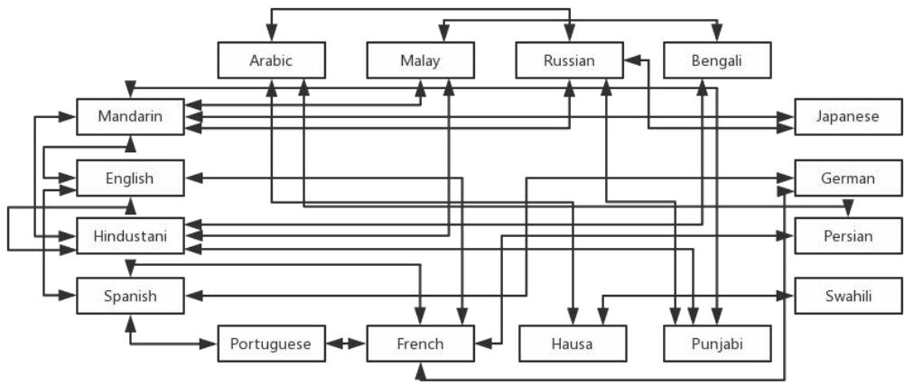
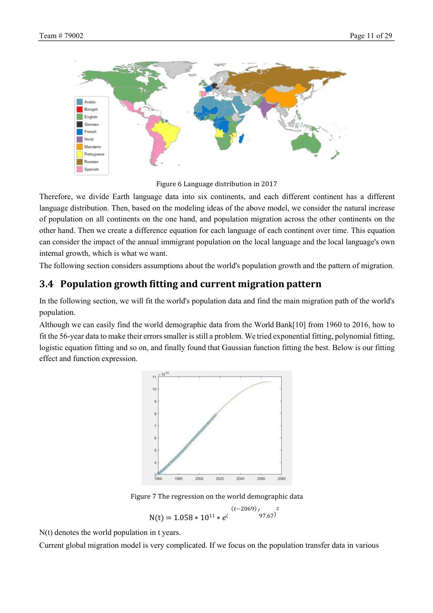
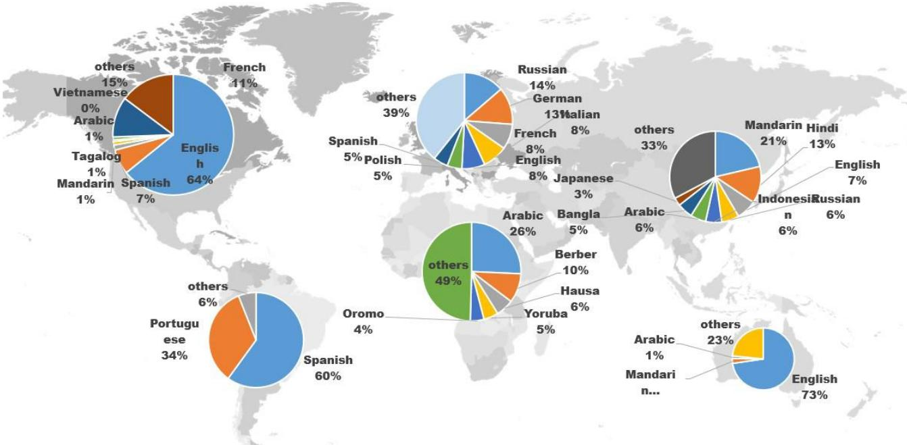
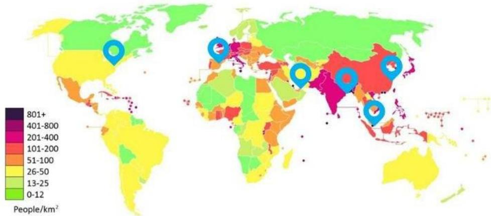

# 2018年美赛O奖论文：How many languages?

原件为竞赛论文。补充：文中的阅读练习及“参考解答”为整理时增加，原件图文保留出处。

## 2018 MCM/ICM 题目 B：How many languages?

To predict the number of the one language, we assume that native speakers are related to natural growth rate of its native speaker and number of the its second speakers. Based on the data we collected, we use time series languages speakers difference equation model to describe the dynamic change of both native and second language speakers, considering the influence of foreign language taught in school, social media, economics, cultural communication and so on.

The difference equation model can apply our collected indicators to the prediction of change of language distribution over time. 50 years later, top 10 languages in order of total speakers change from [Mandarin, English, Hindustani, Spanish, Arabic, Malay, Russian, Bengali, Portuguese, French] to [Mandarin, English, Spanish, Hindustani, Arabic, Bengali, Portuguese, Malay, Russian, French]; the rank of top 10 native languages speakers changes from [Mandarin, Spanish, English, Hindustani, Arabic, Bengali, Portuguese, Russian, Punjabi, Japanese] to [Mandarin, Spanish, English, Hindustani, Arabic, Bengali, Portuguese, Punjabi, Russian, Hausa]. By analyzing these changes, we find some reasonable explanations, such as the rapid natural growth rate of some developing countries and some languages' increasing speaking-power.

Given the global population growth and migration pattern, we establish geographical distribution of difference equation model, to predict the geographical distribution of different languages. Through the establishment of the difference equation, we consider the relationship between the distribution of languages on different continents and main migration routes. We use MATLAB to calculate language proportion changes on each continent over the next 50 years, finding some reasonable predictions. For example, Mandarin will become the No.2 native language in North America and Australia. The proportion of Mandarin and Arabic speakers in Europe will increase significantly.

In Part II, based on the requirement and the feature of service company, we choose six suitable cities based on our prediction of language speakers. Also, we find that the cities are different depending on whether the company is long-term oriented (6 suggested cities: Shanghai, New York, Calcutta, Madrid, Dubai, and Rio de Janeiro) or short-term oriented (6 cities: Shanghai, New York, Calcutta, Madrid, Dubai, and Singapore).

Moreover, we build the cost-benefit analysis model to calculate the suitable number of offices that this company should build. Given the level of company's profitability and cost, we set a new parameter, cost-profitability ratio. If the value of cp ratio is less than 281, we think 6 offices should be built. If the value of this ratio is between 281 and 422, we think 5 offices should be built. If the value is between 422–527, 4 offices are best; if it is between 527 and 544, 3 offices should be built; if > 544, we should only maintain two offices.

Finally, we analyze the performance of our model and the sensitivity of our model, proving that our model is relatively stable for different parameters.

Key words: Language distribution, Time Series Difference Equation Model, Dynamic simulation, site selection, Cost-profit analysis

## CONTENT

1. Introduction....2
   1.1 Problem Background....2
   1.2 Our work....2
2. Assumptions and Symbols....2
   2.1 Assumptions of the initial data....2
   2.2 Symbols and definitions....3
3. Part I Models and Results....4
   3.1 Model I: Various Languages Speakers Difference Equation Model....4
       3.1.1 The increase of the native speakers....4
       3.1.2 The increase of the second language speakers....5
       3.1.3 The total difference equation of model I....8
   3.2 Model I Results & Analysis....8
       3.2.1 Initial rank and parameter setting....8
       3.2.2 Results & Analysis....9
   3.3 Model II: Geographical Distribution Difference Model....10
   3.4 Population growth fitting and current migration pattern....11
   3.5 The increase speakers of each language on each continent....12
   3.6 Result and Analysis....13
4. Part II Models & Results....15
   4.1 Assumptions about the service company....15
   4.2 Explanation about our choices....15
5. Sensitivity Analysis....17
   5.1 sensitivity analysis of Model I....17
   5.2 sensitivity analysis of model II....19
6. Strength and Weakness....20
7. Memo....21
8. Appendix....22
   8.1 data....22
   8.2 program....24

## 1 Introduction

### 1.1 Problem Background

In the world of globalization, number of native speakers and L2 speakers of a certain language increase or decrease over time. There are many factors that affect the increase or decrease of a certain language, including the foreign language taught in school, cultural communication and assimilation, Economic Factor, technology, social media and so on.

Our first task is to establish a model of the distribution of various language speakers over time, in which we should consider the factor listed above.

Besides, our second task is the establish a model to predict the geographic distributions of these languages over time based on the given globe population and human migration patterns for the next 50 years.

In the part II, a large multinational service company hire our team to give location options for new offices. So our third task is to consider where we should locate these offices and if opening less than six offices better.

知识点：[数学建模的基本步骤（问题分析、模型假设、建立、求解、检验、推广）](../../../topics/数学建模/jianmo_buzhou.md)、[任务分解与目标明确](../../../topics/数学建模/renwu_fenjie.md)

### 1.2 Our work

Language is such an important topic due to its role in cultural communication, international business, migration issue and so on. Under the circumstance that we are consulted to give out 6 most suitable sites to build new office by a service company, our main work is as follows:

Firstly, based on the data we collected, we use time series languages speakers difference equation model to describe the dynamic change of both native and second language speakers, considering the influence of foreign language taught in school, social media, economics, cultural communication and so on.

Secondly, considering the global population growth model and migration patterns, we establish geographical distribution difference model, presenting the change of languages’ distribution in 6 main continents over 50 years.

Thirdly, we choose the six suitable cities based on our prediction of language speakers. Also, we find that the cities are different depending on whether the company is long-term oriented or short-term oriented.

Moreover, we build the cost-benefit analysis model to calculate the suitable number of offices that this company should build.

Finally, we analyze the performance of our model and the sensitivity of our model.

## 2 Assumptions and Symbols

知识点：[文献综述与研究背景撰写方法](../../../topics/数学建模/wenxian_zongshu.md)、[一般假设及其合理性说明（Assumptions and Justifications）](../../../topics/数学建模/jiaben_shezhi.md)、[确定模型的定点与稳定性分析](../../../topics/数学建模/dingdian_wending.md)

### 2.1 Assumptions of the initial data

1. Those languages whose current total speakers are less than 100 million won’t become the top 10 languages. Thus, according to the list of languages by total number of speakers, we only use the data of top 16 languages, since they are the only languages that are used by more than 100 million people.[1]

   Reason: The French ranked 10th in 2017 with a total number of 228million speakers. According to common sense, total number of Language speakers have a small possibility to decrease. So, those languages with fewer than 100million speakers are less likely to become Top10 in 50 years. At the same time, we also do this to reduce our computational load and to reduce our programming difficulty.

2. For some Languages L2 speakers number ‘?’in the [1], we assume it is zero.

   Reason: We speculate there may be two reasons for the coming of ‘?’. One is because the data is too small, not good statistics. The other reason is that it is controversial to define who can be the second foreign language speakers. For both reasons, we can all assume the number is zero.

3. We think native speaker's growth is only related to its own natural growth rate and second language population

   Reason: According to our common sense, the growth of native speakers is often associated with changes in the local population. Local population grow, native speakers also will grow. Foreigners migrate in, and the foreign language native speakers increase. Therefore, native speaker changes and population changes are very relevant. And in order to simply our model, we think native speaker's growth is only related to its own natural growth rate and second language population.[2]

4. We think L2 speaker’s growth is only affected by its own feature (the languages learned in school, cultural communication) and the global situation (economics, development of technology, media use). And the relationship between them is directly proportional.

   Reason: According to common sense, these factors positively affects the L2 speaker’s growth. Although we are not quite sure whether the relationship between them is linear or not, in order to simplify the problem, we may think that the relationship between them is linear, and therefore, proportional.

知识点：[一般假设及其合理性说明（Assumptions and Justifications）](../../../topics/数学建模/jiaben_shezhi.md)、[问题重述与分析（Problem Restatement and Analysis）](../../../topics/数学建模/wenti_chongshu.md)、[模型参数的确定（基于数据拟合或实验选择）](../../../topics/数学建模/canshu_queding.md)

### 2.2 Symbols and definitions

**Table 1 Symbols and definitions**

| Symbols | Definitions |
| :--- | :--- |
| $x_{i}(t)$ | The population of the native speaker of language i in year t |
| $y_{i}(t)$ | The population of the L2 speaker of language i in year t |
| $s_{i}(t)$ | The population of the total speaker of language i in year t |
| $LangT_{ij}$ | the percentage of language i taught in the area where the native speakers use language j |
| $Cult_{i,j}$ | the extent of cultural exchange between language i and language j |
| $Eco_{i}$ | the economic power of language i |
| c | the velocity of technology development, $c>0$ |
| $Net_{i}$ | the power of language i in the internet |
| $k_{n}$ | Scale coefficient in the difference equation, we will discuss in more detail in the text. n=1, 2,...6 |
| $Pop(city_{i})$ | the number of speakers of top 10 languages except English in cityi |

**Table 2 codes for top 16 languages**

| i | 1 | 2 | 3 | 4 | 5 | 6 | 7 | 8 |
| :--- | :--- | :--- | :--- | :--- | :--- | :--- | :--- | :--- |
| **Languages** | Mandarin | English | Hindustani | Spanish | Arabic | Malay | Russian | Bengali |
| **i** | 9 | 10 | 11 | 12 | 13 | 14 | 15 | 16 |
| **Languages** | Portuguese | French | Hausa | Punjabi | German | Japanese | Persian | Swahili |

知识点：[符号说明与术语定义（Nomenclature / Symbols and Definitions）](../../../topics/数学建模/fuhao_shuoming.md)、[模型参数的确定（基于数据拟合或实验选择）](../../../topics/数学建模/canshu_queding.md)、[一般假设及其合理性说明（Assumptions and Justifications）](../../../topics/数学建模/jiaben_shezhi.md)

### 3 Part I Models and Results

知识点：[传统 SEIR 流行病模型（Susceptible-Exposed-Infectious-Recovered）](../../../topics/数学建模/seir_moxing.md)、[数学建模的基本步骤（问题分析、模型假设、建立、求解、检验、推广）](../../../topics/数学建模/jianmo_buzhou.md)、[模型验证方法概述（随机模型与确定性模型验证）](../../../topics/数学建模/moxing_yanzheng.md)

### 3.1 Model I: Various Languages Speakers Difference Equation Model

How to quantify the relationship between language growth and the various factors is a difficult problem? There are a variety of time series models we could use. If we have enough data, we can regress the functional relationship between the number of languages on various factors. But the truth is, we can’t find enough credible data online. There are two reasons for this. One is because it is vague to judge whether a person has a second foreign language ability. For this reason, different data sources may not come from the same criterion. So the data between the two will be very different. In addition, the two data whose sources are the same, while years are different are still not credible. This is because the dates of the censuses vary from country to country. This makes a lot of data does not have time continuity. For these two reasons, we can’t and will not use those methods of fitting forecasts.

Difference equation model can consider the impact of different factors on the size of the independent variables. Moreover, the difference equation model only requires the initial data on it. These two characteristics fit very well with our problem. The time step in which we set in the difference equation is one year. We denote that the number of native speakers of language $i$ in next period depends on the current number of its native speakers and the current number of its 2nd language speakers. Therefore, we can construct a difference equation model to describe the change of 2 types speakers for the 16 languages.

#### 3.1.1 The increase of the native speakers

According to our common sense, the growth of native speakers is often associated with changes in the local population. Local population grow, and native speakers also will grow. Foreigners migrate in, and the foreign language native speakers increase. Therefore, native speaker changes and population changes are very relevant. So, we assume that native speaker's growth is only related to its natural growth and the number of second language speakers. We choose the weighted average of natural growth rate of countries whose official language is the language $i$ as the increase of the native speakers of language $i$.

However, the world population growth pattern varies from countries. The most significant difference is the difference between the population growth patterns in developing and developed countries. Therefore, we divide these languages into two group. One type is mainly spoken in developed countries, and the other is mainly spoken in the developing countries. Developed countries usually have low natural population growth rates and high immigration rate while developing countries usually have higher natural population growth rates. To take this difference into consideration, we divide all 16 languages into 2 types, according to their main speakers types—developed or developing.

Table 3 types of languages

| types | languages |
| :--- | :--- |
| Type I: most spoken in developed countries | English, Spanish, French, German, Japanese, Mandarin |
| Type II: most spoken in developing countries | Hindustani, Arabic, Malay, Portuguese, Hausa, Punjabi, Persian, Swahili |

##### Type I languages’ speakers’ growth model: Malthusian growth model

Type I languages are mainly spoken in developed countries, whose population usually have a very low natural growth rate, such as 0.5%, or even a negative value. Its population growth rate mainly depends on the immigration, while the next generation of those immigrants usually have to learn the local language as their mother tongue.

## 3.1.1 Type I languages' speakers' growth model: Malthusian Growth Model

For this type countries, we can consider it as a constant rate, $r$, over the next 50 years. So we use the Malthusian growth model to measure the number of native speakers[4]. According to Malthusian growth model, the population growth rate, $r$, does not change over time. Therefore, the population in year $t+1$ could be written as:

$$
x_{i}(t+1) - x_{i}(t) = x_{i}(t) r_{i} + R \cdot y_{i}(t) \tag{1}
$$

$x_{i}(t)$ denotes the number of native speakers of language $i$ in year $t$; $r_{i}$ denotes the natural speaker growth rate of language $i$; $R$ denotes a coefficient that explains the proportion of 2<sup>nd</sup> speakers of this language in year $t$ that turns into native speaker in year $t+1$. Later, we will do sensitivity analysis for this coefficient $R$.

## 3.1.2 Type II languages' speakers' growth model: Logistic Growth Model

Type II languages are mainly spoken in developing countries, whose population usually have a relatively higher natural growth rate, such as 2%. Nevertheless, we cannot use this number for the next 50 years, since their population cannot maintain growing so fast. To make a more realistic analysis, we use Logistic Growth Model. Logistic Growth Model is a slight modification of Malthus's model. It points that the population growth rate is not constant—there is a limited carrying capacity of the environment, resulting in a stable population over time[5].

According to Logistic Growth Model, the population in year $t+1$ could be written as:

$$
x_{i}(t+1) - x_{i}(t) = \left(r_{i} - \frac{x_{i}(t)}{s_{i}}\right) \cdot x_{i}(t) \tag{2}
$$

$r_{i}$ denotes the current natural growth rate of Type II languages; $s_{i}$ is the maximum of numbers of speakers of language $i$. To make it simple, we regard $s_{i} = 2 x_{i}(0)$. $x_{i}(0)$ denotes the initial number of native speakers of language $i$.

知识点：[数学建模的基本步骤（问题分析、模型假设、建立、求解、检验、推广）](../../../topics/数学建模/jianmo_buzhou.md)、[一般假设及其合理性说明（Assumptions and Justifications）](../../../topics/数学建模/jiaben_shezhi.md)、[模型参数的确定（基于数据拟合或实验选择）](../../../topics/数学建模/canshu_queding.md)

### 3.1.2.1 The increase of the second language speakers

When discussing the change of $2^{\mathrm{nd}}$ language speakers, we believe it is mainly affected by two major factors. Firstly, it is affected by its own feature, such as region, difficulty, promotion by the government, cultural communication, etc. Secondly, it is affected by the global situation, such as economics, development of technology, etc.

#### Effect of the language own features

##### the foreign language taught in school [3]

We assume that the language promoted by the government is the foreign language taught in school. For example, English is taught in many countries as students' main foreign language because of English's wide spread and use in the world. Although statistics are incomplete in some developing countries, we only found data of some developed countries. However, we think this promotion of language in education is related to the power of the language itself, which means the number of L2 speakers. Therefore, we use available data to make up for the missing data.

$$
\Delta_{i, \text{LangT}} = k_{1} \sum_{j=1}^{16} \text{Lang}T_{ij} \cdot x_{j}(t)
$$

$\text{Lang}T_{ij}$ denotes the percentage of language $i$ taught in the area where the native speakers use language $j$. For example, when $i$ refers to French and $j$ refers to English, $\text{Lang}T_{ij}$ is the percentage of French taught in school as a foreign language in English-speaking countries. $k_{1}$ is the coefficient to measure how much this factor (the language taught in school) will influence the increase of 2nd language speakers of language $i$. Later we will do sensitivity analysis for $k_{1}$.

##### Cultural communication & assimilation

Many reports state that cultural communication and assimilation play a significant role in the increase of $2^{\mathrm{nd}}$ language learners. However, how to quantify cultural exchange is a very difficult issue. In order to solve this problem, we propose two factors that will affect cultural communication. The following are two effects:

Neighborhood Effect: If the speakers of two language live near to each other, it is more likely for them to have cultural communication. And therefore, they would become more likely to learn neighbors' language as their $2^{\mathrm{nd}}$ language.



Policy-led Effect: When the home country of language speakers is strongly promoting the country's relations with some special countries, the likelihood of those languages learning from each other's languages will also increase, such as China's the Belt and Road Policy making it more motivated for the people along the policy to learn Chinese. For example, Pakistan uses Chinese as its second language.

# 2018年美赛O奖论文：How many languages?（习题）第 5 部分

本部分整理自《2018年美赛O奖论文：How many languages?》第 8–9 页，主要涉及语言演化模型中文化、经济、技术及网络社交等因素对第二语言学习者数量变化的影响公式推导，以及模型 I 的总差分方程和初始数据表。

## 3.1.2.2 Effect of the global situation

知识点：[模型参数的确定（基于数据拟合或实验选择）](../../../topics/数学建模/canshu_queding.md)、[敏感性分析方法（Sensitivity Analysis，单参数与多参数变动）](../../../topics/数学建模/minganxing_fenxi.md)、[数学建模的基本步骤（问题分析、模型假设、建立、求解、检验、推广）](../../../topics/数学建模/jianmo_buzhou.md)

###  Economic Factor

Different languages have different speaking power in the global business environment. The more power it has, the more persons choose to learn it. Through the GDP contributed by different languages [See Figure 3], we give different weight to the top 16 language.

$$
\Delta_{i,\text{Eco}} = k_3 \cdot Eco_i
$$

$Eco_i$ is the economic power of language $i$. $k_3$ describes how much the economic factor motivates people to learn language $i$ as their $2^{\text{nd}}$ language. Later we will do sensitivity analysis for $k_3$.

知识点：[数学建模的基本步骤（问题分析、模型假设、建立、求解、检验、推广）](../../../topics/数学建模/jianmo_buzhou.md)、[模型参数的确定（基于数据拟合或实验选择）](../../../topics/数学建模/canshu_queding.md)、[敏感性分析方法（Sensitivity Analysis，单参数与多参数变动）](../../../topics/数学建模/minganxing_fenxi.md)

###  The update of translation software technology

The development of technology will make it easier and faster to translate different languages. We assume the velocity of translation software’s update rate is constant. Therefore, it will have a negative impact on the number of $2^{\text{nd}}$ language learners. This factor will influence the increase of L2 speakers of language $i$ as:

$$
\Delta_{i,\text{Tech}} = k_4 c \quad (c > 0, k_4 < 0)
$$

$C$ is the velocity of technology development. $k_4$ describes the change of $2^{\text{nd}}$ language learner influenced by the development of translation software. Later we will do sensitivity analysis for $k_4$.

知识点：[文献综述与研究背景撰写方法](../../../topics/数学建模/wenxian_zongshu.md)、[一般假设及其合理性说明（Assumptions and Justifications）](../../../topics/数学建模/jiaben_shezhi.md)、[敏感性分析方法（Sensitivity Analysis，单参数与多参数变动）](../../../topics/数学建模/minganxing_fenxi.md)

###  The push of network and social media

Though there are thousands of languages all over the world, only 5% of them are used widely in the internet. 54.5% of all web content is still in English despite huge growth in users that do not understand English or who prefer to access content in their native languages. Due to analysis of the most popular 10 million websites by W3techs, after English, the most common languages are Russian (5.9%), German (5.7%), Japanese (5.0%), and Spanish (4.7%).[8]

Data also show us that the number of languages used by mainstream social medias, such as Facebook, Twitter and LinkedIn is limited to few languages.

We can express the power of language in the network as follows:

$$
\Delta_{i,\text{Net}} = k_5 \cdot Net_i
$$

$Net_i$ describes the power of language $i$ in the internet. $k_5$ describes the change of $2^{\text{nd}}$ language learner influenced by the push of internet and social media. Later we will do sensitivity analysis for $k_5$.

## 3.1.3 The total difference equation of model I

In this way, we get the general formula describing the change in the number of speakers learning $i$ as their $2^{\text{nd}}$ languages:

$$
y_i(t + 1) - y_i(t) = \Delta_{i,\text{LangT}} + \Delta_{i,\text{cult}} + \Delta_{i,\text{Eco}} + \Delta_{i,\text{Tech}} + \Delta_{i,\text{Net}} \tag{3}
$$

Adding (1) and (3), we get the change of total speakers for Type I language:

$$
S_i(t + 1) - S_i(t) = x_i(t)r_i + R \cdot y_i(t) + \Delta_{i,\text{LangT}} + \Delta_{i,\text{cult}} + \Delta_{i,\text{Eco}} + \Delta_{i,\text{Tech}} + \Delta_{i,\text{Net}} \tag{4}
$$

Adding (2) and (3), we get the change of total speakers for Type II language:

$$
S_i(t + 1) - S_i(t) = \left(r_i - \frac{x_i(t)}{s_i}\right) \cdot x_i(t) + \Delta_{i,\text{LangT}} + \Delta_{i,\text{cult}} + \Delta_{i,\text{Eco}} + \Delta_{i,\text{Tech}} + \Delta_{i,\text{Net}} \tag{5}
$$

## 3.2 Model I Results & Analysis

知识点：[数学建模的基本步骤（问题分析、模型假设、建立、求解、检验、推广）](../../../topics/数学建模/jianmo_buzhou.md)、[模型参数的确定（基于数据拟合或实验选择）](../../../topics/数学建模/canshu_queding.md)、[敏感性分析方法（Sensitivity Analysis，单参数与多参数变动）](../../../topics/数学建模/minganxing_fenxi.md)

### 3.2.1 Initial rank and parameter setting

In the section above, we build a difference equation model, which could predict the number of native speakers and second language speakers in the following years. We get the initial rank by total language speaker[1]. It represents the numbers of native speakers and second language speakers of different languages in 2017. And here is the initial data:

**Table 4 The initial rank by language size [1]**

| Rank | Language | L1 speakers | L1 Rank | L2 speakers | L2 Rank | Total |
| :--- | :--- | :--- | :--- | :--- | :--- | :--- |
| 1 | Mandarin | 897 | 1 | 193 | 4 | 1090 |
| 2 | English | 371 | 3 | 611 | 1 | 982 |
| 3 | Hindustani | 329 | 4 | 215 | 2 | 544 |
| 4 | Spanish | 436 | 2 | 91 | 8 | 527 |
| 5 | Arabic | 290 | 5 | 132 | 6 | 422 |
| 6 | Malay | 77 | 15 | 204 | 3 | 281 |
| 7 | Russian | 153 | 8 | 113 | 7 | 267 |
| 8 | Bengali | 242 | 6 | 19 | 13 | 261 |
| 9 | Portuguese | 218 | 7 | 11 | 15 | 229 |
| 10 | French | 76 | 17 | 153 | 5 | 229 |
| 11 | Hausa | 85 | 11 | 65 | 10 | 150 |
| 12 | Punjabi | 148 | 9 | ? | ? | 148 |
| 13 | German | 76 | 18 | 52 | 12 | 129 |
| 14 | Japanese | 128 | 10 | 1 | 19 | 129 |
| 15 | Persian | 60 | 25 | 61 | 11 | 121 |
| 16 | Swahili | 16 | 26 | 91 | 8 | 107 |

According to the data we collected in [1, 4-7, 9], we can set indices in the formula (4) and formula (5). The indices are given as follows:

# 2018年美赛O奖论文：How many languages?（习题）

本部分为《How many languages?》论文第6部分（共13部分），主要涉及模型参数敏感性分析结果、语言排名预测及地理分布模型的引入。

## 一、参数敏感性分析与排名预测结果

知识点：[参数合理性验证](../../../topics/数学建模/canshu_heli_xing.md)、[长期预测模型（如20年可持续发展计划预测）](../../../topics/数学建模/nian_yuce.md)、[文献综述与研究背景撰写方法](../../../topics/数学建模/wenxian_zongshu.md)

### 选择/简答 1：模型参数设定与敏感性分析目的

在多种语言-speaker差值方程模型中，参数由估计值给出。团队对这些索引进行敏感性分析，以判断第二语言（L2）speakers的变化是否对这些索引敏感。

**表 5 索引设置 (Table 5 Indices setting)**

| Index | $k_1$ | $k_2$ | $k_3$ | $k_4$ | $k_5$ |
| :--- | :--- | :--- | :--- | :--- | :--- |
| **value** | $\frac{1}{300}$ | $\frac{1}{90000}$ | 0.2 | -0.3 | 0.2 |
| **Explanation** | L2 learner condition | Cultural communication | Language's power in business | Technology factor | Language's power in internet |

知识点：[模型参数的确定（基于数据拟合或实验选择）](../../../topics/数学建模/canshu_queding.md)、[敏感性分析方法（Sensitivity Analysis，单参数与多参数变动）](../../../topics/数学建模/minganxing_fenxi.md)、[参数合理性验证](../../../topics/数学建模/canshu_heli_xing.md)

### 计算/简答 2：50年后语言规模预测排名

输入初始值和索引后，通过MATLAB得到新的排名。下表展示了50年后按语言规模预测的排名（单位：百万）。

**表 6 50年后按语言规模的预测排名 (Table 6 The predicted rank by language size after 50 years, Unit: million)**

| rank | Languages | L1 speakers | L1 rank | L2 speakers | L2 rank | Total |
| :--- | :--- | :--- | :--- | :--- | :--- | :--- |
| 1 | Mandarin | 1119.9556 | 1 | 397.2715 | 2 | 1517.227 |
| 2 | English | 625.07569 | 3 | 752.60658 | 1 | 1377.682 |
| 3 | Spanish | 714.54914 | 2 | 232.09149 | 7 | 946.6406 |
| 4 | Hindustani | 437.73828 | 4 | 322.65571 | 3 | 760.394 |
| 5 | Arabic | 410.4004 | 5 | 235.69087 | 5 | 646.0913 |
| 6 | Bengali | 337.48877 | 6 | 112.72084 | 13 | 450.2096 |
| 7 | Portuguese | 306.72269 | 7 | 101.83735 | 14 | 408.56 |
| 8 | Malay | 121.75222 | 11 | 269.89281 | 4 | 391.645 |
| 9 | Russian | 159.65859 | 9 | 187.58738 | 8 | 347.246 |
| 10 | French | 109.24506 | 13 | 234.28833 | 6 | 343.5334 |
| 11 | Punjabi | 226.42109 | 8 | 78.858666 | 15 | 305.2798 |
| 12 | Hausa | 133.98132 | 10 | 132.39229 | 10 | 266.3736 |
| 13 | Persian | 87.30792 | 14 | 122.95997 | 12 | 210.2679 |
| 14 | German | 81.926176 | 15 | 125.04862 | 11 | 206.9748 |
| 15 | Japanese | 121.48183 | 12 | 71.268763 | 16 | 192.7506 |
| 16 | Swahili | 26.054248 | 16 | 145.23578 | 9 | 171.29 |

知识点：[长期预测模型（如20年可持续发展计划预测）](../../../topics/数学建模/nian_yuce.md)

### 简答 1：前后十年十大语言排名变化对比

**1. 总speakers（Total speakers）前十大变化：**
*   **原前十：** Mandarin, English, Hindustani, Spanish, Arabic, Malay, Russian, Bengali, Portuguese, French
*   **50年后前十：** Mandarin, English, Spanish, Hindustani, Arabic, Bengali, Portuguese, Malay, Russian, French

**2. 母语speakers（Native speakers）前十大变化：**
*   **原前十：** Mandarin, Spanish, English, Hindustani, Arabic, Bengali, Portuguese, Russian, Punjabi, Japanese
*   **50年后前十：** Mandarin, Spanish, English, Hindustani, Arabic, Bengali, Portuguese, Punjabi, Russian, Hausa

知识点：[数学建模的基本步骤（问题分析、模型假设、建立、求解、检验、推广）](../../../topics/数学建模/jianmo_buzhou.md)

### 简答 2：基于排名的五大主要结论

对比两个排名，得出以下5个主要结论：

1.  **普通话（Mandarin）L2 speakers快速增长：**
    作为中国官方语言，也是快速增长国家的典型代表，普通话吸引了许多人将其作为第二语言。同时，中国采取了与其他国家的一系列交流政策，如对非洲的援助和“一带一路”政策，这也增强了中文的吸引力。

2.  **俄语（Russian）总排名下降：**
    由于俄罗斯的自然增长率非常低，俄语母语speakers的排名下降，直接导致俄语总排名的下降。

3.  **孟加拉语（Bengali）总排名上升：**
    孟加拉国拥有庞大的人口基数和高自然增长率，导致孟加拉语母语speakers及其排名迅速增加。

4.  **前十语言列表仅发生组内变化：**
    第10名语言（法语，总speakers：2.29亿）和第11名语言（豪萨语，总speakers：1.5亿）之间存在巨大差距。这种差距不会完全消失。但从表7可以看出，前16名语言列表在50年间发生了变化。

5.  **日语（Japanese）母语speakers从前10名列表中下降：**
    这主要是因为日本近期的自然增长率为负。此外，由于豪萨语（Hausa）在非洲的自然增长率迅速提高，它已成为第10大母语speakers语言。

## 二、模型 II：地理分布差异模型

知识点：[问题重述与分析（Problem Restatement and Analysis）](../../../topics/数学建模/wenti_chongshu.md)、[文献综述与研究背景撰写方法](../../../topics/数学建模/wenxian_zongshu.md)

### 简答 3：地理分布对语言模型的影响及挑战

上述建立的模型用于衡量不同语言随时间的speakers数量。该模型量化了母语speakers和第二语言speakers的趋势与学校、文化群体迁移、经济、翻译技术使用和社会媒体之间的关系。但显然，未考虑地理分布对语言的影响。以下模型专门解决这一问题。

然而，如何将地理分布纳入模型是一个巨大的挑战。起初不知道应用多少语言来衡量语言的地理分布。但在查阅数据后发现，各大洲的语言分布差异很大。以下是2017年的语言分布情况：

*(注：原文此处提及2017年语言分布，但提供的文本片段在此处结束，未包含具体分布数据或图表)*

 替代文字：2017年全球语言地理分布示意图（原文图片占位）


Therefore, we divide Earth language data into six continents, and each different continent has a different language distribution. Then, based on the modeling ideas of the above model, we consider the natural increase of population on all continents on the one hand, and population migration across the other continents on the other hand. Then we create a difference equation for each language of each continent over time. This equation can consider the impact of the annual immigrant population on the local language and the local language's own internal growth, which is what we want.

The following section considers assumptions about the world's population growth and the pattern of migration.

知识点：[文献综述与研究背景撰写方法](../../../topics/数学建模/wenxian_zongshu.md)、[一般假设及其合理性说明（Assumptions and Justifications）](../../../topics/数学建模/jiaben_shezhi.md)、[确定模型的定点与稳定性分析](../../../topics/数学建模/dingdian_wending.md)

### 3.4 Population growth fitting and current migration pattern

In the following section, we will fit the world's population data and find the main migration path of the world's population.

Although we can easily find the world demographic data from the World Bank[10] from 1960 to 2016, how to fit the 56-year data to make their errors smaller is still a problem. We tried exponential fitting, polynomial fitting, logistic equation fitting and so on, and finally found that Gaussian function fitting the best. Below is our fitting effect and function expression.

$$
\mathrm{N(t)} = 1.058 \times 10^{11} * e^{-\frac{(t - 2069)^2}{97.67}}
$$

N(t) denotes the world population in t years.

Current global migration model is very complicated. If we focus on the population transfer data in various countries, we can easily fall into too many data and can’t get the result. So, in order to simplify the world migration pattern, we may wish to consider only major migration routes in the current world. Then we look for the main migration patterns, and the image below shows some of the routes we found.

![Figure 8 Some main routes of global migration[11]](2018年美赛O奖论文：How-many-languages.assets/原件图1.jpg)

Based on the current global migration patterns, we propose to assume the following seven major migration routes. These seven migration routes are the most promising migration path we believe will be in the next 50 years. Based on the average annual data and our understanding of these routes, we make the following assumptions as to the proportion of these seven routes in all the routes.

**Table 8 7 main migration routes**

| route | details | proportion |
| :--- | :--- | :--- |
| 1 | China to US and Canada | 20% |
| 2 | China to EU | 15% |
| 3 | India to EU | 15% |
| 4 | West Asia to EU | 15% |
| 5 | north Africa to EU | 15% |
| 6 | Latin America to US and Canada | 15% |
| 7 | China to Australia | 5% |

知识点：[模型参数的确定（基于数据拟合或实验选择）](../../../topics/数学建模/canshu_queding.md)、[数学建模的基本步骤（问题分析、模型假设、建立、求解、检验、推广）](../../../topics/数学建模/jianmo_buzhou.md)、[一般假设及其合理性说明（Assumptions and Justifications）](../../../topics/数学建模/jiaben_shezhi.md)

### 3.5 The increase speakers of each language on each continent

Because we mainly consider the impact of immigration on the geographical distribution of language, we do not intend to consider the second language speakers here. All the following language-related data refers to the native speakers. Just like the model we built above, we also regard one year as the variation time of the difference equation. We denote $X _ { j } ^ { i } ( t )$ as the number of ith language speakers in $\mathrm { j } ^ { \mathrm { t h } }$ continent in the year t. Also, we denote $L _ { i }$ as the number of speakers in the $\mathrm { i } ^ { \mathrm { t h } }$ migration route, which is marked above

When we think about the $\mathrm { i } ^ { \mathrm { t h } }$ language native speakers' increase, the first thing we think of is the natural increase of the population. But different languages generally have different natural growth rates of its native speakers So we denote $r _ { j } ^ { i }$ is the natural increase rate of $\mathrm { \ddot { i } ^ { t h } }$ language in $\mathrm { j } ^ { \mathrm { t h } }$ continent.

When we think of the impact of migration route on native speakers, what we think first is that the population of immigrants will increase the number of native speakers of the language which the migration group speaks.

Besides, the population of immigrants will have the next generation in the destination country. Because it is difficult to measure the impact of this factor on the number of native speakers in that country, we assume that the annual growth of native speakers in local languages because of migration is proportional to the number of immigrants, and we set the index is $\mathrm { k } _ { 6 } .$

Thus, we have the following difference equation:

$$
X _ {j} ^ {i} (t + 1) = X _ {j} ^ {i} (t) + r _ {j} ^ {i} \cdot X _ {j} ^ {i} (t) + \sum_ {l = 1} ^ {6} k _ {6} \cdot L _ {l} \cdot p _ {j} ^ {i} * I _ {\{d e s t i n a t i o n = = j \}} + \sum_ {l = 1} ^ {6} L _ {l} \cdot I _ {\{d e s t i n a t i o n = = j \}} \cdot I _ {\{L a n g u a g e = = i \}}
$$

$p _ { j } ^ { i }$ denotes the $\mathrm { i } ^ { \mathrm { t h } }$ language's proportion in $\mathrm { j } ^ { \mathrm { t h } }$ continent; $I _ { \{ d e s t i n a t i o n = = j \} }$ judges whether the migration's destination is $\mathrm { j } ^ { \mathrm { t h } }$ continent; $I _ { \{ L a n g u a g e = = i \} }$ judges whether the migration's language is $\mathrm { i } ^ { \mathrm { t h } }$ language

After we calculated every language of the six continents, we can get the language distribution of each continent one year later. After 50 times of this process, we can so predict the geographical distribution of every continent 50 years later.

知识点：[数学建模的基本步骤（问题分析、模型假设、建立、求解、检验、推广）](../../../topics/数学建模/jianmo_buzhou.md)、[一般假设及其合理性说明（Assumptions and Justifications）](../../../topics/数学建模/jiaben_shezhi.md)、[模型参数的确定（基于数据拟合或实验选择）](../../../topics/数学建模/canshu_queding.md)

### 3.6 Result and Analysis

We use MATLAB to calculate that difference equations. And the chart below is our result. In order to easily differentiate data changes on all continents, we specialized in converting data ofdifferent continents to pie charts.




根据上述变化可以看出：

1. 非洲、澳大利亚、亚洲和拉丁美洲的语言分布变化不大。这是因为这两个大洲的语言变化主要由自然人口增长决定，人口迁移方式对这两个大洲影响较小（尽管非洲是移民的输出地之一，澳大利亚是移民的目的地之一）。

2. 美国和加拿大普通话和西班牙语的比例呈上升趋势，并出现了一定比例的葡萄牙语母语者。这是因为路线 1 将大量普通话使用者带到美国和加拿大，路线 6 将大量西班牙语和葡萄牙语使用者带到这些地区。

3. 阿拉伯语、普通话、印地语母语者出现在欧洲并持续增加。但由于移民人数较少，比例仍然较低，欧洲的语言仍包含大量语种。

## 4 第二部分 模型与结果

知识点：[长期预测模型（如20年可持续发展计划预测）](../../../topics/数学建模/nian_yuce.md)、[模型参数的确定（基于数据拟合或实验选择）](../../../topics/数学建模/canshu_queding.md)、[模型验证方法概述（随机模型与确定性模型验证）](../../../topics/数学建模/moxing_yanzheng.md)

### 4.1 关于服务公司的假设

服务公司是通过提供服务而非销售实物产品来获取收入的企业，公共会计师事务所就是一个很好的例子。他们通过编制所得税申报表、执行审计和资产服务，甚至进行记账工作来赚取收入。[12]

基于对服务公司的理解，我们对新国际办事处的位置作出如下假设：

1. 服务公司的利润与其服务的语言总数成正比。服务的语言越多，获得的利润越高。这也是该服务公司的主要盈利模式。

2. 考虑到英语在不同分支机构之间沟通中的关键作用，办事处应设在英语广泛使用的地方。

3. 办事处倾向于设在人口稠密、交通便利的大都市区。也就是说，如果同一语言区内有两座城市，我们更倾向于选择人口多、交通便利的城市。

知识点：[数学建模的基本步骤（问题分析、模型假设、建立、求解、检验、推广）](../../../topics/数学建模/jianmo_buzhou.md)、[一般假设及其合理性说明（Assumptions and Justifications）](../../../topics/数学建模/jiaben_shezhi.md)

### 4.2 关于选择的说明

短期内语言人口不会发生重大变化。因此，在考虑短期选址时，我们参考 2017 年的语言使用者数量。使用人数最多的六种语言为普通话、英语、印度斯坦语、西班牙语、阿拉伯语和马来语，六个地点相应为上海、纽约、加尔各答、马德里、迪拜、新加坡。人口密度图和办事处位置如下所示：



然而，在考虑长期选址时，我们参考模型 I 的结果。此时使用人数最多的六种语言已经发生变化，分别为普通话、英语、西班牙语、印度斯坦语、阿拉伯语和孟加拉语。但由于孟加拉国人口众多而经济欠发达，公司的服务项目缺乏当地消费群体。因此，我们考虑预测语言排名中的第七种语言——葡萄牙语。于是，我们按顺序选择上海、纽约、马德里、加尔各答、迪拜和里约热内卢作为办事处所在地。


如图 14 所示，由于葡萄牙语使用者的快速增长，新加坡被里约热内卢取代。

基于第一部分模型，我们得到如下结果：

短期内，我们选择上海、纽约、加尔各答、马德里、迪拜和新加坡作为国际办事处所在地。使用人数最多的六种语言——普通话、英语、印度斯坦语、西班牙语、阿拉伯语和马来语将相应在这些办事处使用。

长期内，我们选择上海、纽约、马德里、加尔各答、迪拜和里约热内卢。普通话、英语、西班牙语、印度斯坦语、阿拉伯语和葡萄牙语将相应在这些办事处使用。

## 成本效益分析模型

每当在新地点设立办事处，公司就会拥有更广泛的消费群体，从而获得更多收入。但与此同时，建立新办事处也需要大量成本。根据一般的 收益 = 收入 − 成本 公式，我们需要明确公司收入 $R$ 和成本 $C$ 的来源。

由于英语是必需语言，我们在建立成本效益分析模型时，使用该地区除英语外最流行语言的使用者数量来判断公司的盈利能力。在此给出如下假设：

- $R$（总收入）与公司的盈利能力正相关，即与 $\alpha$ 相关。
- $C$（总成本）在每个地点是固定数值。我们假设建立新办事处的成本为常数 $C$。

因此，我们有方程：

$$
\text{Profit}(\text{city}_i) = \alpha \cdot \text{pop}(\text{city}_i) - C
$$

其中 $\text{pop}(\text{city}_i)$ 是城市 $i$ 中除英语外前 10 种语言的使用者数量。因为我们用 $\text{pop}(\text{city}_i)$ 来描述语言 $i$ 的影响力和流行度，所以可以用总使用者数量大致表示它。

我们已在 4.1 节中计算出最合适的城市，排名见表 9。

表 10 最合适的城市

| 排名 | 1 | 2 | 3 | 4 | 5 | 6 |
|---|---|---|---|---|---|---|
| 城市 | 上海 | 纽约 | 马德里 | 加尔各答 | 迪拜 | 新加坡 |

注：1. 上海和纽约是我们已经拥有的两个办事处。

2. 我们使用 2017 年收集的数据，而非 50 年后的预测值，因为公司是现在建设这 6 个新办事处，而不是 50 年后。

To calculate the profit-maximize office amount, we need to ask some additional information from our client company, which is the exact value of $\alpha$ and $C$, from the company to measure its profitability.

For $\mathrm{city}_{i}$, we have a judgement to determine whether we should set up an office here:

$$
\left\{ \begin{array}{l l} I f \frac {C}{\alpha} > p o p (c i t y _ {i}), & \text {set up an office in city} _ {i} \\ I f \frac {C}{\alpha} \leq p o p (c i t y _ {i}), & \text {do not set up an office in city} _ {i} \end{array} \right.
$$

$C/\alpha$ measures the company’s ability to turn the cost into profit, we call it cost-profitability ratio, or c-p ratio in short.

Given different value of $C / \alpha ,$ we can give the following suggestions:

**Table 11 How many offices should the company set up?**

| C-p ratio (unit: million) | Number of offices | City |
| :--- | :--- | :--- |
| 544.982) | 2 | Shanghai, New York |
| [527, 544) | 3 | Shanghai, New York, Madrid |
| [422, 527) | 4 | Shanghai, New York, Madrid, Calcutta |
| [281, 422) | 5 | Shanghai, New York, Madrid, Calcutta, Dubai |
| [0, 281) | 6 | Shanghai, New York, Madrid, Calcutta, Dubai, Singapore |

Therefore, given the additional information of $\alpha$ and $C$, we can help the company to decide how many offices they should build.

## 5 Sensitivity Analysis

知识点：[配送地点选址模型（公平原则与效率原则）](../../../topics/数学建模/peisong_xuanzhi.md)、[模型参数的确定（基于数据拟合或实验选择）](../../../topics/数学建模/canshu_queding.md)

### 5.1 sensitivity analysis of Model I

The purpose of our Model I was to get the change of Top10 language of the most native speakers and total speakers for the next 50 years. But if you use rankings as the dependent variable for our sensitivity analysis, we think the result we got must be insensitive, and the rank remain the same, because the Independent variables change little, and the rank is a discrete data. So we want to choose one of the model I’s result data as our other dependent variable. For example, we choose the number of Mandarin second language speakers in 50 years later as our observed variables. The following analysis is to consider the sensitivity of this variable under small changes in below parameters.

#### 1. natural increase rate

We enter different natural growth rates of Mandarin into the program, and we get different Mandarin L2 speakers number. Here is the result:

**Table 12 Sensitivity analysis on natural increase rate**

| natural increase rate of Mandarin | 0.34 | 0.44 | 0.54 |
| :--- | :--- | :--- | :--- |
| the number of Mandarin L2 speakers | 386.34 | 397.27 | 403.18 |
| sensitivity | 0.093256475 | | |

The Sensitivity Index shown above means that when the natural increase rate increased by 1%, the number of Mandarin L2 speakers will in turn increase by 0.09%. So the variation of this index has minor influence on the results.

#### 2. $k_1$

$k_1$ is the proportional coefficient of the second language growth rate and school learning rate. We enter different $k_1$ into the program, and we get different Mandarin L2 speakers number. Here is the result:

**Table 13 Sensitivity analysis on k1**

| $k_1$ | 0.0025 | 0.003333 | 0.005 |
| :--- | :--- | :--- | :--- |
| the number of Mandarin L2 speakers | 383.14 | 397.27 | 410.5 |
| sensitivity | | 0.104437788 | |

The Sensitivity Index shown above means that when the $k_1$ increased by 1%, the number of Mandarin L2 speakers will in turn increase by 0.10%. So the variation of this index has minor influence on the results.

#### 3. $k_2$

$k_2$ is the proportional coefficient of the second language growth rate and cultural communication. We enter different $k_2$ into the program, and we get different Mandarin L2 speakers number. Here is the result:

**Table 14 Sensitivity analysis on k2**

| $k_2$ | 0.00001 | 0.0000111 | 0.0000125 |
| :--- | :--- | :--- | :--- |
| the number of Mandarin L2 speakers | 393.11 | 397.27 | 401.38 |
| sensitivity | | 0.093739774 | |

The Sensitivity Index shown above means that when the $k_2$ increased by 1%, the number of Mandarin L2 speakers will in turn increase by 0.09%. So the variation of this index has minor influence on the results.

#### 4. $k_3$

$k_3$ is the proportional coefficient of the second language growth rate and economics. We enter different $k_3$ into the program, and we get different Mandarin L2 speakers number. Here is the result:

**Table 15 Sensitivity analysis on k3**

| $k_3$ | 0.2 | 0.3 | 0.4 |
| :--- | :--- | :--- | :--- |
| the number of Mandarin L2 speakers | 387.12 | 397.27 | 408.2 |
| sensitivity | | 0.079593224 | |

The Sensitivity Index shown above means that when the $k_3$ increased by 1%, the number of Mandarin L2 speakers will in turn increase by 0.079%. So the variation of this index has minor influence on the results.

#### 5. $k_4$

$k_4$ is the proportional coefficient of the second language growth rate and technology. We enter different $k_4$ into the program, and we get different Mandarin L2 speakers number. Here is the result:

**Table 16 Sensitivity analysis on k4**

| $k_4$ | 0.1 | 0.2 | 0.3 |
| :--- | :--- | :--- | :--- |
| the number of Mandarin L2 speakers | 391.82 | 397.27 | 403.1 |
| sensitivity | | 0.028393788 | |

The Sensitivity Index shown above means that when the $k_4$ increased by 1%, the number of Mandarin L2 speakers will in turn increase by 0.028%. So, the variation of this index has minor influence on the results.

#### 6. $k_5$

# 2018年美赛O奖论文：How many languages?（习题）

本资料由识别工具读取《2018年美赛O奖论文》第 10 部分（共 13 部分，原文第 20–22 页）整理而成。内容涵盖模型敏感性分析、模型优缺点评估及备忘录建议。

## 一、模型敏感性分析

知识点：[敏感性分析方法（Sensitivity Analysis，单参数与多参数变动）](../../../topics/数学建模/minganxing_fenxi.md)、[模型参数的确定（基于数据拟合或实验选择）](../../../topics/数学建模/canshu_queding.md)、[模型验证方法概述（随机模型与确定性模型验证）](../../../topics/数学建模/moxing_yanzheng.md)

### 选择 5.2 Model II 的敏感性分析

Model II 旨在展示语言地理分布变化与移民随时间变化的关系。Model II 中的人为参数是自然增长率和 $k_6$。下文将对这两个参数进行敏感性分析，并使用不同结果来衡量两个指标的变化。

#### 知识点 [模型敏感性分析

知识点：[敏感性分析方法（Sensitivity Analysis，单参数与多参数变动）](../../../topics/数学建模/minganxing_fenxi.md)、[一般假设及其合理性说明（Assumptions and Justifications）](../../../topics/数学建模/jiaben_shezhi.md)、[参数合理性验证](../../../topics/数学建模/canshu_heli_xing.md)

### 选择 7. 自然增长率

在 Model II 中，我们设定了非常大的自然增长率数值。几乎每个大陆每种语言都有自己的自然增长率。但我们无法分析每一个参数，因此我们仅改变亚洲 Hindi（印地语）的自然增长率，观察其带来的变化。

如饼图所示，自然增长率的微小变化并未改变亚洲的语言分布。因此，我们认为我们对自然增长率的选择不敏感于结果。

#### 知识点 自然增长率

知识点：[敏感性分析方法（Sensitivity Analysis，单参数与多参数变动）](../../../topics/数学建模/minganxing_fenxi.md)、[参数合理性验证](../../../topics/数学建模/canshu_heli_xing.md)、[一般假设及其合理性说明（Assumptions and Justifications）](../../../topics/数学建模/jiaben_shezhi.md)

### 选择 8. $k_6$

$k_6$ 是母语者增长与迁移之间的比例系数。如果我们改变 $k_6$ 的数值，所有结果可能会发生变化。我们最初设定的 $k_6$ 值为 0.5%。随后我们将该值略微降低至 0.3%，以观察其产生的变化。

Team # 79002
Page 19 of 29


现在，我们将此结果与 Figure 17 中的原始结果（即 Figure 18）进行对比。美国和加拿大的英语和法语使用者略有下降。此外，澳大利亚英语使用者也有所减少。我们可以看到这些变化非常小，不影响整体情况。因此，我们认为该参数的变化对结果影响很小。

#### 知识点 敏感性分析

知识点：[敏感性分析方法（Sensitivity Analysis，单参数与多参数变动）](../../../topics/数学建模/minganxing_fenxi.md)

### 选择 17. 关于 $k_5$ 的敏感性分析表

$k_5$ 是第二种语言增长率与媒体之间的比例系数。我们将不同的 $k_5$ 值输入程序，得到不同的汉语作为第二语言（Mandarin L2）的 speaker 数量。结果如下：

**Table 17 Sensitivity analysis on k5**

| k5 | 0.1 | 0.2 | 0.3 |
| :--- | :--- | :--- | :--- |
| the number of Mandarin L2 speakers sensitivity (Base) | 394.88 | 397.27 | 400.12 |
| Sensitivity Index | - | 0.013190022 | - |

上表所示的敏感性指数意味着：当 $k_5$ 增加 $1\%$ 时，汉语作为第二语言的 speaker 数量将随之增加 $0.013\%$。因此，该指数的变化对结果影响较小。

#### 知识点 敏感性指数

## 二、模型的优缺点

知识点：[敏感性分析方法（Sensitivity Analysis，单参数与多参数变动）](../../../topics/数学建模/minganxing_fenxi.md)、[模型验证方法概述（随机模型与确定性模型验证）](../../../topics/数学建模/moxing_yanzheng.md)、[模型优缺点分析（Strengths and Weaknesses）](../../../topics/数学建模/youque_dian.md)

### 简答 6. Strengths and Weaknesses

#### Strengths（优点）

(1) 我们进行了大量的研究，收集了大量数据，使我们的模型更接近现实。

(2) 我们从多个方面考虑了第二语言增加的因素，包括学校教育、文化迁移与同化、技术使用、社交媒体和经济因素。

(3) 我们进行了全面的敏感性分析。

#### Weaknesses（缺点）

(1) 我们没有包含影响语言总 speaker 数量的所有因素，例如由于缺乏数据而未包含电子通信的使用。

(2) 我们假设第二语言 speaker 的数量与其影响因素成正比。但事实可能并非如此。例如，我们假设第二语言 speaker 数量与学校教育成正比，但事实可能是指数关系或幂律关系（paternity relationship）。

(3) 我们的 Model II 未考虑年龄和性别比例。

(4) 我们未考虑这些语言的地理分布方面的第二语言问题。因为我们找不到有效的数据来分析这一点。

#### 知识点 模型局限性

## 三、备忘录与建议

知识点：[模型优缺点分析（Strengths and Weaknesses）](../../../topics/数学建模/youque_dian.md)、[敏感性分析方法（Sensitivity Analysis，单参数与多参数变动）](../../../topics/数学建模/minganxing_fenxi.md)

### 简答 7. Memo

**MEMORANDUM**

TO: Chief Operating Officer
FROM: Team#79002

世界上约有一半的人口以十大语言之一（按 speaker 数量排序）作为母语。此外，许多人出于政府推广、学校教育、邻里效应、社交媒体趋势、国际贸易和移民等原因学习第二语言。因此，每种语言的母语者和第二语言使用者的数量随时间动态变化。

#### Prediction of top 10 languages over 50 years（未来 50 年前十种语言的预测）

基于从 Ethnologue、World Bank 和其他资源收集的各类数据，我们团队考虑了上述因素，并建立了各语言 speaker 数量随时间变化的模型，以预测 50 年内语言排名的变化。

我们发现，前十名语言的排名将从 2017 年的 **Mandarin、English、Hindustani、Spanish、Arabic、Malay、Russian、Bengali、Portuguese、French** 变为 2067 年的 **Mandarin、English、Spanish、Hindustani、Arabic、Bengali、Portuguese、Malay、Russian、French**。

作为一家服务公司，在选择是否设立当地分支机构时，贵公司应关注潜在本地客户的数量，然后开展广泛的专业服务，以实现更高的盈利能力。

同时，这些城市中有很大比例的城市以母语或第二外语为主，拥有两种以上语言能力的员工更容易被公司分公司录用。

#### Six office sites（六个办公地点）

我们的短期与长期推荐有所不同，因为葡萄牙语使用者的人口和经济都在快速增长。

*   **短期推荐：** Shanghai（上海）、New York（纽约）、Calcutta（加尔各答）、Madrid（马德里）、Dubai（迪拜）、Singapore（新加坡）。
*   **长期推荐：** Shanghai（上海）、New York（纽约）、Calcutta（加尔各答）、Madrid（马德里）、Dubai（迪拜）、Rio de Janeiro（里约热内卢）。

我们可以看到，马来语使用者的增长速度略低于葡萄牙语使用者的增长速度。

#### The best number of offices（最佳办公室数量）

为了确定最佳办公室数量，我们建立了一个成本效益分析模型。当贵公司向我们提供盈利能力和办公室建设成本后，我们可以计算出合适的公司数量。当公司的盈利水平和成本水平不同时，最适合建设的工厂（办公室）数量也不同。

*   如果 c-p 比值小于 281，我们认为应建立 6 个办公室。
*   如果该比值在 281 到 422 之间，我们认为应建立 5 个办公室。
*   如果该比值在 422 到 527 之间，4 个办公室最佳。
*   如果该比值在 527 到 544 之间，应建立 3 个办公室。
*   如果大于 544，我们只应维持原有的两个办公室。

Team # 79002
Page 20 of 29

# 2018年美赛O奖论文：How many languages?

本部分为论文第 11 部分（共 13 部分），包含参考文献、附录数据及来源说明，由识别工具整理自原件第 23–23 页。

## 参考文献

[1]. https://en.wikipedia.org/wiki/List_of_languages_by_total_number_of_speakers.

[2]. Languages for the future. 2013: British Council.

[3]. Sarah Elaine Eaton, P.D., global trends in language learning in 21st century. 2010.

[4]. https://en.wikipedia.org/wiki/Malthusian_growth_model.

[5]. http://www.stolaf.edu/people/mckelvey/envision.dir/logistic.html.

[6]. https://en.wikipedia.org/wiki/List_of_most_commonly_learned_foreign_languages_in_the_United_States.

[7]. http://unicode.org/notes/tn13/.

[8]. https://www.weforum.org/agenda/2015/10/is-the-internet-killing-off-the-worlds-languages/.

[9]. http://www.internetworldstats.com/stats7.html.

[10]. https://data.worldbank.org.cn/indicator/SP.POP.TOTL.

[11]. https://faculty.washington.edu/sis/.

[12]. https://www.myaccountingcourse.com/accounting-dictionary/service-company.

[13]. https://en.wikipedia.org/wiki/List_of_most_commonly_learned_foreign_languages_in_the_United_States.

## 附录

知识点：[长期预测模型（如20年可持续发展计划预测）](../../../topics/数学建模/nian_yuce.md)、[模型参数的确定（基于数据拟合或实验选择）](../../../topics/数学建模/canshu_queding.md)、[多目标优化模型（药物相对充足阶段的配送策略）](../../../topics/数学建模/duo_mubiao_youhua.md)

### 8.1 数据

#### (1) 各大洲语言分布情况

| 序号 | 语言       | 亚洲     | 欧洲   | 北美洲   | 拉丁美洲 | 非洲   | 澳大利亚 |
| :--- | :--------- | :------- | :----- | :------- | :------- | :----- | :------- |
| 1    | Mandarin   | 900      | 0      | 0        | 0        | 0      | 0.62     |
| 2    | English    | 301.6    | 60     | 347.8    | 0        | 6.5    | 18       |
| 3    | Hindustani | 0        | 0      | 0        | 0        | 0      | 0        |
| 4    | Spanish    | 0        | 38     | 0        | 314.2    | 4.1    | 0        |
| 5    | Arabic     | 230      | 0      | 0        | 0        | 150    | 0.3472   |
| 6    | Malay      | 30       | 0      | 0        | 0        | 0      | 0        |
| 7    | Russian    | 260      | 106    | 0        | 0        | 0      | 0        |
| 8    | Bengali    | 0        | 0      | 0        | 0        | 0      | 0        |
| 9    | Portuguese | 1.2      | 10     | 0        | 201      | 13.7   | 0        |
| 10   | French     | 0        | 66     | 11.2     | 0.2      | 0.7    | 0        |
| 11   | Hausa      | 0        | 0      | 0        | 0        | 34     | 0        |
| 12   | Punjabi    | 100      | 0      | 0        | 0        | 0      | 0        |
| 13   | Japanese   | 120      | 0      | 0        | 0        | 0      | 0        |
| 14   | German     | 0        | 97     | 0        | 0        | 0      | 0        |
| 15   | Persian    | 50       | 0      | 0        | 0        | 0      | 0        |
| 16   | Swahili    | 0        | 0      | 0        | 0        | 15     | 0        |
|      |            |          |        | 0        | 0        |        |          |
|      | total      | 4436     | 741    | 579      | 517      | 1216   | 24.8     |
|      | others     | 2443.2   | 364    | 200      | 1.6      | 992    | 5.8328   |

**数据来源：**
https://www.worldatlas.com/articles/the-most-spoken-languages-in-america.html
https://en.wikipedia.org/wiki/Teaching_English_as_a_second_or_foreign_language#Asia
https://en.wikipedia.org/wiki/List_of_countries_by_natural_increase

# 2018年美赛O奖论文：How many languages?（习题）

本部分整理自《2018年美赛O奖论文：How many languages?》第 12 部分（共 13 部分），包含关于互联网语言分布、GDP 关联及学校外语教学情况的原始数据表格。

## 一、互联网上的语言分布

知识点：[模型参数的确定（基于数据拟合或实验选择）](../../../topics/数学建模/canshu_queding.md)、[数学建模的基本步骤（问题分析、模型假设、建立、求解、检验、推广）](../../../topics/数学建模/jianmo_buzhou.md)

### 选择 1

(2) languages On the Internet[9]

| Language | Count | Percentage (%) | Proportion | Rank Name | Rank Count | Rank Value |
| :--- | :--- | :--- | :--- | :--- | :--- | :--- |
| Mandarin | 771 | 20.68133 | 0.206813 | | | |
| English | 985 | 26.42167 | 0.264217 | | | |
| Hindustani | 0 | 0 | 0 | | | |
| Spanish | 312 | 8.369099 | 0.083691 | Mandarin | 771 | 20.68133 |
| Arabic | 185 | 4.962446 | 0.049624 | English | 985 | 26.42167 |
| Malay | 0 | 0 | 0 | Spanish | 312 | 8.369099 |
| Russian | 109 | 2.92382 | 0.029238 | Arabic | 185 | 4.962446 |
| Bengali | 0 | 0 | 0 | Russian | 109 | 2.92382 |
| Portuguese | 158 | 4.238197 | 0.042382 | Portuguese | 158 | 4.238197 |
| French | 108 | 2.896996 | 0.02897 | French | 108 | 2.896996 |
| Hausa | 0 | 0 | 0 | German | 85 | 2.280043 |
| Punjabi | 0 | 0 | 0 | Japanese | 118 | 3.165236 |
| German | 85 | 2.280043 | 0.0228 | others | 897 | 24.06116 |
| Japanese | 118 | 3.165236 | 0.031652 | | | |
| Persian | 0 | 0 | 0 | | | |
| swahili | 0 | 0 | 0 | | | |
| others | 897 | 24.06116 | | | | |
| total | 3728 | | | | | |

注：原文中 "Mardarin" 识别有误，根据上下文修正为 "Mandarin"。

## 二、GDP 相关数据

知识点：[文献综述与研究背景撰写方法](../../../topics/数学建模/wenxian_zongshu.md)、[任务分解与目标明确](../../../topics/数学建模/renwu_fenjie.md)、[影响因素评估指标体系构建（温度、湿度、经济、教育等）](../../../topics/数学建模/yingxiang_zhibiao.md)

### 选择 2

(3) GDP

| Language | Value A | Proportion A | | | Rank Name | Rank Value |
| :--- | :--- | :--- | :--- | :--- | :--- | :--- |
| Mandarin | 22.8 | 0.228 | | | | |
| English | 28.2 | 0.282 | | | | |
| Hindustani | 2.1 | 0.021 | | | | |
| Spanish | 5.2 | 0.052 | | | | |
| Arabic | 2 | 0.02 | | Mandarin | 22.8 |
| Malay | 0 | 0 | | English | 28.2 |
| Russian | 2.1 | 0.021 | | Hindustani | 2.1 |
| Bengali | 0 | 0 | | Spanish | 5.2 |
| Portuguese | 3.4 | 0.034 | | Arabic | 2 |
| French | 4.2 | 0.042 | | Russian | 2.1 |
| Hausa | 0 | 0 | | Portuguese | 3.4 |
| Punjabi | 0 | 0 | | French | 4.2 |
| German | 4.9 | 0.049 | | German | 4.9 |
| Japanese | 5.6 | 0.056 | | Japanese | 5.6 |
| Persian | 0 | 0 | | others | 19.5 |
| swahili | 0 | 0 | | | | |
| others | 19.5 | | | | | |

## 三、学校教授的外语

知识点：[文献综述与研究背景撰写方法](../../../topics/数学建模/wenxian_zongshu.md)、[影响因素评估指标体系构建（温度、湿度、经济、教育等）](../../../topics/数学建模/yingxiang_zhibiao.md)、[人类发展指数 HDI 的局限性与社会经济调整指数的构建](../../../topics/数学建模/hdi_zhibiao.md)

### 选择 3

(4) foreign language taught in school:[13]

Source:

- https://en.wikipedia.org/wiki/List_of_most_commonly_learned_foreign_languages_in_the_United_States
- http://ec.europa.eu/eurostat/statistics-explained/index.php/File:Foreign_languages_learnt_per_pupil_in_upper_secondary_education_(general),_2010_and_2015_(%25)_ET2017.png

## 一、数据表格

知识点：[问题重述与分析（Problem Restatement and Analysis）](../../../topics/数学建模/wenti_chongshu.md)、[影响因素评估指标体系构建（温度、湿度、经济、教育等）](../../../topics/数学建模/yingxiang_zhibiao.md)、[模型参数的确定（基于数据拟合或实验选择）](../../../topics/数学建模/canshu_queding.md)

### 语言间相似度矩阵

| 序号 | 语言 | Mandarin | English | Hindustani | Spanish | Arabic | Malay | Russian | Bengali | Portuguese | French | Hausa | Punjabi | Japanese | German | Persian | Swahili |
| :--- | :--- | :--- | :--- | :--- | :--- | :--- | :--- | :--- | :--- | :--- | :--- | :--- | :--- | :--- | :--- | :--- | :--- |
| 1 | Mandarin | 9.59 | 30.37 | 10.69 | 4.52 | 6.56 | 10.14 | 5.62 | 0.94 | 0.55 | 7.60 | 3.23 | 0.00 | 2.58 | 0.05 | 3.03 | 4.52 |
| 2 | English | 3.90% | 0 | - | 50.60% | 2.10% | - | 1.40% | - | 0.80% | 12.70% | - | - | 4.30% | 5.50% | - | - |
| 3 | Hindustani | 9.59 | 30.37 | 10.69 | 4.52 | 6.56 | 10.14 | 5.62 | 0.94 | 0.55 | 7.60 | 3.23 | 0.00 | 2.58 | 0.05 | 3.03 | 4.52 |
| 4 | Spanish | - | 79.8 | - | - | - | - | - | - | - | 19.4 | - | - | - | 0.08 | - | - |
| 5 | Arabic | 9.59 | 30.37 | 10.69 | 4.52 | 6.56 | 10.14 | 5.62 | 0.94 | 0.55 | 7.60 | 3.23 | 0.00 | 2.58 | 0.05 | 3.03 | 4.52 |
| 6 | Malay | 9.59 | 30.37 | 10.69 | 4.52 | 6.56 | 10.14 | 5.62 | 0.94 | 0.55 | 7.60 | 3.23 | 0.00 | 2.58 | 0.05 | 3.03 | 4.52 |
| 7 | Russian | 9.59 | 30.37 | 10.69 | 4.52 | 6.56 | 10.14 | 5.62 | 0.94 | 0.55 | 7.60 | 3.23 | 0.00 | 2.58 | 0.05 | 3.03 | 4.52 |
| 8 | Bengali | 9.59 | 30.37 | 10.69 | 4.52 | 6.56 | 10.14 | 5.62 | 0.94 | 0.55 | 7.60 | 3.23 | 0.00 | 2.58 | 0.05 | 3.03 | 4.52 |
| 9 | Portuguese | 9.59 | 30.37 | 10.69 | 4.52 | 6.56 | 10.14 | 5.62 | 0.94 | 0.55 | 7.60 | 3.23 | 0.00 | 2.58 | 0.05 | 3.03 | 4.52 |
| 10 | French | - | 51.6 | - | 37.5 | - | - | - | - | - | - | - | - | - | 10.9 | - | - |
| 11 | Hausa | 9.59 | 30.37 | 10.69 | 4.52 | 6.56 | 10.14 | 5.62 | 0.94 | 0.55 | 7.60 | 3.23 | 0.00 | 2.58 | 0.05 | 3.03 | 4.52 |
| 12 | Punjabi | 9.59 | 30.37 | 10.69 | 4.52 | 6.56 | 10.14 | 5.62 | 0.94 | 0.55 | 7.60 | 3.23 | 0.00 | 2.58 | 0.05 | 3.03 | 4.52 |
| 13 | Japanese | 9.59 | 30.37 | 10.69 | 4.52 | 6.56 | 10.14 | 5.62 | 0.94 | 0.55 | 7.60 | 3.23 | 0.00 | 2.58 | 0.05 | 3.03 | 4.52 |
| 14 | German | - | 69.10 | - | 14.00 | - | - | - | - | - | 16.90 | - | - | - | - | - | - |
| 15 | Persian | 9.59 | 30.37 | 10.69 | 4.52 | 6.56 | 10.14 | 5.62 | 0.94 | 0.55 | 7.60 | 3.23 | 0.00 | 2.58 | 0.05 | 3.03 | 4.52 |
| 16 | Swahili | 9.59 | 30.37 | 10.69 | 4.52 | 6.56 | 10.14 | 5.62 | 0.94 | 0.55 | 7.60 | 3.23 | 0.00 | 2.58 | 0.05 | 3.03 | 4.52 |

知识点：[问题重述与分析（Problem Restatement and Analysis）](../../../topics/数学建模/wenti_chongshu.md)、[符号说明与术语定义（Nomenclature / Symbols and Definitions）](../../../topics/数学建模/fuhao_shuoming.md)、[数学建模的基本步骤（问题分析、模型假设、建立、求解、检验、推广）](../../../topics/数学建模/jianmo_buzhou.md)

### (5) Natural Growth Rate

| NO. | Language | Natural Growth Rate (%) | Main Countries |
| :--- | :--- | :--- | :--- |
| 1 | Mandarin | 0.44 | China |
| 2 | English | 1 | Australia; Canada; Ireland; Jamaica; New Zealand; United Kingdom; United States of America |
| 3 | Hindustani | 1.4 | India |
| 4 | Spanish | 1 | Spain; Argentina; Peru; Colombia; Venezuela |
| 5 | Arabic | 1.8 | Algeria; Bahrain; Egypt; Iraq; Jordan; Yemen |
| 6 | Malay | 2.7 | Brunei, Indonesia, Malaysia and Singapore |
| 7 | Russian | 0.04 | Russia, Belarus, Kazakhstan, Kyrgyzstan |
| 8 | Bengali | 1.7 | Bangladesh |
| 9 | Portuguese | 1.76 | Brazil, Mozambique, Angola, Portugal, Guinea-Bissau, East Timor |
| 10 | French | 0.64 | Belgium, Canada, Congo, France, Haiti, Mali, Niger, Switzerland, Togo, and Vanuatu |
| 11 | Hausa | 2.67 | Nigeria |
| 12 | Punjabi | 2.4 | Pakistan |
| 13 | Japanese | -0.12 | Japan |
| 14 | German | 0.1 | Germany; Belgium; Austria; Switzerland |
| 15 | Persian | 2 | Iran, Afghanistan, Tajikistan |
| 16 | Swahili | 3 | Tanzania, Kenya, Uganda, Comoros |

**Source:** https://en.wikipedia.org/wiki/List_of_countries_by_natural_increase

## 二、程序代码

知识点：[模型参数的确定（基于数据拟合或实验选择）](../../../topics/数学建模/canshu_queding.md)、[数学建模的基本步骤（问题分析、模型假设、建立、求解、检验、推广）](../../../topics/数学建模/jianmo_buzhou.md)

### 8.2 Program

#### 1. Module I

```python
# r1 average natural population of people
Team # 79002
Page 24 of 29

Team # 79002
Page 25 of 29

Team # 79002
Page 26 of 29

Team # 79002
Page 27 of 29

Team # 79002
Page 28 of 29

知识点：[数学建模的基本步骤（问题分析、模型假设、建立、求解、检验、推广）](../../../topics/数学建模/jianmo_buzhou.md)
