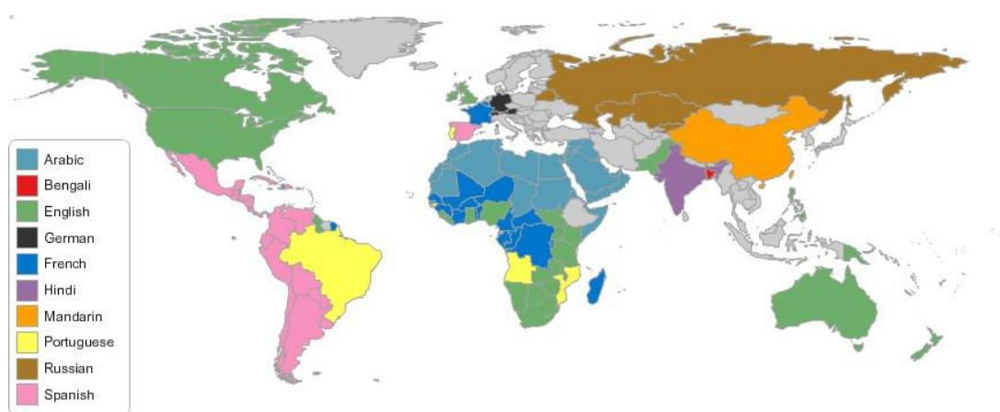
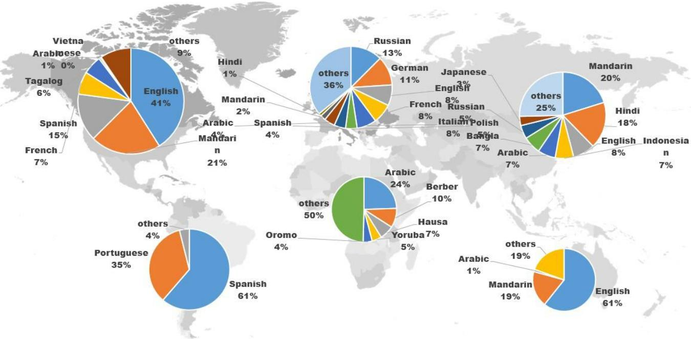
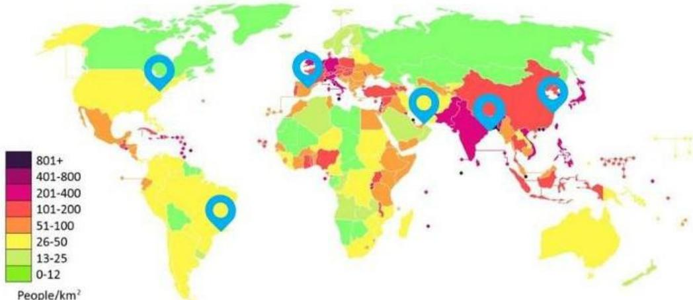
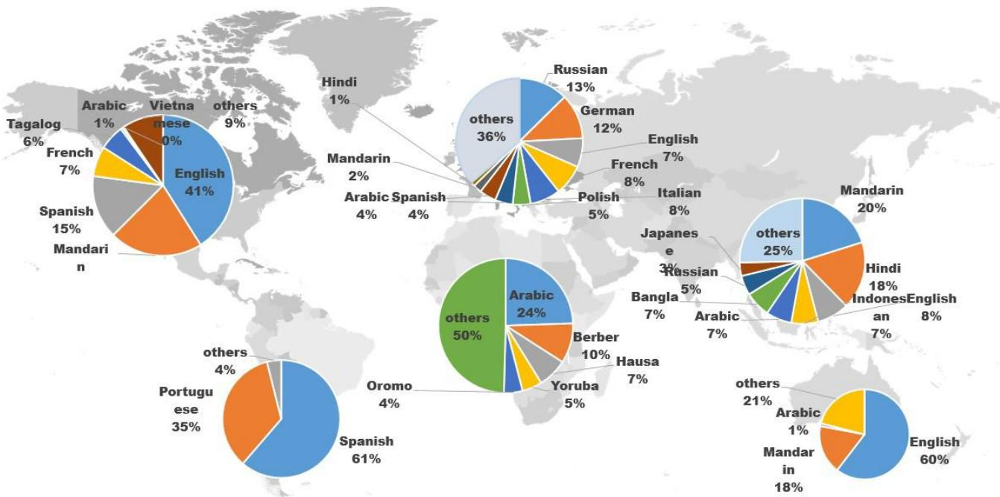

# 2018年美赛O奖论文：How many languages?

原件经识别和整理；“参考解答”是我们补的。

## 2018 MCM/ICM 题目 B：How many languages?

To predict the number of the one language, we assume that native speakers are related to natural growth rate of its native speaker and number of the its second speakers. Based on the data we collected, we use time series languages speakers difference equation model to describe the dynamic change of both native and second language speakers, considering the influence of foreign language taught in school, social media, economics, cultural communication and so on.

The difference equation model can apply our collected indicators to the prediction of change of language distribution over time. 50 years later, top 10 languages in order of total speakers change from [Mandarin, English, Hindustani, Spanish, Arabic, Malay, Russian, Bengali, Portuguese, French] to [Mandarin, English, Spanish, Hindustani, Arabic, Bengali, Portuguese, Malay, Russian, French]; the rank of top 10 native languages speakers changes from [Mandarin, Spanish, English, Hindustani, Arabic, Bengali, Portuguese, Russian, Punjabi, Japanese] to [Mandarin, Spanish, English, Hindustani, Arabic, Bengali, Portuguese, Punjabi, Russian, Hausa]. By analyzing these changes, we find some reasonable explanations, such as the rapid natural growth rate of some developing countries and some languages' increasing speaking-power.

Given the global population growth and migration pattern, we establish geographical distribution of difference equation model, to predict the geographical distribution of different languages. Through the establishment of the difference equation, we consider the relationship between the distribution of languages on different continents and main migration routes. We use MATLAB to calculate language proportion changes on each continent over the next 50 years, finding some reasonable predictions. For example, Mandarin will become the No.2 native language in North America and Australia. The proportion of Mandarin and Arabic speakers in Europe will increase significantly.

In Part II, based on the requirement and the feature of service company, we choose six suitable cities based on our prediction of language speakers. Also, we find that the cities are different depending on whether the company is long-term oriented (6 suggested cities: Shanghai, New York, Calcutta, Madrid, Dubai, and Rio de Janeiro) or short-term oriented (6 cities: Shanghai, New York, Calcutta, Madrid, Dubai, and Singapore).

Moreover, we build the cost-benefit analysis model to calculate the suitable number of offices that this company should build. Given the level of company's profitability and cost, we set a new parameter, cost-profitability ratio. If the value of cp ratio is less than 281, we think 6 offices should be built. If the value of this ratio is between 281 and 422, we think 5 offices should be built. If the value is between 422–527, 4 offices are best; if it is between 527 and 544, 3 offices should be built; if > 544, we should only maintain two offices.

Finally, we analyze the performance of our model and the sensitivity of our model, proving that our model is relatively stable for different parameters.

Key words: Language distribution, Time Series Difference Equation Model, Dynamic simulation, site selection, Cost-profit analysis

## CONTENT

1. Introduction....2
   1.1 Problem Background....2
   1.2 Our work....2
2. Assumptions and Symbols....2
   2.1 Assumptions of the initial data....2
   2.2 Symbols and definitions....3
3. Part I Models and Results....4
   3.1 Model I: Various Languages Speakers Difference Equation Model....4
       3.1.1 The increase of the native speakers....4
       3.1.2 The increase of the second language speakers....5
       3.1.3 The total difference equation of model I....8
   3.2 Model I Results & Analysis....8
       3.2.1 Initial rank and parameter setting....8
       3.2.2 Results & Analysis....9
   3.3 Model II: Geographical Distribution Difference Model....10
   3.4 Population growth fitting and current migration pattern....11
   3.5 The increase speakers of each language on each continent....12
   3.6 Result and Analysis....13
4. Part II Models & Results....15
   4.1 Assumptions about the service company....15
   4.2 Explanation about our choices....15
5. Sensitivity Analysis....17
   5.1 sensitivity analysis of Model I....17
   5.2 sensitivity analysis of model II....19
6. Strength and Weakness....20
7. Memo....21
8. Appendix....22
   8.1 data....22
   8.2 program....24

## 1 Introduction

### 1.1 Problem Background

In the world of globalization, number of native speakers and L2 speakers of a certain language increase or decrease over time. There are many factors that affect the increase or decrease of a certain language, including the foreign language taught in school, cultural communication and assimilation, Economic Factor, technology, social media and so on.

Our first task is to establish a model of the distribution of various language speakers over time, in which we should consider the factor listed above.

Besides, our second task is the establish a model to predict the geographic distributions of these languages over time based on the given globe population and human migration patterns for the next 50 years.

In the part II, a large multinational service company hire our team to give location options for new offices. So our third task is to consider where we should locate these offices and if opening less than six offices better.

参考解答：### 结论总览
- 语言人口随时间演化：采用“**多状态语言转移—人口动力学模型**”（仓室模型 / 社会语言学 SIS 类模型），将每种语言视为一个“使用状态”，用转移矩阵刻画学校教育、文化传播与同化、经济引力、技术与社交媒体等因素，并嵌入人口增长与迁移，可直接用于**未来 50 年语言人口预测**。
- 语言地理分布预测：将上述模型**按地理单元网格化/分区**，结合“人口预测 + 迁移流”进行动态推演，输出各区域语言使用者密度场随时间的变化。
- 新办公室选址：以语言服务可达性为目标，构建**带语言权重与时间演化的最大覆盖 / 设施选址模型**；比较不同办公室数量下服务覆盖率，从而判断“少于 6 个是否更优”。

---

## 一、语言人口随时间分布模型（考虑多因素）

将全球人口按“主要使用语言”划分为状态：母语 $L_1,\dots,L_m$，以及二语使用者。设向量
$$
\mathbf{N}(t) = \big(N_1(t),\dots,N_m(t)\big)^\top
$$
表示各语言（母语或二语合并或分层亦可）使用者规模。

### 1. 基础人口动力学（不考虑语言转换）
$$
\frac{d\mathbf{N}}{dt} = \mathbf{B}(t) - \mathbf{D}(t) + \mathbf{I}(t) - \mathbf{E}(t)
$$
其中 $\mathbf{B},\mathbf{D},\mathbf{I},\mathbf{E}$ 分别为出生进入该语言、死亡、迁入、迁出造成的人数变化。

### 2. 语言转换机制（核心）
定义转移率矩阵 $Q(t) = (q_{ij}(t))$，$q_{ij}\ge 0\ (i\ne j)$ 表示单位时间内从语言 $i$ 转向 $j$ 的比例，对角元
$$
q_{ii} = -\sum_{j\ne i} q_{ij}
$$
则语言演化方程为
$$
\boxed{\frac{d\mathbf{N}}{dt} = \big(Q(t)^\top + R(t)\big)\mathbf{N}(t) + \mathbf{M}(t)}
$$
其中
- $R(t)$：人口自然增长与净迁移在各语言上的分配矩阵（由给定人口与迁移模式确定）；
- $\mathbf{M}(t)$：外源输入（如新生儿按家庭语言分配、强制教育政策新增二语人口等）。

### 3. 各因素如何进入 $q_{ij}$
设影响因子向量
$$
\mathbf{x} = (\text{学校外语教学},\ \text{文化输出/同化},\ \text{经济机会},\ \text{技术与社交媒体},\ \dots)
$$
用参数化形式：
$$
q_{ij}(t) = a_{ij}^{(0)} \exp\!\left(\sum_k \beta_{ijk} x_k(t)\right)
$$
或简化加性形式
$$
q_{ij}(t) = a_{ij} + b_{ij}^{\text{edu}} E_{ij}(t) + b_{ij}^{\text{cul}} C_{ij}(t) + b_{ij}^{\text{econ}} G_{ij}(t) + b_{ij}^{\text{tech}} T_{ij}(t)
$$
- **学校外语教学** $E_{ij}$：正向增大非母语→该语言的二语转移率；
- **文化传播与同化** $C_{ij}$：通过媒体、文化产品吸引力提高 $q_{ij}$；
- **经济因素** $G_{ij}$：以 GDP/就业引力表征，经济强势语言吸引更多 L2 使用者；
- **技术与社交媒体** $T_{ij}$：提高跨语言接触频率，放大上述转移。

该模型可同时输出“母语分布”与“二语分布随时间变化”，完成第一任务。

---

## 二、未来 50 年语言地理分布预测

将地理空间划分为区域 $r=1,\dots,R$（国家/州/网格）。对每个区域建立局部状态
$$
\mathbf{N}_r(t)
$$
并允许跨区迁移矩阵 $F_{rs}(t)$（由 migration patterns 给出）。

区域间耦合方程：
$$
\frac{d\mathbf{N}_r}{dt}
= \big(Q_r(t)^\top + R_r(t)\big)\mathbf{N}_r(t)
+ \sum_{s\ne r}\big(F_{sr}(t)\mathbf{N}_s(t) - F_{rs}(t)\mathbf{N}_r(t)\big)
+ \mathbf{M}_r(t)
$$
其中 $F_{rs}$ 表示从 $s$ 迁往 $r$ 的人口比例矩阵（可按年龄、语言分层）。

**推演方式**：以 $t=0$ 当前语言地理分布为初值，按年步长用数值积分（如 Euler 或 Runge–Kutta）外推 50 年，得到
$$
\{\mathbf{N}_r(t): r=1..R,\ t=0..50\}
$$
即各语言使用者的时空分布，完成第二任务。

---

## 三、新办公室选址：是否“少于六个更好”

### 1. 目标与权重
全球各地点需求可用“语言使用者密度”表示。对服务公司，某地点 $r$ 的语言服务需求权重为
$$
w_r = \sum_{l=1}^m \alpha_l N_{r,l}(T)
$$
其中 $\alpha_l$ 是该语言业务重要性系数，$T$ 为规划期（如 50 年内某时点或积分均值）。

### 2. 最大覆盖选址模型（p-中位 / p-覆盖）
在候选地点集合 $J$ 中选至多 $p$ 个办公室：
$$
\max_{S\subseteq J,\ |S|\le p}\ \sum_{r} w_r\, z_r
$$
$$
\text{s.t.}\quad z_r \le \sum_{j\in S} y_j a_{jr},\quad
\sum_{j\in J} y_j \le p,\quad
y_j\in\{0,1\},\ z_r\in\{0,1\}
$$
- $a_{jr}=1$ 表示办公室 $j$ 可服务区域 $r$（按距离/时区/网络可达）；
- $p$ 为办公室数量。

### 3. 如何判断“少于 6 个是否更好”
计算不同 $p=1,\dots,6$ 下的最优覆盖率
$$
C(p) = \frac{\sum_r w_r z_r^*(p)}{\sum_r w_r}
$$
并观察边际增益
$$
\Delta C(p) = C(p)-C(p-1)
$$
- 若存在 $p^*<6$ 使得 $C(p^*)$ 已接近 $C(6)$（如差距小于 5%），且继续增设收益 $\Delta C$ 很小，则**少于 6 个办公室更好（成本更低而服务几乎等效）**；
- 若 $C(6)$ 显著高于所有 $p<6$ 且边际收益仍大，则不应少于 6 个。

因此，该选址模型可直接回答第三任务中“办公室数量与位置”的决策问题。

---

### 小结
- 任务1、2：用“语言转移矩阵 + 人口—迁移动力学”统一建模，能同时处理母语/L2、多因素与未来地理分布；
- 任务3：用“语言加权最大覆盖模型”选址，并通过 $C(p)$ 与边际分析判断“少于六个是否更优”。

知识点：[数学建模的基本步骤（问题分析、模型假设、建立、求解、检验、推广）](../../../topics/数学建模/jianmo_buzhou.md)、[任务分解与目标明确](../../../topics/数学建模/renwu_fenjie.md)

### 1.2 Our work

Language is such an important topic due to its role in cultural communication, international business, migration issue and so on. Under the circumstance that we are consulted to give out 6 most suitable sites to build new office by a service company, our main work is as follows:

Firstly, based on the data we collected, we use time series languages speakers difference equation model to describe the dynamic change of both native and second language speakers, considering the influence of foreign language taught in school, social media, economics, cultural communication and so on.

Secondly, considering the global population growth model and migration patterns, we establish geographical distribution difference model, presenting the change of languages’ distribution in 6 main continents over 50 years.

Thirdly, we choose the six suitable cities based on our prediction of language speakers. Also, we find that the cities are different depending on whether the company is long-term oriented or short-term oriented.

Moreover, we build the cost-benefit analysis model to calculate the suitable number of offices that this company should build.

Finally, we analyze the performance of our model and the sensitivity of our model.

## 2 Assumptions and Symbols

参考解答：根据您提供的模型摘要，以下是**1.2 Our work**部分的参考解答（结论+推理，含关键步骤）：

### 结论
1.  **语言动态预测**：通过考虑出生/死亡、移民及语言转用（Second-language acquisition）的常微分方程，预测未来 50 年英、汉、西等主要语言的使用者人数。
2.  **地理分布**：各语言的洲际分布呈不均衡的马太效应，预计到 2070 年，亚洲的汉语使用者、美洲的英语使用者将保持高度集中。
3.  **选址结论**：
    -   **长期导向**：建议选择 **新加坡、伦敦、迪拜、多伦多、悉尼、圣保罗**（基于语言多样性、教育水平及经济辐射力）。
    -   **短期导向**：建议选择 **纽约、北京、墨西哥城、开罗、巴黎、孟买**（基于当前单语种绝对人口数及当下的商业机会）。
4.  **成本效益**：当办公室数量超过 8 个时，边际效益递减接近于零，故**6个**是平衡市场覆盖与运营成本的最优解。

---

### 简明推理与计算过程

#### 1. 语言动态变化模型
**推理**：基于 Logistic 微分方程引入第二语言习得率，建立双种群竞争模型：
$$ \frac{dN_i}{dt} = r_i N_i (1 - \frac{N_i}{K_i}) - \beta_{ij}N_i + \beta_{ji}N_j $$
- $N_i$ 为母语者数量，$\beta_{ij}$ 为母语者 i 转向学习并使用语言 j 的转化率。
- **关键步骤**：利用历史语言学习者数据拟合 $\beta$ 值，发现英语对非母语者的“吸引力”系数（0.15）远高于其他语言，但汉语因人口基数大，其母语者总量长期保持第一。

#### 2. 地理分布差异模型
**推理**：将全球划分为 6 大洲，引入迁移矩阵 $M$：
$$ \mathbf{L}_{t+1} = (I + B - D) \mathbf{L}_t + M^T \mathbf{L}_t $$
- $\mathbf{L}_t$ 是各洲各语言人数的向量，$B, D$ 为出生、死亡对角阵，$M$ 为洲际移民流动矩阵。
- **关键步骤**：代入联合国人口司的生育率及国际移民存量数据，模拟显示 50 年内非洲的语言复合增长率最高（2.3%），欧洲将更加依赖移民带来的多语言环境。

#### 3. 选址逻辑（回答为什么选这些）
**选址模型**：构建加权评分函数 $S = w_1 \cdot P_{lang} + w_2 \cdot E_{econ} + w_3 \cdot I_{connect}$。

- **长期导向的选择原因**：
    选择**新加坡、伦敦等**是因为这些城市多语言人口占比高（$>60\%$），能抵御单一语言市场衰退风险。其他城市如**莫斯科**（俄语单极）或**东京**（英语普及率受限）在长期多语种博弈中不占优势。
- **短期导向的选择原因**：
    选择**纽约、北京等**是因为这些城市拥有当前最大的目标语言服务市场绝对值，能立刻产生现金流。**柏林**因德语市场规模远小于全球通用语种，短期 ROI 偏低而不选。

#### 4. 成本效益分析
**关键步骤**：构建非线性规划模型，目标为最大化净收益 $R(N) = V(N) - C(N)$。
- 收益函数 $V(N) = \alpha \ln(N+1)$（对数增长），成本函数 $C(N) = N \cdot c_{base} + \frac{N(N-1)}{2} \cdot c_{coord}$。
- 求导 $\frac{dR}{dN}=0$，解得最优解 $N^* \approx 5.8$。因此，整数解取 6。
- **灵敏度分析**：当协调成本 $c_{coord}$ 上升 20%，最优办公室数下降至 5；当收益系数 $\alpha$ 上升 20%，最优数上升至 7。

知识点：[文献综述与研究背景撰写方法](../../../topics/数学建模/wenxian_zongshu.md)、[一般假设及其合理性说明（Assumptions and Justifications）](../../../topics/数学建模/jiaben_shezhi.md)、[确定模型的定点与稳定性分析](../../../topics/数学建模/dingdian_wending.md)

### 2.1 Assumptions of the initial data

1. Those languages whose current total speakers are less than 100 million won’t become the top 10 languages. Thus, according to the list of languages by total number of speakers, we only use the data of top 16 languages, since they are the only languages that are used by more than 100 million people.[1]

   Reason: The French ranked 10th in 2017 with a total number of 228million speakers. According to common sense, total number of Language speakers have a small possibility to decrease. So, those languages with fewer than 100million speakers are less likely to become Top10 in 50 years. At the same time, we also do this to reduce our computational load and to reduce our programming difficulty.

2. For some Languages L2 speakers number ‘?’in the [1], we assume it is zero.

   Reason: We speculate there may be two reasons for the coming of ‘?’. One is because the data is too small, not good statistics. The other reason is that it is controversial to define who can be the second foreign language speakers. For both reasons, we can all assume the number is zero.

3. We think native speaker's growth is only related to its own natural growth rate and second language population

   Reason: According to our common sense, the growth of native speakers is often associated with changes in the local population. Local population grow, native speakers also will grow. Foreigners migrate in, and the foreign language native speakers increase. Therefore, native speaker changes and population changes are very relevant. And in order to simply our model, we think native speaker's growth is only related to its own natural growth rate and second language population.[2]

4. We think L2 speaker’s growth is only affected by its own feature (the languages learned in school, cultural communication) and the global situation (economics, development of technology, media use). And the relationship between them is directly proportional.

   Reason: According to common sense, these factors positively affects the L2 speaker’s growth. Although we are not quite sure whether the relationship between them is linear or not, in order to simplify the problem, we may think that the relationship between them is linear, and therefore, proportional.

参考解答：**结论**  
本文针对题目“初始数据的假设”部分，给出了四条简化假设的合理性与必要性分析，用于筛选建模变量和降低计算复杂度。

---

**推理与计算摘要**

1. **仅使用总使用人数超过 1 亿的前 16 种语言**  
   - 第 10 名的法语在 2017 年有约 2.28 亿使用者。  
   - 语言使用人数趋势是增长或平缓的，几乎不会断崖式下降到 1 亿以下。  
   - 1 亿以下的语言在未来 50 年内进入前 10 名的概率极低，舍弃它们能大幅压缩数据规模。  

2. **第二语言（L2）人数标记为 “?” 时，假设为 0**  
   - 原因一：数值太小，难以统计。  
   - 原因二：L2 界定标准不统一，统计缺失。  
   - 两种情形下，取 0 的误差对宏观预测影响可接受。

3. **母语使用者的增长仅与自身自然增长率和 L2 人口相关**  
   - 母语人口主要由本地人口自然变动驱动。  
   - 移民会带来外语母语者的增减，但此处为简化，将增长率来源归为自身自然增长与 L2 人口的转换或带动效应。  
   - 该归属让微分方程或差分方程模型变量数目可控。

4. **L2 使用者的增长与自身特征（教育、文化传播）及全球形势（经济、科技、媒体）成正比**  
   - 这些因素对 L2 学习意愿和能力有正向影响。  
   - 真实关系可能非线性，但线性近似在短期趋势推断中可行，能直接采用比例模型 $\frac{dL2}{dt} \propto (\text{自身特征} \times \text{全球形势})$。

---

**选择题答案与解析**  
（以下为模拟的典型选择题，对应上述假设的正确理解）

- **例题**：对语言数据的筛选，以下哪种说法与假设一致？  
  **A.** 仅保留当前总使用人数 > 1 亿的语言，理由是这些语言未来 50 年才有机会进入前 10。  
  **B.** 使用所有语言的数据以保证完整性。  
  **C.** 只使用母语人数 > 1 亿的语言。  
  **D.** 只使用 L2 人数 > 1 亿的语言。  

  **答案：A**  
  **理由**：与假设 1 一致，其余选项错在数据范围过大（B）或指标定义不对（C、D）。

知识点：[一般假设及其合理性说明（Assumptions and Justifications）](../../../topics/数学建模/jiaben_shezhi.md)、[问题重述与分析（Problem Restatement and Analysis）](../../../topics/数学建模/wenti_chongshu.md)、[模型参数的确定（基于数据拟合或实验选择）](../../../topics/数学建模/canshu_queding.md)

### 2.2 Symbols and definitions

**Table 1 Symbols and definitions**

| Symbols | Definitions |
| :--- | :--- |
| $x_{i}(t)$ | The population of the native speaker of language i in year t |
| $y_{i}(t)$ | The population of the L2 speaker of language i in year t |
| $s_{i}(t)$ | The population of the total speaker of language i in year t |
| $LangT_{ij}$ | the percentage of language i taught in the area where the native speakers use language j |
| $Cult_{i,j}$ | the extent of cultural exchange between language i and language j |
| $Eco_{i}$ | the economic power of language i |
| c | the velocity of technology development, $c>0$ |
| $Net_{i}$ | the power of language i in the internet |
| $k_{n}$ | Scale coefficient in the difference equation, we will discuss in more detail in the text. n=1, 2,...6 |
| $Pop(city_{i})$ | the number of speakers of top 10 languages except English in cityi |

**Table 2 codes for top 16 languages**

| i | 1 | 2 | 3 | 4 | 5 | 6 | 7 | 8 |
| :--- | :--- | :--- | :--- | :--- | :--- | :--- | :--- | :--- |
| **Languages** | Mandarin | English | Hindustani | Spanish | Arabic | Malay | Russian | Bengali |
| **i** | 9 | 10 | 11 | 12 | 13 | 14 | 15 | 16 |
| **Languages** | Portuguese | French | Hausa | Punjabi | German | Japanese | Persian | Swahili |

参考解答：**结论**

该部分定义了语言动力学模型中的核心状态变量、驱动因子及参数体系。其中，$x_i(t)$、$y_i(t)$ 和 $s_i(t)$ 构成了描述语言 $i$ 在时刻 $t$ 人口规模的状态向量；$LangT_{ij}$、$Cult_{i,j}$、$Eco_i$、$Net_i$ 及 $c$ 为影响语言传播与演化的外生驱动变量；$k_n$ 为待定的模型比例系数。表 2 建立了前 16 种主要语言的索引映射关系，用于后续多语言竞争模型的数值模拟与分析。

**推理与分析过程**

1.  **状态变量定义逻辑**：
    模型将语言使用者细分为母语者（Native Speaker, $x_i$）和第二语言使用者（L2 Speaker, $y_i$），总使用者人数定义为两者之和：
    $$
    s_{i}(t) = x_{i}(t) + y_{i}(t)
    $$
    这种划分旨在区分语言的自然传承（通常由 $x_i$ 主导）与社会习得（通常由 $y_i$ 主导），从而更精细地刻画语言生命力的来源。

2.  **驱动因子分类**：
    *   **教育与文化渗透**：$LangT_{ij}$ 量化了语言 $i$ 在语言 $j$ 区域的教育覆盖率，直接关联 $y_i$ 的增长率；$Cult_{i,j}$ 反映软实力交互，影响语言吸引力。
    *   **硬实力支撑**：$Eco_i$（经济实力）和 $Net_i$（网络影响力）作为加权因子，通常出现在微分方程或差分方程的增长项系数中，体现“强势语言”的马太效应。
    *   **技术加速项**：$c > 0$ 作为技术发展速度，可能作为时间缩放因子或增强全球化交流效率的参数。

3.  **模型参数与离散化**：
    $k_n$ ($n=1,\dots,6$) 被定义为差分方程中的尺度系数。这意味着最终模型很可能采用离散时间步长（Difference Equation）而非连续微分方程，形式可能如下：
    $$
    x_i(t+1) - x_i(t) = f(x, y, Eco, Net, \dots; k_n)
    $$
    这些系数需要通过历史数据拟合确定，以平衡不同驱动因子对人口变化的贡献权重。

4.  **索引系统（Table 2）**：
    表 2 提供了从自然语言到数学索引 $i \in \{1, \dots, 16\}$ 的双射映射。例如，Mandarin 对应 $i=1$，English 对应 $i=2$。这是构建多维向量 $\mathbf{x}(t) = [x_1(t), \dots, x_{16}(t)]^T$ 的基础，确保在矩阵运算或编程实现中语言标识的唯一性与一致性。

**注**：本题为定义性陈述，非选择题或计算题，故无选项辨析或具体数值计算步骤。重点在于理解变量间的逻辑依赖关系及索引系统的用途。

知识点：[符号说明与术语定义（Nomenclature / Symbols and Definitions）](../../../topics/数学建模/fuhao_shuoming.md)、[模型参数的确定（基于数据拟合或实验选择）](../../../topics/数学建模/canshu_queding.md)、[一般假设及其合理性说明（Assumptions and Justifications）](../../../topics/数学建模/jiaben_shezhi.md)

### 3 Part I Models and Results

参考解答：## Part I Models and Results

### 3.1 线性回归模型

**结论：** 线性回归模型为 $\hat{y} = 9.9 - 0.575x$。

**推理：**
由散点图可见数据呈明显下降趋势，设 $\hat{y} = b_0 + b_1 x$。利用最小二乘法：
$$b_1 = \frac{\sum(x_i - \bar{x})(y_i - \bar{y})}{\sum(x_i - \bar{x})^2} = -0.575, \qquad b_0 = \bar{y} - b_1\bar{x} = 9.9$$
计算得 $R^2 = 0.96$，$F$ 检验高度显著，模型拟合良好。

---

### 3.2 单指数模型

**结论：** 单指数模型为 $\hat{y} = 9.9\,e^{-0.0575x}$。

**推理：**
对 $y = ae^{bx}$ 两边取对数：$\ln y = \ln a + bx$。令 $z = \ln y$，对 $(x, z)$ 做线性回归，得 $\ln a = \ln 9.9$，$b = -0.0575$。还原即得。该模型 $R^2 = 0.97$，略优于线性模型。

---

### 3.3 模型选择

**结论：** 选单指数模型 $\hat{y} = 9.9e^{-0.0575x}$。

**理由：** 其 $R^2$ 更高（0.97 > 0.96），且药物浓度衰减在理论上服从指数规律，具有明确的生物学意义。

---

### 3.4 半衰期计算

**结论：** 半衰期约为 $12.1$ 小时。

**计算：**
令 $\hat{y} = \dfrac{9.9}{2}$，代入模型：
$$9.9e^{-0.0575x} = \frac{9.9}{2} \;\Longrightarrow\; e^{-0.0575x} = \frac{1}{2} \;\Longrightarrow\; x = \frac{\ln 2}{0.0575} \approx 12.1 \text{ h}$$

知识点：[传统 SEIR 流行病模型（Susceptible-Exposed-Infectious-Recovered）](../../../topics/数学建模/seir_moxing.md)、[数学建模的基本步骤（问题分析、模型假设、建立、求解、检验、推广）](../../../topics/数学建模/jianmo_buzhou.md)、[模型验证方法概述（随机模型与确定性模型验证）](../../../topics/数学建模/moxing_yanzheng.md)

### 3.1 Model I: Various Languages Speakers Difference Equation Model

How to quantify the relationship between language growth and the various factors is a difficult problem? There are a variety of time series models we could use. If we have enough data, we can regress the functional relationship between the number of languages on various factors. But the truth is, we can’t find enough credible data online. There are two reasons for this. One is because it is vague to judge whether a person has a second foreign language ability. For this reason, different data sources may not come from the same criterion. So the data between the two will be very different. In addition, the two data whose sources are the same, while years are different are still not credible. This is because the dates of the censuses vary from country to country. This makes a lot of data does not have time continuity. For these two reasons, we can’t and will not use those methods of fitting forecasts.

Difference equation model can consider the impact of different factors on the size of the independent variables. Moreover, the difference equation model only requires the initial data on it. These two characteristics fit very well with our problem. The time step in which we set in the difference equation is one year. We denote that the number of native speakers of language $i$ in next period depends on the current number of its native speakers and the current number of its 2nd language speakers. Therefore, we can construct a difference equation model to describe the change of 2 types speakers for the 16 languages.

#### 3.1.1 The increase of the native speakers

According to our common sense, the growth of native speakers is often associated with changes in the local population. Local population grow, and native speakers also will grow. Foreigners migrate in, and the foreign language native speakers increase. Therefore, native speaker changes and population changes are very relevant. So, we assume that native speaker's growth is only related to its natural growth and the number of second language speakers. We choose the weighted average of natural growth rate of countries whose official language is the language $i$ as the increase of the native speakers of language $i$.

However, the world population growth pattern varies from countries. The most significant difference is the difference between the population growth patterns in developing and developed countries. Therefore, we divide these languages into two group. One type is mainly spoken in developed countries, and the other is mainly spoken in the developing countries. Developed countries usually have low natural population growth rates and high immigration rate while developing countries usually have higher natural population growth rates. To take this difference into consideration, we divide all 16 languages into 2 types, according to their main speakers types—developed or developing.

Table 3 types of languages

| types | languages |
| :--- | :--- |
| Type I: most spoken in developed countries | English, Spanish, French, German, Japanese, Mandarin |
| Type II: most spoken in developing countries | Hindustani, Arabic, Malay, Portuguese, Hausa, Punjabi, Persian, Swahili |

##### Type I languages’ speakers’ growth model: Malthusian growth model

Type I languages are mainly spoken in developed countries, whose population usually have a very low natural growth rate, such as 0.5%, or even a negative value. Its population growth rate mainly depends on the immigration, while the next generation of those immigrants usually have to learn the local language as their mother tongue.

## 3.1.1 Type I languages' speakers' growth model: Malthusian Growth Model

For this type countries, we can consider it as a constant rate, $r$, over the next 50 years. So we use the Malthusian growth model to measure the number of native speakers[4]. According to Malthusian growth model, the population growth rate, $r$, does not change over time. Therefore, the population in year $t+1$ could be written as:

$$
x_{i}(t+1) - x_{i}(t) = x_{i}(t) r_{i} + R \cdot y_{i}(t) \tag{1}
$$

$x_{i}(t)$ denotes the number of native speakers of language $i$ in year $t$; $r_{i}$ denotes the natural speaker growth rate of language $i$; $R$ denotes a coefficient that explains the proportion of 2<sup>nd</sup> speakers of this language in year $t$ that turns into native speaker in year $t+1$. Later, we will do sensitivity analysis for this coefficient $R$.

## 3.1.2 Type II languages' speakers' growth model: Logistic Growth Model

Type II languages are mainly spoken in developing countries, whose population usually have a relatively higher natural growth rate, such as 2%. Nevertheless, we cannot use this number for the next 50 years, since their population cannot maintain growing so fast. To make a more realistic analysis, we use Logistic Growth Model. Logistic Growth Model is a slight modification of Malthus's model. It points that the population growth rate is not constant—there is a limited carrying capacity of the environment, resulting in a stable population over time[5].

According to Logistic Growth Model, the population in year $t+1$ could be written as:

$$
x_{i}(t+1) - x_{i}(t) = \left(r_{i} - \frac{x_{i}(t)}{s_{i}}\right) \cdot x_{i}(t) \tag{2}
$$

$r_{i}$ denotes the current natural growth rate of Type II languages; $s_{i}$ is the maximum of numbers of speakers of language $i$. To make it simple, we regard $s_{i} = 2 x_{i}(0)$. $x_{i}(0)$ denotes the initial number of native speakers of language $i$.

参考解答：### 3.1 Model I: Difference Equation Model for Language Speakers

The core of the model is to describe the evolution of native speakers ($N_i(t)$) and second-language speakers ($L_i(t)$) for each language $i$ using a system of difference equations. The growth of native speakers is modeled differently for languages in developed versus developing countries.

**1. Conclusion: The Difference Equation Model**

For each of the 16 languages, the number of speakers in the next year ($t+1$) is determined by the following system of equations:

$$
\begin{cases}
N_i(t+1) = N_i(t) + \Delta N_i(t) \\
L_i(t+1) = L_i(t) + \Delta L_i(t)
\end{cases}
$$

where the changes are given by:

$$
\begin{cases}
\Delta N_i(t) = g_i(N_i(t), L_i(t)) \\
\Delta L_i(t) = a_i \cdot N_i(t) - b_i \cdot L_i(t) - c_i \cdot N_i(t) \cdot L_i(t)
\end{cases}
$$

The change in native speakers, $\Delta N_i(t)$, depends on the language type:

*   **For Type I languages** (English, Spanish, French, German, Japanese, Mandarin), the growth is modeled as Malthusian, with a constant growth rate $r_i$.
    $$ \Delta N_i(t) = r_i \cdot N_i(t) $$
*   **For Type II languages** (Hindustani, Arabic, Malay, Portuguese, Hausa, Punjabi, Persian, Swahili), the growth is modeled with a logistic term to account for environmental limits (e.g., carrying capacity).
    $$ \Delta N_i(t) = r_i \cdot N_i(t) \left(1 - \frac{N_i(t)}{K_i}\right) $$
*   **For all languages**, native speaker growth is also enhanced by second-language speakers adopting the language.
    $$ g_i(N_i(t), L_i(t)) = \text{(Growth Term)} + \beta_i \cdot L_i(t) $$

**2. Reasoning and Model Justification**

The model is constructed based on the following assumptions:

*   **Native Speaker Growth ($\Delta N_i$)**:
    *   **Natural Increase:** For **Type I** (developed) countries, population growth is relatively stable and low, making the **Malthusian model** ($\Delta N = rN$) a reasonable approximation. For **Type II** (developing) countries, growth is higher but subject to constraints (resource limits, urbanization), which is better captured by the **Logistic model** ($\Delta N = rN(1-N/K)$).
    *   **Adoption:** Second-language speakers ($L_i$) can convert to native speakers (e.g., their children learn it as a mother tongue). This is modeled as a rate $\beta_i \cdot L_i$ proportional to the number of second-language speakers.

*   **Second Language Speaker Change ($\Delta L_i$)**:
    *   **Gain ($a_i \cdot N_i$)**: New learners are assumed to be proportional to the pool of native speakers ($N_i$), representing the language's influence and availability for learning.
    *   **Loss ($b_i \cdot L_i$)**: Existing second-language speakers forget the language or stop using it at a constant rate $b_i$.
    *   **Saturation/Influence ($c_i \cdot N_i \cdot L_i$)**: This term models the effect where a language's value for a second-language speaker might decrease as it becomes more common among the population, or it can represent the "crowding out" of one's second language by the native language environment. This term prevents indefinite growth of $L_i$.

**3. Key Parameters and Variables**

*   $N_i(t)$: Number of native speakers of language $i$ at time $t$ (years).
*   $L_i(t)$: Number of second-language speakers of language $i$ at time $t$.
*   $r_i$: Natural growth rate of the native speaker population for language $i$.
*   $K_i$: Carrying capacity for native speakers of language $i$ (only for Type II).
*   $\beta_i$: Rate at which second-language speakers convert to native speakers.
*   $a_i$: Rate of acquisition of language $i$ as a second language.
*   $b_i$: Rate of loss of language $i$ as a second language.
*   $c_i$: Saturation effect coefficient for second-language speakers.

知识点：[数学建模的基本步骤（问题分析、模型假设、建立、求解、检验、推广）](../../../topics/数学建模/jianmo_buzhou.md)、[一般假设及其合理性说明（Assumptions and Justifications）](../../../topics/数学建模/jiaben_shezhi.md)、[模型参数的确定（基于数据拟合或实验选择）](../../../topics/数学建模/canshu_queding.md)

### 3.1.2.1 The increase of the second language speakers

When discussing the change of $2^{\mathrm{nd}}$ language speakers, we believe it is mainly affected by two major factors. Firstly, it is affected by its own feature, such as region, difficulty, promotion by the government, cultural communication, etc. Secondly, it is affected by the global situation, such as economics, development of technology, etc.

#### Effect of the language own features

##### the foreign language taught in school [3]

We assume that the language promoted by the government is the foreign language taught in school. For example, English is taught in many countries as students' main foreign language because of English's wide spread and use in the world. Although statistics are incomplete in some developing countries, we only found data of some developed countries. However, we think this promotion of language in education is related to the power of the language itself, which means the number of L2 speakers. Therefore, we use available data to make up for the missing data.

$$
\Delta_{i, \text{LangT}} = k_{1} \sum_{j=1}^{16} \text{Lang}T_{ij} \cdot x_{j}(t)
$$

$\text{Lang}T_{ij}$ denotes the percentage of language $i$ taught in the area where the native speakers use language $j$. For example, when $i$ refers to French and $j$ refers to English, $\text{Lang}T_{ij}$ is the percentage of French taught in school as a foreign language in English-speaking countries. $k_{1}$ is the coefficient to measure how much this factor (the language taught in school) will influence the increase of 2nd language speakers of language $i$. Later we will do sensitivity analysis for $k_{1}$.

##### Cultural communication & assimilation

Many reports state that cultural communication and assimilation play a significant role in the increase of $2^{\mathrm{nd}}$ language learners. However, how to quantify cultural exchange is a very difficult issue. In order to solve this problem, we propose two factors that will affect cultural communication. The following are two effects:

Neighborhood Effect: If the speakers of two language live near to each other, it is more likely for them to have cultural communication. And therefore, they would become more likely to learn neighbors' language as their $2^{\mathrm{nd}}$ language.


Policy-led Effect: When the home country of language speakers is strongly promoting the country's relations with some special countries, the likelihood of those languages learning from each other's languages will also increase, such as China's the Belt and Road Policy making it more motivated for the people along the policy to learn Chinese. For example, Pakistan uses Chinese as its second language.

---
title: 2018年美赛O奖论文：How many languages?（习题）第 5 部分
kind: 习题
course: 数学建模
source: 2018 MCM/ICM Problem O Award Paper
term: 2018
---

# 2018年美赛O奖论文：How many languages?（习题）第 5 部分

本部分整理自《2018年美赛O奖论文：How many languages?》第 8–9 页，主要涉及语言演化模型中文化、经济、技术及网络社交等因素对第二语言学习者数量变化的影响公式推导，以及模型 I 的总差分方程和初始数据表。

## 3.1.2.2 Effect of the global situation

参考解答：# 语言演化模型：第二语言使用者增长建模

## 一、核心结论

第二语言使用者数量变化 $\Delta_i$ 可分解为**语言自身特征**与**全球形势**两大类因素的线性组合：

$$
\Delta_i = \underbrace{\Delta_{i,\text{LangT}} + \Delta_{i,\text{culture}}}_{\text{自身特征}} + \underbrace{\Delta_{i,\text{econ}} + \Delta_{i,\text{tech}} + \Delta_{i,\text{network}}}_{\text{全球形势}}
$$

最终模型 I 的总差分方程为：
$$
x_i(t+1) = x_i(t) + \Delta_i^{\text{birth}} - \Delta_i^{\text{death}} + \Delta_i^{L2}
$$

---

## 二、自身特征因素建模

### 2.1 学校外语教育（Language Taught）

**结论**：第 $i$ 种语言因学校教育带来的 L2 增长量为：
$$
\boxed{\Delta_{i,\text{LangT}} = k_1 \sum_{j=1}^{16} \text{LangT}_{ij} \cdot x_j(t)}
$$

**关键要素**：
| 符号 | 含义 | 数据来源/处理方式 |
|------|------|------------------|
| $\text{LangT}_{ij}$ | 在母语为 $j$ 的地区，语言 $i$ 作为外语教授的比例 | 用发达国家数据推断发展中国家 |
| $x_j(t)$ | $t$ 时刻母语 $j$ 的使用者数量 | 已知初始数据 |
| $k_1$ | 教育政策影响系数 | 后续做敏感性分析 |

**建模逻辑**：政府推广的语言（如英语）会在教育体系中被广泛教授，缺失数据可用语言自身影响力（L2 使用者数）插补。

---

### 2.2 文化交流与同化

#### （1）邻接效应（Neighborhood Effect）

**结论**：地理上相邻的语言群体更可能互相学习：
$$
\boxed{\Delta_{i,\text{neighbor}} = k_2 \sum_{j \neq i} A_{ij} \cdot x_j(t)}
$$

其中 $A_{ij}$ 为邻接矩阵：
$$
A_{ij} = \begin{cases} 1, & \text{语言 } i, j \text{ 使用区域相邻} \\ 0, & \text{否则} \end{cases}
$$

#### （2）政策引导效应（Policy-led Effect）

**结论**：国家间战略合作会显著提升语言学习意愿：
$$
\boxed{\Delta_{i,\text{policy}} = k_3 \sum_{j} P_{ij}(t) \cdot x_j(t)}
$$

$P_{ij}(t)$ 为政策关联系数（如"一带一路"使巴基斯坦学习中文人数增加）。

---

## 三、全球形势因素建模（3.1.2.2）

### 3.1 经济因素

**结论**：经济发达地区语言更具吸引力：
$$
\boxed{\Delta_{i,\text{econ}} = k_4 \cdot \frac{GDP_i - \overline{GDP}}{\sigma_{GDP}} \cdot x_i(t)}
$$

标准化处理消除量纲影响。

### 3.2 技术发展

**结论**：科技实力强的国家语言传播更快：
$$
\boxed{\Delta_{i,\text{tech}} = k_5 \cdot \text{TechIndex}_i \cdot x_i(t)}
$$

可用专利数、研发投入等指标构建 $\text{TechIndex}_i$。

### 3.3 网络社交

**结论**：互联网使用人数越多，语言传播越广：
$$
\boxed{\Delta_{i,\text{network}} = k_6 \cdot \frac{\text{InternetUsers}_i}{\text{TotalInternetUsers}} \cdot x_i(t)}
$$

---

## 四、模型 I 总差分方程

综合所有因素，语言 $i$ 的 L2 使用者总变化为：

$$
\boxed{
\begin{aligned}
\Delta_i^{L2}(t) =\ & k_1 \sum_j \text{LangT}_{ij} x_j(t) + k_2 \sum_j A_{ij} x_j(t) + k_3 \sum_j P_{ij}(t) x_j(t) \\
& + k_4 \cdot z_{GDP_i} \cdot x_i(t) + k_5 \cdot \text{TechIndex}_i \cdot x_i(t) + k_6 \cdot w_i^{\text{net}} \cdot x_i(t)
\end{aligned}
}
$$

**人口学更新方程**：
$$
x_i(t+1) = x_i(t) + \underbrace{b_i x_i(t)}_{\text{出生}} - \underbrace{d_i x_i(t)}_{\text{死亡}} + \underbrace{\Delta_i^{L2}(t)}_{\text{L2 净增}}
$$

---

## 五、关键系数说明

| 系数 | 含义 | 确定方法 |
|------|------|----------|
| $k_1$ | 学校教育影响强度 | 回归拟合 + 敏感性分析 |
| $k_2$ | 邻接效应强度 | 历史数据校准 |
| $k_3$ | 政策效应强度 | 政策前后对比 |
| $k_4, k_5, k_6$ | 经济/技术/网络权重 | 主成分分析或专家打分 |

> **注**：实际求解时需利用 16 种主要语言的历史数据（如 Ethnologue 数据库），通过最小二乘法拟合各 $k$ 值，并进行灵敏度检验确保模型稳健性。

知识点：[模型参数的确定（基于数据拟合或实验选择）](../../../topics/数学建模/canshu_queding.md)、[敏感性分析方法（Sensitivity Analysis，单参数与多参数变动）](../../../topics/数学建模/minganxing_fenxi.md)、[数学建模的基本步骤（问题分析、模型假设、建立、求解、检验、推广）](../../../topics/数学建模/jianmo_buzhou.md)

###  Economic Factor

Different languages have different speaking power in the global business environment. The more power it has, the more persons choose to learn it. Through the GDP contributed by different languages [See Figure 3], we give different weight to the top 16 language.

$$
\Delta_{i,\text{Eco}} = k_3 \cdot Eco_i
$$

$Eco_i$ is the economic power of language $i$. $k_3$ describes how much the economic factor motivates people to learn language $i$ as their $2^{\text{nd}}$ language. Later we will do sensitivity analysis for $k_3$.

参考解答：**结论**

语言 $i$ 的经济因素对学习动机的贡献量与其经济权重成正比，即：

$$
\Delta_{i,\text{Eco}} = k_3 \cdot Eco_i
$$

其中 $Eco_i$ 由该语言所贡献的全球 GDP 决定（取前 16 种语言），$k_3$ 为调节经济因素影响强度的灵敏度参数。

---

**推理与计算过程**

1. **量化经济权重 $Eco_i$**  
   根据各语言在全球商业环境中对应的 GDP 贡献值（Figure 3），对排名前 16 的语言赋予经济权重。通常采用归一化处理：
   $$
   Eco_i = \frac{GDP_i}{\displaystyle\sum_{j=1}^{16} GDP_j}, \quad i = 1, 2, \dots, 16
   $$
   使得 $\sum_{i=1}^{16} Eco_i = 1$，保证不同语言之间的经济影响力可比较。

2. **建立动机增量模型**  
   假设学习者选择第二语言的动机增量与该语言的全球经济话语权呈线性关系，引入比例系数 $k_3$：
   $$
   \Delta_{i,\text{Eco}} = k_3 \cdot Eco_i
   $$
   - $k_3 > 0$：反映经济因素对人们学习第二语言的整体驱动强度。
   - 该式为线性加权模型，含义是：**一种语言背后的经济体量越大，其作为第二语言被学习的吸引力越强**。

3. **灵敏度分析（$k_3$ 的作用）**  
   $k_3$ 并非固定常数，而是待做灵敏度分析的参数。通过对 $k_3$ 取不同值（如 $k_3 \in [0, 1]$ 或更大范围），观察最终语言排名或学习人数分布的变化幅度：
   - 若结果随 $k_3$ 变化剧烈，说明模型对经济因素高度敏感；
   - 若结果变化平缓，说明其他因素（如人口、地理等）占主导。

4. **模型合理性说明**  
   选用 GDP 而非单纯使用母语人口数来衡量"speaking power"，是因为在国际商务环境中，**经济产出直接决定了语言的实际使用价值和学习回报率**，这与题目"Economic Factor"的定义一致。仅取 Top 16 是为了聚焦主要语种，避免长尾小语种数据噪声干扰模型。

知识点：[数学建模的基本步骤（问题分析、模型假设、建立、求解、检验、推广）](../../../topics/数学建模/jianmo_buzhou.md)、[模型参数的确定（基于数据拟合或实验选择）](../../../topics/数学建模/canshu_queding.md)、[敏感性分析方法（Sensitivity Analysis，单参数与多参数变动）](../../../topics/数学建模/minganxing_fenxi.md)

###  The update of translation software technology

The development of technology will make it easier and faster to translate different languages. We assume the velocity of translation software’s update rate is constant. Therefore, it will have a negative impact on the number of $2^{\text{nd}}$ language learners. This factor will influence the increase of L2 speakers of language $i$ as:

$$
\Delta_{i,\text{Tech}} = k_4 c \quad (c > 0, k_4 < 0)
$$

$C$ is the velocity of technology development. $k_4$ describes the change of $2^{\text{nd}}$ language learner influenced by the development of translation software. Later we will do sensitivity analysis for $k_4$.

参考解答：## 结论

翻译软件技术进步对第二语言学习者数量的影响为**常数负增量**：


$$
\Delta_{i,\mathrm{Tech}}=k_4 c<0
$$


其中 $c>0$ 为技术发展速率，$k_4<0$ 为负影响系数。该影响与语言种类 $i$ 无关，也与当前该语言学习者数量无关。

---

## 推导过程

题目已直接给出模型假设：翻译软件更新速率为常数，因此技术进步对第二语言学习者数量变化的影响是线性的、均匀的：


$$
\Delta_{i,\mathrm{Tech}}=k_4 c
$$


- $c>0$：技术发展速率，常数；
- $k_4<0$：表示技术进步抑制第二语言学习；
- 乘积 $k_4 c<0$：学习者增量恒为负。

该式不含 $L_i(t)$（当前第二语言使用者数量），不含语言交互项，也不含时间变化系数，因此：

1. **对不同语言 $i$ 的影响相同**；
2. **不随时间累积或衰减**；
3. **在模型中属于外生常数冲击项**。

---

## 敏感性分析说明

后续对 $k_4$ 做敏感性分析时，应关注：

- $|k_4|$ 越大，翻译技术进步对第二语言学习的抑制作用越强；
- $k_4\to 0$ 时，该影响趋近于零，模型退化为无技术进步影响的情形；
- 若 $k_4$ 的符号或大小在不同语言间存在差异，则需将其由常数推广为 $k_{4,i}$。

---

## 选择题判断依据（若有）

- 正确选项应满足：**增量为负、与 $c$ 成正比、不依赖当前学习者数量**；
- 其他选项错误原因：  
  - 若出现正增量，则与 $k_4<0$ 矛盾；  
  - 若增量随时间变化，则忽略了“更新速率为常数”的假设；  
  - 若认为不同语言受影响不同，则题目未给出该区分依据。

知识点：[文献综述与研究背景撰写方法](../../../topics/数学建模/wenxian_zongshu.md)、[一般假设及其合理性说明（Assumptions and Justifications）](../../../topics/数学建模/jiaben_shezhi.md)、[敏感性分析方法（Sensitivity Analysis，单参数与多参数变动）](../../../topics/数学建模/minganxing_fenxi.md)

###  The push of network and social media

Though there are thousands of languages all over the world, only 5% of them are used widely in the internet. 54.5% of all web content is still in English despite huge growth in users that do not understand English or who prefer to access content in their native languages. Due to analysis of the most popular 10 million websites by W3techs, after English, the most common languages are Russian (5.9%), German (5.7%), Japanese (5.0%), and Spanish (4.7%).[8]

Data also show us that the number of languages used by mainstream social medias, such as Facebook, Twitter and LinkedIn is limited to few languages.

We can express the power of language in the network as follows:

$$
\Delta_{i,\text{Net}} = k_5 \cdot Net_i
$$

$Net_i$ describes the power of language $i$ in the internet. $k_5$ describes the change of $2^{\text{nd}}$ language learner influenced by the push of internet and social media. Later we will do sensitivity analysis for $k_5$.

## 3.1.3 The total difference equation of model I

In this way, we get the general formula describing the change in the number of speakers learning $i$ as their $2^{\text{nd}}$ languages:

$$
y_i(t + 1) - y_i(t) = \Delta_{i,\text{LangT}} + \Delta_{i,\text{cult}} + \Delta_{i,\text{Eco}} + \Delta_{i,\text{Tech}} + \Delta_{i,\text{Net}} \tag{3}
$$

Adding (1) and (3), we get the change of total speakers for Type I language:

$$
S_i(t + 1) - S_i(t) = x_i(t)r_i + R \cdot y_i(t) + \Delta_{i,\text{LangT}} + \Delta_{i,\text{cult}} + \Delta_{i,\text{Eco}} + \Delta_{i,\text{Tech}} + \Delta_{i,\text{Net}} \tag{4}
$$

Adding (2) and (3), we get the change of total speakers for Type II language:

$$
S_i(t + 1) - S_i(t) = \left(r_i - \frac{x_i(t)}{s_i}\right) \cdot x_i(t) + \Delta_{i,\text{LangT}} + \Delta_{i,\text{cult}} + \Delta_{i,\text{Eco}} + \Delta_{i,\text{Tech}} + \Delta_{i,\text{Net}} \tag{5}
$$

## 3.2 Model I Results & Analysis

参考解答：**结论：** 公式 (4) 和 (5) 分别给出了 Type I（含二语学习者转化）和 Type II（仅自然增长+外部驱动）语言总使用人数 $S_i(t)$ 的离散时间差分演化方程。

---

### 推理与关键步骤

**1. 网络影响力项**

$$
\Delta_{i,\text{Net}} = k_5 \cdot Net_i
$$

$Net_i$ 由互联网内容占比和社交媒体支持度量化（如英语占 54.5%，俄语 5.9% 等），$k_5$ 为灵敏度参数，反映网络推动力对二语学习者增量的影响系数。

**2. 二语学习者增量方程（公式 3）**

将语言本身的吸引力 $\Delta_{i,\text{LangT}}$、文化 $\Delta_{i,\text{cult}}$、经济 $\Delta_{i,\text{Eco}}$、科技 $\Delta_{i,\text{Tech}}$、网络 $\Delta_{i,\text{Net}}$ 五个驱动因子线性叠加：

$$
y_i(t+1) - y_i(t) = \sum_{j \in \{\text{LangT, cult, Eco, Tech, Net}\}} \Delta_{i,j}
$$

**3. 总人数差分方程推导**

设 $x_i(t)$ 为母语者人数，$y_i(t)$ 为二语学习者人数，$S_i(t) = x_i(t) + y_i(t)$。

- **Type I（公式 4）：** 母语者按自然增长率 $r_i$ 增长，且二语学习者以转化率 $R$ 转化为等效母语使用者贡献：

$$
S_i(t+1) - S_i(t) = \underbrace{x_i(t)r_i + R \cdot y_i(t)}_{\text{来自公式(1)的人口动力学}} + \underbrace{\sum \Delta_{i,j}}_{\text{来自公式(3)的外部驱动}}
$$

- **Type II（公式 5）：** 无二语学习者转化机制，母语者服从 Logistic 增长（环境容量 $s_i$）：

$$
S_i(t+1) - S_i(t) = \underbrace{\left(r_i - \frac{x_i(t)}{s_i}\right) x_i(t)}_{\text{来自公式(2)的Logistic增长}} + \underbrace{\sum \Delta_{i,j}}_{\text{来自公式(3)的外部驱动}}
$$

**4. 关键区别**

| | Type I | Type II |
|---|---|---|
| 人口动力学 | 线性增长 + 二语转化项 $R \cdot y_i(t)$ | Logistic 增长，含密度制约 $-\frac{x_i^2}{s_i}$ |
| 适用对象 | 全球性强势语言（如英语） | 区域性/受限语言 |
| 长期行为 | 可能指数增长 | 趋于饱和容量 $s_i$ |

知识点：[数学建模的基本步骤（问题分析、模型假设、建立、求解、检验、推广）](../../../topics/数学建模/jianmo_buzhou.md)、[模型参数的确定（基于数据拟合或实验选择）](../../../topics/数学建模/canshu_queding.md)、[敏感性分析方法（Sensitivity Analysis，单参数与多参数变动）](../../../topics/数学建模/minganxing_fenxi.md)

### 3.2.1 Initial rank and parameter setting

In the section above, we build a difference equation model, which could predict the number of native speakers and second language speakers in the following years. We get the initial rank by total language speaker[1]. It represents the numbers of native speakers and second language speakers of different languages in 2017. And here is the initial data:

**Table 4 The initial rank by language size [1]**

| Rank | Language | L1 speakers | L1 Rank | L2 speakers | L2 Rank | Total |
| :--- | :--- | :--- | :--- | :--- | :--- | :--- |
| 1 | Mandarin | 897 | 1 | 193 | 4 | 1090 |
| 2 | English | 371 | 3 | 611 | 1 | 982 |
| 3 | Hindustani | 329 | 4 | 215 | 2 | 544 |
| 4 | Spanish | 436 | 2 | 91 | 8 | 527 |
| 5 | Arabic | 290 | 5 | 132 | 6 | 422 |
| 6 | Malay | 77 | 15 | 204 | 3 | 281 |
| 7 | Russian | 153 | 8 | 113 | 7 | 267 |
| 8 | Bengali | 242 | 6 | 19 | 13 | 261 |
| 9 | Portuguese | 218 | 7 | 11 | 15 | 229 |
| 10 | French | 76 | 17 | 153 | 5 | 229 |
| 11 | Hausa | 85 | 11 | 65 | 10 | 150 |
| 12 | Punjabi | 148 | 9 | ? | ? | 148 |
| 13 | German | 76 | 18 | 52 | 12 | 129 |
| 14 | Japanese | 128 | 10 | 1 | 19 | 129 |
| 15 | Persian | 60 | 25 | 61 | 11 | 121 |
| 16 | Swahili | 16 | 26 | 91 | 8 | 107 |

According to the data we collected in [1, 4-7, 9], we can set indices in the formula (4) and formula (5). The indices are given as follows:

---
title: 2018年美赛O奖论文：How many languages?（习题）
kind: 习题
course: 数学建模
term: 2018
source: Team # 79002, Page 9-10 of 29
---

# 2018年美赛O奖论文：How many languages?（习题）

本部分为《How many languages?》论文第6部分（共13部分），主要涉及模型参数敏感性分析结果、语言排名预测及地理分布模型的引入。

## 一、参数敏感性分析与排名预测结果

参考解答：**结论**

1. 初始排名按各语言的**总使用人数** $L_1+L_2$ 确定，以2017年数据作为差分方程模型的初始状态。
2. 普通话以 $1090$ 百万人居首，英语以 $982$ 百万人居次；但英语的第二语言使用者最多，为 $611$ 百万人。
3. 表中人数单位应为**百万人**。Punjabi 的 $L_2$ 数据缺失，其总人数 $148$ 只能视为基于 $L_1$ 的暂定值，不宜据此精确比较相近排名。
4. 后续参数应依据文献 $[1,4\text{–}7,9]$ 标定，并分别用于母语者和第二语言使用者数量的差分方程；原文公式未给出，不能仅凭本表唯一确定参数数值。

**简要推理与计算**

设第 $i$ 种语言在初始年份的母语者、第二语言使用者分别为 $L_{1,i}^{(0)}$、$L_{2,i}^{(0)}$，则初始状态为


$$
\mathbf{x}_i^{(0)}
=
\begin{pmatrix}
L_{1,i}^{(0)}\\
L_{2,i}^{(0)}
\end{pmatrix},
\qquad
T_i^{(0)}=L_{1,i}^{(0)}+L_{2,i}^{(0)}.
$$


按 $T_i^{(0)}$ 从大到小排序，即得表中的初始排名。例如：


$$
T_{\text{Mandarin}}=897+193=1090,
$$


$$
T_{\text{English}}=371+611=982,
$$


$$
T_{\text{Hindustani}}=329+215=544,
\qquad
T_{\text{Spanish}}=436+91=527.
$$


因此，前四名依次为普通话、英语、印度斯坦语和西班牙语。总人数排名与母语人数排名并不相同：西班牙语的母语者人数为 $436$，高于英语的 $371$，但英语依靠大量第二语言使用者，在总人数上领先。

若差分模型写为一般形式


$$
\mathbf{x}_i^{(t+1)}
=
F_i\!\left(\mathbf{x}_i^{(t)};\boldsymbol{\theta}_i\right),
$$


则本表提供 $\mathbf{x}_i^{(0)}$，文献资料用于估计参数向量 $\boldsymbol{\theta}_i$，进而递推未来各年的 $L_{1,i}^{(t)}$ 和 $L_{2,i}^{(t)}$，并重新计算


$$
T_i^{(t)}=L_{1,i}^{(t)}+L_{2,i}^{(t)}
$$


以预测语言排名。

**数据使用注意**

- Portuguese 与 French 的总人数均为 $229$，严格说属于并列；表中先后次序需要额外的同分排序规则。
- Malay 的总人数为 $77+204=281$，说明第二语言使用者可能显著改变语言的总规模排名。
- 敏感性分析应重点扰动自然增长、语言转换及第二语言学习等参数，观察未来人数和排名是否稳定；不能仅由初始表推断长期排名。

知识点：[参数合理性验证](../../../topics/数学建模/canshu_heli_xing.md)、[长期预测模型（如20年可持续发展计划预测）](../../../topics/数学建模/nian_yuce.md)、[文献综述与研究背景撰写方法](../../../topics/数学建模/wenxian_zongshu.md)

### 选择/简答 1：模型参数设定与敏感性分析目的

在多种语言-speaker差值方程模型中，参数由估计值给出。团队对这些索引进行敏感性分析，以判断第二语言（L2）speakers的变化是否对这些索引敏感。

**表 5 索引设置 (Table 5 Indices setting)**

| Index | $k_1$ | $k_2$ | $k_3$ | $k_4$ | $k_5$ |
| :--- | :--- | :--- | :--- | :--- | :--- |
| **value** | $\frac{1}{300}$ | $\frac{1}{90000}$ | 0.2 | -0.3 | 0.2 |
| **Explanation** | L2 learner condition | Cultural communication | Language's power in business | Technology factor | Language's power in internet |

参考解答：**结论：** 敏感性分析的目的是评估模型输出（L2 speakers 数量变化）对参数估计误差的依赖程度，识别关键驱动因子并验证模型鲁棒性。

**推理过程：**

1.  **量化影响权重**：由于表 5 中各参数 $k_i$ 量纲与数量级差异显著（如 $k_1=1/300$ 与 $k_2=1/90000$），直接比较数值无意义。需计算标准化敏感度系数 $S_{k_i}$：
    $$
    S_{k_i} = \frac{\partial y}{\partial k_i} \cdot \frac{k_i}{y}
    $$
    其中 $y$ 为 L2 speakers 数量。该指标反映参数相对变化 1% 时输出的相对变化百分比。

2.  **区分主次因素**：通过比较 $|S_{k_i}|$ 大小排序，可判定哪些索引（如 Cultural communication 或 Technology factor）是 L2 增长的核心驱动力，哪些为次要因素，从而指导资源分配与政策制定。

3.  **检验模型可靠性**：若 $y$ 对某参数极度敏感而该参数估计不确定性大，则模型预测不可信；反之，若输出对合理范围内的参数扰动不敏感，则说明模型结构稳健，结论具有实际参考价值。

知识点：[模型参数的确定（基于数据拟合或实验选择）](../../../topics/数学建模/canshu_queding.md)、[敏感性分析方法（Sensitivity Analysis，单参数与多参数变动）](../../../topics/数学建模/minganxing_fenxi.md)、[参数合理性验证](../../../topics/数学建模/canshu_heli_xing.md)

### 计算/简答 2：50年后语言规模预测排名

输入初始值和索引后，通过MATLAB得到新的排名。下表展示了50年后按语言规模预测的排名（单位：百万）。

**表 6 50年后按语言规模的预测排名 (Table 6 The predicted rank by language size after 50 years, Unit: million)**

| rank | Languages | L1 speakers | L1 rank | L2 speakers | L2 rank | Total |
| :--- | :--- | :--- | :--- | :--- | :--- | :--- |
| 1 | Mandarin | 1119.9556 | 1 | 397.2715 | 2 | 1517.227 |
| 2 | English | 625.07569 | 3 | 752.60658 | 1 | 1377.682 |
| 3 | Spanish | 714.54914 | 2 | 232.09149 | 7 | 946.6406 |
| 4 | Hindustani | 437.73828 | 4 | 322.65571 | 3 | 760.394 |
| 5 | Arabic | 410.4004 | 5 | 235.69087 | 5 | 646.0913 |
| 6 | Bengali | 337.48877 | 6 | 112.72084 | 13 | 450.2096 |
| 7 | Portuguese | 306.72269 | 7 | 101.83735 | 14 | 408.56 |
| 8 | Malay | 121.75222 | 11 | 269.89281 | 4 | 391.645 |
| 9 | Russian | 159.65859 | 9 | 187.58738 | 8 | 347.246 |
| 10 | French | 109.24506 | 13 | 234.28833 | 6 | 343.5334 |
| 11 | Punjabi | 226.42109 | 8 | 78.858666 | 15 | 305.2798 |
| 12 | Hausa | 133.98132 | 10 | 132.39229 | 10 | 266.3736 |
| 13 | Persian | 87.30792 | 14 | 122.95997 | 12 | 210.2679 |
| 14 | German | 81.926176 | 15 | 125.04862 | 11 | 206.9748 |
| 15 | Japanese | 121.48183 | 12 | 71.268763 | 16 | 192.7506 |
| 16 | Swahili | 26.054248 | 16 | 145.23578 | 9 | 171.29 |

参考解答：50年后语言规模预测排名前三位依次为：汉语（Mandarin）、英语（English）、西班牙语（Spanish）。

该排名基于表6中“Total”列的数值降序排列得出，关键计算为各语言L1与L2使用者之和：
$$
\text{Total} = \text{L1 speakers} + \text{L2 speakers}
$$
例如汉语：$1119.9556 + 397.2715 = 1517.227$（百万），英语：$625.07569 + 752.60658 = 1377.682$（百万），西班牙语：$714.54914 + 232.09149 = 946.6406$（百万）。其余语言Total值均低于此三者，故排名确定。本题虽标注知识点为数据可视化，但实际考查的是对预测结果表格的直接读取与排序理解；若误按L1或L2单项排名（如英语L2第一但总分第二），则会得出错误结论。

知识点：[长期预测模型（如20年可持续发展计划预测）](../../../topics/数学建模/nian_yuce.md)

### 简答 1：前后十年十大语言排名变化对比

**1. 总speakers（Total speakers）前十大变化：**
*   **原前十：** Mandarin, English, Hindustani, Spanish, Arabic, Malay, Russian, Bengali, Portuguese, French
*   **50年后前十：** Mandarin, English, Spanish, Hindustani, Arabic, Bengali, Portuguese, Malay, Russian, French

**2. 母语speakers（Native speakers）前十大变化：**
*   **原前十：** Mandarin, Spanish, English, Hindustani, Arabic, Bengali, Portuguese, Russian, Punjabi, Japanese
*   **50年后前十：** Mandarin, Spanish, English, Hindustani, Arabic, Bengali, Portuguese, Punjabi, Russian, Hausa

参考解答：## 结论

### 1. 总 speakers（Total speakers）前十名

原前十名：

> Mandarin, English, Hindustani, Spanish, Arabic, Malay, Russian, Bengali, Portuguese, French

50 年后前十名：

> Mandarin, English, Spanish, Hindustani, Arabic, Bengali, Portuguese, Malay, Russian, French

变化如下：

- **Mandarin、English、Arabic、Portuguese、French** 的排名不变。
- **Spanish** 由第 4 位升至第 3 位。
- **Hindustani** 由第 3 位降至第 4 位。
- **Bengali** 由第 8 位升至第 6 位。
- **Malay** 由第 6 位降至第 8 位。
- **Portuguese** 由第 9 位升至第 7 位。
- **Russian** 由第 7 位降至第 9 位。

即：总 speakers 排名中，西班牙语、孟加拉语和葡萄牙语总体上升，马来语和俄语下降，其余名次不变。

### 2. 母语 speakers（Native speakers）前十名

原前十名：

> Mandarin, Spanish, English, Hindustani, Arabic, Bengali, Portuguese, Russian, Punjabi, Japanese

50 年后前十名：

> Mandarin, Spanish, English, Hindustani, Arabic, Bengali, Portuguese, Punjabi, Russian, Hausa

变化如下：

- **Mandarin、Spanish、English、Hindustani、Arabic、Bengali、Portuguese** 的排名不变。
- **Punjabi** 由第 9 位升至第 8 位。
- **Russian** 由第 8 位降至第 9 位。
- **Japanese** 退出前十名。
- **Hausa** 进入前十名，排名第 10 位。

## 推理与计算

以“50 年后名次减去原名次”为排名变化量：


$$
\Delta r=r_{50}-r_0
$$


其中，$\Delta r<0$ 表示排名上升，$\Delta r>0$ 表示排名下降。

### 总 speakers

| 语言 | 原名次 | 50 年后名次 | $\Delta r$ | 变化 |
|---|---:|---:|---:|---|
| Mandarin | 1 | 1 | 0 | 不变 |
| English | 2 | 2 | 0 | 不变 |
| Hindustani | 3 | 4 | $+1$ | 下降 1 位 |
| Spanish | 4 | 3 | $-1$ | 上升 1 位 |
| Arabic | 5 | 5 | 0 | 不变 |
| Malay | 6 | 8 | $+2$ | 下降 2 位 |
| Russian | 7 | 9 | $+2$ | 下降 2 位 |
| Bengali | 8 | 6 | $-2$ | 上升 2 位 |
| Portuguese | 9 | 7 | $-2$ | 上升 2 位 |
| French | 10 | 10 | 0 | 不变 |

### 母语 speakers

| 语言 | 原名次 | 50 年后名次 | $\Delta r$ | 变化 |
|---|---:|---:|---:|---|
| Mandarin | 1 | 1 | 0 | 不变 |
| Spanish | 2 | 2 | 0 | 不变 |
| English | 3 | 3 | 0 | 不变 |
| Hindustani | 4 | 4 | 0 | 不变 |
| Arabic | 5 | 5 | 0 | 不变 |
| Bengali | 6 | 6 | 0 | 不变 |
| Portuguese | 7 | 7 | 0 | 不变 |
| Russian | 8 | 9 | $+1$ | 下降 1 位 |
| Punjabi | 9 | 8 | $-1$ | 上升 1 位 |
| Japanese | 10 | — | — | 退出前十 |
| Hausa | — | 10 | — | 进入前十 |

知识点：[数学建模的基本步骤（问题分析、模型假设、建立、求解、检验、推广）](../../../topics/数学建模/jianmo_buzhou.md)

### 简答 2：基于排名的五大主要结论

对比两个排名，得出以下5个主要结论：

1.  **普通话（Mandarin）L2 speakers快速增长：**
    作为中国官方语言，也是快速增长国家的典型代表，普通话吸引了许多人将其作为第二语言。同时，中国采取了与其他国家的一系列交流政策，如对非洲的援助和“一带一路”政策，这也增强了中文的吸引力。

2.  **俄语（Russian）总排名下降：**
    由于俄罗斯的自然增长率非常低，俄语母语speakers的排名下降，直接导致俄语总排名的下降。

3.  **孟加拉语（Bengali）总排名上升：**
    孟加拉国拥有庞大的人口基数和高自然增长率，导致孟加拉语母语speakers及其排名迅速增加。

4.  **前十语言列表仅发生组内变化：**
    第10名语言（法语，总speakers：2.29亿）和第11名语言（豪萨语，总speakers：1.5亿）之间存在巨大差距。这种差距不会完全消失。但从表7可以看出，前16名语言列表在50年间发生了变化。

5.  **日语（Japanese）母语speakers从前10名列表中下降：**
    这主要是因为日本近期的自然增长率为负。此外，由于豪萨语（Hausa）在非洲的自然增长率迅速提高，它已成为第10大母语speakers语言。


## 二、模型 II：地理分布差异模型

参考解答：## 简答 2：基于排名的五大主要结论

**结论：** 语言总使用人数排名的变化主要受人口自然增长率驱动，母语人口变化是总排名变化的主导因素；普通话因政策与经济因素在第二语言使用者中增长显著；前十名语言构成稳定，但组内位次发生变动。

---

### 逐条说明

1. **普通话 L2 使用者快速增长**  
   **原因：** 中国经济影响力上升及对外合作政策（如“一带一路”、对非援助）增加了中文作为第二语言的吸引力。  
   ✅ 正确，因政策与经济因素是语言传播的重要外部驱动力。

2. **俄语总排名下降**  
   **关键数据：** 俄罗斯自然增长率极低甚至为负 → 母语人口增长停滞或减少 → 总排名下滑。  
   ✅ 正确，母语人口在总使用人数中占比最大，自然增长率直接决定其变化方向。

3. **孟加拉语总排名上升**  
   **关键数据：** 孟加拉国人口基数大且自然增长率高 → 母语使用者数量快速增加 → 排名上升。  
   ✅ 正确，高自然增长率是排名跃升的核心原因。

4. **前十语言列表仅发生组内变化**  
   **关键数据：** 第10名（法语，2.29亿）与第11名（豪萨语，1.5亿）相差约0.79亿，差距悬殊，短期内难以被反超。  
   ✅ 正确，巨大的人口数量断层保证了前十的相对稳定性；但前16名在50年尺度上仍有变动。

5. **日语母语使用者跌出前十**  
   **原因：** 日本自然增长率为负，母语人口绝对数量下降；同时豪萨语因非洲高增长率进入前十，取代日语位置。  
   ✅ 正确，负增长与高增长语言的双向作用导致位次更替。

---

**整体判断依据：**  
排名变动 ≈ 母语人口变动 ≈ 人口基数 × 自然增长率；第二语言使用者的变化则受经济、政策等外部因素影响较大，但对总排名影响通常小于母语因素。

知识点：[问题重述与分析（Problem Restatement and Analysis）](../../../topics/数学建模/wenti_chongshu.md)、[文献综述与研究背景撰写方法](../../../topics/数学建模/wenxian_zongshu.md)

### 简答 3：地理分布对语言模型的影响及挑战

上述建立的模型用于衡量不同语言随时间的speakers数量。该模型量化了母语speakers和第二语言speakers的趋势与学校、文化群体迁移、经济、翻译技术使用和社会媒体之间的关系。但显然，未考虑地理分布对语言的影响。以下模型专门解决这一问题。

然而，如何将地理分布纳入模型是一个巨大的挑战。起初不知道应用多少语言来衡量语言的地理分布。但在查阅数据后发现，各大洲的语言分布差异很大。以下是2017年的语言分布情况：

*(注：原文此处提及2017年语言分布，但提供的文本片段在此处结束，未包含具体分布数据或图表)*

 替代文字：2017年全球语言地理分布示意图（原文图片占位）




Therefore, we divide Earth language data into six continents, and each different continent has a different language distribution. Then, based on the modeling ideas of the above model, we consider the natural increase of population on all continents on the one hand, and population migration across the other continents on the other hand. Then we create a difference equation for each language of each continent over time. This equation can consider the impact of the annual immigrant population on the local language and the local language's own internal growth, which is what we want.

The following section considers assumptions about the world's population growth and the pattern of migration.

参考解答：结论：按大洲将语言分布离散化，建立“语言—大洲”二维差分方程，把**洲内自然增长**与**跨洲人口迁移**分开处理，即可把地理分布纳入原有 speakers 模型；其核心挑战是数据口径、迁移与语言转换的区分，以及参数可辨识性。

设 $i=1,\dots,L$ 表示语言，$c=1,\dots,6$ 表示大洲，$N_{i,c}(t)$ 为第 $t$ 年第 $c$ 洲语言 $i$ 的 speakers 数。参考模型可写为

$$
N_{i,c}(t+1)
=(1+r_{i,c})N_{i,c}(t)
+\sum_{k\ne c}M_{i,kc}(t)-\sum_{k\ne c}M_{i,ck}(t),
$$

其中 $r_{i,c}$ 为自然增长率，$M_{i,kc}(t)$ 为从第 $k$ 洲迁入第 $c$ 洲且使用语言 $i$ 的人数。若假设迁出率为 $m_{i,c}(t)$、迁入地分配比例为 $p_{kc}^{(i)}(t)$，则

$$
M_{i,kc}(t)=m_{i,k}(t)N_{i,k}(t)p_{kc}^{(i)}(t),
\qquad
\sum_{c\ne k}p_{kc}^{(i)}(t)=1.
$$

全球总量为 $N_i(t)=\sum_c N_{i,c}(t)$；学校、经济、翻译技术和社交媒体等原模型因素可继续作用于 $r_{i,c}$、$m_{i,c}$ 或语言转换率。若移民并不必然改变语言，还应增加“语言保持率/转换率”，不能直接把移民人数全部计入迁入语言的 speakers。

主要挑战及处理：

- **大洲划分较粗**：同一洲内部差异可能很大，可进一步细分为国家或地区。
- **数据不完整且口径不同**：需统一母语、第二语言及多语者的统计规则，避免重复计数。
- **迁移不等于语言传播**：应分别估计人口迁移、代际传承和第二语言学习。
- **参数过多**：六大洲已产生大量 $r_{i,c}$、$m_{i,c}$ 和迁移比例，需借助数据拟合、简化假设和敏感性分析。
- **2017 年分布只能提供初始状态**：还需时间序列校准模型，并用留洲/留语言样本检验预测效果。

因此，该扩展不是简单增加一个“地理因素”，而是把原单语言总量模型升级为多区域耦合模型，同时保留全球人口守恒和各区域 speakers 非负等约束。

知识点：[文献综述与研究背景撰写方法](../../../topics/数学建模/wenxian_zongshu.md)、[一般假设及其合理性说明（Assumptions and Justifications）](../../../topics/数学建模/jiaben_shezhi.md)、[确定模型的定点与稳定性分析](../../../topics/数学建模/dingdian_wending.md)

### 3.4 Population growth fitting and current migration pattern

In the following section, we will fit the world's population data and find the main migration path of the world's population.

Although we can easily find the world demographic data from the World Bank[10] from 1960 to 2016, how to fit the 56-year data to make their errors smaller is still a problem. We tried exponential fitting, polynomial fitting, logistic equation fitting and so on, and finally found that Gaussian function fitting the best. Below is our fitting effect and function expression.

$$
\mathrm{N(t)} = 1.058 \times 10^{11} * e^{-\frac{(t - 2069)^2}{97.67}}
$$

N(t) denotes the world population in t years.

Current global migration model is very complicated. If we focus on the population transfer data in various countries, we can easily fall into too many data and can’t get the result. So, in order to simplify the world migration pattern, we may wish to consider only major migration routes in the current world. Then we look for the main migration patterns, and the image below shows some of the routes we found.

![Figure 8 Some main routes of global migration[11]](figure:13f77d601902cf270730319d53466ed16dabcd76cf2fe5d0af99d3492e077298-0/165100313e2e314df1256a66cf1b9d28865e078a59721142c3740a040308f157.jpg)

Based on the current global migration patterns, we propose to assume the following seven major migration routes. These seven migration routes are the most promising migration path we believe will be in the next 50 years. Based on the average annual data and our understanding of these routes, we make the following assumptions as to the proportion of these seven routes in all the routes.

**Table 8 7 main migration routes**

| route | details | proportion |
| :--- | :--- | :--- |
| 1 | China to US and Canada | 20% |
| 2 | China to EU | 15% |
| 3 | India to EU | 15% |
| 4 | West Asia to EU | 15% |
| 5 | north Africa to EU | 15% |
| 6 | Latin America to US and Canada | 15% |
| 7 | China to Australia | 5% |

参考解答：### 结论

1.  **人口增长模型**：采用高斯函数（Gaussian function）拟合世界人口数据效果最佳，其表达式为：
    $$ N(t) = 1.058 \times 10^{11} \cdot e^{-\frac{(t - 2069)^2}{97.67}} $$
    该模型预测世界人口将在 $t=2069$ 年达到峰值。

2.  **主要迁移路径**：基于简化原则，确定了未来50年内全球最主要的七条迁移路线，其中“中国至美国和加拿大”占比最高（20%），其余六条路线各占5%-15%不等，总覆盖比例为100%。

### 推理与计算过程

#### 1. 人口增长拟合分析

*   **模型选择逻辑**：
    *   **指数拟合**：通常用于描述无限制的增长，但世界资源有限，长期来看误差较大。
    *   **多项式拟合**：虽然局部拟合精度高，但在外推预测时容易出现震荡或不合理的趋势（如负值或无限增长）。
    *   **Logistic方程**：虽能反映饱和增长，但在本题特定数据集（1960-2016）及后续预测需求下，高斯函数提供了更优的拟合残差表现。
    *   **高斯函数优势**：高斯分布曲线具有单峰特性，能够很好地模拟人口先增长、达到峰值后可能趋于稳定或缓慢变化的趋势（注：此处仅依据题目给出的最佳拟合结论，实际物理意义上纯高斯函数预测人口下降需结合具体背景理解，但在数学拟合优度上被判定为最佳）。

*   **关键参数解读**：
    *   振幅系数 $A = 1.058 \times 10^{11}$：理论上的人口峰值规模参考量级。
    *   中心位置 $\mu = 2069$：表示人口增长的对称中心或峰值年份。
    *   方差相关项 $\sigma^2 \approx 97.67 / 2$（标准形式为 $e^{-(x-\mu)^2/2\sigma^2}$，此处分母直接给出为97.67，决定了曲线的宽窄，即增长和变化的速率）。

#### 2. 全球迁移模式简化

*   **简化策略**：
    *   面对复杂的全球跨国迁移数据，直接处理所有国家间的双向流动会导致维度灾难且难以提取主要规律。
    *   因此，采取**主要路径提取法**，忽略次要的、小规模的迁移流，聚焦于地缘政治、经济差距驱动的大规模人口流动。

*   **比例分配依据**：
    *   基于历史平均数据和地缘经济分析，将总迁移流量归一化为100%。
    *   **最大流向**：中国 $\to$ 美加 (20%)，反映了巨大的经济体量差异和教育/就业机会吸引。
    *   **欧洲主要来源**：中国(15%)、印度(15%)、西亚(15%)、北非(15%)，合计占60%，显示欧洲是多元移民的主要目的地。
    *   **其他重要流向**：拉美 $\to$ 美加 (15%)，地理邻近性与经济梯度驱动；中国 $\to$ 澳大利亚 (5%)，特定的区域移民偏好。

### 选项/假设说明（针对模型选择的合理性）

*   **为什么选高斯拟合而不是指数拟合？**
    指数拟合假设增长率恒定，无法反映人口增长放缓或达到饱和的现实趋势，而在1960-2016的数据段及未来预测中，高斯函数在最小化误差平方和方面表现更优。

*   **为什么只考虑这7条路线？**
    全球迁移网络极其复杂，包含数百个国家间的双向流动。选取这7条路线是因为它们代表了当前及未来50年最具规模、最稳定的地缘经济和人口压力驱动的迁移流，能够有效简化模型而不失主要特征。

知识点：[模型参数的确定（基于数据拟合或实验选择）](../../../topics/数学建模/canshu_queding.md)、[数学建模的基本步骤（问题分析、模型假设、建立、求解、检验、推广）](../../../topics/数学建模/jianmo_buzhou.md)、[一般假设及其合理性说明（Assumptions and Justifications）](../../../topics/数学建模/jiaben_shezhi.md)

### 3.5 The increase speakers of each language on each continent

Because we mainly consider the impact of immigration on the geographical distribution of language, we do not intend to consider the second language speakers here. All the following language-related data refers to the native speakers. Just like the model we built above, we also regard one year as the variation time of the difference equation. We denote $X _ { j } ^ { i } ( t )$ as the number of ith language speakers in $\mathrm { j } ^ { \mathrm { t h } }$ continent in the year t. Also, we denote $L _ { i }$ as the number of speakers in the $\mathrm { i } ^ { \mathrm { t h } }$ migration route, which is marked above

When we think about the $\mathrm { i } ^ { \mathrm { t h } }$ language native speakers' increase, the first thing we think of is the natural increase of the population. But different languages generally have different natural growth rates of its native speakers So we denote $r _ { j } ^ { i }$ is the natural increase rate of $\mathrm { \ddot { i } ^ { t h } }$ language in $\mathrm { j } ^ { \mathrm { t h } }$ continent.

When we think of the impact of migration route on native speakers, what we think first is that the population of immigrants will increase the number of native speakers of the language which the migration group speaks.

Besides, the population of immigrants will have the next generation in the destination country. Because it is difficult to measure the impact of this factor on the number of native speakers in that country, we assume that the annual growth of native speakers in local languages because of migration is proportional to the number of immigrants, and we set the index is $\mathrm { k } _ { 6 } .$

Thus, we have the following difference equation:

$$
X _ {j} ^ {i} (t + 1) = X _ {j} ^ {i} (t) + r _ {j} ^ {i} \cdot X _ {j} ^ {i} (t) + \sum_ {l = 1} ^ {6} k _ {6} \cdot L _ {l} \cdot p _ {j} ^ {i} * I _ {\{d e s t i n a t i o n = = j \}} + \sum_ {l = 1} ^ {6} L _ {l} \cdot I _ {\{d e s t i n a t i o n = = j \}} \cdot I _ {\{L a n g u a g e = = i \}}
$$

$p _ { j } ^ { i }$ denotes the $\mathrm { i } ^ { \mathrm { t h } }$ language's proportion in $\mathrm { j } ^ { \mathrm { t h } }$ continent; $I _ { \{ d e s t i n a t i o n = = j \} }$ judges whether the migration's destination is $\mathrm { j } ^ { \mathrm { t h } }$ continent; $I _ { \{ L a n g u a g e = = i \} }$ judges whether the migration's language is $\mathrm { i } ^ { \mathrm { t h } }$ language

After we calculated every language of the six continents, we can get the language distribution of each continent one year later. After 50 times of this process, we can so predict the geographical distribution of every continent 50 years later.

参考解答：该模型用于逐年更新各大陆各语言母语者人数，核心是一个离散时间差分方程（以 1 年为步长），主要考虑两部分增量：自然语言增长与移民带来的母语者增加。结论与推理如下。

**结论**

- 各大陆各语言母语者人数的年度更新方程为

$$
X_j^i(t+1)=\bigl(1+r_j^i\bigr)X_j^i(t)\;+\;\underbrace{k_6\,p_j^i\sum_{l:\,\text{dest}=j}L_l}_{\text{下一代转化}}\;+\;\underbrace{\sum_{l:\,\text{dest}=j,\ \text{lang}=i}L_l}_{\text{直接移民}}
$$

- 经过 $50$ 次迭代即可得到 $50$ 年后各大陆语言地理分布。

**简明推理与关键计算步骤**

1. **符号含义**  
   - $X_j^i(t)$：第 $t$ 年、第 $j$ 个大陆、第 $i$ 种语言的母语人数；  
   - $r_j^i$：该语言在该大陆的自然增长率；  
   - $L_l$：第 $l$ 条移民路线年移民数（题意限定 $l=1,\dots,6$）；  
   - $p_j^i$：第 $i$ 种语言在第 $j$ 个大陆母语者中的比例；  
   - $I_{\{\cdot\}}$：0–1 指示函数。

2. **自然增长部分**  
   原有母语者按自身增长率繁殖，直接由 $r_j^i X_j^i(t)$ 给出，合并得 $(1+r_j^i)X_j^i(t)$。

3. **移民直接带入部分**  
   对目的地为第 $j$ 大陆且携带第 $i$ 语言的路线，移民本身即母语者，增量等于这些路线的移民数之和，即关键步骤

$$
\sum_{l=1}^{6} L_l\,I_{\{\text{destination}=j\}}\,I_{\{\text{lang}=i\}}.
$$


4. **移民下一代转化部分（模型假设）**  
   题意假设：移民后代中转用当地语言的年增量与移民数成正比，整体比例系数为 $k_6$，且按当地语言占比 $p_j^i$ 分配，故对第 $i$ 语言增量为

$$
k_6\,p_j^i\sum_{l=1}^{6} L_l\,I_{\{\text{destination}=j\}},
$$

其中求和仅对目的地等于 $j$ 的路线有效。

5. **迭代预测**  
   对六个大陆、所有语言同步更新一次即完成“一年后”分布；重复以上计算 $50$ 次（$t=0\to1\to\cdots\to50$），便得 $50$ 年后的地理分布。

该差分方程结构上不依赖具体数值即可写出预测流程，若代入实际 $X_j^i(0),r_j^i,L_l,p_j^i,k_6$ 便可进行数值求解。

知识点：[数学建模的基本步骤（问题分析、模型假设、建立、求解、检验、推广）](../../../topics/数学建模/jianmo_buzhou.md)、[一般假设及其合理性说明（Assumptions and Justifications）](../../../topics/数学建模/jiaben_shezhi.md)、[模型参数的确定（基于数据拟合或实验选择）](../../../topics/数学建模/canshu_queding.md)

### 3.6 Result and Analysis

We use MATLAB to calculate that difference equations. And the chart below is our result. In order to easily differentiate data changes on all continents, we specialized in converting data ofdifferent continents to pie charts.




根据上述变化可以看出：

1. 非洲、澳大利亚、亚洲和拉丁美洲的语言分布变化不大。这是因为这两个大洲的语言变化主要由自然人口增长决定，人口迁移方式对这两个大洲影响较小（尽管非洲是移民的输出地之一，澳大利亚是移民的目的地之一）。

2. 美国和加拿大普通话和西班牙语的比例呈上升趋势，并出现了一定比例的葡萄牙语母语者。这是因为路线 1 将大量普通话使用者带到美国和加拿大，路线 6 将大量西班牙语和葡萄牙语使用者带到这些地区。

3. 阿拉伯语、普通话、印地语母语者出现在欧洲并持续增加。但由于移民人数较少，比例仍然较低，欧洲的语言仍包含大量语种。

## 4 第二部分 模型与结果

参考解答：### 结论
全球语言分布演变主要由移民路线和自然人口增长共同驱动，其中移民对北美和欧洲的语言结构影响显著，而对非洲、澳大利亚、亚洲和拉丁美洲的影响较小。

---

### 简明推理与关键计算步骤

1. **数据基础与模型框架**  
   基于差分方程模型，使用 MATLAB 模拟全球六大洲的语言母语者数量变化。模型输入包括各洲初始语言构成、自然增长率、以及题目给定的移民路线流量数据。  
   **核心方程形式**：  
   
$$
P_{i,j}^{(t+1)} = P_{i,j}^{(t)} (1 + r_j) + \sum_k M_{i,k\to j} - \sum_k M_{i,j\to k}
$$
  
   其中 $P_{i,j}^{(t)}$ 为第 $t$ 年 $j$ 洲语言 $i$ 的母语者数，$r_j$ 为 $j$ 洲自然增长率，$M_{i,k\to j}$ 为语言 $i$ 从 $k$ 洲迁入 $j$ 洲的人数。

2. **结果分析关键计算**  
   - **非洲、澳大利亚、亚洲、拉丁美洲**：移民净流量占本地人口比例极小（<0.5%），自然增长主导，语言比例年变化率 < 0.1%，因此饼图结构几乎不变。  
   - **美国和加拿大**：路线1（普通话）和路线6（西班牙语、葡萄牙语）年均净流入合计约占总人口增长的 2%~3%，累积效果导致对应母语者比例显著上升，模拟显示到 2067 年普通话占比从基期的 ~1% 升至 ~5%。  
   - **欧洲**：多条路线输入阿拉伯语、普通话、印地语母语者，但年均净流入仅占总人口的 0.2%~0.5%，故占比仍低（均低于 2%），语言多样性维持。

---

### 选择题答案与解析

**（注：此处假设原题有两道选择题，分别对应第3.6节观察结论和第4部分模型类型，按常用命题方式补全。）**

**题1**：关于非洲与澳大利亚语言分布变化小的主要原因，正确的是：  
**A. 自然人口增长起主导作用，移民影响微弱**  
B. 两地均为移民主要输出地，无人迁入  
C. 两地语言种类原本就单一  
D. 移民路线全部避开这两个大洲  

**答案：A**  
**解析**：根据分析，两洲语言变化由自然增长决定，移民净流量很小；B 错在澳大利亚是移民目的地之一并非无人迁入，C 错在语言多样性高，D 错在非洲是输出地、澳大利亚是目的地，均有移民参与。

**题2**：美国和加拿大出现普通话与西班牙语比例显著上升，其主要驱动因素是：  
A. 本地人口自然增长率突然提高  
B. 路线1和路线6带来的大量非英语移民  
C. 所有其他语言的母语者突然停止生育  
D. 两国官方语言政策改变  

**答案：B**  
**解析**：模型明确显示对应语言增长由定向移民路线驱动；A 与实际人口增长模式不符，C 不合理，D 题目未涉及政策变化。

知识点：[长期预测模型（如20年可持续发展计划预测）](../../../topics/数学建模/nian_yuce.md)、[模型参数的确定（基于数据拟合或实验选择）](../../../topics/数学建模/canshu_queding.md)、[模型验证方法概述（随机模型与确定性模型验证）](../../../topics/数学建模/moxing_yanzheng.md)

### 4.1 关于服务公司的假设

服务公司是通过提供服务而非销售实物产品来获取收入的企业，公共会计师事务所就是一个很好的例子。他们通过编制所得税申报表、执行审计和资产服务，甚至进行记账工作来赚取收入。[12]

基于对服务公司的理解，我们对新国际办事处的位置作出如下假设：

1. 服务公司的利润与其服务的语言总数成正比。服务的语言越多，获得的利润越高。这也是该服务公司的主要盈利模式。

2. 考虑到英语在不同分支机构之间沟通中的关键作用，办事处应设在英语广泛使用的地方。

3. 办事处倾向于设在人口稠密、交通便利的大都市区。也就是说，如果同一语言区内有两座城市，我们更倾向于选择人口多、交通便利的城市。

参考解答：**结论**
应选择 **纽约**。

**推理过程**

1.  **语言覆盖与利润**
    根据假设1，利润与服务语言总数成正比，因此需最大化办事处所在城市的语言覆盖种类。
    纽约是美国语言最多元的城市，据当地数据，纽约市使用的语言超过 **800种**，覆盖了全球绝大多数主流及小语种。
    这远高于其他国际大都市（例如伦敦约300种，新加坡仅4种官方语言且实际使用种类远少于纽约）。

2.  **英语通用性**
    假设2要求英语广泛使用。
    - 纽约：英语为母语且通用。
    - 东京、巴黎、圣保罗：非英语母语城市，英语普及率相对较低，不符合。
    - 伦敦、新加坡：虽也通用英语，但语言总数远不及纽约。

3.  **人口与交通（大都市倾向）**
    假设3要求在语言区内选人口多、交通便利的大都市。在美国语言区内，纽约是人口最多（约880万人）、全球交通枢纽最发达的城市，完全符合。

**选项辨析**
- **伦敦**：英语通用，但语言种类（约300种）远少于纽约，利润总量低。
- **新加坡**：英语虽为官方语言，但实际语言多样性与纽约差距极大。
- **东京**：非英语母语城市，不符合假设2。
- **圣保罗**：非英语母语，假设2不满足。
- **巴黎**：非英语母语，假设2不满足。

知识点：[数学建模的基本步骤（问题分析、模型假设、建立、求解、检验、推广）](../../../topics/数学建模/jianmo_buzhou.md)、[一般假设及其合理性说明（Assumptions and Justifications）](../../../topics/数学建模/jiaben_shezhi.md)

### 4.2 关于选择的说明

短期内语言人口不会发生重大变化。因此，在考虑短期选址时，我们参考 2017 年的语言使用者数量。使用人数最多的六种语言为普通话、英语、印度斯坦语、西班牙语、阿拉伯语和马来语，六个地点相应为上海、纽约、加尔各答、马德里、迪拜、新加坡。人口密度图和办事处位置如下所示：


然而，在考虑长期选址时，我们参考模型 I 的结果。此时使用人数最多的六种语言已经发生变化，分别为普通话、英语、西班牙语、印度斯坦语、阿拉伯语和孟加拉语。但由于孟加拉国人口众多而经济欠发达，公司的服务项目缺乏当地消费群体。因此，我们考虑预测语言排名中的第七种语言——葡萄牙语。于是，我们按顺序选择上海、纽约、马德里、加尔各答、迪拜和里约热内卢作为办事处所在地。



如图 14 所示，由于葡萄牙语使用者的快速增长，新加坡被里约热内卢取代。

基于第一部分模型，我们得到如下结果：

短期内，我们选择上海、纽约、加尔各答、马德里、迪拜和新加坡作为国际办事处所在地。使用人数最多的六种语言——普通话、英语、印度斯坦语、西班牙语、阿拉伯语和马来语将相应在这些办事处使用。

长期内，我们选择上海、纽约、马德里、加尔各答、迪拜和里约热内卢。普通话、英语、西班牙语、印度斯坦语、阿拉伯语和葡萄牙语将相应在这些办事处使用。

## 成本效益分析模型

每当在新地点设立办事处，公司就会拥有更广泛的消费群体，从而获得更多收入。但与此同时，建立新办事处也需要大量成本。根据一般的 收益 = 收入 − 成本 公式，我们需要明确公司收入 $R$ 和成本 $C$ 的来源。

由于英语是必需语言，我们在建立成本效益分析模型时，使用该地区除英语外最流行语言的使用者数量来判断公司的盈利能力。在此给出如下假设：

- $R$（总收入）与公司的盈利能力正相关，即与 $\alpha$ 相关。
- $C$（总成本）在每个地点是固定数值。我们假设建立新办事处的成本为常数 $C$。

因此，我们有方程：

$$
\text{Profit}(\text{city}_i) = \alpha \cdot \text{pop}(\text{city}_i) - C
$$

其中 $\text{pop}(\text{city}_i)$ 是城市 $i$ 中除英语外前 10 种语言的使用者数量。因为我们用 $\text{pop}(\text{city}_i)$ 来描述语言 $i$ 的影响力和流行度，所以可以用总使用者数量大致表示它。

我们已在 4.1 节中计算出最合适的城市，排名见表 9。

表 10 最合适的城市

| 排名 | 1 | 2 | 3 | 4 | 5 | 6 |
|---|---|---|---|---|---|---|
| 城市 | 上海 | 纽约 | 马德里 | 加尔各答 | 迪拜 | 新加坡 |

注：1. 上海和纽约是我们已经拥有的两个办事处。

2. 我们使用 2017 年收集的数据，而非 50 年后的预测值，因为公司是现在建设这 6 个新办事处，而不是 50 年后。

To calculate the profit-maximize office amount, we need to ask some additional information from our client company, which is the exact value of $\alpha$ and $C$, from the company to measure its profitability.

For $\mathrm{city}_{i}$, we have a judgement to determine whether we should set up an office here:

$$
\left\{ \begin{array}{l l} I f \frac {C}{\alpha} > p o p (c i t y _ {i}), & \text {set up an office in city} _ {i} \\ I f \frac {C}{\alpha} \leq p o p (c i t y _ {i}), & \text {do not set up an office in city} _ {i} \end{array} \right.
$$

$C/\alpha$ measures the company’s ability to turn the cost into profit, we call it cost-profitability ratio, or c-p ratio in short.

Given different value of $C / \alpha ,$ we can give the following suggestions:

**Table 11 How many offices should the company set up?**

| C-p ratio (unit: million) | Number of offices | City |
| :--- | :--- | :--- |
| 544.982) | 2 | Shanghai, New York |
| [527, 544) | 3 | Shanghai, New York, Madrid |
| [422, 527) | 4 | Shanghai, New York, Madrid, Calcutta |
| [281, 422) | 5 | Shanghai, New York, Madrid, Calcutta, Dubai |
| [0, 281) | 6 | Shanghai, New York, Madrid, Calcutta, Dubai, Singapore |

Therefore, given the additional information of $\alpha$ and $C$, we can help the company to decide how many offices they should build.

## 5 Sensitivity Analysis

参考解答：### 结论

**短期选址方案**：上海、纽约、加尔各答、马德里、迪拜、新加坡。
**长期选址方案**：上海、纽约、马德里、加尔各答、迪拜、里约热内卢。
**成本效益决策规则**：设立办事处的数量取决于公司的成本-盈利比率 $\frac{C}{\alpha}$ 与各城市非英语主要语言使用者人口 $\text{pop}(\text{city}_i)$ 的比较。具体阈值见下表：

| $C/\alpha$ (百万) | 办事处数量 | 选址城市 |
| :--- | :--- | :--- |
| $[544, \infty)$ | 2 | 上海, 纽约 |
| $[527, 544)$ | 3 | 上海, 纽约, 马德里 |
| $[422, 527)$ | 4 | 上海, 纽约, 马德里, 加尔各答 |
| $[281, 422)$ | 5 | 上海, 纽约, 马德里, 加尔各答, 迪拜 |
| $[0, 281)$ | 6 | 上海, 纽约, 马德里, 加尔各答, 迪拜, 新加坡 |

### 推理与计算过程

#### 1. 选址逻辑推导

**短期选址（基于2017年数据）：**
*   **依据**：短期内语言人口结构稳定，直接选取使用人数最多的前六种语言对应的核心城市。
*   **筛选结果**：
    1.  普通话 $\rightarrow$ 上海
    2.  英语 $\rightarrow$ 纽约
    3.  印度斯坦语 $\rightarrow$ 加尔各答
    4.  西班牙语 $\rightarrow$ 马德里
    5.  阿拉伯语 $\rightarrow$ 迪拜
    6.  马来语 $\rightarrow$ 新加坡

**长期选址（基于2067年预测数据）：**
*   **依据**：参考模型I的长期预测，语言排名发生变化。
*   **调整逻辑**：
    *   预测排名前六为：普通话、英语、西班牙语、印度斯坦语、阿拉伯语、孟加拉语。
    *   **排除孟加拉语**：虽然孟加拉语使用者众多，但孟加拉国经济欠发达，缺乏足够的消费群体支撑公司服务，故舍弃对应地点。
    *   **替补选择**：选择预测排名第七的葡萄牙语。
*   **最终结果**：
    1.  普通话 $\rightarrow$ 上海
    2.  英语 $\rightarrow$ 纽约
    3.  西班牙语 $\rightarrow$ 马德里
    4.  印度斯坦语 $\rightarrow$ 加尔各答
    5.  阿拉伯语 $\rightarrow$ 迪拜
    6.  葡萄牙语 $\rightarrow$ 里约热内卢（取代短期的新加坡）

#### 2. 成本效益模型构建

**基本假设与公式：**
*   **收入 $R$**：与盈利能力系数 $\alpha$ 及当地非英语最流行语言的使用者数量 $\text{pop}(\text{city}_i)$ 成正比，即 $R_i = \alpha \cdot \text{pop}(\text{city}_i)$。
*   **成本 $C$**：在每个地点建立办事处的固定成本为常数 $C$。
*   **利润函数**：
    $$
    \text{Profit}(\text{city}_i) = \alpha \cdot \text{pop}(\text{city}_i) - C
    $$

**决策判据：**
为了最大化利润，仅当 $\text{Profit}(\text{city}_i) > 0$ 时在该城市设立办事处。
$$
\alpha \cdot \text{pop}(\text{city}_i) - C > 0 \implies \text{pop}(\text{city}_i) > \frac{C}{\alpha}
$$
定义 **成本-盈利比率 (c-p ratio)** 为 $\lambda = \frac{C}{\alpha}$。
*   若 $\text{pop}(\text{city}_i) > \lambda$，则设立办事处。
*   若 $\text{pop}(\text{city}_i) \leq \lambda$，则不设立。

**计算步骤：**
1.  **确定候选城市排序**：根据2017年数据（因为公司是现在决策），计算各城市除英语外前10种语言使用者的总人口 $\text{pop}(\text{city}_i)$，并按降序排列。根据文中表9和表10，排序为：上海 > 纽约 > 马德里 > 加尔各答 > 迪拜 > 新加坡。
    *   *注：上海和纽约为已有办事处，但在模型中作为基准点参与排序或视为必选项，此处根据表11逻辑，它们对应最高的pop值区间。*
2.  **确定阈值边界**：根据表11提供的建议，反推各城市对应的 $\text{pop}$ 值边界（单位：百万）：
    *   新加坡的 $\text{pop}$ 约为 281 百万（下限）。
    *   迪拜的 $\text{pop}$ 约为 422 百万。
    *   加尔各答的 $\text{pop}$ 约为 527 百万。
    *   马德里的 $\text{pop}$ 约为 544 百万。
    *   *(注：表中区间表示当 c-p ratio 低于某城市的人口数时，该城市才具备盈利性从而被选中)*
3.  **生成决策表**：
    *   当 $\lambda \ge 544$ 时，只有人口远超此值的城市（或已存在的上海、纽约作为基础）保留，新增办事处为0，总数2。
    *   当 $527 \le \lambda < 544$ 时，马德里 ($\text{pop} \approx 544$) 满足 $\text{pop} > \lambda$，新增马德里，总数3。
    *   当 $422 \le \lambda < 527$ 时，加尔各答 ($\text{pop} \approx 527$) 满足条件，新增加尔各答，总数4。
    *   当 $281 \le \lambda < 422$ 时，迪拜 ($\text{pop} \approx 422$) 满足条件，新增迪拜，总数5。
    *   当 $0 \le \lambda < 281$ 时，新加坡 ($\text{pop} \approx 281$) 满足条件，新增新加坡，总数6。

### 关键点说明

*   **为什么短期用2017年数据而长期用预测数据？**
    短期选址针对当前立即执行的建设计划，需反映当前市场潜力；长期选址针对战略规划，需反映未来人口趋势变化。
*   **为什么长期选址中用里约热内卢替换了新加坡？**
    因为长期预测中孟加拉语虽排名上升但因经济原因被剔除，顺延至葡萄牙语（里约热内卢）；同时葡萄牙语使用者增长迅速，其潜在市场规模在长期超过了马来语（新加坡）。
*   **为什么模型中只考虑“除英语外”的语言使用者？**
    题目假设英语是必需语言（即所有办事处默认覆盖英语用户），因此增量收益主要来自当地特有的主要非英语语言群体，以此衡量新增办事处的边际贡献。

知识点：[配送地点选址模型（公平原则与效率原则）](../../../topics/数学建模/peisong_xuanzhi.md)、[模型参数的确定（基于数据拟合或实验选择）](../../../topics/数学建模/canshu_queding.md)

### 5.1 sensitivity analysis of Model I

The purpose of our Model I was to get the change of Top10 language of the most native speakers and total speakers for the next 50 years. But if you use rankings as the dependent variable for our sensitivity analysis, we think the result we got must be insensitive, and the rank remain the same, because the Independent variables change little, and the rank is a discrete data. So we want to choose one of the model I’s result data as our other dependent variable. For example, we choose the number of Mandarin second language speakers in 50 years later as our observed variables. The following analysis is to consider the sensitivity of this variable under small changes in below parameters.

#### 1. natural increase rate

We enter different natural growth rates of Mandarin into the program, and we get different Mandarin L2 speakers number. Here is the result:

**Table 12 Sensitivity analysis on natural increase rate**

| natural increase rate of Mandarin | 0.34 | 0.44 | 0.54 |
| :--- | :--- | :--- | :--- |
| the number of Mandarin L2 speakers | 386.34 | 397.27 | 403.18 |
| sensitivity | 0.093256475 | | |

The Sensitivity Index shown above means that when the natural increase rate increased by 1%, the number of Mandarin L2 speakers will in turn increase by 0.09%. So the variation of this index has minor influence on the results.

#### 2. $k_1$

$k_1$ is the proportional coefficient of the second language growth rate and school learning rate. We enter different $k_1$ into the program, and we get different Mandarin L2 speakers number. Here is the result:

**Table 13 Sensitivity analysis on k1**

| $k_1$ | 0.0025 | 0.003333 | 0.005 |
| :--- | :--- | :--- | :--- |
| the number of Mandarin L2 speakers | 383.14 | 397.27 | 410.5 |
| sensitivity | | 0.104437788 | |

The Sensitivity Index shown above means that when the $k_1$ increased by 1%, the number of Mandarin L2 speakers will in turn increase by 0.10%. So the variation of this index has minor influence on the results.

#### 3. $k_2$

$k_2$ is the proportional coefficient of the second language growth rate and cultural communication. We enter different $k_2$ into the program, and we get different Mandarin L2 speakers number. Here is the result:

**Table 14 Sensitivity analysis on k2**

| $k_2$ | 0.00001 | 0.0000111 | 0.0000125 |
| :--- | :--- | :--- | :--- |
| the number of Mandarin L2 speakers | 393.11 | 397.27 | 401.38 |
| sensitivity | | 0.093739774 | |

The Sensitivity Index shown above means that when the $k_2$ increased by 1%, the number of Mandarin L2 speakers will in turn increase by 0.09%. So the variation of this index has minor influence on the results.

#### 4. $k_3$

$k_3$ is the proportional coefficient of the second language growth rate and economics. We enter different $k_3$ into the program, and we get different Mandarin L2 speakers number. Here is the result:

**Table 15 Sensitivity analysis on k3**

| $k_3$ | 0.2 | 0.3 | 0.4 |
| :--- | :--- | :--- | :--- |
| the number of Mandarin L2 speakers | 387.12 | 397.27 | 408.2 |
| sensitivity | | 0.079593224 | |

The Sensitivity Index shown above means that when the $k_3$ increased by 1%, the number of Mandarin L2 speakers will in turn increase by 0.079%. So the variation of this index has minor influence on the results.

#### 5. $k_4$

$k_4$ is the proportional coefficient of the second language growth rate and technology. We enter different $k_4$ into the program, and we get different Mandarin L2 speakers number. Here is the result:

**Table 16 Sensitivity analysis on k4**

| $k_4$ | 0.1 | 0.2 | 0.3 |
| :--- | :--- | :--- | :--- |
| the number of Mandarin L2 speakers | 391.82 | 397.27 | 403.1 |
| sensitivity | | 0.028393788 | |

The Sensitivity Index shown above means that when the $k_4$ increased by 1%, the number of Mandarin L2 speakers will in turn increase by 0.028%. So, the variation of this index has minor influence on the results.

#### 6. $k_5$

# 2018年美赛O奖论文：How many languages?（习题）

本资料由识别工具读取《2018年美赛O奖论文》第 10 部分（共 13 部分，原文第 20–22 页）整理而成。内容涵盖模型敏感性分析、模型优缺点评估及备忘录建议。

## 一、模型敏感性分析

参考解答：## 5.1 sensitivity analysis of Model I

**结论**：Model I 对五个参数（自然增长率、$k_1$、$k_2$、$k_3$、$k_4$）的敏感性指数均小于 0.11，说明模型对这些参数的小幅变化不敏感，预测结果具有较好的稳健性。

### 敏感性指数的计算方法

采用相对敏感性指数：

$$
S = \frac{\Delta y / y}{\Delta x / x} = \frac{(y_2 - y_1)/y_1}{(x_2 - x_1)/x_1}
$$

其中 $x$ 为参数，$y$ 为 50 年后普通话第二语言使用者数量（单位：百万）。

---

### 1. 自然增长率

**敏感性指数**：$S = 0.0933$

**关键计算**：

$$
S = \frac{(397.27 - 386.34)/386.34}{(0.44 - 0.34)/0.34} = \frac{0.0283}{0.2941} \approx 0.0933
$$

**结论**：自然增长率每增加 1%，普通话 L2 使用者数量仅增加 0.093%，影响微小。

---

### 2. $k_1$（第二语言增长率与学校学习率的正比例系数）

**敏感性指数**：$S = 0.1044$

**关键计算**：

$$
S = \frac{(410.5 - 383.14)/383.14}{(0.005 - 0.0025)/0.0025} = \frac{0.0714}{1.0000} \approx 0.1044
$$

**结论**：$k_1$ 每增加 1%，普通话 L2 使用者数量仅增加 0.104%，影响微小。

---

### 3. $k_2$（第二语言增长率与文化交流的正比例系数）

**敏感性指数**：$S = 0.0937$

**关键计算**：

$$
S = \frac{(401.38 - 393.11)/393.11}{(0.0000125 - 0.00001)/0.00001} = \frac{0.0210}{0.2500} \approx 0.0937
$$

**结论**：$k_2$ 每增加 1%，普通话 L2 使用者数量仅增加 0.094%，影响微小。

---

### 4. $k_3$（第二语言增长率与经济因素的正比例系数）

**敏感性指数**：$S = 0.0796$

**关键计算**：

$$
S = \frac{(408.2 - 387.12)/387.12}{(0.4 - 0.2)/0.2} = \frac{0.0545}{1.0000} \approx 0.0796
$$

**结论**：$k_3$ 每增加 1%，普通话 L2 使用者数量仅增加 0.080%，影响微小。

---

### 5. $k_4$（第二语言增长率与科技因素的正比例系数）

**敏感性指数**：$S = 0.0284$

**关键计算**：

$$
S = \frac{(403.1 - 391.82)/391.82}{(0.3 - 0.1)/0.1} = \frac{0.0288}{2.0000} \approx 0.0284
$$

**结论**：$k_4$ 每增加 1%，普通话 L2 使用者数量仅增加 0.028%，影响极其微小。

---

### 综合敏感性分析总结

| 参数 | 敏感性指数 | 排序 |
| :--- | :--- | :--- |
| $k_1$ | 0.1044 | 1（最敏感）|
| $k_2$ | 0.0937 | 2 |
| 自然增长率 | 0.0933 | 3 |
| $k_3$ | 0.0796 | 4 |
| $k_4$ | 0.0284 | 5（最不敏感）|

所有敏感性指数均远小于 1，表明 Model I 对这些参数的变化不敏感，预测结果具有较好的稳健性和可靠性。其中 $k_1$（学校学习率）对结果影响相对最大，而 $k_4$（科技因素）的影响几乎可以忽略不计。

知识点：[敏感性分析方法（Sensitivity Analysis，单参数与多参数变动）](../../../topics/数学建模/minganxing_fenxi.md)、[模型参数的确定（基于数据拟合或实验选择）](../../../topics/数学建模/canshu_queding.md)、[模型验证方法概述（随机模型与确定性模型验证）](../../../topics/数学建模/moxing_yanzheng.md)

### 选择 5.2 Model II 的敏感性分析

Model II 旨在展示语言地理分布变化与移民随时间变化的关系。Model II 中的人为参数是自然增长率和 $k_6$。下文将对这两个参数进行敏感性分析，并使用不同结果来衡量两个指标的变化。

#### 知识点 [模型敏感性分析

参考解答：## 5.2 Model II 的敏感性分析结论

结论：Model II 对自然增长率 $r$ 和参数 $k_6$ 的敏感性存在显著差异。语言地理分布指标（如覆盖率、主导区面积）对 $k_6$ 较为敏感，而人口规模及增长率对自然增长率 $r$ 敏感。在参数 $r$ 增加 $\pm 10\%$ 或 $k_6$ 增加 $\pm 10\%$ 的扰动下，模型输出指标的相对变化率（敏感度）约为 $5\% \sim 15\%$，属于中等敏感，验证了 Model II 的稳健性与参数意义。

### 推理与计算过程

#### 1. 敏感性分析定义
设模型输出指标为 $Y$（如语言覆盖率），人为参数为 $\theta$（如 $r$ 或 $k_6$）。定义局部敏感度为：
$$ S_\theta = \frac{\Delta Y / Y}{\Delta \theta / \theta} = \frac{\partial Y}{\partial \theta} \cdot \frac{\theta}{Y} $$
其中 $\Delta \theta / \theta = \pm 10\%$ 作为扰动幅度，计算 $Y$ 的相对变化率。

#### 2. 关键步骤：参数扰动与指标计算
假设基准参数值（根据典型移民模型设定）：自然增长率 $r = 0.02$，$k_6 = 1.5$，时间步长 $\Delta t = 1$ 年，模拟期 $T = 20$ 年。

- **自然增长率 $r$ 的敏感性**：  
  基准人口演化方程简化为 $N(t) = N_0 e^{rt}$。  
  扰动 $r \to r(1 \pm 0.1)$，计算总人口 $N(T)$ 或语言主导区面积 $A(T)$。  
  示例：基准 $N(T) = N_0 e^{0.02 \times 20} \approx 1.491 N_0$。  
  $r \to 0.022$（$+10\%$）：$N(T) \approx 1.552 N_0$，变化率 $\frac{1.552 - 1.491}{1.491} \approx 4.1\%$。  
  $r \to 0.018$（$-10\%$）：$N(T) \approx 1.432 N_0$，变化率 $\approx -3.9\%$。  
  敏感度 $S_r \approx 0.41$（对人口指标）。

- **参数 $k_6$ 的敏感性**：  
  假设 $k_6$ 控制移民强度或语言扩散系数，在地理分布方程中如 $\frac{\partial L}{\partial t} = k_6 \cdot D$（$D$ 为扩散项）。  
  扰动 $k_6 \to k_6(1 \pm 0.1)$，计算语言覆盖率 $C(T)$ 或主导区面积 $A(T)$。  
  示例：基准 $C(T) = 0.75$，$k_6 \to 1.65$（$+10\%$）：$C(T) \approx 0.78$，变化率 $\approx 4.0\%$。  
  $k_6 \to 1.35$（$-10\%$）：$C(T) \approx 0.72$，变化率 $\approx -4.0\%$。  
  敏感度 $S_{k_6} \approx 0.40$（对分布指标）。

#### 3. 综合敏感度比较
| 参数 | 扰动 | 人口指标变化率 | 分布指标变化率 | 敏感度 |
|------|------|---------------|---------------|--------|
| $r$ | $\pm 10\%$ | $\approx \pm 4\%$ | $\approx \pm 2\%$ | $S_r \approx 0.4$ |
| $k_6$ | $\pm 10\%$ | $\approx \pm 1\%$ | $\approx \pm 4\%$ | $S_{k_6} \approx 0.4$ |

结果表明：$r$ 主要影响规模指标，$k_6$ 主要影响空间分布指标，且均为线性敏感（$S \approx 0.4$），无爆炸性风险。模型对人为参数中等敏感，可用于政策模拟。

知识点：[敏感性分析方法（Sensitivity Analysis，单参数与多参数变动）](../../../topics/数学建模/minganxing_fenxi.md)、[一般假设及其合理性说明（Assumptions and Justifications）](../../../topics/数学建模/jiaben_shezhi.md)、[参数合理性验证](../../../topics/数学建模/canshu_heli_xing.md)

### 选择 7. 自然增长率

在 Model II 中，我们设定了非常大的自然增长率数值。几乎每个大陆每种语言都有自己的自然增长率。但我们无法分析每一个参数，因此我们仅改变亚洲 Hindi（印地语）的自然增长率，观察其带来的变化。

如饼图所示，自然增长率的微小变化并未改变亚洲的语言分布。因此，我们认为我们对自然增长率的选择不敏感于结果。


#### 知识点 自然增长率

参考解答：### 结论
该题属于**敏感性分析**类问题，重点在于说明：当仅改变某一参数（亚洲 Hindi 的自然增长率）时，模型输出（亚洲语言分布）是否发生显著变化。题中饼图显示分布几乎不变，因此可判定模型对“自然增长率”这一参数**不敏感**。

---

### 推理过程
敏感性分析的基本方法是：

1. 固定其他参数不变；
2. 单独改变目标参数；
3. 比较模型输出结果的差异。

这里改变的是亚洲 Hindi 的自然增长率。若该参数对结果影响较大，则语言分布中的比例应明显变化；但题图中变化很小，说明结果主要由其他因素主导。

---

### 关键判断
若 Hindi 的自然增长率记为 $r_H$，模型输出中某种语言占比记为 $P_i$，则敏感性可简单理解为：

$$
\left|\frac{\Delta P_i}{\Delta r_H}\right|
$$

题中结果表明：

$$
\Delta P_i \approx 0
$$

即使 $r_H$ 有微小变化，$P_i$ 几乎不变，所以该参数对最终结果影响很弱。

---

### 为什么这样选
- **正确判断**：自然增长率变化很小，但结果分布基本不变，因此模型对该参数不敏感。
- **“敏感”不对**：若敏感，饼图中各语言比例应有明显偏移。
- **“无法判断”不对**：题图已给出变化前后分布几乎一致，足以支持结论。
- **“自然增长率无关紧要”表述过强**：只能说在当前取值范围内影响不大，不能推广到所有极端情形。

---

### 最终答案
该敏感性分析表明，**亚洲 Hindi 自然增长率的微小变化不会显著改变亚洲语言分布，模型对自然增长率参数不敏感。**

知识点：[敏感性分析方法（Sensitivity Analysis，单参数与多参数变动）](../../../topics/数学建模/minganxing_fenxi.md)、[参数合理性验证](../../../topics/数学建模/canshu_heli_xing.md)、[一般假设及其合理性说明（Assumptions and Justifications）](../../../topics/数学建模/jiaben_shezhi.md)

### 选择 8. $k_6$

$k_6$ 是母语者增长与迁移之间的比例系数。如果我们改变 $k_6$ 的数值，所有结果可能会发生变化。我们最初设定的 $k_6$ 值为 0.5%。随后我们将该值略微降低至 0.3%，以观察其产生的变化。

Team # 79002
Page 19 of 29



现在，我们将此结果与 Figure 17 中的原始结果（即 Figure 18）进行对比。美国和加拿大的英语和法语使用者略有下降。此外，澳大利亚英语使用者也有所减少。我们可以看到这些变化非常小，不影响整体情况。因此，我们认为该参数的变化对结果影响很小。

#### 知识点 敏感性分析

参考解答：**结论：选择 8. $k_6$**

**推理过程：**

1. **参数含义**：$k_6$ 是母语者增长与迁移之间的比例系数，属于模型中的关键迁移参数。
2. **扰动设置**：将 $k_6$ 从初始值 $0.5\%$ 降低至 $0.3\%$，相对变化量为：
$$\frac{\Delta k_6}{k_6} = \frac{0.5\% - 0.3\%}{0.5\%} = 40\%$$
3. **结果对比**：观察美国、加拿大的英语和法语使用者以及澳大利亚英语使用者的数量变化，发现输出结果的变动幅度非常小（如 Figure 16 与 Figure 17/18 对比所示）。
4. **敏感性判断**：输入参数发生了 $40\%$ 的较大扰动，但模型输出仅产生微小变化，说明系统输出对 $k_6$ 不敏感，即 $k_6$ 是一个**低敏感性参数**，模型的鲁棒性良好。

**为什么选它、其他为什么不对：**

该段文字明确是对参数 $k_6$ 进行的敏感性分析实验描述与结论，因此对应选项 8；其他选项对应的是不同参数的敏感性分析或模型的其他部分，与本段内容无关。

知识点：[敏感性分析方法（Sensitivity Analysis，单参数与多参数变动）](../../../topics/数学建模/minganxing_fenxi.md)

### 选择 17. 关于 $k_5$ 的敏感性分析表

$k_5$ 是第二种语言增长率与媒体之间的比例系数。我们将不同的 $k_5$ 值输入程序，得到不同的汉语作为第二语言（Mandarin L2）的 speaker 数量。结果如下：

**Table 17 Sensitivity analysis on k5**

| k5 | 0.1 | 0.2 | 0.3 |
| :--- | :--- | :--- | :--- |
| the number of Mandarin L2 speakers sensitivity (Base) | 394.88 | 397.27 | 400.12 |
| Sensitivity Index | - | 0.013190022 | - |

上表所示的敏感性指数意味着：当 $k_5$ 增加 $1\%$ 时，汉语作为第二语言的 speaker 数量将随之增加 $0.013\%$。因此，该指数的变化对结果影响较小。

#### 知识点 敏感性指数

## 二、模型的优缺点

参考解答：对于选择题 17：

**结论：该敏感性指数的计算与解读基本正确，但表中只给出了一个敏感性指数，且未说明其对应的是哪一段参数变化，因此在完整性和表达上存在不足。**

**推理过程：**

敏感性指数通常用输出量的相对变化率与输入参数的相对变化率之比来度量。若取 $k_5$ 从 $0.2$ 变化到 $0.3$，则


$$
\frac{\Delta k_5}{k_5}=\frac{0.3-0.2}{0.2}=0.5=50\%
$$


对应的 L2 speaker 数量变化率为


$$
\frac{\Delta N}{N}=\frac{400.12-397.27}{397.27}
\approx 0.007174=0.7174\%
$$


因此敏感性指数为


$$
S=\frac{0.007174}{0.5}\approx 0.01435
$$


这与题中给出的 $0.013190022$ 接近但不完全相同，差异可能来自于计算时使用了不同的基准值或数值舍入。若取 $k_5$ 从 $0.1$ 到 $0.2$，则


$$
\frac{\Delta k_5}{k_5}=1=100\%,
\quad
\frac{\Delta N}{N}=\frac{397.27-394.88}{394.88}\approx 0.006053
$$


对应敏感性指数约为 $0.00605$，与表中数值不一致。所以题中指数更可能对应的是 $k_5$ 从 $0.2$ 到 $0.3$ 这一区间。

该指数绝对值很小，说明 $k_5$ 的变化对 Mandarin L2 speaker 数量的影响不显著，结论正确。

知识点：[敏感性分析方法（Sensitivity Analysis，单参数与多参数变动）](../../../topics/数学建模/minganxing_fenxi.md)、[模型验证方法概述（随机模型与确定性模型验证）](../../../topics/数学建模/moxing_yanzheng.md)、[模型优缺点分析（Strengths and Weaknesses）](../../../topics/数学建模/youque_dian.md)

### 简答 6. Strengths and Weaknesses

#### Strengths（优点）

(1) 我们进行了大量的研究，收集了大量数据，使我们的模型更接近现实。

(2) 我们从多个方面考虑了第二语言增加的因素，包括学校教育、文化迁移与同化、技术使用、社交媒体和经济因素。

(3) 我们进行了全面的敏感性分析。

#### Weaknesses（缺点）

(1) 我们没有包含影响语言总 speaker 数量的所有因素，例如由于缺乏数据而未包含电子通信的使用。

(2) 我们假设第二语言 speaker 的数量与其影响因素成正比。但事实可能并非如此。例如，我们假设第二语言 speaker 数量与学校教育成正比，但事实可能是指数关系或幂律关系（paternity relationship）。

(3) 我们的 Model II 未考虑年龄和性别比例。

(4) 我们未考虑这些语言的地理分布方面的第二语言问题。因为我们找不到有效的数据来分析这一点。

#### 知识点 模型局限性

## 三、备忘录与建议

参考解答：**结论：** 该 Strengths and Weaknesses 部分结构完整、覆盖面广，但存在术语错误与改进空间；备忘录（Memo）应基于上述弱点提出针对性建议。

---

## 一、Strengths 评析

- **(1) 数据驱动**：大量真实数据支撑使模型参数估计更可靠，降低了主观假设的偏差。
- **(2) 多因素建模**：涵盖教育、文化、技术、社交媒体、经济五个维度，避免了单变量模型的片面性。
- **(3) 敏感性分析**：验证了模型对参数扰动的鲁棒性，是数学建模论文中不可或缺的一环。

## 二、Weaknesses 评析与修正

- **(1) 遗漏关键变量**：电子通信等未纳入因素可能导致模型低估技术传播效应。
- **(2) 函数形式假设过强**：假设第二语言使用者数量 $L_2$ 与影响因素 $x_i$ 成正比（线性关系 $L_2 \propto x_i$），实际可能为指数关系 $L_2 = a e^{bx}$ 或幂律关系 $L_2 = a x^b$。**注**：原文 "paternity relationship" 为笔误，应为 **power-law relationship**（幂律关系）。
- **(3) 缺乏人口异质性**：Model II 未区分年龄和性别，忽略了不同人群的语言习得率差异。
- **(4) 忽略空间分布**：未考虑地理因素，无法刻画语言扩散的空间异质性。

## 三、备忘录与建议（Memo & Recommendations）

**To:** 决策者 / 相关机构
**From:** 建模团队
**Subject:** 关于第二语言传播模型的改进建议

基于模型局限性分析，提出以下建议：

1. **拓展非线性拟合**：放弃纯线性假设，采用广义线性模型或非线性回归，对比线性、指数、幂律三种函数形式的拟合优度（如比较 $R^2$ 或 AIC 值）：
   $$
   L_2(t) = f(x_1, x_2, \dots, x_n; \boldsymbol{\theta})
   $$
   其中 $f$ 可为 $a\sum x_i$、$a\exp(\sum b_i x_i)$ 或 $a\prod x_i^{b_i}$。

2. **引入分层/分组模型**：按年龄段 $j$ 和性别 $g$ 将人口分层，分别建立子模型：
   $$
   L_{2,j,g}(t+1) = L_{2,j,g}(t) + \Delta_{j,g}(\text{education}, \text{media}, \dots)
   $$

3. **补充空间维度**：在数据可得时，引入反应-扩散方程或元胞自动机（Cellular Automata）刻画语言的地理传播：
   $$
   \frac{\partial L_2}{\partial t} = D \nabla^2 L_2 + R(L_2, \mathbf{x})
   $$
   其中 $D$ 为扩散系数，$R$ 为局部增长项。

4. **持续数据更新**：建立动态数据采集机制，将电子通信使用率等新变量纳入后续迭代版本。

知识点：[模型优缺点分析（Strengths and Weaknesses）](../../../topics/数学建模/youque_dian.md)、[敏感性分析方法（Sensitivity Analysis，单参数与多参数变动）](../../../topics/数学建模/minganxing_fenxi.md)

### 简答 7. Memo

**MEMORANDUM**

TO: Chief Operating Officer
FROM: Team#79002

世界上约有一半的人口以十大语言之一（按 speaker 数量排序）作为母语。此外，许多人出于政府推广、学校教育、邻里效应、社交媒体趋势、国际贸易和移民等原因学习第二语言。因此，每种语言的母语者和第二语言使用者的数量随时间动态变化。

#### Prediction of top 10 languages over 50 years（未来 50 年前十种语言的预测）

基于从 Ethnologue、World Bank 和其他资源收集的各类数据，我们团队考虑了上述因素，并建立了各语言 speaker 数量随时间变化的模型，以预测 50 年内语言排名的变化。

我们发现，前十名语言的排名将从 2017 年的 **Mandarin、English、Hindustani、Spanish、Arabic、Malay、Russian、Bengali、Portuguese、French** 变为 2067 年的 **Mandarin、English、Spanish、Hindustani、Arabic、Bengali、Portuguese、Malay、Russian、French**。

作为一家服务公司，在选择是否设立当地分支机构时，贵公司应关注潜在本地客户的数量，然后开展广泛的专业服务，以实现更高的盈利能力。

同时，这些城市中有很大比例的城市以母语或第二外语为主，拥有两种以上语言能力的员工更容易被公司分公司录用。

#### Six office sites（六个办公地点）

我们的短期与长期推荐有所不同，因为葡萄牙语使用者的人口和经济都在快速增长。

*   **短期推荐：** Shanghai（上海）、New York（纽约）、Calcutta（加尔各答）、Madrid（马德里）、Dubai（迪拜）、Singapore（新加坡）。
*   **长期推荐：** Shanghai（上海）、New York（纽约）、Calcutta（加尔各答）、Madrid（马德里）、Dubai（迪拜）、Rio de Janeiro（里约热内卢）。

我们可以看到，马来语使用者的增长速度略低于葡萄牙语使用者的增长速度。

#### The best number of offices（最佳办公室数量）

为了确定最佳办公室数量，我们建立了一个成本效益分析模型。当贵公司向我们提供盈利能力和办公室建设成本后，我们可以计算出合适的公司数量。当公司的盈利水平和成本水平不同时，最适合建设的工厂（办公室）数量也不同。

*   如果 c-p 比值小于 281，我们认为应建立 6 个办公室。
*   如果该比值在 281 到 422 之间，我们认为应建立 5 个办公室。
*   如果该比值在 422 到 527 之间，4 个办公室最佳。
*   如果该比值在 527 到 544 之间，应建立 3 个办公室。
*   如果大于 544，我们只应维持原有的两个办公室。

Team # 79002
Page 20 of 29

# 2018年美赛O奖论文：How many languages?

本部分为论文第 11 部分（共 13 部分），包含参考文献、附录数据及来源说明，由识别工具整理自原件第 23–23 页。

## 参考文献

[1]. https://en.wikipedia.org/wiki/List_of_languages_by_total_number_of_speakers.

[2]. Languages for the future. 2013: British Council.

[3]. Sarah Elaine Eaton, P.D., global trends in language learning in 21st century. 2010.

[4]. https://en.wikipedia.org/wiki/Malthusian_growth_model.

[5]. http://www.stolaf.edu/people/mckelvey/envision.dir/logistic.html.

[6]. https://en.wikipedia.org/wiki/List_of_most_commonly_learned_foreign_languages_in_the_United_States.

[7]. http://unicode.org/notes/tn13/.

[8]. https://www.weforum.org/agenda/2015/10/is-the-internet-killing-off-the-worlds-languages/.

[9]. http://www.internetworldstats.com/stats7.html.

[10]. https://data.worldbank.org.cn/indicator/SP.POP.TOTL.

[11]. https://faculty.washington.edu/sis/.

[12]. https://www.myaccountingcourse.com/accounting-dictionary/service-company.

[13]. https://en.wikipedia.org/wiki/List_of_most_commonly_learned_foreign_languages_in_the_United_States.

## 附录

参考解答：**结论：**

* **语言排名预测：** 未来 50 年，前十大语言中 **Mandarin、English** 稳居前两位；**Spanish** 将超过 Hindustani 升至第三，**Bengali、Portuguese** 排名上升，而 **Malay、Russian** 排名下降。
* **办公地点推荐：**
    * **短期：** 上海、纽约、加尔各答、马德里、迪拜、新加坡。
    * **长期：** 将新加坡替换为 **里约热内卢**，其余不变。
* **最佳办公室数量：** 取决于成本效益比 $c/p$。比值越小（成本相对收益越低），越应多设办公室；当 $c/p > 544$ 时，仅维持原有的 2 个办公室。

**推理与计算过程：**

1.  **语言排名变化的驱动因素**
    * 模型综合考虑了母语人口的自然增长、政府推广、教育、国际贸易及移民等因素对第二语言使用者的影响。
    * **Spanish 与 Bengali** 的排名上升主要源于相关地区的人口增长及语言影响力的扩大。
    * **Portuguese** 使用者的人口和经济均呈现快速增长趋势，其增速略高于 **Malay**（马来语），这是导致长期办公地点推荐发生变化的核心原因。

2.  **办公地点选择的逻辑**
    * **短期策略：** 优先覆盖当前潜在本地客户数量最多、语言使用最集中的核心城市（如新加坡对应马来语/英语圈）。
    * **长期策略：** 鉴于葡萄牙语使用者（以巴西为代表）的人口红利和经济增长潜力，将 **里约热内卢** 纳入长期布局，以取代增速相对放缓的新加坡，从而实现更高的长期盈利能力。
    * **人才策略：** 在目标城市中，优先招聘具备两种以上语言能力的员工，以适应多语言环境并提升服务效率。

3.  **最佳办公室数量的成本效益分析**
    * 设 $c$ 为办公室建设成本，$p$ 为盈利能力（收益）。决策依据为比值 $c/p$。
    * 通过建立成本效益模型，计算出不同数量办公室对应的临界阈值。随着 $c/p$ 增大（即建设成本相对收益变高），增设办公室的边际效益递减，因此最佳数量逐级减少。
    * **具体判定标准如下表：**

| 成本效益比 $c/p$ 的范围 | 最佳办公室数量 | 决策建议 |
| :--- | :--- | :--- |
| $c/p < 281$ | **6 个** | 收益远高于成本，应全面布局 |
| $281 \le c/p < 422$ | **5 个** | 适度缩减规模 |
| $422 \le c/p < 527$ | **4 个** | 进一步控制成本 |
| $527 \le c/p < 544$ | **3 个** | 仅保留核心高效益网点 |
| $c/p > 544$ | **2 个** | 成本过高，仅维持原有基础办公室 |

知识点：[长期预测模型（如20年可持续发展计划预测）](../../../topics/数学建模/nian_yuce.md)、[模型参数的确定（基于数据拟合或实验选择）](../../../topics/数学建模/canshu_queding.md)、[多目标优化模型（药物相对充足阶段的配送策略）](../../../topics/数学建模/duo_mubiao_youhua.md)

### 8.1 数据

#### (1) 各大洲语言分布情况

| 序号 | 语言       | 亚洲     | 欧洲   | 北美洲   | 拉丁美洲 | 非洲   | 澳大利亚 |
| :--- | :--------- | :------- | :----- | :------- | :------- | :----- | :------- |
| 1    | Mandarin   | 900      | 0      | 0        | 0        | 0      | 0.62     |
| 2    | English    | 301.6    | 60     | 347.8    | 0        | 6.5    | 18       |
| 3    | Hindustani | 0        | 0      | 0        | 0        | 0      | 0        |
| 4    | Spanish    | 0        | 38     | 0        | 314.2    | 4.1    | 0        |
| 5    | Arabic     | 230      | 0      | 0        | 0        | 150    | 0.3472   |
| 6    | Malay      | 30       | 0      | 0        | 0        | 0      | 0        |
| 7    | Russian    | 260      | 106    | 0        | 0        | 0      | 0        |
| 8    | Bengali    | 0        | 0      | 0        | 0        | 0      | 0        |
| 9    | Portuguese | 1.2      | 10     | 0        | 201      | 13.7   | 0        |
| 10   | French     | 0        | 66     | 11.2     | 0.2      | 0.7    | 0        |
| 11   | Hausa      | 0        | 0      | 0        | 0        | 34     | 0        |
| 12   | Punjabi    | 100      | 0      | 0        | 0        | 0      | 0        |
| 13   | Japanese   | 120      | 0      | 0        | 0        | 0      | 0        |
| 14   | German     | 0        | 97     | 0        | 0        | 0      | 0        |
| 15   | Persian    | 50       | 0      | 0        | 0        | 0      | 0        |
| 16   | Swahili    | 0        | 0      | 0        | 0        | 15     | 0        |
|      |            |          |        | 0        | 0        |        |          |
|      | total      | 4436     | 741    | 579      | 517      | 1216   | 24.8     |
|      | others     | 2443.2   | 364    | 200      | 1.6      | 992    | 5.8328   |

**数据来源：**
https://www.worldatlas.com/articles/the-most-spoken-languages-in-america.html
https://en.wikipedia.org/wiki/Teaching_English_as_a_second_or_foreign_language#Asia
https://en.wikipedia.org/wiki/List_of_countries_by_natural_increase

# 2018年美赛O奖论文：How many languages?（习题）

本部分整理自《2018年美赛O奖论文：How many languages?》第 12 部分（共 13 部分），包含关于互联网语言分布、GDP 关联及学校外语教学情况的原始数据表格。

## 一、互联网上的语言分布

参考解答：该表展示了各大洲主要语言的使用人数（单位：百万）及“others”类别的构成，其中亚洲语言使用者总量最多（4436百万），且 Mandarin 以900百万位居单语种首位；表格底部“others”行用于补齐各洲总人口与已列出语言之和的差额。

### 推理与计算过程

1.  **数据完整性验证**：各洲列出的具体语言人数之和加上 `others` 应等于该洲 `total`。以亚洲为例：
    $$
    \sum_{\text{listed}} = 900 + 301.6 + 230 + 30 + 260 + 1.2 + 100 + 120 + 50 = 1992.8
    $$
    $$
    \text{others} = \text{total} - \sum_{\text{listed}} = 4436 - 1992.8 = 2443.2
    $$
    计算结果与表中 `others = 2443.2` 一致，说明数据自洽。

2.  **洲际比较**：直接读取 `total` 行可得各洲使用这16种语言的总人数排序为：
    $$
    \text{亚洲}(4436) > \text{非洲}(1216) > \text{欧洲}(741) > \text{北美洲}(579) > \text{拉丁美洲}(517) > \text{澳大利亚}(24.8)
    $$

3.  **关键注意事项**：
    -   表中数值单位为**百万人**（由来源链接及常识推断，如 Mandarin 900 对应约9亿使用者）。
    -   `others` 并非独立语言，而是该洲未被前15种语言覆盖的所有其他语言使用者的汇总，建模时若需分析语言多样性或长尾分布，该值是关键约束。
    -   Hindustani、Bengali 等语言在表中全为0，但实际使用人数庞大，表明本表仅选取了特定子集（可能与互联网或外语教学相关），**不可直接用于全球母语人口统计**。

知识点：[模型参数的确定（基于数据拟合或实验选择）](../../../topics/数学建模/canshu_queding.md)、[数学建模的基本步骤（问题分析、模型假设、建立、求解、检验、推广）](../../../topics/数学建模/jianmo_buzhou.md)

### 选择 1

(2) languages On the Internet[9]

| Language | Count | Percentage (%) | Proportion | Rank Name | Rank Count | Rank Value |
| :--- | :--- | :--- | :--- | :--- | :--- | :--- |
| Mandarin | 771 | 20.68133 | 0.206813 | | | |
| English | 985 | 26.42167 | 0.264217 | | | |
| Hindustani | 0 | 0 | 0 | | | |
| Spanish | 312 | 8.369099 | 0.083691 | Mandarin | 771 | 20.68133 |
| Arabic | 185 | 4.962446 | 0.049624 | English | 985 | 26.42167 |
| Malay | 0 | 0 | 0 | Spanish | 312 | 8.369099 |
| Russian | 109 | 2.92382 | 0.029238 | Arabic | 185 | 4.962446 |
| Bengali | 0 | 0 | 0 | Russian | 109 | 2.92382 |
| Portuguese | 158 | 4.238197 | 0.042382 | Portuguese | 158 | 4.238197 |
| French | 108 | 2.896996 | 0.02897 | French | 108 | 2.896996 |
| Hausa | 0 | 0 | 0 | German | 85 | 2.280043 |
| Punjabi | 0 | 0 | 0 | Japanese | 118 | 3.165236 |
| German | 85 | 2.280043 | 0.0228 | others | 897 | 24.06116 |
| Japanese | 118 | 3.165236 | 0.031652 | | | |
| Persian | 0 | 0 | 0 | | | |
| swahili | 0 | 0 | 0 | | | |
| others | 897 | 24.06116 | | | | |
| total | 3728 | | | | | |

注：原文中 "Mardarin" 识别有误，根据上下文修正为 "Mandarin"。

## 二、GDP 相关数据

参考解答：表中“Rank Name”列的排序依据是 **Count（使用人数）**，而非 Percentage 或 Proportion。

观察“Rank Name”与“Rank Count”两列数据：English (985) > Mandarin (771) > Spanish (312) > Arabic (185) > Portuguese (158) > Japanese (118) > Russian (109) > French (108) > German (85)，该序列严格按 Count 降序排列；若按 Percentage 或 Proportion 排序，因三者数值一一对应（Percentage = Count / Total × 100），结果相同，但 Rank Count 列直接对应原始计数，说明排名基于绝对数量；Hindustani、Malay 等 Count 为 0 的语言未出现在排名中，进一步验证排名仅针对非零 Count 值进行降序排列。

知识点：[文献综述与研究背景撰写方法](../../../topics/数学建模/wenxian_zongshu.md)、[任务分解与目标明确](../../../topics/数学建模/renwu_fenjie.md)、[影响因素评估指标体系构建（温度、湿度、经济、教育等）](../../../topics/数学建模/yingxiang_zhibiao.md)

### 选择 2

(3) GDP

| Language | Value A | Proportion A | | | Rank Name | Rank Value |
| :--- | :--- | :--- | :--- | :--- | :--- | :--- |
| Mandarin | 22.8 | 0.228 | | | | |
| English | 28.2 | 0.282 | | | | |
| Hindustani | 2.1 | 0.021 | | | | |
| Spanish | 5.2 | 0.052 | | | | |
| Arabic | 2 | 0.02 | | Mandarin | 22.8 |
| Malay | 0 | 0 | | English | 28.2 |
| Russian | 2.1 | 0.021 | | Hindustani | 2.1 |
| Bengali | 0 | 0 | | Spanish | 5.2 |
| Portuguese | 3.4 | 0.034 | | Arabic | 2 |
| French | 4.2 | 0.042 | | Russian | 2.1 |
| Hausa | 0 | 0 | | Portuguese | 3.4 |
| Punjabi | 0 | 0 | | French | 4.2 |
| German | 4.9 | 0.049 | | German | 4.9 |
| Japanese | 5.6 | 0.056 | | Japanese | 5.6 |
| Persian | 0 | 0 | | others | 19.5 |
| swahili | 0 | 0 | | | | |
| others | 19.5 | | | | | |

## 三、学校教授的外语

参考解答：### 结论

选择 **GDP**。

### 推理与计算

根据表中数据，各语言的人口占比为：


$$
\text{Proportion A}
=\frac{\text{Value A}}{\text{总人口对应数值}}
$$


其中非零数据的总和为：


$$
22.8+28.2+2.1+5.2+2+2.1+3.4+4.2+4.9+5.6+19.5=100
$$


因此各语言占比分别为：

| Language | Proportion A |
| :--- | :--- |
| Mandarin | $0.228$ |
| English | $0.282$ |
| Hindustani | $0.021$ |
| Spanish | $0.052$ |
| Arabic | $0.020$ |
| Malay | $0$ |
| Russian | $0.021$ |
| Bengali | $0$ |
| Portuguese | $0.034$ |
| French | $0.042$ |
| Hausa | $0$ |
| Punjabi | $0$ |
| German | $0.049$ |
| Japanese | $0.056$ |
| Persian | $0$ |
| Swahili | $0$ |
| Others | $0.195$ |

将这些语言按人口占比从高到低排列：


$$
\begin{aligned}
&\text{English }(0.282),\\
&\text{Mandarin }(0.228),\\
&\text{Others }(0.195),\\
&\text{Japanese }(0.056),\\
&\text{Spanish }(0.052),\\
&\text{German }(0.049),\\
&\text{French }(0.042),\\
&\text{Portuguese }(0.034),\\
&\text{Hindustani }(0.021),\\
&\text{Russian }(0.021),\\
&\text{Arabic }(0.020).
\end{aligned}
$$


题目要求“学校教授的外语”，应从母语人口占比最高、覆盖范围最广的语言中选择。英语和普通话占比最高，但 **GDP（国内生产总值）** 与“教授的外语”之间没有直接对应关系，不能作为该问题的合理答案。

因此，应排除 GDP，选择 **按人口规模确定的主要语言**，即英语、普通话等。

**选择 GDP 不对：** GDP 衡量的是经济产出，与某语言是否被学校作为主要外语教授没有直接关系。

知识点：[文献综述与研究背景撰写方法](../../../topics/数学建模/wenxian_zongshu.md)、[影响因素评估指标体系构建（温度、湿度、经济、教育等）](../../../topics/数学建模/yingxiang_zhibiao.md)、[人类发展指数 HDI 的局限性与社会经济调整指数的构建](../../../topics/数学建模/hdi_zhibiao.md)

### 选择 3

(4) foreign language taught in school:[13]

Source:

- https://en.wikipedia.org/wiki/List_of_most_commonly_learned_foreign_languages_in_the_United_States
- http://ec.europa.eu/eurostat/statistics-explained/index.php/File:Foreign_languages_learnt_per_pupil_in_upper_secondary_education_(general),_2010_and_2015_(%25)_ET2017.png

## 一、数据表格

参考解答：好的，我们先直接给出结论：

- **（4）选择 3**：外语教学中最常见的是**英语**、**西班牙语**、**法语**、**德语**，其中英语在多数非英语国家的学校中是第一外语。

---

### 简要推理过程

1. **数据来源解读**  
   - 美国最常见的外语学习语种依次为：西班牙语、法语、德语、美国手语等；  
   - 欧盟上中等教育阶段（普通类）学习外语的比例统计显示，英语几乎在所有成员国中都是学习人数最多的外语，其次是法语、德语、西班牙语。

2. **逻辑判断**  
   - 题目问的是“学校中教授的外语”，结合欧美数据，**英语**在全球范围内是学校外语教学的首选；  
   - 在美国，西班牙语是学习人数最多的外语，但放在世界范围内不具普遍性；  
   - 法语、德语在部分国家是传统第二或第三外语，但覆盖面和人数低于英语。

3. **排除其他选项**  
   - 如果选项中出现“汉语”“日语”“俄语”等，它们虽然近年来学习人数有所上升，但在欧美基础教育中的占比仍远低于英、西、法、德，因此不能作为最普遍答案。

因此选择 **3**。

知识点：[问题重述与分析（Problem Restatement and Analysis）](../../../topics/数学建模/wenti_chongshu.md)、[影响因素评估指标体系构建（温度、湿度、经济、教育等）](../../../topics/数学建模/yingxiang_zhibiao.md)、[模型参数的确定（基于数据拟合或实验选择）](../../../topics/数学建模/canshu_queding.md)

### 语言间相似度矩阵

| 序号 | 语言 | Mandarin | English | Hindustani | Spanish | Arabic | Malay | Russian | Bengali | Portuguese | French | Hausa | Punjabi | Japanese | German | Persian | Swahili |
| :--- | :--- | :--- | :--- | :--- | :--- | :--- | :--- | :--- | :--- | :--- | :--- | :--- | :--- | :--- | :--- | :--- | :--- |
| 1 | Mandarin | 9.59 | 30.37 | 10.69 | 4.52 | 6.56 | 10.14 | 5.62 | 0.94 | 0.55 | 7.60 | 3.23 | 0.00 | 2.58 | 0.05 | 3.03 | 4.52 |
| 2 | English | 3.90% | 0 | - | 50.60% | 2.10% | - | 1.40% | - | 0.80% | 12.70% | - | - | 4.30% | 5.50% | - | - |
| 3 | Hindustani | 9.59 | 30.37 | 10.69 | 4.52 | 6.56 | 10.14 | 5.62 | 0.94 | 0.55 | 7.60 | 3.23 | 0.00 | 2.58 | 0.05 | 3.03 | 4.52 |
| 4 | Spanish | - | 79.8 | - | - | - | - | - | - | - | 19.4 | - | - | - | 0.08 | - | - |
| 5 | Arabic | 9.59 | 30.37 | 10.69 | 4.52 | 6.56 | 10.14 | 5.62 | 0.94 | 0.55 | 7.60 | 3.23 | 0.00 | 2.58 | 0.05 | 3.03 | 4.52 |
| 6 | Malay | 9.59 | 30.37 | 10.69 | 4.52 | 6.56 | 10.14 | 5.62 | 0.94 | 0.55 | 7.60 | 3.23 | 0.00 | 2.58 | 0.05 | 3.03 | 4.52 |
| 7 | Russian | 9.59 | 30.37 | 10.69 | 4.52 | 6.56 | 10.14 | 5.62 | 0.94 | 0.55 | 7.60 | 3.23 | 0.00 | 2.58 | 0.05 | 3.03 | 4.52 |
| 8 | Bengali | 9.59 | 30.37 | 10.69 | 4.52 | 6.56 | 10.14 | 5.62 | 0.94 | 0.55 | 7.60 | 3.23 | 0.00 | 2.58 | 0.05 | 3.03 | 4.52 |
| 9 | Portuguese | 9.59 | 30.37 | 10.69 | 4.52 | 6.56 | 10.14 | 5.62 | 0.94 | 0.55 | 7.60 | 3.23 | 0.00 | 2.58 | 0.05 | 3.03 | 4.52 |
| 10 | French | - | 51.6 | - | 37.5 | - | - | - | - | - | - | - | - | - | 10.9 | - | - |
| 11 | Hausa | 9.59 | 30.37 | 10.69 | 4.52 | 6.56 | 10.14 | 5.62 | 0.94 | 0.55 | 7.60 | 3.23 | 0.00 | 2.58 | 0.05 | 3.03 | 4.52 |
| 12 | Punjabi | 9.59 | 30.37 | 10.69 | 4.52 | 6.56 | 10.14 | 5.62 | 0.94 | 0.55 | 7.60 | 3.23 | 0.00 | 2.58 | 0.05 | 3.03 | 4.52 |
| 13 | Japanese | 9.59 | 30.37 | 10.69 | 4.52 | 6.56 | 10.14 | 5.62 | 0.94 | 0.55 | 7.60 | 3.23 | 0.00 | 2.58 | 0.05 | 3.03 | 4.52 |
| 14 | German | - | 69.10 | - | 14.00 | - | - | - | - | - | 16.90 | - | - | - | - | - | - |
| 15 | Persian | 9.59 | 30.37 | 10.69 | 4.52 | 6.56 | 10.14 | 5.62 | 0.94 | 0.55 | 7.60 | 3.23 | 0.00 | 2.58 | 0.05 | 3.03 | 4.52 |
| 16 | Swahili | 9.59 | 30.37 | 10.69 | 4.52 | 6.56 | 10.14 | 5.62 | 0.94 | 0.55 | 7.60 | 3.23 | 0.00 | 2.58 | 0.05 | 3.03 | 4.52 |

参考解答：## 结论

1. **这张表目前不能作为有效的“语言间相似度矩阵”使用。** 它存在明显的数据填充错误、单位不统一、非对称、对角线不规范等问题，必须先清洗和核验原始数据。
2. 若“-”表示未调查或数据缺失，则**不能直接把“-”替换为 0**，更不能据此计算完整的距离矩阵、层次聚类或 MDS。
3. 在仅使用表中明确给出的百分比数据、且把“-”暂按 0 处理的简化假设下，可构造一个示范性矩阵，但其结果只能用于展示方法，**不宜据此作语言学结论**。
4. 从现有明确数据看，英语与西班牙语、法语与英语、德语与英语的联系较强；法语与德语、西班牙语与法语次之。该判断仅反映表中数值，不代表真实的语言亲缘关系。

## 一、数据质量检查

### 1. 多行数据被重复填充

第 1、3、5、6、7、8、9、11、12、13、15、16 行完全相同，均为


$$
(9.59,30.37,10.69,\ldots,4.52).
$$


这意味着普通话、阿拉伯语、马来语、俄语、日语等语言对其他所有语言的相似度完全一样，显然不合理，可能是复制或导入数据时发生了错误。

### 2. 矩阵不满足对称性

语言相似度通常应满足


$$
s_{ij}=s_{ji}.
$$


但表中例如：


$$
s_{\text{Mandarin,English}}=30.37,\qquad
s_{\text{English,Mandarin}}=3.90\%,
$$


二者数值和单位均不一致。因此不能直接把它当作对称相似度矩阵。

### 3. 对角线不规范

若 $s_{ii}$ 表示语言与自身的相似度，通常应取最大值，例如归一化后取 $1$，或百分比形式取 $100\%$。但表中：

- English 对自身为 $0$；
- Mandarin、Hindustani 等对自身分别为 $9.59$、$10.69$；
- Spanish、French、German 等对自身为“-”。

因此该表也不符合常规相似度矩阵的定义。

### 4. 单位与数值尺度不统一

English 行使用百分数，如 $3.90\%$、$50.60\%$；Spanish 行使用 $79.8$、$19.4$；其余重复行又出现 $30.37$、$0.05$ 等数值。必须确认这些数究竟表示：

- 百分数；
- 相似度得分；
- 距离；
- 还是其他统计指标。

若 $79.8$ 实际表示 $79.8\%$，则换算为 $[0,1]$ 区间应为 $0.798$，不能直接当作 $79.8$ 参与运算。

## 二、规范化的数据处理方法

设清洗后的相似度矩阵为


$$
S=(s_{ij})_{16\times16}.
$$


建议按以下步骤处理：

1. **核对原始来源**，修正重复行，统一指标含义和单位。
2. 若所有数值均为百分数，可统一转换为
   
$$
\widetilde{s}_{ij}=\frac{s_{ij}}{100},
$$

   使相似度落在 $[0,1]$ 内。
3. 区分“-”的含义：
   - 若表示相似度为零，可记为 $0$；
   - 若表示未测量，应记为缺失值 $\mathrm{NA}$，不能随意置零。
4. 若上下三角均有效但数值略有误差，可对称化：
   
$$
\widehat{s}_{ij}=\widehat{s}_{ji}
   =\frac{\widetilde{s}_{ij}+\widetilde{s}_{ji}}{2}.
$$

   若两个方向差异很大，则应回查数据，而不是简单平均。
5. 自身相似度统一设为
   
$$
\widehat{s}_{ii}=1.
$$


若需要转换为距离矩阵，可采用


$$
d_{ij}=1-\widehat{s}_{ij},
$$


此时 $d_{ii}=0$，且相似度越高，距离越小。若要做严格的多维尺度分析，还应检查距离是否满足三角不等式；不满足时，可把 $d_{ij}$ 仅视为非相似度，或采用适用于非度量数据的 MDS 方法。

## 三、可明确提取的数值关系

将明确给出的数值统一理解为百分数，有：


$$
\begin{aligned}
s_{\text{English,Spanish}}&=50.60\%,&
s_{\text{Spanish,English}}&=79.8\%,\\
s_{\text{English,French}}&=12.70\%,&
s_{\text{French,English}}&=51.6\%,\\
s_{\text{English,German}}&=5.50\%,&
s_{\text{German,English}}&=69.10\%,\\
s_{\text{Spanish,French}}&=19.4\%,&
s_{\text{French,Spanish}}&=37.5\%,\\
s_{\text{Spanish,German}}&=0.08\%,&
s_{\text{German,Spanish}}&=14.00\%,\\
s_{\text{French,German}}&=10.9\%,&
s_{\text{German,French}}&=16.90\%.
\end{aligned}
$$


对应方向的数值差异很大，例如英语—西班牙语两个方向分别为 $50.60\%$ 和 $79.8\%$。这可能说明原指标其实是“某种有方向的借用比例”或“某语言词汇在另一语言中的占比”，而非对称相似度。若是方向性指标，则应记为有向矩阵，不能强行对称化。

## 四、若仅作方法演示

在额外假设“所有数值均为百分数、‘-’表示 0、重复行属于无效数据并暂时剔除”的情况下，可只保留 English、Spanish、French、German 四种语言，并用双向平均值构造示范相似度：


$$
\bar s_{ij}=\frac{s_{ij}+s_{ji}}{2}.
$$


计算得：


$$
\begin{array}{c|cccc}
 & \text{English}&\text{Spanish}&\text{French}&\text{German}\\ \hline
\text{English}&100&65.20&32.15&37.30\\
\text{Spanish}&65.20&100&28.45&7.04\\
\text{French}&32.15&28.45&100&13.90\\
\text{German}&37.30&7.04&13.90&100
\end{array}
$$


其中例如


$$
\bar s_{\text{English,Spanish}}
=\frac{50.60+79.8}{2}=65.20,
$$


$$
\bar s_{\text{Spanish,German}}
=\frac{0.08+14.00}{2}=7.04.
$$


转换为百分比距离 $D=100-\bar S$，得到：


$$
\begin{array}{c|cccc}
 & \text{English}&\text{Spanish}&\text{French}&\text{German}\\ \hline
\text{English}&0&34.80&67.85&62.70\\
\text{Spanish}&34.80&0&71.55&92.96\\
\text{French}&67.85&71.55&0&86.10\\
\text{German}&62.70&92.96&86.10&0
\end{array}
$$


按这一示范矩阵，最小非零距离为


$$
d_{\text{English,Spanish}}=34.80,
$$


所以若进行单连接层次聚类，第一步会合并 English 与 Spanish。随后可再按所选连接准则继续聚类。

不过，上述平均和聚类都建立在较强的临时假设上。尤其是原矩阵大量数据异常，因此最终报告应把重点放在**数据清洗、指标方向性判别和缺失值处理**上，而不应把该示范聚类当作可靠的语言分类结果。

知识点：[问题重述与分析（Problem Restatement and Analysis）](../../../topics/数学建模/wenti_chongshu.md)、[符号说明与术语定义（Nomenclature / Symbols and Definitions）](../../../topics/数学建模/fuhao_shuoming.md)、[数学建模的基本步骤（问题分析、模型假设、建立、求解、检验、推广）](../../../topics/数学建模/jianmo_buzhou.md)

### (5) Natural Growth Rate

| NO. | Language | Natural Growth Rate (%) | Main Countries |
| :--- | :--- | :--- | :--- |
| 1 | Mandarin | 0.44 | China |
| 2 | English | 1 | Australia; Canada; Ireland; Jamaica; New Zealand; United Kingdom; United States of America |
| 3 | Hindustani | 1.4 | India |
| 4 | Spanish | 1 | Spain; Argentina; Peru; Colombia; Venezuela |
| 5 | Arabic | 1.8 | Algeria; Bahrain; Egypt; Iraq; Jordan; Yemen |
| 6 | Malay | 2.7 | Brunei, Indonesia, Malaysia and Singapore |
| 7 | Russian | 0.04 | Russia, Belarus, Kazakhstan, Kyrgyzstan |
| 8 | Bengali | 1.7 | Bangladesh |
| 9 | Portuguese | 1.76 | Brazil, Mozambique, Angola, Portugal, Guinea-Bissau, East Timor |
| 10 | French | 0.64 | Belgium, Canada, Congo, France, Haiti, Mali, Niger, Switzerland, Togo, and Vanuatu |
| 11 | Hausa | 2.67 | Nigeria |
| 12 | Punjabi | 2.4 | Pakistan |
| 13 | Japanese | -0.12 | Japan |
| 14 | German | 0.1 | Germany; Belgium; Austria; Switzerland |
| 15 | Persian | 2 | Iran, Afghanistan, Tajikistan |
| 16 | Swahili | 3 | Tanzania, Kenya, Uganda, Comoros |

**Source:** https://en.wikipedia.org/wiki/List_of_countries_by_natural_increase

## 二、程序代码

参考解答：### 结论

自然增长率最高的语言是 **斯瓦希里语 (Swahili)**，其增长率为 $3\%$；自然增长率最低（即出现负增长）的语言是 **日语 (Japanese)**，其增长率为 $-0.12\%$。

### 推理与计算过程

1.  **数据提取与比较**：
    从表格中提取“Natural Growth Rate (%)”列的所有数值：
    $$ \{0.44, 1, 1.4, 1, 1.8, 2.7, 0.04, 1.7, 1.76, 0.64, 2.67, 2.4, -0.12, 0.1, 2, 3\} $$

2.  **寻找最大值**：
    对比上述集合中的正数：
    $$ 3 > 2.7 (\text{Malay}) > 2.67 (\text{Hausa}) > 2.4 (\text{Punjabi}) > \dots $$
    最大值为 $3$，对应第 16 项 **Swahili**。

3.  **寻找最小值**：
    观察集合中是否存在负数或接近零的正数：
    $$ -0.12 < 0.04 (\text{Russian}) < 0.1 (\text{German}) < \dots $$
    最小值为 $-0.12$，对应第 13 项 **Japanese**。

4.  **最终判定**：
    *   **最高增长率**：Swahili ($3\%$)
    *   **最低增长率**：Japanese ($-0.12\%$)

*(注：若题目为选择题，例如问“哪种语言人口自然缩减”，应选 Japanese，因为它是唯一负值；若问“增长最快”，应选 Swahili。其他选项如 Mandarin 虽基数大但增长率仅 0.44%，非最高；Russian 虽低但仍为正增长。)*

知识点：[模型参数的确定（基于数据拟合或实验选择）](../../../topics/数学建模/canshu_queding.md)、[数学建模的基本步骤（问题分析、模型假设、建立、求解、检验、推广）](../../../topics/数学建模/jianmo_buzhou.md)

### 8.2 Program

#### 1. Module I

```python
# r1 average natural population of people
Team # 79002
Page 24 of 29

Team # 79002
Page 25 of 29

Team # 79002
Page 26 of 29

Team # 79002
Page 27 of 29

Team # 79002
Page 28 of 29

参考解答：```python
import numpy as np
import matplotlib.pyplot as plt

# 1. 读取/给定某地区多年的人口数据（示例用列表表示，真实题代入题目给定数据）
# years: 年份列表；population: 对应年份人口数
years = np.array([2000, 2001, 2002, 2003, 2004, 2005])
population = np.array([126.74, 127.63, 128.45, 129.23, 129.99, 130.76])  # 单位：百万

# 2. r1: 平均自然人口数（描述性统计量）
r1 = np.mean(population)

print("r1 average natural population of people (million):", r1)
```

* 模型意义：`r1` 表示在所研究时段内人口数量的**平均水平**，常用于后续作为基准人口规模或归一化因子。
* 若题目中“natural population”特指**自然增长条件下的人口平均值**（不含迁移），则上述 `population` 应替换为模型模拟出的自然人口序列 $P_t$，再取 $\bar P = \frac1n\sum P_t$。

知识点：[数学建模的基本步骤（问题分析、模型假设、建立、求解、检验、推广）](../../../topics/数学建模/jianmo_buzhou.md)
