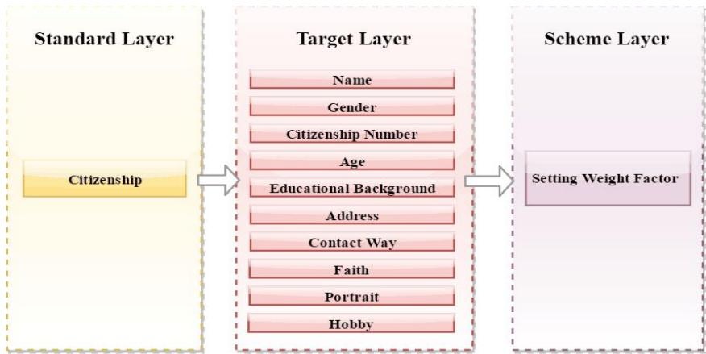
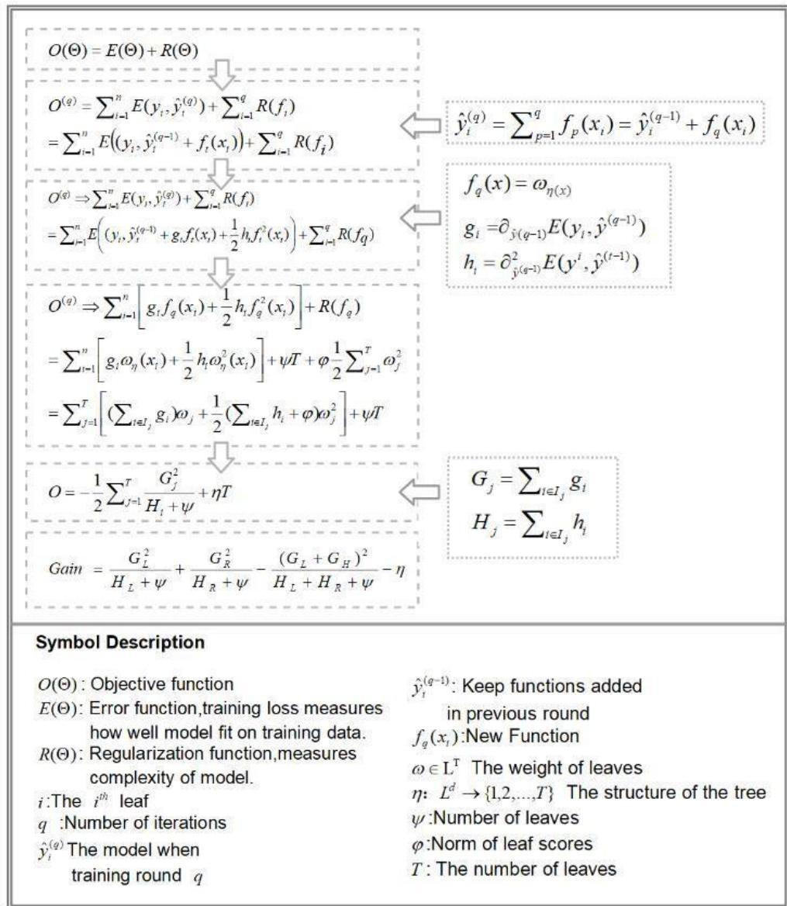
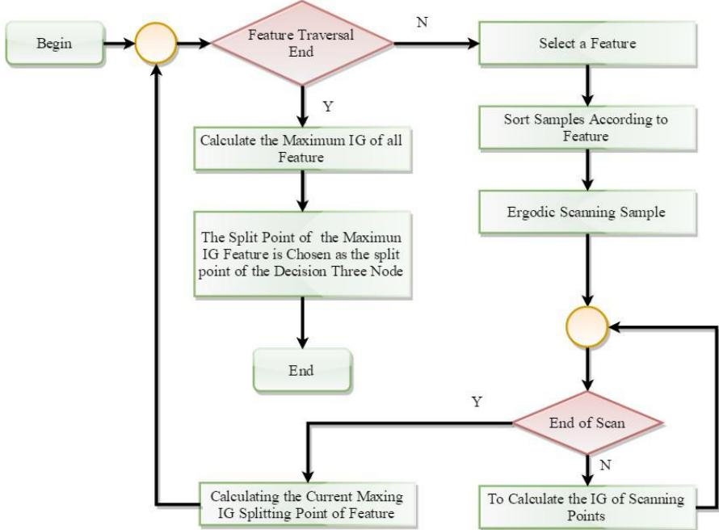
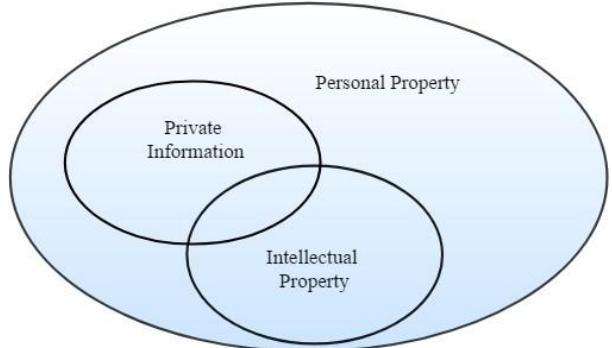
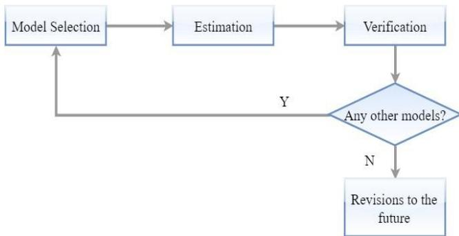

# 2018年美赛O奖论文：How much is your privacy information?

原件为竞赛论文。补充：文中的阅读练习及“参考解答”为整理时增加，原件图文保留出处。

# 2018 ICM How much is your privacy information? Summary Sheet

For ensuring the stability of the society, we establish a system of privacy pricing.

**Task 1**: According to the personal characteristics and information field, we choose 26 indexes to measure privacy price, and divide them into 5 categories according to the degree of correlation.

**Task 2**: We price the privacy. The present value method is used to quantify the value of privacy. We use the Analytic Hierarchy Process and Gradient Boosting Decision Tree, through the Python language to calculate the coefficients of the parameters. Then we establish Gauss mixture model to evaluate the information related value. Finally, the simulation of 500 people's privacy information is selected to verify the feasibility of the model.

**Task 3**: We give the pricing method, introduce the demand elasticity coefficient, and analyze that the privacy information is more flexible. Then the life cycle changes in a long time range are predicted.

**Task 4**: With the development of the times, the risk factor will be changed. We add dynamic factors and use Matlab to fit the change function of the risk coefficient.

**Task 5**: The value of privacy will increase with age and then stabilize at a certain level. We find out the relationship between PI, IP and PP in the privacy market through a number of literature searches.

**Task 6**: We use small world model and dynamic game theory to do simulation and prediction, and find that the privacy of individuals and groups will be largely leaked with the development of market.

**Task 7**: The impact of data leakage is long tail. The agency can use the actuarial model to calculate the total amount of compensation to the individual.

**Task 8**: We put forward some suggestions to the government on the basis of the model.

Finally, we perform a sensitivity test to verify the stability of the model.

## I Introduction

With the development of social informatization, the commercialization of privacy becomes an important issue. Therefore, we need to establish a privacy pricing system to maintain the stable and healthy development of the information sales market. Our tasks are as follows:

**Task 1**: Considering the level of risk can pass personal information and data fields classifying model, considering the different characteristics of category information, find the best balance of classification accuracy and simplicity.

**Task 2**: The question to think about the integrity of personal information, uniqueness, scarcity, according to the value of different factors, finally comprehensive assessment of the value of personal information.

**Task 3**: Consider the information value, risk value, and the impact of information integrity on the final information pricing.

**Task 4**: Consider the assumptions and constraints of the pricing model, judge the relationship between information privacy and human rights, and adjust the model to make it universal in the dynamic environment.

**Task 5**: Consider the influence of age factors on the risk-benefit ratio of the population, and consider the similarities and differences between PI and PP and IP.

**Task 6**: Make sure each individual data sharing information leakage caused by the network effect, and to consider whether the information network effect will affect the value of the personal information system, and to have the same privacy risks related to personnel, the sale of their personal information should be restricted.

**Task 7**: Consider the impact of large-scale PI leakage on data vendors, acquirers, and information value systems. And consider whether the responsibility for data disclosure should be responsible for information disclosure.

**Task 8**: Organize the above questions into proposals.

## II Categorize individuals into sub-groups (Task 1)

### 2.1 A brief introduction to personal privacy pricing

Personal privacy is a basic resource, if it is used reasonably, it will help to promote the information social development. Culnan[1] found that, if private used by business are not known to individuals, they will increase their concerns about privacy disclosure. Hagel and others' [2] research shows, some people tend to pay more attention to privacy, the reason is that they want to get compensation for information leakage. Adjei[3] thinks that, people will be willing to provide personal information to get paid if their personal profits outweigh the risks.

Thus, it can be seen that, on the premise of the sound pricing system of personal privacy most people are willing to obtain certain compensation or compensation through the sale of personal privacy. So the appropriate pricing system should be set up.

知识点：[文献综述与研究背景撰写方法](../../../topics/数学建模/wenxian_zongshu.md)、[问题重述与分析（Problem Restatement and Analysis）](../../../topics/数学建模/wenti_chongshu.md)

### 2.1.1 The establishment and evaluation of personal privacy information archives

The classification of personal privacy information can help research and excavate the real value contained in information, and the value of information can be further evaluated by studying the correlation degree. Therefore, we chose 26 indicators based on the principle of personal information classification and the actual situation of this subject. It includes personal attributes, financial transactions, social networks, personal assets and health care. This paper classifies personal privacy into two aspects: individual characteristics and information field.

The indicators and their classification are shown in Figure 2-1.

The reasons for the selection of personal privacy information in five aspects are analyzed as follows:

*   **Citizenship**: They belong to the range of attribute information and are objective information that can be used to identify specific individuals.
*   **Social Contact**: Because of the unique social attributes of human beings, it has an important research value in the field of information, which is generated in the process of life with the other spider web information.
*   **Finance**: It reflects the situation of individual financial trade and has great value for information mining.
*   **Health/Medical**: It has certain significance to the study of social medical treatment service system, and reflects the various situations of the individual body.
*   **Personal Assets**: It reflects the personal economic status, which is valuable for public interest, such as national economic analysis, and corporate profits, and it can create economic benefits.

## III 隐私成本模型（任务 2）

知识点：[任务分解与目标明确](../../../topics/数学建模/renwu_fenjie.md)、[影响因素评估指标体系构建（温度、湿度、经济、教育等）](../../../topics/数学建模/yingxiang_zhibiao.md)

### 3.1 简要介绍

隐私成本是对隐私价值的综合定价，我们考虑三个组成部分。

第一部分是期望收益价值，我们将五个二级参数分为两类。

- 难以量化：作为公民身份，我们通过层次分析法[4]为每个参数赋权。

- 可量化：其余 16 个参数可以用会计中的收益现值法进行量化。然后通过梯度提升决策树（GBDT）[5]的机器学习方法计算每个参数的系数。

第二部分是隐私的风险价值。由于风险价值不易衡量，我们使用概率论来估计期望收益的平均偏离程度，并得到期望风险报酬[6]。

第三部分是信息相关价值。隐私成本不仅取决于信息的完整性，还取决于相关性。例如，仅姓名的价值应低于姓名与个人相关联时的价值。我们建立高斯混合模型来研究相关价值与信息关联价值之间的关系[7]。

知识点：[层次分析法 AHP（Analytic Hierarchy Process）用于综合评价](../../../topics/数学建模/ahp_fangfa.md)、[模型参数的确定（基于数据拟合或实验选择）](../../../topics/数学建模/canshu_queding.md)、[数学建模的基本步骤（问题分析、模型假设、建立、求解、检验、推广）](../../../topics/数学建模/jianmo_buzhou.md)

### 3.2 模型建立

知识点：[数学建模的基本步骤（问题分析、模型假设、建立、求解、检验、推广）](../../../topics/数学建模/jianmo_buzhou.md)、[传统 SEIR 流行病模型（Susceptible-Exposed-Infectious-Recovered）](../../../topics/数学建模/seir_moxing.md)、[基本再生数 R0 的估计方法](../../../topics/数学建模/r0_guji.md)

### 3.2.1 期望收益价值

期望收益价值为：

$$
I = \sum_ {j = 1} ^ {2 6} \alpha_ {i} C _ {i}
$$

其中：

$I$：期望总收益价值

$\alpha_{j}$：第 $j$ 个参数的价值系数，$\alpha_{j} = \omega_{j}^{*}$

$C_{j}$：第 $j$ 个参数的期望收益值

知识点：[任务分解与目标明确](../../../topics/数学建模/renwu_fenjie.md)、[模型参数的确定（基于数据拟合或实验选择）](../../../topics/数学建模/canshu_queding.md)、[模型优缺点分析（Strengths and Weaknesses）](../../../topics/数学建模/youque_dian.md)

### 步骤 1：用 AHP 对公民身份信息赋权

将公民身份量化的相关因素分解为目标、准则、方案等。在此基础上，进行定性和定量分析。层次分析法如图 3–1 所示：

知识点：[层次分析法 AHP（Analytic Hierarchy Process）用于综合评价](../../../topics/数学建模/ahp_fangfa.md)、[问题重述与分析（Problem Restatement and Analysis）](../../../topics/数学建模/wenti_chongshu.md)、[模型参数的确定（基于数据拟合或实验选择）](../../../topics/数学建模/canshu_queding.md)

### - 构造比较矩阵

通过查阅相关资料并结合生活实际，我们分析公民身份中 10 个指标之间的关系和重要性，并建立两两比较矩阵。

知识点：[层次分析法 AHP（Analytic Hierarchy Process）用于综合评价](../../../topics/数学建模/ahp_fangfa.md)、[问题重述与分析（Problem Restatement and Analysis）](../../../topics/数学建模/wenti_chongshu.md)、[模型参数的确定（基于数据拟合或实验选择）](../../../topics/数学建模/canshu_queding.md)

### - 层次单排序

将判断矩阵每一列的元素归一化，元素的一般项为：

$$
\mathrm{A} _ {i j} = \mathrm{A} _ {i j} \div \sum_ {\mathrm{i}, \mathrm{j} = 1} ^ {n} \mathrm{A} _ {i j}
$$

采用和积法对归一化后的判断矩阵按列求和，得到 $W_{i}$。

$$
\mathrm{W} _ {i} = \sum_ {\mathrm{i}, \mathrm{j} = 1} ^ {n} B _ {i j}
$$

$W_{i}$ 的元素是同一层次因素对上一层次某一因素相对重要性的排序权重值。对于 $\mathrm{W} = (\mathrm{W}_{1}, \mathrm{W}_{2}, ..., \mathrm{W}_{n})^{T}$，在归一化过程中得到特征向量的近似解。计算判断矩阵的最大特征值 $\lambda_{max}$：

$$
\lambda_ {\max} = \sum_ {i = 1} ^ {n} \frac {(\mathrm{AW}) _ {i}}{n \mathrm{W} _ {i}}
$$

之后，我们可以确保排序与一致性检验一致。所谓一致性检验，就是 A 的允许范围。

知识点：[层次分析法 AHP（Analytic Hierarchy Process）用于综合评价](../../../topics/数学建模/ahp_fangfa.md)

### ● 两两比较矩阵一致性检验

两两比较矩阵的一致性指标为一致性指标（C.I.），

$$
C I = \frac {\lambda_ {\mathrm{max}} - n}{n - 1}
$$

为衡量 CI 的大小，引入随机一致性指标 RI。方法是：随机构造 500 个两两比较矩阵，得到一致性指标

$$
R I = \frac {C I _ {1} + C I _ {2} + \dots + C I _ {5 0 0}}{5 0 0}
$$

一致性指标 CI 与同阶平均随机一致性指标 R.I. 之比称为随机一致性比率（CR）。

$$
C R = \frac {C I}{R I}
$$

知识点：[层次分析法 AHP（Analytic Hierarchy Process）用于综合评价](../../../topics/数学建模/ahp_fangfa.md)

### Step 2: Earnings present value method quantifies other information

Privacy information seems to be difficult to quantify, but as long as the method is appropriate, we can quantify it to a certain extent. We regard privacy information as an intangible asset, a lot of international ways of quantifying intangible assets. Here we use the present value method[8].

The present value method of income is a kind of asset evaluation method to estimate the value of the assets evaluated by estimating the future expected revenue of the assessed assets and turning them into the present value. We determine the value of privacy information by calculating the future revenue of the privacy value. For example, Table 3-1 shows that the future earnings of businesses refer to the profits gained by merchants' knowledge of private information, or the expenditure reduced by government agencies and public organizations.

**Table 3–1: Information value quantization table**

| Original Parameter | Quantized Parameters |
| :--- | :--- |
| **Personal Assets** | |
| Total Assets | Average Deposit |
| Income | Disposable Income |
| Expenditure | Disposable Expenditure |
| Intellectual Property | Education Expenditure |
| **Social Contact** | |
| Social Way | Social Consumption Profit |
| Friends | Social Web Site Profit |
| Social Signal | Profit of Communication |
| **Finance** | |
| Financial Credit | Average Credit |
| Trading Information | Average Stock Investment |
| Transaction on Amount | Average Transaction Amount |
| Debt | Average Liabilities |
| **Health/Medical** | |
| Physical Health Status | Health Expenses |
| Medical Insurance | Insurance Cost |
| Medical History | Medical Records |
| Medical Expense | Medical Expenditure |
| Genetic Map | Medical Research Funds |

知识点：[模型参数的确定（基于数据拟合或实验选择）](../../../topics/数学建模/canshu_queding.md)、[符号说明与术语定义（Nomenclature / Symbols and Definitions）](../../../topics/数学建模/fuhao_shuoming.md)、[任务分解与目标明确](../../../topics/数学建模/renwu_fenjie.md)

### Step 3: GBDT calculation of expected value coefficient

Gradient Boosting Decision Tree is a combination algorithm for machine learning[9], By iterating forward distribution algorithm, continue with the new weights, each round of iteration to get a strong learner and loss function, the next iteration of the goal is to find is a weak learning regression tree model, make the next round to minimize the loss, it is to find a decision tree, let sample loss to become smaller. This is the most significant algorithm in machine learning at present. Figure 3 - 2 shows the principle of its calculation[10].

The last formula of the above steps is the information gain after the division of the decision tree is created, and the best splitting point is the position with the highest information gain. In order to find the maximum gain position of the feature, we need to traverse all the characteristics, find the highest gain for every feature, calculate all the features gain, the specific process is like Figure 3-3, and then use greedy algorithm to repeat the process.

We use Python to program according to the above principles, then we can increase the accuracy and find the most appropriate coefficient by adjusting the steps, iterations, the maximum depth of decision tree, the minimum sample size and so on. Finally, we can get the expected value of each parameter value coefficient:

$$
\omega^ {*} = - \frac {G _ {j}}{\pi_ {j} + \psi}
$$

## 3.2.4 Venture Value

知识点：[模型参数的确定（基于数据拟合或实验选择）](../../../topics/数学建模/canshu_queding.md)

### Step 1: The standard deviation is calculated.

Generally, we can use standard deviation to measure the degree of general response risk, but we have multidimensional index. In order to facilitate comparison with other parameters, it is more ideal to use standard deviation rate.

$$
C o f = \frac {\sigma}{E}
$$

Where

*   Cof: coefficient of variation
*   E: expected value
*   $\sigma$ : Standard deviation

知识点：[模型参数的确定（基于数据拟合或实验选择）](../../../topics/数学建模/canshu_queding.md)、[一般假设及其合理性说明（Assumptions and Justifications）](../../../topics/数学建模/jiaben_shezhi.md)、[文献综述与研究背景撰写方法](../../../topics/数学建模/wenxian_zongshu.md)

### Step 2: Determine the risk factor.

By the analytic hierarchy process described above, the weight of each parameter is considered as a risk factor, indicating the risk of privacy exposure.

The risk coefficient is determined by the analytic hierarchy process. After introducing the risk factor, we can calculate the expected rate of return on the risk of privacy:

$$
R _ {i} = \sum_ {j = 1} ^ {2 6} r _ {i} C o f
$$

Where

*   $R_{j}$ : The rate of risk reward for the $j^{th}$ parameter
*   $r_{j}$ : The risk coefficient of the $j^{th}$ parameter

知识点：[文献综述与研究背景撰写方法](../../../topics/数学建模/wenxian_zongshu.md)、[问题重述与分析（Problem Restatement and Analysis）](../../../topics/数学建模/wenti_chongshu.md)、[任务分解与目标明确](../../../topics/数学建模/renwu_fenjie.md)

### Step 3: Calculating the amount of the risk of privacy, that is the value of the risk.

$$
K = \sum_ {j = 1} ^ {2 6} I _ {j} R _ {j} = \sum_ {j = 1} ^ {2 6} \frac {\alpha_ {j} r _ {j} C _ {j} \sigma}{E}
$$

Where

*   K : Value of privacy risk
*   $I_{j}$ : Expected return value of the $j^{th}$ parameter

知识点：[模型参数的确定（基于数据拟合或实验选择）](../../../topics/数学建模/canshu_queding.md)、[符号说明与术语定义（Nomenclature / Symbols and Definitions）](../../../topics/数学建模/fuhao_shuoming.md)、[文献综述与研究背景撰写方法](../../../topics/数学建模/wenxian_zongshu.md)

### 3.2.4 Information related value

For the personal privacy information provided, the value of the data should be further excavated. According to practical experience, the more sensitive information is, the more sensitive rules can be mined, so the value of information is bigger, so we define "information related value" to measure the degree of information correlation.

According to the study, the relationship between the two is "S" positive correlation, so the Gauss mixed model is established[11], the Gauss probability density function is used to quantify accurately.

The relationship between information related value and information correlation is consistent with the following Gauss function curve trend such as figure Figure 3–4.

$$
D (\delta) = a e ^ {- \frac {(\delta - \mu) ^ {2}}{2 \sigma^ {2}}}
$$

The $\mu$ and $\sigma$ are the parameters, and the maximum likelihood method can be used[12]to estimate the parameters.

The MATLAB program is used to program the correlation value of the information provided by the individual, and the information related value can be calculated. Personal data provided that the two person, the expected value and risk return value is the same, privacy cost pricing is not representative of the two men is the same, it is necessary to study the degree of correlation according to specific content provided by the two data, estimate the value of the relevant information, so as to calculate the final cost of privacy pricing.

The information related value is calculated on the basis of the expected value of income, and the concrete steps are as follows:

$$
D = a e ^ {- \frac {(\delta - \mu) ^ {2}}{2 \sigma^ {2}}}
$$

Where:

- $D$: Information related value
- $I$: Expected value of income
- $\delta$: Correlation

知识点：[模型参数的确定（基于数据拟合或实验选择）](../../../topics/数学建模/canshu_queding.md)、[参数合理性验证](../../../topics/数学建模/canshu_heli_xing.md)

### 3.2.5 Total value of the cost of privacy

$$
C P = I + K + D = \sum_ {j = 1} ^ {2 6} \alpha_ {j} C _ {j} \bullet \left(1 + \sum_ {j = 1} ^ {2 6} r _ {j} C o f + a e ^ {- \frac {(\delta - \mu) ^ {2}}{2 \sigma^ {2}}}\right)
$$

Where:

- $CP$: Total price of privacy
- $I$: Expected value of income
- $R_{i}$ : Risk rate
- $K$: value of risk
- $r_{i}$ : risk coefficient
- $D$: Information related value
- $\sigma$ : standard deviation
- $\alpha_{j}$ : Expected return coefficient
- $$\alpha_ {j} = \omega_ {j} ^ {*}$$
- $E$ : expectation
- $Cof$: coefficient of variation
- $\delta$ : correlation

知识点：[符号说明与术语定义（Nomenclature / Symbols and Definitions）](../../../topics/数学建模/fuhao_shuoming.md)、[模型参数的确定（基于数据拟合或实验选择）](../../../topics/数学建模/canshu_queding.md)

### 3.3 Model solution

#### 3.3.1 Data compilation

Based on the parameters that are quantified, we have collected data for 1997-2016 years in China's census and consumption.

Data source: National Bureau of Statistics of China (http://data.stats.gov.cn/)

#### 3.3.2 Data processing

After a simple arrangement of the data, further processing of the data is needed. Data cleaning: check whether the data is correct. The outliers are modified by fuzzy matching to fill the missing values.

Data standardization: using the Z-score method to standardize the data, the research shows that the method has the highest compatibility in many criteria standardization[13].

#### 3.3.3 Calculation coefficient

Through the above method, we get the risk coefficient, value coefficient and correlation degree of each dimension through the analytic hierarchy process and GBDT by Python programming. The specific values are Table 3–2.

#### 3.3.4 Privacy cost pricing

The expected value of earnings is based on the data of China's nearly five years (2011-2016) and is further calculated by the above coefficients.

Table 3–2 Value coefficient and risk factor

<table><tr><td>Secondary</td><td>Tertiary</td><td>Income Coefficient</td><td>Risk Coefficient</td></tr><tr><td rowspan="10">Citizenship</td><td>Name</td><td>0.056</td><td>0.020</td></tr><tr><td>Gender</td><td>0.019</td><td>0.020</td></tr><tr><td>Citizenship Number</td><td>0.155</td><td>0.163</td></tr><tr><td>Age</td><td>0.025</td><td>0.026</td></tr><tr><td>Educational Background</td><td>0.075</td><td>0.059</td></tr><tr><td>Address</td><td>0.134</td><td>0.173</td></tr><tr><td>Contact Way</td><td>0.053</td><td>0.059</td></tr><tr><td>Faith</td><td>0.095</td><td>0.083</td></tr><tr><td>Portrait</td><td>0.186</td><td>0.197</td></tr><tr><td>Hobby</td><td>0.200</td><td>0.200</td></tr><tr><td rowspan="4">Personal Assets</td><td>Total Assets</td><td>0.045</td><td>0.581</td></tr><tr><td>Income</td><td>0.014</td><td>0.163</td></tr><tr><td>Expenditure</td><td>0.052</td><td>0.163</td></tr><tr><td>Intellectual Property</td><td>0.084</td><td>0.092</td></tr><tr><td rowspan="3">Social Contact</td><td>Social Way</td><td>0.076</td><td>0.405</td></tr><tr><td>Friends</td><td>0.008</td><td>0.149</td></tr><tr><td>Social Signal</td><td>0.023</td><td>0.234</td></tr><tr><td rowspan="4">Finance</td><td>Financial Credit</td><td>0.025</td><td>0.211</td></tr><tr><td>Trading Information</td><td>0.049</td><td>0.186</td></tr><tr><td>Transaction on Amount</td><td>0.008</td><td>0.127</td></tr><tr><td>Debt</td><td>0.007</td><td>0.687</td></tr><tr><td rowspan="5">Health/Medical</td><td>Physical Health Status</td><td>0.041</td><td>0.233</td></tr><tr><td>Medical Insurance</td><td>0.058</td><td>0.060</td></tr><tr><td>Medical History</td><td>0.017</td><td>0.091</td></tr><tr><td>Medical Expense</td><td>0.053</td><td>0.233</td></tr><tr><td>Genetic Map</td><td>0.074</td><td>0.383</td></tr></table>

Table 3-3 Privacy cost price 1 of them represent this privacy information, and 0 are not provided.
<table><tr><td></td><td colspan="10">Citizenship</td><td colspan="4">Personal</td><td colspan="3">Social</td><td colspan="4">Finance</td><td colspan="4">Health/Medical</td><td colspan="4">¥</td><td></td></tr><tr><td>ID</td><td>x1</td><td>x2</td><td>x3</td><td>x4</td><td>x5</td><td>x6</td><td>x7</td><td>x8</td><td>x9</td><td>x10</td><td>x11</td><td>x12</td><td>x13</td><td>x14</td><td>x19</td><td>x20</td><td>x21</td><td>x15</td><td>x16</td><td>x17</td><td>x18</td><td>x22</td><td>x23</td><td>x24</td><td>x25</td><td>x26</td><td>I</td><td>K</td><td>D</td><td>CP</td></tr><tr><td>1</td><td>0</td><td>1</td><td>1</td><td>1</td><td>1</td><td>0</td><td>0</td><td>1</td><td>1</td><td>1</td><td>1</td><td>0</td><td>1</td><td>0</td><td>0</td><td>1</td><td>1</td><td>0</td><td>0</td><td>1</td><td>0</td><td>0</td><td>0</td><td>0</td><td>1</td><td>0</td><td>926.04</td><td>472.93</td><td>170.18</td><td>1569.16</td></tr><tr><td>2</td><td>1</td><td>1</td><td>1</td><td>1</td><td>1</td><td>1</td><td>1</td><td>0</td><td>0</td><td>1</td><td>0</td><td>1</td><td>1</td><td>0</td><td>1</td><td>1</td><td>1</td><td>1</td><td>1</td><td>1</td><td>1</td><td>1</td><td>0</td><td>1</td><td>1</td><td>1</td><td>365.19</td><td>734.33</td><td>173.54</td><td>1273.06</td></tr><tr><td>3</td><td>0</td><td>1</td><td>1</td><td>1</td><td>1</td><td>0</td><td>0</td><td>1</td><td>0</td><td>0</td><td>1</td><td>0</td><td>1</td><td>1</td><td>0</td><td>1</td><td>0</td><td>1</td><td>0</td><td>0</td><td>1</td><td>1</td><td>1</td><td>1</td><td>1</td><td>1</td><td>1506.07</td><td>528.41</td><td>198.76</td><td>2233.23</td></tr><tr><td>4</td><td>1</td><td>1</td><td>1</td><td>1</td><td>1</td><td>1</td><td>0</td><td>0</td><td>1</td><td>0</td><td>0</td><td>1</td><td>0</td><td>0</td><td>0</td><td>1</td><td>1</td><td>1</td><td>0</td><td>1</td><td>0</td><td>1</td><td>1</td><td>1</td><td>1</td><td>1</td><td>234.76</td><td>701.66</td><td>39.85</td><td>976.28</td></tr><tr><td>5</td><td>0</td><td>1</td><td>1</td><td>1</td><td>1</td><td>0</td><td>1</td><td>1</td><td>0</td><td>0</td><td>0</td><td>1</td><td>1</td><td>1</td><td>1</td><td>0</td><td>1</td><td>1</td><td>1</td><td>0</td><td>1</td><td>1</td><td>0</td><td>1</td><td>1</td><td>0</td><td>730.35</td><td>770.34</td><td>61.78</td><td>1562.46</td></tr><tr><td>.</td><td></td><td></td><td></td><td></td><td></td><td></td><td></td><td></td><td></td><td></td><td></td><td></td><td></td><td></td><td></td><td></td><td></td><td></td><td></td><td></td><td></td><td></td><td></td><td></td><td></td><td></td><td></td><td></td><td></td><td></td></tr><tr><td>.</td><td></td><td></td><td></td><td></td><td></td><td></td><td></td><td></td><td></td><td></td><td></td><td></td><td></td><td></td><td></td><td></td><td></td><td></td><td></td><td></td><td></td><td></td><td></td><td></td><td></td><td></td><td></td><td></td><td></td><td></td></tr><tr><td>.</td><td></td><td></td><td></td><td></td><td></td><td></td><td></td><td></td><td></td><td></td><td></td><td></td><td></td><td></td><td></td><td></td><td></td><td></td><td></td><td></td><td></td><td></td><td></td><td></td><td></td><td></td><td></td><td></td><td></td><td></td></tr><tr><td>224</td><td>0</td><td>0</td><td>0</td><td>0</td><td>1</td><td>0</td><td>0</td><td>0</td><td>1</td><td>1</td><td>0</td><td>0</td><td>0</td><td>0</td><td>1</td><td>0</td><td>0</td><td>0</td><td>1</td><td>1</td><td>1</td><td>0</td><td>0</td><td>1</td><td>0</td><td>1</td><td>611.83</td><td>55.10</td><td>88.19</td><td>755.12</td></tr><tr><td>225</td><td>1</td><td>1</td><td>1</td><td>1</td><td>1</td><td>1</td><td>0</td><td>1</td><td>0</td><td>0</td><td>0</td><td>1</td><td>1</td><td>1</td><td>0</td><td>1</td><td>1</td><td>0</td><td>0</td><td>1</td><td>0</td><td>1</td><td>1</td><td>1</td><td>0</td><td>0</td><td>598.51</td><td>403.65</td><td>80.72</td><td>1082.88</td></tr><tr><td>226</td><td>1</td><td>1</td><td>1</td><td>1</td><td>1</td><td>1</td><td>1</td><td>0</td><td>1</td><td>1</td><td>0</td><td>0</td><td>0</td><td>1</td><td>0</td><td>1</td><td>0</td><td>1</td><td>1</td><td>0</td><td>0</td><td>0</td><td>1</td><td>0</td><td>0</td><td>0</td><td>660.82</td><td>440.44</td><td>111.43</td><td>1212.69</td></tr><tr><td>227</td><td>0</td><td>1</td><td>1</td><td>1</td><td>1</td><td>0</td><td>1</td><td>0</td><td>1</td><td>0</td><td>0</td><td>0</td><td>0</td><td>0</td><td>0</td><td>0</td><td>1</td><td>1</td><td>0</td><td>1</td><td>1</td><td>0</td><td>0</td><td>1</td><td>1</td><td>0</td><td>650.62</td><td>692.13</td><td>79.51</td><td>1422.27</td></tr><tr><td>.</td><td></td><td></td><td></td><td></td><td></td><td></td><td></td><td></td><td></td><td></td><td></td><td></td><td></td><td></td><td></td><td></td><td></td><td></td><td></td><td></td><td></td><td></td><td></td><td></td><td></td><td></td><td></td><td></td><td></td><td></td></tr><tr><td>.</td><td></td><td></td><td></td><td></td><td></td><td></td><td></td><td></td><td></td><td></td><td></td><td></td><td></td><td></td><td></td><td></td><td></td><td></td><td></td><td></td><td></td><td></td><td></td><td></td><td></td><td></td><td></td><td rowspan="2"></td><td rowspan="2"></td><td rowspan="2"></td></tr><tr><td>.</td><td></td><td></td><td></td><td></td><td></td><td></td><td></td><td></td><td></td><td></td><td></td><td></td><td></td><td></td><td></td><td></td><td></td><td></td><td></td><td></td><td></td><td></td><td></td><td></td><td></td><td></td><td></td></tr><tr><td>497</td><td>1</td><td>1</td><td>1</td><td>1</td><td>0</td><td>1</td><td>1</td><td>1</td><td>0</td><td>1</td><td>0</td><td>1</td><td>0</td><td>1</td><td>0</td><td>0</td><td>1</td><td>0</td><td>1</td><td>1</td><td>1</td><td>1</td><td>1</td><td>0</td><td>1</td><td>0</td><td>815.32</td><td>419.52</td><td>138.94</td><td>1373.78</td></tr><tr><td>498</td><td>0</td><td>0</td><td>0</td><td>0</td><td>0</td><td>0</td><td>0</td><td>0</td><td>0</td><td>0</td><td>0</td><td>1</td><td>1</td><td>0</td><td>0</td><td>1</td><td>1</td><td>0</td><td>1</td><td>1</td><td>1</td><td>1</td><td>0</td><td>0</td><td>1</td><td>0</td><td>1488.56</td><td>343.07</td><td>231.13</td><td>2062.76</td></tr><tr><td>499</td><td>0</td><td>1</td><td>1</td><td>1</td><td>1</td><td>1</td><td>1</td><td>0</td><td>1</td><td>0</td><td>1</td><td>0</td><td>1</td><td>0</td><td>1</td><td>1</td><td>0</td><td>1</td><td>1</td><td>0</td><td>0</td><td>0</td><td>1</td><td>0</td><td>1</td><td>0</td><td>170.35</td><td>512.77</td><td>92.07</td><td>775.18</td></tr><tr><td>500</td><td>1</td><td>0</td><td>0</td><td>0</td><td>0</td><td>1</td><td>1</td><td>0</td><td>0</td><td>1</td><td>1</td><td>0</td><td>1</td><td>1</td><td>1</td><td>1</td><td>1</td><td>1</td><td>0</td><td>1</td><td>1</td><td>1</td><td>1</td><td>1</td><td>0</td><td>1</td><td>394.81</td><td>885.23</td><td>33.59</td><td>1313.63</td></tr><tr><td></td><td></td><td></td><td></td><td></td><td></td><td></td><td></td><td></td><td></td><td></td><td></td><td></td><td></td><td></td><td></td><td></td><td></td><td></td><td></td><td></td><td></td><td></td><td></td><td></td><td></td><td></td><td></td><td></td><td></td><td></td></tr><tr><td></td><td></td><td></td><td></td><td></td><td></td><td></td><td></td><td></td><td></td><td></td><td></td><td></td><td></td><td></td><td></td><td></td><td></td><td></td><td></td><td></td><td></td><td></td><td></td><td></td><td></td><td></td><td></td><td></td><td></td><td></td></tr></table>

Then, we simulated the transactions of 500 people's personal privacy data, such as Table 3 – 3, and calculated the privacy cost pricing based on these data, and made a brief analysis.

We calculate each individual's expected return value, risk value and relative value, have been found according to the total privacy, personal privacy information provided \$600-3000 between the floating in.

If a person provides all his privacy information is all 1, then we calculate the total privacy for \$5578 (per year).

Team # 87280

Page 10 of 20

知识点：[层次分析法 AHP（Analytic Hierarchy Process）用于综合评价](../../../topics/数学建模/ahp_fangfa.md)、[模型参数的确定（基于数据拟合或实验选择）](../../../topics/数学建模/canshu_queding.md)、[数学建模的基本步骤（问题分析、模型假设、建立、求解、检验、推广）](../../../topics/数学建模/jianmo_buzhou.md)

### IV Pricing system & Supply and demand relationship (Task3)

When we sell personal privacy information as commodities, we are bound to be affected by market fluctuations, including micro supply and demand, macro policy adjustment and economic balance.

知识点：[问题重述与分析（Problem Restatement and Analysis）](../../../topics/数学建模/wenti_chongshu.md)、[任务分解与目标明确](../../../topics/数学建模/renwu_fenjie.md)

### 4.1 Pricing system

Individuals can earn certain profits by selling their own privacy information. Businesses or government agencies want to purchase these information, and they will pay personal money, plus some profits besides privacy costs.

$$
B = C P + S
$$

Where:

- $B$: Pricing of privacy information
- $CP$: The total price of privacy
- $S$: Personal sale of hidden profits

According to the current market profits, in addition to luxury accessories and profiteering, the profit margin of a commodity is roughly 10%-30%. As a person's private seller, how much profit can be made for its own price, but the profit margin can not exceed 30%.

The profit margin is $\phi\left(\phi\leq0.3\right)$ , we can get the following:

$$
\begin{array}{l} B = C P + C P \bullet \phi = C P (1 + \phi) \\ = (1 + \phi) \sum_ {j = 1} ^ {2 6} \alpha_ {j} C _ {j} \bullet \left(1 + \sum_ {j = 1} ^ {2 6} r _ {j} C o f + a e ^ {- \frac {(\delta - \mu) ^ {2}}{2 \sigma^ {2}}}\right) \end{array}
$$

知识点：[文献综述与研究背景撰写方法](../../../topics/数学建模/wenxian_zongshu.md)、[一般假设及其合理性说明（Assumptions and Justifications）](../../../topics/数学建模/jiaben_shezhi.md)、[模型参数的确定（基于数据拟合或实验选择）](../../../topics/数学建模/canshu_queding.md)

### 4.2 Demand elasticity of privacy value

When privacy information becomes a commodity in the market, it will receive the influence of market fluctuations caused by various factors. This kind of influence will cause the change of demand and price of privacy information. In order to respond to the degree and relationship of change, we introduce the concept of demand price elasticity in economics to explain the demand elasticity of privacy value[14].

$$
E _ {d} = \frac {\partial Q}{\partial B} \bullet \frac {B}{Q}
$$

Where:

- $E_{d}$: Elasticity coefficient of demand
- $Q$: Quantity demanded
- $B$: Pricing of privacy information

In general, the elastic coefficient is negative, and in order to be simple, we see it as a positive number. It is also divided into five cases of Table4-1.

Table 4-1 Elasticity coefficient of demand

| Condition | Description |
| :--- | :--- |
| $E_d = 0$ | Nonelastic, the price will change in any case, and the demand will not change. |
| $0 < E_d < 1$ | Lack of elasticity, The rate of change in demand is less than the rate of price change. |
| $E_d = 1$ | Single elasticity, at this time, the rate of price change is equal to the rate of change in demand. |
| $E_d > 1$ | Resilient, A ratio of change in price to a ratio of change in demand. |
| $E_d = \infty$ | Perfect elasticity, The price is fixed and there is an unlimited demand. |

According to the concept of life cycle, we divide the market of this kind of information into three stages, as shown by Figure 4–1

- Development period: In this period, the relationship between the value of privacy and the amount of demand is more flexible. When the price of privacy rises, most people will be willing to sell, and when the price falls, people will choose to keep their privacy.
- Mature period: With the deepening of the concept of privacy information becoming a commodity, institutions or organizations have fixed demand for privacy information, and the coefficient of elasticity will be smaller, or even a fixed price.
- Decline period: When most of the people's privacy is sold for years, the market for privacy information is close to saturation, and there may be a price - free phenomenon.

知识点：[模型参数的确定（基于数据拟合或实验选择）](../../../topics/数学建模/canshu_queding.md)、[一般假设及其合理性说明（Assumptions and Justifications）](../../../topics/数学建模/jiaben_shezhi.md)、[文献综述与研究背景撰写方法](../../../topics/数学建模/wenxian_zongshu.md)

### V Assumptions and Dynamic improvement (Task 4)

知识点：[数学建模的基本步骤（问题分析、模型假设、建立、求解、检验、推广）](../../../topics/数学建模/jianmo_buzhou.md)、[一般假设及其合理性说明（Assumptions and Justifications）](../../../topics/数学建模/jiaben_shezhi.md)、[模型优缺点分析（Strengths and Weaknesses）](../../../topics/数学建模/youque_dian.md)

### 5.1 Assumptions and constraints of personal information pricing model

1. It is assumed that people with the same conditions have the same willingness to protect privacy. In the real world, due to the particularity of each person, the degree of importance attached to personal information is different. Its distribution is roughly normal distribution. We assume that each person's attention to their personal information is only related to the individual characteristics and information related fields.
2. We don't consider the personal information of people in a special field. Special areas include political areas, military areas, and so on. In some special areas, the disclosure of

# 2018年美赛O奖论文：How much is your privacy information?（习题）

## 一、模型分析与动态评估

知识点：[一般假设及其合理性说明（Assumptions and Justifications）](../../../topics/数学建模/jiaben_shezhi.md)

### 章节 5.2 Whether information privacy should be regarded as human rights

In our view, information privacy should not be protected fully as human rights.

On the one hand, a part of personal information is closely related to the dignity of the person and reflects the personality factors of the individual. From the phenomenon of the commercialization of personal information, we can find that personal information reflects both personality and property interests[15]. Therefore, it is reasonable to protect the property right.

To sum up, we think that the personal information should be divided into two aspects, that is, the personality elements of personal information and the property elements of personal information. In the collection and utilization of personal information, we should pay attention to the desensitization of personal information and make use of the information data without damaging the legitimate rights and interests of the information owners.

知识点：[非技术性文稿撰写（如致世界医学会的信函、新闻发布会声明）](../../../topics/数学建模/fei_jishu_wengao.md)

### 章节 5.3 Dynamic analysis of cost of privacy

#### 小节 5.3.1 The change of personal values with time

With the development of time, the spread of privacy protection ideas is expanding. People are increasingly familiar with the consequences of privacy disclosure and pay more attention to privacy. Therefore, people's expectations for the return of privacy are getting higher and higher. According to the analysis of the privacy cost model, the risk value is changed due to the change of people's thought.

#### 小节 5.3.2 The dynamic analysis of the model

With the change of time, the value of risk increases gradually, we add dynamic factors on the basis of the original model. The risk factors of 26 indicators ($r_{j}$) are changed from constants to functions, which are changing by time($t$).

Taking the total asset as an example, its trend of change is shown in Figure 5-1.

The data is fitted by the MATLAB fitting toolbox. We get a higher fitting degree R-square, which is 0.9779. The fitting effect is very good. So, the function relationship between the risk coefficient $(r_{18})$ and the time $(t)$ of the 18th indexes is as follows:

$$
r_{18} = -0.6404 e^{(-0.07066 t + 0.6887)}
$$

By fitting the risk coefficients of the other 25 indexes in the same way, we can calculate the function relation of the risk coefficients of each index. Combined with the formula of risk value:

$$
K = \sum_{j=1}^{26} I_j R_j = \sum_{j=1}^{26} \frac{\alpha_j r_j C_j \sigma}{E}
$$

We will add the functional relationship between the dynamic factors $(r_j)$ and the time $(t)$ into the upper formula, then it can calculate the change of risk value over time to realize the dynamic evaluation of the model.

## 二、代际差异与概念比较 (Task 5)

知识点：[模型参数的确定（基于数据拟合或实验选择）](../../../topics/数学建模/canshu_queding.md)、[敏感性分析方法（Sensitivity Analysis，单参数与多参数变动）](../../../topics/数学建模/minganxing_fenxi.md)

### 章节 6.1 Generational Differences

With the different ideas of the times and the growth of age, there are more or less differences in the cognition of the risk and income of privacy information. In this regard, we collect relevant data, and do an analysis.

Data sources:

(1) Data report on China's Internet consumption ecology in 2015-2017. http://doc.mbalib.com/view/e720ad8eb4ebac9f83d56ec790a6dd1c.html

(2) Census of China's national bureau of statistics.
http://www.stats.gov.cn/tjsj/pcsj/

(3) Chinese data Yearbook

http://data.stats.gov.cn/easyquery.htm?cn=C01

We get the consumption data of all ages in personal assets, social networking, financial transactions, health care, and then analyze and regress to get Figure 6 - 1, from 19 to 63 years old, the average growth of people's activities and consumption expenditure and 19 years old.

According to the analysis of the second problem, consumption expenditure can be regarded as expected value, so our model needs to make some changes.

If pertinence is stronger, or we want to accurately calculate the value of privacy information, we can increase the value of each kind of privacy value according to the growth of every dimension.

If only for the overall calculation, and without careful consideration of the increase in the situation, the average growth value can be used.

知识点：[文献综述与研究背景撰写方法](../../../topics/数学建模/wenxian_zongshu.md)、[模型参数的确定（基于数据拟合或实验选择）](../../../topics/数学建模/canshu_queding.md)

### 章节 6.2 Compare with PI, PP and IP

- Private information[16]: Non-public information, Commercialization is not entirely beneficial to individuals, and the sale of personal information will bring a series of immeasurable risks, which may be invisible and long-term.
- PP: Personal property is divided into tangible and intangible assets [17]. The sale of PP by changing the commodity itself to a certain value is not determined by the relationship with the owner.
- IP: Rights generated by creative activities based on intelligence[18]. The sale of IP will not cause the risk of disclosure of privacy information.

The conceptual relationships of PI, PP, and IP are shown in Figure 6 - 2.

## 三、数据共享的网络效应 (Task 6)

知识点：[文献综述与研究背景撰写方法](../../../topics/数学建模/wenxian_zongshu.md)、[任务分解与目标明确](../../../topics/数学建模/renwu_fenjie.md)

### 章节 VII Network effects of data sharing (Task 6)

We use Matlab to build a small world model for information leakage, and find that individuals who do not sell privacy are increasingly implicated with the development of privacy trading market. Then through the dynamic game theory, it is predicted that the information of the group will be leaked seriously because of the individual behavior, and if it is properly constrained, the interests of the group can be maximized.

# 2018年美赛O奖论文：How much is your privacy information?（习题）

本资料整理自2018年美国大学生数学建模竞赛O奖获奖论文《How much is your privacy information?》第7章至第8章部分（原文第16–18页），由识别工具读取后修正格式与错别字，保留原题结构与逻辑。

## 一、问题假设与分析（第7章）

知识点：[多重网络/多层网络构建（Multiplex/Multi-layer Network）](../../../topics/数学建模/duoceng_wangluo.md)、[动态规划求解（状态变量、决策变量、状态转移函数、值函数）](../../../topics/数学建模/dongtai_guihua.md)、[生产率与成本模型（Productivity and Costs of HCM）](../../../topics/数学建模/shengchan_liebian.md)

### 选择 1

**题干：** 基于“经济人”假设，社区中所有居民被视为理性个体，其决策仅考虑自身利益。

- A. 正确
- B. 错误

答案：A。
知识点：[一般假设及其合理性说明（Assumptions and Justifications）](../../../topics/数学建模/jiaben_shezhi.md)、[问题重述与分析（Problem Restatement and Analysis）](../../../topics/数学建模/wenti_chongshu.md)、[任务分解与目标明确](../../../topics/数学建模/renwu_fenjie.md)

### 选择 2

**题干：** 在改进的小世界模型中，成员出售个人信息时，有 $p$ 的概率泄露其邻居以外其他成员的信息。

- A. 正确
- B. 错误

答案：B。
订正：原文表述为“have a $^{p}$ chance to reveal information about other members”，结合上下文及后续模拟参数设置，应理解为泄露非相邻成员信息的概率为 $p$，但选项表述中“其他成员”范围模糊，且原文未明确区分“邻居”与“非邻居”的具体定义，此处需根据模型设定修正理解。
补充：在模型中，$n$ 代表愿意出售信息的人口比例，$p$ 代表因出售行为导致非相邻个体隐私泄露的概率。

知识点：[多重网络/多层网络构建（Multiplex/Multi-layer Network）](../../../topics/数学建模/duoceng_wangluo.md)

### 简答 1

**题干：** 简述建立个人隐私泄露小世界模型的五个基本假设。

**正文：**
1. **经济人假设**：社区内所有居民均为“经济人”，即每一步决策仅考虑自身利益最大化。
2. **小世界模型改进**：利用改进的小世界模型模拟群体信息泄露。成员出售信息时，会泄露其相邻成员的隐私，并有概率 $p$ 泄露非相邻成员的信息。
3. **即时知晓假设**：假设任何成员的隐私出售行为会立即被其他成员知晓。在小规模群体中，这是一个合理的假设。
4. **影响均等假设**：假设每个成员对信息泄露的影响是相同的。
5. **无权利约束**：信息泄露过程不考虑人权限制或法律道德约束。

答案：见上文正文。

## 二、模型构建与分析（第7章）

知识点：[一般假设及其合理性说明（Assumptions and Justifications）](../../../topics/数学建模/jiaben_shezhi.md)

### 计算 1

**题干：** 基于小世界模型，设群体总人数为40人，调整参数 $n$（愿意出售信息者比例）和 $p$（非相邻泄露概率），模拟隐私泄露程度。请分析随着 $n$ 和 $p$ 的增加，隐私泄露的变化趋势。

**正文：**
模型设定：
- $n$：愿意为了利益出售个人隐私的人群比例。
- $1-n$：不愿意出售隐私的人群比例。
- 机制：出售隐私的个体将失去两个相邻个体的隐私；若发生非相邻泄露（概率为 $p$），则会导致更多非相邻个体的隐私损失。

模拟结果分析（基于Matlab仿真）：
- 当参数 $n$（出售意愿比例）和 $p$（非相邻泄露概率）增加时，群体内的隐私泄露程度显著加剧。
- 连接紧密的个体（邻居）面临更高的隐私风险。
- 结论：随着 $n$ 和 $p$ 的提升，隐私泄露呈现加速恶化趋势。

答案：隐私泄露随 $n$ 和 $p$ 的增加而变得更加严重。

知识点：[数学建模的基本步骤（问题分析、模型假设、建立、求解、检验、推广）](../../../topics/数学建模/jianmo_buzhou.md)、[敏感性分析方法（Sensitivity Analysis，单参数与多参数变动）](../../../topics/数学建模/minganxing_fenxi.md)

### 简答 2

**题干：** 基于动态博弈理论，分析群体中的囚徒困境及其纳什均衡状态。

**正文：**
**情境描述：**
群体中存在两类人：一类愿意出售隐私，另一类认为隐私更重要。假设隐私出售是公开透明的，存在以下四种博弈情形：

| | 成员B：出售隐私 | 成员B：不出售隐私 |
| :--- | :--- | :--- |
| **成员A：出售隐私** | A和B都获得金钱，但两人都失去隐私。 | B获得金钱，A和B都失去隐私（因为A出售导致B泄露）。 |
| **成员A：不出售隐私** | A获得金钱，A和B都失去隐私（因为B出售导致A泄露）。 | 无人获得金钱，也无人失去隐私。 |

**博弈分析：**
基于“经济人”假设，每个成员只关注自身利益和行动。
- 只要有一个成员愿意出售隐私，其他人的隐私就会受到侵犯（无论对方是否出售）。
- 即使部分成员不愿出售，为了阻止他人出售或获取更大利益，理性的选择往往是“出售隐私”。
- **纳什均衡**：在没有外部干预的情况下，具有相同隐私风险的群体会陷入子博弈精炼纳什均衡，无法实现整体利益优化。

**结论：**
为了跳出囚徒困境，最大化群体利益并限制个人隐私售卖行为，必须引入外部干预或建立约束机制。

答案：见上文分析。

## 三、数据泄露对隐私价值的影响（第8章）

知识点：[问题重述与分析（Problem Restatement and Analysis）](../../../topics/数学建模/wenti_chongshu.md)、[数学建模的基本步骤（问题分析、模型假设、建立、求解、检验、推广）](../../../topics/数学建模/jianmo_buzhou.md)

### 论述 1

**题干：** 阐述数据泄露对个人隐私价值的影响机制。

**正文：**
当购买个人隐私信息的组织出现信息安全问题时，会导致大量隐私信息泄露。若隐私被犯罪分子窃取，将威胁个人安全和社会稳定。基于隐私价值的构成要素，数据泄露的影响主要体现在以下三个方面：

1. **市场供需失衡**：当大量数据泄露时，个人隐私信息在市场上被不当分发，商家购买个人信息的意愿降低，导致个人的预期回报价值下降。
2. **风险意识提升**：公众对个人信息泄露的风险意识增强，导致其出售信息的意愿下降。
3. **价值递减效应**：相关隐私价值随预期回报值的降低而减少。

**总结：**
如图8-1所示（注：原图已移除，内容见下文），数据泄露会导致个人隐私价值下降，同时人们出售隐私的意愿也会降低，这将引发隐私交易市场的经济危机。

答案：见上文三点分析。

知识点：[文献综述与研究背景撰写方法](../../../topics/数学建模/wenxian_zongshu.md)、[问题重述与分析（Problem Restatement and Analysis）](../../../topics/数学建模/wenti_chongshu.md)、[模型优缺点分析（Strengths and Weaknesses）](../../../topics/数学建模/youque_dian.md)

### 论述 2

**题干：** 分析数据泄露的时间效应，包括长尾效应与牛鞭效应。

**正文：**
随着时间的推移，数据泄露的影响会发生变化。主要考虑两种趋势：

1. **长尾效应 (Long Tail Effect)**：
   - **定义**：如果关于泄露的舆论是由个人信息需求方（如中介公司、政府机构）引导的，则会产生长尾效应。
   - **特征**：泄露信息的关注度在初期可能不高，但随着特定需求的持续存在，会在较长时间内保持一定的关注度或影响。

2. **牛鞭效应 (Bullwhip Effect)**：
   - **定义**：如果泄露数据的消息在网络中迅速传播，且整体舆论不受任何单一组织的控制，则会产生牛鞭效应。
   - **特征**：微小的初始泄露信息在传播过程中被逐级放大，导致社会恐慌或过度反应，影响范围呈指数级扩大。

**结论：**
时间维度上，数据泄露的影响并非线性衰减，而是可能通过长尾效应持续存在，或通过牛鞭效应爆发式扩散。

答案：见上文两种效应分析。

知识点：[文献综述与研究背景撰写方法](../../../topics/数学建模/wenxian_zongshu.md)、[问题重述与分析（Problem Restatement and Analysis）](../../../topics/数学建模/wenti_chongshu.md)、[数学建模的基本步骤（问题分析、模型假设、建立、求解、检验、推广）](../../../topics/数学建模/jianmo_buzhou.md)

### 8.3 Agency compensation model

When the data leakage occurs, the agency needs to compensate everyone for a certain loss. In addition to the value of the data itself, the agency also needs to compensate for other losses caused by data lost. We use the actuarial model of the insurance[21] industry to calculate the amount of compensation. The establishment method of actuarial model is generally parametric modeling, and its process is shown in Figure 8-4.

Finally, the amount of compensation we have calculated is as follows:

$$
U = I + \Pi
$$

Where:

*   $U$: The amount of the final compensation to the individual
*   $I$: The value of the information itself, and it is also the original expected value.
*   $\Pi$: Other losses should be compensated for by the actuarial model.

知识点：[模型参数的确定（基于数据拟合或实验选择）](../../../topics/数学建模/canshu_queding.md)、[文献综述与研究背景撰写方法](../../../topics/数学建模/wenxian_zongshu.md)、[数学建模的基本步骤（问题分析、模型假设、建立、求解、检验、推广）](../../../topics/数学建模/jianmo_buzhou.md)

### IX Sensitivity analysis

In order to test the stability of the model, we consider that different people pay different attention to personal privacy information and have different attitudes and tolerance to risk disclosure. Therefore, the weight assignment of value coefficient and risk coefficient is different from person to person. In order to test the universality of the coefficients determined by the gradient lifting tree and the analytic hierarchy process, we have designed a questionnaire on personal privacy information attitude (see Appendix II). In this paper, 50 people of different ages were selected as the respondents, we investigated their weighting of 26 indicators and obtained new value coefficients and risk factors. Through the analysis of the data, 3 groups of invalid data were excluded, and 47 new value coefficients and risk factors were obtained. We put these coefficients into the model and repriced the privacy costs of the 500 people generated by the simulation. The new pricing situation is shown in Figure 9-1.(Because of the large amount of data, only partial data is displayed.)

The average value of the new pricing (Average) is not significantly different from the original model (Original). We use SPSS software to carry out the independent-samples T-test on these two sets of data, and get the test results such as Figure 9-2.

**Figure 9-2: The result of independent-samples T-test**

| | | Levene's Test for Equality of Variances | | t-test for Equality of Means | | | | | | |
| :--- | :--- | :---: | :---: | :---: | :---: | :---: | :---: | :---: | :---: | :---: |
| **data** | | **F** | **Sig.** | **t** | **df** | **Sig. (2-tailed)** | **Mean Difference** | **Std. Error Difference** | **Lower** | **Upper** |
| | Equal variances assumed | .083 | .775 | -.115 | 24 | .910 | -19.79385 | 172.83605 | -376.50991 | 336.92222 |
| | Equal variances not assumed | | | -.115 | 23.998 | .910 | -19.79385 | 172.83605 | -376.51157 | 336.92388 |

It can be seen from the test results that, in the test of homogeneity of variance, $p=0.775>0.05$, we can accept the original hypothesis, it can be considered that the variance is equal, the independent-samples T-test should be used.

The results of independent-samples T-test shows, $\mathbf{p} = 0.910 > 0.05$ , we can't reject the original hypothesis. Therefore, there is no significant difference between the above two sets of data, so the stability of the model is good.

知识点：[敏感性分析方法（Sensitivity Analysis，单参数与多参数变动）](../../../topics/数学建模/minganxing_fenxi.md)、[稳定性分析（Stability Analysis）](../../../topics/数学建模/wending_xing.md)、[模型验证方法概述（随机模型与确定性模型验证）](../../../topics/数学建模/moxing_yanzheng.md)

### X Analysis of the advantages and weaknesses of the model

**Advantages:**

1. We consider many basic and derived parameters and establish a personal information pricing model that reflects the impact of all aspects.
2. The impact of the emergency pricing model is considered.
3. Model is a simple but flexible and reliable. When a certain factor changes greatly, the model can be universally adjusted by simple adjustment.
4. The method used in the pricing model is novel, R-squared is high, and the error rate is small.

**Weaknesses:**

1. Some parameters need to be adjusted according to the actual situation.
2. It is impossible for all people can accept the commercialization of privacy.
3. The areas involved are not exhaustive.

# Privacy Pricing Policy Recommendations

本文整理自 2018 年美国大学生数学建模竞赛（MCM/ICM）O 奖论文《How much is your privacy information?》第 10 部分，主要阐述了针对个人信息商业化的定价政策建议、宏观控制及事故预防方案。

## 隐私信息定价因素

知识点：[模型优缺点分析（Strengths and Weaknesses）](../../../topics/数学建模/youque_dian.md)

### 定价考量因素

决策者：

在信息社会中，信息的分析与处理带来了巨大的社会和经济价值，信息变得越来越重要。目前，公民个人信息已在市场中流通，但个人信息是信息集群的重要组成部分。关于个人信息商业化的法律、政策和定价策略在各领域仍存在巨大空白，导致巨大的风险。为了规范信息市场秩序，减少因信息商业化带来的公民信息泄露风险，经过综合考量各种因素，我们建立了个人信息商业化定价体系。

我们的团队从信息所有者和信息使用者两个角度考虑信息的价值。我们通过信息获取成本度量，评估信息共享的风险和价值，并预测信息的价值。此外，我们还考虑了动态因素和突发事件对信息价值的影响，建立了信息商业化定价系统。

我们考虑以下因素进行定价模型构建：

#### 预期收益 (Prospective Earnings)
将隐私视为无形资产，通过无形资产的量化方法对个人信息的价值进行量化。也可以理解为，当个人将隐私作为商品出售时，他们可以为隐私买家带来巨大的利润。

#### 风险评估价值 (Risk Assessment Value)
当人们出售隐私时，所出售的隐私会带来一定的风险。作为补偿，信息购买方应就风险向出售方进行补偿。由于每个人的信息和信息价值不同，风险价值也不同。

#### 关联价值 (Relevance Value)
实际上，系统的隐私价值往往高于单个隐私价格。在其他条件相同的情况下，如果隐私是一个系统，其隐私价值更高。

#### 其他因素 (Other Factors)
除了上述三个因素外，我们还考虑其他因素对模型进行动态补偿：

- **代际差异**：年龄差异导致观念不同，这导致了隐私价值认知上的更大差异。
- **年龄差异**：年轻一代的差异也能反映在观念上，个人的信息价值会随年龄变化而变化。个人对风险和利益的感知也随年龄变化。
- **不可预测的风险**：有些风险是潜伏的，无法在当今的环境下预测。

*图 1：隐私定价模型相关示意图*

*图 2：隐私定价模型相关示意图*

*图 3：隐私定价模型相关示意图*

## 定价效果与应用

知识点：[问题重述与分析（Problem Restatement and Analysis）](../../../topics/数学建模/wenti_chongshu.md)、[任务分解与目标明确](../../../topics/数学建模/renwu_fenjie.md)、[数学建模的基本步骤（问题分析、模型假设、建立、求解、检验、推广）](../../../topics/数学建模/jianmo_buzhou.md)

### 适用领域
我们为 PI（个人信息）在以下三个领域提出了定价建议：
- 社交媒体 (Social Media)
- 金融交易 (Financial Transactions)
- 健康/医疗记录 (Health/Medical Records)

知识点：[任务分解与目标明确](../../../topics/数学建模/renwu_fenjie.md)、[数学建模的基本步骤（问题分析、模型假设、建立、求解、检验、推广）](../../../topics/数学建模/jianmo_buzhou.md)

### 模型效果
根据在线调查和模拟结果，同一群体在信息价值认知上略有不同，但整体价值的浮动小于 10 美元。基础定价模型可以满足人们的预期价值。

超过 50% 的人愿意以这个价格出售他们的隐私信息，但前提是信息能被合理使用，且不会对个人安全构成威胁。

## 国家宏观调控

为了避免出现意外的隐私信息市场状况，导致数据泄露或其他社会不稳定事件发生，政府必须承担一定的宏观经济调控，将隐私价格限制在一定范围内。

- **颁布经济调控法律法规**：建立适应市场经济发展的完善制度，缓和供需关系。
- **对违法行为进行纪律处罚**：避免利用他人隐私信息进行非法活动。
- **限制特殊信息的交易**：对于特定群体（如政府人员）的信息，应根据情况进行限制交易。

## 事故预防

如果发生意外情况，例如大量隐私泄露，我们需要制定完整的解决方案。

- **机构赔偿**：在个人信息价值的基础上，进行一定的增量赔偿。
- **引导舆论**：政府和媒体在不侵犯个人权益的前提下引导舆论，防止暴乱或恐慌，造成社会不稳定。
- **控制市场**：尽量避免泄露的数据进入市场，防止经济衰退或失衡。
- **尽快处理**：及时妥善地处理突发情况。

 

此致

Team 87280

## 参考文献

[1] Culnan M J. 'How did they get my name': an exploratory investigation of consumer attitudes toward secondary information use[J]. MIS Quarterly, 1993, 17(3): 341-363.

[2] Hagel J III, Rayport J F. The coming battle for customer information[J]. Harvard Business Review, 1997, 75(1): 53-65.

[3] Adjei J K. Monetization of personal identity information: technological and regulatory framework[C]. India: International Conference on Information Science & Security, 2015.

[4] Al-Harbi A S. Application of the AHP in project management[J]. International Journal of Project Management, 2001, 19(1): 19-27.

[5] Dai Yixin, Sun Rongling. Realization and quantification of intangible asset value[J]. Chinese Soft Science, 2000(07): 74-77.

[6] Zhu Guo. Application of EXCEL in financial management — calculation of investment risk value[J]. Journal of Chifeng College (Natural Edition), 2009, 25(4): 130-131.

[7] Sun Guangling, Tang Xianglong. Hierarchical semi supervised learning algorithm based on Gauss mixture model[J]. Computer Research and Development, 2004(01): 159-164.

[8] Li Hongxun. Asset evaluation and management: China Forestry Publishing House, 2000.

[9] Friedman J H. Stochastic Gradient Boosting[J]. Computational Statistics & Data Analysis, 2002, 38(4): 367-378.

[10] Introduction to Boosted Trees, Tianqi Chen, 2014. From http://homes.cs.washington.edu/~tqchen/pdf/BoostedTree.pdf

[11] Sun Guangling, Tang Xianglong. Research and development of semi supervised learning algorithm[J]. Layered computer based on Gauss mixture model, 2004(01): 159-164.

[12] Zhang Rongquan, Du Yuming, Yang Jianyu. A LFM signal maximum likelihood estimation model and a fast algorithm for parameter estimation[J]. Journal of Radio Wave Science, 2005(05): 101-105.

[13] Xu Yunhui, Li Zhongfei. Dynamic portfolio selection based on income sequence related dynamic mean variance model[J]. Theory and Practice of System Engineering, 2008(08): 125-.

[14] Diego S. Price elasticity of demand[J]. Betascript Publishing, 2009, 3(4): 1717-1718.

[15] Peng Yun. Research on property property of personal information from the angle of Anglo American Property Law[J]. Legal System and Society: Ten-day Periodical, 2011(11): 249.

[16] A. Beimel and Y. Stahl, Robust information-theoretic private information retrieval, in Proceedings of the 3rd International Conference on Security in Communication Networks (SCN'02), pp. 326–341, 2003. Cite is from DGH 2012, op. cit.

[17] "Personal property". Sir Robert Harry Inglis Palgrave. Dictionary of Political Economy, Volume 3. 1908. p. 96.

[18] "Personal property". Sir Robert Harry Inglis Palgrave. Dictionary of Political Economy, Volume 3. 1908. p. 96.

[19] Tang Haijun. Theory of long tail theory of economics[J]. Modern Management Science, 2009(1): 62-64.

[20] Tang Haijun. Theory of long tail theory of economics[J]. Modern Management Science, 2009(1): 62-64.

[21] Xiao Yan. Actuarial Model[M]. Renmin University of China Press, 2013.

## 附录 I

知识点：[文献综述与研究背景撰写方法](../../../topics/数学建模/wenxian_zongshu.md)、[一般假设及其合理性说明（Assumptions and Justifications）](../../../topics/数学建模/jiaben_shezhi.md)、[模型优缺点分析（Strengths and Weaknesses）](../../../topics/数学建模/youque_dian.md)

### Python

知识点：[数学建模的基本步骤（问题分析、模型假设、建立、求解、检验、推广）](../../../topics/数学建模/jianmo_buzhou.md)、[传统 SEIR 流行病模型（Susceptible-Exposed-Infectious-Recovered）](../../../topics/数学建模/seir_moxing.md)、[模型优缺点分析（Strengths and Weaknesses）](../../../topics/数学建模/youque_dian.md)

### Matlab

## 附录 II

知识点：[传统 SEIR 流行病模型（Susceptible-Exposed-Infectious-Recovered）](../../../topics/数学建模/seir_moxing.md)、[确定模型的定点与稳定性分析](../../../topics/数学建模/dingdian_wending.md)、[敏感性分析方法（Sensitivity Analysis，单参数与多参数变动）](../../../topics/数学建模/minganxing_fenxi.md)

### 关于个人隐私态度的调查

#### 调查 1

您的性别：

- A. 男
- B. 女

#### 调查 2

您的年龄：

- A. ≤11 岁
- B. 12—18 岁
- C. 19—35 岁
- D. 36—65 岁
- E. ≥65 岁

#### 调查 3

您的职业：

- A. 政府官员
- B. 技术人员
- C. 基层职员
- D. 商业服务
- E. 商业和服务人员
- F. 生产、运输设备操作人员及相关人员
- G. 军人

#### 调查 4

您对个人隐私信息的重视程度：

- A. 非常重视
- B. 重视
- C. 一般重视
- D. 不重视
- E. 无所谓

#### 调查 5

请用以下信息填写下表：例如，如果您认为家庭住址信息的重要性是姓名信息的 3 倍，请在相应表格中填“3”；如果您认为性别信息的重要性是兴趣爱好信息的 1/8 倍，请在相应表格中填“1/8”。

<table><tr><td></td><td>x1</td><td>x2</td><td>x3</td><td>x4</td><td>x5</td><td>x6</td><td>x7</td><td>x8</td><td>x9</td><td>x10</td><td>x11</td><td>x12</td><td>x13</td><td>x14</td><td>x15</td><td>x16</td><td>x17</td><td>x18</td><td>x19</td><td>x20</td><td>x21</td><td>x22</td><td>x23</td><td>x24</td><td>x25</td><td>x26</td></tr><tr><td>Name(x1)</td><td>1</td><td></td><td></td><td></td><td></td><td></td><td></td><td></td><td></td><td></td><td></td><td></td><td></td><td></td><td></td><td></td><td></td><td></td><td></td><td></td><td></td><td></td><td></td><td></td><td></td><td></td></tr><tr><td>Gender(x2)</td><td></td><td>1</td><td></td><td></td><td></td><td></td><td></td><td></td><td></td><td></td><td></td><td></td><td></td><td></td><td></td><td></td><td></td><td></td><td></td><td></td><td></td><td></td><td></td><td></td><td></td><td></td></tr><tr><td>Citizenship Number(x3)</td><td></td><td></td><td>1</td><td></td><td></td><td></td><td></td><td></td><td></td><td></td><td></td><td></td><td></td><td></td><td></td><td></td><td></td><td></td><td></td><td></td><td></td><td></td><td></td><td></td><td></td><td></td></tr><tr><td>Age(x4)</td><td></td><td></td><td></td><td>1</td><td></td><td></td><td></td><td></td><td></td><td></td><td></td><td></td><td></td><td></td><td></td><td></td><td></td><td></td><td></td><td></td><td></td><td></td><td></td><td></td><td></td><td></td></tr><tr><td>Educational Background(x5)</td><td></td><td></td><td></td><td></td><td>1</td><td></td><td></td><td></td><td></td><td></td><td></td><td></td><td></td><td></td><td></td><td></td><td></td><td></td><td></td><td></td><td></td><td></td><td></td><td></td><td></td><td></td></tr><tr><td>Address(x6)</td><td></td><td></td><td></td><td></td><td></td><td>1</td><td></td><td></td><td></td><td></td><td></td><td></td><td></td><td></td><td></td><td></td><td></td><td></td><td></td><td></td><td></td><td></td><td></td><td></td><td></td><td></td></tr><tr><td>Contact Way(x7)</td><td></td><td></td><td></td><td></td><td></td><td></td><td>1</td><td></td><td></td><td></td><td></td><td></td><td></td><td></td><td></td><td></td><td></td><td></td><td></td><td></td><td></td><td></td><td></td><td></td><td></td><td></td></tr><tr><td>Faith(x8)</td><td></td><td></td><td></td><td></td><td></td><td></td><td></td><td>1</td><td></td><td></td><td></td><td></td><td></td><td></td><td></td><td></td><td></td><td></td><td></td><td></td><td></td><td></td><td></td><td></td><td></td><td></td></tr><tr><td>Portrait(x9)</td><td></td><td></td><td></td><td></td><td></td><td></td><td></td><td></td><td>1</td><td></td><td></td><td></td><td></td><td></td><td></td><td></td><td></td><td></td><td></td><td></td><td></td><td></td><td></td><td></td><td></td><td></td></tr><tr><td>Hobby(x10)</td><td></td><td></td><td></td><td></td><td></td><td></td><td></td><td></td><td></td><td>1</td><td></td><td></td><td></td><td></td><td></td><td></td><td></td><td></td><td></td><td></td><td></td><td></td><td></td><td></td><td></td><td></td></tr><tr><td>Total Assets(x11)</td><td></td><td></td><td></td><td></td><td></td><td></td><td></td><td></td><td></td><td></td><td>1</td><td></td><td></td><td></td><td></td><td></td><td></td><td></td><td></td><td></td><td></td><td></td><td></td><td></td><td></td><td></td></tr><tr><td>Income(x12)</td><td></td><td></td><td></td><td></td><td></td><td></td><td></td><td></td><td></td><td></td><td></td><td>1</td><td></td><td></td><td></td><td></td><td></td><td></td><td></td><td></td><td></td><td></td><td></td><td></td><td></td><td></td></tr><tr><td>Expenditure(x13)</td><td></td><td></td><td></td><td></td><td></td><td></td><td></td><td></td><td></td><td></td><td></td><td></td><td>1</td><td></td><td></td><td></td><td></td><td></td><td></td><td></td><td></td><td></td><td></td><td></td><td></td><td></td></tr><tr><td>Intellectual Property(x14)</td><td></td><td></td><td></td><td></td><td></td><td></td><td></td><td></td><td></td><td></td><td></td><td></td><td></td><td>1</td><td></td><td></td><td></td><td></td><td></td><td></td><td></td><td></td><td></td><td></td><td></td><td></td></tr><tr><td>Social Way(x15)</td><td></td><td></td><td></td><td></td><td></td><td></td><td></td><td></td><td></td><td></td><td></td><td></td><td></td><td></td><td>1</td><td></td><td></td><td></td><td></td><td></td><td></td><td></td><td></td><td></td><td></td><td></td></tr><tr><td>Friends(x16)</td><td></td><td></td><td></td><td></td><td></td><td></td><td></td><td></td><td></td><td></td><td></td><td></td><td></td><td></td><td></td><td>1</td><td></td><td></td><td></td><td></td><td></td><td></td><td></td><td></td><td></td><td></td></tr><tr><td>Social Signal(x17)</td><td></td><td></td><td></td><td></td><td></td><td></td><td></td><td></td><td></td><td></td><td></td><td></td><td></td><td></td><td></td><td></td><td></td><td></td><td></td><td></td><td></td><td></td><td></td><td></td><td></td><td></td></tr><tr><td>Financial Credit(x18)</td><td></td><td></td><td></td><td></td><td></td><td></td><td></td><td></td><td></td><td></td><td></td><td></td><td></td><td></td><td></td><td></td><td></td><td>1</td><td></td><td></td><td></td><td></td><td></td><td></td><td></td><td></td></tr><tr><td>Trading Information(x19)</td><td></td><td></td><td></td><td></td><td></td><td></td><td></td><td></td><td></td><td></td><td></td><td></td><td></td><td></td><td></td><td></td><td></td><td></td><td>1</td><td></td><td></td><td></td><td></td><td></td><td></td><td></td></tr><tr><td>Transaction on Amount(x20)</td><td></td><td></td><td></td><td></td><td></td><td></td><td></td><td></td><td></td><td></td><td></td><td></td><td></td><td></td><td></td><td></td><td></td><td></td><td></td><td>1</td><td></td><td></td><td></td><td></td><td></td><td></td></tr><tr><td>Debt(x21)</td><td></td><td></td><td></td><td></td><td></td><td></td><td></td><td></td><td></td><td></td><td></td><td></td><td></td><td></td><td></td><td></td><td></td><td></td><td></td><td></td><td>1</td><td></td><td></td><td></td><td></td><td></td></tr><tr><td>Physical Health Status(x22)</td><td></td><td></td><td></td><td></td><td></td><td></td><td></td><td></td><td></td><td></td><td></td><td></td><td></td><td></td><td></td><td></td><td></td><td></td><td></td><td></td><td></td><td>1</td><td></td><td></td><td></td><td></td></tr><tr><td>Medical Insurance(x23)</td><td></td><td></td><td></td><td></td><td></td><td></td><td></td><td></td><td></td><td></td><td></td><td></td><td></td><td></td><td></td><td></td><td></td><td></td><td></td><td></td><td></td><td></td><td>1</td><td></td><td></td><td></td></tr><tr><td>Medical History(x24)</td><td></td><td></td><td></td><td></td><td></td><td></td><td></td><td></td><td></td><td></td><td></td><td></td><td></td><td></td><td></td><td></td><td></td><td></td><td></td><td></td><td></td><td></td><td></td><td>1</td><td></td><td></td></tr><tr><td>Medical Expense(x25)</td><td></td><td></td><td></td><td></td><td></td><td></td><td></td><td></td><td></td><td></td><td></td><td></td><td></td><td></td><td></td><td></td><td></td><td></td><td></td><td></td><td></td><td></td><td></td><td></td><td>1</td><td></td></tr><tr><td>Genetic Map(x26)</td><td></td><td></td><td></td><td></td><td></td><td></td><td></td><td></td><td></td><td></td><td></td><td></td><td></td><td></td><td></td><td></td><td></td><td></td><td></td><td></td><td></td><td></td><td></td><td></td><td></td><td>1</td></tr></table>

知识点：[层次分析法 AHP（Analytic Hierarchy Process）用于综合评价](../../../topics/数学建模/ahp_fangfa.md)
