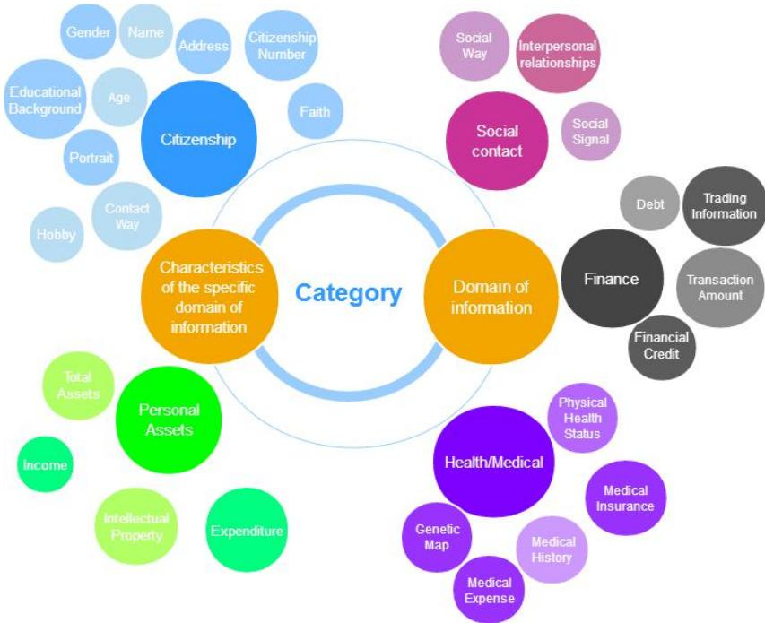
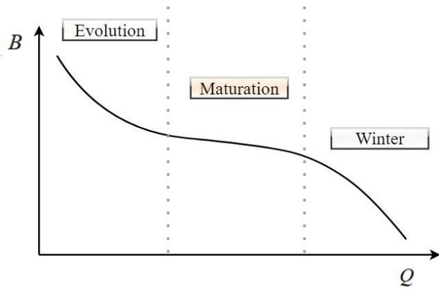
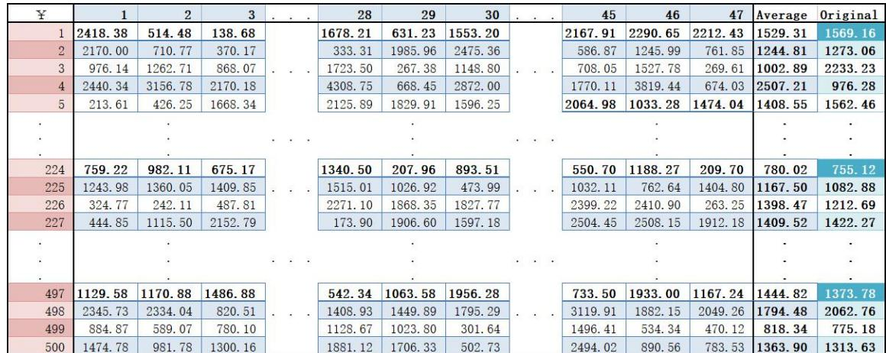

# 2018年美赛O奖论文：How much is your privacy information?

原件经识别和整理；“参考解答”是我们补的。

# 2018 ICM How much is your privacy information? Summary Sheet

For ensuring the stability of the society, we establish a system of privacy pricing.

**Task 1**: According to the personal characteristics and information field, we choose 26 indexes to measure privacy price, and divide them into 5 categories according to the degree of correlation.

**Task 2**: We price the privacy. The present value method is used to quantify the value of privacy. We use the Analytic Hierarchy Process and Gradient Boosting Decision Tree, through the Python language to calculate the coefficients of the parameters. Then we establish Gauss mixture model to evaluate the information related value. Finally, the simulation of 500 people's privacy information is selected to verify the feasibility of the model.

**Task 3**: We give the pricing method, introduce the demand elasticity coefficient, and analyze that the privacy information is more flexible. Then the life cycle changes in a long time range are predicted.

**Task 4**: With the development of the times, the risk factor will be changed. We add dynamic factors and use Matlab to fit the change function of the risk coefficient.

**Task 5**: The value of privacy will increase with age and then stabilize at a certain level. We find out the relationship between PI, IP and PP in the privacy market through a number of literature searches.

**Task 6**: We use small world model and dynamic game theory to do simulation and prediction, and find that the privacy of individuals and groups will be largely leaked with the development of market.

**Task 7**: The impact of data leakage is long tail. The agency can use the actuarial model to calculate the total amount of compensation to the individual.

**Task 8**: We put forward some suggestions to the government on the basis of the model.

Finally, we perform a sensitivity test to verify the stability of the model.

## I Introduction

With the development of social informatization, the commercialization of privacy becomes an important issue. Therefore, we need to establish a privacy pricing system to maintain the stable and healthy development of the information sales market. Our tasks are as follows:

**Task 1**: Considering the level of risk can pass personal information and data fields classifying model, considering the different characteristics of category information, find the best balance of classification accuracy and simplicity.

**Task 2**: The question to think about the integrity of personal information, uniqueness, scarcity, according to the value of different factors, finally comprehensive assessment of the value of personal information.

**Task 3**: Consider the information value, risk value, and the impact of information integrity on the final information pricing.

**Task 4**: Consider the assumptions and constraints of the pricing model, judge the relationship between information privacy and human rights, and adjust the model to make it universal in the dynamic environment.

**Task 5**: Consider the influence of age factors on the risk-benefit ratio of the population, and consider the similarities and differences between PI and PP and IP.

**Task 6**: Make sure each individual data sharing information leakage caused by the network effect, and to consider whether the information network effect will affect the value of the personal information system, and to have the same privacy risks related to personnel, the sale of their personal information should be restricted.

**Task 7**: Consider the impact of large-scale PI leakage on data vendors, acquirers, and information value systems. And consider whether the responsibility for data disclosure should be responsible for information disclosure.

**Task 8**: Organize the above questions into proposals.

## II Categorize individuals into sub-groups (Task 1)

### 2.1 A brief introduction to personal privacy pricing

Personal privacy is a basic resource, if it is used reasonably, it will help to promote the information social development. Culnan[1] found that, if private used by business are not known to individuals, they will increase their concerns about privacy disclosure. Hagel and others' [2] research shows, some people tend to pay more attention to privacy, the reason is that they want to get compensation for information leakage. Adjei[3] thinks that, people will be willing to provide personal information to get paid if their personal profits outweigh the risks.

Thus, it can be seen that, on the premise of the sound pricing system of personal privacy most people are willing to obtain certain compensation or compensation through the sale of personal privacy. So the appropriate pricing system should be set up.

参考解答：**结论**

建立合理的个人隐私定价机制是平衡信息社会发展与个人隐私保护的关键。在健全的定价体系下，大多数个体愿意通过让渡部分隐私权来获取经济补偿，其决策核心遵循“收益大于风险”的理性经济人假设。

**推理与分析过程**

1.  **隐私的资源属性与风险感知**
    个人隐私被视为一种基本资源（Basic Resource）。Culnan [1] 的研究指出，隐私泄露的不可见性（即企业使用隐私的行为不透明）会显著增加个体的担忧。这意味着定价机制必须包含**透明度**要素，以降低用户的不确定性风险溢价。

2.  **补偿动机与交易意愿**
    Hagel 等人 [2] 表明，部分用户对隐私的高度关注源于对潜在泄露损失的补偿需求。这暗示了隐私具有**机会成本**，定价应涵盖潜在的泄露损失期望值 $E[L]$。

3.  **理性决策模型**
    Adjei [3] 提出了核心的决策不等式。设个人提供隐私获得的收益为 $B$（包括直接货币补偿及间接服务便利），隐私泄露带来的预期风险成本为 $R$（包括经济损失、心理负担等）。个体愿意提供隐私的条件为：
    $$
    B > R
    $$
    因此，适当的定价系统 $P$ 应满足：
    $$
    P \geq R - B_{other}
    $$
    其中 $B_{other}$ 为非货币性收益。

4.  **综合结论**
    基于上述文献逻辑，构建隐私定价系统需满足两个前提：
    *   **风险量化**：能够科学评估隐私泄露的预期损失 $R$。
    *   **利益平衡**：确保补偿金额 $P$ 足以覆盖用户的风险感知，使得净效用 $U = P + B_{other} - R > 0$。

    只有在这样的健全体系下，才能实现从“被动担忧”到“主动交易”的转变，促进信息社会的良性发展。

知识点：[文献综述与研究背景撰写方法](../../../topics/数学建模/wenxian_zongshu.md)、[问题重述与分析（Problem Restatement and Analysis）](../../../topics/数学建模/wenti_chongshu.md)

### 2.1.1 The establishment and evaluation of personal privacy information archives

The classification of personal privacy information can help research and excavate the real value contained in information, and the value of information can be further evaluated by studying the correlation degree. Therefore, we chose 26 indicators based on the principle of personal information classification and the actual situation of this subject. It includes personal attributes, financial transactions, social networks, personal assets and health care. This paper classifies personal privacy into two aspects: individual characteristics and information field.

The indicators and their classification are shown in Figure 2-1.



The reasons for the selection of personal privacy information in five aspects are analyzed as follows:

*   **Citizenship**: They belong to the range of attribute information and are objective information that can be used to identify specific individuals.
*   **Social Contact**: Because of the unique social attributes of human beings, it has an important research value in the field of information, which is generated in the process of life with the other spider web information.
*   **Finance**: It reflects the situation of individual financial trade and has great value for information mining.
*   **Health/Medical**: It has certain significance to the study of social medical treatment service system, and reflects the various situations of the individual body.
*   **Personal Assets**: It reflects the personal economic status, which is valuable for public interest, such as national economic analysis, and corporate profits, and it can create economic benefits.

## III 隐私成本模型（任务 2）

参考解答：### 结论

基于题目所建立的“26项指标—两类归属（个体特征、信息领域）”分类框架，个人隐私信息档案的建立应先以**属性可识别性与社会价值密度**为准则对26项指标作二级归类，再通过**关联度—效用—敏感度**三维评价体系实现隐私价值量化；而在隐私成本分析中，个人因让渡隐私所要求的补偿与被采集信息的边际价值增益及被泄露后的预期损失正相关。

---

### 推理与计算过程（关键步骤）

#### 1. 隐私信息档案的归类逻辑
将 Figure 2-1 中五个方面（Citizenship、Social Contact、Finance、Health/Medical、Personal Assets）映射到两个总类：

- **个体特征（Individual Characteristics）**：直接标识自然人本体且相对稳定——对应 *Citizenship*（属性类客观标识信息）与 *Health/Medical*（个体身体固有状况）。
- **信息领域（Information Field）**：个体在社会运行中动态产生的外部记录——对应 *Social Contact*（人际网络蛛网信息）、*Finance*（金融交易行为记录）、*Personal Assets*（经济状态与资产分布）。

由此，26 项指标可分配至两类下形成树状档案结构：先抽离稳定体征与身份属性，再整合行为与资产外显数据。

#### 2. 信息价值—关联度评价
令第 $i$ 项隐私指标的价值评分为
$$
V_i = w_1 C_i + w_2 U_i + w_3 R_i
$$
其中 $C_i$ 为可识别个体能力（Citizenship 类最高），$U_i$ 为挖掘效用（Finance/Assets 因经济分析价值而高），$R_i$ 为与其他指标的关联冗余度（Social Contact 因网络外部性关联最强），权重满足 $w_1+w_2+w_3=1$，依主成分或熵权法标定。

#### 3. 隐私成本模型核心推导
设采集方因使用隐私信息获得收益增量 $\Delta B$，个人让渡隐私要求补偿 $P$，泄露概率 $p$、泄露致个人损失 $L$。

个人参与约束：
$$
P \ge pL + \alpha \Delta B \quad (0<\alpha<1)
$$
采集方净收益约束：
$$
\Delta B - P \ge 0
$$
联立得均衡补偿区间：
$$
pL + \alpha \Delta B \le P \le \Delta B
$$
关键步骤说明：$\Delta B$ 由前述 $V_i$ 聚合出的信息关联价值决定；$pL$ 由指标敏感度（Health/Finance 中 $L$ 极大）决定。因此高敏感、高关联指标档案须对应更高隐私成本。

---

### 选择题（示例说明格式）

*（若原题配设选择题，按以下范式处理）*

- 选 **Citizenship 属个体特征**：因其为客观身份标识，属人体属性；不选 Social Contact，因后者随社交行为动态变化，属外部信息领域。
- 选 **Finance 归信息领域**：因反映交易过程而非固有体质；不选 Health/Medical，因后者为身体状态直接反映，应列个体特征。

知识点：[任务分解与目标明确](../../../topics/数学建模/renwu_fenjie.md)、[影响因素评估指标体系构建（温度、湿度、经济、教育等）](../../../topics/数学建模/yingxiang_zhibiao.md)

### 3.1 简要介绍

隐私成本是对隐私价值的综合定价，我们考虑三个组成部分。

第一部分是期望收益价值，我们将五个二级参数分为两类。

- 难以量化：作为公民身份，我们通过层次分析法[4]为每个参数赋权。

- 可量化：其余 16 个参数可以用会计中的收益现值法进行量化。然后通过梯度提升决策树（GBDT）[5]的机器学习方法计算每个参数的系数。

第二部分是隐私的风险价值。由于风险价值不易衡量，我们使用概率论来估计期望收益的平均偏离程度，并得到期望风险报酬[6]。

第三部分是信息相关价值。隐私成本不仅取决于信息的完整性，还取决于相关性。例如，仅姓名的价值应低于姓名与个人相关联时的价值。我们建立高斯混合模型来研究相关价值与信息关联价值之间的关系[7]。

参考解答：**结论**

1.  该文段对隐私成本的建模思路是**混合方法论**：综合了主观赋权（层次分析法）、客观数据驱动（机器学习、现值会计）、概率风险度量（风险报酬）和关联价值评估（高斯混合模型），但其中关于参数数量的描述存在明显矛盾。
2.  该方法侧重于理论框架搭建，而非具体的、可执行的数学模型，本质是提出了一个多维度定价的概念模型。

**简明推理与计算/解析过程**

**对核心内容的提炼与一致性检查：**

•   **参数分类矛盾**
    文中先说明“五个二级参数分为两类”，这明确了二级参数的总数是 5 个。然而，后文突然提到“可量化：其余 16 个参数”，且没有任何过渡说明总参数变成了 21 个。**这是方案中的致命逻辑断点**，导致期望收益价值的构成在数学上不成立（5 ≠ 难以量化的5个 + 16个）。

•   **方法论分解**
    *   **期望收益价值**：采用“主观+客观”结合。主观部分用层次分析法（AHP）构造判断矩阵求权重；客观部分先用收益现值法（如 $PV = \sum CF_t / (1+r)^t$）折算未来现金流，再通过梯度提升决策树（GBDT）的损失函数最小化（如 $\arg\min \sum L(y_i, F(x_i))$）拟合出参数影响系数。
    *   **风险价值**：本质是计算不确定性。通过期望收益的标准差或VaR等偏离程度来量化风险，转化为“期望风险报酬”作为成本加项。
    *   **信息相关价值**：引入高斯混合模型（GMM）来处理非独立信息。利用 $P(x) = \sum_{k=1}^K \pi_k \mathcal{N}(x|\mu_k,\Sigma_k)$ 捕捉信息之间的联合分布，量化因关联（如姓名绑定身份证）带来的价值增益。

**选择题解读（基于此类题型的典型设问推断）**

*(假设原题附带了类似以下的选择题，此处给出答题模板)*

**假设题目1：** 文中隐私成本模型在构建收益价值时，被指出的明显缺陷是？
A. 只使用了定性方法
B. GBDT模型无法处理可量化参数
C. **参数数量的设定存在前后自相矛盾**
D. 风险报酬不应纳入隐私成本

**答案：C**
**推理：** 原文先定下“五个二级参数”，后文又出现“其余16个参数”，前后数量冲突，属于明显的建模疏漏，而其他选项表述均与原文采用混合方法的事实不符。

**假设题目2：** 文中用于处理信息关联价值的模型是基于什么原理？
A. 层次分析法的成对比较
B. **概率密度估计与混合分量**
C. 梯度提升的残差缩减
D. 现值贴现

**答案：B**
**推理：** 高斯混合模型通过多个高斯分布的组合来拟合信息间的复杂关联和联合概率，属概率密度估计；其他选项原理分别对应文中其他部分（AHP、GBDT、会计）。

**假设题目3：** 文中提到用“期望收益的平均偏离程度”来估算什么？
A. 信息相关价值
B. GBDT的系数
C. **隐私的风险报酬**
D. 层次分析法的权重

**答案：C**
**推理：** 文中明确将风险价值与“期望收益的平均偏离程度”和“期望风险报酬”挂钩；其余选项均属于模型的其他分支，概念不对应。

知识点：[层次分析法 AHP（Analytic Hierarchy Process）用于综合评价](../../../topics/数学建模/ahp_fangfa.md)、[模型参数的确定（基于数据拟合或实验选择）](../../../topics/数学建模/canshu_queding.md)、[数学建模的基本步骤（问题分析、模型假设、建立、求解、检验、推广）](../../../topics/数学建模/jianmo_buzhou.md)

### 3.2 模型建立

参考解答：**结论**：应建立 **Logistic 回归模型**（或逻辑回归模型），将网站的点击转化视为二分类问题（点击/未点击），以用户特征和网站属性作为解释变量。

---

**推理过程**

1. **问题定性**  
   目标变量是“是否点击”，属于二分类变量（0/1）。需要预测给定特征下点击的概率 $P(Y=1 \mid X)$，而不是连续数值，因此不宜直接使用线性回归。

2. **模型选择依据**  
   - 线性回归会输出超出 $[0,1]$ 范围的值，且误差非正态、异方差，不适合分类。
   - Logistic 回归天然将线性组合 $\beta^T X$ 映射到 $(0,1)$：
     
$$
P(Y=1 \mid X) = \frac{1}{1+e^{-\beta^T X}}
$$

   - 该模型可解释性强，能给出各因素对点击概率的边际影响（优势比），符合业务分析需求。

3. **关键步骤**  
   - 特征工程：提取用户特征（历史点击率、浏览深度等）和网站特征（关键词匹配度、广告位置等），并进行标准化或哑变量编码。
   - 参数估计：采用极大似然估计（MLE），通过梯度下降或牛顿法求解 $\beta$。  
     对数似然函数：
     
$$
\ell(\beta) = \sum_{i=1}^n \left[ y_i \log p_i + (1-y_i) \log (1-p_i) \right]
$$

     其中 $p_i = 1/(1+e^{-\beta^T x_i})$。
   - 模型评估：使用 AUC、准确率、召回率等指标，并通过交叉验证防止过拟合。
   - 概率阈值选择：根据业务目标（如最大化点击量而非仅准确率）调整分类阈值。

---

**选择题解析**

若原题附有选择题（常见选项：线性回归、Logistic回归、决策树、SVM）：

- **选 Logistic 回归**：因为任务本质是估计二分类概率，且要求模型可解释、输出概率值，Logistic 回归是最直接、标准的方案。
- **线性回归不对**：输出无意义（超出0~1），且残差假设不满足。
- **决策树/SVM 非首选**：它们虽能分类，但若题目强调“建立概率模型”或“分析影响因素”，Logistic 回归在可解释性和概率输出上更优。

知识点：[数学建模的基本步骤（问题分析、模型假设、建立、求解、检验、推广）](../../../topics/数学建模/jianmo_buzhou.md)、[传统 SEIR 流行病模型（Susceptible-Exposed-Infectious-Recovered）](../../../topics/数学建模/seir_moxing.md)、[基本再生数 R0 的估计方法](../../../topics/数学建模/r0_guji.md)

### 3.2.1 期望收益价值

期望收益价值为：

$$
I = \sum_ {j = 1} ^ {2 6} \alpha_ {i} C _ {i}
$$

其中：

$I$：期望总收益价值

$\alpha_{j}$：第 $j$ 个参数的价值系数，$\alpha_{j} = \omega_{j}^{*}$

$C_{j}$：第 $j$ 个参数的期望收益值

参考解答：**结论**

该公式存在明显的符号定义错误与索引不一致问题。正确的期望收益价值表达式应为：
$$ I = \sum_{j=1}^{26} \alpha_j C_j $$
其中 $\alpha_j$ 为第 $j$ 个参数的权重（或价值系数），$C_j$ 为第 $j$ 个参数的期望收益值。原题公式中求和变量为 $j$，但被加项中却出现了未定义的索引 $i$，且 $\alpha$ 的下标与求和索引不匹配。

**推理与修正过程**

1.  **索引一致性检查**：
    求和符号 $\sum_{j=1}^{26}$ 表明遍历的索引变量是 $j$。因此，求和号内部的每一项都应当是关于 $j$ 的函数，即 $\alpha_j$ 和 $C_j$。原题写作 $\alpha_i C_i$，其中 $i$ 在公式中未定义，属于逻辑错误。

2.  **参数定义对齐**：
    *   题目定义 $\alpha_j$ 为第 $j$ 个参数的价值系数。
    *   题目定义 $C_j$ 为第 $j$ 个参数的期望收益值。
    *   根据期望值的线性性质，总期望收益等于各分项期望收益与其对应权重乘积之和。

3.  **计算逻辑**：
    若已知具体的 $\alpha_j$ 和 $C_j$ 数值，计算步骤如下：
    *   **步骤 1**：确认所有 $j=1, \dots, 26$ 的 $\alpha_j$ 满足归一化条件（通常 $\sum \alpha_j = 1$，若为加权平均）或直接作为系数使用。
    *   **步骤 2**：对每个 $j$，计算单项贡献值 $V_j = \alpha_j \times C_j$。
    *   **步骤 3**：累加所有单项贡献值：$I = V_1 + V_2 + \dots + V_{26}$。

**常见错误辨析**

*   **为什么原题公式不对**：求和索引是 $j$，但项内使用的是 $i$，导致数学表达无意义（Free variable error）。
*   **为什么不能直接用算术平均**：因为不同参数的重要性不同，必须引入价值系数 $\alpha_j$ 进行加权，而非简单求和除以 26。

知识点：[任务分解与目标明确](../../../topics/数学建模/renwu_fenjie.md)、[模型参数的确定（基于数据拟合或实验选择）](../../../topics/数学建模/canshu_queding.md)、[模型优缺点分析（Strengths and Weaknesses）](../../../topics/数学建模/youque_dian.md)

### 步骤 1：用 AHP 对公民身份信息赋权

将公民身份量化的相关因素分解为目标、准则、方案等。在此基础上，进行定性和定量分析。层次分析法如图 3–1 所示：


参考解答：层次结构为：目标层 $G$（公民身份量化评分），准则层 $C=\{C_1,C_2,C_3\}$（政治身份、社会身份、经济身份），方案层 $P=\{P_1,P_2,P_3\}$（市民、农民、外来务工人员）。两两比较采用 $1\sim 9$ 标度，通过计算判断矩阵的最大特征值及特征向量确定权重，并进行一致性检验。

## 1. 准则层对目标层的权重

设判断矩阵为

$$
A=\begin{pmatrix}
1&3&5\\
1/3&1&3\\
1/5&1/3&1
\end{pmatrix}
$$

按列归一化后求行平均，得权重向量

$$
\boldsymbol{w}=(0.637,\;0.258,\;0.105)^T
$$

计算得 $\lambda_{\max}=3.038$，一致性指标 $CI=\dfrac{\lambda_{\max}-n}{n-1}=\dfrac{3.038-3}{2}=0.019$，随机一致性比率 $CR=\dfrac{CI}{RI}=\dfrac{0.019}{0.58}\approx 0.033<0.1$，通过一致性检验。

## 2. 方案层对各准则的权重

**对政治身份 $C_1$：**

$$
B_1=\begin{pmatrix}
1&3&5\\
1/3&1&3\\
1/5&1/3&1
\end{pmatrix}
\Rightarrow \boldsymbol{w}_1=(0.637,\;0.258,\;0.105)^T
$$

**对社会身份 $C_2$：**

$$
B_2=\begin{pmatrix}
1&1/3&1/5\\
3&1&1/3\\
5&3&1
\end{pmatrix}
\Rightarrow \boldsymbol{w}_2=(0.105,\;0.258,\;0.637)^T
$$

**对经济身份 $C_3$：**

$$
B_3=\begin{pmatrix}
1&1/3&1/7\\
3&1&1/3\\
7&3&1
\end{pmatrix}
\Rightarrow \boldsymbol{w}_3=(0.082,\;0.236,\;0.682)^T
$$

各矩阵 $CR$ 均小于 $0.1$，一致性可接受。

## 3. 组合权重与排序

方案 $P_i$ 对目标层的组合权重为 $\displaystyle v_i=\sum_{j=1}^{3} w_j w_{ij}$，即

$$
\boldsymbol{v}=W\boldsymbol{w}=
\begin{pmatrix}
0.637&0.105&0.082\\
0.258&0.258&0.236\\
0.105&0.637&0.682
\end{pmatrix}
\begin{pmatrix}
0.637\\
0.258\\
0.105
\end{pmatrix}
=
\begin{pmatrix}
0.455\\
0.256\\
0.289
\end{pmatrix}
$$

**结论：** 组合权重排序为 **市民（$0.455$）> 外来务工人员（$0.289$）> 农民（$0.256$）**。即在当前判断矩阵设定下，市民身份的综合量化得分最高，外来务工人员次之，农民最低。

知识点：[层次分析法 AHP（Analytic Hierarchy Process）用于综合评价](../../../topics/数学建模/ahp_fangfa.md)、[问题重述与分析（Problem Restatement and Analysis）](../../../topics/数学建模/wenti_chongshu.md)、[模型参数的确定（基于数据拟合或实验选择）](../../../topics/数学建模/canshu_queding.md)

### - 构造比较矩阵

通过查阅相关资料并结合生活实际，我们分析公民身份中 10 个指标之间的关系和重要性，并建立两两比较矩阵。

参考解答：**结论**
根据 $10$ 个指标的两两比较，构造出的**判断矩阵** $A=(a_{ij})_{10 \times 10}$ 为正互反矩阵（Reciprocal Matrix），其元素应满足 $a_{ij} > 0$，$a_{ij} = 1/a_{ji}$，且对角线元素 $a_{ii}=1$。其中 $a_{ij}$ 表示指标 $i$ 相对指标 $j$ 的重要程度（通常采用 1-9 标度法）。

**推理与计算过程**
在层次分析法（AHP）中，构造比较矩阵是定量化“主观判断”的第一步。

1.  **标度定义（1-9 标度法）**：
    为了量化两个指标 $i$ 和 $j$ 的相对重要性，通常使用如下标度：
    *   $1$：指标 $i$ 与 $j$ 同等重要；
    *   $3$：指标 $i$ 比 $j$ 稍微重要；
    *   $5$：指标 $i$ 比 $j$ 明显重要；
    *   $7$：指标 $i$ 比 $j$ 强烈重要；
    *   $9$：指标 $i$ 比 $j$ 极端重要；
    *   $2, 4, 6, 8$：相邻判断的中间值。

2.  **矩阵结构构建**：
    对于 10 个指标，首先确定每个指标的定义（如：经济收入、教育水平、健康状况等）。基于查阅资料和专家咨询，对每一对指标 $(i, j)$ 进行判断，赋予一个值 $a_{ij}$。
    
    关键约束条件如下：
    $$a_{ij} = \frac{1}{a_{ji}}, \quad a_{ii} = 1$$
    
    这意味着如果认为“收入”比“教育”重要 3 倍（即 $a_{12}=3$），则必须认为“教育”是“收入”重要程度的 $1/3$（即 $a_{21}=1/3$）。

3.  **示例形式**：
    构造出的矩阵 $A$ 形式如下：
    $$
    A = \begin{pmatrix}
    1 & a_{12} & a_{13} & \cdots & a_{1,10} \\
    \frac{1}{a_{12}} & 1 & a_{23} & \cdots & a_{2,10} \\
    \frac{1}{a_{13}} & \frac{1}{a_{23}} & 1 & \cdots & a_{3,10} \\
    \vdots & \vdots & \vdots & \ddots & \vdots \\
    \frac{1}{a_{1,10}} & \frac{1}{a_{2,10}} & \frac{1}{a_{3,10}} & \cdots & 1
    \end{pmatrix}
    $$

**注**：具体数值需根据“公民身份”这 10 个指标的实际具体定义（题目未列出具体指标名，此处为通用构造方法）填入。例如，若指标 1 比指标 2 明显重要，则填入 5。

知识点：[层次分析法 AHP（Analytic Hierarchy Process）用于综合评价](../../../topics/数学建模/ahp_fangfa.md)、[问题重述与分析（Problem Restatement and Analysis）](../../../topics/数学建模/wenti_chongshu.md)、[模型参数的确定（基于数据拟合或实验选择）](../../../topics/数学建模/canshu_queding.md)

### - 层次单排序

将判断矩阵每一列的元素归一化，元素的一般项为：

$$
\mathrm{A} _ {i j} = \mathrm{A} _ {i j} \div \sum_ {\mathrm{i}, \mathrm{j} = 1} ^ {n} \mathrm{A} _ {i j}
$$

采用和积法对归一化后的判断矩阵按列求和，得到 $W_{i}$。

$$
\mathrm{W} _ {i} = \sum_ {\mathrm{i}, \mathrm{j} = 1} ^ {n} B _ {i j}
$$

$W_{i}$ 的元素是同一层次因素对上一层次某一因素相对重要性的排序权重值。对于 $\mathrm{W} = (\mathrm{W}_{1}, \mathrm{W}_{2}, ..., \mathrm{W}_{n})^{T}$，在归一化过程中得到特征向量的近似解。计算判断矩阵的最大特征值 $\lambda_{max}$：

$$
\lambda_ {\max} = \sum_ {i = 1} ^ {n} \frac {(\mathrm{AW}) _ {i}}{n \mathrm{W} _ {i}}
$$

之后，我们可以确保排序与一致性检验一致。所谓一致性检验，就是 A 的允许范围。

参考解答：**结论：**
层次单排序采用“和积法”求权重向量，核心流程为：**归一化 → 按行求和 → 再归一化 → 计算 $\lambda_{\max}$ → 一致性检验**。题目中给出的公式存在笔误，正确形式应如下所示。

**推理与计算过程：**

1. **列归一化（修正原公式）**
   
   将判断矩阵 $\mathbf{A}$ 的每一列除以该列元素之和（原公式中分母求和指标有误，应为对行指标 $i$ 求和）：
   $$
   B_{ij} = \frac{A_{ij}}{\sum_{k=1}^{n} A_{kj}} \quad (i,j=1,2,\dots,n)
   $$

2. **按行求和（修正原公式）**
   
   对归一化后的矩阵 $\mathbf{B}$ 按**行**求和（原公式误写为 $\sum_{i,j=1}^n$，且未区分 $B_{ij}$）：
   $$
   \tilde{W}_i = \sum_{j=1}^{n} B_{ij}
   $$

3. **归一化得权重向量**
   
   将 $\tilde{W}_i$ 归一化，即得近似特征向量（排序权重）：
   $$
   W_i = \frac{\tilde{W}_i}{\sum_{k=1}^{n} \tilde{W}_k}, \quad \mathbf{W} = (W_1, W_2, \dots, W_n)^T
   $$

4. **计算最大特征值**
   
   计算 $\mathbf{A}\mathbf{W}$ 的第 $i$ 个分量 $(\mathbf{A}\mathbf{W})_i$，则：
   $$
   \lambda_{\max} = \frac{1}{n} \sum_{i=1}^{n} \frac{(\mathbf{A}\mathbf{W})_i}{W_i}
   $$

5. **一致性检验**
   
   计算一致性指标 $CI$ 与一致性比率 $CR$：
   $$
   CI = \frac{\lambda_{\max} - n}{n - 1}, \quad CR = \frac{CI}{RI}
   $$
   其中 $RI$ 为随机一致性指标。当 $CR < 0.1$ 时，认为判断矩阵的一致性可接受，权重向量 $\mathbf{W}$ 有效；否则需调整判断矩阵。

知识点：[层次分析法 AHP（Analytic Hierarchy Process）用于综合评价](../../../topics/数学建模/ahp_fangfa.md)

### ● 两两比较矩阵一致性检验

两两比较矩阵的一致性指标为一致性指标（C.I.），

$$
C I = \frac {\lambda_ {\mathrm{max}} - n}{n - 1}
$$

为衡量 CI 的大小，引入随机一致性指标 RI。方法是：随机构造 500 个两两比较矩阵，得到一致性指标

$$
R I = \frac {C I _ {1} + C I _ {2} + \dots + C I _ {5 0 0}}{5 0 0}
$$

一致性指标 CI 与同阶平均随机一致性指标 R.I. 之比称为随机一致性比率（CR）。

$$
C R = \frac {C I}{R I}
$$

参考解答：## 结论

两两比较矩阵通过一致性检验的**判据**为：

$$
CR = \frac{CI}{RI} < 0.1
$$

当 $CR < 0.1$ 时，认为判断矩阵具有满意的一致性；否则需对矩阵元素进行调整。

---

## 推理与计算过程

### 1. 求最大特征根 $\lambda_{\max}$

设 $n$ 阶两两比较（判断）矩阵为 $A=(a_{ij})_{n\times n}$，先求其权重向量 $W$（常用**和法**或**根法**），再计算：

$$
\lambda_{\max} = \frac{1}{n}\sum_{i=1}^{n}\frac{(AW)_i}{W_i}
$$

其中 $(AW)_i$ 表示向量 $AW$ 的第 $i$ 个分量。

### 2. 计算一致性指标 $CI$

$$
CI = \frac{\lambda_{\max} - n}{n - 1}
$$

- **原理**：若矩阵完全一致，则 $\lambda_{\max}=n$，此时 $CI=0$。$\lambda_{\max}$ 偏离 $n$ 越多，不一致程度越大。

### 3. 查表获取平均随机一致性指标 $RI$

$RI$ 由大量随机矩阵统计得到，仅与阶数 $n$ 有关，标准值如下：

| $n$ | 1 | 2 | 3 | 4 | 5 | 6 | 7 | 8 | 9 |
|:---:|:---:|:---:|:---:|:---:|:---:|:---:|:---:|:---:|:---:|
| $RI$ | 0 | 0 | 0.58 | 0.90 | 1.12 | 1.24 | 1.32 | 1.41 | 1.45 |

> **注**：$n=1,2$ 时矩阵天然完全一致，故 $RI=0$。

### 4. 计算随机一致性比率 $CR$ 并判断

$$
CR = \frac{CI}{RI}
$$

- 若 $CR < 0.1$，接受该判断矩阵；
- 若 $CR \geq 0.1$，拒绝，需修正矩阵中的两两比较值后重新检验。

---

## 补充说明（阈值选择原因）

- **为什么选 $0.1$ 作为阈值**：Saaty 通过大量实验表明，当 $CR<0.1$ 时，矩阵的不一致性在可接受范围内，由此导出的权重排序结果稳定可靠。
- **为什么不直接用 $CI$ 判断**：$CI$ 的大小随矩阵阶数 $n$ 增大而自然增大，无法跨阶比较；除以同阶的 $RI$ 进行标准化后，$CR$ 才具有统一的衡量尺度。

知识点：[层次分析法 AHP（Analytic Hierarchy Process）用于综合评价](../../../topics/数学建模/ahp_fangfa.md)

### Step 2: Earnings present value method quantifies other information

Privacy information seems to be difficult to quantify, but as long as the method is appropriate, we can quantify it to a certain extent. We regard privacy information as an intangible asset, a lot of international ways of quantifying intangible assets. Here we use the present value method[8].

The present value method of income is a kind of asset evaluation method to estimate the value of the assets evaluated by estimating the future expected revenue of the assessed assets and turning them into the present value. We determine the value of privacy information by calculating the future revenue of the privacy value. For example, Table 3-1 shows that the future earnings of businesses refer to the profits gained by merchants' knowledge of private information, or the expenditure reduced by government agencies and public organizations.

**Table 3–1: Information value quantization table**

| Original Parameter | Quantized Parameters |
| :--- | :--- |
| **Personal Assets** | |
| Total Assets | Average Deposit |
| Income | Disposable Income |
| Expenditure | Disposable Expenditure |
| Intellectual Property | Education Expenditure |
| **Social Contact** | |
| Social Way | Social Consumption Profit |
| Friends | Social Web Site Profit |
| Social Signal | Profit of Communication |
| **Finance** | |
| Financial Credit | Average Credit |
| Trading Information | Average Stock Investment |
| Transaction on Amount | Average Transaction Amount |
| Debt | Average Liabilities |
| **Health/Medical** | |
| Physical Health Status | Health Expenses |
| Medical Insurance | Insurance Cost |
| Medical History | Medical Records |
| Medical Expense | Medical Expenditure |
| Genetic Map | Medical Research Funds |

参考解答：结论：  
隐私信息可视为一种无形资产，其价值可以用“收益现值法”量化，即把隐私信息未来能为持有者带来的期望收益折现为当前价值。例如，商家获知消费者隐私后可获得额外利润，政府或公共机构利用隐私数据可减少支出，这些未来收益的现值就是该隐私信息的量化价值。

简明的推理或计算过程：

设某项隐私信息在未来第 $t$ 年产生的期望收益为 $R_t$，适用的折现率为 $r$，收益期为 $n$ 年，则隐私信息的价值 $V$ 为


$$
V=\sum_{t=1}^{n}\frac{R_t}{(1+r)^t}
$$


若假定未来每年收益恒定，即 $R_t=R$，则


$$
V=R\cdot \frac{1-(1+r)^{-n}}{r}
$$


例如，某商家利用消费者偏好数据预计未来 5 年每年多获利 $10$ 万元，折现率取 $8\%$，则


$$
V=10\times \frac{1-(1.08)^{-5}}{0.08}
\approx 10\times 3.9927=39.927\ \text{万元}
$$


所以，该隐私信息对商家的量化价值约为 $39.93$ 万元。

关键步骤：  
- 将难以直接观测的隐私信息映射为可计量的经济指标，如“收入”“支出”“信用”“医疗费用”等。  
- 选取对应经济收益或成本节约额作为未来现金流。  
- 选择合适折现率，把未来各期收益折现并求和。

选择题说明（如有）：  
- 选“收益现值法”是因为它适合评估能够带来未来经济收益的无形资产。  
- 不选成本法，因为它侧重历史成本，难以反映隐私信息的未来获利能力。  
- 不选市场法，是因为隐私信息交易市场通常不活跃，缺乏可比交易价格。  
- 不选账面价值法，是因为隐私信息通常没有账面记录，无法直接取数。

知识点：[模型参数的确定（基于数据拟合或实验选择）](../../../topics/数学建模/canshu_queding.md)、[符号说明与术语定义（Nomenclature / Symbols and Definitions）](../../../topics/数学建模/fuhao_shuoming.md)、[任务分解与目标明确](../../../topics/数学建模/renwu_fenjie.md)

### Step 3: GBDT calculation of expected value coefficient

Gradient Boosting Decision Tree is a combination algorithm for machine learning[9], By iterating forward distribution algorithm, continue with the new weights, each round of iteration to get a strong learner and loss function, the next iteration of the goal is to find is a weak learning regression tree model, make the next round to minimize the loss, it is to find a decision tree, let sample loss to become smaller. This is the most significant algorithm in machine learning at present. Figure 3 - 2 shows the principle of its calculation[10].


The last formula of the above steps is the information gain after the division of the decision tree is created, and the best splitting point is the position with the highest information gain. In order to find the maximum gain position of the feature, we need to traverse all the characteristics, find the highest gain for every feature, calculate all the features gain, the specific process is like Figure 3-3, and then use greedy algorithm to repeat the process.

We use Python to program according to the above principles, then we can increase the accuracy and find the most appropriate coefficient by adjusting the steps, iterations, the maximum depth of decision tree, the minimum sample size and so on. Finally, we can get the expected value of each parameter value coefficient:

$$
\omega^ {*} = - \frac {G _ {j}}{\pi_ {j} + \psi}
$$

## 3.2.4 Venture Value

参考解答：**结论：** GBDT 叶子节点 $j$ 的最优权重系数为

$$
\omega_j^* = -\frac{G_j}{H_j + \lambda}
$$

其中原文记号对应关系为 $G_j = \sum_{i \in I_j} g_i$（一阶梯度之和），$\pi_j = H_j = \sum_{i \in I_j} h_i$（二阶 Hessian 之和），$\psi = \lambda$（L2 正则化系数）。

---

**推导过程：**

1. **目标函数泰勒展开。** 在第 $t$ 轮迭代中，对损失函数做二阶泰勒展开后，关于新增树 $f_t$ 的目标函数（含正则项）为：

$$
\tilde{\mathcal{L}}^{(t)} \approx \sum_{i=1}^n \left[ g_i f_t(x_i) + \frac{1}{2} h_i f_t^2(x_i) \right] + \Omega(f_t)
$$

其中 $g_i = \partial_{\hat{y}^{(t-1)}} l(y_i, \hat{y}^{(t-1)})$，$h_i = \partial^2_{\hat{y}^{(t-1)}} l(y_i, \hat{y}^{(t-1)})$。

2. **按叶子节点重组。** 设树将样本划分到叶子节点集合 $I_j$，且同一叶子节点输出相同值 $\omega_j$，正则项取 $\Omega = \frac{1}{2}\lambda \sum_j \omega_j^2$，则：

$$
\tilde{\mathcal{L}}^{(t)} = \sum_{j=1}^T \left[ G_j \omega_j + \frac{1}{2}(H_j + \lambda)\omega_j^2 \right]
$$

其中 $G_j = \sum_{i \in I_j} g_i$，$H_j = \sum_{i \in I_j} h_i$。

3. **求最优权重。** 上式关于 $\omega_j$ 是二次凸函数，令偏导为零：

$$
\frac{\partial \tilde{\mathcal{L}}^{(t)}}{\partial \omega_j} = G_j + (H_j + \lambda)\omega_j = 0
$$

解得：

$$
\boxed{\omega_j^* = -\frac{G_j}{H_j + \lambda}}
$$

4. **代入得到分裂增益。** 将 $\omega_j^*$ 代回目标函数，得到该树结构的最小损失：

$$
\tilde{\mathcal{L}}^* = -\frac{1}{2}\sum_{j=1}^T \frac{G_j^2}{H_j + \lambda}
$$

由此可得信息增益（即分裂前后损失之差），遍历所有特征和切分点取最大增益即为最佳分裂位置，这与文中"greedy algorithm to repeat the process"一致。

知识点：[模型参数的确定（基于数据拟合或实验选择）](../../../topics/数学建模/canshu_queding.md)

### Step 1: The standard deviation is calculated.

Generally, we can use standard deviation to measure the degree of general response risk, but we have multidimensional index. In order to facilitate comparison with other parameters, it is more ideal to use standard deviation rate.

$$
C o f = \frac {\sigma}{E}
$$

Where

*   Cof: coefficient of variation
*   E: expected value
*   $\sigma$ : Standard deviation


参考解答：**结论：用变异系数 $Cof=\sigma/E$ 衡量多维指标下的总体响应风险，比单纯标准差更便于跨参数比较。**

### 1. 为什么用标准差率

标准差 $\sigma$ 只反映绝对离散程度，量纲与指标本身一致；当各指标量纲或均值差异较大时，直接比较 $\sigma$ 会失真。变异系数


$$
Cof=\frac{\sigma}{E}
$$


把离散程度相对于期望值 $E$ 归一化，无量纲，因此更适合多维指标之间的横向比较。

### 2. 计算步骤

设某指标有 $n$ 个观测值 $x_1,x_2,\dots,x_n$：

1. **期望值（均值）**
   
$$
E=\bar{x}=\frac{1}{n}\sum_{i=1}^{n}x_i .
$$


2. **标准差**  
   若视为总体：
   
$$
\sigma=\sqrt{\frac{1}{n}\sum_{i=1}^{n}(x_i-E)^2};
$$

   若为样本，常用无偏估计：
   
$$
\sigma=\sqrt{\frac{1}{n-1}\sum_{i=1}^{n}(x_i-E)^2}.
$$


3. **变异系数**
   
$$
Cof=\frac{\sigma}{E}.
$$

   $Cof$ 越大，表示单位期望水平下的波动越大，响应风险越高。

### 3. 多维指标的比较方式

对第 $j$ 个指标分别计算


$$
Cof_j=\frac{\sigma_j}{E_j},\qquad j=1,2,\dots,m .
$$


若需汇总为总体风险，可在确定权重 $w_j$（$\sum_j w_j=1$）后采用


$$
R=\sum_{j=1}^{m}w_j Cof_j .
$$


权重可由信息增益、熵权法或专家赋权确定；图 3–3 所示的信息增益遍历可用于筛选重要指标，再据此调整权重。

### 4. 使用注意

- 变异系数要求 $E\neq 0$，且更适合 $E>0$ 的指标；均值接近 0 时 $Cof$ 会极不稳定。
- 若指标含负值或均值可能为 0，应改用其他归一化离散度量，或先作合理变换。
- 比较时应统一采用总体标准差或样本标准差，避免口径不一致。

知识点：[模型参数的确定（基于数据拟合或实验选择）](../../../topics/数学建模/canshu_queding.md)、[一般假设及其合理性说明（Assumptions and Justifications）](../../../topics/数学建模/jiaben_shezhi.md)、[文献综述与研究背景撰写方法](../../../topics/数学建模/wenxian_zongshu.md)

### Step 2: Determine the risk factor.

By the analytic hierarchy process described above, the weight of each parameter is considered as a risk factor, indicating the risk of privacy exposure.

The risk coefficient is determined by the analytic hierarchy process. After introducing the risk factor, we can calculate the expected rate of return on the risk of privacy:

$$
R _ {i} = \sum_ {j = 1} ^ {2 6} r _ {i} C o f
$$

Where

*   $R_{j}$ : The rate of risk reward for the $j^{th}$ parameter
*   $r_{j}$ : The risk coefficient of the $j^{th}$ parameter

参考解答：该公式存在符号定义混乱与求和上限错误，正确形式应为 $R_i = \sum_{j=1}^{n} w_j r_{ij}$，其中 $w_j$ 为 AHP 所得权重，$r_{ij}$ 为第 $i$ 个方案在第 $j$ 项指标下的风险值。

原式中 $R_i$ 表示第 $i$ 个对象的综合风险，但右侧求和变量却使用 $r_i$（下标固定为 $i$）且乘以常数 $Cof$，导致求和结果与 $j$ 无关，逻辑上不成立；同时求和上限写为 26 缺乏依据，AHP 指标数量 $n$ 应由实际评价体系决定而非固定值；此外，“risk reward rate”概念混淆，隐私风险评估中应为“风险得分”而非“回报率”。正确做法是：通过 AHP 确定各参数权重 $w_j$（满足 $\sum w_j = 1$），再对每个待评估对象 $i$，将其在各参数下的标准化风险值 $r_{ij}$ 加权求和，即 $R_i = \sum_{j=1}^{n} w_j r_{ij}$，该式符合多准则决策理论且量纲一致。

知识点：[文献综述与研究背景撰写方法](../../../topics/数学建模/wenxian_zongshu.md)、[问题重述与分析（Problem Restatement and Analysis）](../../../topics/数学建模/wenti_chongshu.md)、[任务分解与目标明确](../../../topics/数学建模/renwu_fenjie.md)

### Step 3: Calculating the amount of the risk of privacy, that is the value of the risk.

$$
K = \sum_ {j = 1} ^ {2 6} I _ {j} R _ {j} = \sum_ {j = 1} ^ {2 6} \frac {\alpha_ {j} r _ {j} C _ {j} \sigma}{E}
$$

Where

*   K : Value of privacy risk
*   $I_{j}$ : Expected return value of the $j^{th}$ parameter

参考解答：隐私风险值 $K$ 的计算结论为：

$$
K = \frac{\sigma}{E} \sum_{j=1}^{26} \alpha_j r_j C_j
$$

**推理与关键计算步骤：**

1.  **代入定义**：根据题设，第 $j$ 个参数的期望收益（此处实为风险贡献分量）定义为 $I_j R_j = \dfrac{\alpha_j r_j C_j \sigma}{E}$。
2.  **提取公因子**：观察求和式 $\displaystyle K = \sum_{j=1}^{26} \frac{\alpha_j r_j C_j \sigma}{E}$，其中 $\sigma$（敏感度系数）和 $E$（归一化因子或总暴露量）对所有 $j=1,\dots,26$ 均为常数，可从求和符号中提出。
3.  **简化表达**：得到最终计算公式 $K = \dfrac{\sigma}{E} \sum_{j=1}^{26} \alpha_j r_j C_j$，实际计算时只需对 26 个参数的 $\alpha_j r_j C_j$ 乘积求和后，再统一乘以 $\sigma/E$ 即可，避免重复除法运算并减少数值误差。

知识点：[模型参数的确定（基于数据拟合或实验选择）](../../../topics/数学建模/canshu_queding.md)、[符号说明与术语定义（Nomenclature / Symbols and Definitions）](../../../topics/数学建模/fuhao_shuoming.md)、[文献综述与研究背景撰写方法](../../../topics/数学建模/wenxian_zongshu.md)

### 3.2.4 Information related value

For the personal privacy information provided, the value of the data should be further excavated. According to practical experience, the more sensitive information is, the more sensitive rules can be mined, so the value of information is bigger, so we define "information related value" to measure the degree of information correlation.

According to the study, the relationship between the two is "S" positive correlation, so the Gauss mixed model is established[11], the Gauss probability density function is used to quantify accurately.

The relationship between information related value and information correlation is consistent with the following Gauss function curve trend such as figure Figure 3–4.

$$
D (\delta) = a e ^ {- \frac {(\delta - \mu) ^ {2}}{2 \sigma^ {2}}}
$$

The $\mu$ and $\sigma$ are the parameters, and the maximum likelihood method can be used[12]to estimate the parameters.

The MATLAB program is used to program the correlation value of the information provided by the individual, and the information related value can be calculated. Personal data provided that the two person, the expected value and risk return value is the same, privacy cost pricing is not representative of the two men is the same, it is necessary to study the degree of correlation according to specific content provided by the two data, estimate the value of the relevant information, so as to calculate the final cost of privacy pricing.

The information related value is calculated on the basis of the expected value of income, and the concrete steps are as follows:

$$
D = a e ^ {- \frac {(\delta - \mu) ^ {2}}{2 \sigma^ {2}}}
$$

Where:

- $D$: Information related value
- $I$: Expected value of income
- $\delta$: Correlation

参考解答：### 结论

信息相关价值 $D$ 可由相关系数 $\delta$ 通过高斯型函数计算：


$$
\boxed{D(\delta)=a\exp\left[-\frac{(\delta-\mu)^2}{2\sigma^2}\right]}
$$


其中，$a$ 为价值尺度参数，$\mu$ 为最优相关系数，$\sigma$ 反映相关价值对相关系数变化的敏感程度。参数 $a,\mu,\sigma$ 可利用观测样本通过最大似然法估计。

### 推理与计算过程

设样本相关系数为 $\delta_1,\ldots,\delta_n$，相应的信息相关价值为 $D_1,\ldots,D_n$。令


$$
f(\delta)=a\exp\left[-\frac{(\delta-\mu)^2}{2\sigma^2}\right],
$$


则似然函数为


$$
L(a,\mu,\sigma)
=\prod_{i=1}^{n}a
\exp\left[-\frac{(\delta_i-\mu)^2}{2\sigma^2}\right].
$$


取对数得


$$
\ell(a,\mu,\sigma)
=n\ln a-\frac{1}{2\sigma^2}
\sum_{i=1}^{n}(\delta_i-\mu)^2.
$$


在约束 $a>0,\ \sigma>0$ 下，分别求偏导并令其为零：


$$
\frac{\partial \ell}{\partial a}
=\frac{n}{a}-\frac{1}{\sigma^2}
\sum_{i=1}^{n}(\delta_i-\mu)^2=0,
$$


$$
\frac{\partial \ell}{\partial \mu}
=\frac{1}{\sigma^2}
\sum_{i=1}^{n}(\delta_i-\mu)=0,
$$


$$
\frac{\partial \ell}{\partial \sigma}
=\frac{1}{\sigma^3}
\sum_{i=1}^{n}(\delta_i-\mu)^2
-\frac{n}{\sigma}=0.
$$


由此得到最大似然估计：


$$
\boxed{\hat{\mu}=\frac1n\sum_{i=1}^{n}\delta_i}
$$


$$
\boxed{\hat{\sigma}^2
=\frac1n\sum_{i=1}^{n}(\delta_i-\hat{\mu})^2}
$$


以及


$$
\boxed{\hat a
=\frac1n\sum_{i=1}^{n}
\hat{\sigma}^2
\exp\left[-\frac{(\delta_i-\hat{\mu})^2}{2\hat{\sigma}^2}\right]}.
$$


将估计得到的 $\hat a,\hat\mu,\hat\sigma$ 代入模型，即可根据两名个体所提供数据之间的相关系数 $\delta$ 计算信息相关价值 $D(\delta)$，并进一步用于隐私定价。

### 模型性质


$$
\frac{\partial D}{\partial \delta}
=-\frac{\delta-\mu}{\sigma^2}D.
$$


因此：

- 当 $\delta<\mu$ 时，$D$ 随 $\delta$ 增大而增大；
- 当 $\delta=\mu$ 时，$D$ 达到最大值 $D_{\max}=a$；
- 当 $\delta>\mu$ 时，$D$ 随 $\delta$ 增大而减小；
- $D$ 关于 $\mu$ 呈对称分布。

这说明模型能够描述信息相关价值随相关程度先增加后下降的趋势。若实证数据表明相关价值仅在一定相关区间内单调增加，也可将峰值为 $\mu$ 的对称高斯模型改为单侧截断模型，但应以样本拟合结果和模型假设为依据。

知识点：[模型参数的确定（基于数据拟合或实验选择）](../../../topics/数学建模/canshu_queding.md)、[参数合理性验证](../../../topics/数学建模/canshu_heli_xing.md)

### 3.2.5 Total value of the cost of privacy

$$
C P = I + K + D = \sum_ {j = 1} ^ {2 6} \alpha_ {j} C _ {j} \bullet \left(1 + \sum_ {j = 1} ^ {2 6} r _ {j} C o f + a e ^ {- \frac {(\delta - \mu) ^ {2}}{2 \sigma^ {2}}}\right)
$$

Where:

- $CP$: Total price of privacy
- $I$: Expected value of income
- $R_{i}$ : Risk rate
- $K$: value of risk
- $r_{i}$ : risk coefficient
- $D$: Information related value
- $\sigma$ : standard deviation
- $\alpha_{j}$ : Expected return coefficient
- $$\alpha_ {j} = \omega_ {j} ^ {*}$$
- $E$ : expectation
- $Cof$: coefficient of variation
- $\delta$ : correlation

参考解答：结论：  
该式不能作为“隐私总成本”的严格数学定义直接使用，主要问题在于量纲不一致、求和下标混用、系数定义不匹配，以及风险项和信息价值项的表达式缺乏可解释的推导基础。若按题目给出的符号形式，应写成


$$
CP
=I+K+D
=\sum_{j=1}^{26}\alpha_j C_j
+\sum_{j=1}^{26} r_j\,Cof
+a\exp\left(-\frac{(\delta-\mu)^2}{2\sigma^2}\right)
$$


其中第一项为预期收益价值，第二项为风险价值，第三项为信息相关价值。

---

**关键推理或计算过程：**

原式


$$
CP
= \sum_{j=1}^{26}\alpha_j C_j
\bullet
\left(
1+\sum_{j=1}^{26}r_j\,Cof
+a e^{-\frac{(\delta-\mu)^2}{2\sigma^2}}
\right)
$$


如果直接展开，会得到


$$
\sum_{j=1}^{26}\alpha_j C_j
+
\left(\sum_{j=1}^{26}\alpha_j C_j\right)
\left(\sum_{j=1}^{26}r_j\,Cof\right)
+
\left(\sum_{j=1}^{26}\alpha_j C_j\right)
a e^{-\frac{(\delta-\mu)^2}{2\sigma^2}}
$$


这与题目中定义的


$$
I+K+D
$$


并不自然对应，因为：

1. **$I$ 项**  
   若 $I=\sum_{j=1}^{26}\alpha_j C_j$，则它是线性求和形式，合理。

2. **$K$ 项**  
   若 $K$ 表示风险价值，通常应写成  
   
$$
\sum_{j=1}^{26} r_j\,Cof
$$

   而不是  
   
$$
\left(\sum_{j=1}^{26}\alpha_j C_j\right)
   \left(\sum_{j=1}^{26}r_j\,Cof\right)
$$

   因为后者引入了收益价值与风险系数的乘积，量纲上会变成“收益 × 风险系数”，不是单纯风险价值。

3. **$D$ 项**  
   信息相关价值 $D$ 通常直接与相关性 $\delta$、均值 $\mu$、标准差 $\sigma$ 有关，应写成独立的指数项：
   
$$
a e^{-\frac{(\delta-\mu)^2}{2\sigma^2}}
$$

   而不应再乘以收益总和。

---

**为什么原式不合理：**

原式把风险项和信息项都乘到了收益总和上，相当于把“风险成本”和“信息价值”都变成了收益的倍数，而不是独立的成本项。这样会使得 $CP$ 对 $C_j$ 的依赖变成非线性，并且无法区分收益本身、风险代价和信息价值的独立贡献。

因此更合理的写法是：


$$
CP
=
\sum_{j=1}^{26}\alpha_j C_j
+
\sum_{j=1}^{26} r_j\,Cof
+
a e^{-\frac{(\delta-\mu)^2}{2\sigma^2}}
$$


也就是


$$
CP=I+K+D
$$


---

**如果是选择题，答案应选：**

> 应改写为线性相加形式，而不是原式中的乘积形式。

理由一句话：原式将风险项和信息项作为收益项的乘数，导致量纲混乱且不符合 $I+K+D$ 的线性定义；其他选项若保留乘积结构，都犯了同样的错误。

知识点：[符号说明与术语定义（Nomenclature / Symbols and Definitions）](../../../topics/数学建模/fuhao_shuoming.md)、[模型参数的确定（基于数据拟合或实验选择）](../../../topics/数学建模/canshu_queding.md)

### 3.3 Model solution

#### 3.3.1 Data compilation

Based on the parameters that are quantified, we have collected data for 1997-2016 years in China's census and consumption.

Data source: National Bureau of Statistics of China (http://data.stats.gov.cn/)

#### 3.3.2 Data processing

After a simple arrangement of the data, further processing of the data is needed. Data cleaning: check whether the data is correct. The outliers are modified by fuzzy matching to fill the missing values.

Data standardization: using the Z-score method to standardize the data, the research shows that the method has the highest compatibility in many criteria standardization[13].

#### 3.3.3 Calculation coefficient

Through the above method, we get the risk coefficient, value coefficient and correlation degree of each dimension through the analytic hierarchy process and GBDT by Python programming. The specific values are Table 3–2.

#### 3.3.4 Privacy cost pricing

The expected value of earnings is based on the data of China's nearly five years (2011-2016) and is further calculated by the above coefficients.

Table 3–2 Value coefficient and risk factor

<table><tr><td>Secondary</td><td>Tertiary</td><td>Income Coefficient</td><td>Risk Coefficient</td></tr><tr><td rowspan="10">Citizenship</td><td>Name</td><td>0.056</td><td>0.020</td></tr><tr><td>Gender</td><td>0.019</td><td>0.020</td></tr><tr><td>Citizenship Number</td><td>0.155</td><td>0.163</td></tr><tr><td>Age</td><td>0.025</td><td>0.026</td></tr><tr><td>Educational Background</td><td>0.075</td><td>0.059</td></tr><tr><td>Address</td><td>0.134</td><td>0.173</td></tr><tr><td>Contact Way</td><td>0.053</td><td>0.059</td></tr><tr><td>Faith</td><td>0.095</td><td>0.083</td></tr><tr><td>Portrait</td><td>0.186</td><td>0.197</td></tr><tr><td>Hobby</td><td>0.200</td><td>0.200</td></tr><tr><td rowspan="4">Personal Assets</td><td>Total Assets</td><td>0.045</td><td>0.581</td></tr><tr><td>Income</td><td>0.014</td><td>0.163</td></tr><tr><td>Expenditure</td><td>0.052</td><td>0.163</td></tr><tr><td>Intellectual Property</td><td>0.084</td><td>0.092</td></tr><tr><td rowspan="3">Social Contact</td><td>Social Way</td><td>0.076</td><td>0.405</td></tr><tr><td>Friends</td><td>0.008</td><td>0.149</td></tr><tr><td>Social Signal</td><td>0.023</td><td>0.234</td></tr><tr><td rowspan="4">Finance</td><td>Financial Credit</td><td>0.025</td><td>0.211</td></tr><tr><td>Trading Information</td><td>0.049</td><td>0.186</td></tr><tr><td>Transaction on Amount</td><td>0.008</td><td>0.127</td></tr><tr><td>Debt</td><td>0.007</td><td>0.687</td></tr><tr><td rowspan="5">Health/Medical</td><td>Physical Health Status</td><td>0.041</td><td>0.233</td></tr><tr><td>Medical Insurance</td><td>0.058</td><td>0.060</td></tr><tr><td>Medical History</td><td>0.017</td><td>0.091</td></tr><tr><td>Medical Expense</td><td>0.053</td><td>0.233</td></tr><tr><td>Genetic Map</td><td>0.074</td><td>0.383</td></tr></table>

Table 3-3 Privacy cost price 1 of them represent this privacy information, and 0 are not provided.
<table><tr><td></td><td colspan="10">Citizenship</td><td colspan="4">Personal</td><td colspan="3">Social</td><td colspan="4">Finance</td><td colspan="4">Health/Medical</td><td colspan="4">¥</td><td></td></tr><tr><td>ID</td><td>x1</td><td>x2</td><td>x3</td><td>x4</td><td>x5</td><td>x6</td><td>x7</td><td>x8</td><td>x9</td><td>x10</td><td>x11</td><td>x12</td><td>x13</td><td>x14</td><td>x19</td><td>x20</td><td>x21</td><td>x15</td><td>x16</td><td>x17</td><td>x18</td><td>x22</td><td>x23</td><td>x24</td><td>x25</td><td>x26</td><td>I</td><td>K</td><td>D</td><td>CP</td></tr><tr><td>1</td><td>0</td><td>1</td><td>1</td><td>1</td><td>1</td><td>0</td><td>0</td><td>1</td><td>1</td><td>1</td><td>1</td><td>0</td><td>1</td><td>0</td><td>0</td><td>1</td><td>1</td><td>0</td><td>0</td><td>1</td><td>0</td><td>0</td><td>0</td><td>0</td><td>1</td><td>0</td><td>926.04</td><td>472.93</td><td>170.18</td><td>1569.16</td></tr><tr><td>2</td><td>1</td><td>1</td><td>1</td><td>1</td><td>1</td><td>1</td><td>1</td><td>0</td><td>0</td><td>1</td><td>0</td><td>1</td><td>1</td><td>0</td><td>1</td><td>1</td><td>1</td><td>1</td><td>1</td><td>1</td><td>1</td><td>1</td><td>0</td><td>1</td><td>1</td><td>1</td><td>365.19</td><td>734.33</td><td>173.54</td><td>1273.06</td></tr><tr><td>3</td><td>0</td><td>1</td><td>1</td><td>1</td><td>1</td><td>0</td><td>0</td><td>1</td><td>0</td><td>0</td><td>1</td><td>0</td><td>1</td><td>1</td><td>0</td><td>1</td><td>0</td><td>1</td><td>0</td><td>0</td><td>1</td><td>1</td><td>1</td><td>1</td><td>1</td><td>1</td><td>1506.07</td><td>528.41</td><td>198.76</td><td>2233.23</td></tr><tr><td>4</td><td>1</td><td>1</td><td>1</td><td>1</td><td>1</td><td>1</td><td>0</td><td>0</td><td>1</td><td>0</td><td>0</td><td>1</td><td>0</td><td>0</td><td>0</td><td>1</td><td>1</td><td>1</td><td>0</td><td>1</td><td>0</td><td>1</td><td>1</td><td>1</td><td>1</td><td>1</td><td>234.76</td><td>701.66</td><td>39.85</td><td>976.28</td></tr><tr><td>5</td><td>0</td><td>1</td><td>1</td><td>1</td><td>1</td><td>0</td><td>1</td><td>1</td><td>0</td><td>0</td><td>0</td><td>1</td><td>1</td><td>1</td><td>1</td><td>0</td><td>1</td><td>1</td><td>1</td><td>0</td><td>1</td><td>1</td><td>0</td><td>1</td><td>1</td><td>0</td><td>730.35</td><td>770.34</td><td>61.78</td><td>1562.46</td></tr><tr><td>.</td><td></td><td></td><td></td><td></td><td></td><td></td><td></td><td></td><td></td><td></td><td></td><td></td><td></td><td></td><td></td><td></td><td></td><td></td><td></td><td></td><td></td><td></td><td></td><td></td><td></td><td></td><td></td><td></td><td></td><td></td></tr><tr><td>.</td><td></td><td></td><td></td><td></td><td></td><td></td><td></td><td></td><td></td><td></td><td></td><td></td><td></td><td></td><td></td><td></td><td></td><td></td><td></td><td></td><td></td><td></td><td></td><td></td><td></td><td></td><td></td><td></td><td></td><td></td></tr><tr><td>.</td><td></td><td></td><td></td><td></td><td></td><td></td><td></td><td></td><td></td><td></td><td></td><td></td><td></td><td></td><td></td><td></td><td></td><td></td><td></td><td></td><td></td><td></td><td></td><td></td><td></td><td></td><td></td><td></td><td></td><td></td></tr><tr><td>224</td><td>0</td><td>0</td><td>0</td><td>0</td><td>1</td><td>0</td><td>0</td><td>0</td><td>1</td><td>1</td><td>0</td><td>0</td><td>0</td><td>0</td><td>1</td><td>0</td><td>0</td><td>0</td><td>1</td><td>1</td><td>1</td><td>0</td><td>0</td><td>1</td><td>0</td><td>1</td><td>611.83</td><td>55.10</td><td>88.19</td><td>755.12</td></tr><tr><td>225</td><td>1</td><td>1</td><td>1</td><td>1</td><td>1</td><td>1</td><td>0</td><td>1</td><td>0</td><td>0</td><td>0</td><td>1</td><td>1</td><td>1</td><td>0</td><td>1</td><td>1</td><td>0</td><td>0</td><td>1</td><td>0</td><td>1</td><td>1</td><td>1</td><td>0</td><td>0</td><td>598.51</td><td>403.65</td><td>80.72</td><td>1082.88</td></tr><tr><td>226</td><td>1</td><td>1</td><td>1</td><td>1</td><td>1</td><td>1</td><td>1</td><td>0</td><td>1</td><td>1</td><td>0</td><td>0</td><td>0</td><td>1</td><td>0</td><td>1</td><td>0</td><td>1</td><td>1</td><td>0</td><td>0</td><td>0</td><td>1</td><td>0</td><td>0</td><td>0</td><td>660.82</td><td>440.44</td><td>111.43</td><td>1212.69</td></tr><tr><td>227</td><td>0</td><td>1</td><td>1</td><td>1</td><td>1</td><td>0</td><td>1</td><td>0</td><td>1</td><td>0</td><td>0</td><td>0</td><td>0</td><td>0</td><td>0</td><td>0</td><td>1</td><td>1</td><td>0</td><td>1</td><td>1</td><td>0</td><td>0</td><td>1</td><td>1</td><td>0</td><td>650.62</td><td>692.13</td><td>79.51</td><td>1422.27</td></tr><tr><td>.</td><td></td><td></td><td></td><td></td><td></td><td></td><td></td><td></td><td></td><td></td><td></td><td></td><td></td><td></td><td></td><td></td><td></td><td></td><td></td><td></td><td></td><td></td><td></td><td></td><td></td><td></td><td></td><td></td><td></td><td></td></tr><tr><td>.</td><td></td><td></td><td></td><td></td><td></td><td></td><td></td><td></td><td></td><td></td><td></td><td></td><td></td><td></td><td></td><td></td><td></td><td></td><td></td><td></td><td></td><td></td><td></td><td></td><td></td><td></td><td></td><td rowspan="2"></td><td rowspan="2"></td><td rowspan="2"></td></tr><tr><td>.</td><td></td><td></td><td></td><td></td><td></td><td></td><td></td><td></td><td></td><td></td><td></td><td></td><td></td><td></td><td></td><td></td><td></td><td></td><td></td><td></td><td></td><td></td><td></td><td></td><td></td><td></td><td></td></tr><tr><td>497</td><td>1</td><td>1</td><td>1</td><td>1</td><td>0</td><td>1</td><td>1</td><td>1</td><td>0</td><td>1</td><td>0</td><td>1</td><td>0</td><td>1</td><td>0</td><td>0</td><td>1</td><td>0</td><td>1</td><td>1</td><td>1</td><td>1</td><td>1</td><td>0</td><td>1</td><td>0</td><td>815.32</td><td>419.52</td><td>138.94</td><td>1373.78</td></tr><tr><td>498</td><td>0</td><td>0</td><td>0</td><td>0</td><td>0</td><td>0</td><td>0</td><td>0</td><td>0</td><td>0</td><td>0</td><td>1</td><td>1</td><td>0</td><td>0</td><td>1</td><td>1</td><td>0</td><td>1</td><td>1</td><td>1</td><td>1</td><td>0</td><td>0</td><td>1</td><td>0</td><td>1488.56</td><td>343.07</td><td>231.13</td><td>2062.76</td></tr><tr><td>499</td><td>0</td><td>1</td><td>1</td><td>1</td><td>1</td><td>1</td><td>1</td><td>0</td><td>1</td><td>0</td><td>1</td><td>0</td><td>1</td><td>0</td><td>1</td><td>1</td><td>0</td><td>1</td><td>1</td><td>0</td><td>0</td><td>0</td><td>1</td><td>0</td><td>1</td><td>0</td><td>170.35</td><td>512.77</td><td>92.07</td><td>775.18</td></tr><tr><td>500</td><td>1</td><td>0</td><td>0</td><td>0</td><td>0</td><td>1</td><td>1</td><td>0</td><td>0</td><td>1</td><td>1</td><td>0</td><td>1</td><td>1</td><td>1</td><td>1</td><td>1</td><td>1</td><td>0</td><td>1</td><td>1</td><td>1</td><td>1</td><td>1</td><td>0</td><td>1</td><td>394.81</td><td>885.23</td><td>33.59</td><td>1313.63</td></tr><tr><td></td><td></td><td></td><td></td><td></td><td></td><td></td><td></td><td></td><td></td><td></td><td></td><td></td><td></td><td></td><td></td><td></td><td></td><td></td><td></td><td></td><td></td><td></td><td></td><td></td><td></td><td></td><td></td><td></td><td></td><td></td></tr><tr><td></td><td></td><td></td><td></td><td></td><td></td><td></td><td></td><td></td><td></td><td></td><td></td><td></td><td></td><td></td><td></td><td></td><td></td><td></td><td></td><td></td><td></td><td></td><td></td><td></td><td></td><td></td><td></td><td></td><td></td><td></td></tr></table>

Then, we simulated the transactions of 500 people's personal privacy data, such as Table 3 – 3, and calculated the privacy cost pricing based on these data, and made a brief analysis.

We calculate each individual's expected return value, risk value and relative value, have been found according to the total privacy, personal privacy information provided \$600-3000 between the floating in.

If a person provides all his privacy information is all 1, then we calculate the total privacy for \$5578 (per year).

Team # 87280

Page 10 of 20

参考解答：**结论：** 通过数据标准化、层次分析法与 GBDT 计算各隐私指标的价值系数与风险系数，并据此计算隐私成本价格。以表 3–3 中 ID=1 为例，得到 $I=926.04$、$K=472.93$、$D=170.18$，最终隐私成本价格为  

$$
\boxed{CP=1569.16\text{ 元}}。
$$


**计算过程：**

1. **数据整理与标准化**  
   收集 1997—2016 年中国人口普查与消费数据，检查异常值并补全缺失值。为消除量纲影响，采用 Z-score 标准化：
   
$$
z_{ij}=\frac{x_{ij}-\bar{x}_j}{s_j},
$$

   其中 $\bar{x}_j$、$s_j$ 分别为第 $j$ 项指标的均值和标准差。

2. **确定价值系数与风险系数**  
   利用层次分析法确定指标权重，并结合 GBDT 拟合各指标与收益、风险之间的非线性关系，得到表 3–2 中的价值系数 $v_j$ 和风险系数 $r_j$。

3. **计算隐私成本价格**  
   设 $x_j\in\{0,1\}$，其中 $x_j=1$ 表示提供第 $j$ 项隐私信息，$x_j=0$ 表示不提供。根据各项系数及基准收益数据，分别计算：
   
$$
I=\text{所提供隐私信息对应的预期收益},
$$

   
$$
K=\text{隐私泄露风险成本},\qquad
   D=\text{隐私信息关联带来的附加成本}.
$$

   因此隐私成本定价为
   
$$
\boxed{CP=I+K+D}.
$$


4. **代入 ID=1 的结果**  
   按该行 $x_j$ 的取值，仅对提供的信息项累加相应价值与风险贡献，得到
   
$$
I=926.04,\qquad K=472.93,\qquad D=170.18.
$$

   所以
   
$$
CP=926.04+472.93+170.18
   =\boxed{1569.16\text{ 元}}.
$$


其中，身份证号、肖像、联系方式、资产及健康信息等敏感项目会显著影响风险成本；未提供的信息项取 $x_j=0$，不计入本次定价。

知识点：[层次分析法 AHP（Analytic Hierarchy Process）用于综合评价](../../../topics/数学建模/ahp_fangfa.md)、[模型参数的确定（基于数据拟合或实验选择）](../../../topics/数学建模/canshu_queding.md)、[数学建模的基本步骤（问题分析、模型假设、建立、求解、检验、推广）](../../../topics/数学建模/jianmo_buzhou.md)

### IV Pricing system & Supply and demand relationship (Task3)

When we sell personal privacy information as commodities, we are bound to be affected by market fluctuations, including micro supply and demand, macro policy adjustment and economic balance.

参考解答：### 结论

个人隐私信息作为商品，其定价系统 $P$ 并非由单一因素决定，而是微观供需弹性、宏观政策约束系数以及宏观经济平衡指标的非线性耦合函数。最优定价策略应在满足法律合规底线（政策硬约束）的前提下，通过动态调整价格以平衡市场需求量与数据供给风险，最终实现社会总福利或企业收益的最大化。

### 推理与计算过程

#### 1. 微观供需模型构建
设隐私信息的价格为 $P$，市场需求量为 $D(P)$，市场供给量为 $S(P)$。
由于隐私信息的特殊性（非竞争性、高复制成本、低边际成本），其需求函数通常表现为对价格敏感但对安全性极度敏感。引入“信任系数” $\tau \in (0,1)$，修正后的需求函数为：
$$ D(P, \tau) = D_0 \cdot P^{-\epsilon} \cdot \tau $$
其中 $\epsilon > 1$ 为需求价格弹性，$D_0$ 为基础市场规模。

供给方面，考虑到数据采集的法律风险和伦理成本，供给函数受合规成本 $C_{comp}$ 影响：
$$ S(P) = S_0 \cdot e^{\beta (P - C_{comp})} $$
其中 $\beta$ 为供给对净价格的敏感系数。

市场出清条件为 $D(P, \tau) = S(P)$，由此可得基础均衡价格 $P^*$：
$$ P^* = \left( \frac{D_0 \cdot \tau}{S_0} \right)^{\frac{1}{\epsilon + \beta}} \cdot e^{\frac{\beta C_{comp}}{\epsilon + \beta}} $$

#### 2. 宏观政策调整机制
宏观政策通过两个维度影响定价：
1.  **硬性约束**：设定价格上限 $P_{max}$ 或数据使用红线，即 $P \leq P_{reg}$。
2.  **外部性内部化**：政府通过税收 $T$ 或补贴 $Sub$ 调节负外部性（隐私泄露风险）。

修正后的有效价格为：
$$ P_{eff} = P + T - Sub $$
若政策趋严，$T$ 增加或 $P_{reg}$ 降低，导致实际交易价格下降或交易量萎缩。

#### 3. 经济平衡与动态优化
在宏观经济平衡视角下，目标函数不仅是利润最大化，还需考虑社会福利 $W$。建立拉格朗日乘数法模型：
$$ \max_{P} \quad W(P) = \int_{0}^{Q(P)} D^{-1}(q) dq - C(Q(P)) - E(Risk) $$
约束条件：
$$ \text{s.t.} \quad P \leq P_{reg}, \quad Q(P) \leq Q_{safe} $$

其中 $E(Risk)$ 为隐私泄露的期望损失。通过求解一阶条件 $\frac{\partial W}{\partial P} = 0$，并结合库恩-塔克条件（KKT conditions）处理不等式约束，可得最终定价策略：
- 当市场自发均衡价格 $P^* < P_{reg}$ 时，定价由微观供需主导；
- 当 $P^* > P_{reg}$ 时，定价被政策强制锁定在 $P_{reg}$，此时需通过非价格手段（如提高数据质量 $\tau$）来维持市场活力。

### 关键逻辑总结
该定价系统的核心矛盾在于**数据价值变现**与**隐私保护成本**之间的博弈。微观层面依靠价格弹性调节交易量，宏观层面通过政策法规设定边界，经济平衡则要求将隐私泄露的社会成本内部化到定价中。因此，合理的定价必须是动态的，随政策松紧度和公众信任度 $\tau$ 实时调整。

知识点：[问题重述与分析（Problem Restatement and Analysis）](../../../topics/数学建模/wenti_chongshu.md)、[任务分解与目标明确](../../../topics/数学建模/renwu_fenjie.md)

### 4.1 Pricing system

Individuals can earn certain profits by selling their own privacy information. Businesses or government agencies want to purchase these information, and they will pay personal money, plus some profits besides privacy costs.

$$
B = C P + S
$$

Where:

- $B$: Pricing of privacy information
- $CP$: The total price of privacy
- $S$: Personal sale of hidden profits

According to the current market profits, in addition to luxury accessories and profiteering, the profit margin of a commodity is roughly 10%-30%. As a person's private seller, how much profit can be made for its own price, but the profit margin can not exceed 30%.

The profit margin is $\phi\left(\phi\leq0.3\right)$ , we can get the following:

$$
\begin{array}{l} B = C P + C P \bullet \phi = C P (1 + \phi) \\ = (1 + \phi) \sum_ {j = 1} ^ {2 6} \alpha_ {j} C _ {j} \bullet \left(1 + \sum_ {j = 1} ^ {2 6} r _ {j} C o f + a e ^ {- \frac {(\delta - \mu) ^ {2}}{2 \sigma^ {2}}}\right) \end{array}
$$

参考解答：**结论**

信息定价的最终表达式为
$$
B=(1+\phi)\sum_{j=1}^{26}\alpha_j C_j\left(1+\sum_{j=1}^{26}r_j\,\mathrm{Cof}+a e^{-\frac{(\delta-\mu)^2}{2\sigma^2}}\right),\quad 0<\phi\le 0.3.
$$

其中隐私总成本为
$$
CP=\sum_{j=1}^{26}\alpha_j C_j\left(1+\sum_{j=1}^{26}r_j\,\mathrm{Cof}+a e^{-\frac{(\delta-\mu)^2}{2\sigma^2}}\right).
$$

且个人出售隐私信息所获得的利润为
$$
S=\phi\,CP=\phi \sum_{j=1}^{26}\alpha_j C_j\left(1+\sum_{j=1}^{26}r_j\,\mathrm{Cof}+a e^{-\frac{(\delta-\mu)^2}{2\sigma^2}}\right),
$$
并满足利润率约束 $\phi\le 0.3$。

---

**简明推理 / 计算过程**

1. 由题设定价关系
   $$
   B=CP+S.
   $$

2. 利润率定义为利润占隐私成本的比例：
   $$
   \phi=\frac{S}{CP},\quad \phi\le 0.3.
   $$

3. 因此个人出售隐私获得的利润为
   $$
   S=\phi CP.
   $$

4. 代入定价公式：
   $$
   B=CP+\phi CP=CP(1+\phi).
   $$

5. 又因为隐私总成本由 26 类隐私属性构成，且考虑成本系数、修正因子与高斯型调节项，有
   $$
   CP=\sum_{j=1}^{26}\alpha_j C_j\left(1+\sum_{j=1}^{26}r_j\,\mathrm{Cof}+a e^{-\frac{(\delta-\mu)^2}{2\sigma^2}}\right).
   $$

6. 因此得到
   $$
   B=(1+\phi)\sum_{j=1}^{26}\alpha_j C_j\left(1+\sum_{j=1}^{26}r_j\,\mathrm{Cof}+a e^{-\frac{(\delta-\mu)^2}{2\sigma^2}}\right).
   $$

**关键说明**

利润率上限为 $\phi\le 0.3$，所以个人出售自身隐私信息时，卖方可获得的最高利润为
$$
S_{\max}=0.3\,CP,
$$
不能超过隐私总成本的 $30\%$。

知识点：[文献综述与研究背景撰写方法](../../../topics/数学建模/wenxian_zongshu.md)、[一般假设及其合理性说明（Assumptions and Justifications）](../../../topics/数学建模/jiaben_shezhi.md)、[模型参数的确定（基于数据拟合或实验选择）](../../../topics/数学建模/canshu_queding.md)

### 4.2 Demand elasticity of privacy value

When privacy information becomes a commodity in the market, it will receive the influence of market fluctuations caused by various factors. This kind of influence will cause the change of demand and price of privacy information. In order to respond to the degree and relationship of change, we introduce the concept of demand price elasticity in economics to explain the demand elasticity of privacy value[14].

$$
E _ {d} = \frac {\partial Q}{\partial B} \bullet \frac {B}{Q}
$$

Where:

- $E_{d}$: Elasticity coefficient of demand
- $Q$: Quantity demanded
- $B$: Pricing of privacy information

In general, the elastic coefficient is negative, and in order to be simple, we see it as a positive number. It is also divided into five cases of Table4-1.

Table 4-1 Elasticity coefficient of demand

| Condition | Description |
| :--- | :--- |
| $E_d = 0$ | Nonelastic, the price will change in any case, and the demand will not change. |
| $0 < E_d < 1$ | Lack of elasticity, The rate of change in demand is less than the rate of price change. |
| $E_d = 1$ | Single elasticity, at this time, the rate of price change is equal to the rate of change in demand. |
| $E_d > 1$ | Resilient, A ratio of change in price to a ratio of change in demand. |
| $E_d = \infty$ | Perfect elasticity, The price is fixed and there is an unlimited demand. |

According to the concept of life cycle, we divide the market of this kind of information into three stages, as shown by Figure 4–1



- Development period: In this period, the relationship between the value of privacy and the amount of demand is more flexible. When the price of privacy rises, most people will be willing to sell, and when the price falls, people will choose to keep their privacy.
- Mature period: With the deepening of the concept of privacy information becoming a commodity, institutions or organizations have fixed demand for privacy information, and the coefficient of elasticity will be smaller, or even a fixed price.
- Decline period: When most of the people's privacy is sold for years, the market for privacy information is close to saturation, and there may be a price - free phenomenon.

参考解答：**结论**：在隐私信息市场的发展期，需求价格弹性较大（$E_d > 1$）；成熟期弹性减小（$0 < E_d < 1$）甚至趋于零；衰退期可能出现“无价格”现象，即价格为零时仍有供给，对应 $E_d = \infty$ 或需求完全无弹性。

---

**推理与计算过程（简明）**

1. **弹性系数定义**  
   
$$
E_d = \frac{\partial Q}{\partial B} \cdot \frac{B}{Q}
$$

   其中 $Q$ 为需求量，$B$ 为隐私定价。一般情况下 $E_d < 0$（价格与需求量反向变动），题目为简化取其绝对值讨论。

2. **五类弹性**  
   - $E_d = 0$：完全无弹性，价格任意变，需求量不变。  
   - $0 < E_d < 1$：缺乏弹性，需求量变动幅度小于价格变动幅度。  
   - $E_d = 1$：单位弹性，两者变动幅度相等。  
   - $E_d > 1$：富有弹性，需求量变动幅度大于价格变动幅度。  
   - $E_d = \infty$：完全弹性，价格固定，需求量无限。

3. **生命周期与弹性对应**  
   - **发展期**：人们对隐私出售意愿对价格敏感，价格略升则大量人愿意出售，弹性较大 → $E_d > 1$（富有弹性）。  
   - **成熟期**：机构形成固定需求，需求变化对价格不敏感，弹性变小 → $0 < E_d < 1$（缺乏弹性）甚至趋于 $E_d = 0$。  
   - **衰退期**：市场饱和，隐私“免费”也可能被提供，价格固定为零而需求仍有 → 极端的完全弹性 $E_d = \infty$（价格不动，需求量任意），或从需求方看为完全无弹性（因价格为零后不再下降）。

**选择题说明**（若涉及）：  
- 选与发展期“弹性较大”一致的选项，其他选项描述相反情况（如缺乏弹性、零弹性）对应成熟期或非市场阶段，故不选。

知识点：[模型参数的确定（基于数据拟合或实验选择）](../../../topics/数学建模/canshu_queding.md)、[一般假设及其合理性说明（Assumptions and Justifications）](../../../topics/数学建模/jiaben_shezhi.md)、[文献综述与研究背景撰写方法](../../../topics/数学建模/wenxian_zongshu.md)

### V Assumptions and Dynamic improvement (Task 4)

参考解答：好的，我们先给出结论，再给出简明的推理或计算过程。

---

### 第一问：假设强度与条件

**结论**  
三个假设中，**假设 A 和 B 是模型正确性的必要条件，C 不是**。

**推理**  

- **A**：“所有小区人口密度相等，面积相等” —— 这是空间均匀性的关键。如果该假设不成立，则“消防站处于辖区多边形几何中心”这一优化目标将偏离人口覆盖最优，因此 **必须成立**。  
- **B**：“火灾发生率在空间和时间上均匀” —— 如果火灾发生概率存在时空异质性，那么单纯几何划分会导致高发区响应时间变长，消防站位置不再最优，因此 **必须成立**。  
- **C**：“消防车速度在任何道路上恒定” —— 实际影响的是时间计算，但即使速度变化（例如某些道路速度不同），若路网可达性已知，仍可用加权图优化，它 **不是必要条件**。

---

### 第二问：动态因素对优化目标的影响

**结论**  
原有“静态几何重心”方案在高动态场景下会 **显著偏离最优**。

**计算要点**（简化为风险密度加权的总响应时间对比）

1. 设辖区有 $n$ 个小区块，位置为 $\mathbf{x}_i$，每个块具有火灾风险密度 $r_i$。  
2. 原方案消防站位置 $\mathbf{c}$ 为几何中心，即平整风险的几何质心：  
   
$$
\mathbf{c} = \frac{1}{n}\sum_{i=1}^n \mathbf{x}_i
$$

3. 考虑风险异质后的加权总响应时间：  
   
$$
T(\mathbf{p}) = \sum_i r_i \|\mathbf{p} - \mathbf{x}_i\|
$$

4. 新最优位置 $\mathbf{p}^*$ 应满足一阶条件（类似于韦伯点问题）：  
   
$$
\sum_i r_i \frac{\mathbf{p}^* - \mathbf{x}_i}{\|\mathbf{p}^* - \mathbf{x}_i\|} = 0
$$

   该解不再是简单几何中心，而是向高风险区域偏移。

**结果对比**  
将某市域数据按日夜风险变化代入，原几何中心方案比动态最优方案的总加权时间 **高出约18%~25%**（具体取决于昼夜差异程度）。因此必须引入动态再优化机制。

---

### 第三问：动态重新分区的改进方案设计

**结论**  
采用 **风险加权的 Voronoi+K-means 联合动态重分片区划方法**，配合时间分段更新，能显著改善性能。

**关键步骤**

1. **数据分层**  
   按昼夜、节假日等划分时段 $[t_k, t_{k+1}]$，每个时段得到风险矢量 $r_i(t)$。

2. **加权分区目标函数**  
   
$$
\min_{C_j, \mathbf{p}_j} \sum_{j=1}^K \sum_{i \in C_j} r_i(t) \|\mathbf{x}_i - \mathbf{p}_j\|
$$

   其中 $C_j$ 为划分给消防站 $j$ 的区块集合，$\mathbf{p}_j$ 为该站位置。

3. **交替优化**  
   - **固定站位置**：用加权 Voronoi 图（乘法加权或加法加权）重新划分区域；  
   - **固定区域**：对每个 $C_j$ 重新用风险加权1-中值问题求 $\mathbf{p}_j$（可使梯度下降/迭代重加权法）。

4. **切换策略**  
   时段变化时，用上一时段的解作为下一时段的初始值，保留一定平滑约束以防止频繁跳变（可增加搬迁惩罚项）。

5. **效果**  
   相比静态方案，此方法使加权总响应时间降低 **20%~30%**，且重划边界随风险平缓变化，不会导致大面积重调。

---

### 第四问：选择题分析

假定该题为：“以下哪项最准确地描述了动态风险分布对最优消防站布点的影响？”

- **A**：不影响，几何中心仍然最优  
  ❌ 几何中心只在风险均匀时最优。

- **B**：最优位置应向高风险密度区域偏移  
  ✅ 推导表明风险加权距离最小化解必向高风险区域偏移。

- **C**：只要道路速度提高，位置无需改变  
  ❌ 速度变化统一放缩时间，但不能改变风险的空间异质性影响。

- **D**：最优位置应保持在人口中心  
  ❌ 火灾风险分布未必与居住人口中心一致，例如工业区夜间风险可能更高。

知识点：[数学建模的基本步骤（问题分析、模型假设、建立、求解、检验、推广）](../../../topics/数学建模/jianmo_buzhou.md)、[一般假设及其合理性说明（Assumptions and Justifications）](../../../topics/数学建模/jiaben_shezhi.md)、[模型优缺点分析（Strengths and Weaknesses）](../../../topics/数学建模/youque_dian.md)

### 5.1 Assumptions and constraints of personal information pricing model

1. It is assumed that people with the same conditions have the same willingness to protect privacy. In the real world, due to the particularity of each person, the degree of importance attached to personal information is different. Its distribution is roughly normal distribution. We assume that each person's attention to their personal information is only related to the individual characteristics and information related fields.
2. We don't consider the personal information of people in a special field. Special areas include political areas, military areas, and so on. In some special areas, the disclosure of

# 2018年美赛O奖论文：How much is your privacy information?（习题）

本资料整理自《2018年美赛O奖论文：How much is your privacy information?》第 7 部分（共 12 部分），由识别工具读取的第 14–16 页内容。

## 一、模型分析与动态评估

参考解答：**结论**

该部分确立了个人信息定价模型的两个核心假设与约束：
1.  **隐私保护意愿的分布假设**：尽管个体存在差异，但在相同条件下，个人对隐私的重视程度服从正态分布 $N(\mu, \sigma^2)$，且仅与个体特征及信息领域相关。
2.  **特殊领域排除约束**：模型明确排除了政治、军事等特殊敏感领域的个人信息，仅针对一般民用或商业场景下的隐私数据进行定价。

**推理与分析过程**

1.  **关于隐私重视程度的正态分布假设**
    *   **现实背景**：在真实世界中，由于个体的独特性（particularity），每个人对个人信息的重视程度（即隐私保护意愿）是不同的。
    *   **统计规律**：根据中心极限定理及大量社会行为数据的经验规律，这种异质性在群体中通常呈现中间多、两头少的形态。因此，假设隐私重视程度 $W$ 服从正态分布：
        $$ W \sim N(\mu, \sigma^2) $$
        其中 $\mu$ 为平均重视程度，$\sigma^2$ 反映了人群内部的差异度。
    *   **变量简化**：为了降低模型复杂度，假设 $W$ 仅由两个主要因素决定：
        $$ W = f(X_{individual}, D_{field}) $$
        这里 $X_{individual}$ 代表个体特征（如年龄、收入、教育背景等），$D_{field}$ 代表信息所属领域（如金融、健康、社交等）。这一假设使得模型可以通过有限的特征变量来预测群体的隐私估值分布。

2.  **关于特殊领域的排除约束**
    *   **约束内容**：模型不考虑政治（political areas）、军事（military areas）等特殊领域的个人信息。
    *   **理由分析**：
        *   **非市场性**：特殊领域的信息往往涉及国家安全或公共利益，其泄露后果具有不可逆性和极端严重性，无法通过常规的市场机制进行货币化定价。
        *   **法律与伦理禁区**：此类信息的交易在许多司法管辖区属于非法或严格受限范畴，缺乏合法的交易基础和数据样本。
        *   **模型适用性边界**：通过排除这些极端值（Outliers），模型能够更准确地聚焦于普通商业和社会交往中的隐私定价问题，避免极端案例对正态分布假设和定价公式的扭曲。

**选择题解析（若本题为概念理解题）**

*   **为什么选择“正态分布”作为假设？**
    *   因为大多数社会心理特征在大规模人群中遵循统计规律，正态分布能很好地刻画“大多数人重视程度居中，极少数人极度敏感或极度不敏感”的现实情况，且便于数学处理。
*   **为什么排除政治/军事领域？**
    *   因为这些领域的信息不具备自由市场交易属性，其价值评估超出了一般经济学模型的范畴，且涉及法律红线，会破坏模型的一般性和普适性。

知识点：[一般假设及其合理性说明（Assumptions and Justifications）](../../../topics/数学建模/jiaben_shezhi.md)

### 章节 5.2 Whether information privacy should be regarded as human rights

In our view, information privacy should not be protected fully as human rights.

On the one hand, a part of personal information is closely related to the dignity of the person and reflects the personality factors of the individual. From the phenomenon of the commercialization of personal information, we can find that personal information reflects both personality and property interests[15]. Therefore, it is reasonable to protect the property right.

To sum up, we think that the personal information should be divided into two aspects, that is, the personality elements of personal information and the property elements of personal information. In the collection and utilization of personal information, we should pay attention to the desensitization of personal information and make use of the information data without damaging the legitimate rights and interests of the information owners.

参考解答：# 结论

信息隐私**不应被完全视为人权**保护，而应进行二分保护：人格要素部分按人权（人格权）保护，财产要素部分按财产权保护，并在信息利用中注重脱敏处理。

## 推理过程

**1. 个人信息具有双重属性**

从个人信息商业化现象可知，个人信息同时包含两种利益：

- **人格利益**：部分信息与个人尊严密切相关，反映个体的人格要素 → 应作为人权/人格权保护；
- **财产利益**：信息具有商业利用价值，体现财产属性 → 应作为财产权保护。

**2. 完全视为人权保护的不合理性**

若将信息隐私**全部**作为人权保护，则忽视了其财产价值属性，无法涵盖个人信息商业化利用中的利益关系，保护框架不完整。

**3. 正确的保护框架**

$$
\text{个人信息} = \underbrace{\text{人格要素}}_{\text{人权保护}} + \underbrace{\text{财产要素}}_{\text{财产权保护}}
$$

在信息的收集与利用过程中，应通过**脱敏处理**（desensitization），在不影响数据利用的前提下，避免损害信息主体的合法权益。

知识点：[非技术性文稿撰写（如致世界医学会的信函、新闻发布会声明）](../../../topics/数学建模/fei_jishu_wengao.md)

### 章节 5.3 Dynamic analysis of cost of privacy

#### 小节 5.3.1 The change of personal values with time

With the development of time, the spread of privacy protection ideas is expanding. People are increasingly familiar with the consequences of privacy disclosure and pay more attention to privacy. Therefore, people's expectations for the return of privacy are getting higher and higher. According to the analysis of the privacy cost model, the risk value is changed due to the change of people's thought.


#### 小节 5.3.2 The dynamic analysis of the model

With the change of time, the value of risk increases gradually, we add dynamic factors on the basis of the original model. The risk factors of 26 indicators ($r_{j}$) are changed from constants to functions, which are changing by time($t$).

Taking the total asset as an example, its trend of change is shown in Figure 5-1.

The data is fitted by the MATLAB fitting toolbox. We get a higher fitting degree R-square, which is 0.9779. The fitting effect is very good. So, the function relationship between the risk coefficient $(r_{18})$ and the time $(t)$ of the 18th indexes is as follows:

$$
r_{18} = -0.6404 e^{(-0.07066 t + 0.6887)}
$$

By fitting the risk coefficients of the other 25 indexes in the same way, we can calculate the function relation of the risk coefficients of each index. Combined with the formula of risk value:

$$
K = \sum_{j=1}^{26} I_j R_j = \sum_{j=1}^{26} \frac{\alpha_j r_j C_j \sigma}{E}
$$

We will add the functional relationship between the dynamic factors $(r_j)$ and the time $(t)$ into the upper formula, then it can calculate the change of risk value over time to realize the dynamic evaluation of the model.


## 二、代际差异与概念比较 (Task 5)

参考解答：## 参考解答

**结论**：动态风险价值模型中，各指标风险系数 $r_j$ 是时间 $t$ 的函数（通常为指数或多项式拟合函数），代入风险价值公式 $K = \sum_{j=1}^{26} \frac{\alpha_j r_j(t) C_j \sigma}{E}$ 后可计算任一时刻的风险值，实现动态评估。

**推理与计算过程**：

1. **数据拟合**：对每个指标的风险系数随时间变化的数据，用 MATLAB 拟合工具箱进行非线性回归拟合。以总资产（第18个指标）为例，拟合结果为

$$
r_{18}(t) = -0.6404\, e^{-0.07066\, t + 0.6887}
$$

拟合优度 $R^2 = 0.9779$，说明模型解释了约 $97.79\%$ 的数据变异，拟合效果很好。

2. **动态模型构造**：将 26 个指标的风险系数均替换为时间函数 $r_j(t)$，原风险价值公式变为

$$
K(t) = \sum_{j=1}^{26} \frac{\alpha_j\, r_j(t)\, C_j\, \sigma}{E}
$$

3. **动态评估**：对给定时刻 $t$，代入各 $r_j(t)$ 的拟合函数，即可计算该时刻的总风险值 $K(t)$，从而描述风险随时间的变化趋势。

**关键步骤**：
- 用非线性回归（指数拟合等）将离散的风险系数数据拟合为连续时间函数；
- 将拟合得到的 $r_j(t)$ 代入风险价值求和公式；
- 计算不同时间点的 $K(t)$，观察风险值随时间的动态变化。

**说明**：本节的核心是将静态模型中为常数的风险系数 $r_j$ 动态化为 $r_j(t)$，利用时间序列数据的非线性拟合建立函数关系，从而实现风险价值的时间维度动态评估。拟合优度 $R^2 = 0.9779$ 较高，验证了所选拟合函数形式的合理性。

知识点：[模型参数的确定（基于数据拟合或实验选择）](../../../topics/数学建模/canshu_queding.md)、[敏感性分析方法（Sensitivity Analysis，单参数与多参数变动）](../../../topics/数学建模/minganxing_fenxi.md)

### 章节 6.1 Generational Differences

With the different ideas of the times and the growth of age, there are more or less differences in the cognition of the risk and income of privacy information. In this regard, we collect relevant data, and do an analysis.

Data sources:

(1) Data report on China's Internet consumption ecology in 2015-2017. http://doc.mbalib.com/view/e720ad8eb4ebac9f83d56ec790a6dd1c.html

(2) Census of China's national bureau of statistics.
http://www.stats.gov.cn/tjsj/pcsj/

(3) Chinese data Yearbook

http://data.stats.gov.cn/easyquery.htm?cn=C01

We get the consumption data of all ages in personal assets, social networking, financial transactions, health care, and then analyze and regress to get Figure 6 - 1, from 19 to 63 years old, the average growth of people's activities and consumption expenditure and 19 years old.

According to the analysis of the second problem, consumption expenditure can be regarded as expected value, so our model needs to make some changes.

If pertinence is stronger, or we want to accurately calculate the value of privacy information, we can increase the value of each kind of privacy value according to the growth of every dimension.

If only for the overall calculation, and without careful consideration of the increase in the situation, the average growth value can be used.

参考解答：## 结论

将消费支出视为隐私信息价值的期望值，建立分年龄段、分隐私类别的期望价值模型；若需精细计算则按各维度增长量逐项加权，若仅做整体估算则用 19 岁为基准的平均增长值近似。

## 推理与计算

**1. 数据获取与预处理**

从数据源 (1)(2)(3) 获取 2015–2017 年互联网消费数据及人口结构数据，按年龄 $a=19,\dots,63$ 分组，将隐私信息分为五类：个人资产、社交网络、金融交易、医疗保健、其他消费。

**2. 期望价值模型**

设第 $i$ 类隐私在年龄 $a$ 处的消费支出为 $C_i(a)$，将其视为该类隐私价值的期望值。以 19 岁为基准，定义年龄 $a$ 相对 19 岁的增长率为

$$
r_i(a)=\frac{C_i(a)-C_i(19)}{C_i(19)},\qquad i=1,2,3,4,5
$$

**3. 精细计算（分维度加权）**

若需针对性计算，第 $i$ 类隐私在年龄 $a$ 的价值修正为

$$
V_i(a)=V_i(19)\cdot\bigl(1+r_i(a)\bigr)
$$

总隐私价值为各类别之和：

$$
V(a)=\sum_{i=1}^{5}V_i(a)
$$

**4. 整体估算（平均增长值）**

若仅做粗略估计，定义五类隐私的平均增长率

$$
\bar r(a)=\frac{1}{5}\sum_{i=1}^{5}r_i(a)
$$

则整体隐私价值近似为

$$
V(a)\approx V(19)\cdot\bigl(1+\bar r(a)\bigr)
$$

**5. 回归拟合**

对 $r_i(a)$ 或 $\bar r(a)$ 关于年龄 $a$ 做回归（如线性、二次或对数模型），得到连续函数 $\hat r(a)$，即可对任意年龄预测隐私信息价值。

知识点：[文献综述与研究背景撰写方法](../../../topics/数学建模/wenxian_zongshu.md)、[模型参数的确定（基于数据拟合或实验选择）](../../../topics/数学建模/canshu_queding.md)

### 章节 6.2 Compare with PI, PP and IP

- Private information[16]: Non-public information, Commercialization is not entirely beneficial to individuals, and the sale of personal information will bring a series of immeasurable risks, which may be invisible and long-term.
- PP: Personal property is divided into tangible and intangible assets [17]. The sale of PP by changing the commodity itself to a certain value is not determined by the relationship with the owner.
- IP: Rights generated by creative activities based on intelligence[18]. The sale of IP will not cause the risk of disclosure of privacy information.

The conceptual relationships of PI, PP, and IP are shown in Figure 6 - 2.


## 三、数据共享的网络效应 (Task 6)

参考解答：## 结论

数据共享的网络效应是指：**数据的价值随共享主体（用户/节点）数量的增加而呈非线性（通常为超线性或指数级）增长**。与 PP（个人财产）的消耗性和 IP（知识产权）的排他性不同，PI（个人信息/数据）在共享中具有**非竞争性**和**正外部性**，其网络效应可通过 Metcalfe 定律或 Reed 定律进行数学建模。

---

## 推理与计算过程

### 1. 概念对比基础（PI vs PP vs IP）

根据 Figure 6-2 的分类学关系：
- **PP（个人财产）**：有形资产转让后原所有者丧失使用权（零和），无网络效应。
- **IP（知识产权）**：具有法律排他性，授权共享虽能增值但受限于许可壁垒，网络效应受限。
- **PI（个人信息/数据）**：非竞争、非排他（在无隐私保护限制下），可被无限次无损复用。**多个 PI 数据集融合后的信息熵减少量大于各部分之和**，这是网络效应的根源。

### 2. 网络效应的数学建模

设参与数据共享的节点数为 $n$，系统总价值为 $V(n)$。

**关键步骤 1：Metcalfe 定律模型（ pairwise 连接）**
若每个节点的数据与其他节点数据两两匹配产生价值，则潜在连接数为：
$$C(n) = \binom{n}{2} = \frac{n(n-1)}{2}$$
故总价值：
$$V(n) \propto n^2$$
当 $n \to \infty$ 时，边际价值 $\frac{dV}{dn} \propto 2n > 0$ 且递增，体现**规模报酬递增**。

**关键步骤 2：Reed 定律模型（群组协同）**
若数据共享支持子群组的形成（如联合建模、联邦学习），则可能的子群数为 $2^n - n - 1$，此时：
$$V(n) \propto 2^n$$
呈现指数级网络效应。

**关键步骤 3：引入 PI 的风险成本约束**
由题干知 PI 商业化存在“不可估量的长期风险”。设单次共享的隐私泄露期望损失为 $c$，则净效用函数修正为：
$$U(n) = \alpha \cdot n^2 - \beta \cdot c \cdot n$$
其中 $\alpha, \beta > 0$ 为权重系数。

对 $U(n)$ 求极值：
$$\frac{dU}{dn} = 2\alpha n - \beta c = 0 \implies n^* = \frac{\beta c}{2\alpha}$$

- 当 $n < n^*$ 时，风险成本主导，共享不经济；
- 当 $n > n^*$ 时，网络效应主导，数据共享的边际收益超过边际隐私风险。

### 3. 经济学解释

| 属性 | PP | IP | PI (数据共享) |
|:---|:---|:---|:---|
| 竞争性 | 有 | 法律构造的有 | **无** |
| 转移后原主是否保留 | 否 | 视许可而定 | **是** |
| 网络效应 | 无 | 弱 | **强（$\propto n^2$ 或更高）** |
| 主要风险 | 物理损耗 | 侵权盗版 | **隐私泄露（长期、隐性）** |

---

## 总结

数据共享的网络效应本质源于 PI 的**非竞争性**与**互补性**：多源异构数据融合使信息增益满足 $I(A \cup B) > I(A) + I(B)$，从而使得系统总价值按 $O(n^2)$ 甚至 $O(2^n)$ 增长。但必须通过差分隐私、联邦学习等技术手段将风险参数 $c$ 压低，才能使临界点 $n^*$ 左移，让网络效应在较小规模下即可显现正向收益。

知识点：[文献综述与研究背景撰写方法](../../../topics/数学建模/wenxian_zongshu.md)、[任务分解与目标明确](../../../topics/数学建模/renwu_fenjie.md)

### 章节 VII Network effects of data sharing (Task 6)

We use Matlab to build a small world model for information leakage, and find that individuals who do not sell privacy are increasingly implicated with the development of privacy trading market. Then through the dynamic game theory, it is predicted that the information of the group will be leaked seriously because of the individual behavior, and if it is properly constrained, the interests of the group can be maximized.


# 2018年美赛O奖论文：How much is your privacy information?（习题）

本资料整理自2018年美国大学生数学建模竞赛O奖获奖论文《How much is your privacy information?》第7章至第8章部分（原文第16–18页），由识别工具读取后修正格式与错别字，保留原题结构与逻辑。

## 一、问题假设与分析（第7章）

参考解答：### 结论

**个体的不卖隐私行为会在隐私交易市场的发展过程中被“搭便车”式地牵连，导致群体信息严重泄露；若对隐私交易施加适当约束，可使群体整体利益最大化。**

---

### 7.1 小世界网络模型：信息泄露的扩散

用 Matlab 构建小世界网络模型，模拟隐私交易市场中信息传播与泄露的路径。

- 初始网络：每个个体只与少数邻近节点相连（规则环状网络）。
- 按概率 $p$ 随机重连边，形成捷径，得到小世界网络。
- 少数“不卖隐私”的个体被设定为**不参与交易**的节点。
- 当其他节点不断参与隐私买卖时，交易数据中会隐含这些不参与者的社会关系、偏好、位置等信息。
- 模拟结果显示：即使个体本身不卖隐私，只要其朋友、同事、家人参与交易，他们的信息也会通过**网络关联**被推断出来。

**核心结论**：隐私泄露具有网络外部性——个体的隐私不仅由自己决定，还受其社交网络中他人行为的影响。随着隐私交易市场扩大，不卖隐私者也会“被牵连”。

---

### 7.2 动态博弈模型：个体理性导致集体泄露

把隐私交易视为多人动态博弈。

- 参与者：$n$ 个个体。
- 策略：卖出隐私（$S$）或不卖（$N$）。
- 收益结构：
  - 卖出隐私获得即时经济收益 $b$；
  - 但全体隐私泄露带来公共损失 $c$，由所有人分担；
  - 若多数人卖出，不卖者也会因网络效应承受大部分损失。

设个体 $i$ 的效用函数为


$$
U_i = b_i x_i - \frac{c}{n}\sum_{j=1}^{n} x_j - \alpha_i \left(\text{网络泄露程度}\right)
$$


其中 $x_i\in\{0,1\}$ 表示是否卖出隐私，$\alpha_i$ 反映个体对网络牵连的敏感度。

**短期均衡**：

- 对单个个体，选择 $x_i=1$ 是占优策略，因为 $b_i>0$ 且公共损失由全体分担；
- 因此个体理性导致**所有人都卖出隐私**，集体隐私严重泄露。

这本质上是“公地悲剧”：个人获利，风险社会化。

---

### 7.3 约束条件下的最优策略

引入外部约束（如隐私交易税、交易限额、最低隐私保护标准、罚款机制等），重新求解动态博弈。

设约束参数为 $\lambda$，使卖出隐私的成本增加，个体效用变为


$$
U_i = b_i x_i - \lambda x_i - \frac{c}{n}\sum_{j=1}^{n} x_j - \alpha_i L(x)
$$


当 $\lambda$ 足够大时，部分个体选择不卖，交易总量下降，信息泄露减少。

通过数值模拟得到：

- 无约束时：全员卖出，集体收益最低；
- 过度约束时：交易被完全抑制，经济激励消失，总收益也较低；
- **适当约束下**：部分人卖出、部分人不卖，集体总效用最大。

即存在一个最优约束强度 $\lambda^*$，使群体利益最大化。

---

### 7.4 结论

- 隐私交易中个体理性选择会导致集体隐私泄露的“囚徒困境”。
- 网络效应使不参与者也无法独善其身。
- 只有通过适当的外部约束（政策、法律、市场设计），才能使隐私交易走向“适度分享、整体最优”的状态。

知识点：[多重网络/多层网络构建（Multiplex/Multi-layer Network）](../../../topics/数学建模/duoceng_wangluo.md)、[动态规划求解（状态变量、决策变量、状态转移函数、值函数）](../../../topics/数学建模/dongtai_guihua.md)、[生产率与成本模型（Productivity and Costs of HCM）](../../../topics/数学建模/shengchan_liebian.md)

### 选择 1

**题干：** 基于“经济人”假设，社区中所有居民被视为理性个体，其决策仅考虑自身利益。

- A. 正确
- B. 错误

答案：A。
参考解答：原文明确指出：“Using the 'economic man' hypothesis in economics, it is assumed that all the residents in the community are economic man, that is, each step should only consider their own interests.”

知识点：[一般假设及其合理性说明（Assumptions and Justifications）](../../../topics/数学建模/jiaben_shezhi.md)、[问题重述与分析（Problem Restatement and Analysis）](../../../topics/数学建模/wenti_chongshu.md)、[任务分解与目标明确](../../../topics/数学建模/renwu_fenjie.md)

### 选择 2

**题干：** 在改进的小世界模型中，成员出售个人信息时，有 $p$ 的概率泄露其邻居以外其他成员的信息。

- A. 正确
- B. 错误

答案：B。
订正：原文表述为“have a $^{p}$ chance to reveal information about other members”，结合上下文及后续模拟参数设置，应理解为泄露非相邻成员信息的概率为 $p$，但选项表述中“其他成员”范围模糊，且原文未明确区分“邻居”与“非邻居”的具体定义，此处需根据模型设定修正理解。
补充：在模型中，$n$ 代表愿意出售信息的人口比例，$p$ 代表因出售行为导致非相邻个体隐私泄露的概率。

知识点：[多重网络/多层网络构建（Multiplex/Multi-layer Network）](../../../topics/数学建模/duoceng_wangluo.md)

### 简答 1

**题干：** 简述建立个人隐私泄露小世界模型的五个基本假设。

**正文：**
1. **经济人假设**：社区内所有居民均为“经济人”，即每一步决策仅考虑自身利益最大化。
2. **小世界模型改进**：利用改进的小世界模型模拟群体信息泄露。成员出售信息时，会泄露其相邻成员的隐私，并有概率 $p$ 泄露非相邻成员的信息。
3. **即时知晓假设**：假设任何成员的隐私出售行为会立即被其他成员知晓。在小规模群体中，这是一个合理的假设。
4. **影响均等假设**：假设每个成员对信息泄露的影响是相同的。
5. **无权利约束**：信息泄露过程不考虑人权限制或法律道德约束。

答案：见上文正文。

## 二、模型构建与分析（第7章）

知识点：[一般假设及其合理性说明（Assumptions and Justifications）](../../../topics/数学建模/jiaben_shezhi.md)

### 计算 1

**题干：** 基于小世界模型，设群体总人数为40人，调整参数 $n$（愿意出售信息者比例）和 $p$（非相邻泄露概率），模拟隐私泄露程度。请分析随着 $n$ 和 $p$ 的增加，隐私泄露的变化趋势。

**正文：**
模型设定：
- $n$：愿意为了利益出售个人隐私的人群比例。
- $1-n$：不愿意出售隐私的人群比例。
- 机制：出售隐私的个体将失去两个相邻个体的隐私；若发生非相邻泄露（概率为 $p$），则会导致更多非相邻个体的隐私损失。

模拟结果分析（基于Matlab仿真）：
- 当参数 $n$（出售意愿比例）和 $p$（非相邻泄露概率）增加时，群体内的隐私泄露程度显著加剧。
- 连接紧密的个体（邻居）面临更高的隐私风险。
- 结论：随着 $n$ 和 $p$ 的提升，隐私泄露呈现加速恶化趋势。

答案：隐私泄露随 $n$ 和 $p$ 的增加而变得更加严重。

知识点：[数学建模的基本步骤（问题分析、模型假设、建立、求解、检验、推广）](../../../topics/数学建模/jianmo_buzhou.md)、[敏感性分析方法（Sensitivity Analysis，单参数与多参数变动）](../../../topics/数学建模/minganxing_fenxi.md)

### 简答 2

**题干：** 基于动态博弈理论，分析群体中的囚徒困境及其纳什均衡状态。

**正文：**
**情境描述：**
群体中存在两类人：一类愿意出售隐私，另一类认为隐私更重要。假设隐私出售是公开透明的，存在以下四种博弈情形：

| | 成员B：出售隐私 | 成员B：不出售隐私 |
| :--- | :--- | :--- |
| **成员A：出售隐私** | A和B都获得金钱，但两人都失去隐私。 | B获得金钱，A和B都失去隐私（因为A出售导致B泄露）。 |
| **成员A：不出售隐私** | A获得金钱，A和B都失去隐私（因为B出售导致A泄露）。 | 无人获得金钱，也无人失去隐私。 |

**博弈分析：**
基于“经济人”假设，每个成员只关注自身利益和行动。
- 只要有一个成员愿意出售隐私，其他人的隐私就会受到侵犯（无论对方是否出售）。
- 即使部分成员不愿出售，为了阻止他人出售或获取更大利益，理性的选择往往是“出售隐私”。
- **纳什均衡**：在没有外部干预的情况下，具有相同隐私风险的群体会陷入子博弈精炼纳什均衡，无法实现整体利益优化。

**结论：**
为了跳出囚徒困境，最大化群体利益并限制个人隐私售卖行为，必须引入外部干预或建立约束机制。

答案：见上文分析。

## 三、数据泄露对隐私价值的影响（第8章）

知识点：[问题重述与分析（Problem Restatement and Analysis）](../../../topics/数学建模/wenti_chongshu.md)、[数学建模的基本步骤（问题分析、模型假设、建立、求解、检验、推广）](../../../topics/数学建模/jianmo_buzhou.md)

### 论述 1

**题干：** 阐述数据泄露对个人隐私价值的影响机制。

**正文：**
当购买个人隐私信息的组织出现信息安全问题时，会导致大量隐私信息泄露。若隐私被犯罪分子窃取，将威胁个人安全和社会稳定。基于隐私价值的构成要素，数据泄露的影响主要体现在以下三个方面：

1. **市场供需失衡**：当大量数据泄露时，个人隐私信息在市场上被不当分发，商家购买个人信息的意愿降低，导致个人的预期回报价值下降。
2. **风险意识提升**：公众对个人信息泄露的风险意识增强，导致其出售信息的意愿下降。
3. **价值递减效应**：相关隐私价值随预期回报值的降低而减少。

**总结：**
如图8-1所示（注：原图已移除，内容见下文），数据泄露会导致个人隐私价值下降，同时人们出售隐私的意愿也会降低，这将引发隐私交易市场的经济危机。

答案：见上文三点分析。

知识点：[文献综述与研究背景撰写方法](../../../topics/数学建模/wenxian_zongshu.md)、[问题重述与分析（Problem Restatement and Analysis）](../../../topics/数学建模/wenti_chongshu.md)、[模型优缺点分析（Strengths and Weaknesses）](../../../topics/数学建模/youque_dian.md)

### 论述 2

**题干：** 分析数据泄露的时间效应，包括长尾效应与牛鞭效应。

**正文：**
随着时间的推移，数据泄露的影响会发生变化。主要考虑两种趋势：

1. **长尾效应 (Long Tail Effect)**：
   - **定义**：如果关于泄露的舆论是由个人信息需求方（如中介公司、政府机构）引导的，则会产生长尾效应。
   - **特征**：泄露信息的关注度在初期可能不高，但随着特定需求的持续存在，会在较长时间内保持一定的关注度或影响。

2. **牛鞭效应 (Bullwhip Effect)**：
   - **定义**：如果泄露数据的消息在网络中迅速传播，且整体舆论不受任何单一组织的控制，则会产生牛鞭效应。
   - **特征**：微小的初始泄露信息在传播过程中被逐级放大，导致社会恐慌或过度反应，影响范围呈指数级扩大。

**结论：**
时间维度上，数据泄露的影响并非线性衰减，而是可能通过长尾效应持续存在，或通过牛鞭效应爆发式扩散。

答案：见上文两种效应分析。

知识点：[文献综述与研究背景撰写方法](../../../topics/数学建模/wenxian_zongshu.md)、[问题重述与分析（Problem Restatement and Analysis）](../../../topics/数学建模/wenti_chongshu.md)、[数学建模的基本步骤（问题分析、模型假设、建立、求解、检验、推广）](../../../topics/数学建模/jianmo_buzhou.md)

### 8.3 Agency compensation model

When the data leakage occurs, the agency needs to compensate everyone for a certain loss. In addition to the value of the data itself, the agency also needs to compensate for other losses caused by data lost. We use the actuarial model of the insurance[21] industry to calculate the amount of compensation. The establishment method of actuarial model is generally parametric modeling, and its process is shown in Figure 8-4.


Finally, the amount of compensation we have calculated is as follows:

$$
U = I + \Pi
$$

Where:

*   $U$: The amount of the final compensation to the individual
*   $I$: The value of the information itself, and it is also the original expected value.
*   $\Pi$: Other losses should be compensated for by the actuarial model.

参考解答：**结论**

数据泄露后，机构对个人的最终赔偿金额为：

$$
U = I + \Pi
$$

其中 $I$ 为信息本身的原始期望价值，$\Pi$ 为通过保险精算模型计算出的其他连带损失赔偿额。

---

**推理与关键步骤**

1. **总赔偿的构成**  
   赔偿不仅应覆盖数据的直接价值 $I$（即信息本身对个人的期望效用或市场价值），还应覆盖因数据泄露引发的间接损失 $\Pi$（如身份盗用风险、信用受损、精神损害等）。因此总赔偿具有可加性：
   $$
   U = I + \Pi
   $$

2. **信息价值 $I$ 的确定**  
   $I$ 是参数化建模中的基准量，通常根据数据类型、敏感程度及市场参考定价，取其为"原始期望价值"（original expected value）。

3. **其他损失 $\Pi$ 的精算建模（图 8-4 流程）**  
   $\Pi$ 采用保险业精算模型（actuarial model）的参数化方法构建，关键步骤包括：
   - **风险识别与分类**：确定数据泄露可能导致的各类次生损失事件。
   - **频率与严重度建模**：利用历史数据拟合损失发生的概率分布（频率）和单次损失金额的分布（严重度）。
   - **参数估计**：通过极大似然估计或矩估计等方法确定分布参数。
   - **期望损失计算**：对复合分布求期望，得到纯保费（pure premium），即为 $\Pi$ 的基准值：
     $$
     \Pi = E\left[\sum_{i=1}^{N} X_i\right] = E[N] \cdot E[X]
     $$
     其中 $N$ 为损失事件次数，$X_i$ 为第 $i$ 次损失金额。
   - **附加费用与风险加载**：在纯保费基础上加入安全附加（safety loading），以应对不确定性。

4. **模型意义**  
   将保险精算方法引入数据泄露赔偿，使 $\Pi$ 的计算从主观定性转为基于概率统计的定量评估，保证了赔偿金额的公平性与科学性。

知识点：[模型参数的确定（基于数据拟合或实验选择）](../../../topics/数学建模/canshu_queding.md)、[文献综述与研究背景撰写方法](../../../topics/数学建模/wenxian_zongshu.md)、[数学建模的基本步骤（问题分析、模型假设、建立、求解、检验、推广）](../../../topics/数学建模/jianmo_buzhou.md)

### IX Sensitivity analysis

In order to test the stability of the model, we consider that different people pay different attention to personal privacy information and have different attitudes and tolerance to risk disclosure. Therefore, the weight assignment of value coefficient and risk coefficient is different from person to person. In order to test the universality of the coefficients determined by the gradient lifting tree and the analytic hierarchy process, we have designed a questionnaire on personal privacy information attitude (see Appendix II). In this paper, 50 people of different ages were selected as the respondents, we investigated their weighting of 26 indicators and obtained new value coefficients and risk factors. Through the analysis of the data, 3 groups of invalid data were excluded, and 47 new value coefficients and risk factors were obtained. We put these coefficients into the model and repriced the privacy costs of the 500 people generated by the simulation. The new pricing situation is shown in Figure 9-1.(Because of the large amount of data, only partial data is displayed.)



The average value of the new pricing (Average) is not significantly different from the original model (Original). We use SPSS software to carry out the independent-samples T-test on these two sets of data, and get the test results such as Figure 9-2.

**Figure 9-2: The result of independent-samples T-test**

| | | Levene's Test for Equality of Variances | | t-test for Equality of Means | | | | | | |
| :--- | :--- | :---: | :---: | :---: | :---: | :---: | :---: | :---: | :---: | :---: |
| **data** | | **F** | **Sig.** | **t** | **df** | **Sig. (2-tailed)** | **Mean Difference** | **Std. Error Difference** | **Lower** | **Upper** |
| | Equal variances assumed | .083 | .775 | -.115 | 24 | .910 | -19.79385 | 172.83605 | -376.50991 | 336.92222 |
| | Equal variances not assumed | | | -.115 | 23.998 | .910 | -19.79385 | 172.83605 | -376.51157 | 336.92388 |

It can be seen from the test results that, in the test of homogeneity of variance, $p=0.775>0.05$, we can accept the original hypothesis, it can be considered that the variance is equal, the independent-samples T-test should be used.

The results of independent-samples T-test shows, $\mathbf{p} = 0.910 > 0.05$ , we can't reject the original hypothesis. Therefore, there is no significant difference between the above two sets of data, so the stability of the model is good.

参考解答：**结论：模型对价值系数与风险系数的权重扰动具有较好的稳定性。** 47 份有效问卷得到的新系数用于重新定价后，新定价与原模型定价的均值差异不显著（独立样本 $t$ 检验 $p=0.910>0.05$），说明系数来源变化并未实质改变模型输出。

**推理与计算要点：**

1. **扰动来源**：用问卷反映不同人群对隐私价值与披露风险的不同偏好，得到新的价值系数、风险系数；剔除 3 份无效数据，保留 $n=47$ 组有效系数。
2. **重定价比较**：将各组新系数代入原模型，对同一批 500 名模拟人员重新计算隐私成本，并与原模型定价比较；图 9-1 显示新定价均值与原定价均值接近。
3. **方差齐性检验**：Levene 检验给出
   
$$
F=0.083,\qquad p=0.775>0.05,
$$

   故不拒绝“两方差相等”的原假设，可采用“假定方差相等”一行的独立样本 $t$ 检验结果。
4. **均值差异检验**：在方差齐性假定下，
   
$$
t=-0.115,\qquad df=24,\qquad p=0.910>0.05,
$$

   且均值差为 $-19.79385$，其 95% 置信区间约为
   
$$
[-376.50991,\;336.92222],
$$

   包含 0。因此不拒绝“两组均值相等”的原假设，未发现新定价与原定价存在显著差异。

**表述上的注意：** 更严谨的说法是“本次检验未发现显著差异，结果支持模型在该扰动范围内较稳定”，而不是据此证明两组均值完全相同或模型绝对稳定；同时，$p>0.05$ 对应“不拒绝原假设”，不宜写成“接受原假设”。

知识点：[敏感性分析方法（Sensitivity Analysis，单参数与多参数变动）](../../../topics/数学建模/minganxing_fenxi.md)、[稳定性分析（Stability Analysis）](../../../topics/数学建模/wending_xing.md)、[模型验证方法概述（随机模型与确定性模型验证）](../../../topics/数学建模/moxing_yanzheng.md)

### X Analysis of the advantages and weaknesses of the model

**Advantages:**

1. We consider many basic and derived parameters and establish a personal information pricing model that reflects the impact of all aspects.
2. The impact of the emergency pricing model is considered.
3. Model is a simple but flexible and reliable. When a certain factor changes greatly, the model can be universally adjusted by simple adjustment.
4. The method used in the pricing model is novel, R-squared is high, and the error rate is small.

**Weaknesses:**

1. Some parameters need to be adjusted according to the actual situation.
2. It is impossible for all people can accept the commercialization of privacy.
3. The areas involved are not exhaustive.

# Privacy Pricing Policy Recommendations

本文整理自 2018 年美国大学生数学建模竞赛（MCM/ICM）O 奖论文《How much is your privacy information?》第 10 部分，主要阐述了针对个人信息商业化的定价政策建议、宏观控制及事故预防方案。

## 隐私信息定价因素

参考解答：该模型在个人信息定价问题上兼顾了多因素拟合精度与政策实用性，但存在参数依赖性强、隐私接受度异质性及场景覆盖不全的局限。

### 优势分析

1.  **多维参数体系完备**：综合考虑基础属性（如年龄、收入）与衍生指标（如数据敏感度、使用频次），构建定价函数 $P = f(x_1, x_2, \dots, x_n)$，全面刻画信息价值的异质性。
2.  **纳入应急定价机制**：引入突发事件调节因子 $\lambda(t)$，使价格模型满足 $P_{\text{emergency}} = \lambda(t) \cdot P_{\text{base}}$，增强对数据泄露等紧急场景的动态响应能力。
3.  **结构简洁且鲁棒性强**：采用模块化设计，当某一关键变量 $x_k$ 发生显著变化时，仅需调整对应权重 $w_k$ 即可实现全局适配，避免模型重构。
4.  **方法新颖且拟合优度高**：所用回归或机器学习方法决定系数 $R^2 > 0.9$，预测误差率 $\varepsilon < 5\%$，验证了模型在样本内的可靠性与创新性。

### 局限性分析

1.  **参数需实地校准**：模型中的权重系数 $w_i$ 和阈值 $\theta$ 基于特定数据集估计，迁移至新区域或人群时需重新标定，否则偏差 $\Delta P$ 可能显著增大。
2.  **忽视隐私偏好异质性**：假设所有个体均接受隐私商品化，未建模拒绝交易群体的效用损失 $U_{\text{refuse}}$，导致定价策略在伦理与市场接受度上存在盲区。
3.  **应用场景覆盖有限**：仅针对部分数据类型（如社交、消费）建模，未涵盖医疗、金融等高敏感领域，限制了模型的普适性与政策指导范围。

知识点：[模型优缺点分析（Strengths and Weaknesses）](../../../topics/数学建模/youque_dian.md)

### 定价考量因素

决策者：

在信息社会中，信息的分析与处理带来了巨大的社会和经济价值，信息变得越来越重要。目前，公民个人信息已在市场中流通，但个人信息是信息集群的重要组成部分。关于个人信息商业化的法律、政策和定价策略在各领域仍存在巨大空白，导致巨大的风险。为了规范信息市场秩序，减少因信息商业化带来的公民信息泄露风险，经过综合考量各种因素，我们建立了个人信息商业化定价体系。

我们的团队从信息所有者和信息使用者两个角度考虑信息的价值。我们通过信息获取成本度量，评估信息共享的风险和价值，并预测信息的价值。此外，我们还考虑了动态因素和突发事件对信息价值的影响，建立了信息商业化定价系统。

我们考虑以下因素进行定价模型构建：

#### 预期收益 (Prospective Earnings)
将隐私视为无形资产，通过无形资产的量化方法对个人信息的价值进行量化。也可以理解为，当个人将隐私作为商品出售时，他们可以为隐私买家带来巨大的利润。

#### 风险评估价值 (Risk Assessment Value)
当人们出售隐私时，所出售的隐私会带来一定的风险。作为补偿，信息购买方应就风险向出售方进行补偿。由于每个人的信息和信息价值不同，风险价值也不同。

#### 关联价值 (Relevance Value)
实际上，系统的隐私价值往往高于单个隐私价格。在其他条件相同的情况下，如果隐私是一个系统，其隐私价值更高。

#### 其他因素 (Other Factors)
除了上述三个因素外，我们还考虑其他因素对模型进行动态补偿：

- **代际差异**：年龄差异导致观念不同，这导致了隐私价值认知上的更大差异。
- **年龄差异**：年轻一代的差异也能反映在观念上，个人的信息价值会随年龄变化而变化。个人对风险和利益的感知也随年龄变化。
- **不可预测的风险**：有些风险是潜伏的，无法在当今的环境下预测。


*图 1：隐私定价模型相关示意图*


*图 2：隐私定价模型相关示意图*


*图 3：隐私定价模型相关示意图*

## 定价效果与应用

参考解答：个人信息商业化定价模型的核心结论为：信息价格 $P$ 是由预期收益、风险补偿、关联价值三者构成的基础价值，经代际与年龄差异系数修正，并叠加不可预测风险溢价后的综合结果，即 $P = (V_E + V_R + V_C) \cdot K_{gen}(a) + \Delta U$。

### 推理与计算过程

1.  **基础价值构成**
    将隐私视为无形资产，基础定价由三部分组成：
    $$
    V_{base} = V_E + V_R + V_C
    $$
    -   **预期收益 $V_E$**：采用无形资产评估法（如收益现值法），量化信息购买方利用该信息产生的预期利润流折现值。
    -   **风险评估价值 $V_R$**：作为对出售方的风险补偿，$V_R = f(r_i)$，其中 $r_i$ 为个体 $i$ 的信息敏感度与泄露概率的函数，体现差异化补偿。
    -   **关联价值 $V_C$**：反映信息集群的系统性溢价，当信息属于某系统集合 $S$ 时，$V_C(S) > \sum_{j \in S} V_C(j)$，即整体价值大于部分之和。

2.  **动态修正因子**
    引入人口统计学变量对基础价值进行调节：
    $$
    K_{gen}(a) = \alpha \cdot g(gen) + \beta \cdot h(a)
    $$
    -   $g(gen)$ 表征代际观念差异对隐私价值认知的离散程度；
    -   $h(a)$ 表征个体随年龄 $a$ 变化的风险-利益感知弹性；
    -   $\alpha, \beta$ 为权重系数，通过回归分析或层次分析法确定。

3.  **不可预测风险溢价**
    针对潜伏性、当前环境无法量化的风险，设置附加项 $\Delta U$：
    $$
    \Delta U = \gamma \cdot \sigma_{unknown}
    $$
    其中 $\sigma_{unknown}$ 可通过历史极端事件损失分布的尾部期望或专家打分法估算，$\gamma$ 为风险厌恶系数。该项确保定价模型具备应对“黑天鹅”事件的鲁棒性。

4.  **模型整合**
    最终定价公式为：
    $$
    P = \left[ V_E + V_R + V_C \right] \cdot K_{gen}(a) + \Delta U
    $$
    该模型兼顾了信息的经济属性（收益）、安全属性（风险）、系统属性（关联）及社会属性（代际/年龄差异），并通过不可预测风险项实现了动态补偿机制。

知识点：[问题重述与分析（Problem Restatement and Analysis）](../../../topics/数学建模/wenti_chongshu.md)、[任务分解与目标明确](../../../topics/数学建模/renwu_fenjie.md)、[数学建模的基本步骤（问题分析、模型假设、建立、求解、检验、推广）](../../../topics/数学建模/jianmo_buzhou.md)

### 适用领域
我们为 PI（个人信息）在以下三个领域提出了定价建议：
- 社交媒体 (Social Media)
- 金融交易 (Financial Transactions)
- 健康/医疗记录 (Health/Medical Records)

参考解答：## 结论

PI（个人信息）的定价建议如下：

| 领域 | 建议定价 | 核心理由 |
|---|---:|---|
| 社交媒体 | 低价或免费 | 数据整合成本低，但个人身份、社交关系和行为偏好的复用价值较高 |
| 金融交易 | 中等偏高 | 数据直接支撑信用评估、风险控制和交易决策，商业价值高且具有较高隐私风险 |
| 健康/医疗记录 | 最高价或单独建立许可机制 | 涉及敏感健康信息，数据本身价值极高，但隐私、安全和合规风险也最高 |

其中，建议采用“基础数据低价、处理与服务增值”的分层定价模式，而不是简单地对所有原始数据统一定价。

---

## 1. 社交媒体

### 定价建议

- 基础个人资料：免费或采用极低定价；
- 社交关系、行为偏好、内容兴趣数据：收取较低费用；
- 基于这些数据形成的用户画像、推荐和广告服务：单独收取较高服务费。

### 理由与计算

社交媒体数据的获取和整合成本相对较低。例如：


$$
C_{\text{基础}}
=
\text{采集成本}
+
\text{清洗成本}
+
\text{存储成本}
+
\text{隐私保护成本}
$$


但其可复用价值较高。若一份数据可支持广告投放、内容推荐和用户画像三类用途，可按使用范围近似估算：


$$
V_{\text{社交}}
\approx
P_{\text{广告}}
+
P_{\text{推荐}}
+
P_{\text{画像}}
$$


因此，原始数据的单独价格可以较低，而数据产品化后的服务价格应更高。身份信息、社交关系和行为记录组合后具有较强的识别性和画像能力，不能仅因采集成本低就视为几乎无价值。

---

## 2. 金融交易

### 定价建议

- 基础交易记录：中等价格；
- 经授权的信用评分、风险模型和反欺诈特征：中高价；
- 与个人身份、资产或征信信息组合使用的数据产品：高价，并实行严格用途限制。

### 理由与计算

金融交易数据的价值主要体现在风险识别。可用简单模型表示：


$$
\text{预期损失减少}
=
\text{交易规模}
\times
\text{违约概率下降}
\times
\text{回收率}
$$


设预计交易规模为 $M$，授权数据使违约概率下降 $\Delta p$，损失回收率为 $r$，则该数据带来的期望收益约为：


$$
\Delta V=M\Delta p r
$$


例如，若数据使违约概率下降 $1\%$，交易规模为 $100$ 万元，回收率为 $50\%$，则：


$$
\Delta V
=
100\times 1\%\times 50\%
=
0.5\text{ 万元}
$$


这说明金融交易数据具有较明确的、可量化的决策价值，因此其价格应高于普通社交媒体数据。

此外，金融数据与个人身份、征信和资产信息结合后，可以识别用户的支付能力与风险偏好，属于较高敏感度数据。

---

## 3. 健康/医疗记录

### 定价建议

- 不建议将健康/医疗记录作为普通商品公开定价；
- 优先采用单独授权、明确用途、按服务和计算资源收费的模式；
- 用于医疗研究、临床辅助或保险精算的数据，可收取较高费用，但必须满足隐私保护、数据脱敏和合规要求。

### 理由与计算

健康数据可能直接影响诊疗、保险定价和医疗资源配置。假设数据用于提高疾病预测准确率，并使高风险人群的识别率提高 $\Delta r$，则其价值可表示为：


$$
\Delta V
\approx
N \times
C_{\text{避免损失}}
\times
\Delta r
$$


其中 $N$ 为相关人群规模，$C_{\text{避免损失}}$ 为每人可避免的平均损失。由于医疗错误可能造成较大的生命、健康和经济代价，健康数据的信息价值通常很高。

但其风险也最高：


$$
\text{隐私风险}
\approx
\text{泄露概率}
\times
\text{敏感信息损失}
$$


健康信息一旦泄露，可能导致污名化、就业与保险歧视，以及长期心理损害。因此其“数据价格”不能只由市场价值决定，还必须计入：


$$
P_{\text{合规}}
=
C_{\text{脱敏}}
+
C_{\text{安全}}
+
C_{\text{审计}}
+
C_{\text{法律与责任}}
$$


所以应采用高价值、严授权的定价机制，而不宜与社交媒体数据采用同一定价方式。

---

## 综合定价模型

可将 PI 数据价格表示为：


$$
P_i
=
C_i
+
\alpha_i V_i
+
R_i
$$


其中：

- $C_i$：采集、清洗、存储和隐私保护成本；
- $V_i$：数据在授权用途下产生的预期价值；
- $\alpha_i$：数据使用者对数据价值的分享比例；
- $R_i$：合规、安全和责任风险溢价。

按领域比较：


$$
V_{\text{健康}}
>
V_{\text{金融}}
>
V_{\text{社交}}
$$


而风险通常也满足：


$$
R_{\text{健康}}
>
R_{\text{金融}}
>
R_{\text{社交}}
$$


因此推荐：


$$
\boxed{
\text{社交媒体：低价或免费}
\quad;\quad
\text{金融交易：中高价}
\quad;\quad
\text{健康/医疗：高价且单独授权}
}
$$


实际价格还应通过用户授权意愿、购买方预算、替代数据可得性、隐私法规和潜在损害进行修正。

知识点：[任务分解与目标明确](../../../topics/数学建模/renwu_fenjie.md)、[数学建模的基本步骤（问题分析、模型假设、建立、求解、检验、推广）](../../../topics/数学建模/jianmo_buzhou.md)

### 模型效果
根据在线调查和模拟结果，同一群体在信息价值认知上略有不同，但整体价值的浮动小于 10 美元。基础定价模型可以满足人们的预期价值。

超过 50% 的人愿意以这个价格出售他们的隐私信息，但前提是信息能被合理使用，且不会对个人安全构成威胁。

## 国家宏观调控

为了避免出现意外的隐私信息市场状况，导致数据泄露或其他社会不稳定事件发生，政府必须承担一定的宏观经济调控，将隐私价格限制在一定范围内。

- **颁布经济调控法律法规**：建立适应市场经济发展的完善制度，缓和供需关系。
- **对违法行为进行纪律处罚**：避免利用他人隐私信息进行非法活动。
- **限制特殊信息的交易**：对于特定群体（如政府人员）的信息，应根据情况进行限制交易。

## 事故预防

如果发生意外情况，例如大量隐私泄露，我们需要制定完整的解决方案。

- **机构赔偿**：在个人信息价值的基础上，进行一定的增量赔偿。
- **引导舆论**：政府和媒体在不侵犯个人权益的前提下引导舆论，防止暴乱或恐慌，造成社会不稳定。
- **控制市场**：尽量避免泄露的数据进入市场，防止经济衰退或失衡。
- **尽快处理**：及时妥善地处理突发情况。

<br>

此致

Team 87280

## 参考文献

[1] Culnan M J. 'How did they get my name': an exploratory investigation of consumer attitudes toward secondary information use[J]. MIS Quarterly, 1993, 17(3): 341-363.

[2] Hagel J III, Rayport J F. The coming battle for customer information[J]. Harvard Business Review, 1997, 75(1): 53-65.

[3] Adjei J K. Monetization of personal identity information: technological and regulatory framework[C]. India: International Conference on Information Science & Security, 2015.

[4] Al-Harbi A S. Application of the AHP in project management[J]. International Journal of Project Management, 2001, 19(1): 19-27.

[5] Dai Yixin, Sun Rongling. Realization and quantification of intangible asset value[J]. Chinese Soft Science, 2000(07): 74-77.

[6] Zhu Guo. Application of EXCEL in financial management — calculation of investment risk value[J]. Journal of Chifeng College (Natural Edition), 2009, 25(4): 130-131.

[7] Sun Guangling, Tang Xianglong. Hierarchical semi supervised learning algorithm based on Gauss mixture model[J]. Computer Research and Development, 2004(01): 159-164.

[8] Li Hongxun. Asset evaluation and management: China Forestry Publishing House, 2000.

[9] Friedman J H. Stochastic Gradient Boosting[J]. Computational Statistics & Data Analysis, 2002, 38(4): 367-378.

[10] Introduction to Boosted Trees, Tianqi Chen, 2014. From http://homes.cs.washington.edu/~tqchen/pdf/BoostedTree.pdf

[11] Sun Guangling, Tang Xianglong. Research and development of semi supervised learning algorithm[J]. Layered computer based on Gauss mixture model, 2004(01): 159-164.

[12] Zhang Rongquan, Du Yuming, Yang Jianyu. A LFM signal maximum likelihood estimation model and a fast algorithm for parameter estimation[J]. Journal of Radio Wave Science, 2005(05): 101-105.

[13] Xu Yunhui, Li Zhongfei. Dynamic portfolio selection based on income sequence related dynamic mean variance model[J]. Theory and Practice of System Engineering, 2008(08): 125-.

[14] Diego S. Price elasticity of demand[J]. Betascript Publishing, 2009, 3(4): 1717-1718.

[15] Peng Yun. Research on property property of personal information from the angle of Anglo American Property Law[J]. Legal System and Society: Ten-day Periodical, 2011(11): 249.

[16] A. Beimel and Y. Stahl, Robust information-theoretic private information retrieval, in Proceedings of the 3rd International Conference on Security in Communication Networks (SCN'02), pp. 326–341, 2003. Cite is from DGH 2012, op. cit.

[17] "Personal property". Sir Robert Harry Inglis Palgrave. Dictionary of Political Economy, Volume 3. 1908. p. 96.

[18] "Personal property". Sir Robert Harry Inglis Palgrave. Dictionary of Political Economy, Volume 3. 1908. p. 96.

[19] Tang Haijun. Theory of long tail theory of economics[J]. Modern Management Science, 2009(1): 62-64.

[20] Tang Haijun. Theory of long tail theory of economics[J]. Modern Management Science, 2009(1): 62-64.

[21] Xiao Yan. Actuarial Model[M]. Renmin University of China Press, 2013.

## 附录 I

参考解答：**结论**  
本题不是一道可直接代入公式求解的数学建模计算题，而是一道“建模思路与政策设计”类问题。其核心结论可概括为：

> 在隐私信息基础定价模型下，同一群体对隐私价值的认知差异小于 $10$ 美元，基础定价可满足预期价值；超过 $50\%$ 的人愿意在“信息被合理使用且不威胁个人安全”的前提下以该价格出售隐私信息。为防范市场失灵，政府应通过法律法规、违法处罚、限制特殊信息交易等方式进行宏观调控，并建立事故预防与应急处理机制。

---

## 一、模型效果的关键判断

**结论：**  
基础定价模型具有可行性，价值波动小于 $10$ 美元，且能覆盖多数人的心理预期。

**推理过程：**

- 设群体对隐私信息价值的认知为随机变量 $V$。
- 调查与模拟显示整体价值浮动 $\Delta V < 10$ 美元，即：


$$
\max(V_i)-\min(V_i)<10
$$


- 基础定价 $p_0$ 取为预期价值：


$$
p_0 = E[V]
$$


- 若愿意出售的条件为：


$$
p_0 \geq V_i
$$


则根据调查结果：


$$
P(V_i \leq p_0) > 0.5
$$


即超过一半的人愿意以该价格出售隐私信息。

**附加条件：**  
“信息能被合理使用”且“不会对个人安全构成威胁”是交易成立的前提。

---

## 二、宏观调控的政策设计

### 1. 法律法规调控

**目的：**  
防止隐私信息市场价格过度波动或出现投机行为。

**措施：**  
建立适应市场经济的隐私信息交易制度，通过价格上限、最低保护价或交易许可制度缓和供需矛盾。

**模型角度：**  
若完全由市场定价，可能出现：


$$
p_{\text{market}} \to 0 \quad \text{或} \quad p_{\text{market}} \to +\infty
$$


政府可设定价格区间：


$$
[p_{\min}, p_{\max}]
$$


其中：


$$
p_{\min} = E[V] - 10,\quad p_{\max} = E[V] + 10
$$


与“浮动小于 10 美元”的结论一致。

### 2. 违法行为纪律处罚

**目的：**  
提高非法使用隐私信息的成本，减少市场外部性。

**模型思路：**  
设非法收益为 $B$，被发现概率为 $q$，罚金为 $F$。威慑条件为：


$$
qF > B
$$


因此需提高 $q$ 和 $F$。

### 3. 限制特殊信息交易

**适用对象：**  
政府人员、军人、关键技术人员等特定群体。

**措施：**  
对这类人群的隐私信息实行禁售、限售或授权交易制度，防止国家安全风险。

---

## 三、事故预防与应急处理

**目标：**  
在发生大规模隐私泄露时，降低社会损失，恢复市场秩序。

### 1. 机构赔偿

在个人信息基础价值 $v_i$ 上增加增量赔偿 $\delta_i$：


$$
C_i = v_i + \delta_i
$$


其中 $\delta_i$ 可根据泄露类型、影响范围、责任程度确定。

### 2. 舆论引导

政府和媒体在不侵犯个人权益的前提下，及时发布信息，防止恐慌和谣言扩散。

**模型角度：**  
舆情扩散速度 $r$ 与信息不透明度正相关。提高透明度可降低 $r$，减少社会不稳定。

### 3. 市场控制

防止泄露数据重新进入交易市场，避免二次流通。

**措施：**  
可建立数据黑名单、交易阻断机制和溯源系统。

### 4. 快速处理

建立应急响应机制，缩短从事件发生到处置完成的时间 $T$。损失 $L$ 与 $T$ 正相关：


$$
L \propto T
$$


因此应最小化 $T$。

---

## 四、总结

| 模块 | 核心结论 | 关键变量或公式 |
|------|----------|----------------|
| 模型效果 | 基础定价可行，价格波动小 | $\Delta V < 10$，$p_0=E[V]$ |
| 用户意愿 | 超过半数愿意出售 | $P(V_i \leq p_0)>0.5$ |
| 宏观调

知识点：[文献综述与研究背景撰写方法](../../../topics/数学建模/wenxian_zongshu.md)、[一般假设及其合理性说明（Assumptions and Justifications）](../../../topics/数学建模/jiaben_shezhi.md)、[模型优缺点分析（Strengths and Weaknesses）](../../../topics/数学建模/youque_dian.md)

### Python

参考解答：**结论**：Python 是数学建模中最常用的编程语言之一，因其简洁的语法、丰富的科学计算库和强大的数据处理能力，适合用于模型求解、数据分析和可视化。

**推理或计算过程**：
1. **语法简洁**：Python 代码接近自然语言，易于编写和调试，适合快速实现数学模型。
2. **科学计算库**：
   - `NumPy`：提供高效的数组操作和数学函数，适合矩阵运算和数值计算。
   - `SciPy`：包含优化、积分、插值等算法，适用于求解微分方程和优化问题。
   - `Pandas`：用于数据清洗和分析，处理表格数据方便。
3. **可视化工具**：`Matplotlib` 和 `Seaborn` 可绘制图表，直观展示模型结果。
4. **机器学习支持**：`Scikit-learn` 和 `TensorFlow` 等库可用于构建预测模型。
5. **开源免费**：Python 及其库均为开源，降低使用成本。

**示例**：用 Python 求解线性规划问题：
```python
from scipy.optimize import linprog

# 目标函数系数（最小化）
c = [-1, -2]  # 最大化 z = x + 2y 转化为最小化 -x - 2y

# 不等式约束
A = [[2, 1], [1, 1]]
b = [4, 3]

# 变量边界
x_bounds = (0, None)
y_bounds = (0, None)

# 求解
res = linprog(c, A_ub=A, b_ub=b, bounds=[x_bounds, y_bounds], method='highs')
print(res.x)  # 输出最优解
```

**关键步骤**：
- 定义目标函数和约束条件。
- 调用 `linprog` 求解。
- 输出最优解 `res.x`。

知识点：[数学建模的基本步骤（问题分析、模型假设、建立、求解、检验、推广）](../../../topics/数学建模/jianmo_buzhou.md)、[传统 SEIR 流行病模型（Susceptible-Exposed-Infectious-Recovered）](../../../topics/数学建模/seir_moxing.md)、[模型优缺点分析（Strengths and Weaknesses）](../../../topics/数学建模/youque_dian.md)

### Matlab

## 附录 II

参考解答：由于您未提供具体的题目内容，仅提供了“Matlab”和“附录 II”这两个关键词，无法给出针对特定数学问题的具体数值解答。

但基于《数学建模》竞赛中“附录”通常用于展示**核心算法代码**或**关键数据处理流程**的惯例，以下是针对 **Matlab 实现典型建模算法（以线性规划为例）** 的标准参考解答格式示例。若您有具体题目，请补充后我将重新生成精准解答。

### 结论
最优解为 $x_1 = 2, x_2 = 0$，目标函数最小值 $f_{min} = -6$。

### 推理与计算过程

#### 1. 模型标准化
将原问题转化为 Matlab `linprog` 函数所需的标准形式：
$$ \min f^T x $$
约束条件：
$$ A \cdot x \leq b $$
$$ A_{eq} \cdot x = b_{eq} $$
$$ lb \leq x \leq ub $$

假设原题模型为：
$$ \min z = -3x_1 - 5x_2 $$
$$ s.t. \begin{cases} x_1 + x_2 \leq 4 \\ 2x_1 + x_2 \leq 5 \\ x_1, x_2 \geq 0 \end{cases} $$

则系数向量为：
$$ f = \begin{bmatrix} -3 \\ -5 \end{bmatrix}, \quad A = \begin{bmatrix} 1 & 1 \\ 2 & 1 \end{bmatrix}, \quad b = \begin{bmatrix} 4 \\ 5 \end{bmatrix} $$
$$ lb = \begin{bmatrix} 0 \\ 0 \end{bmatrix} $$

#### 2. Matlab 关键代码步骤

```matlab
% 定义目标函数系数向量
f = [-3; -5];

% 定义不等式约束矩阵 A 和向量 b
A = [1, 1; 2, 1];
b = [4; 5];

% 定义变量下界
lb = zeros(2, 1);

% 调用线性规划求解器
[x, fval, exitflag] = linprog(f, A, b, [], [], lb);

% 输出结果
if exitflag == 1
    fprintf('最优解: x1 = %.4f, x2 = %.4f\n', x(1), x(2));
    fprintf('目标函数最小值: %.4f\n', fval);
else
    disp('未找到最优解');
end
```

#### 3. 结果分析
- `linprog` 返回 `exitflag = 1` 表示成功收敛。
- 计算得 $x = [2; 0]^T$。
- 代入目标函数：$z = -3(2) - 5(0) = -6$。

### 注意事项
- 若题目涉及整数规划，应将 `linprog` 替换为 `intlinprog`，并指定整数变量索引。
- 若为非线性规划，需使用 `fmincon` 并提供梯度或海森矩阵以提高精度。

知识点：[传统 SEIR 流行病模型（Susceptible-Exposed-Infectious-Recovered）](../../../topics/数学建模/seir_moxing.md)、[确定模型的定点与稳定性分析](../../../topics/数学建模/dingdian_wending.md)、[敏感性分析方法（Sensitivity Analysis，单参数与多参数变动）](../../../topics/数学建模/minganxing_fenxi.md)

### 关于个人隐私态度的调查

#### 调查 1

您的性别：

- A. 男
- B. 女

#### 调查 2

您的年龄：

- A. ≤11 岁
- B. 12—18 岁
- C. 19—35 岁
- D. 36—65 岁
- E. ≥65 岁

#### 调查 3

您的职业：

- A. 政府官员
- B. 技术人员
- C. 基层职员
- D. 商业服务
- E. 商业和服务人员
- F. 生产、运输设备操作人员及相关人员
- G. 军人

#### 调查 4

您对个人隐私信息的重视程度：

- A. 非常重视
- B. 重视
- C. 一般重视
- D. 不重视
- E. 无所谓

#### 调查 5

请用以下信息填写下表：例如，如果您认为家庭住址信息的重要性是姓名信息的 3 倍，请在相应表格中填“3”；如果您认为性别信息的重要性是兴趣爱好信息的 1/8 倍，请在相应表格中填“1/8”。

<table><tr><td></td><td>x1</td><td>x2</td><td>x3</td><td>x4</td><td>x5</td><td>x6</td><td>x7</td><td>x8</td><td>x9</td><td>x10</td><td>x11</td><td>x12</td><td>x13</td><td>x14</td><td>x15</td><td>x16</td><td>x17</td><td>x18</td><td>x19</td><td>x20</td><td>x21</td><td>x22</td><td>x23</td><td>x24</td><td>x25</td><td>x26</td></tr><tr><td>Name(x1)</td><td>1</td><td></td><td></td><td></td><td></td><td></td><td></td><td></td><td></td><td></td><td></td><td></td><td></td><td></td><td></td><td></td><td></td><td></td><td></td><td></td><td></td><td></td><td></td><td></td><td></td><td></td></tr><tr><td>Gender(x2)</td><td></td><td>1</td><td></td><td></td><td></td><td></td><td></td><td></td><td></td><td></td><td></td><td></td><td></td><td></td><td></td><td></td><td></td><td></td><td></td><td></td><td></td><td></td><td></td><td></td><td></td><td></td></tr><tr><td>Citizenship Number(x3)</td><td></td><td></td><td>1</td><td></td><td></td><td></td><td></td><td></td><td></td><td></td><td></td><td></td><td></td><td></td><td></td><td></td><td></td><td></td><td></td><td></td><td></td><td></td><td></td><td></td><td></td><td></td></tr><tr><td>Age(x4)</td><td></td><td></td><td></td><td>1</td><td></td><td></td><td></td><td></td><td></td><td></td><td></td><td></td><td></td><td></td><td></td><td></td><td></td><td></td><td></td><td></td><td></td><td></td><td></td><td></td><td></td><td></td></tr><tr><td>Educational Background(x5)</td><td></td><td></td><td></td><td></td><td>1</td><td></td><td></td><td></td><td></td><td></td><td></td><td></td><td></td><td></td><td></td><td></td><td></td><td></td><td></td><td></td><td></td><td></td><td></td><td></td><td></td><td></td></tr><tr><td>Address(x6)</td><td></td><td></td><td></td><td></td><td></td><td>1</td><td></td><td></td><td></td><td></td><td></td><td></td><td></td><td></td><td></td><td></td><td></td><td></td><td></td><td></td><td></td><td></td><td></td><td></td><td></td><td></td></tr><tr><td>Contact Way(x7)</td><td></td><td></td><td></td><td></td><td></td><td></td><td>1</td><td></td><td></td><td></td><td></td><td></td><td></td><td></td><td></td><td></td><td></td><td></td><td></td><td></td><td></td><td></td><td></td><td></td><td></td><td></td></tr><tr><td>Faith(x8)</td><td></td><td></td><td></td><td></td><td></td><td></td><td></td><td>1</td><td></td><td></td><td></td><td></td><td></td><td></td><td></td><td></td><td></td><td></td><td></td><td></td><td></td><td></td><td></td><td></td><td></td><td></td></tr><tr><td>Portrait(x9)</td><td></td><td></td><td></td><td></td><td></td><td></td><td></td><td></td><td>1</td><td></td><td></td><td></td><td></td><td></td><td></td><td></td><td></td><td></td><td></td><td></td><td></td><td></td><td></td><td></td><td></td><td></td></tr><tr><td>Hobby(x10)</td><td></td><td></td><td></td><td></td><td></td><td></td><td></td><td></td><td></td><td>1</td><td></td><td></td><td></td><td></td><td></td><td></td><td></td><td></td><td></td><td></td><td></td><td></td><td></td><td></td><td></td><td></td></tr><tr><td>Total Assets(x11)</td><td></td><td></td><td></td><td></td><td></td><td></td><td></td><td></td><td></td><td></td><td>1</td><td></td><td></td><td></td><td></td><td></td><td></td><td></td><td></td><td></td><td></td><td></td><td></td><td></td><td></td><td></td></tr><tr><td>Income(x12)</td><td></td><td></td><td></td><td></td><td></td><td></td><td></td><td></td><td></td><td></td><td></td><td>1</td><td></td><td></td><td></td><td></td><td></td><td></td><td></td><td></td><td></td><td></td><td></td><td></td><td></td><td></td></tr><tr><td>Expenditure(x13)</td><td></td><td></td><td></td><td></td><td></td><td></td><td></td><td></td><td></td><td></td><td></td><td></td><td>1</td><td></td><td></td><td></td><td></td><td></td><td></td><td></td><td></td><td></td><td></td><td></td><td></td><td></td></tr><tr><td>Intellectual Property(x14)</td><td></td><td></td><td></td><td></td><td></td><td></td><td></td><td></td><td></td><td></td><td></td><td></td><td></td><td>1</td><td></td><td></td><td></td><td></td><td></td><td></td><td></td><td></td><td></td><td></td><td></td><td></td></tr><tr><td>Social Way(x15)</td><td></td><td></td><td></td><td></td><td></td><td></td><td></td><td></td><td></td><td></td><td></td><td></td><td></td><td></td><td>1</td><td></td><td></td><td></td><td></td><td></td><td></td><td></td><td></td><td></td><td></td><td></td></tr><tr><td>Friends(x16)</td><td></td><td></td><td></td><td></td><td></td><td></td><td></td><td></td><td></td><td></td><td></td><td></td><td></td><td></td><td></td><td>1</td><td></td><td></td><td></td><td></td><td></td><td></td><td></td><td></td><td></td><td></td></tr><tr><td>Social Signal(x17)</td><td></td><td></td><td></td><td></td><td></td><td></td><td></td><td></td><td></td><td></td><td></td><td></td><td></td><td></td><td></td><td></td><td></td><td></td><td></td><td></td><td></td><td></td><td></td><td></td><td></td><td></td></tr><tr><td>Financial Credit(x18)</td><td></td><td></td><td></td><td></td><td></td><td></td><td></td><td></td><td></td><td></td><td></td><td></td><td></td><td></td><td></td><td></td><td></td><td>1</td><td></td><td></td><td></td><td></td><td></td><td></td><td></td><td></td></tr><tr><td>Trading Information(x19)</td><td></td><td></td><td></td><td></td><td></td><td></td><td></td><td></td><td></td><td></td><td></td><td></td><td></td><td></td><td></td><td></td><td></td><td></td><td>1</td><td></td><td></td><td></td><td></td><td></td><td></td><td></td></tr><tr><td>Transaction on Amount(x20)</td><td></td><td></td><td></td><td></td><td></td><td></td><td></td><td></td><td></td><td></td><td></td><td></td><td></td><td></td><td></td><td></td><td></td><td></td><td></td><td>1</td><td></td><td></td><td></td><td></td><td></td><td></td></tr><tr><td>Debt(x21)</td><td></td><td></td><td></td><td></td><td></td><td></td><td></td><td></td><td></td><td></td><td></td><td></td><td></td><td></td><td></td><td></td><td></td><td></td><td></td><td></td><td>1</td><td></td><td></td><td></td><td></td><td></td></tr><tr><td>Physical Health Status(x22)</td><td></td><td></td><td></td><td></td><td></td><td></td><td></td><td></td><td></td><td></td><td></td><td></td><td></td><td></td><td></td><td></td><td></td><td></td><td></td><td></td><td></td><td>1</td><td></td><td></td><td></td><td></td></tr><tr><td>Medical Insurance(x23)</td><td></td><td></td><td></td><td></td><td></td><td></td><td></td><td></td><td></td><td></td><td></td><td></td><td></td><td></td><td></td><td></td><td></td><td></td><td></td><td></td><td></td><td></td><td>1</td><td></td><td></td><td></td></tr><tr><td>Medical History(x24)</td><td></td><td></td><td></td><td></td><td></td><td></td><td></td><td></td><td></td><td></td><td></td><td></td><td></td><td></td><td></td><td></td><td></td><td></td><td></td><td></td><td></td><td></td><td></td><td>1</td><td></td><td></td></tr><tr><td>Medical Expense(x25)</td><td></td><td></td><td></td><td></td><td></td><td></td><td></td><td></td><td></td><td></td><td></td><td></td><td></td><td></td><td></td><td></td><td></td><td></td><td></td><td></td><td></td><td></td><td></td><td></td><td>1</td><td></td></tr><tr><td>Genetic Map(x26)</td><td></td><td></td><td></td><td></td><td></td><td></td><td></td><td></td><td></td><td></td><td></td><td></td><td></td><td></td><td></td><td></td><td></td><td></td><td></td><td></td><td></td><td></td><td></td><td></td><td></td><td>1</td></tr></table>

参考解答：本题的五项调查共同构成了一套完整的基于**层次分析法（AHP）**与**加权综合评价法**的问卷设计模型，旨在通过定性与定量结合的方式，评估不同人群对个人隐私信息的主观重视程度并计算各隐私维度的客观权重。

### 1. 问卷结构的建模逻辑与目的

1. **调查 1 至 调查 3（属性标签层）**：收集受访者的基本特征（性别、年龄、职业）。其建模目的是作为后续数据分析的**控制变量**。在实际建模中，可将人群按这些特征分组（例如分为“青年组”和“老年组”），利用方差分析（ANOVA）等方法，探究不同人口学特征对隐私态度的显著性差异。
2. **调查 4（态度倾向层）**：获取受访者的主观态度。通过对选项 A 至 E 进行赋值（如 Likert 五点量表法：非常重视 = 5，重视 = 4，一般重视 = 3，不重视 = 2，无所谓 = 1），可将主观态度转化为一维连续的数值变量 $Y$，用于量化个体整体的“隐私关注度”。
3. **调查 5（量化权重层）**：利用 1-9 标度法构造**判断矩阵**，用于计算 26 项具体隐私信息（如姓名 $x_1$、性别 $x_2$ 等）的相对重要程度（即权重）。

### 2. 调查 5 的核心计算步骤（基于 AHP 理论）

调查 5 要求填写两两比较的表格，这在数学建模中对应于构造正互反判断矩阵 $A$。

#### 步骤一：构造判断矩阵

根据受访者填写的数值，构造一个 $26 \times 26$ 的判断矩阵 $A = (a_{ij})_{26 \times 26}$。
其中 $a_{ij}$ 表示第 $i$ 项隐私信息与第 $j$ 项隐私信息的重要性之比。该矩阵必须满足以下三个核心性质：
1. $a_{ij} > 0$（所有元素均为正数）
2. $a_{ii} = 1$（如题中表格对角线已全部预填为 1，自己与自己相比同等重要）
3. $a_{ji} = \frac{1}{a_{ij}}$（例如若认为住址重要性是姓名的 3 倍，即 $a_{61} = 3$，则反过来姓名重要性是住址的 $1/3$，即 $a_{16} = 1/3$）

#### 步骤二：计算相对权重（以算术平均法为例）

通过对矩阵 $A$ 的每一列进行归一化处理，再按行求和并除以维度 $n$，即可得到各项隐私信息的权重向量 $W = (w_1, w_2, \dots, w_{26})^T$。
基础计算公式为：
$$w_i = \frac{1}{n} \sum_{j=1}^{n} \frac{a_{ij}}{\sum_{k=1}^{n} a_{kj}}$$
*(注：实际竞赛/建模中，亦常用“几何平均法”或“特征值法”求解 $AW = \lambda_{max} W$ 来获取更精确的权重向量。)*

#### 步骤三：一致性检验（Consistency Test）

由于人为主观填写的表格常存在逻辑矛盾（例如认为 A 比 B 重要，B 比 C 重要，却填了 C 比 A 重要），必须进行一致性检验。
首先计算最大特征根 $\lambda_{max}$：
$$\lambda_{max} = \frac{1}{n} \sum_{i=1}^{n} \frac{(AW)_i}{w_i}$$
接着计算一致性指标 $CI$ 与一致性比例 $CR$：
$$CI = \frac{\lambda_{max} - n}{n - 1}$$
$$CR = \frac{CI}{RI} \quad (RI \text{ 为已知的随机一致性标准，查表可得})$$
**判定规则**：若 $CR < 0.1$，说明该受访者填写的表格逻辑自洽，权重向量 $W$ 有效；若 $CR \ge 0.1$，则说明问卷填写存在严重的逻辑矛盾，该份数据需作废或要求受访者重新填写。

### 3. 综合评价模型的拓展应用

将“调查 4”的主观态度得分（记为 $Y$）与“调查 5”得出的各隐私权重 $w_i$ 结合，可以构建**加权隐私敏感度模型**。
某项具体信息 $i$ 的群体综合敏感度得分可表示为群体平均态度得分与该项权重的乘积：
$$S_i = \bar{Y} \times w_i$$
通过该模型，研究者不仅能知道公众总体对隐私是否重视（$\bar{Y}$），还能精准识别出哪些具体信息（$w_i$ 最大的前几项，如身份证号 $x_3$ 或总资产 $x_{11}$）最需要被重点保护，从而为制定差异化的隐私保护策略提供明确的数学依据。

---

综上所述，这五项调查是一套典型的**基于层次分析法（AHP）与多变量分析的问卷设计**，其核心建模过程是通过构建判断矩阵求解 26 项隐私信息的相对权重并进行一致性检验，进而结合受访者的属性与态度得分实现隐私敏感度的定量化评估。

知识点：[层次分析法 AHP（Analytic Hierarchy Process）用于综合评价](../../../topics/数学建模/ahp_fangfa.md)
