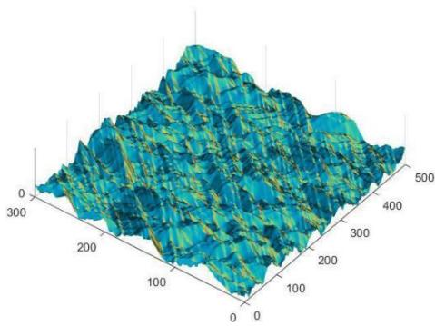
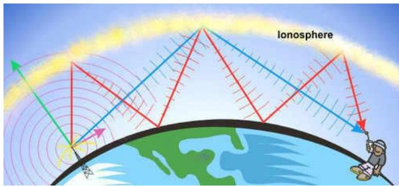
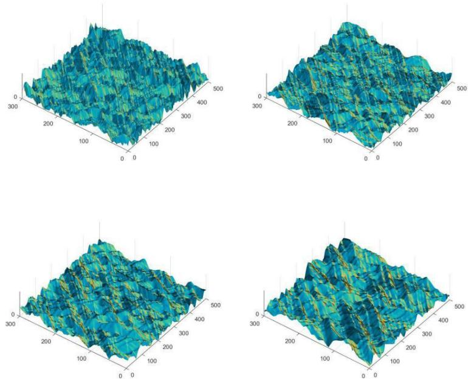
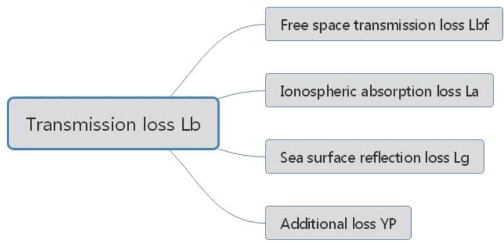
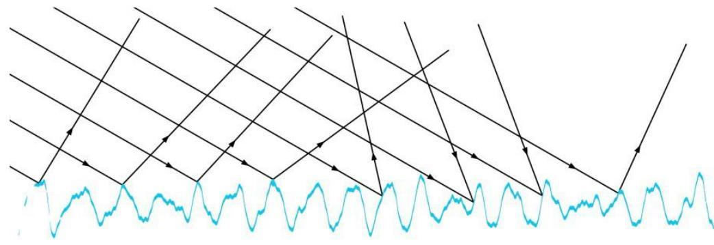
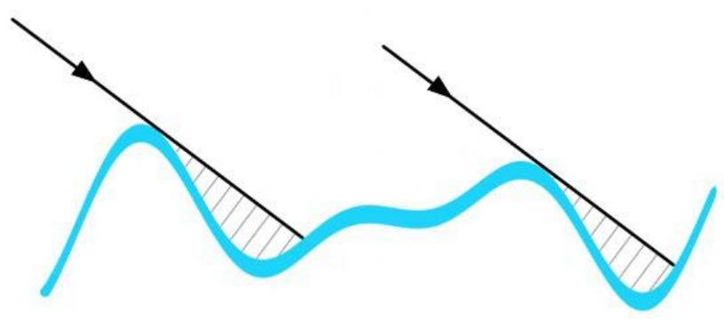

# 2018年美赛O奖论文：Simulation Analysis of Multi-hop HF Radio

原件经识别和整理；“参考解答”是我们补的。

## 2018 MCM/ICM Summary Sheet

### Summary

HF radio propagation plays an extremely important role in communication at sea and mountains. It may be influenced by various factors, resulting in great loss of signal transmission. In this paper we focus on transmission and reflection loss of HF radio propagation in reflecting surface changes.

First, according to the PM wave spectrum and random wave theory, we establish a three-dimensional random wave model to simulate the motion of waves. On this basis, we analyze the reflection of electromagnetic waves on the sea surface. We consider the influence of wave height caused by different wind levels on the reflection coefficient and obtain the reflection loss of electromagnetic wave under different conditions successfully. Then we get the sum of the loss in the transmission and the The first reflection intensity of the turbulent ocean and the calm one. At last we analyze the signal electric-field and atmospheric noise electric field of the receiving point, get the relation between SNR, transmission distance and hops, and the maximum number of hops should be 6 when SNR attenuates to 10 dB.

Second, we analyze the transmission on the ground on the basis of the wave model. We simulate the topography with the wave fluctuation. Because the electromagnetic characteristics of the earth are different from the sea surface, we correct the relative dielectric constant and conductivity. Since there are more obstacles on the ground than on the sea, so we also analyze the diffraction phenomenon of electromagnetic wave propagation on the ground. We calculate and compare the first reflection intensity between mountainous or rugged terrain and smooth terrain. Surprisingly, the effective distance of sky-wave transmission is shorter than that of sea surface reflection. Under the same conditions, the maximum number of hops of HF radio propagation is 4.

Finally, we consider the wind and waves that the ship may encounter on the sea surface, and calculate the longest distance that the received signal can propagate at a given wind level (i.e., SNR not less than 10 dB). Because ships usually travel longer, we also analyze the periodic variation of the ionosphere with time, and obtain the influence of the periodic variation of the ionosphere on the propagation of sky wave. On the basis of this, we get the optimal radio frequency under different conditions. After taking the ship speed into account, we amend the original model and obtain the maximum time for the ship to maintain the same multi-hop path.

更多数学建模资料请关注微店店铺“数学建模学习交流”https://k.weidian.com/RHO6PSpA

## Simulation Analysis of Multi-hop HF Radio

### Abstract

HF radio is widely used in long-distance propagation in a lot of countries because of its advantages of long propagation distance, low transmission loss and no external influence on the quality of propagation, especially maritime propagation. Because it is capable of reflections off the ionosphere and the earth, "jumping" to its destination. Besides, the characteristics of the reflected surface determine the intensity of the reflected waves and the extent to which the signal eventually travels. In this paper, we simulate different environments of the ocean and ground, and obtain the degree of signal loss and the propagation distance finally.

### Ocean wave model

According to the wave spectrum and random wave theory, we take the actual wave as the superposition result of sinusoidal wave with different frequency, different propagation direction, different wave height and different initial phase. Then we establish the Longuet-Higgins long peak wave model. On this basis, we analyze the possible superposition of waves, and get the three-dimensional simulation diagram of the waves, and simulate it.

### Transmission loss analysis

In the process of transmission, SNR of the signal may be reduced due to various factors. For a fixed reception point, the loss of the signal is related to the angle of the signal emission, the transmission distance, the ionospheric absorption intensity, sea situation and so on. We have a simple classification of the loss of the signal: free space transmission loss, ionospheric absorption loss, additional loss and sea surface reflection loss.

Then, we lay special stress on the relationship between sea surface reflection loss and various factors. By simulating the reflection path, we study the relationship between reflection path and reflection coefficient, and draw the conclusion that when the hop count is 1, the relationship between the first reflection intensity and the wind scale is as follows:

In long-distance propagation, the number of multi-hop is often greater than 1 so that the wave can travel enough distance. But the integrity of the signal also attenuates gradually with the propagation. By calculation, we know that the maximum number of hops at calm sea is 6 when the power is 100 w and the frequency is 15 MHz.

### Compare with the model on the ground

Based on the three-dimensional wave model, we simulate the relief of the terrain with the wave fluctuation. Considering diffraction may occur during the ground propagation, and the variation of the conductivity and relative dielectric constant caused by the complex ground. We modify the existing models, calculate the first reflection intensity and the maximum number of hops on different ground forms.

### Modification based on navigation

In the actual navigation, the receiving point is motional. Thus, it cannot be regarded as a fixed point and to be calculated. So we modify the model to calculate the emission angle, frequency, power and so on as variables. Based on these, we obtain the maximum distance and the time to maintain the same multi-hop path before the SNR attenuates to 10 dB. We also conclude that the absorption loss will increase due to the periodic variation of the ionosphere. So the launch frequency needs to be adjusted at different times.

---
title: Simulation Analysis of Multi-hop HF Radio
kind: 课件
course: 美赛O奖论文
source: 2018年美赛O奖论文：Simulation Analysis of Multi-hop HF Radio（第 4–7 页）
---

# Simulation Analysis of Multi-hop HF Radio

本部分整理自《2018年美赛O奖论文：Simulation Analysis of Multi-hop HF Radio》第 4–7 页，包含目录、引言、假设、符号定义及海面传播模型的前半部分。

## 1 Introduction

### 1.1 Background

It is universally acknowledged that a ship sailing in the boundless sea will encounter a variety of danger at any time. With the increasing number of ships in the world and the trend toward large-scale and high-speed ocean shipping, the world's waterways are becoming more and more crowded and crisis may occur at any time. In this case, HF radio propagation has played a significant role. HF radio propagation can attract us to transmitting messages, thats mainly because that HF communication can be achieved only by appropriate transmitting power and moderate equipment cost even far apart.

### 1.2 Restatement of the problem

As required by the question, we are supposed to determine the strength of the first reflection off a turbulent ocean and compare it with the strength off a calm ocean. Meanwhile, we will also determine the maximum number of hops the signal can take before its strength falls below a usable SNR. After that, we will compare the findings with hf reflections off different topography. Moreover, we are going to change our model to accommodate a shipboard receiver moving on a turbulent ocean.

There are two forms of shortwave propagation. One is ground wave, which consists of surface wave, direct wave and reflected wave; and another is sky wave that reaches the ground reception point being reflected by the ionospheric. In this article, we only model the reflection of sky waves.

## 2 Assumptions

- We consider the transmission of sky waves as the main way.
    - Reason: Energy is lost with the propagation of ground wave, and the higher the frequency(that is, the shorter the wave length), the greater the loss. However, sky-wave communication has the advantages of long propagation distance, low transmission loss and not being affected by the geological types of both sides. So we consider the transmission of sky waves as the main way.
- The reflection of sky-waves in the ionosphere is mainly considered in the $F_{2}$ layer.
    - Reason: (1) It's exist all day. (2) It's height can accommodate the longest path. (3) MUF(maximum usable frequency) is the biggest.
- The main factor affecting wave height is wind speed.
- We regard the relative permittivity and conductivity of seawater as fixed values.
    - Reason: The changes of relative dielectric constant and conductivity are mainly caused by the change of salt content and temperature, and the wave and sea water motion have little effect on them, so we think that they are almost unchanged, and regard them as fixed values.
- We consider ships movement on the sea as a uniform motion.

## 3 Notation

| Notation | Definition |
| :--- | :--- |
| $L_b$ | Transmission loss |
| $L_{bf}$ | Free space transmission loss |
| $L_a$ | Ionospheric absorption loss |
| $L_g$ | Ground reflection loss |
| $\varepsilon$ | Electric medium constant |
| $\sigma$ | Conductivity |
| $Y_P$ | Additional loss |
| r | Propagation distance |
| D | Maximum propagation distance |
| $\Delta$ | Elevation angle of transmission |
| n | Number of hops |
| f | Working frequency |
| $P_0$ | Power of the transmitter |
| $P_1$ | First reflection intensity |
| R | Reflection coefficient |
| θ | Incidence angle of electromagnetic wave |

P.s. Other symbols instruction will be given in the text.

## 4 Radio propagation on sea surface model

### 4.1 Introduction to HF propagation

#### 4.1.1 Way of HF propagation

HF propagation is the radio propagation of radio waves in the range of 3 to 30MHz(corresponding wave length 100 to 10m). HF communication has the advantages of long communication distance, strong persistence and simple equipment, meanwhile, it has the disadvantages of channel congestion, time-varying, dispersion characteristics, and so on. Moreover, it is easy to be influenced by other external factors and is unstable. HF propagation can propagate along the ground as the ground-wave, and it can also propagate through reflections off the ionospheric as the sky-wave. The propagation diagram is as follows:

## 4.1 电离层与最佳可用频率

### 4.1.2 电离层的结构

电离层是地球大气的一个电离区域，由太阳的高能辐射和宇宙射线电离形成。由于存在大量自由电子和离子，无线电波在其中传播时速度会改变，并发生折射、反射和散射。电离层可分为 D、E、F 等层，其中 F 层又可分为 $F_1$ 和 $F_2$ 层$^{[1]}$。各层的高度随时间变化，部分层在夜间甚至会消失。

### 4.1.3 最佳可用频率

根据电离层传播理论，频率较高的短波只能从电子密度分布较高的电离层反射回地面。存在一个能被反射回地面的最高频率，称为 MUF（最大可用频率）。为减少吸收，传播频率应尽可能高，但一般只取 0.85 MUF。因为若使用 MUF，只要电离层稍有变化，电波就会穿过电离层而不返回。因此把 0.85 MUF$^{[2]}$ 称为最佳可用频率。

## 4.2 波浪模型

### 4.2.1 Longuet-Higgins 波浪模型

波浪现象十分复杂，具有随机性和非线性，因此建立精确的波浪模型非常困难。根据波浪谱和随机波理论，可将实际波浪视为不同频率、不同传播方向、不同波高和不同初相位的正弦波叠加的结果。Longuet-Higgins 模型$^{[3]}$用无数随机余弦波的叠加描述长峰波，其幅值表达式为：

$$
\zeta (t) = \sum_ {i = 1} ^ {\infty} \xi_ {a i} \cos (\omega_ {i} + \varepsilon_ {i})\tag{1}
$$

其中 $\xi_{ai}$ 为第 $i$ 个余弦波的幅值，$\omega_{i}$ 为第 $i$ 个余弦波的频率，$\varepsilon_{i}$ 为第 $i$ 个余弦波的相位。

实际应用中，Longuet-Higgins 模型常以波浪谱表示：

$$
\zeta (t) = \sum_ {i = 1} ^ {\infty} \sqrt {2 S _ {\zeta} \Delta \omega} \cos (\omega_ {i} + \varepsilon_ {i})\tag{2}
$$

式中 $S_{\zeta} \Delta\omega$ 为波浪谱。目前常用的海浪谱有 Pierson-Moscowitz 谱（PM 谱）、Neumann 谱（N 谱）、ITTC 谱等，其中 PM 谱应用最广，能很好地表示充分发展的随机波，因此我们采用 PM 谱。PM 谱的表达式为：

$$
S _ {\zeta} (\omega_ {i}) = \frac {8 . 1 \times 1 0 ^ {- 3} g ^ {2}}{\omega^ {5}} \exp \left[ - 0. 7 4 \left(\frac {g}{v \omega}\right) ^ {4} \right]\tag{3}
$$

其中 $v$ 为海面以上 19.5 m 高度处的风速。

### 4.2.2 三维波浪模型

上述模型只考虑了一个方向。而实际波浪不仅在高度和频率上变化，还会向多个方向传播。因此，我们将相互叠加并在主波方向 $\pm\pi/2$ 范围内随机扩散的波浪定义为三维不规则短峰随机波模型。

将上述模型在多个方向上叠加，最终得到如下表达式：

$$
\zeta (\xi , \eta , t) = \sum_ {i = 1} ^ {n} \sum_ {j = 1} ^ {m} \zeta_ {a i j} \cos \left(k _ {i} \xi \cos \mu_ {j} + k _ {i} \eta \sin \mu_ {j} - \omega_ {i} + \varepsilon_ {i j}\right)\tag{4}
$$

其中 $\zeta_{aij}$、$\omega_{i}$、$k_{i}$、$\mu_{j}$、$\varepsilon_{ij}$ 分别为各分量谐波的幅值、角频率、波数、方向角和随机初相位，$\varepsilon_{ij}$ 为 0 到 $\pi/2$ 之间的随机数，$(\xi, \eta)$ 为波面上某点的坐标。

### 4.2.3 模型仿真

我们在 MATLAB 中对模型进行了仿真，结果如下：

## 4.3 高频无线电波的传输损耗 $L_{b}$

无线电波传输过程中有许多因素会影响传输损耗。我们将整个传播过程中的基本传输损耗 $(L_{b})$ 分为四部分：自由空间传输损耗 $L_{bf}$、电离层吸收损耗 $L_{a}$、地面反射损耗 $L_{g}$ 和附加损耗 $Y_{P}$。若所有损耗均以分贝（dB）表示，天波传播的基本传输损耗为：

$$
L _ {b} = L _ {b f} + L _ {i} + L _ {g} + Y _ {P}\tag{5}
$$

# Simulation Analysis of Multi-hop HF Radio

本节内容整理自《2018年美赛O奖论文：Simulation Analysis of Multi-hop HF Radio》第 4 部分（第 11–14 页），主要阐述了高频无线电传播中的自由空间损耗、电离层吸收损耗及海面反射损耗模型。

## 一、自由空间传输损耗 $L_{bf}$

### 选择 1

**题干**：自由空间传输损耗的定义及其计算公式是什么？其中频率 $f$ 和距离 $r$ 的单位分别是什么？

- A. 能量由几何因素引起的损耗；公式为 $L_{bf} = 32.44 + 20 \lg f + 20 \lg r$，单位为 kHz 和 km
- B. 能量由几何因素引起的损耗；公式为 $L_{bf} = 32.44 + 20 \lg f + 20 \lg r$，单位为 MHz 和 km
- C. 能量由大气折射引起的损耗；公式为 $L_{bf} = 32.44 + 20 \lg f + 20 \lg r$，单位为 MHz 和 m
- D. 能量由天线效率引起的损耗；公式为 $L_{bf} = 32.44 + 20 \lg f + 20 \lg r$，单位为 GHz 和 km

答案：B。
参考解答：根据原文，自由空间传输损耗是由无线电波脱离天线后几何因素引起的能量损耗。公式为 $L _ {b f} = 3 2. 4 4 + 2 0 \lg f + 2 0 \lg r$，其中 $f$ 是工作频率（单位 MHz），$r$ 是高频无线电传播的有效路径（单位 km）。

### 选择 2

**题干**：关于电离层反射的最大单跳距离 $D_{max}$，下列说法正确的是？

- A. 仅受地球半径影响，与电离层高度无关
- B. 受地球曲率和电离层高度限制，对于 $F_2$ 层反射，最大传播距离约为 4000km
- C. 天线仰角越小，$D_{max}$ 越大，且无上限
- D. $D_{max}$ 的计算不需要考虑最小仰角 $\Delta_{min}$

答案：B。
参考解答：原文指出，地球曲率和电离层高度限制了电离层反射的单次最大跳跃距离 $D_{max}$。对于 $F_2$ 反射，最大传播距离 $D_{max}$ 为 4000km。计算涉及最小仰角 $\Delta_{min}$（通常大于 $3^{\circ}$）、地球半径 $R_e$（取 6371km）以及电离层反射虚高 $h$。

## 二、电离层吸收损耗 $L_{a}$

### 简答 1

**题干**：简述高频无线电传播中电离层吸收损耗的主要发生区域及其昼夜变化规律，并说明文中对吸收损耗的简化处理。

答案：
1. **主要区域**：吸收损耗主要发生在 D 层，因为该层中性分子较多，碰撞损耗大。E 层或 F 层的发射吸收主要指偏移吸收，数值很小（$\leq 1$ dB），计算时忽略不计。
2. **昼夜变化**：夜间 D 层电子浓度降低，吸收损耗随之减小。
3. **简化处理**：由于电离层吸收损耗与发射机、时间及接收点参数关系复杂，文中将其简化取值为 4dB 以方便计算。

参考解答：
原文指出，在 HF 无线电传播中，主要由 D 层引起的非偏移吸收损耗较大。虽然 E 层或 F 层存在偏移吸收，但其值极小可忽略。为了简化计算，团队将总的电离层吸收损耗设定为 4dB。

### 计算 1

**题干**：写出电离层吸收损耗 $L_a$ 的计算公式，并解释公式中各符号的含义。

- **公式**：
  $$
  L _ {a} = \frac {6 7 7 . 2}{(f + f _ {H}) ^ {1 . 9 8} + 1 0 . 2} \sum_ {j = 1} ^ {n} \sec \phi_ {j} \times I _ {j}
  $$
- **符号说明**：
  - $\phi$：100 km 高度处的入射角
  - $f$ (MHz)：工作频率
  - $f_H$ (MHz)：陀螺磁频率
  - $I$：吸收指数
  - $n$：路径中的跳数

**吸收指数 $I$ 的计算公式**：
$$
I = (1 + 0. 0 3 7 R) (\cos 0. 8 8 1 \chi) ^ {1. 3}
$$
- $R$：太阳黑子数
- $\chi$：两个 100 km 高吸收点的天顶角

## 三、海面反射损耗 $L_{g}$

### 选择 3

**题干**：在多跳海面反射损耗计算中，假设入射波为杂乱偏振，其能量在水平和垂直偏振上均匀分布。此时计算能量的公式是？

- A. $L _ {g} = 1 0 \lg \left(R _ {V} ^ {2} + R _ {H} ^ {2}\right)$
- B. $L _ {g} = 1 0 \lg \left(\frac {R _ {V} ^ {2} + R _ {H} ^ {2}}{2}\right)$
- C. $L _ {g} = 2 0 \lg \left(\frac {R _ {V} + R _ {H}}{2}\right)$
- D. $L _ {g} = 1 0 \lg \left(R _ {V} ^ {2} - R _ {H} ^ {2}\right)$

答案：B。
参考解答：原文公式 (10) 明确指出，当能量在水平和垂直偏振上均匀分布时，计算公式为 $L _ {g} = 1 0 \lg \left(\frac {R _ {V} ^ {2} + R _ {H} ^ {2}}{2}\right)$，其中 $R_H$ 和 $R_V$ 分别为水平和垂直偏振波的反射系数。

### 简答 2

**题干**：比较水平偏振波和垂直偏振波在海面反射系数随入射角变化的特性差异。

答案：
1. **水平偏振波**：反射系数从 1 开始逐渐减小，幅度非常小。
2. **垂直偏振波**：反射系数起初迅速减小，随后随着入射角的增加而逐渐增大，最终趋近于 1。
3. **结论**：水平偏振波的反射系数对比入射角的变化更为敏感。

参考解答：
根据原文描述及图示分析，水平偏振波的反射系数随入射角增加单调递减；而垂直偏振波则呈现先快速下降后上升的趋势。对比表明，水平偏振波的反射系数对入射角的变化更加敏感。

### 计算 2

**题干**：在平静海面的反射系数计算中，垂直偏振波反射系数 $R_V$ 的公式包含哪些参数？请列出复介电常数 $\widetilde {\varepsilon}$ 的表达式。

- **$R_V$ 公式**：
  $$
  R _ {V} = \frac {\widetilde {\varepsilon} \sin \theta - \sqrt {\widetilde {\varepsilon} - \cos^ {2} \theta}}{\widetilde {\varepsilon} \sin \theta + \sqrt {\widetilde {\varepsilon} - \cos^ {2} \theta}}
  $$
- **参数说明**：
  - $\theta$：入射角
  - $\widetilde {\varepsilon}$：海面的复介电常数
  - $\varepsilon$：海水介电常数
  - $\lambda$：入射波波长
  - $\sigma$：电导率

- **复介电常数表达式**：
  $$
  \widetilde {\varepsilon} = \varepsilon - \mathrm{j} 6 0 \lambda \sigma
  $$

## 四、湍流海洋波模型算法

### 综合 1

**题干**：针对三维不规则短峰随机波模型，如何计算电磁波在波浪表面的反射修正系数 $\rho$？若考虑阴影遮挡，修正后的系数 $\rho'$ 如何计算？

**1. 基础反射修正系数 $\rho$**
- **原理**：由于水面存在俯仰角，并非所有入射波都能向正方向反射。通过对波表面进行微分分析，统计向正方向反射的微元平面数量。
- **公式**：
  $$
  \rho = \frac {m}{M}
  $$
  其中 $m$ 为正向反射的电磁波总数，$M$ 为入射电磁波总数。

**2. 阴影遮挡修正系数 $\rho'$**
- **背景**：实际海浪有起伏，风浪大时部分海面被波峰遮挡（阴影区），这部分不产生反射。
- **计算方法**：
  1. 对波函数 $\xi(x)$ 求二阶导数，得到极值点对应的切线方程。
  2. 确定电磁波与波浪的第二个交点，即为阴影区的边界。
  3. 计算阴影面积 $s$ 与单个波表面积 $S$。
- **公式**：
  $$
  \rho^ {\prime} = \rho_ {*} \frac {S - s}{S}
  $$
  其中 $S$ 为一个波的表面面积，$s$ 为阴影面积。

*图 6：湍流海洋上电磁波反射示意图*

*图 7：波浪阴影示意图*

参考解答：
对于湍流海洋，首先通过波函数的导数确定局部切平面，利用斯涅尔定律推导反射路径。由于波浪的凹凸性，需引入系数 $\rho$ 来修正正向反射波的比例。进一步考虑到波浪遮挡导致的阴影效应（如图 7 所示），通过计算阴影面积 $s$ 占波表面积 $S$ 的比例，对 $\rho$ 进行二次修正，得到最终修正系数 $\rho'$。

### 4.3.3 Turbulent ocean reflection coefficient correction

In the figure above, the left image shows the correction coefficients at different wind speeds when the grazing angle is $1^{\circ}/5^{\circ}/15^{\circ}$ , and the right image shows the correction coefficients at different wind speeds when the frequency is 10 MHz / 20 MHz / 30 MHz.

We can get the following curve, which is the final reflection coefficient by multiplying it with the reflection coefficient when it is stationary:

Then we can get the loss of turbulent ocean:

$$
L _ {g} ^ {'} = L _ {g} - 1 0 \lg (\rho^ {'})\tag{18}
$$

### 4.3.4 Additional loss $Y_{P}$

Additional loss is the loss caused by other factors in addition to the main reasons mentioned above. The detailed calculation is too complicated, but we conclude that it is mainly related to local time, which is assumed to be about 15 dB here $^{[9]}$ .

### 4.4 First reflection intensity

Combined with the loss analysis above, for a single jump signal source, we can get the following formula:

$$
1 0 \lg (P _ {1}) = 1 0 \lg (P _ {0}) - L _ {b f} - L _ {a} - L _ {g} - Y _ {P}\tag{19}
$$

Among them, $P_{1}(w)$ is the electromagnetic wave power of the transmitting point and $P_{0}(w)$ is the first reflection intensity. For the electromagnetic wave propagation route which has been determined in both time and space, only $L_{g}$ is alterable because of the different sea conditions, we get the following chart by calculation:

**Table 1 Related Parameters**

| Parameter | Reference value | Unit |
| :--- | :--- | :--- |
| $L_a$ | 4 | dB |
| $Y_P$ | 15 | dB |
| $f$ | 100 | MHz |
| $P_0$ | 100 | w |
| $\theta$ | 3 | ° |

As is shown in the figure, its the first reflection intensity of a signal with different frequencies under different wind speeds. We can get the curve of reflection intensity changing with sea condition by fitting. From the diagram, we can know that the first reflection intensity decreases with the increase of frequency and the increase of wind speed. Thus, we must consider the influence of weather in the process of maritime communication.

### 4.5 Calculation of SNR

#### 4.5.1 HF sky-wave field intensity $^{[10]}$

The field strength of the receiving point can be calculated by the following formula:

$$
E _ {t} = 1 3 7. 2 + 2 0 \lg f + 1 0 \lg P _ {0} + G _ {t} - L _ {b}\tag{20}
$$

In the formula, $E_{t}(\mathrm{dB})$ is the signal intensity of the receiving point during the propagation of sky wave, f(MHz) is the working frequency, $P(\mathrm{kw})$ is the power of the transmitter, $G_{t}(\mathrm{dB})$ is the normal gain of the transmitter antenna radiation, and $L_{b}(\mathrm{dB})$ is the transmission loss of sky-wave.

#### 4.5.2 Field intensity of atmospheric noise

Atmospheric noise is mainly caused by lightning $^{[11]}$ . It is the main noise source of marine HF radio propagation at present. The formula for calculating the effective value of atmospheric noise field intensity is as follows:

$$
E _ {n} = F _ {a} + 1 0 \lg B + 2 0 \lg f - 9 6. 8\tag{21}
$$

In the formula, $E_{n}(\mathrm{dB})$ is the field intensity of atmospheric noise, $F_{a}(\mathrm{dB})$ is the effective noise coefficient of atmospheric radio, $B(\mathrm{dB})$ is the effective noise bandwidth of receiver, $f(\mathrm{MHz})$ is working frequency.

Atmospheric noise is usually estimated by the noise data provided in the CCIR322nd report. A complete set of atmospheric noise data contains 72 charts. The calculation process is very complicated and the accuracy is not high enough. Thus we use the method of establishing a database to make a simple estimate. The following table shows the atmospheric noise at different times in a certain area in summer $^{[12]}$ .

**Table 2 Atmospheric noise at different times in a certain area in summer**

| Latitude\Longitude\Local Time | 75~90 0~4 | 75~90 4~8 | 75~90 8~12 | 90~105 0~4 | 90~105 4~8 | 90~105 8~12 | 105~120 0~4 | 105~120 4~8 | 105~120 8~12 |
| :--- | :---: | :---: | :---: | :---: | :---: | :---: | :---: | :---: | :---: |
| 10~20 | 95 | 70 | 99 | 78 | 102 | 104 | 104 | 81 | 103 |
| 20~30 | 95 | 73 | 99 | 75 | 100 | 99 | 99 | 74 | 99 |
| 30~40 | 93 | 71 | 99 | 71 | 98 | 98 | 91 | 68 | 94 |
| 40~50 | 88 | 68 | 90 | 62 | 62 | 78 | 81 | 62 | 77 |

#### 4.5.3 Maximum number of hops

According to the formula for calculating the electric field intensity of HF sky-wave and the formula for calculating the effective value of atmospheric noise field intensity, we obtain the formula for calculating signal-to-noise ratio of shortwave sky-wave communication under natural conditions.

$$
S N R = 2 0 1. 5 6 + 1 0 \lg P _ {0} - 2 0 \lg f - 2 0 \lg r - 1 0 \lg B - L _ {a} - L _ {g} - Y _ {P} - F _ {a}\tag{22}
$$

In the formula, after n jumps, we found that

$$
r = n D _ {m a x}\tag{23}
$$

$$
L _ {g} ^ {'} = (n - 1) \times L _ {g}\tag{24}
$$

$$
L _ {a} ^ {'} = n \times L _ {a}\tag{25}
$$

With reference to the following table for each parameter, we can get n = 6 by using the fsolve function of MATLAB.

# 2018年美赛O奖论文：Simulation Analysis of Multi-hop HF Radio（第6部分）

kind: 课件
course: 通信原理与电磁场
source: 2018 MCM/ICM O Award Paper: Simulation Analysis of Multi-hop HF Radio, Pages 15-17

本文档整理自《2018年美赛O奖论文：Simulation Analysis of Multi-hop HF Radio》教材的第6部分（共7部分），对应原文第18–20页（即论文第15–17页）。内容主要对比海表面与地面传播模型，并分析 turbulent ocean 上船舶运动对多跳路径的影响。

## 一、海表面模型与地面模型的比较

### 选择 1

**背景说明**：由于地面环境比海表面更复杂且由多种材料组成，计算中取相对介电常数 $\varepsilon$ 为 3 到 8 作为基本值，并将大地等效电导率作为电导率 $\sigma$ 进行计算。

利用提出的模型和上述算法，我们将山的起伏近似为波浪的运动进行计算。由于地面上有许多障碍物，电磁波遇到障碍物时会发生衍射。然而，由于短波波长不足以避免障碍物，大部分会被各种障碍物阻挡，因此短波在地面上的传播能力非常弱。根据分析，将地面的电磁参数代入公式得到如下解 $^{[13]}$ ：

相关参数如表所示。

**Table 3 $\varepsilon,\sigma$ in different environments**

| Ground form | Variation $\varepsilon(F/m)$ | Variation $\sigma(S/m)$ | Average $\varepsilon(F/m)$ | Average $\sigma(S/m)$ |
| :--- | :--- | :--- | :--- | :--- |
| Seawater | 80 | 1~4.3 | 80 | 4 |
| Freshwater | 80 | $10^{-3} \sim 2.4 \times 10^{-2}$ | 80 | $10^{-3}$ |
| Wet soil | 10~30 | $3 \times 10^{-3} \sim 2.4 \times 10^{-2}$ | 10 | $10^{-2}$ |
| Dry soil | 3~4 | $1.1 \times 10^{-5} \sim 2 \times 10^{-2}$ | 4 | $10^{-3}$ |

山地的第一次反射强度如图所示，特别是当地形平滑时，起伏度为 0。

当地面平坦时，我们取 $L_{g}$ 为 6.53dB，并得出 $n = 4$。与海表面相比，HF 无线电通过地面的传播距离远小于海表面。

## 二、湍流海洋上 HF 无线电传播的船舶运动分析

### 6.1 使用相同多跳路径的最大时间 ($t_{max}$)

在上述模型中，我们仅考虑接收点固定的情况。该模型适用于两点之间的通信，或接收点位置变化可忽略的情况。在湍流海洋中航行的船舶移动距离较长，因此我们不能仅将有效传播距离 $r$ 计算为固定值 $^{[14]}$ 。此时，传播距离 $r$ 与发射角 $\Delta$ 有关，而 $L_{a}$ 、 $L_{g}$ 与 $n$ （天波的跳数）有关，同时 $L_{g}$ 也与发射角 $\Delta$ 有关。为了确保接收到的信号足够清晰，我们得出结论，信噪比 SNR 应大于或等于 10，即：

$$
SNR = 201.56 + 10 \lg P_0 - 20 \lg f - 20 \lg r - 10 \lg B - n L_a - (n - 1) L_g - Y_p - F_a \geq 10\tag{24}
$$

通过分析可知，由于 $L_g$ 与 $\Delta$ 有关，路线距离越长，就需要更高的发射功率和增加天线来辅助海上航行的船舶。或者可以调整射频以避免过度衰减导致 SNR 过低难以区分。

如图（见原文插图），在接收点处获得了 100W 信号的 SNR，不同频率和距离下，跳数 $n = 1 \sim 6$ ，风级为 5 ，以及不同频率和距离下的接收点。

**Table 4 Maximum propagation distance r when f=15Hz, P=100w**

*注：原文表格标题单位为 Hz，但结合上下文及常规 HF 频段，此处保留原文数据，实际应用中需注意频率单位通常为 MHz。*

| Number of hops n | Maximum propagation distance r(km) | SNR(dB) |
| :--- | :--- | :--- |
| 1 | 3225 | 54.0977 |
| 2 | 6449 | 23.2859 |
| 3 | 9674 | 16.9728 |
| 4 | 10125 | 10 |
| 5 | <10125 | 10 |
| 6 | <10125 | 10 |

从图中可知，当 $n$ 固定时，随着距离增加，传播距离不足或信噪比过低。

通过分析上述数据，我们得出结论：当跳数过高时，对于在湍流海面上行驶的船舶，信号在海面和电离层之间反射次数过多，传播路径损耗过大，导致最大传播距离减小。信号无法传播得足够远。因此，在这种情况下，我们需要增加传输功率或信号频率以提高信噪比和最大传播距离。

综上所述，船舶在湍流海洋中保持多跳路径的最大时间为：

$$
t_{max} = \frac{r}{\nu}\tag{27}
$$

其中 $\nu$ 是船舶在海上的移动速度。在上表的情况下，每移动 3000km 必须改变多跳路径。在 100W 和 15MHz 的情况下，当传输距离超过 10000 km 时，必须增加信号功率和频率。

### 6.2 Suggestions on frequency selection of transmitter

Because not only the periodic variation of the ionosphere, but also the influence of the day and night, the season, the solar activity and so on can affect the value of the ionospheric propagation loss $L_{a}$. In order for ships to have better communication at sea, the emitter must choose different frequency at different time to achieve better propagation. The following table shows the range of radio broadcasts commonly used to take into account ionospheric effects:

Table 5 Recommended emission frequency

| Frequency Range | Description |
| :--- | :--- |
| 2~4 MHz | Tropical frequency, small number of sunspots and transmission is good. Some countries near the equator can use it as domestic broadcasting |
| 6~7 MHz | More suitable using in autumn and winter or night for close-range broadcasting |
| 9~11 MHz | Moderate and suitable for all-day broadcasting both inside and outside |
| 13 MHz | Effect would be better at daytime and is suitable for long distance broadcasting |
| 15~17 MHz | Better in spring and summer |

### 7 Strengths and weaknesses

#### 7.1 Strengths

- We classify and analyze the propagation path, which makes our calculation more accurate.
- We have established a three-dimensional wave model, which is more intuitive.
- We adopt the correction method of reflection coefficient, which is different from the previous empirical formula, and can analyze the reflection coefficient under different sea conditions quantitatively.
- We take the effects of periodic ionospheric variations into account, which are sensitive and can be used in various situations.

#### 7.2 Weaknesses

- We only consider the HF sky-wave transmission model, but the ground-wave transmission also has certain influence.
- In real life, the ionospheric loss is complicated and varies greatly with latitude, longitude, seasons and so on. However, we only calculate the reasonable values according to the literature.
- We only focus on the characteristics of shortwave propagation at sea level and the effect of reflection without considering the effect of refraction diffraction.
- The dielectric constant and conductivity of the reflected surface change with the frequency, but we only use the fixed value to calculate. When the salinity and temperature of seawater change sharply, the reliability of the data will decrease.

### References

[1] LI Wei. Influence of Ionospheric Characteristics on Shortwave Transmission[J]. Inner Mongolia Radio & TV Broadcast Engineering, 2016, 33(06): 68-71. Mathematical Society and Addison-Wesley Publishing Company, 1984-1986.

[2] SHI Xiang-tong, WANG Lei, HU Bo. Frequency Selection of Shortwave Communication Radio[J]. Ship Electronic Engineering, 2013, 33(10):39-41.

[3] QI Ning, XIA Tian, LI Wen-yan, ZHAO Li-guang. Simulation of the Mathematical Model of 3-D Irregular Wave Based on MATLAB[J]. Computer Knowledge and Technology, 2013, 9(25): 5737-5739.

[4] PENG Feng-hua, ZHOU Xue-jun. Propagation of Maritime Short-wave Telecommunication Link[J]. Ship Electronic Engineering, 2011, 31(12): 125-127.

[5] ZHAO Yu-cai. Research and Realization on Radio Propagation Prediction and Interference Analyzing Technology[D]. National University of Defense Technology, 2009.

[6] YUAN Xiao-bo. Shortwave Sky Wave Propagation Loss Prediction and Prediction of Field Strength[J]. Information & Communications, 2013(05):11-12.

[7] LI Xue-hong, LI Fazhong, HAN Long, CHEN Lijun. Method and Models of Field Strength Calculation in HF Sky Wave Communication[J]. Communications Technology, 2016, 49(04): 418-422.

[8] WANG Ying, GU Jian. Research and simulation analysis of radio reflection characteristic over the ocean[J]. International Electronic Elements, 2016, 24(05):113-115+119.

[9] LUO Jia, ZHANG Wen-ming, WANG Xue-song. Modeling and Simulation of HF Skywave Transmission Loss in Communication Countermeasure[J]. Computer Simulation, 2007(08):28-31+35.

[10] DONG Hang, XU Chi, YI Tao, HAN Dong. HF Communication Aid Decision-Making Model based on SNR Evaluation[J]. Communications Technology, 2014, 47(11): 1313-1317.

[11] Qu Gui-cheng, Wang Rui. Research on the Feasibility of Shortwave Communication at Sea under the Condition of Atmosphere Yawp.[J]. Ship Electronic Engineering, 2009, 29(01): 92-95.

[12] ZHANG Hai-yong. Evaluation of SNR and SIR Based on HF Field-Strength Prediction[A]. Thirteen Chinese Conference SSTA:2011:5.

[13] ZHUANG Qian-bo, SUN Fang-gang. Influence of Different Ground Forms on Shortwave Communication[J]. China New Telecommunications, 2014, 16(09): 92+97.

[14] HUANG Fang. Research on Characteristics of Maritime Wireless Radio Propagation and Channel Modeling[D]. Hainan University, 2016, 49(04): 418-422.

### Appendices

#### Appendix A First appendix

Here are simulation programmes we used in our model as follow.
