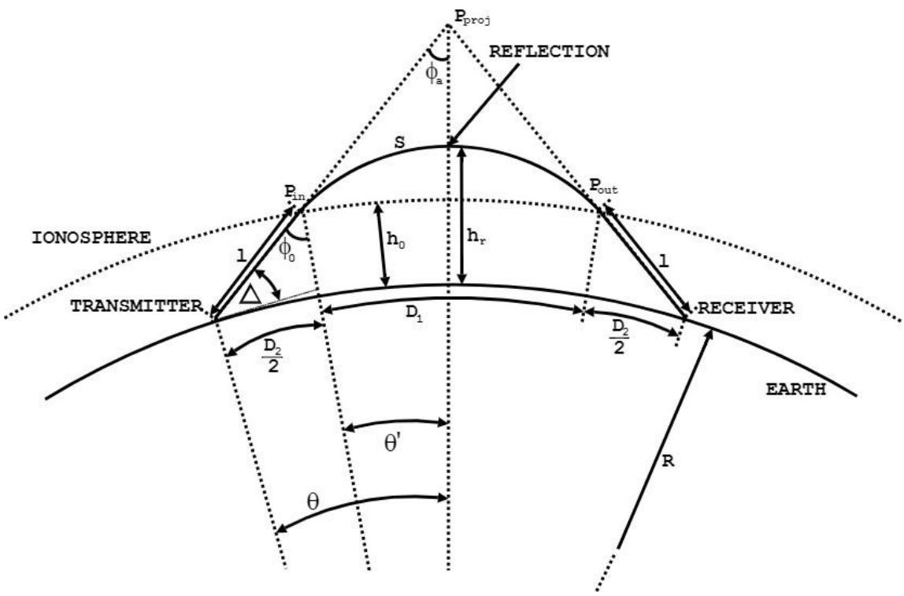
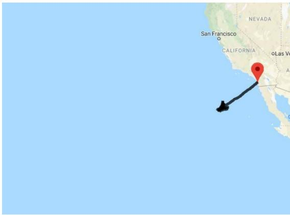

# 2018年美赛O奖论文：Wave Goodbye to Poor Reception (A题)

原件为竞赛论文。补充：文中的阅读练习及“参考解答”为整理时增加，原件图文保留出处。

## Wave Goodbye to Poor Reception

The discovery of High Frequency skywaves in the 1920’s allowed amateur radio enthusiasts, even those with low powered transmitters, to connect over long distances. Now in common use, skywaves allow communication across the turbulent ocean to ships at sea or distant continents by bouncing waves between the ionosphere and the surface of the Earth. We create a model to tackle the challenge of reliable communication, simulating the unpredictability of skywave communication, including uneven ionosphere density and wild reflection off of non-uniform surfaces.

In our model, a transmitter at an initial latitude and longitude on a spherical Earth beams a HF signal with a bearing and elevation angle.

We use NASA’s International Reference Ionosphere data set to determine the curved trajectory resulting from refraction of the signal in the ionosphere.

We generate small patches of terrain using either a wave simulator or geological elevation data, which give the signal a new heading as it bounces.

This multi-step process allows our model to create the complete path of a skywave signal.

Next, we can calculate how the atmosphere and terrain interfere with skywaves, or prevent them from reflecting at all. We model signal strength using the dominant sources of signal gain and loss, and stop propagation when the signal falls below the 10 dB minimum.

- The transmitter power, receiver sensitivity, and antenna gain provide 170 dB of margin.
- The signal weakens along its trajectory because of the free space path loss.
- The signal attenuates due to ionospheric absorption and diffuse surface reflection.

We run high-throughput simulations of skywave paths that bounce on calm and turbulent water, as well as smooth and mountainous land. We randomly vary transmitter locations, and test paths from coastal cities to determine the maximum effective transmission distance. To explore our model’s sensitivity, we alter the wave conditions from calm to super-turbulent, increase the transmission power, and change ionospheric density. Lastly, we co-vary the frequency and elevation angle, which we determine to be the most sensitive parameters.

We inspect the average number of hops, distance travelled over the Earth, and power lost after bounces to compare our results. For our default frequency and angle of 3 MHz and 30 degrees, respectively, we find a maximum of two hops. The power after a first bounce is 0.72 dB less for turbulent seas compared to calm, and 0.26 dB less for mountainous land compared to smooth. The signals over turbulent ocean reach 1622 km from the shore. We find that depending on location, angle, and frequency, many signals pass through the ionosphere completely or are absorbed before they can bounce. Mapping bounce locations over ionospheric density, we find that skywave propagation is most effective on the “greyline” between night and day, when absorption is lessened but the ionosphere can still reflect signals.

## Table of Contents

| Section | Title | Page |
| :--- | :--- | :--- |
| I | Introduction | 2 |
| A | Problem Summary | 2 |
| B | Our Starting Point: Existing Models | 2 |
| C | Our Model | 3 |
| II | Background | 3 |
| A | Transmitter and Receiver | 3 |
| B | Radio Propagation and Loss | 4 |
| C | Skywave Channel Interaction | 4 |
| D | Performance Evaluation | 5 |
| III | Assumptions | 6 |
| A | Model Assumptions | 6 |
| IV | Model Development | 8 |
| A | Model Construction | 8 |
| B | Model Validation | 13 |
| V | Model Application | 13 |
| A | Part I | 13 |
| B | Part II | 14 |
| C | Part III | 14 |
| VI | Results | 14 |
| A | Validation | 14 |
| B | Part I | 14 |
| C | Part II | 15 |
| D | Sensitivity Results | 16 |
| E | Part III | 16 |
| VII | Sensitivity Analysis | 17 |
| A | Explore Parameter Space | 17 |
| VIII | Conclusion | 19 |
| A | Our Conclusion | 19 |
| B | Strengths | 20 |
| C | Weaknesses and Limiting Assumptions | 20 |
| D | Future Work | 20 |
| IX | Letter | 21 |
| X | Appendix | 24 |

### I. Introduction

Innovators since the dawn of humankind have sought a more interconnected society by enhancing our ability to communicate over long distances. The history of telecommunication began in 1800 BC, where Chinese soldiers used smoke signals to warn their comrades up to 500 miles away of an attack.1 In 1876, Alexander Graham Bell achieved the first telephone call.1 While the telephone was a vast improvement over other technologies at the time, it required an enormous infrastructure investment and could only be used with static stations. A few decades later, the invention of the radio allowed mobile vehicles to communicate over vast distances. In 1914, the International Convention for the Safety of Life at Sea required shipboard radio stations to be manned 24 hours a day. Long-distance communication via HF radio waves remains the most stable means of communication on the open ocean to this day. If a vessel is not within line-of-sight of a coastal radio station, the coastal radio station uses skywave propagation to reflect radio waves off of the ionosphere and back to Earth. As the radio wave skips between the surface and the ionosphere, it allows the station to communicate beyond the horizon. Despite the unpredictability of radio over long distances, rugged terrain, and volatile seas, it remains an integral component of communication technologies that allow mankind to stay connected.

#### A. Problem Summary

- High Frequency (HF) radio waves, from 3-30MHz, can “hop” between the ionosphere and the surface of the Earth, travelling a greater distance than they could along the ground. When sufficient signal strength is maintained (>10 dB), this enables long distance communication.
- If the signal reflects off the ocean surface, it may be affected by changing electrical and magnetic properties of the waves, as well as size, shape, frequency, and direction.
- If the signal reflects off the land, it may be affected by terrain variations.
- Following the loss of a multi-hop signal necessitates the modeling of the transmitter, propagation between bounces, interaction with the ionosphere, interaction with the Earth’s surface, and finally the receiver.

#### B. Our Starting Point: Existing Models

Studies of skywave communication have been performed both empirically and theoretically by radio operators and electrical engineers in the decades since its creation. These existing models have been refined over time by our increasing understanding of complex physical phenomenon, improved measuring tools, and the capabilities of modern computers.

Before developing our own model, we explored the literature to gain a thorough understanding of existing models, and which complexities they consider. A few are highlighted here:

- Analytical and geometric models are easy to implement but make simplifications that degrade accuracy. Examples include:
    - Assuming that the Earth and ionosphere are flat
    - Treating radio waves as single or double rays
    - Formula-based surfaces for terrain
- Numerical models can achieve high accuracy and take into account dynamic conditions, but they require large data sets and computational power. Examples include:
    - Using real ionospheric conditions as a function of time
    - Statistical fading of signals during propagation
    - Real terrain from geological or oceanic data sources

#### C. Our Model

Our modeling approach is rooted in our conclusion that while this prompt focuses on surface hops, a full model of the signal propagation is necessary. The losses in the ionosphere, for instance, directly determine the remaining signal strength for hops. Thus, our model will focus on implementing complexity where detail is most necessary, and simplicity where detail is not necessary, as determined by our research. We hope to obtain an accurate trajectory through the ionosphere, as well as accurate interactions with terrain, but simplify free space propagation.

The complexity of the propagation of radio waves requires us to evaluate the trade-offs between realism and computation time. This impacts our terrain and ionosphere modeling, the types of loss we consider during propagation, and radio hardware. In the following sections, we will determine which terrain and ionosphere models to use by considering those with available data and sufficient resolution.5 We will determine a propagation model that includes losses with a significant magnitude compared to the complexity of the necessary calculations. Finally, we will choose general details about our transmitter, receiver and the system antennae in order to determine our signal strength. By programming different scenarios into the model to link bounces together, we can track the results for the complete path of each signal.

知识点：[文献综述与研究背景撰写方法](../../../topics/数学建模/wenxian_zongshu.md)、[数学建模的基本步骤（问题分析、模型假设、建立、求解、检验、推广）](../../../topics/数学建模/jianmo_buzhou.md)

### II. Background

#### A. Transmitter and Receiver

The ending of each signal’s path can be determined by the point that the remaining signal power falls below the 10 decibel threshold. This threshold is called the “link margin,” and is the minimum power required to have a reliable connection.

The 100 W transmit power can be converted to decibels with the equation:

$$
dBm = 10 \log_{10} (P * 1000 / 1) = 50\tag{1}
$$

The decibel is a relative calculation, which in this case is taken as a ratio of power to one milliwatt. In decibel form, the power $P$, positive antenna gain $G_t$, and negative loss $L$ can be added. The combination of these factors is known as the link budget, and will tell us the received power.

# 2018年美赛O奖论文：Wave Goodbye to Poor Reception (A题)（习题）

本文档整理自《2018年美赛O奖论文：Wave Goodbye to Poor Reception (A题)》第3部分，由识别工具读取并修正格式。

## 一、无线电传播与损耗分析

知识点：[一般假设及其合理性说明（Assumptions and Justifications）](../../../topics/数学建模/jiaben_shezhi.md)、[文献综述与研究背景撰写方法](../../../topics/数学建模/wenxian_zongshu.md)、[确定模型的定点与稳定性分析](../../../topics/数学建模/dingdian_wending.md)

### 选择 1

题干：根据公式 $P_{Rx} = P_{Tx} + tt_{Tx} + L + tt_{Rx}$，比较接收灵敏度可得链路余量。由于接收机和接收天线的特性包含在方程中，我们将信号路径的终点视为接收机无法再检测到信号的 theoretical location（理论位置），这意味着预算不满足所需的链路余量。

知识点：[数学建模的基本步骤（问题分析、模型假设、建立、求解、检验、推广）](../../../topics/数学建模/jianmo_buzhou.md)、[文献综述与研究背景撰写方法](../../../topics/数学建模/wenxian_zongshu.md)、[问题重述与分析（Problem Restatement and Analysis）](../../../topics/数学建模/wenti_chongshu.md)

### 简答 1

题干：确定天线增益和接收灵敏度的来源是什么？文中选择了多大的接收灵敏度？为什么？

知识点：[模型参数的确定（基于数据拟合或实验选择）](../../../topics/数学建模/canshu_queding.md)、[参数合理性验证](../../../topics/数学建模/canshu_heli_xing.md)

### 简答 2

题干：文中提到的简单天线类型是什么？其增益是多少？相对于什么基准？

知识点：[模型参数的确定（基于数据拟合或实验选择）](../../../topics/数学建模/canshu_queding.md)

### 简答 4

题干：即使没有反射，接收到的信号功率也会小于发射功率，这是为什么？这种现象叫什么？

知识点：[考虑尸体、医院和接触者追踪的原因阐述](../../../topics/数学建模/shi_ti_yiyuan.md)

### 简答 7

题干：电离层中的带电粒子如何影响无线电波？这种影响受哪些因素变化？

知识点：[文献综述与研究背景撰写方法](../../../topics/数学建模/wenxian_zongshu.md)

### 简答 8

题干：白天和夜晚，电离层的 D 层、E 层和 F 层有何不同？这对信号传播有什么影响？

知识点：[文献综述与研究背景撰写方法](../../../topics/数学建模/wenxian_zongshu.md)

### 简答 9

题干：在地表，信号可能经历哪些相互作用？地形建模可以使用什么数据？

知识点：[非技术性文稿撰写（如致世界医学会的信函、新闻发布会声明）](../../../topics/数学建模/fei_jishu_wengao.md)

### 简答 11

题干：地球表面的反射系数取决于什么？它对信号幅度有何影响？

知识点：[文献综述与研究背景撰写方法](../../../topics/数学建模/wenxian_zongshu.md)

### 简答 14

题干：除了知道跳数，预测信号最终落在地球上的哪里有什么意义？如何利用距离和方向确定经纬度？

知识点：[坐标变换（经纬度坐标转换与搜索区域离散化网格）](../../../topics/数学建模/zuobiao_bianhuan.md)

### A. Model Assumptions

- The signal is not attenuated by rain, fog, and interactions with molecules in the lower atmosphere. These losses are only significant for frequencies above 1 GHz.

- Ground interference is not significant because the signal is high above the Earth’s surface for most of its path and the interference from the ground is viewed as a minimal impairment until reflection.

- The signal is not polarized and the frequency remains the same during travel. These factors are not as useful for long-distance radio models compared to free space loss.

- The ionosphere reaches from 80 km to 2000 km as a spherical shell above a spherical Earth for increased accuracy compared to flat models.13 The signal only begins to be refracted from bottom of the ionosphere.

- The ionosphere follows the Reference Standard Ionosphere data from NASA at a given epoch, so the global data provides information about both night and day.

- When modeling the behavior of a radio wave bouncing off of water or land, every bounce will occur on that specified terrain. The coordinates that we use are only to determine the ionosphere data location and the distance travelled on the Earth.

- The ocean surface is stationary compared to the speed of light. The signal reflects off of fixed wave shapes.

- A calm ocean has wave heights of less than 1 m, while a rough ocean can have swells from 1 to 10 m. A super-turbulent ocean can have a peak swell of 15 m, based on National Weather Service wave forecasts for a fully-developed sea.

- The land consists of topographical features without any surface coverings, to simplify computations.

- A flat land surface is entirely smooth, while a mountainous region may have sharp altitude deviations in the tens of meters.

- The transmitting and receiving antennae are dipole $\frac{1}{4}$ wavelength antennae with gains of 5.03 dBi each.6 The receiver has a sensitivity of -120 dBm.6

- The velocities of the transmitting and receiving antennas, if in motion, are negligible compared to the speed of light.

- All the signal loss occurs between the two antennae, with no loss due to cabling, filters, or other noise at the transmitter and receiver. These values are usually small compared to path loss, and require defining precise equipment to determine.6

- The communications link only needs to be complete in one direction, meaning that the transmitting station only transmits, and the receiving station only receives. We do not need to determine how successfully information is transmitted, only if the connection is made.

知识点：[数学建模的基本步骤（问题分析、模型假设、建立、求解、检验、推广）](../../../topics/数学建模/jianmo_buzhou.md)、[一般假设及其合理性说明（Assumptions and Justifications）](../../../topics/数学建模/jiaben_shezhi.md)、[文献综述与研究背景撰写方法](../../../topics/数学建模/wenxian_zongshu.md)

### Nomenclature

| Symbol | Description |
| :--- | :--- |
| $\Delta A$ | Amplitude change factor |
| $\Delta h$ | Standard deviation of surface height [m] |
| $\Delta$ | Initial angle of signal projection [rad] |
| $A$ | Path length from starting point to bottom of the ionosphere [km] |
| $\epsilon_0$ | Permittivity of free space [$8.8541 \times 10^{-12} \text{ F}\cdot\text{m}^{-1}$] |
| $\hat{l}$ | Local incidence unit vector |
| $\hat{n}$ | Local normal unit vector |
| $\hat{r}$ | Local reflection unit vector |
| $\lambda$ | Signal wavelength [m] |
| $\mu(z)$ | The refractive index at a given altitude |
| $\omega$ | Angular wave frequency [rad/s] |
| $\phi_0$ | The angle of incidence at point P in [rad] |
| $\psi$ | Phase [rad] |
| $\rho$ | Complex reflectivity coefficient |
| $\Theta_j$ | The angle swept out from the wave entering the ionosphere to its peak altitude [rad] |
| $\theta_i$ | Incidence angle between ray and surface [rad] |
| $\bar{r}$ | Total reflection unit vector |
| $B$ | Total path length [m] |
| $brg$ | Initial bearing of a signal [rad] |
| $c$ | Velocity of light [$2.99792 \times 10^8 \text{ m/s}$] |
| $e$ | Charge on the electron [$-1.602 \times 10^{-19} \text{ C}$] |
| $f$ | Frequency of the signal wave [hertz] |
| $g_t$ | Antenna gain [dBi] |
| $h_0$ | Distance from surface of the Earth to the lowest point of the ionosphere [80 km] |
| $h_r$ | Distance from surface of the Earth to the highest point the ray reaches [km] |
| $j$ | Complex variable [$-1$] |
| $k$ | Non-deviative absorption loss [dB] |
| $L$ | Loss [dB] |
| $m$ | Mass of the electron [$9.109 \times 10^{-31} \text{ kg}$] |
| $N$ | Electron density [electrons/m³] |
| $P$ | Power [W] |
| $P_{in}/P_{out}$ | The points of entry/exit into/leaving the ionosphere |
| $R$ | Radius of the Earth [km] |
| $S$ | Path length the ionosphere [km] |
| $\nu$ | Electron-neutral collision frequency [Hz] |
| $z$ | Distance between the ray and the surface of the Earth at any given point in its trajectory [km] |

## IV. Model Development

知识点：[符号说明与术语定义（Nomenclature / Symbols and Definitions）](../../../topics/数学建模/fuhao_shuoming.md)

### A. Model Construction

The model is constructed in order to accurately create the path of the bouncing signal. This path provides the loss due to free space and ionospheric absorption, which are determined per distance. The ground model determines the loss from the terrain interaction as well as the new incidence angle for propagation of the next bounce.

知识点：[数学建模的基本步骤（问题分析、模型假设、建立、求解、检验、推广）](../../../topics/数学建模/jianmo_buzhou.md)、[一般假设及其合理性说明（Assumptions and Justifications）](../../../topics/数学建模/jiaben_shezhi.md)、[模型参数的确定（基于数据拟合或实验选择）](../../../topics/数学建模/canshu_queding.md)

### 1. Propagation and Ionosphere Interaction

The first portion of the model consists of the signal travelling from the ground to the ionosphere, refracting, and travelling from the ionosphere back to the ground. Over this entire section, we determine the path above and below the ionosphere separately. The below equations are derived from several sources.5, 15

The equations in this section are based on a curved radio wave trajectory, as shown in our diagram, Figure 1.

The distance from the transmitter to the ionosphere is determined from the law of sines using the equation

$$
\ell = \frac {R \sin (\frac {\pi}{2} - \Delta - \phi_ {0})}{\sin (\phi_ {0})}\tag{3}
$$

where

$$
\phi_ {0} = \arcsin \left(\frac {R \sin (\Delta + \frac {\pi}{2})}{R + h _ {0}}\right)\tag{4}
$$

By Snell’s law, the angle of incidence is equal to the angle of reflection; therefore, the length of the transmitter-ionosphere path is the same as the length of the ionosphere-receiver path.

Once the wave enters the ionosphere, it begins on a trajectory towards point $P _ { p r o j }$. Due to the variability of the refractive index between the first 80 km of Earth's atmosphere and the ionosphere, the ray begins to bend along path $S$ until it reaches the reflection point, at which it bends back towards the Earth's surface. We calculate the length of path $S$ with the equation

$$
S = \int_ {P _ {i n}} ^ {P _ {o u t}} \sqrt {1 + \left(\frac {d y}{d x} (x)\right) ^ {2}} d x\tag{5}
$$

where

$$
x = (R + z) \cos \left(\frac {\pi}{2} + \alpha - \Theta^ {\prime}\right), \quad \alpha \in [ 0, 2 \Theta^ {\prime} ]\tag{6}
$$

$$
y = (R + z) \sin \left(\frac {\pi}{2} + \alpha - \Theta^ {\prime}\right) - R\tag{7}
$$

$$
P _ {i n} = x (0), \quad P _ {o u t} = x (2 \Theta^ {\prime})\tag{8}
$$

The above equations convert from polar coordinates to a Cartesian grid with the origin on the earth's surface directly below the radio wave's virtual maximum. The value of $\Theta'$ is found with [5]

$$
2 \Theta^ {\prime} = 2 \int_ {h _ {0}} ^ {h _ {r}} \frac {(R + z) \sin \phi_ {0} d z}{(R + z) \left[ (R + z) ^ {2} \mu^ {2} - (R + h _ {0}) ^ {2} \sin^ {2} \phi_ {0} \right] ^ {\frac {1}{2}}}\tag{9}
$$

where

$$
\mu = \sqrt {1 - k \frac {N}{f _ {v} ^ {2}}}, \quad f _ {v} = \frac {f}{k \sec (\phi_ {0})}, \quad k = \left(\frac {e ^ {2}}{\epsilon_ {0} m}\right) \approx 80.5\tag{10}
$$

We modeled the electron density of the ionosphere using values provided by a NASA database [13]. Our model has a sample for every $10^\circ$ latitude by $20^\circ$ longitude by 10km section of the ionosphere. These values are taken from January 1, 2001 at 1:30 AM GMT to provide a consistent dataset with both day and night regions, but it does not include variation in the ionosphere from season, solar cycle, and other factors. For computational speed, intermediate electron density is found with linear interpolation. See Figure 5 in the Appendix for an example of a trajectory calculated by our model. This trajectory matches Figure 1 well.

 <!-- Example of a trajectory calculated by our model -->

The total length of the path of the wave for one hop is shown as

$$
B = 2 \ell + S\tag{11}
$$

Given the total distance, we calculate the location of the signal when it hits the Earth using the equations [16]:

$$
l a t _ {2} = \arcsin \left(\sin (l a t _ {1}) \cos \left(\frac {D}{R}\right) + \cos (l a t _ {1}) \sin \left(\frac {D}{R}\right) \cos (b r g)\right)\tag{12}
$$

$$
l o n g _ {2} = l o n g _ {1} + \arctan \left[ \sin (b r g) \sin \left(\frac {D}{R}\right) \cos (l a t _ {1}), \cos \left(\frac {D}{R}\right) \sin (l a t _ {1}) \sin (l a t _ {2}) \right]\tag{13}
$$

where $l a t _ {1}$ and $long_1$ are the beginning coordinates of the signal, and $brg$ is the initial bearing.

The free space path loss (in dB) describes how the signal strength decreases with total path length $B$ as the wavefront spreads [8]:

$$
L _ {f r e e} = 2 0 \log_ {1 0} \left(\frac {4 \pi B}{\lambda}\right)\tag{14}
$$

The 'non-deviative' absorption loss is the primary contributor to loss besides free space path loss in the ionosphere [5]. It primarily arises in the D region and is calculated using the absorption coefficient $k$, electron density $N ( z )$, collision frequency $v$, and angular wave frequency $\omega$:

$$
L _ {a b s o r p t i o n} = 8. 6 9 S k = 8. 6 9 S \frac {e ^ {2} N v}{2 \epsilon_ {0} m c \omega^ {2}}\tag{15}
$$

## 二、地面相互作用

When the radio wave comes in contact with the earth, we employ a different model to predict its new direction and loss. This model is generalized to allow for different types of land and water terrains.

For fixed terrain such as land masses, geological survey data exists that we can use to create realistic shapes. The United States Geological Survey website contains downloadable data sets for elevation, such as the Space Shuttle Radar Topography Mission data that covers the globe with one arcsecond resolution [12]. We arbitrarily select one such data set, containing hills and gullies from the border of Guinea and Mali in western Africa.

For unfixed terrain such as water, no permanent data sets exist. Because we only need to capture the motion of the water at a fixed moment in time, we decide to generate instantaneous wave shapes. Such simulations are plentiful in MATLAB, and we adapt one provided by StackExchange user "Hoki" [17]. This simulation models random waves of set height based on wind patterns, using the Phillips spectrum of wave amplitude for a fully-developed sea. Figure 2 (and Figure 7 in the Appendix) are examples of turbulent and calm random waves, respectively.

 <!-- Examples of turbulent and calm random waves -->

We create the terrain for each type of surface as follows:

| Terrain Type | Description |
| :--- | :--- |
| **Smooth land** | We generate a perfectly flat 10 by 10 meter surface in MATLAB, representing a plains environment. |
| **Mountainous land** | Our model randomly selects a 50 by 50 point subsection of the Guinea/Mali data set to provide the terrain shape. The size is scaled down to a 10 by 10 meter square, with smoothed elevation changes of 10 meters or less. This terrain can vary from gentle slopes to steep mountainsides, but does not include cliffs. |
| **Calm seas** | We generate a 10 by 10 meter square of gentle waves, with amplitude less than one meter. |
| **Rough seas** | We provide a crosswind to generate large swells, with amplitude from 1 to 10 meters for rough ocean and up to 15 meters for super-turbulent. |

The size of each patch is determined by our need for a small mesh in order to reduce computation time, which means the area must also be small in order to preserve detail.

The next step is to determine the signal loss experienced on each type of terrain, using equations for reflection and scattering on rough surfaces [5]. We quantify the roughness of a surface using the standard deviation of the height $\Delta h$ over the entire mesh surface. We can then apply the Rayleigh roughness criterion to approximate how much the signal will reflect or scatter. The change in phase caused by the height difference, as different rays take different length paths, can be calculated using incidence angle $\theta_i$ and wavelength $\lambda$.

## 2. Terrain Reflection

The different phases cause multipath interference in the wave, which reduces the amplitude of the coherent specularly reflected component. This amplitude reduction can be calculated:

$$
\Delta A = \exp (- \Delta \psi^ {2})\tag{17}
$$

The reflection capability of the terrain depends on its reflection coefficient $\rho$, determined by the relative permittivity $\epsilon_r$ and conductivity $\sigma$. We use the equation for perpendicular polarization, although we have not assigned a polarization to our signal:

$$
\rho = \frac {s i n (\theta_ {i}) - \sqrt {(\epsilon_ {r} - j \chi) - c o s ^ {2} (\theta_ {i})}}{s i n (\theta_ {i}) + \sqrt {(\epsilon_ {r} - j \chi) - c o s ^ {2} (\theta_ {i})}}\tag{18}
$$

where $x = 18 e 9 \sigma / f$, $f = 5 \mathrm {MHz}$, $\sigma_{water} = 5 \mathrm {S/m}$, $\sigma_{land} = 0.002 \mathrm {S/m}$, $\epsilon_{r, water} = 81$, and $\epsilon_{r, land} = 13$ for mountainous terrain.18

The resulting loss, based on the power of the specular component, is:

$$
L _ {reflection} = 10 l o g _ {10} (\rho (\Delta A) ^ {2})\tag{19}
$$

Lastly, we use ray tracing methods to determine the direction that the specular component will reflect, providing the new incidence angle for the next ionosphere bounce.1

Using the terrain surface mesh, we find the local normal vector $\hat { \boldsymbol {n} }$ at each mesh-point using the MATLAB function `surfnorm`. We use the incidence angle between the incoming signal and the horizontal to find a local incidence vector $\hat { \boldsymbol {i} }$, which is constant for each mesh-point. Using these two vectors with the Law of Reflection, we can determine the local reflected vectors $\hat { \boldsymbol {r} }$:

$$
\hat {r} = \hat {i} + 2 \cos (\theta_ {local}) \hat {n}\tag{20}
$$

where $\theta_{local}$ is the local angle of incidence between the local normal and local incidence vector, determined by:

$$
\cos (\theta_ {local}) = - \hat {\boldsymbol {i}} \cdot \hat {\boldsymbol {n}}\tag{21}
$$

Once we find the local reflection vectors, we can take the mean of each component in order to find the total reflection vector. We remove the local vectors where the z-component is negative from the calculation, because this represents cases where the terrain is shadowed from the incident signal. With the total reflection direction, we extract the azimuth and elevation using MATLAB’s `cart2sph` converter to provide for the next bounce.

The example terrain plots, including Figure 2 and Figure 6 and 7 in the Appendix, display the surfaces with local vectors shown, as well as the mean incidence and reflected vectors.

知识点：[数学建模的基本步骤（问题分析、模型假设、建立、求解、检验、推广）](../../../topics/数学建模/jianmo_buzhou.md)、[模型参数的确定（基于数据拟合或实验选择）](../../../topics/数学建模/canshu_queding.md)

### 3. Loss

To tie our model together, we return to the overall link budget, updated with new losses:

$$
P _ {Rx} = P _ {Tx} + G _ {Tx} + L _ {free} + L _ {absorption} + L _ {reflection} + G _ {Rx}\tag{22}
$$

After each ionosphere and surface bounce, our model reevaluates this equation to determine if the link margin is met. If it is met, the signal continues for another bounce. If not, we determine that signal to be lost, and record its last known surface location. Overall, we have 180 dB in the budget, of which we can lose up to 170 dB to remain over 10 dB.

知识点：[数学建模的基本步骤（问题分析、模型假设、建立、求解、检验、推广）](../../../topics/数学建模/jianmo_buzhou.md)

### B. Model Validation

We will first validate our model qualitatively by following individual rays along their path until they are absorbed, fly into space, or fall below the minimum signal strength. Given accounts of skywave radio operators, we expect that this will depend on the time of day and electron density at the bounce location.10 We expect the signal to follow a straight path from the origin to the bottom of the ionosphere, followed by a curved point that peaks at the calculated point of refraction, followed by a straight path from the bottom of the ionosphere back to the surface. While we don’t have a quantitative expectation of the signal’s behavior after bouncing off of the surface; however, we do expect that the more surface variation, the more variation we will see in subsequent bounces. We expect that the loss will increase with distance travelled, and increase with each surface and ionosphere interaction.

Quantitatively, we find that a range for the maximum distance of a hop is between 2500 and 5000 km, depending on the height.20 We will likely see our maximum distance on our first bounce because of our ability to control the input frequency and angle.

## V. Model Application

In order to recreate the desired scenarios, we set the model conditions for each test, including input variables, output variables, and number of trials.

知识点：[数学建模的基本步骤（问题分析、模型假设、建立、求解、检验、推广）](../../../topics/数学建模/jianmo_buzhou.md)、[模型验证方法概述（随机模型与确定性模型验证）](../../../topics/数学建模/moxing_yanzheng.md)、[模型优缺点分析（Strengths and Weaknesses）](../../../topics/数学建模/youque_dian.md)

### A. Part I

The first application of our model focuses on reflection of the signal off of the ocean. Using the January 1, 2000 ionosphere data obtained from NASA,13 we will uniformly randomly select a latitude, longitude, and bearing as the origin of the signal. This location determines only the local ionospheric conditions, because we assume that the signal will bounce off of water for this problem, no matter where it goes.

We send this signal initially at an elevation angle of 30°, a frequency of 3 MHz, a power of 100 W, an antenna gain of 5.03 dBi, and a receiver antenna sensitivity of -120 dBm. We will determine a mean, median, and standard deviation of signal strength after a single bounce and the max number of bounces (where bounce 2 and onward are over calm water) given the above initial conditions. We will simulate 10000 signals for a first bounce on calm seas with <1 m waves (because this is our base case) and 1000 for a first bounce on rough seas with < 10 m waves.

# 2018年美赛O奖论文：Wave Goodbye to Poor Reception (A题)（习题）

本部分为《2018年美赛O奖论文：Wave Goodbye to Poor Reception (A题)》第7部分（共11部分），对应原文第15–16页。内容主要涉及模型验证及不同场景（海洋湍流、地形粗糙度）下的结果分析。

## VI. Results

知识点：[模型验证方法概述（随机模型与确定性模型验证）](../../../topics/数学建模/moxing_yanzheng.md)、[海洋搜索理论历史与核心概念](../../../topics/数学建模/sousuo_lilun.md)、[随机模型与确定性模型的对比（Stochastic vs Deterministic Model）](../../../topics/数学建模/suiji_queding.md)

### Validation

As we discussed in the Background, we expect that the peak of radio wave reflection to occur in the region of the day/night terminator. This occurs because of a balance of the weak reflection of the night and the strong absorption of the day. Our model matches these results, as shown in Figures 8 and 9 in the Appendix. The former plots the latitude and longitude of modeled oceanic bounces, superimposed over a colormap of the maximum ionosphere electron density that day. The bounces occur between the bright and dark regions, showing a clear preference for the day/night terminator. The latter plot shows the probability of radio waves bursting through the ionosphere as a function of peak electron density. This probability is near unity the highest and lowest densities, but decreases for intermediate densities, as would be expected near the day/night terminator. Thus, our model matches well with qualitative predictions.

知识点：[模型验证方法概述（随机模型与确定性模型验证）](../../../topics/数学建模/moxing_yanzheng.md)

### Part I

We run our model to compare the performance of the signal on calm ocean and turbulent ocean measured by the power of the signal after the first bounce. For Part I and Part II, we will use a 2 sample t-test because the observed data are from random samples of a skewed normal distributions. For our analysis, we say that our null hypothesis is that the two sets of data are the same.

Table 1. Power After First Bounce by Varying Turbulence of Ocean

| | Mean (dB) | Std Power (dB) |
| :--- | :--- | :--- |
| Calm | 25.54 | 4.13 |
| Turbulent | 24.82 | 4.28 |

The distribution of signal strength after the first bounce is shown in Figure 10 in the Appendix and the numerical values are shown in Table 1. Running our t-test, we get a p-value of $0.0291$, which means the difference in power from calm to turbulent is significant at a 5% level.

Table 2. Distance of Signal by Varying Turbulence of Water

| | Av Distance (km) | Std Distance (km) | Av Bounces | Std Bounces |
| :--- | :--- | :--- | :--- | :--- |
| Calm | 1444.67 | 474.26 | 1.53 | 0.50 |
| Turbulent | 1006.71 | 231.72 | 1.10 | 0.33 |

As we extend our analysis to include multiple bounces, we find that the maximum number of bounces with an initial angle of $30^\circ$ and a frequency of 3 MHz is 2 bounces, for both initial calm and initial turbulent cases. Using the same t-test on the average signal distance, we get a p-value of $3.87 \times 10^{-32}$, and a p-value of $7.84 \times 10^{-28}$ for the number of bounces. This means that although both have the same maximum number of bounces, we can conclude that overall the turbulent ocean causes a reduction in both distance and bounce number.

知识点：[敏感性分析方法（Sensitivity Analysis，单参数与多参数变动）](../../../topics/数学建模/minganxing_fenxi.md)

### Part II

We run our model to compare the performance of the signal on smooth terrain and rugged terrain measured by the power of the signal after the first bounce.

Table 3. Power After First Bounce by Varying Ruggedness of Terrain

| | Mean (dB) | Std Power (dB) |
| :--- | :--- | :--- |
| Smooth | 24.84 | 4.07 |
| Rugged | 24.58 | 3.97 |

The distribution of signal strength after the first bounce is shown in Figure 11 in the Appendix and the numerical values are shown in Table 3. Running our t-test on the two data sets, we get a p-value of $0.39$ and cannot prove that the power data from the smooth and rugged terrain simulations are different.

Table 4. Distance of Signal by Varying Ruggedness of Terrain

| | Av Distance (km) | Std Distance (km) | Av Bounces | Std Bounces |
| :--- | :--- | :--- | :--- | :--- |
| Smooth | 1360.45 | 453.67 | 1.47 | 0.50 |
| Rugged | 997.47 | 316.37 | 1.25 | 0.44 |

As we extend our analysis to include all signals that do not fall below the SNR threshold of 10 dB, we find that the maximum number of bounces that we observe with an initial angle of $30^\circ$ and a frequency of 3 MHz over smooth and mountainous terrain is 2 bounces. Using the same t-test on the average signal distance over the Earth, we get a p-value of $2.74 \times 10^{-4}$ and reject the null hypothesis because the p-value is well below any reasonable statistical measure. Therefore, we can say that the distance data from the smooth and rugged terrain simulations are different. The p-value for bounces is $3.74 \times 10^{-10}$, which is similarly significant.

## D. Sensitivity Results

Before proceeding to Part III, we must first determine the best initial angle and the best initial frequency for our transmitting station and our boat receiver. Instead of the number of hops, we will use the highest average Earth distance of an angle-frequency combination.

With an ideal angle 30° and frequency 3 MHz, we will sample three potential locations and ship travel directions in order to determine the maximum distance that the ship can travel away from the station while still receiving communication.

## E. Part III

To ensure that our sample size has enough successful bounces to compare the three locations, we choose to sample from locations and directions that showed a high percentage of reflection from Parts I and II. Our two realistic locations are Monjaras, Honduras (13°09’07.6”N 87°23’07.2”W) and Los Angeles, California (32°41’19.9”N 117°13’14.7”W), and we will aim our transmitter West and Southwest, respectively. After running these three simulations, we will determine the average performance of our radio system.

In this simulation, we vary the initial angle $\Delta$ from $0^{\circ}$ to $60^{\circ}$ in increments of $0.1^{\circ}$ in order to get a representation of a transmitter dispersing a signal.

Table 5. Distance for Signals Aimed at a Ship in Turbulent Seas (Measured in km)

| | B1 Min Dist | B1 Max Dist | B2 Min Dist | B2 Max Dist |
|---|---|---|---|---|
| Honduras (W) | 651.77 | 1085.87 | 187.67 | 1622.24 |
| L.A. (SW) | 676.42 | 810.67 | - | - |

Our model tracks the minimum and maximum distance (km) for each bounce that we observe of individual rays. From Honduras, we see that a boat on turbulent oceans could maintain a signal with the transmitting station from 187.67 km to 1622.24 km in a straight line from the shore. As shown in Figure 18 in the Appendix, the location of the first points are concentrated between 651.77 km and 1085.87 km from the shore. The second bounces are scattered by the turbulent waves and would not provide a consistent signal for a boat outside of the first bounce concentration.

From L.A., our signal only bounces a single time and covers the distance stretch of ocean from 676.42 km to 810.42 km in a straight line from the shore. Similar to the Honduras simulation, the first bounce points are concentrated along the initial trajectory.

## VII. Sensitivity Analysis

## A. Explore Parameter Space

In order to ensure that our model is robust, we need to understand how our assumptions and inputs effect the results. To do this, we select several key inputs and data sets, and vary them with 1000 trials to see how the model responds.

## 1. Frequency and Elevation Angle

The HF band contains frequencies from 3–30 MHz, but we choose 3 MHz as our default, launched at an angle of 30 degrees. This selection is arbitrary, so we decide to perform a study on the model’s sensitivity to combinations of elevation angle and signal frequency. Our metrics are the distance, bounces, and loss due to ionospheric absorption. We select elevation angles of 0, 2, 5, 10, 15, 20, 30, 40, and 50 degrees for this sweep, accompanying the changes in signal from 3 to 21 MHz by multiples of 3 MHz. We expect that some types of loss penalize high frequencies, while some penalize low, so there is a trade-off. Additionally, the elevation angle effects the overall path length, which effects loss.

The results of this analysis show that functional angle/frequency pairs exist on a line traversing through the parameter space. Deviation from this line causes the signal to either travel unabated through the ionosphere or be totally deteriorated by loss. Pairs with low frequencies and high angles tend to bounce more, but travel a shorter overall distance, as is seen in Figures 12 and 13 in the Appendix. High frequency/low angle pairs are much more likely to be consumed by loss than low frequency, high angle pairs. This can be observed in Figure 14 in the Appendix.

## 2. Wave Turbulence

For the wave turbulence, we wish to determine the limits of the extent to which turbulent water can effect the overall distance. We do this by adding an additional metric for super-turbulent swells with a max height of <15 m, representative of extreme storm conditions, as well as running trials that bounce off of the same type of water for all bounces instead of calm water for bounces after the first. We expect that super-turbulent water will have the most effect on decreasing distance, but changing the subsequent bounces will also decrease the distance.

Table 6 contains the resulting values from the simulation as the turbulence is varied. We perform a t-test to determine where these differences are significant. We test the hypotheses that each pair of observations have the same mean and find p-values of essentially 0 for the Calm/Turbulent and Calm/Super Turbulent pairings. The final pairing, Turbulent/Super Turbulent, has an insignificant p-value of 0.64. Thus, we conclude that turbulent and super turbulent oceans tend decrease the mean distance traveled by the radio signal. A box-plot of these data are found in Figure 15 in the Appendix.

## 3. Transmit Power

The power of the transmitter determines the initial signal strength, so we want to examine if increasing this parameter allows the signal to bounce a greater distance across the Earth. The transmitter power is increased in order of magnitude steps of 100 W, 1000 W, and 100,000 W, which correspond to 50, 60, and 80 dBm. Including the antenna and receiver sensitivity, the values are 180, 190, and 210 dBm total signal compared to the 10 dB cutoff.

Plugging these values into the simulation, we find statistics presented in Table 7. We compare these simulations with a 2-sample t-test, finding the differences between all three pairs to be statistically significant. The lowest p-value, $4 \times 10^{-5}$, corresponds to the null hypothesis that the 190 and 210 dBm signals have the same average distance travelled. This is much lower than any common significance level. The other p-values are essentially 0. We conclude that the more powerful the transmitter, the greater the overall distance travelled. A box plot of this data can be found in Figure 16 in the Appendix.

**Table 7. Effects of Transmitter Power on Distance Traveled**

| Distance Traveled | 180 dBm | 190 dBm | 210 dBm |
| :--- | :---: | :---: | :---: |
| Mean (km) | 1445 | 1737 | 2105 |
| Standard Derivation (km) | 474 | 672 | 1168 |

知识点：[敏感性分析方法（Sensitivity Analysis，单参数与多参数变动）](../../../topics/数学建模/minganxing_fenxi.md)、[模型验证方法概述（随机模型与确定性模型验证）](../../../topics/数学建模/moxing_yanzheng.md)、[稳定性分析（Stability Analysis）](../../../topics/数学建模/wending_xing.md)

### 4. Ionosphere Density

Our sample used NASA’s ionosphere data for January 1, 2000. This year recorded nearly 140 sun spots, a relatively high amount of solar activity compared to neighboring years. To test the effect of the number of sun spots on our model, we use NASA data for the years 2003 and 2009, with 70 sun spots and 10 sun spots, respectively. These represent a moderate and low case of solar activity. The solar activity influences the electron density of the ionosphere, which should increase the refractive index, making it more difficult for signals to reflect instead of refract.

As in the previous cases, we plugged these parameters into the simulation and recorded the resultant total distances, with overall statistics displayed in Table 8. We perform a two-sample t-test on each of these pairs, and find an insignificant p-value of 0.6 for the 2009/2003 pair. Thus, we cannot conclude that these two data sets are different. However, the 2009/2000 and 2003/2000 pairs have p-values of 0.03 and 0.003 respectively, which are both significant at the common 5% standard. Thus, we can conclude that high solar activity has a statistically significant negative effect on distance travelled. See Figure 17 in the Appendix for a box-plot of these data.

**Table 8. Effects of Solar Activity on Distance Traveled**

| Distance Traveled | 2009 Data (Low) | 2003 Data (Medium) | 2000 Data (High) |
| :--- | :---: | :---: | :---: |
| Mean (km) | 1587 | 1551 | 1445 |
| Standard Derivation (km) | 520 | 430 | 474 |

知识点：[文献综述与研究背景撰写方法](../../../topics/数学建模/wenxian_zongshu.md)、[一般假设及其合理性说明（Assumptions and Justifications）](../../../topics/数学建模/jiaben_shezhi.md)、[模型优缺点分析（Strengths and Weaknesses）](../../../topics/数学建模/youque_dian.md)

### VIII. Conclusion

#### A. Our Conclusion

Using high-throughput simulation of radio wave travel, we explore the parameters that most strongly affect radio communications. We find that the interaction between the radio waves and the ionosphere is the strongest determinant of propagation behavior. The typical loss a signal experiences in the ionosphere is around 15-20 dB, whereas typical loss from ground interaction is less than one dB.

The sensitivity to the ionosphere manifests itself when considering the frequency and angle of elevation of skywave. Too much interaction with the ionosphere will sap the signal’s strength, while too little interaction will not alter its upward trajectory, allowing it to escape to space. The seasonal and daily changes in the ionosphere also have marked effects on signal propagation, increasing and decreasing the electron density as more or less solar radiation is incident on the atmosphere.

Also important to radio wave propagation is interaction with the Earth. We consider multiple terrains in this model, and find that rough oceans or mountainous land slightly reduce signal strength while scattering its trajectory.

Through our consideration of all relevant signal attributes, we qualitatively match known radio wave behavior. Thus, we hold this model to be a useful tool for radio enthusiasts and professionals alike.

知识点：[敏感性分析方法（Sensitivity Analysis，单参数与多参数变动）](../../../topics/数学建模/minganxing_fenxi.md)、[模型优缺点分析（Strengths and Weaknesses）](../../../topics/数学建模/youque_dian.md)、[数学建模的基本步骤（问题分析、模型假设、建立、求解、检验、推广）](../../../topics/数学建模/jianmo_buzhou.md)

### B. Strengths

- The model considers the complexity of the layers of the ionosphere, using real global data for day and night that varies with altitude. This allows more accurate calculations of ionospheric trajectory and absorption loss, as well as when signals are reflected or transmitted, matching real world expectations for the day/night terminator.
- The model considers a curved ionosphere and curved Earth, finding more accurate distances as arc lengths over the surface than a flat approximation.
- The model uses realistic terrain shapes for land and water, to aid in determining correct reflection loss and bounce direction.
- The model is computationally efficient, allowing 1000 trials to run in just a few minutes on a personal laptop.

知识点：[数学建模的基本步骤（问题分析、模型假设、建立、求解、检验、推广）](../../../topics/数学建模/jianmo_buzhou.md)、[模型优缺点分析（Strengths and Weaknesses）](../../../topics/数学建模/youque_dian.md)、[文献综述与研究背景撰写方法](../../../topics/数学建模/wenxian_zongshu.md)

### C. Weaknesses and Limiting Assumptions

- The model ignores many potential sources of loss, including multipath loss due to polarization in areas other than the ground bounce, as well as Doppler shift and magnetic effects in the ionosphere.
- The model only considers a small patch of ground, when in reality the signal would bounce off a much larger area. It also neglects surface coverings.
- The model does not consider the ways that the ionosphere changes with time on scales larger than one day-night cycle, unless a completely new data set is provided.
- The model does not take into account the use of real radio equipment with cables, noise, and the need to transmit information with a low bit error rate.

知识点：[模型优缺点分析（Strengths and Weaknesses）](../../../topics/数学建模/youque_dian.md)、[一般假设及其合理性说明（Assumptions and Justifications）](../../../topics/数学建模/jiaben_shezhi.md)

### D. Future Work

Our simulation could be extended and improved by increasing the complexity of the data used, and reducing assumptions. If we gained access to or created a model of ionospheric conditions with time, we could make the time an input to our model. With a full global land data set, we could tie the latitude and longitude to terrain as well as the ionosphere, and make the terrain deterministic for a given location. In addition, with more time we could include bigger land and water patches, so larger features would dominate instead of very local ones. Loss accuracy could be increased by accounting for the signal phase and interference throughout the propagation, as well as considering real radio equipment.

Furthermore, we could gain greater understanding of the accuracy of our model compared to real skywave signals by finding an empirical data. For instance, if we found recorded information about the equipment used, transmit and receive locations, and exact date and time, we could use an ionosphere dataset for that day to simulate the real contact. We could see where the signals bounced on the Earth, and what power we expect them to arrive with, to see if our model is accurately recreating trajectory and loss.

知识点：[模型优缺点分析（Strengths and Weaknesses）](../../../topics/数学建模/youque_dian.md)、[数学建模的基本步骤（问题分析、模型假设、建立、求解、检验、推广）](../../../topics/数学建模/jianmo_buzhou.md)

### IX. Letter

Skywave communication remains the only non-line-of-sight method of radiocommunication over vast, turbulent oceans and disruptive terrain. While bouncing the signal between the ionosphere and the surface of the Earth allows signal transmission over long distances, it introduces the unpredictability of the ionospheric density, the non-uniformity of reflection surfaces, and signal deterioration over the path of the signal.

Our model simulates a transmitter at an initial latitude and longitude on a spherical Earth beaming a HF (between 3 MHz and 30 MHz) signal with an initial bearing and elevation angle. For our simulation, we assume a 100-Watt transmitter with a 100-meter dipole antenna. The model of the ionosphere was adapted from a gradient set of data collected by NASA (see NASA’s International Reference Ionosphere data set). Using the variable density, we can determine the refraction of the signal at each layer of the ionosphere.

Once the signal exits the bottom of the ionosphere, it continues on its trajectory towards a simulated patch of terrain using either a wave simulator or geological elevation data. From this bounce we determine the impact loss and the new trajectory of the signal. We iterate this process until the signal falls below the sensitivity of the radio receiver.

With the path determined, we calculate the loss along the path of the signal considering free space path loss due to spreading along distance, ionospheric absorption loss, and reflection loss from scattering. While other sources of loss exist in real systems, we determined that these three losses constitute most of the loss incurred during transmission.

Due to the unpredictability of the ocean and of terrain, we test skywave paths that bounce on calm and turbulent water, as well as smooth and mountainous land. We do this by randomly varying transmitter locations, and test paths from coastal cities to determine the maximum effective transmission distance.

We observe the largest difference in our results when varying frequency and elevation angle. To determine their relation to one-another, we co-vary the frequency and elevation angle. From this analysis, we find an effective angle and transmission frequency around $10^\circ$ and 20 MHz. Lower frequency and higher angle pairs, such as $30^\circ$ and 3 MHz tends to bounce more, but travel a lower distance. The effectiveness of the radio waves ranging above $50^\circ$ and 15 MHz quickly dissipates, as these waves are either absorbed in the ionosphere or launched into space.

We also explore our models sensitivity by altering the wave conditions from calm to super-turbulent, increasing the transmission power, and changing ionospheric density. Of these factors, the ruggedness of the terrain has the largest influence of the dispersion of the signal, while the ionospheric density (heavily influenced by sun spot number) causes our waves to be absorbed or lost in space.

In our most realistic simulation, we send a signal from Honduras directly southwest at 3 MHz and a varying elevation angle. We find that the signal distance ranges from 187.67 km to 1622.24 km in a straight line from the shore. The signal as it first bounces is fairly concentrated, while the secondary bounces shows a near-chaotic dispersion of the signal from the roughness of the waves. This 600 ray simulation demonstrates the unpredictability of the spread of HF radio waves on rough terrain. These results demonstrate the cause for dead-zones of skywave signals, especially on the open ocean.

In summary, our model considers the most significant factors in modeling the behavior of HF radio waves. Through these considerations and our sensitivity analysis, we qualitatively match known radio wave behavior as well as approximate ranges expected from the transmission systems described above. Thus, we hold this model to be a useful tool for radio enthusiasts and professionals alike.

知识点：[非技术性文稿撰写（如致世界医学会的信函、新闻发布会声明）](../../../topics/数学建模/fei_jishu_wengao.md)、[敏感性分析方法（Sensitivity Analysis，单参数与多参数变动）](../../../topics/数学建模/minganxing_fenxi.md)、[模型验证方法概述（随机模型与确定性模型验证）](../../../topics/数学建模/moxing_yanzheng.md)

### References

1. “The History of Communication Technology,” https://www.conferencecallsunlimited.com/history-of-communication-technology. Accessed: 2018-02-10.
2. “Report and Minutes of Proceedings,” Tech. rep., International Conference on Safety of Life at Sea Committee on Life Saving Appliances, 1914.
3. “What Marine Communication Systems Are Used in the Maritime Industry?” https://www.marineinsight.com/marine-navigation/marine-communication-systems-used-in-the-maritime-industry. Accessed: 2018-02-10.
4. MCM 2018: Problem A, Mathematical Contest in Modeling, COMAP, Web, 2018.
5. Barclay, L. and of Electrical Engineers, I., Propagation of Radiowaves, Electromagnetic Waves, Institution of Engineering and Technology, 2003.
6. Scientific, C., “Link Budget and Fade Margin,” https://s.campbellsci.com/documents/us/technicalpapers/link-budget.pdf, 2016.
7. Wescom, G., “Just a Dipole,” , 2007.
8. Modeling the Propagation of Signals, MATLAB Documentation Center, Accessed: 2018-02-10.
9. Farahmand, F., “Channel Modeling and Characteristics,” https://web.sonoma.edu/users/f/farahman/sonoma/courses/cet543/lectures/2011 Lectures/ChannelModels F13.pdf, Sonoma State University, 2014.
10. ElectronicsNotes, “Ionospheric Layers: D, E, F, F1, and F2 Regions,” https://www.electronics-notes.com/articles/antennas-propagation/ionospheric/ionospheric-layers-regions-d-e-f1-f2.php, Accessed: 2018-02-10.
11. Gannon, M., “Sun’s 2013 Solar Activity Peak Is Weakest in 100 Years,” https://www.space.com/21937-sun-solar-weather-peak-is-weak.html, Accessed: 2018-02-11.
12. Survey, U. S. G., “Shuttle Radar Topography Mission (SRTM) 1 Arc-Second Global,” https://lta.cr.usgs.gov/SRTM1Arc, Accessed: 2018-02-11.
13. “International Reference Ionosphere,” https://iri.gsfc.nasa.gov/. Accessed: 2018-02-10.
14. “Sea States,” https://manoa.hawaii.edu/exploringourfluidearth/physical/waves/sea-states, University of Hawaii, 2018.
15. Davies, K. and of Electrical Engineers, I., Ionospheric Radio, Electromagnetics and Radar Series, Peregrinus, 1990.
16. “Calculate distance, bearing and more between Latitude/Longitude points,” http://www.movable-type.co.uk/scripts/latlong.html, Accessed: 2018-02-11.
17. Hoki, “MATLAB/CUDA: ocean wave simulation,” https://stackoverflow.com/questions/28279337/matlab-cuda-ocean-wave-simulation, Accessed: 2018-02-11.
18. Stroobandt, S., “World Atlas of Ground Conductivity,” http://hamwaves.com/ground/en/index.html, Accessed: 2018-02-10.
19. de Greve, B., “Reflections and Refractions in Ray Tracing,” https://graphics.stanford.edu/courses/cs148-10-summer/docs/2006--degreve--reflection refraction.pdf, Stanford University, 2006.
20. ElectronicsNotes, “Ionospheric Layers: D, E, F, F1, and F2 Regions,” https://www.electronics-notes.com/articles/antennas-propagation/ionospheric/skywaves-skip-distance-zone.php, Accessed: 2018-02-11.
21. “Google Maps,” https://www.google.com/maps/, Accessed: 2018-02-12.

## X. Appendix

知识点：[文献综述与研究背景撰写方法](../../../topics/数学建模/wenxian_zongshu.md)、[坐标变换（经纬度坐标转换与搜索区域离散化网格）](../../../topics/数学建模/zuobiao_bianhuan.md)、[确定模型的定点与稳定性分析](../../../topics/数学建模/dingdian_wending.md)

### Diagram of Calculated Ionosphere Trajectory

This plot provides an example of our ionosphere model, illustrating the bending of the signal before it is reflected.

知识点：[数学建模的基本步骤（问题分析、模型假设、建立、求解、检验、推广）](../../../topics/数学建模/jianmo_buzhou.md)、[文献综述与研究背景撰写方法](../../../topics/数学建模/wenxian_zongshu.md)、[问题重述与分析（Problem Restatement and Analysis）](../../../topics/数学建模/wenti_chongshu.md)

### Example Terrain with Vectors

These plots demonstrate the terrain generation and vector reflection calculations. The axes describe the x and y locations, as well as height, in meters. The local vectors are positioned at every mesh-point to illustrate the local calculations. The mean vectors are shown to the side in red and yellow. Land is shown in grey and water in blue. The water plot is formatted identically to land, except the local normal vectors are omitted for clarity.

知识点：[数学建模的基本步骤（问题分析、模型假设、建立、求解、检验、推广）](../../../topics/数学建模/jianmo_buzhou.md)、[一般假设及其合理性说明（Assumptions and Justifications）](../../../topics/数学建模/jiaben_shezhi.md)、[符号说明与术语定义（Nomenclature / Symbols and Definitions）](../../../topics/数学建模/fuhao_shuoming.md)

### Model Validation: Comparing Absorbed and Escaped Signals to Modeled Electron Density

知识点：[模型验证方法概述（随机模型与确定性模型验证）](../../../topics/数学建模/moxing_yanzheng.md)、[参数合理性验证](../../../topics/数学建模/canshu_heli_xing.md)、[稳定性分析（Stability Analysis）](../../../topics/数学建模/wending_xing.md)

### Signal Remaining After First Bounce for Water (Part I) and Land (Part I)

知识点：[确定模型的定点与稳定性分析](../../../topics/数学建模/dingdian_wending.md)、[非技术性文稿撰写（如致世界医学会的信函、新闻发布会声明）](../../../topics/数学建模/fei_jishu_wengao.md)

### Results of Frequency and Elevation Angle Sweep Sensitivity Analysis

知识点：[敏感性分析方法（Sensitivity Analysis，单参数与多参数变动）](../../../topics/数学建模/minganxing_fenxi.md)、[参数合理性验证](../../../topics/数学建模/canshu_heli_xing.md)

### Results of Ocean Turbulence Sensitivity Analysis

知识点：[敏感性分析方法（Sensitivity Analysis，单参数与多参数变动）](../../../topics/数学建模/minganxing_fenxi.md)、[模型验证方法概述（随机模型与确定性模型验证）](../../../topics/数学建模/moxing_yanzheng.md)、[发现不确定性模型（Uncertainty Model）与传感器视野](../../../topics/数学建模/faxian_buqueding.md)

### Results of Transmit Power Sensitivity Analysis

知识点：[数学建模的基本步骤（问题分析、模型假设、建立、求解、检验、推广）](../../../topics/数学建模/jianmo_buzhou.md)、[敏感性分析方法（Sensitivity Analysis，单参数与多参数变动）](../../../topics/数学建模/minganxing_fenxi.md)、[确定模型的定点与稳定性分析](../../../topics/数学建模/dingdian_wending.md)

### Results of Ionosphere Electron Density Sensitivity Analysis

知识点：[数学建模的基本步骤（问题分析、模型假设、建立、求解、检验、推广）](../../../topics/数学建模/jianmo_buzhou.md)、[敏感性分析方法（Sensitivity Analysis，单参数与多参数变动）](../../../topics/数学建模/minganxing_fenxi.md)、[模型优缺点分析（Strengths and Weaknesses）](../../../topics/数学建模/youque_dian.md)

### Results from Geographic Locations in Part III

知识点：[坐标变换（经纬度坐标转换与搜索区域离散化网格）](../../../topics/数学建模/zuobiao_bianhuan.md)、[贝叶斯定理在搜索中的应用（Bayes' Theorem）](../../../topics/数学建模/beiyesi_dingli.md)、[后验概率更新与搜索路径规划](../../../topics/数学建模/houyan_gailv.md)
