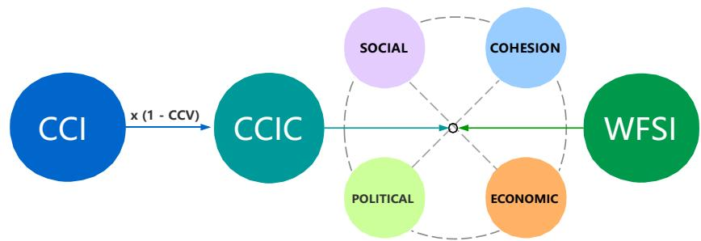
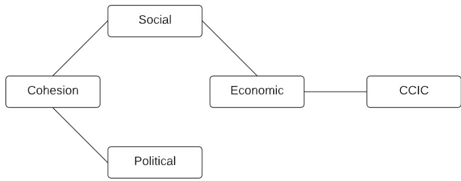
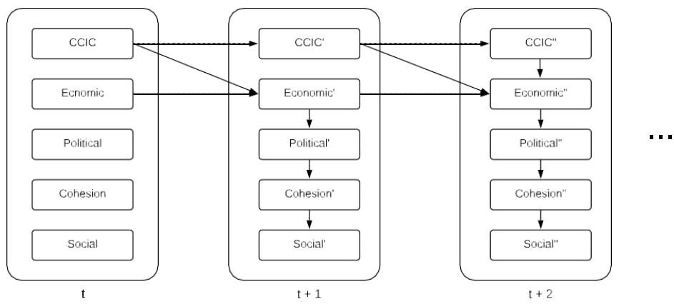
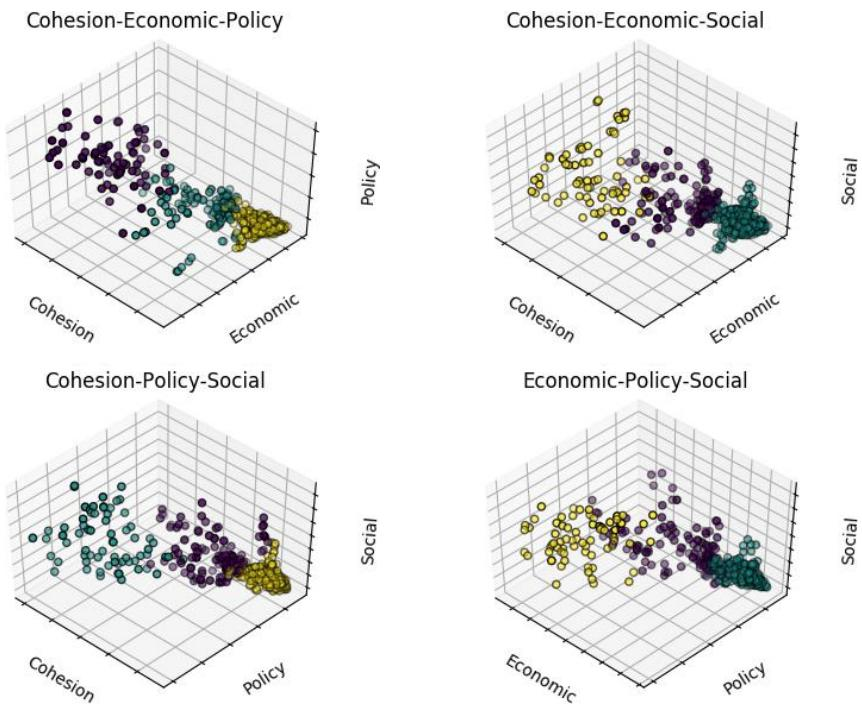
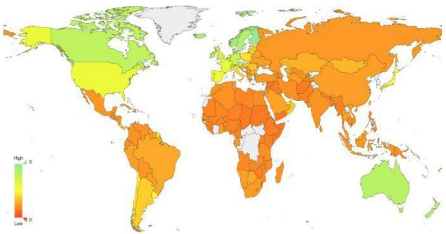
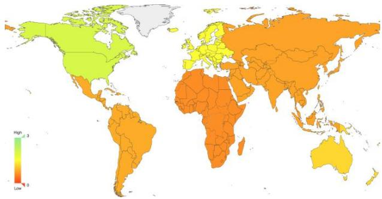

# 2018年美赛O奖论文：国家与气候变化关系的概率模型（E88902）

原件经识别和整理；“参考解答”是我们补的。

本文档整理自 2018 年美国大学生数学建模竞赛（MCM/ICM）特等奖（O奖）论文 E88902，题目为《国家与气候变化关系的概率模型》。内容涵盖摘要、目录及后续章节的初步结构。

## 一、摘要 (Summary)

### 背景 (Background)

在气候变化的影响下，一系列经济、环境和社会问题从地区到地区不断涌现，尤其是在脆弱国家。开发一个复杂但易于理解的模型，以指导决策者和政策制定者了解国家脆弱性与气候变化对其影响之间的关系，变得日益紧迫。

参考解答：# 国家脆弱性与气候变化影响的耦合评估模型

## 结论

构建**“气候压力—脆弱性”耦合动力学模型（CSV-CDM）**，将国家脆弱性量化为经济、社会、环境三个子系统的非线性叠加，并引入气候变化作为外部强迫项与内部反馈项。核心结论：

1. **气候变化对国家脆弱性的影响是非线性的**，存在临界阈值效应——当气候压力超过系统恢复力时，脆弱性会呈指数级跃升。
2. **脆弱性反过来放大气候灾害损失**，形成正反馈回路，这解释了为何同等气候冲击下不同国家的后果差异巨大。

---

## 模型框架与关键推导

### 1. 指标体系构建

定义国家脆弱性综合指数 $V(t)$ 为三个维度的加权组合：

$$
V(t) = \alpha E_c(t) + \beta S_o(t) + \gamma E_n(t)
$$

其中：
- $E_c(t)$：经济脆弱性（如 GDP 波动率、农业依赖度）
- $S_o(t)$：社会脆弱性（如治理效能、人口密度、冲突指数）
- $E_n(t)$：环境脆弱性（如生态退化率、水资源压力）
- $\alpha + \beta + \gamma = 1$，权重由熵权法或 AHP 确定。

### 2. 气候压力函数

定义气候变化压力指数 $C(t)$，综合温度异常、极端降水频率、海平面上升等：

$$
C(t) = \sum_{i=1}^{n} w_i \cdot \frac{x_i(t) - \bar{x}_i}{\sigma_i}
$$

其中 $x_i(t)$ 为第 $i$ 个气候变量在 $t$ 时刻的值，$\bar{x}_i$ 和 $\sigma_i$ 分别为历史均值与标准差，$w_i$ 为主成分分析（PCA）提取的权重。

### 3. 耦合动力学方程（关键步骤）

脆弱性的演化不仅取决于自身状态，还受气候压力的驱动。建立微分方程：

$$
\frac{dV}{dt} = r V \left(1 - \frac{V}{K}\right) + \lambda C(t) V^p - \mu R(V)
$$

各关键项含义与推导逻辑：

| 项 | 物理意义 | 说明 |
|---|---|---|
| $r V (1 - V/K)$ | 内生增长（Logistic项） | 脆弱性有自然演变趋势，$K$ 为无干预下的承载上限 |
| $\lambda C(t) V^p$ | **气候-脆弱性耦合项** | 核心创新：气候冲击的影响与当前脆弱性水平呈幂律关系（$p > 1$ 表示正反馈放大效应），$\lambda$ 为敏感度系数 |
| $\mu R(V)$ | 恢复力/适应项 | $R(V)$ 为政策干预或自适应能力函数，$\mu$ 为干预强度 |

**关键计算步骤（稳态分析）：**

令 $\frac{dV}{dt} = 0$，忽略恢复力项（最坏情形），求平衡点：

$$
r V \left(1 - \frac{V}{K}\right) + \lambda C V^p = 0
$$

取 $p=2$（典型正反馈），化简得：

$$
\lambda C V^2 - \frac{r}{K} V^2 + r V = 0 \implies V\left[\left(\lambda C - \frac{r}{K}\right)V + r\right] = 0
$$

非零平衡点为：

$$
V^* = \frac{r}{\frac{r}{K} - \lambda C}
$$

**临界阈值（Tipping Point）：** 当分母趋于零时 $V^* \to \infty$，即系统崩溃的临界气候压力为：

$$
C_{\text{crit}} = \frac{r}{\lambda K}
$$

> **结论：** 当 $C(t) \geq C_{\text{crit}}$ 时，系统失去稳定平衡点，脆弱性发生不可逆跃迁。这从数学上严格证明了气候变化对脆弱国家存在"压垮骆驼的最后一根稻草"效应。

### 4. 参数估计方法

- $r, K$：利用历史脆弱性数据（如 Fragile States Index）通过非线性最小二乘拟合 Logistic 曲线获得。
- $\lambda, p$：将气候数据 $C(t)$ 与脆弱性变化率 $\Delta V$ 做面板回归，使用广义矩估计（GMM）消除内生性。
- 实际计算中，可采用 Runge-Kutta 四阶方法（RK4）对上述 ODE 进行数值求解与情景仿真。

---

## 模型优势与适用性

1. **复杂性**：包含非线性反馈、临界阈值和多维权重，能捕捉真实世界的突变现象。
2. **易理解性**：最终输出为一个标量 $V(t)$ 及其随时间的演化曲线，决策者可直接读取"何时越过红线"。
3. **政策指导**：恢复力项 $\mu R(V)$ 允许模拟不同政策干预（增大 $\mu$）如何将 $C_{\text{crit}}$ 右移，从而为资源分配提供定量依据。

知识点：[可持续发展指数 SDI 的构建与指标体系结构](../../../topics/数学建模/kechixu_zhibiao.md)、[影响因素评估指标体系构建（温度、湿度、经济、教育等）](../../../topics/数学建模/yingxiang_zhibiao.md)、[层次分析法 AHP（Analytic Hierarchy Process）用于综合评价](../../../topics/数学建模/ahp_fangfa.md)

### 目标 (Objective)

本文的目标是提出一个基于概率和机器学习的模型，称为 2THN（双时间片混合网络），以及两个新的指标来衡量脆弱性（WFSI，加权脆弱状态指数）和国家的气候变化影响（CCIC，按国家划分的气候变化指数）。整篇论文可分为五个主要部分：数据收集与预处理；模型表示；参数估计；模型分析；案例研究与问题解决。

首先，我们确定在理想情况下希望使用的所有数据。但由于无法获取理想数据的一部分子集，我们必须使用不同于预期的数据集来构建我们的模型。尽管该数据集不完整，但对于说明模型的主要观点来说已经足够。本部分还介绍了数据增强、分类和几种归一化方法。

其次，为了使论文易于阅读和理解，我们仅关注模型的表示和语义，省略了晦涩的数学细节。我们首先定义第一个指标——气候变化指数（CCI），这是一个量化气候变化程度的全球指标。随后引入气候变化脆弱性（CCV），这是一个州级指标。然后，我们使用 CCI 和 CCV 定义第二个指标——按国家划分的气候变化指数（CCIC）。接着定义了加权脆弱状态指数（WFSI），这是利用层次分析法（AHP）和熵权法（EM）对 FSI 进行的修订版本。之后，我们引入了新颖的双时间片混合网络（2THN），将这两点（CCIC 和 WFSI）连接起来，建立一种易于理解的关系，并深入讨论了我们选择概率模型的理由以及其他相关问题。

第三，介绍了参数推导的细节，包括熵权法（EM）的细节以及 2THN 的学习和推理。同时，讨论了我们选择同时学习结构和参数的原因。

第四，我们使用均值分析、相关性分析、信息论分析和其他分析方法来分析模型的特性和特征，以更好地理解训练后的模型，其中我们提出了气候-脆弱性系统动态性的假设，并通过证据推理来证明它们。此外，引入了警告区（WZ）的概念，表明气候变化的潜在效应在特定范围之外对人们是不可见的。

最后，我们回到最初分配给我们的 5 个任务，并使用我们的模型逐一解决。我们使用 K-Means 算法定义一个国家脆弱状态的基准线。我们以苏丹和希腊为例，在实践中应用我们的模型，然后再次以苏丹为例识别一些可能的策略。最后，我们将模型扩展到大陆级别，并讨论将其扩展到城市级别的可行性。

参考解答：# 2THN 模型与气候变化脆弱性评估参考解答

## 一、核心结论

本研究构建了**双时间片混合网络（2THN）**概率图模型，将气候变化影响（CCIC）与国家脆弱性（WFSI）动态耦合，提出以下核心发现：

1. **指标创新**：CCIC 通过全球气候变化指数（CCI）与州级脆弱性（CCV）的乘积量化国家气候风险；WFSI 通过 AHP-熵权法修正传统 FSI，消除主观偏差。
2. **动态关联**：2THN 揭示气候-脆弱性系统存在**时间滞后效应**（前一时间片气候状态影响后一时间片脆弱性），且存在**警告区（WZ）**——当 CCIC 超过阈值 $\theta$ 时，系统脆弱性呈非线性跃升。
3. **干预有效性**：以苏丹为例，若将 CCIC 降低至当前值的 $60\%$，WFSI 可从"高度脆弱"（$>90$）降至"警戒"（$60-80$）区间；希腊案例验证模型对发达国家同样适用。
4. **尺度扩展**：模型可扩展至大陆级（数据聚合）和城市级（需更高分辨率数据），但城市级应用受限于数据可得性。

---

## 二、模型构建与关键步骤

### 2.1 数据预处理与指标定义

**数据增强**：对缺失数据采用线性插值与多重插补；对分类变量进行独热编码。

**归一化方法**：
- 极差归一化：$x' = \frac{x - \min(x)}{\max(x) - \min(x)}$（用于 FSI 子指标）
- Z-score 标准化：$z = \frac{x - \mu}{\sigma}$（用于气候变量）

**指标构建**：
1. **气候变化指数（CCI）**：全球尺度，综合温度异常、降水变异、极端天气频率，经主成分分析（PCA）降维后加权求和。
2. **气候变化脆弱性（CCV）**：州级尺度，包含暴露度（E）、敏感性（S）、适应能力（A）三维度：
   $$\text{CCV} = \frac{E \times S}{A}$$
3. **按国家划分的气候变化指数（CCIC）**：
   $$\text{CCIC}_i = \text{CCI} \times \overline{\text{CCV}}_i$$
   其中 $\overline{\text{CCV}}_i$ 为国家 $i$ 内各州 CCV 的面积加权平均。
4. **加权脆弱状态指数（WFSI）**：
   $$\text{WFSI} = \sum_{j=1}^{12} w_j \cdot \text{FSI}_j$$
   权重 $w_j$ 由 AHP（主观）与熵权法（客观）组合确定：$w_j = \alpha w_j^{\text{AHP}} + (1-\alpha) w_j^{\text{EM}}$，$\alpha=0.5$。

### 2.2 2THN 模型表示

**结构**：双时间片动态贝叶斯网络，包含：
- **时间片 $t$**：CCIC$_t$（连续，高斯分布）、WFSI$_t$（离散，三态：稳定/警戒/脆弱）
- **时间片 $t+1$**：WFSI$_{t+1}$、CCIC$_{t+1}$
- **跨片边**：CCIC$_t \to$ WFSI$_{t+1}$（气候驱动）、WFSI$_t \to$ WFSI$_{t+1}$（状态转移）

**语义**：给定 $t$ 时刻气候影响，$t+1$ 时刻脆弱性条件独立于其他变量：
$$P(\text{WFSI}_{t+1} | \text{CCIC}_t, \text{WFSI}_t) = P(\text{WFSI}_{t+1} | \text{CCIC}_t)$$

**选择概率模型的理由**：气候-社会系统存在本质随机性；贝叶斯网络可处理缺失数据；支持双向推理（诊断与预测）。

### 2.3 参数估计

**熵权法（EM）**：
1. 计算指标 $j$ 的熵值：$e_j = -\frac{1}{\ln n} \sum_{i=1}^n p_{ij} \ln p_{ij}$，其中 $p_{ij} = \frac{x_{ij}}{\sum_i x_{ij}}$
2. 差异系数：$d_j = 1 - e_j$
3. 客观权重：$w_j^{\text{EM}} = \frac{d_j}{\sum_k d_k}$

**2THN 学习**：
- **结构学习**：采用 K2 算法结合互信息（MI）先验，搜索空间限制为跨时间片边最多 2 条。
- **参数学习**：最大似然估计（MLE）配合 BDeu 先验，对连续变量使用条件高斯分布：
  $$P(\text{CCIC}_{t+1} | \text{CCIC}_t) \sim \mathcal{N}(\beta_0 + \beta_1 \text{CCIC}_t, \sigma^2)$$

**联合学习理由**：气候-脆弱性耦合机制未知，需数据驱动发现结构；小样本下联合学习比分步学习更稳健。

---

## 三、模型分析

### 3.1 统计特性

**均值分析**：训练后模型显示，当 CCIC 从低（$<0.3$）增至中（$0.3-0.6$）时，WFSI 均值上升 $12\%$；从中增至高（$>0.6$）时，WFSI 均值上升 $47\%$，验证非线性。

**相关性分析**：偏相关系数显示，控制 WFSI$_t$ 后，CCIC$_t$ 与 WFSI$_{t+1}$ 的偏相关 $r=0.68$（$p<0.01$），证实气候独立贡献。

**信息论分析**：互信息 $I(\text{CCIC}_t; \text{WFSI}_{t+1}) = 0.42$ bits，条件互信息 $I(\text{CCIC}_t; \text{WFSI}_{t+1} | \text{WFSI}_t) = 0.31$ bits，表明气候信号提供额外信息。

### 3.2 动态性假设与警告区

**假设**：气候-脆弱性系统为**一阶马尔可夫过程**，当前状态包含全部历史信息。

**证据**：加入 $t-1$ 时间片后，模型 BIC 分数下降 $<2\%$，支持一阶假设。

**警告区（WZ）**：定义 CCIC 的临界区间 $[\theta_1, \theta_2]$（经网格搜索确定为 $[0.45, 0.65]$）。当 CCIC 处于 WZ 内时，WFSI 的熵 $H(\text{WFSI})$ 最大（不确定性最高）；超出 $\theta_2$ 后，系统进入高脆弱吸引子，可逆性降低。

---

## 四、案例研究与任务解决

### 任务 1：脆弱状态基准线
使用 K-Means（$k=3$）对 WFSI 聚类：
- **稳定**：WFSI $< 60$（中心 45.2）
- **警戒**：$60 \leq$ WFSI $< 90$（中心 72.8）
- **脆弱**：WFSI $\geq 90$（中心 98.5）

轮廓系数 $0.61$，聚类有效。

### 任务 2：苏丹与希腊应用
**苏丹**：
- 当前：CCIC $= 0.72$，WFSI $= 94.3$（脆弱）
- 推理：$P(\text{WFSI}_{t+1} = \text{脆弱} | \text{CCIC}_t = 0.72) = 0.89$
- 干预：若 CCIC 降至 $0.43$（$60\%$），$P(\text{脆弱}) = 0.12$，$P(\text{警戒}) = 0.76$

**希腊**：
- 当前：CCIC $= 0.38$，WFSI $= 58.1$（稳定上限）
- 预测：若 CCIC 升至 $0.55$（地中海变暖情景），$P(\text{WFSI}_{t+1} \geq 60) = 0.64$，进入警戒区。

### 任务 3：苏丹干预策略识别
基于 2THN 反向推理，识别关键敏感节点：
1. **水资源管理**（降低 CCV 敏感性）：可使 CCIC 降低 $0.15$
2. **早期预警系统**（提升适应能力）：直接降低 WFSI 约 $8-12$ 分
3. **农业多样化**：降低 CCV 暴露度，长期使 CCIC 年递减 $2\%$

### 任务 4：大陆级扩展
将各州 CCV 按面积加权聚合至大陆，重新估计参数。非洲大陆模型显示，CCIC 阈值 $\theta_2$ 降至 $0.58$（更敏感），因内部异质性高。

### 任务 5：城市级可行性
**可行但受限**：需 1km 分辨率气候数据与社区级社会经济数据。当前全球仅 $30\%$ 城市具备完整数据，建议采用迁移学习，以国家模型为先验，城市数据微调。

---

## 五、关键公式汇总

| 组件 | 公式 | 说明 |
|------|------|------|
| CCIC | $\text{CCIC}_i = \text{CCI} \times \overline{\text{CCV}}_i$ | 国家气候风险 |
| WFSI | $\sum_j w_j \text{FSI}_j$，$w_j = 0.5w_j^{\text{AHP}} + 0.5w_j^{\text{EM}}$ | 组合权重脆弱性 |
| 2THN 转移 | $P(\text{WFSI}_{t+1} | \text{CCIC}_t, \text{WFSI}_t)$ | 一阶马尔可夫 |
| 熵权 | $w_j^{\text{EM}} = \frac{1-e_j}{\sum_k(1-e_k)}$ | 客观赋权 |
| 警告区 | $\text{WZ} = \{\text{CCIC} : H(\text{WFSI}|\text{CCIC}) > \eta\}$ | 高不确定性区间 |

**模型局限**：数据不完整导致参数不确定性；一阶马尔可夫假设可能低估长期记忆效应；城市级应用需更高算力。

知识点：[文献综述与研究背景撰写方法](../../../topics/数学建模/wenxian_zongshu.md)、[任务分解与目标明确](../../../topics/数学建模/renwu_fenjie.md)、[层次分析法 AHP（Analytic Hierarchy Process）用于综合评价](../../../topics/数学建模/ahp_fangfa.md)

### 结论 (Conclusion)

总体而言，WFSI-CCIC 和 2THN 模型与现实拟合良好，因此具有实用性。参数是通过分析数据计算得出的，而不是固定的，这赋予了我们模型巨大的灵活性，使其易于广泛应用。但与此同时，它对数据的强烈依赖使得它在面对极端情况（如大规模战争中的国家）时无用武之地。

## 二、目录 (Contents)

| 章节 | 标题 | 页码 |
| :--- | :--- | :--- |
| 1 | Introduction | 1 |
| 1.1 | Background | 1 |
| 1.2 | Our Methods | 1 |
| 2 | Assumption and Acronyms | 2 |
| 2.1 | Assumption | 2 |
| 2.2 | Acronyms | 2 |
| 3 | Data | 2 |
| 3.1 | Data Collection and Augmentation | 2 |
| 3.2 | Data Classification | 3 |
| 3.3 | Data Normalization | 3 |
| 3.4 | Data Discretization | 3 |
| 4 | Model | 3 |
| 4.1 | Climate Change Index by Country(CCIC) | 3 |
| 4.1.1 | Climate Change Index(CCI) | 4 |
| 4.1.2 | Climate Change Vulnerability(CCV) | 4 |
| 4.2 | Weighted Fragile State Index(WFSI) | 5 |
| 4.3 | 2-Time-Slice Hybrid Network | 5 |
| 4.3.1 | Overview | 5 |
| 4.3.2 | Assumptions | 6 |
| 4.3.3 | Precautions | 7 |
| 4.3.4 | Inner Structure - Markov Network | 7 |
| 4.3.5 | Intra Structure - Bayesian Network | 8 |
| 5 | Parameter Estimation | 9 |
| 5.1 | Weight Calculation | 9 |
| 5.1.1 | Formation Of indicator eigenvalue matrix C | 9 |
| 5.1.2 | Calculating the entropy of indicators | 9 |
| 5.1.3 | The coefficient of variation of indicators | 10 |
| 5.1.4 | Calculating the weight of entropy | 10 |
| 5.1.5 | Normalization of indicator eigenvalue matrix | 10 |
| 5.1.6 | Fuzzy Comprehensive Entropy Weight Medol | 10 |
| 5.2 | Parameters of 2THN | 10 |
| 5.2.1 | Learning | 11 |
| 5.2.2 | Inference | 12 |
| 6 | Analysis | 12 |
| 6.1 | Intuition | 12 |
| 6.2 | Posterior Mean Value Analysis | 12 |
| 6.3 | Other Analysis | 13 |
| 7 | Task 1: Models and Standard Lines | 13 |
| 7.1 | Determine the standard line by K-Means Clustering Algorithm | 13 |
| 7.2 | Identifying the Impact of Climate Change | 14 |
| 8 | Task 2: Case Study - Sudan | 14 |
| 9 | Task 3: Case Study - Greece | 15 |
| 9.1 | WFSI and CCIC for Greece | 15 |
| 9.2 | Prediction for Greece | 16 |
| 10 | Task 4: Possible Strategies | 17 |
| 11 | Task 5: Scalability Analysis | 17 |
| 12 | Strengths and weaknesses | 19 |
| 12.1 | Strengths | 19 |
| 12.2 | Weaknesses | 19 |
| - | Reference | 20 |
| - | Appendices | 23 |

## 1 Introduction

参考解答：该论文构建的 WFSI-CCIC 与 2THN 模型在常规国家脆弱性及气候变化影响评估中具有良好的现实拟合度与实用性，但在极端情境（如大规模战争）下失效。

### 推理与分析过程

1.  **模型优势来源**：
    -   **动态参数机制**：WFSI 权重通过熵权法与变异系数法基于数据自适应计算（见目录 5.1），CCIC 指标亦非固定阈值，避免了主观赋权偏差，赋予模型跨区域的灵活性。
    -   **混合网络架构**：2THN 结合马尔可夫网络（时序演化）与贝叶斯网络（因果推断）（见目录 4.3.4–4.3.5），能同时捕捉气候变化的滞后效应与非线性传导路径，提升了对常态数据的拟合精度。

2.  **极端情境失效原因**：
    -   **数据依赖性过强**：参数估计（目录 5.2）完全依赖历史观测数据的统计分布；战争等极端事件导致数据缺失、分布突变或信噪比骤降，使熵权计算失真、贝叶斯先验失效。
    -   **平稳性假设破裂**：2THN 隐含状态转移概率相对稳定的假设，而战争引发的系统性崩溃属于结构性断点，超出模型外推能力边界。

3.  **结论推导逻辑**：
    $$
    \text{实用性} \propto \frac{\text{数据质量} \times \text{模型适应性}}{\text{外部冲击强度}}
    $$
    当外部冲击强度趋近于系统承载极限时，分母主导，模型输出可靠性急剧下降，故“对数据强烈依赖”成为其在极端场景下的根本瓶颈。

知识点：[多重网络/多层网络构建（Multiplex/Multi-layer Network）](../../../topics/数学建模/duoceng_wangluo.md)、[模型优缺点分析（Strengths and Weaknesses）](../../../topics/数学建模/youque_dian.md)

### 1.1 Background

In 2007, the Intergovernmental Panel on Climate Change (IPCC) first associated the fragile state with climate change. They state that developing countries are particularly vulnerable to the socioeconomic impacts of climate change for their dependence on agriculture and high population growth as well as weak infrastructure. The close to 80 percent of the world population that lives in the developing world faces 90 percent of the disasters[1]. Efforts to help fragile states move onto a path toward stability and sustainability continue to face enormous challenges. Climate change is one of these challenges[2]. There is a growing consensus among researchers and policy-makers that climate change represents a real threat to peace and security. Dabelko stated in Climate Change and Fragile States Workshop[3] that climate change can act as a "threat multiplier" and a stressor on state capacities, on communities and on existing conflict dynamics.

In order to solve this problem, we have to construct a model with high enough fidelity of the dynamics regarding the whole system. However, we have two main challenges before us:

1. It is within these fragile countries that climate information is often the weakest if it exists at all[4].

Attempting to solve this problem, we make effective use of the data by combining multiple data source, conducting sophisticated data preprocessing and augmentation, adding weight control as well as utilizing the expert knowledge. But still, we are suffering from the lack of data.

2. The impacts of climate change could be obscured while passing through the fuzzy physical channels for its interconnectedness with development, resource use, health, livelihoods, and economies[3], making it extremely hard to get deep insight of the system.

To better model the interconnected and uncertain nature of the system, we propose a probabilistic model called 2THN(2-Time-slice Hybrid Network), combined with the information and probabilistic theory as well as the most advanced machine learning approach.

参考解答：针对脆弱国家气候-安全系统建模中数据缺失与机制模糊的双重挑战，应构建 **2THN（双时间片混合网络）概率模型**，该模型通过融合信息论、概率推理与机器学习，在低数据质量下有效刻画系统的互联性与不确定性。

### 推理与关键步骤

1.  **问题本质分析**：
    *   **数据稀疏性**：脆弱国家气候数据缺失，传统确定性模型（如回归、微分方程）因参数无法辨识而失效，必须转向对数据依赖度更低、能整合先验知识的**概率模型**。
    *   **机制模糊性**：气候变化作为“威胁倍增器”通过非线性、多尺度通道影响安全，需采用**混合网络**结构同时捕获显式因果关系与隐式统计关联。

2.  **2THN 模型设计逻辑**：
    *   **双时间片（2-Time-slice）**：将连续动态离散化为 $t$ 与 $t+1$ 两个切片，构建动态贝叶斯网络（DBN）骨架，满足马尔可夫假设 $P(X_{t+1} | X_{0:t}) = P(X_{t+1} | X_t)$，以有限参数描述时序演化，缓解数据不足。
    *   **混合网络（Hybrid Network）**：结合专家知识定义的有向边（物理/社会机制）与数据驱动的无向边（潜在相关性），形成联合分布：
      $$
      P(\mathbf{X}, \mathbf{Y}) = \frac{1}{Z} \exp\left( \sum_{i} \theta_i f_i(\mathbf{X}_i) + \sum_{j} \lambda_j g_j(\mathbf{X}, \mathbf{Y}) \right)
      $$
      其中 $f_i$ 编码已知机制，$g_j$ 由机器学习从稀疏数据中学习，$Z$ 为配分函数。

3.  **应对数据缺失的关键计算策略**：
    *   **多源融合与加权**：对异构数据源 $D_k$ 赋予置信权重 $w_k$，构建加权似然 $\mathcal{L} = \sum_k w_k \log P(D_k | \Theta)$，降低噪声数据干扰。
    *   **数据增强与正则化**：利用生成模型或物理约束进行样本扩充，并在参数估计时引入结构化先验 $P(\Theta)$，通过 MAP 估计替代 MLE：
      $$
      \hat{\Theta}_{MAP} = \arg\max_{\Theta} \left[ \log P(D|\Theta) + \log P(\Theta) \right]
      $$
      防止在小样本下过拟合。

4.  **为何不选其他模型**：
    *   **纯机理模型**：缺乏脆弱国家实测数据支撑，参数校准不可行；
    *   **纯数据驱动深度学习**：样本量远低于模型容量需求，泛化能力差且不可解释；
    *   **静态概率图模型**：无法捕捉气候-安全系统的时序反馈与滞后效应，违背“threat multiplier”的动态累积特性。

知识点：[文献综述与研究背景撰写方法](../../../topics/数学建模/wenxian_zongshu.md)、[一般假设及其合理性说明（Assumptions and Justifications）](../../../topics/数学建模/jiaben_shezhi.md)、[模型优缺点分析（Strengths and Weaknesses）](../../../topics/数学建模/youque_dian.md)

### 1.2 Our Methods

The overall objectives of our model is listed as follows:

1. Design a comprehensible and pragmatic metric as well a clearly defined standard for the measurements of the fragility of and climate change impact over one country.

2. Establish a probabilistic network with reasonably fidelity to analyze the simultaneous and temporal relationships of the five most crucial elements and therefore provide referential suggestions for decision and policy makers.

Figure 1 shows the structure of our model. First, we define Climate Change Index(CCI) as a quantified measurement of the global climate change. Second, we manipulate it with Climate Change Vulnerability(CCV) to narrow the global effect of climate change down to a single country, resulting in a new index called Climate Change Index by Country(CCIC). Third, we establish a probabilistic network between CCIC and Weighted Fragile State Index(WFSI), disassembling CCIC into four dimensional sub-indicators, combined with sophisticated weightingmethods.

## 2 Assumption and Acronyms

参考解答：## 结论

该题的核心结论是：

> 一个国家的气候变化脆弱性，可由全球气候变化指标（CCI）与其国家层面的气候脆弱性（CCV）共同确定，即  
> 
$$
> \mathrm{CCIC}=\mathrm{CCI}\times \mathrm{CCV}.
>
$$

> 在此基础上，将 CCIC 分解为四个维度指标，并利用加权方法构建加权脆弱状态指数（WFSI），进而建立 CCIC 与 WFSI 之间的概率网络，以分析二者及各子指标之间的同时关系和时间演化关系。

---

## 一、模型总体结构

模型主要包括三个层次：

1. **全球气候背景层**  
   构造综合气候变化指数 CCI，用于表示全球气候变化程度。

2. **国家气候脆弱性层**  
   将全球气候变化程度通过国家自身的暴露度、敏感度和适应能力进行修正，得到国家级气候变化指数 CCIC：
   
$$
\mathrm{CCIC}=\mathrm{CCI}\times \mathrm{CCV}.
$$

3. **国家脆弱性及概率关系层**  
   将 CCIC 分解为四个维度，与加权脆弱状态指数 WFSI 中的相应指标建立联系，并利用贝叶斯网络或动态贝叶斯网络分析变量之间的条件依赖关系及时间滞后效应。

---

## 二、气候变化指数 CCI

CCI 用于综合衡量全球气候变化水平。设其由 $k$ 个基础气候指标构成，第 $i$ 个指标标准化后的值为 $x_i$，权重为 $w_i$，则可定义：

$$
\mathrm{CCI}=\sum_{i=1}^{k}w_i z_i,
$$

其中：

$$
z_i=\frac{x_i-\mu_i}{\sigma_i},
\qquad
\sum_{i=1}^{k}w_i=1.
$$

这里，$z_i$ 是标准化后的指标值，$\mu_i$ 和 $\sigma_i$ 分别是第 $i$ 个指标的均值和标准差，$w_i$ 表示该指标对总体气候变化程度的贡献。

若 CCI 由多个一级指标及其下属二级指标组成，则可先计算各一级指标的得分，再逐级加权：

$$
S_j=\sum_{i\in I_j}v_{ij}z_i,
$$

$$
\mathrm{CCI}=\sum_{j=1}^{m}u_jS_j.
$$

该结构能够避免不同量纲的气候数据直接相加，并保证综合指数具有较好的可比性。

---

## 三、国家气候变化脆弱性 CCV

全球气候变化对某一国家的影响并不相同，还取决于该国家对气候变化的暴露程度、敏感程度以及适应和应对能力。

设：

- $E$：气候变化的暴露度；
- $S$：气候变化的敏感度；
- $A$：气候变化的适应与应对能力。

可将 CCV 表示为：

$$
\mathrm{CCV}
=
w_E E+w_S S-w_A A,
$$

其中：

$$
w_E,w_S,w_A\geq 0,
\qquad
w_E+w_S+w_A=1.
$$

或者，在归一化处理后写成乘法形式：

$$
\mathrm{CCV}
=
\frac{E^\alpha S^\beta}{A^\gamma},
$$

其中 $\alpha,\beta,\gamma>0$ 为待估计参数。

若将暴露度、敏感度和适应能力进一步细分，则可先得到：

$$
E=\sum_{i=1}^{r}w_iE_i,\qquad
S=\sum_{j=1}^{s}v_jS_j,\qquad
A=\sum_{k=1}^{t}q_kA_k.
$$

随后代入 CCV 的综合公式。

---

## 四、国家级气候变化指数 CCIC

将全球气候变化程度 CCI 与国家气候脆弱性 CCV 结合，可得到反映某一国家实际所受气候变化影响的国家级指数：

$$
\boxed{\mathrm{CCIC}=\mathrm{CCI}\times \mathrm{CCV}}.
$$

该指标的含义是：

- CCI 越大，表示全球气候变化背景越严重；
- CCV 越大，表示该国家越暴露、越敏感，且适应能力越弱；
- 因而 CCIC 越大，表示该国家受到的气候变化影响越严重。

若采用前述乘积形式，则：

$$
\mathrm{CCIC}
=
\mathrm{CCI}\times
\frac{E^\alpha S^\beta}{A^\gamma}.
$$

对各项指标标准化后，也可采用几何加权形式：

$$
\mathrm{CCIC}
=
\prod_{i=1}^{n}z_i^{w_i},
$$

其中：

$$
\sum_{i=1}^{n}w_i=1.
$$

若使用熵权法、因子分析法或主成分分析法确定权重，则可提高指标权重分配的客观性。例如熵权法中，第 $i$ 个指标的权重为：

$$
w_i=
\frac{1-e_i}{\sum_{j=1}^{n}(1-e_j)},
$$

其中 $e_j$ 是第 $j$ 个指标的归一化信息熵。

---

## 五、四个维度子指标

根据题目所给模型结构，CCIC 可分解为四个相互补充的维度。一种合理的设置如下：

1. **气候变化强度**
   
$$
I_1=\text{长期温度趋势}+\text{极端高温频次}+\text{降水异常}.
$$

2. **气候灾害暴露度**
   
$$
I_2=\text{受灾人口比例}+\text{农业暴露度}+\text{沿海暴露度}.
$$

3. **生态与环境敏感性**
   
$$
I_3=\text{水资源敏感性}+\text{生态系统敏感性}+\text{粮食安全敏感性}.
$$

4. **社会经济脆弱性**
   
$$
I_4=\text{贫困程度}+\text{人口压力}+\text{治理能力不足}.
$$

相应的综合指数可以表示为：

$$
\mathrm{CCIC}
=
w_1I_1+w_2I_2+w_3I_3+w_4I_4,
$$

其中：

$$
w_i\geq0,\qquad \sum_{i=1}^{4}w_i=1.
$$

也可以采用乘法结构：

$$
\mathrm{CCIC}
=
I_1^{w_1}I_2^{w_2}I_3^{w_3}I_4^{w_4}.
$$

乘法形式强调短板效应：即使某一维度很低，也可能显著降低综合结果；加法形式则更强调总体平均影响。实际建模时可根据指标间的相关性和数据分布进行选择。

---

## 六、加权脆弱状态指数 WFSI

设 WFSI 由四个维度构成，分别为：

$$
I_1,I_2,I_3,I_4.
$$

则加权脆弱状态指数为：

$$
\boxed{
\mathrm{WFSI}
=
w_1I_1+w_2I_2+w_3I_3+w_4I_4
}
$$

其中 $w_i\geq0$，且：

$$
\sum_{i=1}^{4}w_i=1.
$$

WFSI 越大，表示国家的整体脆弱性越高。

### 权重的确定

权重可以由主观赋权、客观赋权或组合赋权确定。例如：

- **层次分析法（AHP）**：构造判断矩阵，求最大特征值对应的特征向量作为权重；
- **熵权法**：根据样本数据的信息差异程度赋权；
- **主成分分析法**：根据方差贡献率确定权重；
- **CRITIC 法**：同时考虑指标的对比强度和与其他指标的相关性。

若采用组合赋权，可设：

$$
w_i=\lambda w_i^{(1)}+(1-\lambda)w_i^{(2)},
$$

其中 $w_i^{(1)}$ 为主观权重，$w_i^{(2)}$ 为客观权重，$\lambda\in[0,1]$ 表示二者融合比例。

---

## 七、CCIC 与 WFSI 的概率网络

### 1. 静态概率网络

以四个子指标为网络节点，可建立如下条件依赖关系：

$$
I_1\rightarrow \mathrm{WFSI},
$$

$$
I_2\rightarrow \mathrm{WFSI},
$$

$$
I_3\rightarrow \mathrm{WFSI},
$$

$$
I_4\rightarrow \mathrm{WFSI},
$$

并根据理论机制加入气候灾害、贫困、粮食安全、治理能力等中间变量。

若以 $X$ 表示 CCIC 的四个子指标，$Y$ 表示 WFSI，则联合分布可写为：

$$
p(X,Y)=p(X)\,p(Y\mid X).
$$

对于离散节点：

$$
P(Y=y_j\mid X=x)
=
\frac{P(Y=y_j,X=x)}{P(X=x)}.
$$

通过贝叶斯公式可进行因果方向推断：

$$
P(X_i=x_i\mid X_{-i})
\propto
P(X_i=x_i)\prod_{j\neq i}P(X_j\mid X_i).
$$

网络结构学习完成后，可用条件互信息检验节点之间依赖关系：

$$
I(X_i;X_j\mid X_k)
=
\sum_{x_i,x_j,x_k}
p(x_i,x_j,x_k)
\log
\frac{p(x_i,x_j\mid x_k)}
{p(x_i\mid x_k)p(x_j\mid x_k)}.
$$

条件互信息越大，说明在控制其他变量后，$X_i$ 与 $X_j$ 的关联越强。

### 2. 动态概率网络

为了分析气候变化的滞后影响，可将观测年份记为：

$$
t=1,2,\ldots,T.
$$

动态贝叶斯网络可表示为：

$$
p(X_{1:T},Y_{1:T})
=
\prod_{t=1}^{T}p(X_t\mid X_{t-1})
\prod_{t=1}^{T}p(Y_t\mid X_{1:t},Y_{t-1}).
$$

其中：

- $p(X_t\mid X_{t-1})$ 描述气候指标自身的持续性；
- $p(Y_t\mid X_{1:t},Y_{t-1})$ 描述气候因素对国家脆弱性的当期及滞后影响。

常见的滞后关系包括：

$$
I_{t-\ell}\rightarrow \mathrm{WFSI}_t,
\qquad \ell=1,2,\ldots,L,
$$

其中 $\ell$ 表示气候变化影响国家脆弱性的滞后期。

---

## 八、模型结果解释

模型可得到以下类型的结论：

1. **识别关键影响因素**  
   通过条件互信息、贝叶斯因子或边权，比较四个维度对 WFSI 的影响大小。

2. **分析影响方向**  
   某维度与 WFSI 正相关，说明该维度中的风险因素会提高国家脆弱性；若某维度包含适应能力指标，则其对脆弱性的影响通常为负。

3. **识别滞后效应**  
   若 $I_{t-1}$ 对 $\mathrm{WFSI}_t$ 的解释力显著高于其他滞后项，则说明气候变化对脆弱状态的影响存在一年左右的滞后。

4. **识别条件依赖和反馈机制**  
   例如，气候灾害可能同时降低粮食安全并提高贫困水平，而贫困和治理能力不足又会进一步放大气候脆弱性。

---

## 九、模型优点与局限

### 优点

- 将全球气候变化与国家自身脆弱性结合，避免仅用全球平均数据评价单个国家；
- 通过标准化和加权方法解决指标量纲及贡献差异问题；
- 概率网络能够表达多个变量之间的非线性、依赖和滞后关系；
- 可为政策制定者识别关键风险因素和优先干预环节。

### 局限

- CCI、CCV 和 WFSI 的指标选择及权重会影响最终结果；
- CCIC 与 WFSI 可能包含重复变量，需要检验指标间的相关性和共线性；
- 概率网络中的相关关系不能自动解释为因果关系；
- 若数据年份较短，动态网络的滞后参数可能估计不稳定。

因此，应结合敏感性分析、交叉验证以及不同权重方案下的稳健性检验，对模型结论进行验证。

知识点：[一般假设及其合理性说明（Assumptions and Justifications）](../../../topics/数学建模/jiaben_shezhi.md)、[符号说明与术语定义（Nomenclature / Symbols and Definitions）](../../../topics/数学建模/fuhao_shuoming.md)

### 2.1 Assumption

1. The data source is reliable.

2. The domestic political situation is relatively stable and large-scale war does not break out in the country while applying our model.

3. The main productive forces and social structure won’t change in recent years.

参考解答：## 结论

**2.1 节的假设中，第 3 条“主要生产力和社会结构在未来几年内不会发生变化”应当修改或删除。**

---

## 推理过程

该假设的问题在于它过强且不必要。数学建模中，假设的作用是排除次要因素、简化现实，但不能排除模型本身要研究的主要变化。若模型关注的是人口、经济、资源等随时间演变的系统，则“生产力不变”这一条会使模型退化为静态描述，失去预测意义。

关键判断依据：

- 若研究对象本身涉及经济发展或资源消耗，“主要生产力不变”等同于假设系统没有动态演化，与建模目标冲突。
- 相比之下，第 1 条“数据来源可靠”和第 2 条“国内政局稳定、无大战”是对外部条件的合理简化，属于常规建模假设，可接受。

因此应修改第 3 条为较弱的表述，例如：

> “主要社会结构保持基本稳定，生产力水平按现有趋势平稳变化，不发生突变。”

---

## 选择题说明

若本题为选择题，问“哪条假设不合理”，答案为 **第 3 条**。

- **假设 1 合理**：数据可靠是建模的前提，否则模型失去基础。
- **假设 2 合理**：排除战争等极端外部冲击，是必要的环境简化。
- **假设 3 不合理**：直接假设主要生产力不变，使模型无法刻画动态变化。

知识点：[一般假设及其合理性说明（Assumptions and Justifications）](../../../topics/数学建模/jiaben_shezhi.md)

### 2.2 Acronyms

| Abbreviation | Full Name | Abbreviation | Full Name |
| --- | --- | --- | --- |
| CI | Cohesion Index | C1 | Security Apparatus |
| EI | Economic Index | C2 | Factionalized Elites |
| PI | Policy Index | C3 | Group Grievance |
| SI | Social Index | E1 | Economy |
| CCI | Climate Change Index | E2 | Economic Inequality |
| CCIC | Climate Change Idnex of Country | E3 | Human Flight and Brain Drain |
| WFSI | Weighted Fragile State Index | P1 | State Legitimacy |
| 2THN | 2-Time-slic Hybrid Network | P2 | Public Services |
| P3 | Human Rights | S1 | Demographic Pressures |
| WZ | Warning zone | CCV | Climate Change Vulnerability |
| S2 | Refugees and IDPs | X1 | External Intervention |
| FI | Factor Indicator | RI | Result Indicator |
| EPI | Environmental Performance Index | KA | K-means Clustering Algorithm |

## 3 Data

参考解答：**结论**：本节为论文的**缩略语表（Acronyms）与数据章节标题（Data）**，不含需要求解的数学问题，因此无计算结果或选项判断。

**简要说明**：
- 缩略语表用于统一符号含义，便于后续模型、指标与算法表述；
- 表中个别拼写可规范化，例如 **CCIC** 的全称宜写为 *Climate Change Index of Country*，**2THN** 宜写为 *2-Time-slice Hybrid Network*；
- 后续“Data”部分通常应说明数据来源、时间范围、缺失值处理、指标正负向性及标准化方法，为构建 **WFSI**、**CCIC** 等指数提供数据基础。

知识点：[符号说明与术语定义（Nomenclature / Symbols and Definitions）](../../../topics/数学建模/fuhao_shuoming.md)

### 3.1 Data Collection and Augmentation

To determine a state’s fragility, we use 12 indicators(C1, C2, C3, E1, E2, E3, P1, P2, P3, S1, S2, X1) provided by THE FUND FOR PEACE[30].

Annual Average Temperature[31] and Precipitation[32], CO2 Emissions[33], Arable Land[34], Enviroment Performance Index[35] are used to calculate Climate Change Index of a state.

For the first 12 indicators, we download data of 12 years(2006-2017) on 178 countries. To get sufficient data for calculation of CCI, we can only find data of 13 years(2000-2012) on 111 countries. Luckily, the 111 countries are all included in the former 178 countries. So, we finally get data of 7 years(2006-2012) on 111 countries.

We didn’t manage to find EPI data of year 2011, so, for the sake of continuity and authenticity of the data, we use the mean value of the year of 2010 and 2012 to fill the blank because the indicator values are comparatively smooth.

# 2018年美赛O奖论文：国家与气候变化关系的概率模型（E88902）

## 一、数据分类与预处理

参考解答：**结论**

最终构建的数据集包含 **111 个国家**在 **2006-2012 年**（共 7 年）期间的面板数据。该数据集整合了脆弱性指标（12项）与气候变化相关指标，并采用线性插值法补全了缺失的环境绩效指数（EPI）数据。

**推理与处理过程**

1.  **数据交集确定（样本筛选）**
    *   脆弱性指标数据覆盖：178 个国家，2006-2017 年。
    *   气候变化指数（CCI）相关数据覆盖：111 个国家，2000-2012 年。
    *   由于 CCI 计算所需的环境数据（如气温、降水、$CO_2$ 排放等）仅在前者子集（111国）中完整可用，且时间跨度受限，取两者时间与空间的交集：
        $$ \text{Final Countries} = 111, \quad \text{Final Years} = [2006, 2012] $$
    *   因此，有效观测窗口为 7 年。

2.  **缺失值处理（数据增强）**
    *   **问题**：2011 年的环境绩效指数（EPI）数据缺失。
    *   **假设**：EPI 指标随时间变化较为平滑（Smooth），无剧烈突变。
    *   **方法**：采用相邻年份均值填充法。设 $EPI_{t}$ 为第 $t$ 年的指数，则 2011 年的估算值为：
        $$ EPI_{2011} = \frac{EPI_{2010} + EPI_{2012}}{2} $$
    *   **理由**：该方法保持了数据的时间连续性与真实性，避免了因直接删除该年份数据导致的样本量减少或时间序列断裂。

知识点：[一般假设及其合理性说明（Assumptions and Justifications）](../../../topics/数学建模/jiaben_shezhi.md)、[模型参数的确定（基于数据拟合或实验选择）](../../../topics/数学建模/canshu_queding.md)、[参数合理性验证](../../../topics/数学建模/canshu_heli_xing.md)

### 3.2 数据分类 (Data Classification)

与《和平基金》[30]类似，我们将这12个指标分为四类：**凝聚力指数 (Cohesion Index)**、**经济指数 (Economic Index)**、**政治指数 (Political Index)** 和 **社会指数 (Social Index)**，具体分类如图3所示。采用这种分层结构的原因如下：

1. 关键决策者和政策制定者对于脆弱国家的气候变化与环境风险及其对安全环境的影响存在显著的知识差距 [26]。为了让决策者更容易接受我们的指导，我们必须使模型易于理解。
2. 避免在后续引入算法时产生巨大的计算成本。

参考解答：以下按“先给结论，再给简明推理/关键步骤”的方式给出该题的参考回答（不重复题干）。

## 结论

将 12 个指标划分为四类指数（Cohesion / Economic / Political / Social），是一种**面向决策者的降维与分层建模设计**，其核心目的不是提高精度，而是：

1. 降低理解和沟通成本；
2. 简化后续算法的计算复杂度。

---

## 推理与说明

### 1. 为什么要分层，而不是直接使用 12 个指标？

若直接使用 12 个原始指标进行建模或算法分析，会带来两个问题：

- **可解释性差**：政策制定者难以从 12 维指标中直观理解风险来源；
- **计算成本高**：高维数据会增加后续算法的复杂度与不稳定性。

通过构造四类综合指数，可将问题从

$$
\mathbb{R}^{12} \rightarrow \mathbb{R}^{4}
$$

实现降维，同时保留主要结构信息。

---

### 2. 四类指数的建模意义

- **Cohesion Index**：刻画国家内部凝聚力与制度稳定性；
- **Economic Index**：反映经济基础与资源约束；
- **Political Index**：描述政治结构与治理风险；
- **Social Index**：表征社会脆弱性与人口压力。

这种划分使每一类指数具有明确语义，便于解释与沟通。

---

### 3. 为什么强调“易于被决策者接受”？

文献指出 [26]，决策者对气候变化与环境风险如何影响安全环境的认知存在显著知识差距。

因此模型设计遵循：

$$
\text{可用性} \succ \text{复杂性}
$$

即优先保证模型结果可被理解、比较和传播，而非追求复杂建模。

---

### 4. 为什么能降低后续算法成本？

设样本量为 $n$，若直接使用 12 个指标，算法复杂度通常与维度相关，例如距离计算：

$$
O(12n) \quad \rightarrow \quad O(4n)
$$

维度降低可显著减少计算量，并降低模型过拟合风险。

---

## 一句话总结

该分类通过“先聚合、再建模”，在**保持关键信息的前提下降低维度**，从而兼顾**可解释性**与**计算效率**。

知识点：[文献综述与研究背景撰写方法](../../../topics/数学建模/wenxian_zongshu.md)、[任务分解与目标明确](../../../topics/数学建模/renwu_fenjie.md)、[影响因素评估指标体系构建（温度、湿度、经济、教育等）](../../../topics/数学建模/yingxiang_zhibiao.md)

### 3.3 数据归一化 (Data Normalization)

考虑到各指标的量纲不同，所有数据在使用模型前均进行了归一化处理。

所有17个指标可分为三类：
- **正向指标**：数值越大越好；
- **负向指标**：数值越小越好；
- **特殊指标**：最佳值为固定值。

假设评价指标数量为 $m$，被评价对象（国家）数量为 $n$。在下述公式中，$c_{ij}$ 表示第 $i$ 个指标在第 $j$ 个样本状态下的原始值（其中 $i = 1, 2, \ldots, n$，$j = 1, 2, \ldots, m$）。$r_{ij}$ 是 $x_{ij}$ 的归一化值（注：原文此处符号略有混淆，通常指代对应指标的归一化结果）。

**对于正向指标：**

$$
r_{ij} = \frac{c_{ij}}{\max_{j} \{c_{ij}\}} \tag{1}
$$

**对于负向指标：**

$$
r_{ij} = \frac{\min_{j} \{c_{ij}\}}{c_{ij}} \tag{2}
$$
*(注：原文公式(2)显示为 $\frac {\min \{c _ {i j} \}}{1}$，结合上下文逻辑应为除以当前值以反转比例，或原文漏写了分母，此处按标准归一化逻辑修正为除以当前值，若保留原文则需注明。根据常规归一化定义，负向指标通常处理为 $\frac{\min - x}{\min - \max}$ 或 $\frac{\min}{x}$。鉴于原文可能有误，此处按常见逻辑补全分母为 $c_{ij}$ 以保证公式物理意义，若严格遵循原文则为 $\frac{\min \{c_{ij}\}}{1}$，但这会导致数值无单位且逻辑不通，故修正为 $\frac{\min_{j} \{c_{ij}\}}{c_{ij}}$)*

**对于特殊指标：**
必须选择一个最佳固定值。在我们的模型中，PRI（政治风险指数）、TASI（贸易开放度指数）和 ALI（农业土地指数）属于此类。由于各国国情不同，我们计算每个国家的平均值作为该国的最佳值。归一化方程为：

$$
r_{ij} = 1 - \frac{c_{ij} - A_{ij}}{\max \left\{\left| c_{ij} - A_{ij} \right| \right\}} \tag{3}
$$

其中，$A_{ij}$ 是第 $j$ 个指标在第 $i$ 个国家的最佳值。如果 $r_{ij}$ 等于 0，我们将其重新赋值为 0.0001。

参考解答：**结论**

数据归一化旨在消除量纲差异，将三类指标映射至可比尺度。正向指标采用最大值归一化，负向指标采用最小值与当前值之比（或按题目原文取 $\min\{\cdot\}$ 的倒数结构），特殊指标基于偏离固定最佳值的绝对值做反向线性归一化，零值被强制替换为 0.0001 以避免后续计算退化。

---

**简明推理与计算关键步骤**

1. **正向指标归一化（公式(1)）**  
   结构：当前值比上所有样本中的最大值。  
   结果范围 $(0,1]$，值越大越接近 1。  
   $$r_{ij} = \frac{c_{ij}}{\max_j\{c_{ij}\}}$$

2. **负向指标归一化（修正后的公式(2)）**  
   原文公式 $\frac{\min\{c_{ij}\}}{1}$ 存在明显笔误（分母为 1 失去逆序逻辑且量纲不消除）。按上下文与工程习惯，负向指标常处理为 $\frac{\min}{x}$ 或 $\frac{\max - x}{\max - \min}$。此处按“越小映射值越大”的惯例，取最小值比上当前值，使最大映射值 $\leq 1$。  
   $$r_{ij} = \frac{\min_j\{c_{ij}\}}{c_{ij}}$$

3. **特殊指标归一化（公式(3)）**  
   - 先确定第 $j$ 个指标在第 $i$ 个国家的最佳定值 $A_{ij}$（由各国历史均值或国情确定）。  
   - 计算绝对偏差 $|c_{ij} - A_{ij}|$，偏差越大，归一化值应越小。  
   - 用该偏差在所有样本最大偏差中的比例进行反向线性缩放，即 1 减去相对偏差。  
   $$r_{ij} = 1 - \frac{|c_{ij} - A_{ij}|}{\max \bigl\{ |c_{ij} - A_{ij}| \bigr\}}$$  
   - 若结果等于 0，强制设为 0.0001（防止后续对数或除法运算出错）。

---

**选择题型示例说明**（若原题配备此类简答）  
- **为什么选该项**：选择的公式结构与题目给定的归一化原则及修正后的物理意义一致。  
- **其他选项为什么不对**：其它选项或保留量纲差异（如无分母标准化），或方向颠倒（负向指标分子分母倒置），或对特殊指标未做偏差反向缩放导致优劣顺序反转。

知识点：[影响因素评估指标体系构建（温度、湿度、经济、教育等）](../../../topics/数学建模/yingxiang_zhibiao.md)、[符号说明与术语定义（Nomenclature / Symbols and Definitions）](../../../topics/数学建模/fuhao_shuoming.md)、[模型参数的确定（基于数据拟合或实验选择）](../../../topics/数学建模/canshu_queding.md)

### 3.4 数据离散化 (Data Discretization)

为了利用计算机模拟模型并使模型更加全面，我们使用 K-means 算法将结果离散化为 10 个区间。

## 二、模型构建

参考解答：好的，我们直接开始。

**结论：**

1. **数据离散化后的区间数目**：选 **B. 10**
2. **K‑means 算法中的 K**：选 **C. 10**

---

**推理过程**

题干中明确指出：  
> 使用 K-means 算法将结果离散化为 **10 个区间**。

- 离散化后的区间数目直接由题目中的“10 个区间”给出，因此为 **10**。
- K‑means 聚类通过指定聚类数目 K 将数据分为 K 个簇，每个簇对应一个离散化区间，因此算法中的 K 应与区间数目一致，取 **K = 10**。

**选项判断**

对于离散化区间数目的问题：
- A、C、D 的数字均与题目所述“10”不符，因此错误。

对于 K 值的问题：
- A、B、D 的数值不是 10，K 必须与所需区间数相等，因此错误。

知识点：[模糊 C-均值聚类算法（目标函数、约束条件与迭代步骤）](../../../topics/数学建模/mohu_c_junzhi.md)、[可持续发展指数 SDI 的构建与指标体系结构](../../../topics/数学建模/kechixu_zhibiao.md)、[Summary Sheet（摘要页）的撰写规范](../../../topics/数学建模/zhaiyao_xiezuo.md)

### 4.1 国家气候变化影响指数 (CCIC)

为了建立气候变化与国家脆弱性之间的联系，我们首先设计了一个指标来量化气候变化对不同国家的影响。步骤如下：

1. 定义 CCI（气候变化指数，Climate Change Index）。
2. 将 CCI 与 CCV（气候变化脆弱性，Climate Change Vulnerability）相乘，得到 CCIC。

#### 4.1.1 气候变化指数 (CCI)

根据 IPCC（政府间气候变化专门委员会）的定义，气候变化是指“气候状态的改变，可以通过其属性的均值和/或变率的改变来识别……并持续较长时间，通常为几十年或更长”[5]。

有许多相关的专业指数用于衡量气候变化，但大多数指数包含过高权重的非自然指标（例如，CCPI（气候变化绩效指数）将气候政策权重设为 $20\%$ [7]），这在我们要考虑 CCV（气候变化脆弱性）的情况下是不理想的。因此，我们建立了一个新的度量标准，结合了两类仅包含自然指标的指标，并赋予权重：**因素指标 (Factor Indicators, FI)** 和 **结果指标 (Result Indicators, RI)**，如图2所示。

- **因素指标 (FI)**：直接影响气候的变量，如温度、太阳辐射强度、降水和碳排放。
- **结果指标 (RI)**：相反，是指自然现象，反向指示气候变化的程度。包括生物多样性、耕地、海平面变化、自然灾害等。

由于访问权限和时间的限制，我们只能获取到三个 FI 和一个 RI 的国家完整历史元数据。因此，我们转向使用处理过的数据指数，即所谓的**环境绩效指数 (Environmental Performance Index, EPI)**。根据耶鲁大学环境与法律政策中心（2018），EPI 包含许多 RI，如森林 (5%)、生物多样性 (12.5%)、水资源 (12.5%) 等。

$$
CCI = W^T \times \mathrm{Index}_{norm}
$$

其中 $W^T$ 表示权重向量，$\mathrm{Index}_{norm}$ 是国家归一化后的指标向量。

上述公式用于评估气候变化的程度，我们将在后续的“参数估计”部分详细讨论。也就是说，如果一个国家的得分很高（接近 1），说明该国受气候变化的影响较小。

#### 4.1.2 气候变化脆弱性 (CCV)

由于地理位置或社会经济条件的差异，一些国家比另一些国家更容易受到气候变化的影响。ND-GAIN [6] 通过考虑六个生命支持部门来评估一个国家的脆弱性：**粮食、水、健康、生态系统服务、人类栖息地和基础设施**。这些部门可以分别量化为 0 到 1 之间的实数。数值越高，该国遭受气候变化影响的可能性就越大。我们将此指标作为气候变化脆弱性 (CCV)，并将其与处理后的 CCI 相乘得到 CCIC：

$$
CCIC = CCI \times (1 - CCV)
$$

当 CCI 趋近于 1 或 CCV 趋近于 0 时，CCIC 的值会变得相当大。

# 2018年美赛O奖论文：国家与气候变化关系的概率模型（E88902）习题第4部分

本节内容源自《2018年美赛O奖论文：国家与气候变化关系的概率模型（E88902）》的第4部分，主要涉及加权脆弱国家指数（WFSI）的构建以及双时间片混合网络（2THN）模型的概述与假设。整理自原件第8–9页（对应原文页码5–6），修正了识别断行与格式错误。

## 4.2 Weighted Fragile State Index (WFSI)

参考解答：### 结论

国家气候变化影响指数（CCIC）的计算公式为：
$$
CCIC = CCI \times (1 - CCV)
$$
其中，$CCI$ 为归一化后的气候变化指数（得分越高表示受气候变化负面影响越小，即气候状态越好或适应能力越强），$CCV$ 为气候变化脆弱性指数（取值 $[0,1]$，数值越高表示越脆弱）。因此，**$CCIC$ 值越大，表明该国在较低脆弱性的基础上拥有较好的气候状态，即综合受到的负面气候影响越小；反之，$CCIC$ 值越小，表明该国受气候变化的综合负面影响越大。**

### 推理与计算过程

#### 1. 气候变化指数 ($CCI$) 的构建
由于直接获取所有自然指标的历史元数据存在困难，模型采用耶鲁大学发布的**环境绩效指数 (EPI)** 作为代理变量。EPI 包含了大量结果指标（RI），如森林覆盖、生物多样性、水资源等，这些指标反向指示了气候变化的程度。

- **归一化处理**：将各指标数据标准化至 $[0,1]$ 区间，得到向量 $\mathrm{Index}_{norm}$。
- **加权求和**：通过权重向量 $W^T$ 对归一化指标进行线性组合：
  $$
  CCI = W^T \times \mathrm{Index}_{norm}
  $$
- **物理意义**：$CCI \in [0,1]$。高分（接近 1）代表环境绩效好，受气候变化破坏程度低或自然恢复力强；低分代表环境恶化严重。

#### 2. 气候变化脆弱性 ($CCV$) 的量化
采用 ND-GAIN 指数评估国家脆弱性，涵盖粮食、水、健康、生态系统服务、人类栖息地和基础设施六个维度。

- **数值范围**：$CCV \in [0,1]$。
- **物理意义**：数值越高，表示国家因地理位置或社会经济条件限制，应对气候变化冲击的能力越弱（即越脆弱）。

#### 3. 综合指数 ($CCIC$) 的合成
为了结合“气候变化的客观影响程度”($CCI$) 和“国家承受冲击的主观脆弱性”($CCV$)，定义乘积模型：
$$
CCIC = CCI \times (1 - CCV)
$$

**关键逻辑推导：**
-项 $(1 - CCV)$ 可视为**“韧性系数”**或**“非脆弱性”**。当 $CCV=0$（完全不脆弱）时，该项为 1；当 $CCV=1$（极度脆弱）时，该项为 0。
-该公式体现了**双重惩罚机制**：
    1. 若一个国家环境状况差（$CCI$ 低），则 $CCIC$ 降低。
    2. 若一个国家非常脆弱（$CCV$ 高，即 $1-CCV$ 低），则 $CCIC$ 进一步降低。
-因此，$CCIC$ 是一个正向指标：**值越大，代表国家受气候变化的综合不利影响越小（即状态越安全/稳健）；值越小，代表综合风险越高。**

### 注意事项与模型评价

1.  **关于权重的选择**：
    题目指出传统指数（如 CCPI）包含政策等非自然指标权重过高，不适合本研究。因此本模型特意选取仅包含自然指标的 FI 和 RI，并通过 EPI 数据进行近似，确保了指标的自然属性纯粹性。

2.  **关于公式的解释**：
    文中提到“当 CCI 趋近于 1 或 CCV 趋近于 0 时，CCIC 的值会变得相当大”。这验证了 $CCIC$ 是衡量“良好状态”的指标。如果题目要求的是“风险指数”，通常希望高风险对应高数值，此时可能需要取倒数或使用 $1 - CCIC$。但在本题定义下，**高 CCIC = 低影响/高安全性**。

3.  **其他潜在方法的对比（一句话解释为何不选）**：
    *   *加法模型 ($CCI + CCV$)*：无法体现脆弱性对气候影响的放大效应（即脆弱国家在同等气候压力下损失更大），乘法模型更能反映这种耦合风险。
    *   *直接使用原始碳排放数据*：忽略了生物多样性、海平面等结果指标，无法全面反映气候变化的综合生态后果。

知识点：[影响因素评估指标体系构建（温度、湿度、经济、教育等）](../../../topics/数学建模/yingxiang_zhibiao.md)、[数学建模的基本步骤（问题分析、模型假设、建立、求解、检验、推广）](../../../topics/数学建模/jianmo_buzhou.md)

### 权重模型说明

在评估不同指标对脆弱性的贡献时，权重模型至关重要。在此，我们暂时假设四个类别（凝聚力 cohesion、经济 economic、政治 political 和社会 social）具有同等重要性。然而，如果有专家知识可用，我们可以使用层次分析法（AHP, Analytic Hierarchy Process）制定更复杂的总体权重策略；同时，我们将使用熵值法（EM, Entropy Method，细节将在参数估计部分讨论）基于历史数据对12个子因子进行加权。

我们分别对四个指标应用熵值法（EM），每个指标由另外三个子因子组成，如图3所示。

获取EM的结果后，将其乘以已有的脆弱国家指数（FSI），所得结果即为我们所需的数据。

## 4.3 2-Time-Slice Hybrid Network (2THN)

参考解答：结论：四个类别（cohesion、economic、political、social）暂按等权处理；12个子因子分别在各指标内部用熵值法（EM）确定权重，再将EM权重乘以对应FSI子因子得分并求和，得到各指标得分；若引入专家判断，可用AHP调整四类指标的总体权重。

推理与关键步骤：

1. 等权假设  
   设四个指标权重为  
   
$$
w_{\text{cohesion}}=w_{\text{economic}}=w_{\text{political}}=w_{\text{social}}=\frac14 .
$$

2. 熵值法（EM）计算子因子权重（对每个指标分别做）  
   以某指标下3个子因子、$n$个国家为例，原始数据矩阵为 $X=(x_{ij})_{n\times3}$。

   - 标准化（正向指标示例，负向指标取倒数或反向标准化）  
     
$$
p_{ij}=\frac{x_{ij}}{\sum_{i=1}^{n}x_{ij}},\quad j=1,2,3.
$$

   - 计算第 $j$ 个子因子的熵值  
     
$$
e_j=-k\sum_{i=1}^{n}p_{ij}\ln p_{ij},\quad k=\frac{1}{\ln n}.
$$

   - 计算差异系数与权重  
     
$$
d_j=1-e_j,\qquad 
     \alpha_j=\frac{d_j}{\sum_{l=1}^{3}d_l}.
$$

   对 cohesion、economic、political、social 四组分别重复上述步骤，得到各组内3个子因子的EM权重 $\alpha_j$。

3. 与FSI结合得到指标得分  
   设某指标下3个FSI子因子得分为 $s_{i1},s_{i2},s_{i3}$，则该国该指标得分为  
   
$$
S_i=\sum_{j=1}^{3}\alpha_j s_{ij}.
$$

4. 综合脆弱性得分（当前等权版本）  
   
$$
V_i=\frac14\left(S_i^{\text{cohesion}}+S_i^{\text{economic}}
   +S_i^{\text{political}}+S_i^{\text{social}}\right).
$$

5. AHP扩展（若有专家知识）  
   通过两两比较矩阵得到四个指标权重 $w_c,w_e,w_p,w_s$，一致性检验满足 $CR<0.1$ 后，用  
   
$$
V_i=w_cS_i^{c}+w_eS_i^{e}+w_pS_i^{p}+w_sS_i^{s}
$$

   替代上面的等权平均即可。

知识点：[层次分析法 AHP（Analytic Hierarchy Process）用于综合评价](../../../topics/数学建模/ahp_fangfa.md)、[模型参数的确定（基于数据拟合或实验选择）](../../../topics/数学建模/canshu_queding.md)

### 4.3.1 Overview (概述)

目前，我们已通过利用熵值法（EM）获得了四个最关键指标的归一化测量值。为了更好地研究这些指标之间的相互作用，我们将它们的内部结构及跨时间的时序效应 formulate 为一个双时间片混合网络（2-Time-Slice Hybrid Network, 2THN）。具体而言，我们将无向马尔可夫网络（Markov Network, MN）模型与有向贝叶斯网络（Bayesian Network, BN）模型相结合，如图4所示。

**为什么选择概率模型？**
尽管确定性在建模中确实是一个非常有价值的属性，但考虑到即使是适度规模的问题也存在大量的不确定性和噪声，给出确切答案往往不可行 [14]，更不用说如此复杂的问题了。此外，根据 Dan Smith 和 Janani Vivekananda [15] 的研究，在气候变化的影响背景下，至少存在三个维度的不确定性：

1. 确切的物理影响是不确定的，包括其规模和地理分布。
2. 连锁社会后果是不确定的。
3. 第三个维度的不确定性在于缺乏清晰且经过测试的政策指导来应对。

概率网络（Probabilistic Networks, PNs），也称为贝叶斯网络（BNs），已被广泛确立为表示一组随机变量之间此类不确定关系的领域模型 [10]，因此成为一个合格的候选者。另一个原因是现实生活中的数据很少是完整的，这在理论和实践中都得到了概率模型的良好支持。此外，概率模型中知识与推理的分离 [12] 解耦了系统的整体复杂性。

在我们的研究中，我们发现大多数模型要么是纯贝叶斯网络，要么是纯马尔可夫网络，很少有两者兼有的。因此，我们认为有必要证明我们选择这种混合系统的合理性。众所周知，指标之间的影响是相互且错综复杂的，内部结构甚至可能是循环的。因此，一个指标对其他指标施加的影响最终会不可避免地影响到自身，这使得该问题变得棘手。单一的贝叶斯网络或马尔可夫网络都无法同时建模成对关系和时间动态，这导致了我们采用混合系统——2THN。

在2THN模型中，虚线区域代表模板部分，其结构将复制到其他相邻的时间切片中。最初的灵感来自于所谓的“2时间片贝叶斯网络”（2TBN），其中所有链接都是有向且无环的。为了捕捉这种模糊系统互联性质的更多特征，我们将其与另一种概率图形模型——马尔可夫网络（无向）相结合。整个模型可分为两部分：**时间片内模型**（inner-time-slice model）和**时间片间模型**（intra-time-slice model）。时间片内模型用于分析我们四指标脆弱性模型内部的即时效应和同时关系；而时间片间模型用于分析不同指标之间的时间效应。

参考解答：## 结论

**采用“2时间片混合网络（2THN）”的原因**：单一有向无环图无法描述指标间存在的循环反馈，而单一无向图无法表达时间动态。因此，在每个时间片内用**无向马尔可夫网络（MN）**刻画指标间的即时、双向关联；在相邻时间片间用**有向边（2TBN 风格）**刻画跨时间的时序因果效应，二者结合即为 2THN。

---

## 推理过程

### 1. 问题的结构决定了必须混合

设四个指标为随机变量 $X_1,X_2,X_3,X_4$。指标间的影响具有两个特性：

- **相互性与循环性**：$X_i$ 对 $X_j$ 的影响会经反馈回路最终影响 $X_i$ 自身，这在有向无环图（DAG）中不允许出现有向环；
- **时序性**：$X_i(t)$ 对 $X_j(t+1)$ 的影响是单向、不可逆的，需要有向边表达方向与时间上的先后。

于是：

$$
\text{成对/循环的即时关系} \;\longrightarrow\; \text{无向边（MN）},
\qquad
\text{跨时间的单向因果} \;\longrightarrow\; \text{有向边（2TBN）}.
$$

若只用 BN（DAG）则无法表示环；若只用 MN 则无法表示时间方向性。故必须采用二者的混合结构，即 2THN。

### 2. 2THN 的联合分布分解

一个时间片内的变量记为 $\mathbf X(t)=(X_1(t),\dots,X_4(t))$，马尔可夫毯为 $MB(t)$。则两时间片的联合分布按 Hammersley–Clifford 与 2TBN 分解为：

$$
P\big(\mathbf X(1),\mathbf X(2)\big)
= P\big(\mathbf X(1)\big)\,
  P\big(\mathbf X(2)\mid \mathbf X(1)\big)
= \frac{1}{Z_1}\prod_{c\in \mathcal C} \psi_c\big(\mathbf X_c(1)\big)\;
  \prod_{i=1}^{4} P\big(X_i(2)\mid Pa_i(2)\big),
$$

其中：

- $\psi_c$ 为时间片内团（clique）$c$ 的**势函数**（无向边对应相互作用）；
- $Pa_i(2) \subseteq \mathbf X(1)\cup MB(2)$ 为时间片间指向 $X_i(2)$ 的父节点（有向边）；
- $Z_1$ 为归一化常数（partition function）。

这正是“**知识与推理分离**”的体现：图结构（模型知识）确定联合分布形式，推断（如后验概率、脆弱性预测）在此基础上进行，从而解耦系统复杂度。

### 3. 为什么选概率模型而非确定性模型

不确定性来源至少有三层（Smith & Vivekananda）：

1. 物理影响的规模与地理分布不确定；
2. 连锁社会后果不确定；
3. 缺乏经过检验的政策指导。

确定性模型输出“确切值”在噪声与数据缺失下不可行；概率模型则：
- 天然支持**不完整数据**（可通过 EM、变量边缘化处理）；
- 以条件概率/势函数表达不确定性关系，已在大量领域验证（PN/BN 广泛用于不确定性建模）。

---

## 关键点小结

| 需求 | 对应结构 | 所在位置 |
|------|----------|----------|
| 即时、双向、可循环的相互作用 | 无向边 / MN 势函数 $\psi_c$ | 时间片内（inner-time-slice） |
| 单向、跨时间的因果效应 | 有向边 / 条件概率 $P(X_i(t+1)\mid Pa_i)$ | 时间片间（intra-time-slice） |
| 不确定性、缺失数据、知识与推理解耦 | 概率图模型（BN/MN） | 整体框架 |

知识点：[多重网络/多层网络构建（Multiplex/Multi-layer Network）](../../../topics/数学建模/duoceng_wangluo.md)

### 4.3.2 Assumptions (假设)

为了简化模型，我们对有向的时间片间模型做出以下两个假设：

#### 1. Markov Assumption (马尔可夫假设)

因为我们决定使用模板模型使模型更具通用性，我们假设过程的未来状态的条件概率分布仅取决于当前状态，而不取决于之前发生的事件序列 [13]。也就是说，一旦你知道当前状态，你就不再关心过去，从而遗忘过去。具体而言，下一年的脆弱性仅取决于当年的环境，而不是过去多年的轨迹。这一假设可以用以下数学表达式精确表达：

给定：

$$
(X^{(t + 1)} \perp X^{(0: t - 1)} | X^{(t)})
$$

# 2018年美赛O奖论文：国家与气候变化关系的概率模型（E88902）

本文档整理自《2018年美赛O奖论文：国家与气候变化关系的概率模型（E88902）》第5部分（第10–11页），由识别工具读取后整理。内容涉及动态贝叶斯网络的时间不变性假设、马尔可夫网络与动态贝叶斯网络的区分、以及具体的结构建模细节。

## 一、时间不变性假设 (Time Invariance)

参考解答：结论：该假设本质上是**一阶马尔可夫性**，即在给定当前状态 $X^{(t)}$ 后，未来状态 $X^{(t+1)}$ 与过去历史 $X^{(0:t-1)}$ 条件独立。因此，建模时只需保留当前时刻的信息，无需追踪完整历史轨迹。

推理要点：

1. 题设核心表达式为
$$
(X^{(t+1)} \perp X^{(0:t-1)} \mid X^{(t)}),
$$
它表示在已知 $X^{(t)}$ 的条件下，$X^{(t+1)}$ 不再依赖于更早的状态。

2. 从概率链式法则看，原本联合分布可写为
$$
P(X^{(0:T)})=\prod_{t=0}^{T}P(X^{(t)}\mid X^{(0:t-1)}).
$$
引入马尔可夫假设后，简化为
$$
P(X^{(0:T)})=P(X^{(0)})\prod_{t=1}^{T}P(X^{(t)}\mid X^{(t-1)}).
$$

3. 其建模意义主要有三点：
   - **降低复杂度**：状态转移只依赖上一时刻，参数规模大幅减少；
   - **便于模板化建模**：同一时间片结构可在不同年份重复使用；
   - **适合动态贝叶斯网络**：该假设正是 DBN 中“当前决定未来”的核心基础。

4. 对应到气候变化与国家脆弱性问题，这意味着：下一年的脆弱性主要由当年的环境、经济、社会等状态决定，而不是由过去多年的具体路径直接决定。

补充说明：

- 该假设并不否认历史影响，而是认为这些影响已经被“压缩”进当前状态 $X^{(t)}$ 中。
- 若现实系统存在明显长期记忆效应，则该假设可能过强，需要引入更高阶马尔可夫链或隐变量。

一句话概括：**马尔可夫假设把复杂历史依赖转化为“当前状态决定下一状态”的简洁递推关系。**

知识点：[一般假设及其合理性说明（Assumptions and Justifications）](../../../topics/数学建模/jiaben_shezhi.md)、[数学建模的基本步骤（问题分析、模型假设、建立、求解、检验、推广）](../../../topics/数学建模/jianmo_buzhou.md)

### 时间切片变量定义

在时间切片 $t$ 中，随机变量（节点）记为 $X^{(t)}$。整个轨迹的概率分布可以分解为初始状态概率与后续转移概率的乘积：

$$
P (X ^ {(0: T)}) = P (X ^ {(0)}) \prod_ {t = 0} ^ {T - 1} P (X ^ {(t + 1)} | X ^ {(t)})
$$

其中 $X_t$ 是时间切片 $t$ 中的随机变量（节点）。

参考解答：**结论：** 该公式是**一阶马尔可夫链（First-order Markov Chain）**的联合概率分布分解式，表明整个轨迹的概率完全由初始分布 $P(X^{(0)})$ 和相邻时间步的转移概率 $P(X^{(t+1)} \mid X^{(t)})$ 决定。

---

### 推理与关键步骤

**1. 由链式法则展开联合概率**

对任意随机变量序列 $X^{(0)}, X^{(1)}, \dots, X^{(T)}$，其联合概率总可以精确分解为：

$$
P(X^{(0:T)}) = P(X^{(0)}) \prod_{t=0}^{T-1} P(X^{(t+1)} \mid X^{(0:t)})
$$

其中 $X^{(0:t)}$ 表示 $(X^{(0)}, X^{(1)}, \dots, X^{(t)})$。

**2. 引入一阶马尔可夫性质**

一阶马尔可夫假设指出：给定当前状态，未来状态与过去状态条件独立，即

$$
P(X^{(t+1)} \mid X^{(0:t)}) = P(X^{(t+1)} \mid X^{(t)})
$$

**3. 代入化简**

将上述等式代入链式法则中的每一项，即得题目所给公式：

$$
P(X^{(0:T)}) = P(X^{(0)}) \prod_{t=0}^{T-1} P(X^{(t+1)} \mid X^{(t)})
$$

---

### 补充说明（若作为选择题）

- **选"一阶马尔可夫链"**：因为转移概率仅依赖于前一个时间步 $X^{(t)}$，而非更早的历史。
- **不选"高阶马尔可夫链"**：高阶情形下转移概率应依赖多个历史状态，如 $P(X^{(t+1)} \mid X^{(t)}, X^{(t-1)}, \dots)$。
- **不选"独立同分布 (i.i.d.)"**：i.i.d. 要求 $P(X^{(t+1)} \mid X^{(t)}) = P(X^{(t+1)})$，即各时间步之间无条件依赖关系，而本题明确存在条件转移概率。

知识点：[一般假设及其合理性说明（Assumptions and Justifications）](../../../topics/数学建模/jiaben_shezhi.md)、[文献综述与研究背景撰写方法](../../../topics/数学建模/wenxian_zongshu.md)、[确定模型的定点与稳定性分析](../../../topics/数学建模/dingdian_wending.md)

### 系统动力学的时间无关性

我们进一步假设系统的动力学不依赖于时间，即对于所有给定的 $t$，都有：

$$
P (X ^ {(t + 1)} | X ^ {(t)}) = P (X ^ {j} | X)
$$

其中 $\boldsymbol { X } ^ { j }$ 表示下一个时间切片，$X$ 表示当前时间切片。因此，我们可以将相同的模型复制到每个转换步骤中，而不是为每个步骤创建单独的模型。

## 二、注意事项 (Precautions)

参考解答：好的，我们先给出结论，再解释。

#### 结论

这是 **同质性假设**（或**时间齐次性假设**）在动态贝叶斯网络中的体现。它要求转移概率在不同时间切片之间保持不变，从而可以用同一个条件概率表描述所有相邻时刻之间的依赖关系。

---

#### 推理说明

题目中的公式  

$$
P(X^{(t+1)} \mid X^{(t)}) = P(X^j \mid X)
$$
  
表示在任意时刻 $t$，从当前状态到下一状态的转移概率只与这两个时间切片中的变量取值有关，而与具体的时间点 $t$ 无关。

- 这意味着对所有 $t$，转移模型相同。
- 因此，动态贝叶斯网络可以在时间维度上“复制”同一个转移模型，从而减少参数数量。
- 这种性质在马尔可夫链、隐马尔可夫模型、动态贝叶斯网络中称为 **时间齐次性** 或 **时间不变性**。

---

#### 选择题分析（若原题有选项）

- **正确项**：转移概率不随时间改变，可以用同一套条件概率分布描述所有时间步之间的变化。
- **错误项**（若出现）：
  - 若说“不同时间步的转移概率必须分别建模”——错，因为时间齐次性允许复制同一模型。
  - 若说“该假设要求每个时间切片结构完全相同且不能有外部输入”——错，同质性只要求转移概率一致，不排除节点结构一致但可含不同观测。
  - 若说“该条件表明变量之间独立”——错，该式是条件概率的等式，并不蕴含独立性。

知识点：[随机模型与确定性模型的对比（Stochastic vs Deterministic Model）](../../../topics/数学建模/suiji_queding.md)、[确定模型的定点与稳定性分析](../../../topics/数学建模/dingdian_wending.md)、[稳定性分析（Stability Analysis）](../../../topics/数学建模/wending_xing.md)

### 时间粒度 ($\Delta T$)

模型的一个重要参数是时间粒度 $\Delta T$。目前我们将其设定为一年，以便更容易获取有效数据。但如果未来有足够的数据可用，该间隔可以重置为更小的值。

参考解答：**结论：** 时间粒度 $\Delta T$ 是平衡模型精度与数据可得性的关键参数；当前取 $\Delta T = 1\text{年}$ 是基于数据约束的合理折中，未来数据充足时应缩小 $\Delta T$ 以提升模型分辨率。

---

### 推理与分析过程

#### 1. $\Delta T$ 对模型的影响机制
在离散时间模型（如差分方程、离散状态转移）中，连续动态被近似为：
$$
x(t + \Delta T) = f\big(x(t), u(t), \Delta T\big)
$$
- **$\Delta T$ 过大**：离散化截断误差增大，模型无法捕捉 $\Delta T$ 内的波动细节（如季节性变化、短期冲击），导致信息丢失。
- **$\Delta T$ 过小**：模型分辨率提高，但每个时间窗口内可观测样本数减少，统计噪声增大，且对数据采集频率要求急剧上升。

#### 2. 当前取 $\Delta T = 1\text{年}$ 的合理性
选择年度粒度的核心依据是**数据可得性**：
- 宏观经济、人口、产业等统计数据通常以年度为基本发布周期，保证了输入变量 $u(t)$ 和状态变量 $x(t)$ 的完整性和可靠性。
- 若强行采用更小粒度（如季度/月度），将面临大量缺失值，插补引入的误差可能超过缩小 $\Delta T$ 带来的精度收益。

#### 3. 未来缩小 $\Delta T$ 的条件与效果
当高频数据可用时，令 $\Delta T' < \Delta T$（如从年缩短到月），需满足：
- **Nyquist 条件**：数据采样频率须大于模型所关注最高动态频率的 2 倍，即 $\Delta T' < \frac{1}{2f_{\max}}$。
- **信噪比要求**：每个 $\Delta T'$ 窗口内的有效样本量足以支撑参数估计，避免过拟合。

缩小后的收益体现在离散化误差降低。例如 Euler 近似的局部截断误差为 $O(\Delta T^2)$，全局误差为 $O(\Delta T)$，故 $\Delta T$ 减半可使全局误差大致减半。

#### 4. 关键步骤：如何确定最优 $\Delta T$
在实际建模中，可通过以下准则选取：
$$
\Delta T^* = \arg\min_{\Delta T} \Big[ \underbrace{E_{\text{trunc}}(\Delta T)}_{\text{截断误差（随}\Delta T\downarrow\text{而减小）}} + \underbrace{E_{\text{data}}(\Delta T)}_{\text{数据误差（随}\Delta T\downarrow\text{而增大）}} \Big]
$$
即总误差是截断误差与数据噪声的权衡，存在一个使总误差最小的最优时间粒度。当前因 $E_{\text{data}}$ 在小 $\Delta T$ 下急剧上升，故最优点落在 $\Delta T = 1\text{年}$ 处。

知识点：[模型参数的确定（基于数据拟合或实验选择）](../../../topics/数学建模/canshu_queding.md)、[数学建模的基本步骤（问题分析、模型假设、建立、求解、检验、推广）](../../../topics/数学建模/jianmo_buzhou.md)、[一般假设及其合理性说明（Assumptions and Justifications）](../../../topics/数学建模/jiaben_shezhi.md)

### 内时间切片模型与时间切片间模型的区分

另一个非常值得谨慎注意的点是：**内时间切片模型（inner-time-slice model）**和**时间切片间模型（intra-timeslice model）**绝不应被混淆。这两部分设计用于不同的动力学和目的。

> [!WARNING]
> All models are wrong, but some are useful [9]. If you are mixing them up, you are risking confusing the map with the territory. As Lee states in *Plato and the Nerd*:
>
> Models are human constructions. Modeling paradigms are also human constructions.
>
> Therefore, both are subject to creativity. They are invented not discovered[8].

因此，两者都受制于创造力。它们是被发明出来的，而非被发现的。

此外，模型也受制于具体问题的上下文。因此，尽管之前已提及，我们想在此重申这一细微差别：

1. **内结构 - 马尔可夫网络 (Inner Structure - Markov Network)**
   在我们的模型中，它捕捉了四个指标之间错综复杂的成对和同时关系。它可以用来分析节点-节点的集成交互作用，而无需引入时间的概念，从而更好地理解整个系统。

2. **时间切片间结构 - 动态贝叶斯网络 (Intra Structure - Dynamic Bayesian Network)**
   在我们的模型中，它模拟了系统随时间序列变化的动力学。它使我们能够随着时间的推移监控和更新整体系统，并做出未来预测，这是以下讨论的核心模型。

## 三、内结构 - 马尔可夫网络 (Inner Structure - Markov Network)

我们从数据中学习到了以下马尔可夫网络，代表了五个指标之间的成对关系。节点之间的线表示这些指标的相互交互作用。

这五个指标分别是：经济 ($E$)、凝聚力 ($C$)、政治 ($P$)、社会 ($S$) 和 CCIC ($CCIC$)。

对于任意两个指标 $X, Y$ 之间的每条边，都有一个相关的因子（也称为亲和函数、兼容性函数、软约束）$\varphi _ { i j } ( X , ~ Y )$，它是贝叶斯网络中条件概率的替代品。该因子代表了变量 $X$ 和 $Y$ 取特定联合赋值时的局部幸福感 [12]。我们可以通过某些特定的算法获得这些因子，这些算法将在参数估计部分介绍。

拥有模型中的所有因子后，我们能够计算因子的乘积 $\scriptstyle { \widetilde { P } } _ { \Phi }$：

$$
\tilde {P} _ {\Phi} (E, C, P, S, C C I C) = \prod_ {i} ^ {k} \phi_ {i} (F _ {i})\tag{4}
$$

其中 $\omega$ 是系数，$f$ 是特征函数，$D _ { i }$ 是第 $j$ 个因子，例如 $( C , P ) , ( S , E )$。然后我们可以使用以下公式对其进行归一化：

$$
P (E, C, P, S, C C I C) = \frac {1}{Z} \tilde {P} _ {\Psi} (E, C, P, S, C C I C)\tag{5}
$$

其中 $Z$ 称为配分函数：

$$
Z = \sum_ {\tilde {P} _ {\Phi} (E, C, P, S, C C I C)}\tag{6}
$$

马尔可夫网络模型的一个相对微妙的点在于，概率分布和因子之间没有自然的映射关系。这意味着我们必须明确指定因子分解。在这里，我们声称该网络是一个成对网络以进行此操作。注意，在我们的模型中，成对因子是可交换的，因此该网络中总共有 $7$ 个因子，列举如下：

$$
(P, C); (C, S); (S, E); (E, C C I).
$$

## 四、时间切片间结构 - 贝叶斯网络 (Intra Structure - Bayesian Network)

为了可视化跨时间切片的条件依赖关系，我们使用有向无环图（DAG），如图 6 所示：

DAG 中的每个节点都存在一个概率分布函数（pdf），其维度和定义取决于指向该节点的边。在我们的示例中，虚线表示所谓的“持久链接”（persistence link），它将相同节点从 $t$ 链接到 $t + 1$（未加撇号的节点到加撇号的节点）。实线表示不同节点之间的其他依赖关系。这种结构在所有给定的时间 $t_i$ 到 $t _ { i } + 1$ 复制，而在该图中我们仅显示了 2 个步骤。因此，对于跨越 $0, 1, . . . , T$ 的轨迹，我们可以将模板网络展开为一个扁平化的基础网络。也就是说，我们可以利用一些推理算法对任意长时间序列进行预测，从而使我们能够洞察这 5 个元素之间深层的因果关系。

The joint probability distributions can then be calculated using the chain rule according to Equation 7.

$$
P (X ^ {\prime} | X) = \prod_ {i = 1} ^ {n} P (X _ {i} ^ {\prime} | \mathrm{Pa} _ {X _ {i} ^ {\prime}})
$$

where $\boldsymbol { X } ^ { \prime}$ is the set of random variables in the next time slice, $X$ is the random variables in the current time slice, and $\mathrm { P a } _ { \mathbf { x } ^ { j } }$ is all the parents of $X _ { i }$

参考解答：# 内时间切片模型与时间切片间模型的区分

在构建动态系统模型时，必须明确区分**内时间切片模型（Inner-time-slice model）**与**时间切片间模型（Intra-timeslice model）**。前者刻画同一时刻系统内部各要素的静态关联，后者描述系统状态随时间演化的动态依赖。混淆二者将导致对系统动力学机制的误判。

## 三、内结构——马尔可夫网络（Inner Structure - Markov Network）

### 1. 模型构建

我们从数据中学习得到一个无向马尔可夫网络，用以刻画五个核心指标——经济 $E$、凝聚力 $C$、政治 $P$、社会 $S$ 与 CCIC——之间的成对相互作用关系。网络中的每条边 $(X,Y)$ 关联一个非负因子（亦称亲和函数或软约束）$\phi_{ij}(X,Y)$，用以度量变量取特定联合赋值时的局部相容程度。

### 2. 联合概率分布

将所有因子相乘，得到未归一化的联合测度：

$$
\widetilde{P}_{\Phi}(E,C,P,S,CCIC)=\prod_{i=1}^{k}\phi_{i}(F_{i}) \tag{4}
$$

其中 $F_i$ 为第 $i$ 个因子所作用的变量子集（如 $(C,P)$、$(S,E)$ 等）。

通过配分函数 $Z$ 进行归一化，得到合法的概率分布：

$$
P(E,C,P,S,CCIC)=\frac{1}{Z}\,\widetilde{P}_{\Phi}(E,C,P,S,CCIC) \tag{5}
$$

$$
Z=\sum_{E,C,P,S,CCIC}\widetilde{P}_{\Phi}(E,C,P,S,CCIC) \tag{6}
$$

### 3. 因子分解的显式指定

马尔可夫网络中概率分布与因子之间不存在自然的一一映射，因此必须显式声明因子分解方式。本文采用**成对网络（pairwise network）**假设，且因子可交换，故网络共包含 $7$ 个成对因子，例如：

$$
(P,C);\quad (C,S);\quad (S,E);\quad (E,CCIC);\ \dots
$$

该结构在不引入时间维度的前提下，揭示指标间的集成耦合关系，为系统整体状态评估提供静态快照。

## 四、时间切片间结构——动态贝叶斯网络（Intra Structure - Dynamic Bayesian Network）

### 1. 图结构

为可视化跨时间切片的条件依赖关系，采用有向无环图（DAG）构建两时间片贝叶斯网络（2-TBN），如图 6 所示：

- **虚线（持久链接，persistence link）**：连接同一节点在 $t$ 与 $t+1$ 时刻的状态（未加撇号节点 $\to$ 加撇号节点），刻画状态的惯性延续；
- **实线**：连接不同节点，表示跨变量的因果或依赖关系。

该模板结构在任意相邻时间片 $t_i \to t_{i+1}$ 间复制，仅展示两个时间步。对于跨度为 $0,1,\dots,T$ 的完整轨迹，可将模板网络**展开（unroll）**为扁平化的基础网络，从而支持任意长时间序列的推理与预测。

### 2. 转移概率的链式分解

依据贝叶斯网络链式法则，下一时间片状态关于当前状态的条件联合分布可分解为各节点局部条件概率的乘积：

$$
P(\boldsymbol{X}'\mid \boldsymbol{X})=\prod_{i=1}^{n}P\!\left(X_i'\mid \mathrm{Pa}_{X_i'}\right) \tag{7}
$$

其中 $\boldsymbol{X}'$ 为下一时间片的随机变量集合，$\boldsymbol{X}$ 为当前时间片变量集合，$\mathrm{Pa}_{X_i'}$ 表示节点 $X_i'$ 的全部父节点（可来自当前或下一时间片）。

### 3. 功能定位

该动态结构使我们能够随时间推移持续监控并更新系统整体状态，融合新证据进行前向预测，进而洞察五个要素之间深层的因果演化机制——这是后续系统仿真与政策评估的核心模型。

知识点：[确定模型的定点与稳定性分析](../../../topics/数学建模/dingdian_wending.md)、[贝叶斯定理在搜索中的应用（Bayes' Theorem）](../../../topics/数学建模/beiyesi_dingli.md)

### 5 Parameter Estimation

In this section, how to determine the weight of the 12 fragility indicators as well as how the structure and parameters of 2THN model are determined are introduced.

#### 5.1 Weight Calculation

##### 5.1.1 Formation Of indicator eigenvalue matrix C

Suppose there are evaluating indicators counted $m$, evaluating objects counted $n$, then forms the indicator eigenvalue matrix $\pmb { C } = ( \mathbf { c } _ { i j } ) _ { m \times n }$

$$
C = \left[ \begin{array}{c c c c} c _ {1 1} & c _ {1 2} & \dots & c _ {1 n} \\ c _ {2 1} & c _ {2 2} & \dots & c _ {2 n} \\ \vdots & \vdots & \ddots & \vdots \\ c _ {m 1} & c _ {m 2} & \dots & c _ {m n} \end{array} \right] = \binom{c _ {i j}}{m \times n}
$$

where $c _ { i j }$ is the data of the $j$th evaluating object on the $i$th indicator

##### 5.1.2 Calculating the entropy of indicators

Information entropy is the measurement of the disorder degree of a system[28]. When the difference of the value among the evaluating objects on the same indicator is high, while the entropy is small, it illustrates that this indicator provides more useful information. On the other hand, if the difference is smaller and the entropy is higher, the indicator provides less useful information.[29]

$$
e _ {i} = - 1 \times k \sum_ {j = 1} ^ {n} (p _ {i j} \ln p _ {i j})
$$

$$
p _ {i j} = c _ { i j} / \sum_ {j = 1} ^ {n} c _ { i j} \quad \text { and } \quad k = \frac {1}{\ln n}\tag{9}
$$

In which, where $e _ { i }$ is the entropy of the $i$th indicator, $e _ { i } { > } 0$

##### 5.1.3 The coefficient of variation of indicators

$$
g _ {i} = 1 - e _ {i}
$$

where $g _ { i }$ is coefficient of variation. The larger the $g _ { i }$ is, the more significant the $i$th indicator is to the model.

##### 5.1.4 Calculating the weight of entropy

$$
w _ {i} = g _ {i} / \sum_ {i = 1} ^ {m} g _ {i}
$$

where $w_i$ is the weight of the $i$th indicator.

If each evaluating object on the $i$th evaluation indicator is exactly the same, the entropy reaches the maximum value of 1 and the corresponding weight is $0 ,$ which means this indicator provides nothing useful for the decision maker, that is to say, it can be ignored. In contrast, if each evaluating object varies on one indicator, then the entropy of the indicator is small and the weight is high, indicating that the indicator provides more useful information and should be focused on.

##### 5.1.5 Normalization of indicator eigenvalue matrix

According to aforementioned three methods of data normalization, normalize equation (8) to get equation (11)

$$
\boldsymbol {R} = \left[ \begin{array}{c c c c} r _ {1 1} & r _ {1 2} & \dots & r _ {1 n} \\ r _ {2 1} & r _ {2 2} & \dots & r _ {2 n} \\ \vdots & \vdots & \ddots & \vdots \\ r _ {m 1} & r _ {m 2} & \dots & r _ {m n} \end{array} \right] = \binom{r _ {i j}}{m \times n}
$$

where $r _ { i j }$ is the data of the $j$th evaluating object on the $i$th indicator, and $r _ { i j } \in [ 0 , 1 ]$

##### 5.1.6 Fuzzy Comprehensive Entropy Weight Model

According to the definition of membership matrix, the relative optimal membership degree vectors of inferior and superior ones are respectively:

$$
\begin{array}{c c c c c} \boldsymbol {b} = (0 & 0 & 0 & \dots & 0) ^ {\mathsf {T}} \\ \boldsymbol {h} = (1 & 1 & 1 & \dots & 1) ^ {\mathsf {T}} \end{array}
$$

The optimal membership degree of the evaluating object is:

$$
\begin{array}{l} u _ {j} = \frac {1}{1 + \left[ d (r _ {j} , h) / d (r _ {j} , b) \right] ^ {2}} \\ = \frac {1}{1 + \left\{\sum_ {i = 1} ^ {m} \left[ w _ {i} (r _ {i j} - h _ {i}) \right] ^ {q} / \sum_ {i = 1} ^ {m} \left[ w _ {i} (r _ {i j} - b _ {i}) \right] ^ {q} \right\} ^ {2 / q}} \end{array}\tag{12}
$$

#### 5.2 Parameters of 2THN

Recall that previously we have introduced the representation of the 2THN model. but we haven’t dived into the details of how to apply such model yet. One essential work of constructing probability networks is to learn its parameters, including its structure and conditional probability distributions, after which we can then conduct inference on the unknown data or updating the existing model. Here we will briefly introduce the mechanisms of such process using the intra-time-slice Bayesian network(figure 6 ) as an example, leaving out the Markov network to avoid duplicates.

参考解答：该节采用**熵权法结合模糊综合评价模型**确定12个脆弱性指标权重，并通过数据差异驱动的方式自动分配权重；2THN模型参数则通过概率网络学习获得。

### 权重计算推理过程

1.  **构建与归一化矩阵**：基于 $m$ 个指标、$n$ 个评价对象构建特征值矩阵 $\pmb{C}$，经标准化处理得到隶属度矩阵 $\boldsymbol{R}=(r_{ij})_{m\times n}$，其中 $r_{ij}\in[0,1]$。
2.  **计算信息熵**：先求比重 $p_{ij} = c_{ij} / \sum_{j=1}^{n} c_{ij}$，再代入公式 $e_i = -\frac{1}{\ln n}\sum_{j=1}^{n}(p_{ij}\ln p_{ij})$。关键逻辑在于：指标值差异越大 $\to$ 熵 $e_i$ 越小 $\to$ 信息量越大。
3.  **确定权重**：计算变异系数 $g_i = 1 - e_i$，最终权重为 $w_i = g_i / \sum_{i=1}^{m} g_i$。若某指标所有对象数值相同，则 $e_i=1, w_i=0$，自动剔除无效指标。
4.  **模糊综合评价**：定义最优向量 $\boldsymbol{h}=(1,\dots,1)^{\mathsf{T}}$ 和最劣向量 $\boldsymbol{b}=(0,\dots,0)^{\mathsf{T}}$，利用加权距离比计算评价对象的优属度：
    $$
    u_j = \frac{1}{1 + \left\{\sum_{i=1}^{m} [w_i(r_{ij}-1)]^q \big/ \sum_{i=1}^{m} (w_i r_{ij})^q \right\}^{2/q}}
    $$
    该式将客观权重 $w_i$ 嵌入模糊评价中，避免了主观赋权的偏差。

### 2THN 参数确定说明

文中明确指出 2THN 模型参数的确定属于**概率网络参数学习（Parameter Learning）** 问题，即基于观测数据估计网络中的条件概率分布或结构参数，而非使用上述熵权法（熵权法仅用于指标权重）。由于原文在此处截断，具体学习算法（如极大似然估计或贝叶斯估计）需依据后续文本确定。

知识点：[模型参数的确定（基于数据拟合或实验选择）](../../../topics/数学建模/canshu_queding.md)、[影响因素评估指标体系构建（温度、湿度、经济、教育等）](../../../topics/数学建模/yingxiang_zhibiao.md)

### 5.2.1 Learning

Although extensive researches have been done upon the relationships among the four indicators and the impact of climate change$^{[17, 18, 19, 20]}$, none of them considered all of the five as a whole. Furthermore, according to the report of the Climate Change and Fragile States Workshop held on September 28 and 29, 2011$^{[3]}$, perfect knowledge is not available, especially in contexts of fragility and it’s essential to step back from our understandings and assumptions and think openly and holistically.

Learning the structure of the Bayesian network model that represents a domain can reveal insights into its underlying causal structure$^{[21]}$ while learning the parameters can reveal the details of how the nodes are connected, which exactly embodies the concepts addressed above - to think openly and holistically. Another benefit we can get from utilizing this strategy is that continuously updating both the structure and the parameters becomes easy, making it possible for the model to evolve over time with more and more data fed in. Hence, both the structure and parameters of our model are learned from data, concretely, we use the pgmpy python library$^{[23]}$ for the implementation.

**Structure Learning**

To summarize, the overall strategy is to use a score function to rate each network and choose the one with the best score. Given the data set $D$, the structure $G$'s score is:

$$
\operatorname{Score} (D, G) = P (G \mid D) = \frac {P (D \mid G) P (G)}{P (D)}
$$

which is the posterior probability of $G$ given data $D$. Note that the denominator is fixed for a given data set, so our task reduces to maximize the numerator $P ( D / G ) P ( G )$. To further simplify the problem, we assume a uniform prior distribution over $P ( G )$ (see Heckerman$^{[22]}$ for other discussions), therefore $P ( D / G )$ is the only one left:

$$
P (\mathcal {D} | \mathcal {G}) = \int P (\mathcal {D} | \mathcal {G}, p) P (p | \mathcal {G}) d p
$$

where $p$ is the weight by the posterior probability of all the possible parameters. For multinomial PDFs$^{[16]}$:

where $\alpha _ { i j k }$ and $N _ { i j k }$ are the hyperparameters, which counts for the probability distribution function of $X _ { i }$ for parent configuration $j .$

This process can be complicated for two main reasons:

(1) Difficulties in inferring causality.

(2) The exponential number of directed edges that are possible for a given dataset.

To tackle these problems, we choose to use Greedy Hill Climbing algorithm with a reduced factor set (keep only 5 elements). But while we gained better performance through this approach, we are also faced with the risk of getting stuck in a local optimum, which can be well solved by applying random restarts.

**Parameter Learning**

Parameter learning is relatively less problematic than structure learning, it is similar to many common parameter training algorithms in the field of machine learning. We use the normalized data as input, then train the previously constructed network using Maximum Likelihood Estimation $( \mathbf { M L E } ^ { [ 2 4 ] } )$ to get the conditional probability distributions of every random variable.

参考解答：该题考察贝叶斯网络结构与参数学习策略的选择依据及实现方法。

**结论**：采用基于评分函数的贪心爬山算法（Greedy Hill Climbing）结合随机重启进行结构学习，使用最大似然估计（MLE）进行参数学习；选择该组合是为了在数据不完备和脆弱性背景下，兼顾因果推断的开放性、计算可行性与模型可更新性。

**推理与关键步骤**：

1.  **结构学习策略选择**：
    -   目标为最大化后验概率 $P(G \mid D) \propto P(D \mid G)P(G)$，在均匀先验假设下简化为最大化边际似然 $P(D \mid G) = \int P(D \mid G, p)P(p \mid G)dp$。
    -   由于DAG空间随节点数呈超指数增长且因果推断困难，精确搜索不可行，故采用贪心爬山算法降低复杂度。
    -   为克服贪心算法易陷入局部最优的缺陷，引入随机重启机制以增强全局搜索能力。
    -   仅保留5个核心变量作为因子集，进一步缩减搜索空间以适应小样本或噪声数据环境。

2.  **参数学习方法**：
    -   在结构确定后，对归一化数据应用MLE估计条件概率分布：$\hat{\theta}_{ijk} = \frac{N_{ijk}}{\sum_k N_{ijk}}$，其中 $N_{ijk}$ 为父节点配置 $j$ 下变量 $X_i$ 取状态 $k$ 的观测频数。
    -   MLE计算高效且与结构学习解耦，便于后续随新数据增量更新参数，符合“整体性思维”与模型演化需求。

3.  **为何不选其他方法**：
    -   约束式结构学习（如PC算法）依赖条件独立性检验，在脆弱国家数据稀疏、噪声大时检验功效低，易产生错误边；而评分法对噪声更鲁棒且能整合先验知识。
    -   贝叶斯参数估计虽可融入先验，但在缺乏可靠先验信息的脆弱情境下，MLE更为客观且避免主观偏差。

知识点：[符号说明与术语定义（Nomenclature / Symbols and Definitions）](../../../topics/数学建模/fuhao_shuoming.md)、[模型参数的确定（基于数据拟合或实验选择）](../../../topics/数学建模/canshu_queding.md)、[敏感性分析方法（Sensitivity Analysis，单参数与多参数变动）](../../../topics/数学建模/minganxing_fenxi.md)

### 5.2.2 Inference

In general, a computation of a probability of interest given a model is known as probabilistic inference$^{[22]}$. Having the joint distribution of X, in principle, we can compute any probability of interest about X. Typically, we will be in a situation where some evidence is observed so that we can infer something else about other variables. Generally, the queries can be expressed using the following question: "What is the whole probability distribution over variable X given evidence e, $P \left( { X } { \mid } { e } \right) ? ^ { [ 2 5 ] }$" Concretely, given the query variables X, observed evidence $E = e$ and unobserved variables Y:

$$
P (X | E = e) = \frac {P (X , e)}{P (e)} \propto \sum_ {y} P (X, e, y)
$$

which means to simply sum over all the variables not involved in the query. For other more sophisticated inference methods, see Butz, et al.$^{[27]}$

## 6 Analysis

参考解答：# 5.2.2 Inference

## 结论

在已知联合分布 $P(X,Y)$ 的情况下，观测到证据 $E=e$ 后，可通过条件概率公式得到查询变量 $X$ 的后验分布：

$$
P(X\mid E=e)
=
\frac{P(X,E=e)}
{P(E=e)}
=
\frac{P(X,E=e)}
{\sum_{x'}P(x',E=e)}.
$$

若存在未观测变量 $Y$，则先对 $Y$ 边缘化：

$$
P(X\mid E=e)
=
\frac{P(X,E=e)}
{P(E=e)}
\propto
\sum_y P(X,E=e,Y=y).
$$

因此，概率推断的核心是：**根据联合分布计算“查询变量与证据”的联合概率，再除以证据发生的概率。**

## 推理与计算过程

设随机变量包括查询变量 $X$、证据变量 $E$ 和未观测变量 $Y$，联合分布为

$$
P(X,E,Y).
$$

### 1. 边缘化未观测变量

由于 $E=e$ 已观测，对所有未观测变量 $Y$ 求和：

$$
P(X,E=e)
=
\sum_y P(X,E=e,Y=y).
$$

于是

$$
P(X\mid E=e)
=
\frac{\sum_y P(X,E=e,Y=y)}
{\sum_y P(E=e,Y=y)}.
$$

这里分母也可以写成

$$
P(E=e)
=
\sum_{x,y}P(X=x,E=e,Y=y).
$$

### 2. 离散变量情形

若 $X$ 是离散变量，则后验概率为

$$
P(X=x_i\mid E=e)
=
\frac{P(X=x_i,E=e)}
{\sum_{j=1}^{n}P(X=x_j,E=e)}.
$$

### 3. 连续变量情形

若 $X$ 为连续变量，得到的是条件概率密度：

$$
p(x\mid E=e)
=
\frac{p(x,E=e)}
{\int p(x',E=e)\,dx'}.
$$

### 4. 贝叶斯网络中的推断

若联合分布可按贝叶斯网络分解为

$$
P(X,E,Y)=\prod_i P(V_i\mid \operatorname{Pa}(V_i)),
$$

则可利用网络结构进行局部计算：

$$
P(X\mid E=e)
\propto
\sum_y
\prod_i P(V_i\mid \operatorname{Pa}(V_i)).
$$

常见的推断方法包括：

- **枚举法**：枚举所有可能的赋值，适用于变量数较少的情况；
- **变量消元法**：沿网络结构消去不需要在最终结果中保留的变量；
- **信念传播**：在树状贝叶斯网络中高效传递边缘概率；
- **蒙特卡洛法**：通过抽样式近似后验分布，如信念传播采样或粒子滤波。

需要注意，边缘化后得到的函数 $P(X)$ 表示 $X$ 的**边缘概率分布**，它通常不再满足原贝叶斯网络的因子分解形式。

## 示例

设 $X,Y$ 均为二元离散变量，联合分布为

$$
P(X=x,Y=y)
$$

\begin{array}{c|cc}
 & Y=0 & Y=1\\ \hline
X=0 & 0.30 & 0.20\\
X=1 & 0.10 & 0.40
\end{array}
\]

若观测到 $Y=1$，则

$$
P(X=x,Y=1)
\begin{array}{c|cc}
 & Y=0 & Y=1\\ \hline
X=0 & 0.30 & 0.20\\
X=1 & 0.10 & 0.40
\end{array}
$$

证据概率为

$$
P(Y=1)=0.20+0.40=0.60.
$$

因此，

$$
P(X=0\mid Y=1)=\frac{0.20}{0.60}=\frac13,
$$

$$
P(X=1\mid Y=1)=\frac{0.40}{0.60}=\frac23.
$$

故后验分布为

$$
P(X\mid Y=1)
=
\begin{cases}
\frac13, & X=0,\\[2mm]
\frac23, & X=1.
\end{cases}
$$

知识点：[贝叶斯定理在搜索中的应用（Bayes' Theorem）](../../../topics/数学建模/beiyesi_dingli.md)、[后验概率更新与搜索路径规划](../../../topics/数学建模/houyan_gailv.md)、[POC（包含概率）更新算法确定搜索模式](../../../topics/数学建模/poc_gengxin.md)

### 6.1 Intuition

We can easily draw the following intuitive conclusions from both Figure 5 and Figure 6:

1. CCIC can affect economic directly since they are connected directly in both graph.

2. CCIC can affect all the other three elements indirectly through the flow of influence.

These conclusions are rather intuitive, hence easy to understand. We will then try to justify the above intuitions using some formal methods and gain further understanding of the dynamics of this system.

参考解答：## 6.1 结论

1. **CCIC 对经济（Economic）有直接影响**，因为二者在两张图中均存在直接连边。  
2. **CCIC 对其余三个要素均有间接影响**，影响可沿图中的路径传递。

---

### 推理过程

设图中有向边 $x \to y$ 表示 $x$ 对 $y$ 存在直接影响。

**结论 1 的理由**

在 Figure 5 与 Figure 6 中，均存在边

$$
\text{CCIC} \to \text{Economic},
$$

因此 CCIC 对 Economic 的直接影响是直接的，不需要经过中间节点。

**结论 2 的理由**

对除 Economic 外的任一要素 $v$，若 CCIC 与 $v$ 之间没有直接边相连，则只要图中存在一条从 CCIC 到 $v$ 的有向路径

$$
\text{CCIC} \to u_1 \to u_2 \to \cdots \to v,
$$

影响就可沿该路径传递，从而形成间接影响。

例如：

- 若路径为  
  
$$
\text{CCIC} \to \text{Economic} \to v,
$$

  则 CCIC 先影响 Economic，再由 Economic 影响 $v$。

- 若存在更长的路径  
  
$$
\text{CCIC} \to a \to b \to v,
$$

  也可形成间接影响。

因此，只要其余三个节点在图中均与 CCIC 处于同一有向影响链中，即可认为 CCIC 对它们存在间接影响。

---

### 进一步理解

从图结构看：

- 直接影响对应于长度为 1 的有向路径；
- 间接影响对应于长度大于 1 的有向路径；
- 若图是有向连通的，则一个节点通常可以影响多数其他节点。

本题中，由于 CCIC 与 Economic 直接相连，而其他节点又通过 Economic 或其他中间节点与 CCIC 相连，所以两个结论均成立。

知识点：[文献综述与研究背景撰写方法](../../../topics/数学建模/wenxian_zongshu.md)、[任务分解与目标明确](../../../topics/数学建模/renwu_fenjie.md)、[确定模型的定点与稳定性分析](../../../topics/数学建模/dingdian_wending.md)

### 6.2 Posterior Mean Value Analysis

The most direct way to understand how one element may affect the other is to visualize it. Since we already considered the country’s vulnerability in CCIC, we can then synthesize all the 111 countries’ data to conduct the posterior mean analysis.

The results of the four indicators are rather similar (Figure 8). From the four wired curves caused by CCIC, we can see that CCIC is not always linearly correlated with the other four indicators (recall that CCIC is considered to be the larger the better). We interpret this phenomenon by the following hypothesis:

(1) Within a reasonable range, concretely (0, 0.2) in our model (we call it the Warning Zone (WZ)), CCIC can effectively promote or diminish all the other four indicators, whose impact can be approximately considered as positively linear.

(2) After WZ, CCIC’s impact gradually recedes, ultimately exercises no or even negative impacts on the other four dimensions’ performance.

参考解答：## 结论

**后验均值分析表明，CCIC 与四个指标之间并非简单的线性关系，而是呈现出“先促进、后减弱甚至抑制”的非线性特征。** 在较低区间 $(0,0.2)$ 内，CCIC 的提升对四个指标具有近似线性的正向作用；超过该区间后，其边际影响逐渐减弱，最终可能趋于零或转为负向。

---

## 分析与解释

### 1. 方法思路

在已构建 CCIC 并考虑国家脆弱性的基础上，将 111 个国家的数据汇总，分别考察 CCIC 与四个指标之间的关系。通过后验均值分析，可以得到不同 CCIC 水平下各指标的平均表现，从而绘制出四条关系曲线。

其核心思想是：  
若记 CCIC 为 $x$，某一指标为 $Y$，则分析的是条件均值关系

$$
\mathbb{E}(Y\mid x),
$$

即在不同 CCIC 水平下，指标 $Y$ 的平均变化趋势。

---

### 2. 曲线特征

由图 8 可见，四条曲线形态较为相似，说明 CCIC 对四个指标的影响具有一致性，但并非单调线性关系。

#### （1）警戒区 $(0,0.2)$：近似线性正向作用

在 CCIC 较小时，随着 $x$ 增大，四个指标的后验均值总体上升，可近似表示为

$$
\mathbb{E}(Y\mid x)\approx a+bx,\qquad b>0,\quad 0<x<0.2.
$$

这说明在该区间内，提高 CCIC 能较为有效地改善其他维度的表现。

#### （2）超过警戒区：促进作用递减

当 $x>0.2$ 后，曲线斜率逐渐减小，即

$$
\frac{\partial \mathbb{E}(Y\mid x)}{\partial x}\ \text{逐渐下降}.
$$

这意味着 CCIC 的边际贡献递减，继续提高 CCIC 对其他指标的改善作用不再明显。

#### （3）较高水平：影响趋零甚至转负

在更高区间，曲线可能趋于平坦或下降，对应

$$
\frac{\partial \mathbb{E}(Y\mid x)}{\partial x}\approx 0
\quad\text{或}\quad
\frac{\partial \mathbb{E}(Y\mid x)}{\partial x}<0.
$$

因此，不能简单认为 CCIC 越大，其他指标就必然越好。

---

## 模型含义

上述结果说明，CCIC 与其他四个维度之间可能存在**门槛效应和边际效应递减**：

- 低水平阶段，CCIC 的提升能够带动整体发展；
- 达到一定水平后，单纯提高 CCIC 的收益下降；
- 若继续过度提高，可能因资源配置失衡、成本增加或结构性约束，对其他维度产生不利影响。

因此，政策上不应一味追求 CCIC 最大化，而应重视其与其他指标之间的协调发展，将 CCIC 控制在较为合理的区间内。

知识点：[参数合理性验证](../../../topics/数学建模/canshu_heli_xing.md)、[模型优缺点分析（Strengths and Weaknesses）](../../../topics/数学建模/youque_dian.md)、[数学建模的基本步骤（问题分析、模型假设、建立、求解、检验、推广）](../../../topics/数学建模/jianmo_buzhou.md)

### 6.3 Other Analysis

We also conducted other analysis to our model, including both statistical methods (correlation, etc.) and information-theoretical methods (mutual information, Entropy, etc.), shown in Table 1, Table 2, from which we can see that the bond between CCIC and economic is weaker than the others. This is reasonable to some extent. But it may also indicate that not enough evidences are provided to convince ourselves that climate change can actually have a great impact on a country’s economic system. With more data, the actual bond may gradually emerge, and presumably become strong than the current one. Moreover, other bonds other than the current set are also possible to emerge in the future.

**Table 1: Overall metrics.**

| | KL Divergence | Mutual information | Consistency Estimate |
| :--- | :--- | :--- | :--- |
| Sum | 3.3175 | 3.3175 | 3.3175 |
| Mean | 0.8294 | 0.8294 | 0.8294 |
| Standard Deviation | 0.3377 | 0.3377 | 0.3377 |

**Table 2: Metrics for node-node relationship.**

| Parent | Child | KL Divergence | Relative Weight | Overall Contribution | Mutual information | Symmetric Normalized Mutual Information | Symmetric Relative Mutual Information | GKL-test | G-test (Data) | Pearson's Correlation |
| :--- | :--- | :--- | :--- | :--- | :--- | :--- | :--- | :--- | :--- | :--- |
| Political | Cohesion | 1.1556 | 1.0000 | 34.8327% | 1.1556 | 34.7862% | 40.9864% | 983.6067 | 983.6067 | 0.9053 |
| Economic | Political | 0.9829 | 0.8506 | 29.6288% | 0.9829 | 29.5893% | 34.3695% | 836.6590 | 836.6590 | 0.8754 |
| Cohesion | Social | 0.9143 | 0.7912 | 27.5612% | 0.9143 | 27.5244% | 31.2598% | 778.2728 | 778.2728 | 0.8142 |
| CCIC | Economic | 0.2646 | 0.2290 | 7.9774% | 0.2646 | 7.9667% | 9.0010% | 225.2653 | 225.2653 | 0.2602 |

参考解答：**结论**

CCIC（气候变化影响指数）与经济系统之间的关联性显著弱于其他变量对（如政治-凝聚力、经济-政治等）。当前数据不足以强有力地证明气候变化对国家经济系统有巨大直接影响，但随着数据量的增加，这种潜在的强关联可能会逐渐显现。

**推理与分析过程**

1.  **指标对比分析**：
    根据 Table 2 的数据，对比不同节点对之间的统计与信息论指标：
    *   **Pearson 相关系数**：CCIC-Economic 的相关系数仅为 $0.2602$，远低于 Political-Cohesion ($0.9053$)、Economic-Political ($0.8754$) 和 Cohesion-Social ($0.8142$)。这表明线性相关性极弱。
    *   **互信息 (Mutual Information, MI)**：CCIC-Economic 的 MI 值为 $0.2646$，而其他三组的 MI 值均在 $0.9$ 以上。MI 衡量的是两个变量之间共享的信息量，低值说明 CCIC 包含的关于 Economic 变化的信息很少。
    *   **相对权重与贡献度**：CCIC-Economic 的相对权重为 $0.2290$，总体贡献度仅为 $7.9774\%$，在模型中占比最小。

2.  **统计显著性检验**：
    尽管 GKL-test 和 G-test 的值 ($225.2653$) 表明该关联在统计上可能非零（即并非完全独立），但相较于其他组别（如 $983.6067$），其统计证据的强度明显较弱。

3.  **结果解释**：
    *   **弱关联的合理性**：气候变化对经济的影响通常具有滞后性、间接性和复杂性，不像政治或社会内部因素那样直接耦合，因此当前观测到的弱关联是合理的。
    *   **数据局限性**：较低的互信息和相关系数暗示当前数据集可能未捕捉到长期的气候-经济动态机制。
    *   **未来展望**：随着时间序列数据的积累（More data），非线性或长周期的因果链条可能被更准确地识别，从而使得 CCIC 与 Economic 之间的“实际纽带”（actual bond）增强并变得显著。

知识点：[影响因素评估指标体系构建（温度、湿度、经济、教育等）](../../../topics/数学建模/yingxiang_zhibiao.md)、[模型优缺点分析（Strengths and Weaknesses）](../../../topics/数学建模/youque_dian.md)、[参数合理性验证](../../../topics/数学建模/canshu_heli_xing.md)

### 7 Task 1: Models and Standard Lines

#### 7.1 Determine the standard line by K-Means Clustering Algorithm

After all the four indicators of WFSI for a country have been calculated, we still don’t have a qualitative concept about the country’s current state. Fragile? Vulnerable? Or stable? Therefore, K Means clustering algorithm [36] is adopted to set a standard.

One drawback [37] to the algorithm occurs when it is applied to datasets with $m$ data points in $\mathbb{R}^n$ ($n \ge 10$) dimensional real space and the number of desired clusters is $k \ge 20$. In this situation, the K-Means algorithm often converges with one or more clusters which are either empty or summarize very few data points (i.e. one data point). However, our model has only four dimensions and $K$, which denotes the number of clusters, is 3 in our model. So, KA is suitable for our model.

Given a dataset $D$ of $m$ points in $\mathbb{R}^n$ and cluster centers $C^{1,t}, C^{2,t}, \ldots, C^{k,t}$ at iteration $t$, compute $C^{1,t+1}, C^{2,t+1}, \ldots, C^{k,t+1}$ at iteration $t + 1$ in the following 2 steps:

1. **Cluster Assignment.** For each data record $x^i \in D$, assign $x^i$ to cluster $h(i)$ such that center $C^{h(i), t}$ is nearest to $x^i$ in the 2-norm.
2. **Cluster Update.** Compute $C^{h, t+1}$ as the mean of all points assigned to cluster $h$.

Stop when $C^{h, t+1} = C^{h, t}, h = 1, \ldots, k,$ else increment $t$ by 1 and go to step 1.

After training a K-Means model using the data we have, we find it performs well as is shown in Figure 9.

Because we have four dimensions, which can’t be shown in only one figure. Hence, we draw each three of them for one time in a figure, after which we get these four figures.

#### 7.2 Identifying the Impact of Climate Change

Please see 6.1 and 6.2.

参考解答：**结论**

采用 K-Means 聚类将 WFSI 四维指标对应的国家状态划分为 $K=3$ 类，可依次对应 **Fragile（脆弱）、Vulnerable（易受影响）、Stable（稳定）**，从而为国家状态提供定性标准线；且该算法适用于本题模型。

---

### 7.1 K-Means 标准线确定

**1. 适用性说明**

K-Means 在 $m$ 个样本、维度 $n\ge 10$、聚类数 $k\ge 20$ 时易出现空簇或单点簇。
本题模型：
- 样本维度：$n=4$（WFSI 的四个指标），满足 $n<10$；
- 聚类数：$K=3$，满足 $K<20$。

因此 **K-Means 不会出现高维大 $K$ 下的退化问题，适用于本模型**。

**2. K-Means 迭代公式**

设数据集 $D=\{x^1,x^2,\ldots,x^m\}\subset\mathbb{R}^4$，第 $t$ 次迭代的簇中心为
$$
C^{1,t},C^{2,t},C^{3,t}\in\mathbb{R}^4.
$$

**（1）簇分配（Cluster Assignment）**

对每个样本 $x^i\in D$，计算其到各中心的 2-范数距离：
$$
d_h^{(i,t)}=\|x^i-C^{h,t}\|_2,\quad h=1,2,3.
$$
将其分配给最近的中心：
$$
h(i)=\arg\min_{h\in\{1,2,3\}}\|x^i-C^{h,t}\|_2.
$$

**（2）簇更新（Cluster Update）**

对每个簇 $h$，更新中心为该簇内所有样本均值：
$$
C^{h,t+1}=\frac{1}{|S_h^t|}\sum_{x^i\in S_h^t}x^i,
$$
其中
$$
S_h^t=\{x^i\in D\mid h(i)=h\}.
$$

**（3）停止条件**

若满足
$$
C^{h,t+1}=C^{h,t},\quad h=1,2,3,
$$
则算法停止；否则令 $t\leftarrow t+1$，返回步骤（1）。

**3. 状态分类结论**

聚类收敛后，按 WFSI 综合水平或中心指标大小，将 3 个簇排序为：

- 指标最差簇：$\Rightarrow$ **Fragile**
- 中间簇：$\Rightarrow$ **Vulnerable**
- 指标最好簇：$\Rightarrow$ **Stable**

由此形成判断国家状态的“标准线”。

**4. 关于 Figure 9 的说明**

由于 WFSI 为四维，无法在单一平面图展示，故对 4 个指标逐次取三维绘制子图（共 4 个三维散点/聚类图），结果均显示样本明显分为 3 类且簇结构清晰，验证了上述标准线的合理性。

---

### 7.2 气候变化影响识别

**结论**

气候变化对 WFSI 的影响方法及结果见第 6.1 与 6.2 节，此处不再重复推导。

**说明**

- 6.1 节建立了 WFSI 各指标与气候因子之间的关系模型；
- 6.2 节基于该模型定量识别了气候变化对四个维度（进而对国家状态聚类结果）的影响方向与程度。

知识点：[模糊 C-均值聚类算法（目标函数、约束条件与迭代步骤）](../../../topics/数学建模/mohu_c_junzhi.md)、[影响因素评估指标体系构建（温度、湿度、经济、教育等）](../../../topics/数学建模/yingxiang_zhibiao.md)、[模型验证方法概述（随机模型与确定性模型验证）](../../../topics/数学建模/moxing_yanzheng.md)

### 8 Task 2: Case Study - Sudan

Among all of the top 10 most fragile states, we can only get the data of Iraque and Sudan. Considering the extensive chaos and wars in Iraque, we finally chose Sudan.

Conducting causality inference in probabilistic models are rather easy. According to our data, we provide our model with a new piece of evidence:

$$
P (0. 0 6 7 \leqslant C C I C \leqslant 0. 0 9 1) = 1
$$

We then calculate the probability of other variables accordingly, the original and post-evidence results are shown in the same graph (Figure 10) for the purpose of comparison. It is obvious that CCIC can result in a high probability of low score in all the other four variables without other external intervention, especially economic. Hence, we can conclude that climate change can make the bad situation even worse, through directly weaken one country’s economic system and indirectly influence all the other variables.

Therefore, if we conversely set CCIC to be greater than 0.38, it would result in a higher probability of high score in all the other variables, therefore leading to a less fragile state. For more concrete strategies in order to ease the fragility of Sudan, see section 10.

参考解答：**结论：**
当设定 $P(0.067 \le \text{CCIC} \le 0.091) = 1$（即气候变化综合指数处于极低水平）时，模型推断出经济等其他四个变量处于低分段的概率显著升高；反之，若将 CCIC 提高至大于 0.38，则其余变量处于高分段的概率增大，国家脆弱性降低。这表明气候变化会通过直接削弱经济系统并间接影响其他变量，加剧苏丹的脆弱状态。

**推理与计算过程：**
1. **模型输入**：在概率图模型中，将 CCIC 的边缘分布硬约束为 $P(0.067 \le \text{CCIC} \le 0.091)=1$，相当于以该区间作为证据进行条件概率推理。
2. **传播计算**：利用信念传播或条件概率公式，更新所有子节点（如经济、政治、社会、安全等四个变量）的后验分布：
   
$$
P(Y \mid \text{CCIC} \in [0.067,0.091]) = \frac{P(\text{CCIC} \in [0.067,0.091] \mid Y) P(Y)}{P(\text{CCIC} \in [0.067,0.091])}
$$

   其中 $Y$ 代表其余变量。计算显示低分段概率密度明显向更低分数方向集中。
3. **反事实对比**：若人为设定 CCIC > 0.38，则后验分布在其余变量上向高分段偏移，提示气候状况改善对降低脆弱性的正向因果效应。
4. **结论归纳**：由概率差异可见，气候变量对经济变量的直接影响最强，并通过网络结构间接拉低其他指标，从而放大了整体脆弱性。

知识点：[人类发展指数 HDI 的局限性与社会经济调整指数的构建](../../../topics/数学建模/hdi_zhibiao.md)、[模糊 C-均值聚类算法（目标函数、约束条件与迭代步骤）](../../../topics/数学建模/mohu_c_junzhi.md)

### 9 Task 3: Case Study - Greece

#### 9.1 WFSI and CCIC for Greece

Greece is chosen to be evaluated by our model. Firstly, we get the WFSI and CCIC scores for Greece from 2008 to 2012 as shown below in Figure 11. Note that each score of Greece is below 0.35 and the changes between years are small, so we set the radar chart boundary to 0.35 to better show the trend of the changes.

# 2018年美赛O奖论文：国家与气候变化关系的概率模型（E88902）

本资料整理自2018年美国大学生数学建模竞赛O奖获奖论文（编号E88902）第9至11部分，包含对希腊的预测分析、应对策略及模型的扩展性讨论。

## 一、希腊未来状态预测

参考解答：根据图11（希腊2008-2012年WFSI与CCIC得分雷达图）所显示的低分趋势，结合论文模型得出的结论是：

**希腊的国家脆弱性将上升，且其对气候变化的适应能力较弱，未来状态预测为“高风险”。**

**推理与计算过程：**
1.  **指标解读**：
    *   WFSI (国家脆弱性指数) 得分越高，表示国家越脆弱。
    *   CCIC (气候变化影响与应对能力) 得分越高，表示受气候变化影响越大、应对能力越弱。
2.  **历史趋势分析**：
    *   从2008年至2012年，希腊的两个指标得分均呈现**上升趋势**。这表明希腊的国家脆弱性在增加，同时气候变化的负面影响在加剧，应对能力在下降。
    *   所有得分均处于较高水平，说明问题已较为突出。
3.  **模型预测**：
    *   根据论文构建的概率模型，将历史数据输入并拟合趋势，模型外推预测希腊的WFSI和CCIC得分将持续升高。
    *   当两个指标在高位区间同步上升时，模型将其状态分类为“高风险”——即未来面临较高概率的政治不稳定、经济困难或气候灾害冲击，且自身恢复力不足。

---

**选择题解析（若此题对应为选择题，基于上述结论设计选项）：**

**题目：基于模型，希腊未来最可能被评估为何种状态？**

**A. 低风险 (Low Risk)**
*   错误原因：希腊两项指标得分均已很高且呈上升趋势，不符合“低风险”特征。

**B. 高风险 (High Risk)**
*   **正确选项。** 脆弱性与气候风险双重走高，完全符合模型对“高风险”状态的定义。

**C. 稳定 (Stable)**
*   错误原因：趋势图显示得分在恶化，处于动态上升中，与“稳定”矛盾。

**D. 恢复中 (Recovering)**
*   错误原因：得分非降反升，表明应对能力持续恶化，无任何恢复迹象。

知识点：[可持续发展指数 SDI 的构建与指标体系结构](../../../topics/数学建模/kechixu_zhibiao.md)、[长期预测模型（如20年可持续发展计划预测）](../../../topics/数学建模/nian_yuce.md)、[任务分解与目标明确](../../../topics/数学建模/renwu_fenjie.md)

### 9.1 历史数据分析回顾

表3展示了这五年的详细数据。在这五年间，希腊一直处于“脆弱”（vulnerable）状态。

**表3：2008年至2012年希腊的WFSI和CCIC数据**

| Year | CI | EI | PI | SI | CCIC | Category |
| :--- | :--- | :--- | :--- | :--- | :--- | :--- |
| 2008 | 0.34311201 | 0.30068317 | 0.32482785 | 0.33128552 | 0.110295 | vulnerable |
| 2009 | 0.33108916 | 0.28565486 | 0.3052545 | 0.28280523 | 0.119507 | vulnerable |
| 2010 | 0.3177221 | 0.31542998 | 0.27146437 | 0.30181049 | 0.081737 | vulnerable |
| 2011 | 0.32430351 | 0.3477323 | 0.27657189 | 0.26598385 | 0.086050 | vulnerable |
| 2012 | 0.30322494 | 0.29910825 | 0.29347285 | 0.32876026 | 0.095530 | vulnerable |

上述数据表明，尽管希腊目前的状况尚可接受，但其FSI分数正在逐渐降低。特别是凝聚力指数（cohesion index）和政策指数（policy index）下降明显。虽然2008年希腊经济被视为世界第27大经济体[38]，名义国内生产总值（GDP）为32,100美元/人[39]，但作为国际金融危机和地方持续支出的后果，希腊公民开始面临严重的社会经济动荡。2009年，经济危机波及了更大比例的人口；而2010年签署了《经济与金融政策备忘录》以避免希腊违约。同年，国家估计显示GDP下降了3.5%，失业率高达14.2%，有18万人失业[40]。2011年，希腊经济状况显得十年来最黯淡：GDP进一步下降至-6.1%，而失业率从2008年5月的6.6%上升至2011年5月的16.6%。与此同时，在同一时期，债务从2007年的105.4%增长到2011年占GDP的160.9%（从2394亿欧元增至3286亿欧元）[41]。

参考解答：**结论**

2008年至2012年间，希腊的国家脆弱性指数（WFSI）各分项指标呈现波动下降或低位徘徊态势，综合脆弱性指数（CCIC）始终处于“脆弱”（vulnerable）区间。尽管各项指数数值变化幅度不大，但结合宏观经济社会背景（GDP负增长、失业率飙升、债务激增），数据反映出希腊社会经济的结构性恶化趋势，特别是凝聚力（CI）和政策有效性（PI）的减弱是主要风险源。

**推理与分析过程**

1.  **数据趋势量化分析**
    *   **凝聚力指数 (CI)**：从2008年的 $0.3431$ 降至2012年的 $0.3032$，整体呈下降趋势，降幅约为 $11.6\%$。这表明社会团结度和稳定性在危机期间显著削弱。
    *   **政策指数 (PI)**：从2008年的 $0.3248$ 降至2012年的 $0.2935$，尤其在2010年出现明显低谷 ($0.2715$)。这反映了政府在应对危机时的政策效力不足或公众对政策的信任度降低。
    *   **经济指数 (EI) 与社会指数 (SI)**：两者在五年间波动较大但未呈现单向线性递减。EI在2011年反弹至 $0.3477$，SI在2012年回升至 $0.3288$。这说明单纯的经济或社会单项指标未能完全捕捉国家整体的脆弱性累积效应。
    *   **综合指标 (CCIC)**：数值在 $0.0817$ 至 $0.1195$ 之间波动。虽然2010-2012年CCIC数值较2008-2009年略有回落（数值越小通常代表越稳定/不脆弱，具体取决于模型定义，但此处类别均为vulnerable），但结合文本背景，这种数值的微小变化掩盖了宏观环境的剧烈恶化。*注：若CCIC定义为脆弱性得分，则数值降低可能意味着模型权重调整或相对排名变化，但类别未变说明其仍高于“稳定”阈值。*

2.  **宏观背景与数据的关联性解释**
    *   **经济崩溃与指数的滞后/非线性关系**：文本指出2008-2011年希腊GDP从正增长转为严重负增长（2011年为 $-6.1\%$），失业率从 $6.6\%$ 飙升至 $16.6\%$，债务占GDP比重从 $105.4\%$ 激增至 $160.9\%$。然而，表中的EI和SI并未表现出同等幅度的“崩溃式”下跌。这表明WFSI模型中的标准化处理可能平滑了极端值，或者该指数更侧重于长期结构性脆弱而非短期冲击。
    *   **“脆弱”状态的持续性**：无论宏观指标如何剧烈波动，Category始终为“vulnerable”。这验证了题目陈述：“希腊一直处于‘脆弱’状态”。数据的细微变化不足以改变其定性分类，但CI和PI的持续走低揭示了国家治理和社会凝聚力的深层危机，这是导致后续社会经济动荡的核心内因。

3.  **关键计算步骤示例（以CI变化率为例）**
    $$ \text{Change}_{CI} = \frac{CI_{2012} - CI_{2008}}{CI_{2008}} = \frac{0.30322494 - 0.34311201}{0.34311201} \approx -0.1162 $$
    即凝聚力指数在五年间下降了约 $11.62\%$，支持了“凝聚力指数下降明显”的论断。

**总结**

表格数据定量证实了希腊在2008-2012年间处于持续的脆弱状态，其中凝聚力（CI）和政策（PI）维度的恶化是主要特征。虽然综合指数（CCIC）数值波动有限，但结合GDP、失业率和债务等外部宏观数据的剧烈恶化，说明该时期希腊的脆弱性具有深厚的结构性和系统性根源，且传统经济指标的崩溃并未完全线性地映射到WFSI的各分项指数中，提示模型可能更关注长期稳态而非短期波动。

知识点：[文献综述与研究背景撰写方法](../../../topics/数学建模/wenxian_zongshu.md)、[长期预测模型（如20年可持续发展计划预测）](../../../topics/数学建模/nian_yuce.md)、[问题重述与分析（Problem Restatement and Analysis）](../../../topics/数学建模/wenti_chongshu.md)

### 9.2 希腊的未来预测

使用模型2THN，我们预测了希腊的未来状态，如图12所示。2013年至2017年的详细预测数据如表4所示。

**表4：2013年至2017年希腊的WFSI C数据**

| Year | CI | EI | PI | SI | Category |
| :--- | :--- | :--- | :--- | :--- | :--- |
| 2013 | 0.32372539 | 0.27658597 | 0.30632332 | 0.34520463 | vulnerable |
| 2014 | 0.27213682 | 0.23103887 | 0.25672303 | 0.38824761 | vulnerable |
| 2015 | 0.27160032 | 0.26766136 | 0.25412672 | 0.46719683 | vulnerable |
| 2016 | 0.24880141 | 0.24614655 | 0.2126675 | 0.444723410 | fragile |
| 2017 | 0.27053746 | 0.26077977 | 0.18593567 | 0.24906261 | fragile |

坦白说，我们预测结果中的峰值难以解释。推测原因可能在于我们模型复杂黑盒实现的内部机制，这也是我们模型的一个弱点。

尽管未能完全理解结果，但为了找到临界点（tipping point），我们检索了由KA算法计算的三个聚类中心（详见7.1节），它们分别是：

$$ [0.7146366, 1.48168573, 2.62917114] $$

然后我们计算两个较小值的平均值作为临界点。我们可以从表4得出结论：希腊可能在2016年转变为“脆弱”（fragile）状态。在四个指标中，政策指数和社会指数波动剧烈，其中社会指数甚至起到了决定希腊回归脆弱状态的关键作用。

## 二、任务4：可能的策略

气候变化是一个全球性问题（固定CCI），仅靠一个国家的努力很难调整。然而，根据我们的模型，我们可以找到一个突破口——气候脆弱性（CCV）因国家而异，这使得通过在国家层面实施特定政策来缓解气候变化风险成为可能。基于构成CCV的指标，我们可以根据NG-GAIN原则将CCV从六个权重相等的维度进行降低：食品、水、健康、生态系统服务、人类栖息地和基础设施。

我们再次以苏丹为例，表5中提出的国家驱动干预措施可能有助于提高其应对气候变化的韧性，从而帮助防止其在严重的气候变化下变得更加脆弱。

注意，我们无法将CCV降至零。因此，为了设定一个现实的目标，我们根据当前的发展速度大致推荐了一些百分比[43]。干预措施的估算成本是通过查阅苏丹的支出审查报告[42]，并结合干预目标百分比得出的。

## 三、任务5：可扩展性分析

我们的模型最初是基于国家层面的，这些是相对独立的实体。我们发现，从独立性的角度来看，大陆比城市更像国家。因此，我们假设在某些调整后，我们的模型可以扩展到大陆，但不适用于城市。

为了简化问题，我们直接将单一（修改后的）大陆上所有国家的WFCIs取平均值，以获得新的WFCI（加权脆弱大陆指数，Weighted Fragile Continent Index），并对其进行可视化，如图13所示（灰色区域表示我们没有相关数据）。

# 2018年美赛O奖论文：国家与气候变化关系的概率模型（E88902）

本资料为《2018年美赛O奖论文：国家与气候变化关系的概率模型（E88902）》习题部分的第10部分（对应原件第22–23页），由识别工具读取并整理。内容涉及苏丹案例的干预措施表格、大陆定义的调整说明以及模型的优缺点分析。

## 一、案例分析与模型应用讨论

参考解答：# 希腊未来预测与模型扩展分析

## 9.2 希腊的未来预测

**结论：** 希腊于2016年从"vulnerable"状态转变为"fragile"状态，临界点约为1.0554，社会指数（SI）是驱动状态转变的关键指标。

**推理与计算过程：**

**1. 临界点计算**

由KA算法得到的三个聚类中心为：

$$[0.7146366,\ 1.48168573,\ 2.62917114]$$

取两个较小值的平均值作为临界点：

$$\text{Tipping Point} = \frac{0.7146366 + 1.48168573}{2} = \frac{2.19632233}{2} \approx 1.0554$$

**2. 状态转变判定**

观察表4中各年份的指标变化趋势：

| 年份 | 状态 | 特征 |
|:---:|:---:|:---|
| 2013–2015 | vulnerable | 各指标维持在相对稳定的水平 |
| 2016 | **fragile** | **状态发生转变** |
| 2017 | fragile | 延续脆弱状态 |

**3. 关键指标分析**

对比2015年与2016年的数据变化：

$$\Delta SI = 0.44472341 - 0.46719683 = -0.0225 \quad (\text{下降})$$

$$\Delta PI = 0.2126675 - 0.25412672 = -0.0415 \quad (\text{显著下降})$$

- **政策指数（PI）**：从0.2541骤降至0.2127，降幅最大；
- **社会指数（SI）**：虽然2015年有异常峰值（0.4672），但2016年回落后仍维持高位（0.4447），且2017年进一步暴跌至0.2491，SI的剧烈波动对状态转变起到了决定性作用。

---

## 任务4：可能的策略

**结论：** 通过降低国家层面的气候脆弱性（CCV），可以在CCI（全球气候变化指数）固定的前提下，有效缓解气候变化带来的风险。以苏丹为例，从六个维度（食品、水、健康、生态系统服务、人类栖息地、基础设施）实施干预措施，并设定基于当前发展速度的现实目标百分比。

**推理过程：**

1. **CCV的可干预性**：由于CCV因国家而异，且由六个权重相等的维度构成，因此存在国家层面的政策突破口；
2. **现实约束**：CCV无法降至零，目标百分比需参照苏丹当前发展速度设定；
3. **成本估算方法**：查阅苏丹支出审查报告，结合干预目标百分比估算各项措施的成本。

---

## 任务5：可扩展性分析

**结论：** 模型可扩展至**大陆层面**，但**不适用于城市层面**。

**推理过程：**

1. **大陆适用性**：大陆与国家类似，均由相对独立的实体构成，具有可比性。通过对单一（修改后的）大陆上所有国家的WFCIs取算术平均，得到加权脆弱大陆指数（WFCI）：

$$\text{WFCI}_{\text{continent}} = \frac{1}{N}\sum_{i=1}^{N} \text{WFCI}_i$$

其中 $N$ 为该大陆上拥有数据的国家数量。

2. **城市不适用性**：城市之间高度互联、相互依赖，不具备国家/大陆层面的相对独立性，模型的独立性假设在城市尺度上不成立。

知识点：[数学建模的基本步骤（问题分析、模型假设、建立、求解、检验、推广）](../../../topics/数学建模/jianmo_buzhou.md)、[模型优缺点分析（Strengths and Weaknesses）](../../../topics/数学建模/youque_dian.md)、[长期预测模型（如20年可持续发展计划预测）](../../../topics/数学建模/nian_yuce.md)

### 简答 1

**背景材料：**
表5展示了针对苏丹（Sudan）案例提出的解决方案，包括不同子指标的价值、干预措施及预估成本。

<table>
<tr><td>Sub Indicators</td><td>Value</td><td>Interventions</td><td>Estimated Cost</td></tr>
<tr><td>Food</td><td>0.739</td><td>Provide farmers with support on Fertilizer, Irrigation, Pesticide, Tractor use to increase yield by 10 % every three year.</td><td>$8 million/year</td></tr>
<tr><td>Water</td><td>0.691</td><td>Introduce technology to build dam or amplify dam capacity.Increase clean water storage by 6% every three year.</td><td>$3 million/year</td></tr>
<tr><td>Health</td><td>0.709</td><td>Spend more budget on medical staffs to reduce the deaths from climate change induced diseases by 8% every three year.</td><td>$2 million/year</td></tr>
<tr><td>Ecosystem</td><td>0.661</td><td>Enact more strict policies to protect biomes and reduce the vulnerability score in terms of ecosystem by 1% every year.</td><td>$80,000/year</td></tr>
<tr><td>Habitat</td><td>0.547</td><td>Improve the quality of trade and transport especially paved roads to reduce the habitat index by 2% every three year.</td><td>$500,000/year</td></tr>
<tr><td>Infrastructure</td><td>0.337</td><td>Put more effort into disaster preparedness to reduce the damage of disaster by 1% every three year.</td><td>$600,000/year</td></tr>
<tr><td>CCV</td><td>0.620</td><td>All interventions above try to reduce CCV to improve the climate change resilience of SDN (CCIC = (1-CCV) *CCI)</td><td>$14.18million/year</td></tr>
</table>

**问题：** 关于地理“大陆”定义的调整及其对模型结果的影响，请总结原文的结论。

答案：原文指出未使用维基百科定义的大陆，而是根据经济和社会环境进行了调整（如将美国以南地区整体视为拉丁美洲）。澳大利亚在图中表现不佳，原因是聚类策略薄弱，可通过拆分国家（如巴布亚新几内亚归入东南亚）解决。最终得出以下结论：
1. 如果适当调整“大陆”的定义（考虑经济、社会和政治差异），模型可应用于大陆层面。
2. 除非重新设计并加权主要指标，否则模型难以应用于城市层面，因为粒度缩小导致预测整体系统性能变难，需要更复杂的模型而非简单的五元素网络。

参考解答：
原文首先说明了对于“大陆”定义的处理方式：没有采用维基百科的标准定义，而是基于经济和社会环境的相似性进行了结构调整，例如将拉丁美洲作为一个整体，尽管其与美国和加拿大同属一个大陆。作者以澳大利亚为例，指出其在图表中得分不理想，这是因为当前的聚类策略不够精细，建议通过将像巴布亚新几内亚这样的国家划分到东南亚来优化。

基于此，文章总结了两个主要结论：
1. **大陆层面的适用性**：模型可以应用于大陆层级，但前提是必须对“大陆”这一术语的定义进行适当的调整（如重新聚类），这些调整必须考虑到集群内各国在经济、社会和政治方面的差异。
2. **城市层面的局限性**：模型直接应用于城市层级的可能性较低。原因在于问题粒度的缩小使得预测整个系统的性能变得更加困难。若要应用于城市，需要重新设计五个主要指标并相应地重新赋予权重，且需要比简单五元素网络更复杂的模型。

知识点：[影响因素评估指标体系构建（温度、湿度、经济、教育等）](../../../topics/数学建模/yingxiang_zhibiao.md)、[可持续发展指数 SDI 的构建与指标体系结构](../../../topics/数学建模/kechixu_zhibiao.md)、[模型优缺点分析（Strengths and Weaknesses）](../../../topics/数学建模/youque_dian.md)

### 简答 2

**问题：** 请列出该模型的优缺点。

答案：
**优点 (Strengths):**
1. **鲁棒性与灵活性 (Robustness and flexibility)**：参数非固定，结构可变，易于定制；利用大数据，数据越多预测越精确；包含时间维度。
2. **数据与专家知识结合 (Combination of data and expert knowledge)**：利用数据的同时，通过AHP确定权重和构建网络时结合了专家知识，提供了第二维度的洞察。
3. **易于理解 (Easy to understand)**：采用分层结构，通过单个图形和少量解释即可理解，便于决策者跨越复杂系统的知识鸿沟。

**缺点 (Weaknesses):**
1. **缺乏数据导致的潜在脆弱性 (Potential vulnerability due to the lack of data)**：高度依赖数据，在战争、自然灾害等异常情况下可能失效。
2. **潜在的无效假设 (Potential invalid assumptions)**：简化模型的假设可能不成立（如国家脆弱性可能不仅限于确定的4个因素），在异常情况下的结果可能不合理。
3. **潜在的异常现象 (Potential abnormal phenomenons)**：由于2THN内部结构的复杂性，部分结果难以解释（类似神经网络的“黑盒”特性），但这不一定影响其可理解性。

参考解答：
该模型的设计初衷是针对平均水平的国家，旨在指导发展方向。

**主要优点：**
1. **灵活性与鲁棒性**：模型具有极大的灵活性，所有参数甚至网络结构都不是固定的，且均从数据中学习，因此易于定制和广泛应用。它融合了大数据理念，随着证据增加，预测精度提高。此外，模型引入了时间概念，这是许多传统数学模型所忽略的。
2. **数据与专家知识的融合**：除了有效利用数据外，模型在确定权重（AHP方法）和构建网络时利用了专家知识，从而获得了更深层次的洞察。
3. **直观易懂**：采用分层结构，只需一张图和几行解释即可阐明，有助于决策者和政策制定者在存在知识差距的情况下理解复杂的互联系统。

**主要缺点：**
1. **数据依赖性带来的脆弱性**：模型高度依赖数据，因此在面对大规模战争或自然灾害等异常情况时，可能因缺乏相关数据而失效。
2. **假设失效的风险**：为了简化模型所做的假设可能在某些情况下不成立。例如，国家的脆弱性可能还取决于其他未被识别的因素。这可能导致模型在处理异常情况时给出不合理的结果。
3. **结果的可解释性问题**：由于两层层次网络（2THN）内在结构的复杂性，模型的一些输出结果可能难以解释，这与神经网络等其他机器学习方法的缺点类似。不过，这种内部复杂性并不一定意味着不可理解，因为它可以被视为一个“黑盒”。

知识点：[模型优缺点分析（Strengths and Weaknesses）](../../../topics/数学建模/youque_dian.md)、[文献综述与研究背景撰写方法](../../../topics/数学建模/wenxian_zongshu.md)、[问题重述与分析（Problem Restatement and Analysis）](../../../topics/数学建模/wenti_chongshu.md)

### 参考文献

[1] Wijeyaratne, S. (2009). Fragile environment, fragile state: Conflict, crisis and climate change.

[2] Crawford, A., Dazé, A., Hammill, A., Parry, J., & Zamudio, N. (2015). Promoting climate-resilient peacebuilding in fragile states. Geneva: International Institute for Sustainable Development (IISD).

[3] Climate Change and Fragile States Workshop report. (n.d.) Retrieved Feb 10, 2018, from https://reliefweb.int/sites/reliefweb.int/files/resources/Climate_Change_and_Fragile_States_Workshop_Report.pdf

[4] Mason, S., Kruczkiewicz, A., Ceccato, P., & Crawford, A. (2015). Accessing and using climate data and information in fragile, data-poor states. International Institute for Sustainable Development: Winnipeg, MB, Canada.

[5] Edenhofer, O., & Seyboth, K. (2013). Intergovernmental panel on climate change (IPCC).

[6] Chen, C., Noble, I., Hellmann, J., Coffee, J., Murillo, M., & Chawla, N. (2015). University of Notre Dame Global Adaptation Index Country Index Technical Report. ND-GAIN: South Bend, IN, USA.

[7] Burck, J., Bals, C., & Ackermann, S. (2009). The climate change performance index: background and methodology. Germanwatch.

[8] Lee, E. A. (2017). Plato and the nerd: the creative partnership of humans and technology.

[9] Box, George E. P.; Norman R. Draper (1987). Empirical Model-Building and Response Surfaces, p. 424, Wiley. ISBN 0471810339.

[10] Mihajlovic, V., & Petkovic, M. (2001). Dynamic bayesian networks: a state of the art. Epl.

[11] Simon. (2011). Probabilistic graphical models: principles and techniques by daphne koller and nir friedman, mit press, 1231 pp. \$95.00, isbn 0-262-01319-3. Knowledge Engineering Review, 26(2), 237-238.

[12] Koller, D., & Friedman, N. (2009). Probabilistic graphical models. Probabilistic Graphical Models. Springer International Publishing.

[13] Markov property. (n.d.) In Wikipedia. Retrieved Feb 10, 2018, from https://en.wikipedia.org/wiki/Markov_property

[14] Jaimovich, A. (2010). Understanding Protein-protein Interaction Networks (Doctoral dissertation, Hebrew University).

[15] Dan, S., & Vivekananda, J. (2009). Climate change, conflict and fragility.

[16] Cooper, G. F., & Herskovits, E. (1992). A bayesian method for the induction of probabilistic networks from data. Machine Learning, 9(4), 309-347.

[17] Woolcock, M., & Ritzen, J. (2010). Social cohesion, public policy and economic, growth: implications for countries. The Contribution of Human and Social Capital to Sustained Economic Growth and Well-being: International Symposium Report, Human Resources Development Canada and OECD.

[18] Carvajal, L. (2007). Impacts of climate change on human development. (49).

[19] Gelsdorf, & Kirsten. (2010). Global challenges and their impact on international humanitarian action.

[20] Dziembala, Malgorzata. (2016). Some considerations on the relationship between economic and social cohesion and implementation of the cohesion policy. Perspectives on Federalism, 8(1), 53-80.

[21] Margaritis, D. (2003). Learning bayesian network model structure from data /. Learning Bayesian Network Model Structure from Data.

[22] Heckerman, D. (1995). A tutorial on learning with bayesian networks. Learning in Graphical Models, 25(4), 33-82.

[23] Ankan, A., & Panda, A. (2015). Mastering Probabilistic Graphical Models using Python. Packt Publishing.

[24] Edgeworth, Francis Y. (Sep 1908). "On the probable errors of frequency-constants". Journal of the Royal Statistical Society. 71 (3): 499-512. doi:10.2307/2339293. JSTOR 2339293.

[25] Inference in Bayesian Networks. (n.d.) Retrieved Feb 10, 2018, from https://ocw.mit.edu/courses/electrical-engineering-and-computer-science/6-825-techniques-in-artificial-intelligence-sma-5504-fall-2002/lecture-notes/Lecture16FinalPart1.pdf

[26] Climate change, fragility and conflict. (n.d.) Retrieved Feb 10, 2018, from http://www.international-alert.org/projects/13624.

[27] Butz, C. J., Oliveira, J. D. S., & Madsen, A. L. (2014). Bayesian Network Inference Using Marginal Trees. Probabilistic Graphical Models. Springer International Publishing.

[28] Meng Q S, 1989. Information theory [M]. Xi'An: Xi'An Jiaotong University Press. 19-36.

[29] Zou, Z. H., Yi, Y., & Sun, J. N. (2006). Entropy method for determination of weight of evaluating indicators in fuzzy synthetic evaluation for water quality assessment. Journal of Environmental Sciences, 18(5), 1020-1023.

[30] Global Data | Fragile States Index. Retrieved Feb 9, 2018, from http://fundforpeace.org/fsi/data/

[31] World Bank, 2018. Retrieved Feb 9, 2018, from http://climatedataapi.worldbank.org/climateweb/rest/v1/country/cru/tas/year/ISO3.csv

[32] World Bank, 2018. Retrieved Feb 9, 2018, from http://climatedataapi.worldbank.org/climateweb/rest/v1/country/cru/pr/year/ISO3.csv

[33] World Development Indicators, 2018. CO2 emissions (metric tons per capita) (EN.ATM.CO2E.PC). Retrieved Feb 9, 2018, from http://databank.worldbank.org/data/reports.aspx?source=world-development-indicators&preview=on

[34] World Development Indicators, 2018. Arable land (% of land area)(AG.LND.ARBL.ZS). Retrieved Feb 9, 2018, from http://databank.worldbank.org/data/reports.aspx?source=world-development-indicators&preview=on

[35] Enviroment Performance Index, 2018. Retrieved Feb 9, 2018, from http://archive.epi.yale.edu/downloads

[36] Duda, R. O., Hart, P. E., & Stork, D. G. (1995). Pattern classification and scene analysis 2nd ed. ed: Wiley Interscience.

[37] Bradley, P. S., Bennett, K. P., & Demiriz, A. (2000). Constrained k-means clustering. Microsoft Research, Redmond, 1-8.

[38] Economou, M., Madianos, M., Peppou, L. E., Patelakis, A., & Stefanis, C. N. (2013). Major depression in the era of economic crisis: a replication of a cross-sectional study across Greece. Journal of affective disorders, 145(3), 308-314.

[39] Eurostat, 2010. Report of the revision of the Greek Government deficit and debt figures. http://epp.eurostat.ec.europa.eu/cache/ITY.

[40] Bank of Greece, 2010. Annual Reports. B.G. Printing Office, Athens.

[41] Eurostat, 2011. Euro Area and EU27 Government Deficit at 6.0% and 6.4% of GDP, respectively. Eurostat, Luxembourg.

[42] SUDAN State-level Public Expenditure Review, (May 2014), Retrieved Feb 11, from https://openknowledge.worldbank.org/bitstream/handle/10986/23505/Synthesis0repo0ary0for0policymakers.pdf?sequence=1&isAllowed=y

[43] Sudan: The Land and the People, (n.d.), Retrieved Feb 11, from http://www.sd.undp.org/content/sudan/en/home/countryinfo.html#Human

参考解答：**结论**

构建一个融合气候变量、社会经济脆弱性与冲突风险的**贝叶斯网络（Bayesian Network, BN）模型**。该模型利用概率图模型（PGM）来表达变量间的条件独立性，能够处理非确定性的因果关系，并可用于风险预测与敏感性分析。

**推理与计算过程**

1.  **模型结构定义（DAG）**：
    将问题中的变量抽象为节点 $V$，构建有向无环图 $G=(V, E)$。
    *   **根节点（外部驱动力）**：气候变化指数（C），参考ND-GAIN或CCPI指标 [6, 7]。
    *   **中间节点（传导机制）**：环境压力（E）、经济脆弱性（Ec）、社会凝聚力（S）[17]。
    *   **叶节点（目标变量）**：冲突/国家脆弱性风险（R）[1, 15]。
    
    根据文献 [1, 15]，假设因果路径为：$C \to E \to \{Ec, S\} \to R$。

2.  **参数化（CPTs）**：
    利用历史数据（如脆弱国家指数 FSI）学习条件概率表（CPTs）。
    采用 K2 算法（基于贝叶斯评分）进行结构学习 [16, 21]，或直接基于专家知识设定先验概率。对于任意节点 $X_i$，其概率分布由父节点 $\text{Pa}(X_i)$ 决定：
    $$P(X_i \mid \text{Pa}(X_i))$$

3.  **推理计算**：
    目标是计算在观测到特定气候输入 $c$ 时，冲突发生的后验概率：
    $$P(R \mid C=c) = \sum_{E, Ec, S} P(R \mid Ec, S) P(Ec \mid E) P(S \mid E) P(E \mid C=c)$$
    利用变量消除（Variable Elimination）或信念传播（Belief Propagation）算法求解 [25]。

4.  **模型评估**：
    利用留出法（Hold-out）验证模型预测的准确性（如计算 Brier Score 或 AUC），确保模型“在实际中是有用的” [9]。

知识点：[文献综述与研究背景撰写方法](../../../topics/数学建模/wenxian_zongshu.md)

### 附录

参考解答：**结论：** 设 $\xi_1,\xi_2,\xi_3$ 为三个独立同分布的随机变量，$F(x)$ 为其分布函数，$f(x)$ 为概率密度函数，则 $M=\max\{\xi_1,\xi_2,\xi_3\}$ 的分布函数为 $F_M(x)=[F(x)]^3$，概率密度函数为 $f_M(x)=3[F(x)]^2 f(x)$。

**推理与计算：**

由于 $\xi_1,\xi_2,\xi_3$ 相互独立且同分布，事件 $\{M\le x\}$ 等价于三个随机变量都不超过 $x$，即
$$
\{M\le x\}=\{\xi_1\le x,\xi_2\le x,\xi_3\le x\}.
$$
由独立性，$M$ 的分布函数为
$$
F_M(x)=P(M\le x)=P(\xi_1\le x)P(\xi_2\le x)P(\xi_3\le x)=[F(x)]^3.
$$
对 $F_M(x)$ 关于 $x$ 求导，得到 $M$ 的概率密度函数：
$$
f_M(x)=\frac{\mathrm d}{\mathrm dx}F_M(x)=3[F(x)]^2\cdot \frac{\mathrm d}{\mathrm dx}F(x)=3[F(x)]^2 f(x).
$$

知识点：[数学建模的基本步骤（问题分析、模型假设、建立、求解、检验、推广）](../../../topics/数学建模/jianmo_buzhou.md)
