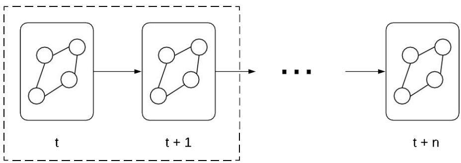
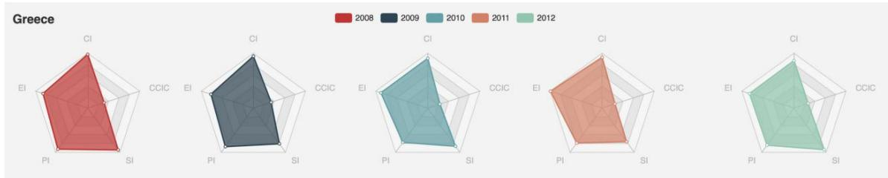

# 2018年美赛O奖论文：国家与气候变化关系的概率模型（E88902）

原件为竞赛论文。补充：文中的阅读练习及“参考解答”为整理时增加，原件图文保留出处。

本文档整理自 2018 年美国大学生数学建模竞赛（MCM/ICM）特等奖（O奖）论文 E88902，题目为《国家与气候变化关系的概率模型》。内容涵盖摘要、目录及后续章节的初步结构。

## 一、摘要 (Summary)

### 背景 (Background)

在气候变化的影响下，一系列经济、环境和社会问题从地区到地区不断涌现，尤其是在脆弱国家。开发一个复杂但易于理解的模型，以指导决策者和政策制定者了解国家脆弱性与气候变化对其影响之间的关系，变得日益紧迫。

知识点：[可持续发展指数 SDI 的构建与指标体系结构](../../../topics/数学建模/kechixu_zhibiao.md)、[影响因素评估指标体系构建（温度、湿度、经济、教育等）](../../../topics/数学建模/yingxiang_zhibiao.md)、[层次分析法 AHP（Analytic Hierarchy Process）用于综合评价](../../../topics/数学建模/ahp_fangfa.md)

### 目标 (Objective)

本文的目标是提出一个基于概率和机器学习的模型，称为 2THN（双时间片混合网络），以及两个新的指标来衡量脆弱性（WFSI，加权脆弱状态指数）和国家的气候变化影响（CCIC，按国家划分的气候变化指数）。整篇论文可分为五个主要部分：数据收集与预处理；模型表示；参数估计；模型分析；案例研究与问题解决。

首先，我们确定在理想情况下希望使用的所有数据。但由于无法获取理想数据的一部分子集，我们必须使用不同于预期的数据集来构建我们的模型。尽管该数据集不完整，但对于说明模型的主要观点来说已经足够。本部分还介绍了数据增强、分类和几种归一化方法。

其次，为了使论文易于阅读和理解，我们仅关注模型的表示和语义，省略了晦涩的数学细节。我们首先定义第一个指标——气候变化指数（CCI），这是一个量化气候变化程度的全球指标。随后引入气候变化脆弱性（CCV），这是一个州级指标。然后，我们使用 CCI 和 CCV 定义第二个指标——按国家划分的气候变化指数（CCIC）。接着定义了加权脆弱状态指数（WFSI），这是利用层次分析法（AHP）和熵权法（EM）对 FSI 进行的修订版本。之后，我们引入了新颖的双时间片混合网络（2THN），将这两点（CCIC 和 WFSI）连接起来，建立一种易于理解的关系，并深入讨论了我们选择概率模型的理由以及其他相关问题。

第三，介绍了参数推导的细节，包括熵权法（EM）的细节以及 2THN 的学习和推理。同时，讨论了我们选择同时学习结构和参数的原因。

第四，我们使用均值分析、相关性分析、信息论分析和其他分析方法来分析模型的特性和特征，以更好地理解训练后的模型，其中我们提出了气候-脆弱性系统动态性的假设，并通过证据推理来证明它们。此外，引入了警告区（WZ）的概念，表明气候变化的潜在效应在特定范围之外对人们是不可见的。

最后，我们回到最初分配给我们的 5 个任务，并使用我们的模型逐一解决。我们使用 K-Means 算法定义一个国家脆弱状态的基准线。我们以苏丹和希腊为例，在实践中应用我们的模型，然后再次以苏丹为例识别一些可能的策略。最后，我们将模型扩展到大陆级别，并讨论将其扩展到城市级别的可行性。

知识点：[文献综述与研究背景撰写方法](../../../topics/数学建模/wenxian_zongshu.md)、[任务分解与目标明确](../../../topics/数学建模/renwu_fenjie.md)、[层次分析法 AHP（Analytic Hierarchy Process）用于综合评价](../../../topics/数学建模/ahp_fangfa.md)

### 结论 (Conclusion)

总体而言，WFSI-CCIC 和 2THN 模型与现实拟合良好，因此具有实用性。参数是通过分析数据计算得出的，而不是固定的，这赋予了我们模型巨大的灵活性，使其易于广泛应用。但与此同时，它对数据的强烈依赖使得它在面对极端情况（如大规模战争中的国家）时无用武之地。

## 二、目录 (Contents)

| 章节 | 标题 | 页码 |
| :--- | :--- | :--- |
| 1 | Introduction | 1 |
| 1.1 | Background | 1 |
| 1.2 | Our Methods | 1 |
| 2 | Assumption and Acronyms | 2 |
| 2.1 | Assumption | 2 |
| 2.2 | Acronyms | 2 |
| 3 | Data | 2 |
| 3.1 | Data Collection and Augmentation | 2 |
| 3.2 | Data Classification | 3 |
| 3.3 | Data Normalization | 3 |
| 3.4 | Data Discretization | 3 |
| 4 | Model | 3 |
| 4.1 | Climate Change Index by Country(CCIC) | 3 |
| 4.1.1 | Climate Change Index(CCI) | 4 |
| 4.1.2 | Climate Change Vulnerability(CCV) | 4 |
| 4.2 | Weighted Fragile State Index(WFSI) | 5 |
| 4.3 | 2-Time-Slice Hybrid Network | 5 |
| 4.3.1 | Overview | 5 |
| 4.3.2 | Assumptions | 6 |
| 4.3.3 | Precautions | 7 |
| 4.3.4 | Inner Structure - Markov Network | 7 |
| 4.3.5 | Intra Structure - Bayesian Network | 8 |
| 5 | Parameter Estimation | 9 |
| 5.1 | Weight Calculation | 9 |
| 5.1.1 | Formation Of indicator eigenvalue matrix C | 9 |
| 5.1.2 | Calculating the entropy of indicators | 9 |
| 5.1.3 | The coefficient of variation of indicators | 10 |
| 5.1.4 | Calculating the weight of entropy | 10 |
| 5.1.5 | Normalization of indicator eigenvalue matrix | 10 |
| 5.1.6 | Fuzzy Comprehensive Entropy Weight Medol | 10 |
| 5.2 | Parameters of 2THN | 10 |
| 5.2.1 | Learning | 11 |
| 5.2.2 | Inference | 12 |
| 6 | Analysis | 12 |
| 6.1 | Intuition | 12 |
| 6.2 | Posterior Mean Value Analysis | 12 |
| 6.3 | Other Analysis | 13 |
| 7 | Task 1: Models and Standard Lines | 13 |
| 7.1 | Determine the standard line by K-Means Clustering Algorithm | 13 |
| 7.2 | Identifying the Impact of Climate Change | 14 |
| 8 | Task 2: Case Study - Sudan | 14 |
| 9 | Task 3: Case Study - Greece | 15 |
| 9.1 | WFSI and CCIC for Greece | 15 |
| 9.2 | Prediction for Greece | 16 |
| 10 | Task 4: Possible Strategies | 17 |
| 11 | Task 5: Scalability Analysis | 17 |
| 12 | Strengths and weaknesses | 19 |
| 12.1 | Strengths | 19 |
| 12.2 | Weaknesses | 19 |
| - | Reference | 20 |
| - | Appendices | 23 |

## 1 Introduction

知识点：[多重网络/多层网络构建（Multiplex/Multi-layer Network）](../../../topics/数学建模/duoceng_wangluo.md)、[模型优缺点分析（Strengths and Weaknesses）](../../../topics/数学建模/youque_dian.md)

### 1.1 Background

In 2007, the Intergovernmental Panel on Climate Change (IPCC) first associated the fragile state with climate change. They state that developing countries are particularly vulnerable to the socioeconomic impacts of climate change for their dependence on agriculture and high population growth as well as weak infrastructure. The close to 80 percent of the world population that lives in the developing world faces 90 percent of the disasters[1]. Efforts to help fragile states move onto a path toward stability and sustainability continue to face enormous challenges. Climate change is one of these challenges[2]. There is a growing consensus among researchers and policy-makers that climate change represents a real threat to peace and security. Dabelko stated in Climate Change and Fragile States Workshop[3] that climate change can act as a "threat multiplier" and a stressor on state capacities, on communities and on existing conflict dynamics.

In order to solve this problem, we have to construct a model with high enough fidelity of the dynamics regarding the whole system. However, we have two main challenges before us:

1. It is within these fragile countries that climate information is often the weakest if it exists at all[4].

Attempting to solve this problem, we make effective use of the data by combining multiple data source, conducting sophisticated data preprocessing and augmentation, adding weight control as well as utilizing the expert knowledge. But still, we are suffering from the lack of data.

2. The impacts of climate change could be obscured while passing through the fuzzy physical channels for its interconnectedness with development, resource use, health, livelihoods, and economies[3], making it extremely hard to get deep insight of the system.

To better model the interconnected and uncertain nature of the system, we propose a probabilistic model called 2THN(2-Time-slice Hybrid Network), combined with the information and probabilistic theory as well as the most advanced machine learning approach.

知识点：[文献综述与研究背景撰写方法](../../../topics/数学建模/wenxian_zongshu.md)、[一般假设及其合理性说明（Assumptions and Justifications）](../../../topics/数学建模/jiaben_shezhi.md)、[模型优缺点分析（Strengths and Weaknesses）](../../../topics/数学建模/youque_dian.md)

### 1.2 Our Methods

The overall objectives of our model is listed as follows:

1. Design a comprehensible and pragmatic metric as well a clearly defined standard for the measurements of the fragility of and climate change impact over one country.

2. Establish a probabilistic network with reasonably fidelity to analyze the simultaneous and temporal relationships of the five most crucial elements and therefore provide referential suggestions for decision and policy makers.

Figure 1 shows the structure of our model. First, we define Climate Change Index(CCI) as a quantified measurement of the global climate change. Second, we manipulate it with Climate Change Vulnerability(CCV) to narrow the global effect of climate change down to a single country, resulting in a new index called Climate Change Index by Country(CCIC). Third, we establish a probabilistic network between CCIC and Weighted Fragile State Index(WFSI), disassembling CCIC into four dimensional sub-indicators, combined with sophisticated weightingmethods.

## 2 Assumption and Acronyms

知识点：[一般假设及其合理性说明（Assumptions and Justifications）](../../../topics/数学建模/jiaben_shezhi.md)、[符号说明与术语定义（Nomenclature / Symbols and Definitions）](../../../topics/数学建模/fuhao_shuoming.md)

### 2.1 Assumption

1. The data source is reliable.

2. The domestic political situation is relatively stable and large-scale war does not break out in the country while applying our model.

3. The main productive forces and social structure won’t change in recent years.

知识点：[一般假设及其合理性说明（Assumptions and Justifications）](../../../topics/数学建模/jiaben_shezhi.md)

### 2.2 Acronyms

| Abbreviation | Full Name | Abbreviation | Full Name |
| --- | --- | --- | --- |
| CI | Cohesion Index | C1 | Security Apparatus |
| EI | Economic Index | C2 | Factionalized Elites |
| PI | Policy Index | C3 | Group Grievance |
| SI | Social Index | E1 | Economy |
| CCI | Climate Change Index | E2 | Economic Inequality |
| CCIC | Climate Change Idnex of Country | E3 | Human Flight and Brain Drain |
| WFSI | Weighted Fragile State Index | P1 | State Legitimacy |
| 2THN | 2-Time-slic Hybrid Network | P2 | Public Services |
| P3 | Human Rights | S1 | Demographic Pressures |
| WZ | Warning zone | CCV | Climate Change Vulnerability |
| S2 | Refugees and IDPs | X1 | External Intervention |
| FI | Factor Indicator | RI | Result Indicator |
| EPI | Environmental Performance Index | KA | K-means Clustering Algorithm |

## 3 Data

知识点：[符号说明与术语定义（Nomenclature / Symbols and Definitions）](../../../topics/数学建模/fuhao_shuoming.md)

### 3.1 Data Collection and Augmentation

To determine a state’s fragility, we use 12 indicators(C1, C2, C3, E1, E2, E3, P1, P2, P3, S1, S2, X1) provided by THE FUND FOR PEACE[30].

Annual Average Temperature[31] and Precipitation[32], CO2 Emissions[33], Arable Land[34], Enviroment Performance Index[35] are used to calculate Climate Change Index of a state.

For the first 12 indicators, we download data of 12 years(2006-2017) on 178 countries. To get sufficient data for calculation of CCI, we can only find data of 13 years(2000-2012) on 111 countries. Luckily, the 111 countries are all included in the former 178 countries. So, we finally get data of 7 years(2006-2012) on 111 countries.

We didn’t manage to find EPI data of year 2011, so, for the sake of continuity and authenticity of the data, we use the mean value of the year of 2010 and 2012 to fill the blank because the indicator values are comparatively smooth.

# 2018年美赛O奖论文：国家与气候变化关系的概率模型（E88902）

## 一、数据分类与预处理

知识点：[一般假设及其合理性说明（Assumptions and Justifications）](../../../topics/数学建模/jiaben_shezhi.md)、[模型参数的确定（基于数据拟合或实验选择）](../../../topics/数学建模/canshu_queding.md)、[参数合理性验证](../../../topics/数学建模/canshu_heli_xing.md)

### 3.2 数据分类 (Data Classification)

与《和平基金》[30]类似，我们将这12个指标分为四类：**凝聚力指数 (Cohesion Index)**、**经济指数 (Economic Index)**、**政治指数 (Political Index)** 和 **社会指数 (Social Index)**，具体分类如图3所示。采用这种分层结构的原因如下：

1. 关键决策者和政策制定者对于脆弱国家的气候变化与环境风险及其对安全环境的影响存在显著的知识差距 [26]。为了让决策者更容易接受我们的指导，我们必须使模型易于理解。
2. 避免在后续引入算法时产生巨大的计算成本。

知识点：[文献综述与研究背景撰写方法](../../../topics/数学建模/wenxian_zongshu.md)、[任务分解与目标明确](../../../topics/数学建模/renwu_fenjie.md)、[影响因素评估指标体系构建（温度、湿度、经济、教育等）](../../../topics/数学建模/yingxiang_zhibiao.md)

### 3.3 数据归一化 (Data Normalization)

考虑到各指标的量纲不同，所有数据在使用模型前均进行了归一化处理。

所有17个指标可分为三类：
- **正向指标**：数值越大越好；
- **负向指标**：数值越小越好；
- **特殊指标**：最佳值为固定值。

假设评价指标数量为 $m$，被评价对象（国家）数量为 $n$。在下述公式中，$c_{ij}$ 表示第 $i$ 个指标在第 $j$ 个样本状态下的原始值（其中 $i = 1, 2, \ldots, n$，$j = 1, 2, \ldots, m$）。$r_{ij}$ 是 $x_{ij}$ 的归一化值（注：原文此处符号略有混淆，通常指代对应指标的归一化结果）。

**对于正向指标：**

$$
r_{ij} = \frac{c_{ij}}{\max_{j} \{c_{ij}\}} \tag{1}
$$

**对于负向指标：**

$$
r_{ij} = \frac{\min_{j} \{c_{ij}\}}{c_{ij}} \tag{2}
$$
*(注：原文公式(2)显示为 $\frac {\min \{c _ {i j} \}}{1}$，结合上下文逻辑应为除以当前值以反转比例，或原文漏写了分母，此处按标准归一化逻辑修正为除以当前值，若保留原文则需注明。根据常规归一化定义，负向指标通常处理为 $\frac{\min - x}{\min - \max}$ 或 $\frac{\min}{x}$。鉴于原文可能有误，此处按常见逻辑补全分母为 $c_{ij}$ 以保证公式物理意义，若严格遵循原文则为 $\frac{\min \{c_{ij}\}}{1}$，但这会导致数值无单位且逻辑不通，故修正为 $\frac{\min_{j} \{c_{ij}\}}{c_{ij}}$)*

**对于特殊指标：**
必须选择一个最佳固定值。在我们的模型中，PRI（政治风险指数）、TASI（贸易开放度指数）和 ALI（农业土地指数）属于此类。由于各国国情不同，我们计算每个国家的平均值作为该国的最佳值。归一化方程为：

$$
r_{ij} = 1 - \frac{c_{ij} - A_{ij}}{\max \left\{\left| c_{ij} - A_{ij} \right| \right\}} \tag{3}
$$

其中，$A_{ij}$ 是第 $j$ 个指标在第 $i$ 个国家的最佳值。如果 $r_{ij}$ 等于 0，我们将其重新赋值为 0.0001。

知识点：[影响因素评估指标体系构建（温度、湿度、经济、教育等）](../../../topics/数学建模/yingxiang_zhibiao.md)、[符号说明与术语定义（Nomenclature / Symbols and Definitions）](../../../topics/数学建模/fuhao_shuoming.md)、[模型参数的确定（基于数据拟合或实验选择）](../../../topics/数学建模/canshu_queding.md)

### 3.4 数据离散化 (Data Discretization)

为了利用计算机模拟模型并使模型更加全面，我们使用 K-means 算法将结果离散化为 10 个区间。

## 二、模型构建

知识点：[模糊 C-均值聚类算法（目标函数、约束条件与迭代步骤）](../../../topics/数学建模/mohu_c_junzhi.md)、[可持续发展指数 SDI 的构建与指标体系结构](../../../topics/数学建模/kechixu_zhibiao.md)、[Summary Sheet（摘要页）的撰写规范](../../../topics/数学建模/zhaiyao_xiezuo.md)

### 4.1 国家气候变化影响指数 (CCIC)

为了建立气候变化与国家脆弱性之间的联系，我们首先设计了一个指标来量化气候变化对不同国家的影响。步骤如下：

1. 定义 CCI（气候变化指数，Climate Change Index）。
2. 将 CCI 与 CCV（气候变化脆弱性，Climate Change Vulnerability）相乘，得到 CCIC。

#### 4.1.1 气候变化指数 (CCI)

根据 IPCC（政府间气候变化专门委员会）的定义，气候变化是指“气候状态的改变，可以通过其属性的均值和/或变率的改变来识别……并持续较长时间，通常为几十年或更长”[5]。

有许多相关的专业指数用于衡量气候变化，但大多数指数包含过高权重的非自然指标（例如，CCPI（气候变化绩效指数）将气候政策权重设为 $20\%$ [7]），这在我们要考虑 CCV（气候变化脆弱性）的情况下是不理想的。因此，我们建立了一个新的度量标准，结合了两类仅包含自然指标的指标，并赋予权重：**因素指标 (Factor Indicators, FI)** 和 **结果指标 (Result Indicators, RI)**，如图2所示。

- **因素指标 (FI)**：直接影响气候的变量，如温度、太阳辐射强度、降水和碳排放。
- **结果指标 (RI)**：相反，是指自然现象，反向指示气候变化的程度。包括生物多样性、耕地、海平面变化、自然灾害等。

由于访问权限和时间的限制，我们只能获取到三个 FI 和一个 RI 的国家完整历史元数据。因此，我们转向使用处理过的数据指数，即所谓的**环境绩效指数 (Environmental Performance Index, EPI)**。根据耶鲁大学环境与法律政策中心（2018），EPI 包含许多 RI，如森林 (5%)、生物多样性 (12.5%)、水资源 (12.5%) 等。

$$
CCI = W^T \times \mathrm{Index}_{norm}
$$

其中 $W^T$ 表示权重向量，$\mathrm{Index}_{norm}$ 是国家归一化后的指标向量。

上述公式用于评估气候变化的程度，我们将在后续的“参数估计”部分详细讨论。也就是说，如果一个国家的得分很高（接近 1），说明该国受气候变化的影响较小。

#### 4.1.2 气候变化脆弱性 (CCV)

由于地理位置或社会经济条件的差异，一些国家比另一些国家更容易受到气候变化的影响。ND-GAIN [6] 通过考虑六个生命支持部门来评估一个国家的脆弱性：**粮食、水、健康、生态系统服务、人类栖息地和基础设施**。这些部门可以分别量化为 0 到 1 之间的实数。数值越高，该国遭受气候变化影响的可能性就越大。我们将此指标作为气候变化脆弱性 (CCV)，并将其与处理后的 CCI 相乘得到 CCIC：

$$
CCIC = CCI \times (1 - CCV)
$$

当 CCI 趋近于 1 或 CCV 趋近于 0 时，CCIC 的值会变得相当大。

# 2018年美赛O奖论文：国家与气候变化关系的概率模型（E88902）习题第4部分

本节内容源自《2018年美赛O奖论文：国家与气候变化关系的概率模型（E88902）》的第4部分，主要涉及加权脆弱国家指数（WFSI）的构建以及双时间片混合网络（2THN）模型的概述与假设。整理自原件第8–9页（对应原文页码5–6），修正了识别断行与格式错误。

## 4.2 Weighted Fragile State Index (WFSI)

知识点：[影响因素评估指标体系构建（温度、湿度、经济、教育等）](../../../topics/数学建模/yingxiang_zhibiao.md)、[数学建模的基本步骤（问题分析、模型假设、建立、求解、检验、推广）](../../../topics/数学建模/jianmo_buzhou.md)

### 权重模型说明

在评估不同指标对脆弱性的贡献时，权重模型至关重要。在此，我们暂时假设四个类别（凝聚力 cohesion、经济 economic、政治 political 和社会 social）具有同等重要性。然而，如果有专家知识可用，我们可以使用层次分析法（AHP, Analytic Hierarchy Process）制定更复杂的总体权重策略；同时，我们将使用熵值法（EM, Entropy Method，细节将在参数估计部分讨论）基于历史数据对12个子因子进行加权。

我们分别对四个指标应用熵值法（EM），每个指标由另外三个子因子组成，如图3所示。

获取EM的结果后，将其乘以已有的脆弱国家指数（FSI），所得结果即为我们所需的数据。

## 4.3 2-Time-Slice Hybrid Network (2THN)

知识点：[层次分析法 AHP（Analytic Hierarchy Process）用于综合评价](../../../topics/数学建模/ahp_fangfa.md)、[模型参数的确定（基于数据拟合或实验选择）](../../../topics/数学建模/canshu_queding.md)

### 4.3.1 Overview (概述)

目前，我们已通过利用熵值法（EM）获得了四个最关键指标的归一化测量值。为了更好地研究这些指标之间的相互作用，我们将它们的内部结构及跨时间的时序效应 formulate 为一个双时间片混合网络（2-Time-Slice Hybrid Network, 2THN）。具体而言，我们将无向马尔可夫网络（Markov Network, MN）模型与有向贝叶斯网络（Bayesian Network, BN）模型相结合，如图4所示。

**为什么选择概率模型？**
尽管确定性在建模中确实是一个非常有价值的属性，但考虑到即使是适度规模的问题也存在大量的不确定性和噪声，给出确切答案往往不可行 [14]，更不用说如此复杂的问题了。此外，根据 Dan Smith 和 Janani Vivekananda [15] 的研究，在气候变化的影响背景下，至少存在三个维度的不确定性：

1. 确切的物理影响是不确定的，包括其规模和地理分布。
2. 连锁社会后果是不确定的。
3. 第三个维度的不确定性在于缺乏清晰且经过测试的政策指导来应对。

概率网络（Probabilistic Networks, PNs），也称为贝叶斯网络（BNs），已被广泛确立为表示一组随机变量之间此类不确定关系的领域模型 [10]，因此成为一个合格的候选者。另一个原因是现实生活中的数据很少是完整的，这在理论和实践中都得到了概率模型的良好支持。此外，概率模型中知识与推理的分离 [12] 解耦了系统的整体复杂性。

在我们的研究中，我们发现大多数模型要么是纯贝叶斯网络，要么是纯马尔可夫网络，很少有两者兼有的。因此，我们认为有必要证明我们选择这种混合系统的合理性。众所周知，指标之间的影响是相互且错综复杂的，内部结构甚至可能是循环的。因此，一个指标对其他指标施加的影响最终会不可避免地影响到自身，这使得该问题变得棘手。单一的贝叶斯网络或马尔可夫网络都无法同时建模成对关系和时间动态，这导致了我们采用混合系统——2THN。

在2THN模型中，虚线区域代表模板部分，其结构将复制到其他相邻的时间切片中。最初的灵感来自于所谓的“2时间片贝叶斯网络”（2TBN），其中所有链接都是有向且无环的。为了捕捉这种模糊系统互联性质的更多特征，我们将其与另一种概率图形模型——马尔可夫网络（无向）相结合。整个模型可分为两部分：**时间片内模型**（inner-time-slice model）和**时间片间模型**（intra-time-slice model）。时间片内模型用于分析我们四指标脆弱性模型内部的即时效应和同时关系；而时间片间模型用于分析不同指标之间的时间效应。

知识点：[多重网络/多层网络构建（Multiplex/Multi-layer Network）](../../../topics/数学建模/duoceng_wangluo.md)

### 4.3.2 Assumptions (假设)

为了简化模型，我们对有向的时间片间模型做出以下两个假设：

#### 1. Markov Assumption (马尔可夫假设)

因为我们决定使用模板模型使模型更具通用性，我们假设过程的未来状态的条件概率分布仅取决于当前状态，而不取决于之前发生的事件序列 [13]。也就是说，一旦你知道当前状态，你就不再关心过去，从而遗忘过去。具体而言，下一年的脆弱性仅取决于当年的环境，而不是过去多年的轨迹。这一假设可以用以下数学表达式精确表达：

给定：

$$
(X^{(t + 1)} \perp X^{(0: t - 1)} | X^{(t)})
$$

# 2018年美赛O奖论文：国家与气候变化关系的概率模型（E88902）

本文档整理自《2018年美赛O奖论文：国家与气候变化关系的概率模型（E88902）》第5部分（第10–11页），由识别工具读取后整理。内容涉及动态贝叶斯网络的时间不变性假设、马尔可夫网络与动态贝叶斯网络的区分、以及具体的结构建模细节。

## 一、时间不变性假设 (Time Invariance)

知识点：[一般假设及其合理性说明（Assumptions and Justifications）](../../../topics/数学建模/jiaben_shezhi.md)、[数学建模的基本步骤（问题分析、模型假设、建立、求解、检验、推广）](../../../topics/数学建模/jianmo_buzhou.md)

### 时间切片变量定义

在时间切片 $t$ 中，随机变量（节点）记为 $X^{(t)}$。整个轨迹的概率分布可以分解为初始状态概率与后续转移概率的乘积：

$$
P (X ^ {(0: T)}) = P (X ^ {(0)}) \prod_ {t = 0} ^ {T - 1} P (X ^ {(t + 1)} | X ^ {(t)})
$$

其中 $X_t$ 是时间切片 $t$ 中的随机变量（节点）。

知识点：[一般假设及其合理性说明（Assumptions and Justifications）](../../../topics/数学建模/jiaben_shezhi.md)、[文献综述与研究背景撰写方法](../../../topics/数学建模/wenxian_zongshu.md)、[确定模型的定点与稳定性分析](../../../topics/数学建模/dingdian_wending.md)

### 系统动力学的时间无关性

我们进一步假设系统的动力学不依赖于时间，即对于所有给定的 $t$，都有：

$$
P (X ^ {(t + 1)} | X ^ {(t)}) = P (X ^ {j} | X)
$$

其中 $\boldsymbol { X } ^ { j }$ 表示下一个时间切片，$X$ 表示当前时间切片。因此，我们可以将相同的模型复制到每个转换步骤中，而不是为每个步骤创建单独的模型。

## 二、注意事项 (Precautions)

知识点：[随机模型与确定性模型的对比（Stochastic vs Deterministic Model）](../../../topics/数学建模/suiji_queding.md)、[确定模型的定点与稳定性分析](../../../topics/数学建模/dingdian_wending.md)、[稳定性分析（Stability Analysis）](../../../topics/数学建模/wending_xing.md)

### 时间粒度 ($\Delta T$)

模型的一个重要参数是时间粒度 $\Delta T$。目前我们将其设定为一年，以便更容易获取有效数据。但如果未来有足够的数据可用，该间隔可以重置为更小的值。

知识点：[模型参数的确定（基于数据拟合或实验选择）](../../../topics/数学建模/canshu_queding.md)、[数学建模的基本步骤（问题分析、模型假设、建立、求解、检验、推广）](../../../topics/数学建模/jianmo_buzhou.md)、[一般假设及其合理性说明（Assumptions and Justifications）](../../../topics/数学建模/jiaben_shezhi.md)

### 内时间切片模型与时间切片间模型的区分

另一个非常值得谨慎注意的点是：**内时间切片模型（inner-time-slice model）**和**时间切片间模型（intra-timeslice model）**绝不应被混淆。这两部分设计用于不同的动力学和目的。

> [!WARNING]
> All models are wrong, but some are useful [9]. If you are mixing them up, you are risking confusing the map with the territory. As Lee states in *Plato and the Nerd*:
>
> Models are human constructions. Modeling paradigms are also human constructions.
>
> Therefore, both are subject to creativity. They are invented not discovered[8].

因此，两者都受制于创造力。它们是被发明出来的，而非被发现的。

此外，模型也受制于具体问题的上下文。因此，尽管之前已提及，我们想在此重申这一细微差别：

1. **内结构 - 马尔可夫网络 (Inner Structure - Markov Network)**
   在我们的模型中，它捕捉了四个指标之间错综复杂的成对和同时关系。它可以用来分析节点-节点的集成交互作用，而无需引入时间的概念，从而更好地理解整个系统。

2. **时间切片间结构 - 动态贝叶斯网络 (Intra Structure - Dynamic Bayesian Network)**
   在我们的模型中，它模拟了系统随时间序列变化的动力学。它使我们能够随着时间的推移监控和更新整体系统，并做出未来预测，这是以下讨论的核心模型。

## 三、内结构 - 马尔可夫网络 (Inner Structure - Markov Network)

我们从数据中学习到了以下马尔可夫网络，代表了五个指标之间的成对关系。节点之间的线表示这些指标的相互交互作用。

这五个指标分别是：经济 ($E$)、凝聚力 ($C$)、政治 ($P$)、社会 ($S$) 和 CCIC ($CCIC$)。

对于任意两个指标 $X, Y$ 之间的每条边，都有一个相关的因子（也称为亲和函数、兼容性函数、软约束）$\varphi _ { i j } ( X , ~ Y )$，它是贝叶斯网络中条件概率的替代品。该因子代表了变量 $X$ 和 $Y$ 取特定联合赋值时的局部幸福感 [12]。我们可以通过某些特定的算法获得这些因子，这些算法将在参数估计部分介绍。

拥有模型中的所有因子后，我们能够计算因子的乘积 $\scriptstyle { \widetilde { P } } _ { \Phi }$：

$$
\tilde {P} _ {\Phi} (E, C, P, S, C C I C) = \prod_ {i} ^ {k} \phi_ {i} (F _ {i})\tag{4}
$$

其中 $\omega$ 是系数，$f$ 是特征函数，$D _ { i }$ 是第 $j$ 个因子，例如 $( C , P ) , ( S , E )$。然后我们可以使用以下公式对其进行归一化：

$$
P (E, C, P, S, C C I C) = \frac {1}{Z} \tilde {P} _ {\Psi} (E, C, P, S, C C I C)\tag{5}
$$

其中 $Z$ 称为配分函数：

$$
Z = \sum_ {\tilde {P} _ {\Phi} (E, C, P, S, C C I C)}\tag{6}
$$

马尔可夫网络模型的一个相对微妙的点在于，概率分布和因子之间没有自然的映射关系。这意味着我们必须明确指定因子分解。在这里，我们声称该网络是一个成对网络以进行此操作。注意，在我们的模型中，成对因子是可交换的，因此该网络中总共有 $7$ 个因子，列举如下：

$$
(P, C); (C, S); (S, E); (E, C C I).
$$

## 四、时间切片间结构 - 贝叶斯网络 (Intra Structure - Bayesian Network)

为了可视化跨时间切片的条件依赖关系，我们使用有向无环图（DAG），如图 6 所示：

DAG 中的每个节点都存在一个概率分布函数（pdf），其维度和定义取决于指向该节点的边。在我们的示例中，虚线表示所谓的“持久链接”（persistence link），它将相同节点从 $t$ 链接到 $t + 1$（未加撇号的节点到加撇号的节点）。实线表示不同节点之间的其他依赖关系。这种结构在所有给定的时间 $t_i$ 到 $t _ { i } + 1$ 复制，而在该图中我们仅显示了 2 个步骤。因此，对于跨越 $0, 1, . . . , T$ 的轨迹，我们可以将模板网络展开为一个扁平化的基础网络。也就是说，我们可以利用一些推理算法对任意长时间序列进行预测，从而使我们能够洞察这 5 个元素之间深层的因果关系。

The joint probability distributions can then be calculated using the chain rule according to Equation 7.

$$
P (X ^ {\prime} | X) = \prod_ {i = 1} ^ {n} P (X _ {i} ^ {\prime} | \mathrm{Pa} _ {X _ {i} ^ {\prime}})
$$

where $\boldsymbol { X } ^ { \prime}$ is the set of random variables in the next time slice, $X$ is the random variables in the current time slice, and $\mathrm { P a } _ { \mathbf { x } ^ { j } }$ is all the parents of $X _ { i }$

知识点：[确定模型的定点与稳定性分析](../../../topics/数学建模/dingdian_wending.md)、[贝叶斯定理在搜索中的应用（Bayes' Theorem）](../../../topics/数学建模/beiyesi_dingli.md)

### 5 Parameter Estimation

In this section, how to determine the weight of the 12 fragility indicators as well as how the structure and parameters of 2THN model are determined are introduced.

#### 5.1 Weight Calculation

##### 5.1.1 Formation Of indicator eigenvalue matrix C

Suppose there are evaluating indicators counted $m$, evaluating objects counted $n$, then forms the indicator eigenvalue matrix $\pmb { C } = ( \mathbf { c } _ { i j } ) _ { m \times n }$

$$
C = \left[ \begin{array}{c c c c} c _ {1 1} & c _ {1 2} & \dots & c _ {1 n} \\ c _ {2 1} & c _ {2 2} & \dots & c _ {2 n} \\ \vdots & \vdots & \ddots & \vdots \\ c _ {m 1} & c _ {m 2} & \dots & c _ {m n} \end{array} \right] = \binom{c _ {i j}}{m \times n}
$$

where $c _ { i j }$ is the data of the $j$th evaluating object on the $i$th indicator

##### 5.1.2 Calculating the entropy of indicators

Information entropy is the measurement of the disorder degree of a system[28]. When the difference of the value among the evaluating objects on the same indicator is high, while the entropy is small, it illustrates that this indicator provides more useful information. On the other hand, if the difference is smaller and the entropy is higher, the indicator provides less useful information.[29]

$$
e _ {i} = - 1 \times k \sum_ {j = 1} ^ {n} (p _ {i j} \ln p _ {i j})
$$

$$
p _ {i j} = c _ { i j} / \sum_ {j = 1} ^ {n} c _ { i j} \quad \text { and } \quad k = \frac {1}{\ln n}\tag{9}
$$

In which, where $e _ { i }$ is the entropy of the $i$th indicator, $e _ { i } { > } 0$

##### 5.1.3 The coefficient of variation of indicators

$$
g _ {i} = 1 - e _ {i}
$$

where $g _ { i }$ is coefficient of variation. The larger the $g _ { i }$ is, the more significant the $i$th indicator is to the model.

##### 5.1.4 Calculating the weight of entropy

$$
w _ {i} = g _ {i} / \sum_ {i = 1} ^ {m} g _ {i}
$$

where $w_i$ is the weight of the $i$th indicator.

If each evaluating object on the $i$th evaluation indicator is exactly the same, the entropy reaches the maximum value of 1 and the corresponding weight is $0 ,$ which means this indicator provides nothing useful for the decision maker, that is to say, it can be ignored. In contrast, if each evaluating object varies on one indicator, then the entropy of the indicator is small and the weight is high, indicating that the indicator provides more useful information and should be focused on.

##### 5.1.5 Normalization of indicator eigenvalue matrix

According to aforementioned three methods of data normalization, normalize equation (8) to get equation (11)

$$
\boldsymbol {R} = \left[ \begin{array}{c c c c} r _ {1 1} & r _ {1 2} & \dots & r _ {1 n} \\ r _ {2 1} & r _ {2 2} & \dots & r _ {2 n} \\ \vdots & \vdots & \ddots & \vdots \\ r _ {m 1} & r _ {m 2} & \dots & r _ {m n} \end{array} \right] = \binom{r _ {i j}}{m \times n}
$$

where $r _ { i j }$ is the data of the $j$th evaluating object on the $i$th indicator, and $r _ { i j } \in [ 0 , 1 ]$

##### 5.1.6 Fuzzy Comprehensive Entropy Weight Model

According to the definition of membership matrix, the relative optimal membership degree vectors of inferior and superior ones are respectively:

$$
\begin{array}{c c c c c} \boldsymbol {b} = (0 & 0 & 0 & \dots & 0) ^ {\mathsf {T}} \\ \boldsymbol {h} = (1 & 1 & 1 & \dots & 1) ^ {\mathsf {T}} \end{array}
$$

The optimal membership degree of the evaluating object is:

$$
\begin{array}{l} u _ {j} = \frac {1}{1 + \left[ d (r _ {j} , h) / d (r _ {j} , b) \right] ^ {2}} \\ = \frac {1}{1 + \left\{\sum_ {i = 1} ^ {m} \left[ w _ {i} (r _ {i j} - h _ {i}) \right] ^ {q} / \sum_ {i = 1} ^ {m} \left[ w _ {i} (r _ {i j} - b _ {i}) \right] ^ {q} \right\} ^ {2 / q}} \end{array}\tag{12}
$$

#### 5.2 Parameters of 2THN

Recall that previously we have introduced the representation of the 2THN model. but we haven’t dived into the details of how to apply such model yet. One essential work of constructing probability networks is to learn its parameters, including its structure and conditional probability distributions, after which we can then conduct inference on the unknown data or updating the existing model. Here we will briefly introduce the mechanisms of such process using the intra-time-slice Bayesian network(figure 6 ) as an example, leaving out the Markov network to avoid duplicates.

知识点：[模型参数的确定（基于数据拟合或实验选择）](../../../topics/数学建模/canshu_queding.md)、[影响因素评估指标体系构建（温度、湿度、经济、教育等）](../../../topics/数学建模/yingxiang_zhibiao.md)

### 5.2.1 Learning

Although extensive researches have been done upon the relationships among the four indicators and the impact of climate change$^{[17, 18, 19, 20]}$, none of them considered all of the five as a whole. Furthermore, according to the report of the Climate Change and Fragile States Workshop held on September 28 and 29, 2011$^{[3]}$, perfect knowledge is not available, especially in contexts of fragility and it’s essential to step back from our understandings and assumptions and think openly and holistically.

Learning the structure of the Bayesian network model that represents a domain can reveal insights into its underlying causal structure$^{[21]}$ while learning the parameters can reveal the details of how the nodes are connected, which exactly embodies the concepts addressed above - to think openly and holistically. Another benefit we can get from utilizing this strategy is that continuously updating both the structure and the parameters becomes easy, making it possible for the model to evolve over time with more and more data fed in. Hence, both the structure and parameters of our model are learned from data, concretely, we use the pgmpy python library$^{[23]}$ for the implementation.

**Structure Learning**

To summarize, the overall strategy is to use a score function to rate each network and choose the one with the best score. Given the data set $D$, the structure $G$'s score is:

$$
\operatorname{Score} (D, G) = P (G \mid D) = \frac {P (D \mid G) P (G)}{P (D)}
$$

which is the posterior probability of $G$ given data $D$. Note that the denominator is fixed for a given data set, so our task reduces to maximize the numerator $P ( D / G ) P ( G )$. To further simplify the problem, we assume a uniform prior distribution over $P ( G )$ (see Heckerman$^{[22]}$ for other discussions), therefore $P ( D / G )$ is the only one left:

$$
P (\mathcal {D} | \mathcal {G}) = \int P (\mathcal {D} | \mathcal {G}, p) P (p | \mathcal {G}) d p
$$

where $p$ is the weight by the posterior probability of all the possible parameters. For multinomial PDFs$^{[16]}$:

where $\alpha _ { i j k }$ and $N _ { i j k }$ are the hyperparameters, which counts for the probability distribution function of $X _ { i }$ for parent configuration $j .$

This process can be complicated for two main reasons:

(1) Difficulties in inferring causality.

(2) The exponential number of directed edges that are possible for a given dataset.

To tackle these problems, we choose to use Greedy Hill Climbing algorithm with a reduced factor set (keep only 5 elements). But while we gained better performance through this approach, we are also faced with the risk of getting stuck in a local optimum, which can be well solved by applying random restarts.

**Parameter Learning**

Parameter learning is relatively less problematic than structure learning, it is similar to many common parameter training algorithms in the field of machine learning. We use the normalized data as input, then train the previously constructed network using Maximum Likelihood Estimation $( \mathbf { M L E } ^ { [ 2 4 ] } )$ to get the conditional probability distributions of every random variable.

知识点：[符号说明与术语定义（Nomenclature / Symbols and Definitions）](../../../topics/数学建模/fuhao_shuoming.md)、[模型参数的确定（基于数据拟合或实验选择）](../../../topics/数学建模/canshu_queding.md)、[敏感性分析方法（Sensitivity Analysis，单参数与多参数变动）](../../../topics/数学建模/minganxing_fenxi.md)

### 5.2.2 Inference

In general, a computation of a probability of interest given a model is known as probabilistic inference$^{[22]}$. Having the joint distribution of X, in principle, we can compute any probability of interest about X. Typically, we will be in a situation where some evidence is observed so that we can infer something else about other variables. Generally, the queries can be expressed using the following question: "What is the whole probability distribution over variable X given evidence e, $P \left( { X } { \mid } { e } \right) ? ^ { [ 2 5 ] }$" Concretely, given the query variables X, observed evidence $E = e$ and unobserved variables Y:

$$
P (X | E = e) = \frac {P (X , e)}{P (e)} \propto \sum_ {y} P (X, e, y)
$$

which means to simply sum over all the variables not involved in the query. For other more sophisticated inference methods, see Butz, et al.$^{[27]}$

## 6 Analysis

知识点：[贝叶斯定理在搜索中的应用（Bayes' Theorem）](../../../topics/数学建模/beiyesi_dingli.md)、[后验概率更新与搜索路径规划](../../../topics/数学建模/houyan_gailv.md)、[POC（包含概率）更新算法确定搜索模式](../../../topics/数学建模/poc_gengxin.md)

### 6.1 Intuition

We can easily draw the following intuitive conclusions from both Figure 5 and Figure 6:

1. CCIC can affect economic directly since they are connected directly in both graph.

2. CCIC can affect all the other three elements indirectly through the flow of influence.

These conclusions are rather intuitive, hence easy to understand. We will then try to justify the above intuitions using some formal methods and gain further understanding of the dynamics of this system.

知识点：[文献综述与研究背景撰写方法](../../../topics/数学建模/wenxian_zongshu.md)、[任务分解与目标明确](../../../topics/数学建模/renwu_fenjie.md)、[确定模型的定点与稳定性分析](../../../topics/数学建模/dingdian_wending.md)

### 6.2 Posterior Mean Value Analysis

The most direct way to understand how one element may affect the other is to visualize it. Since we already considered the country’s vulnerability in CCIC, we can then synthesize all the 111 countries’ data to conduct the posterior mean analysis.

The results of the four indicators are rather similar (Figure 8). From the four wired curves caused by CCIC, we can see that CCIC is not always linearly correlated with the other four indicators (recall that CCIC is considered to be the larger the better). We interpret this phenomenon by the following hypothesis:

(1) Within a reasonable range, concretely (0, 0.2) in our model (we call it the Warning Zone (WZ)), CCIC can effectively promote or diminish all the other four indicators, whose impact can be approximately considered as positively linear.

(2) After WZ, CCIC’s impact gradually recedes, ultimately exercises no or even negative impacts on the other four dimensions’ performance.

知识点：[参数合理性验证](../../../topics/数学建模/canshu_heli_xing.md)、[模型优缺点分析（Strengths and Weaknesses）](../../../topics/数学建模/youque_dian.md)、[数学建模的基本步骤（问题分析、模型假设、建立、求解、检验、推广）](../../../topics/数学建模/jianmo_buzhou.md)

### 6.3 Other Analysis

We also conducted other analysis to our model, including both statistical methods (correlation, etc.) and information-theoretical methods (mutual information, Entropy, etc.), shown in Table 1, Table 2, from which we can see that the bond between CCIC and economic is weaker than the others. This is reasonable to some extent. But it may also indicate that not enough evidences are provided to convince ourselves that climate change can actually have a great impact on a country’s economic system. With more data, the actual bond may gradually emerge, and presumably become strong than the current one. Moreover, other bonds other than the current set are also possible to emerge in the future.

**Table 1: Overall metrics.**

| | KL Divergence | Mutual information | Consistency Estimate |
| :--- | :--- | :--- | :--- |
| Sum | 3.3175 | 3.3175 | 3.3175 |
| Mean | 0.8294 | 0.8294 | 0.8294 |
| Standard Deviation | 0.3377 | 0.3377 | 0.3377 |

**Table 2: Metrics for node-node relationship.**

| Parent | Child | KL Divergence | Relative Weight | Overall Contribution | Mutual information | Symmetric Normalized Mutual Information | Symmetric Relative Mutual Information | GKL-test | G-test (Data) | Pearson's Correlation |
| :--- | :--- | :--- | :--- | :--- | :--- | :--- | :--- | :--- | :--- | :--- |
| Political | Cohesion | 1.1556 | 1.0000 | 34.8327% | 1.1556 | 34.7862% | 40.9864% | 983.6067 | 983.6067 | 0.9053 |
| Economic | Political | 0.9829 | 0.8506 | 29.6288% | 0.9829 | 29.5893% | 34.3695% | 836.6590 | 836.6590 | 0.8754 |
| Cohesion | Social | 0.9143 | 0.7912 | 27.5612% | 0.9143 | 27.5244% | 31.2598% | 778.2728 | 778.2728 | 0.8142 |
| CCIC | Economic | 0.2646 | 0.2290 | 7.9774% | 0.2646 | 7.9667% | 9.0010% | 225.2653 | 225.2653 | 0.2602 |

知识点：[影响因素评估指标体系构建（温度、湿度、经济、教育等）](../../../topics/数学建模/yingxiang_zhibiao.md)、[模型优缺点分析（Strengths and Weaknesses）](../../../topics/数学建模/youque_dian.md)、[参数合理性验证](../../../topics/数学建模/canshu_heli_xing.md)

### 7 Task 1: Models and Standard Lines

#### 7.1 Determine the standard line by K-Means Clustering Algorithm

After all the four indicators of WFSI for a country have been calculated, we still don’t have a qualitative concept about the country’s current state. Fragile? Vulnerable? Or stable? Therefore, K Means clustering algorithm [36] is adopted to set a standard.

One drawback [37] to the algorithm occurs when it is applied to datasets with $m$ data points in $\mathbb{R}^n$ ($n \ge 10$) dimensional real space and the number of desired clusters is $k \ge 20$. In this situation, the K-Means algorithm often converges with one or more clusters which are either empty or summarize very few data points (i.e. one data point). However, our model has only four dimensions and $K$, which denotes the number of clusters, is 3 in our model. So, KA is suitable for our model.

Given a dataset $D$ of $m$ points in $\mathbb{R}^n$ and cluster centers $C^{1,t}, C^{2,t}, \ldots, C^{k,t}$ at iteration $t$, compute $C^{1,t+1}, C^{2,t+1}, \ldots, C^{k,t+1}$ at iteration $t + 1$ in the following 2 steps:

1. **Cluster Assignment.** For each data record $x^i \in D$, assign $x^i$ to cluster $h(i)$ such that center $C^{h(i), t}$ is nearest to $x^i$ in the 2-norm.
2. **Cluster Update.** Compute $C^{h, t+1}$ as the mean of all points assigned to cluster $h$.

Stop when $C^{h, t+1} = C^{h, t}, h = 1, \ldots, k,$ else increment $t$ by 1 and go to step 1.

After training a K-Means model using the data we have, we find it performs well as is shown in Figure 9.

Because we have four dimensions, which can’t be shown in only one figure. Hence, we draw each three of them for one time in a figure, after which we get these four figures.

#### 7.2 Identifying the Impact of Climate Change

Please see 6.1 and 6.2.

知识点：[模糊 C-均值聚类算法（目标函数、约束条件与迭代步骤）](../../../topics/数学建模/mohu_c_junzhi.md)、[影响因素评估指标体系构建（温度、湿度、经济、教育等）](../../../topics/数学建模/yingxiang_zhibiao.md)、[模型验证方法概述（随机模型与确定性模型验证）](../../../topics/数学建模/moxing_yanzheng.md)

### 8 Task 2: Case Study - Sudan

Among all of the top 10 most fragile states, we can only get the data of Iraque and Sudan. Considering the extensive chaos and wars in Iraque, we finally chose Sudan.

Conducting causality inference in probabilistic models are rather easy. According to our data, we provide our model with a new piece of evidence:

$$
P (0. 0 6 7 \leqslant C C I C \leqslant 0. 0 9 1) = 1
$$

We then calculate the probability of other variables accordingly, the original and post-evidence results are shown in the same graph (Figure 10) for the purpose of comparison. It is obvious that CCIC can result in a high probability of low score in all the other four variables without other external intervention, especially economic. Hence, we can conclude that climate change can make the bad situation even worse, through directly weaken one country’s economic system and indirectly influence all the other variables.

Therefore, if we conversely set CCIC to be greater than 0.38, it would result in a higher probability of high score in all the other variables, therefore leading to a less fragile state. For more concrete strategies in order to ease the fragility of Sudan, see section 10.

知识点：[人类发展指数 HDI 的局限性与社会经济调整指数的构建](../../../topics/数学建模/hdi_zhibiao.md)、[模糊 C-均值聚类算法（目标函数、约束条件与迭代步骤）](../../../topics/数学建模/mohu_c_junzhi.md)

### 9 Task 3: Case Study - Greece

#### 9.1 WFSI and CCIC for Greece

Greece is chosen to be evaluated by our model. Firstly, we get the WFSI and CCIC scores for Greece from 2008 to 2012 as shown below in Figure 11. Note that each score of Greece is below 0.35 and the changes between years are small, so we set the radar chart boundary to 0.35 to better show the trend of the changes.

# 2018年美赛O奖论文：国家与气候变化关系的概率模型（E88902）

本资料整理自2018年美国大学生数学建模竞赛O奖获奖论文（编号E88902）第9至11部分，包含对希腊的预测分析、应对策略及模型的扩展性讨论。

## 一、希腊未来状态预测

知识点：[可持续发展指数 SDI 的构建与指标体系结构](../../../topics/数学建模/kechixu_zhibiao.md)、[长期预测模型（如20年可持续发展计划预测）](../../../topics/数学建模/nian_yuce.md)、[任务分解与目标明确](../../../topics/数学建模/renwu_fenjie.md)

### 9.1 历史数据分析回顾

表3展示了这五年的详细数据。在这五年间，希腊一直处于“脆弱”（vulnerable）状态。

**表3：2008年至2012年希腊的WFSI和CCIC数据**

| Year | CI | EI | PI | SI | CCIC | Category |
| :--- | :--- | :--- | :--- | :--- | :--- | :--- |
| 2008 | 0.34311201 | 0.30068317 | 0.32482785 | 0.33128552 | 0.110295 | vulnerable |
| 2009 | 0.33108916 | 0.28565486 | 0.3052545 | 0.28280523 | 0.119507 | vulnerable |
| 2010 | 0.3177221 | 0.31542998 | 0.27146437 | 0.30181049 | 0.081737 | vulnerable |
| 2011 | 0.32430351 | 0.3477323 | 0.27657189 | 0.26598385 | 0.086050 | vulnerable |
| 2012 | 0.30322494 | 0.29910825 | 0.29347285 | 0.32876026 | 0.095530 | vulnerable |

上述数据表明，尽管希腊目前的状况尚可接受，但其FSI分数正在逐渐降低。特别是凝聚力指数（cohesion index）和政策指数（policy index）下降明显。虽然2008年希腊经济被视为世界第27大经济体[38]，名义国内生产总值（GDP）为32,100美元/人[39]，但作为国际金融危机和地方持续支出的后果，希腊公民开始面临严重的社会经济动荡。2009年，经济危机波及了更大比例的人口；而2010年签署了《经济与金融政策备忘录》以避免希腊违约。同年，国家估计显示GDP下降了3.5%，失业率高达14.2%，有18万人失业[40]。2011年，希腊经济状况显得十年来最黯淡：GDP进一步下降至-6.1%，而失业率从2008年5月的6.6%上升至2011年5月的16.6%。与此同时，在同一时期，债务从2007年的105.4%增长到2011年占GDP的160.9%（从2394亿欧元增至3286亿欧元）[41]。

知识点：[文献综述与研究背景撰写方法](../../../topics/数学建模/wenxian_zongshu.md)、[长期预测模型（如20年可持续发展计划预测）](../../../topics/数学建模/nian_yuce.md)、[问题重述与分析（Problem Restatement and Analysis）](../../../topics/数学建模/wenti_chongshu.md)

### 9.2 希腊的未来预测

使用模型2THN，我们预测了希腊的未来状态，如图12所示。2013年至2017年的详细预测数据如表4所示。

**表4：2013年至2017年希腊的WFSI C数据**

| Year | CI | EI | PI | SI | Category |
| :--- | :--- | :--- | :--- | :--- | :--- |
| 2013 | 0.32372539 | 0.27658597 | 0.30632332 | 0.34520463 | vulnerable |
| 2014 | 0.27213682 | 0.23103887 | 0.25672303 | 0.38824761 | vulnerable |
| 2015 | 0.27160032 | 0.26766136 | 0.25412672 | 0.46719683 | vulnerable |
| 2016 | 0.24880141 | 0.24614655 | 0.2126675 | 0.444723410 | fragile |
| 2017 | 0.27053746 | 0.26077977 | 0.18593567 | 0.24906261 | fragile |

坦白说，我们预测结果中的峰值难以解释。推测原因可能在于我们模型复杂黑盒实现的内部机制，这也是我们模型的一个弱点。

尽管未能完全理解结果，但为了找到临界点（tipping point），我们检索了由KA算法计算的三个聚类中心（详见7.1节），它们分别是：

$$ [0.7146366, 1.48168573, 2.62917114] $$

然后我们计算两个较小值的平均值作为临界点。我们可以从表4得出结论：希腊可能在2016年转变为“脆弱”（fragile）状态。在四个指标中，政策指数和社会指数波动剧烈，其中社会指数甚至起到了决定希腊回归脆弱状态的关键作用。

## 二、任务4：可能的策略

气候变化是一个全球性问题（固定CCI），仅靠一个国家的努力很难调整。然而，根据我们的模型，我们可以找到一个突破口——气候脆弱性（CCV）因国家而异，这使得通过在国家层面实施特定政策来缓解气候变化风险成为可能。基于构成CCV的指标，我们可以根据NG-GAIN原则将CCV从六个权重相等的维度进行降低：食品、水、健康、生态系统服务、人类栖息地和基础设施。

我们再次以苏丹为例，表5中提出的国家驱动干预措施可能有助于提高其应对气候变化的韧性，从而帮助防止其在严重的气候变化下变得更加脆弱。

注意，我们无法将CCV降至零。因此，为了设定一个现实的目标，我们根据当前的发展速度大致推荐了一些百分比[43]。干预措施的估算成本是通过查阅苏丹的支出审查报告[42]，并结合干预目标百分比得出的。

## 三、任务5：可扩展性分析

我们的模型最初是基于国家层面的，这些是相对独立的实体。我们发现，从独立性的角度来看，大陆比城市更像国家。因此，我们假设在某些调整后，我们的模型可以扩展到大陆，但不适用于城市。

为了简化问题，我们直接将单一（修改后的）大陆上所有国家的WFCIs取平均值，以获得新的WFCI（加权脆弱大陆指数，Weighted Fragile Continent Index），并对其进行可视化，如图13所示（灰色区域表示我们没有相关数据）。

# 2018年美赛O奖论文：国家与气候变化关系的概率模型（E88902）

本资料为《2018年美赛O奖论文：国家与气候变化关系的概率模型（E88902）》习题部分的第10部分（对应原件第22–23页），由识别工具读取并整理。内容涉及苏丹案例的干预措施表格、大陆定义的调整说明以及模型的优缺点分析。

## 一、案例分析与模型应用讨论

知识点：[数学建模的基本步骤（问题分析、模型假设、建立、求解、检验、推广）](../../../topics/数学建模/jianmo_buzhou.md)、[模型优缺点分析（Strengths and Weaknesses）](../../../topics/数学建模/youque_dian.md)、[长期预测模型（如20年可持续发展计划预测）](../../../topics/数学建模/nian_yuce.md)

### 简答 1

**背景材料：**
表5展示了针对苏丹（Sudan）案例提出的解决方案，包括不同子指标的价值、干预措施及预估成本。

<table>
<tr><td>Sub Indicators</td><td>Value</td><td>Interventions</td><td>Estimated Cost</td></tr>
<tr><td>Food</td><td>0.739</td><td>Provide farmers with support on Fertilizer, Irrigation, Pesticide, Tractor use to increase yield by 10 % every three year.</td><td>$8 million/year</td></tr>
<tr><td>Water</td><td>0.691</td><td>Introduce technology to build dam or amplify dam capacity.Increase clean water storage by 6% every three year.</td><td>$3 million/year</td></tr>
<tr><td>Health</td><td>0.709</td><td>Spend more budget on medical staffs to reduce the deaths from climate change induced diseases by 8% every three year.</td><td>$2 million/year</td></tr>
<tr><td>Ecosystem</td><td>0.661</td><td>Enact more strict policies to protect biomes and reduce the vulnerability score in terms of ecosystem by 1% every year.</td><td>$80,000/year</td></tr>
<tr><td>Habitat</td><td>0.547</td><td>Improve the quality of trade and transport especially paved roads to reduce the habitat index by 2% every three year.</td><td>$500,000/year</td></tr>
<tr><td>Infrastructure</td><td>0.337</td><td>Put more effort into disaster preparedness to reduce the damage of disaster by 1% every three year.</td><td>$600,000/year</td></tr>
<tr><td>CCV</td><td>0.620</td><td>All interventions above try to reduce CCV to improve the climate change resilience of SDN (CCIC = (1-CCV) *CCI)</td><td>$14.18million/year</td></tr>
</table>

**问题：** 关于地理“大陆”定义的调整及其对模型结果的影响，请总结原文的结论。

答案：原文指出未使用维基百科定义的大陆，而是根据经济和社会环境进行了调整（如将美国以南地区整体视为拉丁美洲）。澳大利亚在图中表现不佳，原因是聚类策略薄弱，可通过拆分国家（如巴布亚新几内亚归入东南亚）解决。最终得出以下结论：
1. 如果适当调整“大陆”的定义（考虑经济、社会和政治差异），模型可应用于大陆层面。
2. 除非重新设计并加权主要指标，否则模型难以应用于城市层面，因为粒度缩小导致预测整体系统性能变难，需要更复杂的模型而非简单的五元素网络。

知识点：[影响因素评估指标体系构建（温度、湿度、经济、教育等）](../../../topics/数学建模/yingxiang_zhibiao.md)、[可持续发展指数 SDI 的构建与指标体系结构](../../../topics/数学建模/kechixu_zhibiao.md)、[模型优缺点分析（Strengths and Weaknesses）](../../../topics/数学建模/youque_dian.md)

### 简答 2

**问题：** 请列出该模型的优缺点。

答案：
**优点 (Strengths):**
1. **鲁棒性与灵活性 (Robustness and flexibility)**：参数非固定，结构可变，易于定制；利用大数据，数据越多预测越精确；包含时间维度。
2. **数据与专家知识结合 (Combination of data and expert knowledge)**：利用数据的同时，通过AHP确定权重和构建网络时结合了专家知识，提供了第二维度的洞察。
3. **易于理解 (Easy to understand)**：采用分层结构，通过单个图形和少量解释即可理解，便于决策者跨越复杂系统的知识鸿沟。

**缺点 (Weaknesses):**
1. **缺乏数据导致的潜在脆弱性 (Potential vulnerability due to the lack of data)**：高度依赖数据，在战争、自然灾害等异常情况下可能失效。
2. **潜在的无效假设 (Potential invalid assumptions)**：简化模型的假设可能不成立（如国家脆弱性可能不仅限于确定的4个因素），在异常情况下的结果可能不合理。
3. **潜在的异常现象 (Potential abnormal phenomenons)**：由于2THN内部结构的复杂性，部分结果难以解释（类似神经网络的“黑盒”特性），但这不一定影响其可理解性。

知识点：[模型优缺点分析（Strengths and Weaknesses）](../../../topics/数学建模/youque_dian.md)、[文献综述与研究背景撰写方法](../../../topics/数学建模/wenxian_zongshu.md)、[问题重述与分析（Problem Restatement and Analysis）](../../../topics/数学建模/wenti_chongshu.md)

### 参考文献

[1] Wijeyaratne, S. (2009). Fragile environment, fragile state: Conflict, crisis and climate change.

[2] Crawford, A., Dazé, A., Hammill, A., Parry, J., & Zamudio, N. (2015). Promoting climate-resilient peacebuilding in fragile states. Geneva: International Institute for Sustainable Development (IISD).

[3] Climate Change and Fragile States Workshop report. (n.d.) Retrieved Feb 10, 2018, from https://reliefweb.int/sites/reliefweb.int/files/resources/Climate_Change_and_Fragile_States_Workshop_Report.pdf

[4] Mason, S., Kruczkiewicz, A., Ceccato, P., & Crawford, A. (2015). Accessing and using climate data and information in fragile, data-poor states. International Institute for Sustainable Development: Winnipeg, MB, Canada.

[5] Edenhofer, O., & Seyboth, K. (2013). Intergovernmental panel on climate change (IPCC).

[6] Chen, C., Noble, I., Hellmann, J., Coffee, J., Murillo, M., & Chawla, N. (2015). University of Notre Dame Global Adaptation Index Country Index Technical Report. ND-GAIN: South Bend, IN, USA.

[7] Burck, J., Bals, C., & Ackermann, S. (2009). The climate change performance index: background and methodology. Germanwatch.

[8] Lee, E. A. (2017). Plato and the nerd: the creative partnership of humans and technology.

[9] Box, George E. P.; Norman R. Draper (1987). Empirical Model-Building and Response Surfaces, p. 424, Wiley. ISBN 0471810339.

[10] Mihajlovic, V., & Petkovic, M. (2001). Dynamic bayesian networks: a state of the art. Epl.

[11] Simon. (2011). Probabilistic graphical models: principles and techniques by daphne koller and nir friedman, mit press, 1231 pp. \$95.00, isbn 0-262-01319-3. Knowledge Engineering Review, 26(2), 237-238.

[12] Koller, D., & Friedman, N. (2009). Probabilistic graphical models. Probabilistic Graphical Models. Springer International Publishing.

[13] Markov property. (n.d.) In Wikipedia. Retrieved Feb 10, 2018, from https://en.wikipedia.org/wiki/Markov_property

[14] Jaimovich, A. (2010). Understanding Protein-protein Interaction Networks (Doctoral dissertation, Hebrew University).

[15] Dan, S., & Vivekananda, J. (2009). Climate change, conflict and fragility.

[16] Cooper, G. F., & Herskovits, E. (1992). A bayesian method for the induction of probabilistic networks from data. Machine Learning, 9(4), 309-347.

[17] Woolcock, M., & Ritzen, J. (2010). Social cohesion, public policy and economic, growth: implications for countries. The Contribution of Human and Social Capital to Sustained Economic Growth and Well-being: International Symposium Report, Human Resources Development Canada and OECD.

[18] Carvajal, L. (2007). Impacts of climate change on human development. (49).

[19] Gelsdorf, & Kirsten. (2010). Global challenges and their impact on international humanitarian action.

[20] Dziembala, Malgorzata. (2016). Some considerations on the relationship between economic and social cohesion and implementation of the cohesion policy. Perspectives on Federalism, 8(1), 53-80.

[21] Margaritis, D. (2003). Learning bayesian network model structure from data /. Learning Bayesian Network Model Structure from Data.

[22] Heckerman, D. (1995). A tutorial on learning with bayesian networks. Learning in Graphical Models, 25(4), 33-82.

[23] Ankan, A., & Panda, A. (2015). Mastering Probabilistic Graphical Models using Python. Packt Publishing.

[24] Edgeworth, Francis Y. (Sep 1908). "On the probable errors of frequency-constants". Journal of the Royal Statistical Society. 71 (3): 499-512. doi:10.2307/2339293. JSTOR 2339293.

[25] Inference in Bayesian Networks. (n.d.) Retrieved Feb 10, 2018, from https://ocw.mit.edu/courses/electrical-engineering-and-computer-science/6-825-techniques-in-artificial-intelligence-sma-5504-fall-2002/lecture-notes/Lecture16FinalPart1.pdf

[26] Climate change, fragility and conflict. (n.d.) Retrieved Feb 10, 2018, from http://www.international-alert.org/projects/13624.

[27] Butz, C. J., Oliveira, J. D. S., & Madsen, A. L. (2014). Bayesian Network Inference Using Marginal Trees. Probabilistic Graphical Models. Springer International Publishing.

[28] Meng Q S, 1989. Information theory [M]. Xi'An: Xi'An Jiaotong University Press. 19-36.

[29] Zou, Z. H., Yi, Y., & Sun, J. N. (2006). Entropy method for determination of weight of evaluating indicators in fuzzy synthetic evaluation for water quality assessment. Journal of Environmental Sciences, 18(5), 1020-1023.

[30] Global Data | Fragile States Index. Retrieved Feb 9, 2018, from http://fundforpeace.org/fsi/data/

[31] World Bank, 2018. Retrieved Feb 9, 2018, from http://climatedataapi.worldbank.org/climateweb/rest/v1/country/cru/tas/year/ISO3.csv

[32] World Bank, 2018. Retrieved Feb 9, 2018, from http://climatedataapi.worldbank.org/climateweb/rest/v1/country/cru/pr/year/ISO3.csv

[33] World Development Indicators, 2018. CO2 emissions (metric tons per capita) (EN.ATM.CO2E.PC). Retrieved Feb 9, 2018, from http://databank.worldbank.org/data/reports.aspx?source=world-development-indicators&preview=on

[34] World Development Indicators, 2018. Arable land (% of land area)(AG.LND.ARBL.ZS). Retrieved Feb 9, 2018, from http://databank.worldbank.org/data/reports.aspx?source=world-development-indicators&preview=on

[35] Enviroment Performance Index, 2018. Retrieved Feb 9, 2018, from http://archive.epi.yale.edu/downloads

[36] Duda, R. O., Hart, P. E., & Stork, D. G. (1995). Pattern classification and scene analysis 2nd ed. ed: Wiley Interscience.

[37] Bradley, P. S., Bennett, K. P., & Demiriz, A. (2000). Constrained k-means clustering. Microsoft Research, Redmond, 1-8.

[38] Economou, M., Madianos, M., Peppou, L. E., Patelakis, A., & Stefanis, C. N. (2013). Major depression in the era of economic crisis: a replication of a cross-sectional study across Greece. Journal of affective disorders, 145(3), 308-314.

[39] Eurostat, 2010. Report of the revision of the Greek Government deficit and debt figures. http://epp.eurostat.ec.europa.eu/cache/ITY.

[40] Bank of Greece, 2010. Annual Reports. B.G. Printing Office, Athens.

[41] Eurostat, 2011. Euro Area and EU27 Government Deficit at 6.0% and 6.4% of GDP, respectively. Eurostat, Luxembourg.

[42] SUDAN State-level Public Expenditure Review, (May 2014), Retrieved Feb 11, from https://openknowledge.worldbank.org/bitstream/handle/10986/23505/Synthesis0repo0ary0for0policymakers.pdf?sequence=1&isAllowed=y

[43] Sudan: The Land and the People, (n.d.), Retrieved Feb 11, from http://www.sd.undp.org/content/sudan/en/home/countryinfo.html#Human

知识点：[文献综述与研究背景撰写方法](../../../topics/数学建模/wenxian_zongshu.md)

### 附录

知识点：[数学建模的基本步骤（问题分析、模型假设、建立、求解、检验、推广）](../../../topics/数学建模/jianmo_buzhou.md)
