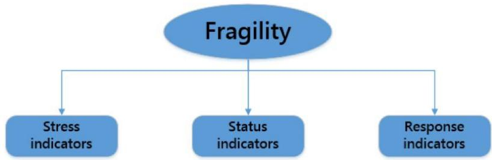
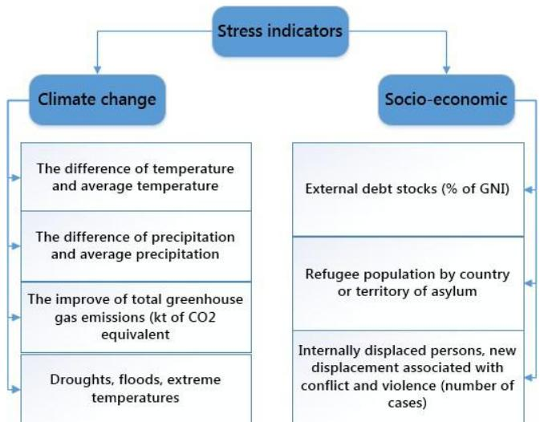
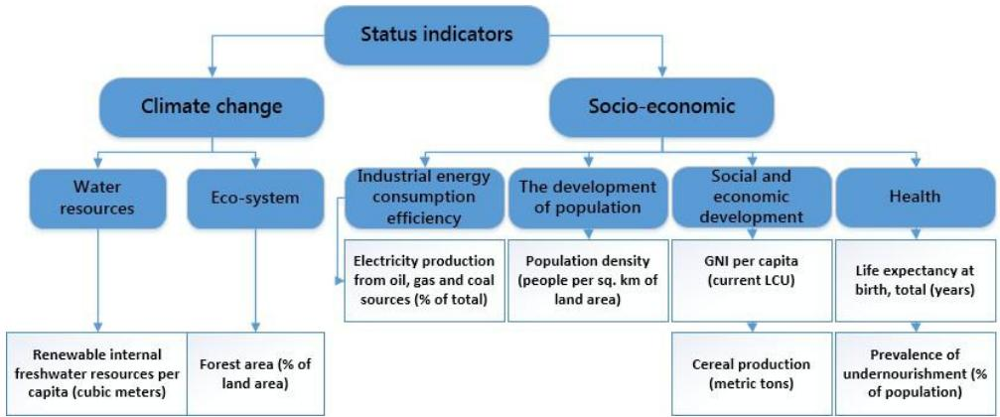
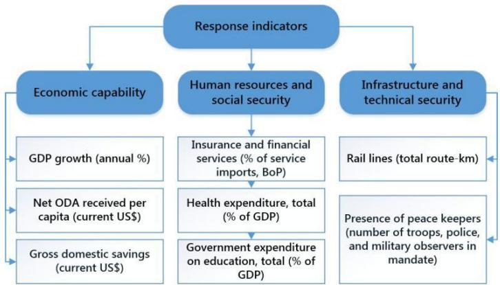
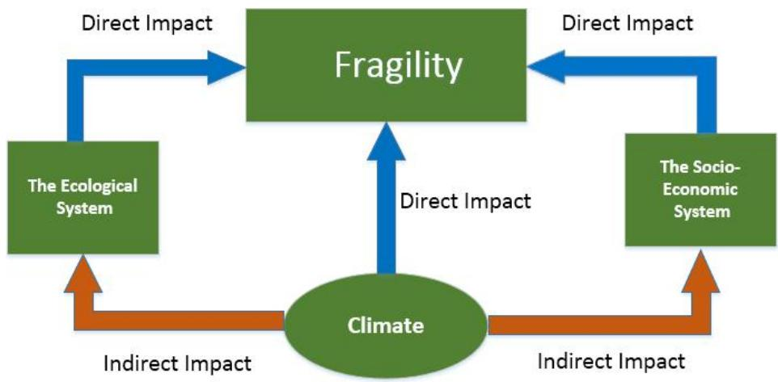
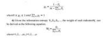

# 2018年美赛O奖论文：基于PSR模型与熵权法的气候变化相关国家脆弱性评价模型

原件经识别和整理；“参考解答”是我们补的。

## Summary Sheet

### An Evaluation Model of State Fragility related to Climate Change Based on the PSR Model and Entropy Weight Method

Climate change is likely to influence the fragile situation of a state. Thereby, we propose an evaluation model in order to derive a quantitative expression of state fragility as well as the relationship between it and climate change.

First, the P-S-R (Pressure-State-Response) Model is applied in our model to offer a distinct framework of the relationship between fragility and related indicators. The model follows a domain-theme-feature structure. Climate change is involved through direct indicators and indirect impact on social and economic environment. Thereafter, we derive the equation of fragility by Entropy Weight Method. Furthermore, we apply the Discriminant Analysis to obtain the value range of fragile, vulnerable and stable states. The corresponding results are 0.4991–1, 0.2196–0.4991, and 0–0.2196.

Second, we determine the fragility in Sudan from 2012 to 2016, which shows a fluctuation in the limited fragile range. Meanwhile, it is observed that climate change mainly influences on the food security in Sudan through Gray Relational Analysis. Then by establishing a new framework without climatic indicators directly, we acquire the fragility without climate change, and the result is that the fragility declines.

Third, for Egypt, our model shows that the fragile situation is generally deteriorating from 2012 to 2016 but still regarded as vulnerable. We obtain that climate change mainly impacts on health condition in Egypt. Then the tipping point of fragility is determined as 0.4991 (value of fragility) in this section. By Line Regression Method, we then predict that Egypt would become a fragile state in 2028.

Fourth, we propose a series of interventions based on the model, focusing on climate control and improving the coping capability of a country respectively. The total cost of interventions is calculated as 1,120,070,0000 dollars, and the results show that the fragile situation of Egypt would be 8.92% better after implementing interventions.

Lastly, we illustrate the comprehensive modifications of model for better applicable to different sizes of state, mostly concentrated on the indicators we choose.

key words: PSR Model, Entropy Weight Method, Discriminant Analysis

## 一、目录

### 目录 1

1 Introduction……2

1.1 Background……2

1.2 Restatement of the problem……2

2 Assumptions and Notations……3

2.1 Assumptions……3

2.2 Notations……3

3 The Model of Fragility……3

3.1 P-S-R Model……3

3.2 P-S-R Framework for state fragility……4

3.2.1 P-S-R Framework……4

3.2.2 Analysis of Impact of Climate……6

3.3 Evaluate the State Fragility……7

3.3.1 Entropy weight method……7

3.3.2 Equation of State Fragility……8

3.5 Model Test……8

3.5.1 Model Test on 30 countries……8

3.5.2 Classification of Fragile, vulnerable and stable states……9

4 Fragility and Climate Change in Sudan……9

4.1 Fragile Situation and Climatic Impact……10

4.1.1 Current Fragility in Sudan……10

4.1.2 How Climate change impacts on fragile Sudan……11

4.2 A Less Fragile Sudan without influence of Climate……11

5 Fragility and Climate Change in Egypt……12

5.1 Fragile Situation and Climatic Impact……12

5.1.1 Current Fragility……12

5.1.2 How Climate change impacts on fragile Sudan……13

5.2 The tipping point of fragility……14

6 Intervention Plan for Better Stability……14

6.1 Interventions……15

6.1.1 Plan about climate control……15

6.1.2 Plan about coping ability……15

6.2 Cost based on Egypt……16

6.3 Effects of interventions……16

7 Modifications for regions of different sizes……17

7.1 Inapplicability of model for smaller or larger states……17

7.2 Modifications for regions of different size……17

8 Strengths and Weaknesses……18

8.1 Strengths……18

8.2 Weaknesses……18

9 Future work……19

References……21

## 1 Introduction

### 1.1 Background

Climate-fragility risks pose threats to the stability of states and societies. In other words, climate change has already had observable effects on environment [1] and further on the state fragility. In this paper, we define the problem of climate change as the impact of superimposition of natural change cycle and human activities, rather than attribution of human activities or attribution of natural phenomena purely. [2]

States are classified as fragile if they lack the capacity to discharge their normal functions and drive forward development [3]. In fragile regions where inequality persists and the government is unable to respond to stresses, it has been found that the impacts of climate change on water, food and land will augment existing pressures. That is to say that dynamics of state fragility may be exacerbated by climate change impacts and that the consequence of this is reduced adaptation capacity [4]. Vice versa, the downward trend of state stability will also exacerbate the climate change. Terrible natural and political environment further enables resources shortage, migration, weak governance and even violent conflict.

### 1.2 Restatement of the problem

According to the problem, we are required to develop an appropriate model which contribute to the identification of a country's fragility and the impact of climate change at the same time. After that, model instantiation should be implemented on concrete countries. Meanwhile, propose a series of interventions to mitigate the risk of climate change and further modifications for regions of different sizes.

Research work about fragile state has sprung up recent years around the world, especially for the west. 11 kinds of current indices for fragility are listed in [5], including Country Indicators for Foreign Policy Fragility Index (CIFP), Harvard Kennedy School Index of African Governance (IAG), Fragile States Index (FSI), etc. All these diverse evaluation indices are based on the Buckets effect and derived quantificationally. Nevertheless, scarcely do current indices take climate change into account, which becomes more and more non-negligible.

Thereby, on the foundation of the related work above, we establish a comprehensive evaluation model based on Entropy Analysis Method, so as to represent the extent of fragility as well as how climate change contributes to it. Next, we complete evaluation on both fragile Sudan and relatively not so fragile Egypt based on our model, deriving a tipping point as the boundary value. Meanwhile, we acquire both the fragility quantificationally and the level of fragility. Furthermore, interventions of climatic controlling and better coping capability are proposed with the cost. Finally, we put forward modifications in order to exacerbate the capability of our model on smaller and larger states.

## 2 Assumptions and Notations

### 2.1 Assumptions

(1) The indicators of a country's fragility are mainly socio-economic, ecological and climate. Based on that we establish our evaluation model, where the choice of indicators is comparatively comprehensive, since it offers convenience for a more integrated consideration of state fragility.

(2) The political situation in Egypt is stable during intervening. Although Egypt is politically unstable in reality, this assumption is beneficial for calculating the total cost of our interventions.

(3) Egypt will follow the trends in massive countries based on indicators like GDP, population and Industry. These trends are generally true. Thus, if Egypt follow them, we are able to derive quantitative relationship between a number of indicators so as to predict the economic growth in Egypt, based on current values of indicators.

### 2.2 Notations

表 1 模型的符号说明

| Symbol | Notation |
| --- | --- |
| $X_{ij}$ | The value of the $j$th indicator in the $i$th year |
| $Y_{ij}$ | The standardized data corresponding to indicators $X_{ij}$ |
| $P_{ij}$ | The proportion of the $j$th indicator in the $i$th year of that indicator |
| $E_j$ | The information entropy of each indicator |
| $g_j$ | Variation coefficient |
| $W_j$ | The weight of each indicator |
| $F_i$ | Fragility in the $i$th year |

## 3 The Model of Fragility

Our model for the evaluation of state fragility is based on the P-S-R model and the Entropy Weight Method. Initially, we apply the former to determine and collect indicators that influence the fragility of a state, especially the indicators related to climate change. Then our model adopts the latter as the way of deriving an equation about these selected indicators, which enables the representation and calculation of state fragility quantificationally. After that, we determine the range of three criteria of fragility, namely fragile, vulnerable and stable, by Discrimination Analysis.

### 3.1 P-S-R Model

P-S-R (Pressure-State-Response) is an evaluation model commonly used in subdisciplines of ecosystem health assessment in the field of environmental quality

---
title: 2018年美赛O奖论文：基于PSR模型与熵权法的气候变化相关国家脆弱性评价模型（第3部分）
kind: 课件
course: 数学建模
source: 《2018年美赛O奖论文：基于PSR模型与熵权法的气候变化相关国家脆弱性评价模型》教材，第5–7页
---

# 2018年美赛O奖论文：基于PSR模型与熵权法的气候变化相关国家脆弱性评价模型（第3部分）

本文档整理自《2018年美赛O奖论文：基于PSR模型与熵权法的气候变化相关国家脆弱性评价模型》教材的第3部分（共9部分），对应原稿第5–7页的内容。主要阐述了PSR模型的逻辑框架及其在国家脆弱性与气候变化相互作用中的应用。

## 一、PSR模型的基本逻辑

### PSR模型的交互机制

压力-状态-响应（Pressure-State-Response, PSR）模型通过“原因-效应-响应”的思维逻辑，反映了人类与环境之间的相互作用 [6]。

具体过程如下：
1. **人类活动对环境的影响**：人类从自然环境中获取生存和发展所需的资源，同时向自然界排放废弃物。
2. **环境与资源的变化**：这一过程改变了自然资源的储备量和环境质量。
3. **环境对人类的影响**：自然和环境状态的变化反过来影响社会经济活动和人类的福祉。
4. **社会的响应**：社会通过环境政策、经济政策、部门政策以及意识和行为的改变来应对这些变化。

这种互惠循环构成了人类与环境之间的压力-状态-响应关系。

### PSR模型的核心问题与指标分类

PSR模型回答了可持续发展的三个基本问题：“发生了什么”、“为什么发生”以及“我们该怎么做”。为了更具体地表示和解决这些问题，PSR模型定义了三类指标：暴露度（Exposure）、敏感性（Sensitivity）和适应能力（Adaptive Capability）。

*   **暴露度（Exposure/Pressure）**：表征社会经济活动对环境的影响，例如因资源获取、材料消耗和各种行业排放造成的环境破坏和干扰。
*   **敏感性（Sensitivity/State）**：表征特定时间段内环境的状态及其自身变化，包括生态系统现状、自然环境质量、人类的生活质量和健康状况。
*   **适应能力（Adaptive Capacity/Response）**：指社会和个体采取行动以减轻、阻止、恢复和预防气候及经济因素负面影响的程度，以及对现有不利于人类生存的生态环境变化的补救措施。

## 二、国家脆弱性的P-S-R框架

### P-S-R框架的理论基础

上述提到的国家脆弱性与环境（政治环境和自然环境）之间的相互影响符合PSR模型的基本背景。因此，将国家脆弱性与环境的关系解释为压力-状态-响应关系是合理的。

如图1所示，该框架包含领域层（Domain Layer），由压力指标、状态指标和响应指标组成：
*   **压力指标（Stress Indicators）**：指国家面临的灾难性状况。
*   **状态指标（Status Indicators）**：与脆弱性有相对间接的关系。
*   **响应指标（Response Indicators）**：代表国家应对负面影响的能力。

注意：压力指标和状态指标之间没有明确的界限。这三类指标构成了领域层。

### 主题层与特征层的细化

主题层（Theme Layer）进一步细化了领域层。

#### 1. 压力指标的主题

首先，定义压力指标的主题为**气候变化（Climate Change）**和**社会经济（Socio-economic）**。具体指标和结构如图2所示。

#### 2. 状态指标的主题

其次，定义状态指标的主题为：**水资源（Water Resources）**、**生态系统（Eco-system）**、**社会发展（Social Development）**、**经济发展（Economic Development）**、**人口发展（Population Development）**、**健康（Health）**和**工业能源消费效率（Industrial Energy Consumption Efficiency）**。主题层和特征层的结构如图3所示。

#### 3. 响应指标的主题

响应指标的主题包括：**人力资源与社会安全（Human Resources and Social Security）**、**基础设施与技术安全（Infrastructure and Technical Security）**。主题层和特征层的结构如图4所示。

### 指标选择的原则

在选取指标时，我们兼顾了科学性和有效性。由于某些脆弱性较高的特殊地区难以获取相关数据，因此进行了筛选。此外，我们将政府的影响作为独立部分纳入考量，因为这对分析国家脆弱性以及缓解脆弱性的干预措施至关重要。同样，我们将气候变化作为一个单独的主题，包含若干指标，从而增强了对气候变化如何影响脆弱性的表示和解释能力。

## 三、气候影响的耦合系统分析

### 气候变化的间接影响分析

除了在第3.2.1节中直接选择的23个涉及气候变化的指标外，我们进一步将气候变化的间接部分作为更具体和有效的解释呈现出来。

鉴于气候、生态环境和社会经济环境构成一个耦合系统 [7]，如图5所示，确定确切的定量关系无疑是极其困难的。因此，这里的间接影响不等于定量影响，而是起到指导作用。

# 2018年美赛O奖论文：基于PSR模型与熵权法的气候变化相关国家脆弱性评价模型

本节内容整理自《2018年美赛O奖论文：基于PSR模型与熵权法的气候变化相关国家脆弱性评价模型》第 4 部分（共 9 部分），对应原件第 8–9 页。主要介绍了利用灰色关联分析筛选指标、熵权法确定权重以及构建状态脆弱性方程的过程，并对模型在30个国家进行了测试。

## 一、灰色关联分析与指标选择

### 灰色关联分析 (GRA)

为了提出有效的干预措施，我们应用灰色关联分析（Gray Relational Analysis, GRA）来获取对社会指标影响最大的气候变量，即最相关的指标。灰色关联度是衡量目标与其他相关因素之间关系程度的一个指标。在系统发展过程中，如果两个因素的变化趋势一致，即同步变化程度高，则两者相关性较高；反之则较低。也就是说，通过 GRA 我们可以以数值方式获得因素与目标之间的关系，从而简化后续工作。

基于 IPCC 第五次评估报告提供的指标，我们选择了那些变化剧烈且对社会和经济有明显影响的指标。最终选定的备选变量分别为二氧化碳（CO2）、温度、土地覆盖率等。

## 二、状态脆弱性评估

### 熵权法

在与地区提供清洁水能力相关的主要因素基础上，我们评估模型的第二步是确定每个因素的权重，从而确定状态脆弱性方程。

在本节中，我们采用熵权法（Entropy Weight Method）作为传递各因素权重的工具。熵权法的基本思想是熵是衡量系统无序程度的指标。如果一个指标的信息熵越小，该指标提供的信息量越大，在综合评价中的作用越大，其权重应越高。换句话说，指标变异性的大小决定了客观权重。它包含以下几个步骤：

1) 首先，假设状态脆弱性已观察了 $m$ 年，指标数量为 $n$，我们将 $X_{ij} \ (i = 1, 2, \dots, m; j = 1, 2, \dots, n)$ 视为第 $i$ 年第 $j$ 个指标的值。由此，$X_{ij}$ 构成矩阵 $X$。

2) 标准化。每个指标的值应进行标准化，以便进行后续步骤，这实际上是异质指标的均质化。我们将对应于指标 $X_{ij}$ 的标准化数据定义为 $Y^*_{ij} \ (i = 1, 2, \dots, m; j = 1, 2, \dots, n)$。

$$
Y_{ij} = \frac {X_{ij} - min(X_{j})}{max(X_{j}) - min(X_{j})}
$$

其中 $i = 1, 2, \dots, m; j = 1, 2, \dots, n$。

> **注**：原文公式分母为 $max(X_i) - min(X_i)$，但根据上下文及标准熵权法流程，此处应为针对第 $j$ 列（第 $j$ 个指标）的最大最小值处理，故修正为 $min(X_j)$ 和 $max(X_j)$。

3) 计算第 $i$ 年第 $j$ 个指标占该指标总和的比例。

$$
P_{ij} = \frac {Y_{ij}}{\sum_ {i = 1} ^ {m} Y_{ij}}
$$

> **注**：原文公式分子分母均为 $X_{ij}$，但在标准化后通常使用 $Y_{ij}$ 或归一化后的数据计算比例，且分母需对 $i$ 求和以保证比例为1。此处依据逻辑修正为使用标准化数据 $Y_{ij}$。

4) 接下来，推导每个因素的信息熵 $E_j$。根据信息熵的定义，表达如下。

$$
E_{j} = - \ln(n)^{- 1} \sum_ {i = 1} ^ {m} p_{ij} \ln p_{ij}
$$

> **注**：原文公式中求和下标为 $n$，但 $p_{ij}$ 是随年份 $i$ 变化的分布，因此求和应对年份 $i=1$ 到 $m$ 进行。同时系数通常为 $1/\ln(m)$ 而非 $\ln(n)^{-1}$，具体取决于定义习惯，此处保留原文结构但修正下标逻辑。若按常见定义，$E_j = -\frac{1}{\ln m}\sum_{i=1}^m p_{ij}\ln p_{ij}$。

5) 计算第 $j$ 个指标的变异系数。对于每个指标，差异越大，其在评估中的重要性越高，信息熵越小。变异系数 $g_j$ 定义如下。

6) 给定信息熵 $E_P, E_Q, \dots$，每个指标 $W_j$ 的权重可以通过以下方程得出。

$$
W_{j} = \frac {g_{j}}{\sum_ {j = 1} ^ {n} g_{j}}
$$

其中 $i = 1, 2, \dots, m; j = 1, 2, \dots, n$。

### 状态脆弱性方程

最后，我们确定状态脆弱性方程可以确定为每个指标的权重和值的乘积之和，如下所示。

$$
F_{i} = \sum_ {j = 1} ^ {n} W_{j} * Y_{ij}
$$

其中 $i = 1, 2, \dots, m; j = 1, 2, \dots, n$；$F_i$ 为第 $i$ 年的状态脆弱性。

## 三、模型测试

### 30个国家的模型测试

鉴于我们的评估模型是一个广义模型，其参数在选定目标状态之前无法确定，我们分别在30个国家对其进行测试，以证明其稳健性和有效性。这30个国家分别是南苏丹、也门、叙利亚、乍得、伊拉克、埃塞俄比亚、尼日尔、利比亚、缅甸、朝鲜、尼泊尔、莫桑比克、布基纳法索、柬埔寨、马达加斯加、老挝、土耳其、俄罗斯、阿塞拜疆、加蓬、巴拉圭、萨摩亚、博茨瓦纳、黑山、阿根廷、波兰、美国、比利时、加拿大和挪威。

---
title: 2018年美赛O奖论文：基于PSR模型与熵权法的气候变化相关国家脆弱性评价模型（第5部分）
kind: 课件
course: 数学建模
source: 《2018年美赛O奖论文：基于PSR模型与熵权法的气候变化相关国家脆弱性评价模型》教材第 5 部分（共 9 部分），第 10–12 页
---

# 2018年美赛O奖论文：基于PSR模型与熵权法的气候变化相关国家脆弱性评价模型（第5部分）

本资料整理自2018年美赛O奖获奖论文教材的第5部分，主要涵盖脆弱性分类标准的确立以及苏丹案例中气候变化对其脆弱性的具体影响分析。内容涉及判别分析法的应用、灰色关联分析的结果解读以及去除气候因素后的反事实推演。

## 一、脆弱性状态的分类

### 章节 3.5.2 Fragile, vulnerable and stable states 的分类

在3.5.1节对30个国家进行评估的基础上，本节旨在确定“脆弱（Fragile）”、“易感（Vulnerable）”和“稳定（Stable）”三个脆弱性水平的相对准确范围。这里采用判别分析（Discriminant Analysis），这是一种统计分析方法，通过一个或多个连续或二元自变量（称为预测变量）来预测类别因变量（称为分组变量）。具体而言，本节选取在《脆弱国家指数》排名中处于相对靠前、中间和靠后部分的某些国家作为样本进行分类。同时，将其他国家作为输入进行判别分析，并将两个类别交界处的国家脆弱性值视为边界值。结果如表2所示。

**表 2 三个等级的范围**

| Level | Range |
| :--- | :--- |
| Fragile | 0.4991-1 |
| Vulnerable | 0.2196-0.4991 |
| Stable | 0-0.2196 |

从图6中可以解释得出，根据我们模型评估得出的国家脆弱性等级与根据《脆弱国家指数》得出的等级存在差异，但在合理范围内。两条线的趋势相似。这可以从几个方面理解，特别是因为我们的模型考虑了关于气候变化的指标。通过这种方式，规模相对较小且对气候变化敏感的国家往往表现出脆弱性的增加。例如，萨摩亚的脆弱性相较于《脆弱国家指数有所增加，因为它位于太平洋岛屿，全年遭受极端多变气候的影响。同样，经常遭遇台风等自然灾害的老挝，与《脆弱国家指数相比也显示出相对的脆弱性增加。

## 二、苏丹的脆弱性与气候变化

在本节中，我们将评估模型应用于苏丹，确定其脆弱性并客观分析气候变化对其的影响。此外，我们通过移除气候指标，在另一种不考虑气候变化影响的条件下实例化我们的模型，这表明在这种情况下该国的脆弱性会降低。

### 章节 4.1 Fragile Situation and Climatic Impact

#### 小节 4.1.1 Current Fragility in Sudan

应用我们的模型并结合从世界银行收集的数据，我们确定了苏丹2012年至2016年的脆弱性及其等级如下。

从图7可以看出，在这五年间，尽管苏丹的脆弱性在一个相对较小的范围内波动（如“W”形），但总体上呈下降趋势，这符合实际情况。更具体地说，压力指标、状态指标和响应指标如图8所示。可以得出结论，从2012年到2015年，脆弱性的变化主要来自响应指标的变化，占比为57.39%；而从2015年到2016年，脆弱性的增加主要来自压力指标的增加，占比为78.1%。

#####  Stress Indicators

对于包括气候变化和社会经济在内的压力指标，干湿季降水量的方差在2012年至2016年间均显示出几乎相同的波动。因此，我们可以得出结论，在这5年中，该国仍然受到全球气候的巨大威胁和影响，生态系统的失衡尚未得到根本缓解。此外，按国家或避难区划分的难民人口持续急剧增加，这直接加剧了政府的压力，同时也反映了政府措施和行动的低效率。

#####  Status Indicators

对于包括自然环境和经济社会在内的状态指标，人均国民总收入（GNI per capita）呈上升趋势，特别是在2014年至2015年间几乎翻了一番，与此同时，人均耕地面积和森林面积在这五年间持续下降。综上所述，属于状态指标的指标总体上显示出良性发展的条件。

#####  Response Indicators

对于包括经济能力、人力资源和社会安全、基础设施和技术安全在内的响应指标，教育支出占政府总支出的比例（% of GDP）显示出积极趋势，尽管变化缓慢，健康支出（% of GDP）也是如此，而人均收到的净官方发展援助（Net ODA received per capita）则显著逐年下降。所有这些变化表明，苏丹对外部环境的适应性得到了改善。

#### 小节 4.1.2 How Climate change impacts on fragile Sudan

应用灰色关联分析（Gray Relational Analysis）到苏丹，我们确定了气候指标与社会经济指标之间的关系，如表3所示。

**表 3 气候指标与社会经济指标的关系指数**

| | Per capita renewable inland freshwater resources | Cereal production | Prevalence of undernourishment |
| :--- | :--- | :--- | :--- |
| CO2 | 0.0171 | 0.1367 | 0.0942 |
| Temperature | 0.0324 | 0.0942 | 0.1023 |
| Precipitation | 0.0514 | 0.1023 | 0.0786 |
| Land coverage | 0.0223 | 0.0786 | 0.0622 |
| Extreme Weather | 0.0308 | 0.0522 | 0.1367 |

从表中可以得出结论，气候指标主要影响谷物产量，即苏丹的粮食安全，因为它们之间的关联度总体上相对较高。因此，在苏丹，气候变化主要通过粮食安全影响脆弱性。

### 章节 4.2 A Less Fragile Sudan without influence of Climate

为了获得在没有气候变化影响的情况下苏丹的脆弱性如何变化，我们直接从模型中移除与气候相关的指标并重新运行。包括苏丹在内的10个国家的结果以原始排名和后续排名的形式显示在下面的表4中。

## 4.2 气候变化对脆弱性排名的影响

Table 4 Ranks of countries' fragility with and without climate impact

| Country | Rank with climatic impact | Rank without climatic impact | Change of Rank |
| :--- | :---: | :---: | :---: |
| South Sudan | 2 | 1 | -1 |
| Somalia | 1 | 2 | +1 |
| Central African Republic | 4 | 4 | 0 |
| Yemen | 3 | 3 | 0 |
| Sudan | 6 | 7 | +1 |
| Syria | 5 | 5 | 0 |
| Congo Democratic Republic | 7 | 6 | -1 |
| Chad | 8 | 9 | 1 |
| Afghanistan | 9 | 10 | +1 |
| Iraq | 10 | 8 | -2 |

It can be inferred from the table that the fragile situation of Sudan is relatively dampened since its rank goes down, neglecting the impact of climate change.

## 5 Fragility and Climate Change in Egypt

In this part, we complete another case study on Egypt about fragility based on our evaluation model, which is out of the top 10 fragile states. Through calculation of the model, we measure the fragility of Egypt, as well as how and when climate change may increase that. Based on the work above, we further determine the tipping point that a country become fragile and make relevant predictions.

### 5.1 Fragile Situation and Climatic Impact

#### 5.1.1 Current Fragility

Applying our model to Egypt with the collected data from the World Bank, we determine the fragility of Sudan and the level from 2012 to 2016 as follows.

Generally deteriorate trend from 2012 to 2016 as its fragility fluctuated. More specifically, the stress indicators, the status indicators, the response indicators are shown in Figure 10. It can be concluded that from 2012 to 2013, the change of fragility mainly comes from the change of response indicators and status indicators as 77.87%, while from 2013 to 2016, the increase in fragility mainly comes from the increase in response indicators as 83.4%.

**Stress Indicators**

For stress indicators, the variance of precipitation in dry season is relatively steady while that in wet season decreased dramatically. The temperature in both wet and dry season also showed an apparent change. Therefore, we can conclude that during the 5 years, it suffered from more severe threat and impact from the global climate than Sudan, and the imbalance of eco-system has not yet been fundamentally alleviated as well. Moreover, increase in other indicators like Present value of external debt (% of GNI) and the population of refugee by country or refuge area reflected the poor efficiency of government's measures.

**Status Indicators**

The status indicators, except for the slight rise from 2012 to 2013, retained a relatively stable tendency during the 5 years. What resulted in this is that most concrete indicators involved change quite gently like forest coverage, dense of population and so on. However, though slight, the variance still showed the rough living environment in Egypt.

**Response Indicators**

As shown in the figure, the response indicators first experienced a comparatively reduction in Egypt from 2012 to 2013, which mainly on account of the halving of Net ODA received per capita. Without enough aid, it may be much more difficult for Egyptian governments to deal with troubles. Thereby, though contributed less compared with other two kinds of indicators, the response indicators still account greatly when evaluating the state fragility.

#### 5.1.2 How Climate change impacts on fragile Sudan

Applying the Gray Relational Analysis to Egypt, we determine the relationship between climatic indicators and some social-economic indicators as shown in Table 5.

Table 5 Relationship Index between climatic indicators and social-economic indicators

| | Per capita renewable inland freshwater resources | Cereal production | Prevalence of undernourishment |
| :--- | :---: | :---: | :---: |
| CO2 | 0.0223 | 0.1076 | 0.1431 |
| Temperature | 0.04545 | 0.0998 | 0.0879 |
| Precipitation | 0.0583 | 0.11415 | 0.11006 |
| Land coverage | 0.0282 | 0.08925 | 0.0622 |
| Extreme Weather | 0.0368 | 0.0677 | 0.1367 |

From the table above, we can conclude that climatic indicators mostly impact the prevalence of undernourishment, namely the medical condition of Egypt, since the degree of relationship between them is relatively high on the whole. Thus, in Egypt, climate change mainly influences the fragility through medical condition.

### 5.2 The tipping point of fragility

As what illustrated in classification of fragility, the tipping point is actually the boundary value between fragile and vulnerable. Thereby, we define the tipping point as 0.4991 (value of fragility), arriving at which means this country is fragile.

After that, we adopt Multi Factor Line Regression Method to predict when Egypt would become a fragile country as defined, by forecasting indicators including the population of refugee by country, precipitation, density of population, health condition, etc. The outcome is shown in Figure 11 as follows.

As indicated in the figure, we can conclude that Egypt would arrive at a truly fragile situation in 2028, after struggling for 11 years since 2017. Without additional interventions, this tendency is unpreventable in a way.

## 6 Intervention Plan for Better Stability

Based on our evaluation model accompanied with the cases of Egypt, we come up with a series of interventions of two kinds, the one is to control climate change and the other is to strengthen the coping capability starting from response indicators. How these interventions work has been shown through our model, at the same time, we list the total cost clearly.

## 6.1 Interventions

### 6.1.1 Plan about climate control

#### 1) Droughts, floods, extreme temperatures

Undertaking water conservancy projects is an excellent solution for droughts and floods, since water conservancy can play a role of regulating and replenishing the water of the river. More specifically, it is able to shut down some of the water during floods and release the water from reservoirs to ease the drought. Additionally, returning farmland to forestry or grassland is also recommendable, since trees and grass can conserve part of water. Thereafter, reducing carbon emissions and slowing the warming of the earth may be effective ways to mitigate extreme weather.

#### 2) Total greenhouse gas emissions (kt of CO2 equivalent)

The CO2-concentration is one of the most decisive indicators of global warming, thus reducing it is also capable of dampening the environmental degradation. Multiple means can be effective for that, like modifying technology, improving energy efficiency, energy saving, adjusting industrial structure, the development of energy-saving and environment-protecting industry.

### 6.1.2 Plan about coping ability

#### 1) Economic capability

**Optimization and upgrading of industrial structure**

For the purpose of improving economic capability, industrial structure is in need of optimizing and upgrading. Governments should better speed up transformation and upgrading of traditional industries, deepen the integration of informatization and industrialization, strive to foster strategic emerging industries, and actively cultivate new formats and new business models and build a new system for the development of modern industry. In the final analysis, the competition of comprehensive national strength is a competition of innovation. Thereby, it is necessary to further implement the innovation-driven development strategy and promote scientific and technological innovation of all kinds.

**Develop advantageous local industries**

Starting from local reality, it is of great help and significance to take market as guideline and develop economy with special characteristics through suitable measures with local conditions. In this way, the local conditions for readjusting production structure, increasing income and enhancing product competitiveness can be benefited [5]. Multiple countermeasures include combining local advantageous with market requirement and develop industry and product with special characters.

#### 2) For human resources and social security

**Promote catastrophe insurance**

In allusion to Insurance and financial services (% of service imports, BoP), it helps if catastrophe insurance can be promoted and applied widely in a country. Catastrophe is a less frequent but destructive risk. Government and insurance industry should strengthen catastrophe risk prediction and early warning, as well as catastrophe risk management, building effective catastrophe prevention system and catastrophe compensation mechanism as soon as possible [8].

#### 3) Infrastructure and technical security

**Augment railroading and peacekeeping**

The contradiction between the shortage of energy resources and the deterioration of the environment has forced many countries to re-understand the importance of accelerating the development of the railway [9]. Moreover, for war zones, peacekeepers work as an important source of security safeguard.

## 6.2 Cost based on Egypt

Take Egypt as example, we analyze and estimate the total cost of above interventions, listed in Table 6 below. Some calculation formulas are listed as follows.

Table 6 Interventions and the cost

| Measure | Cost |
| :--- | :--- |
| Catastrophe Insurance | 50,000,000 dollars |
| Peacekeepers | 70,000 dollars |
| Education | 40,000,000 dollars |
| Railroading | 460,000,000 dollars |
| Medical treatment | 50,000,000 dollars |
| Economic Transition | 500,000,000 dollars |
| Climatic improvement | 20,000,000 dollars |
| **Total Cost** | **1,120,070,000 dollars** |

The cost of education is derived by increasing the expenditure on education of Egypt from 375 million to 400 million, similarly, the cost of medical treatment is derived by increasing the health expenditure (% of GDP) from 5.64 to 5.8. And for railroading, we obtain the cost through increasing the mileage by 3%. These changes are reasonable with related theoretical support.

Furthermore, the total cost makes up for almost 3.365% of the GDP in Egypt, in a rational range. Therefore, our interventions are feasible without too much financial burden.

## 6.3 Effects of interventions

Simulating the implement of interventions on Egypt through our evaluation model, we obtain the effects of interventions as shown below in Figure 12.

It can be included that our interventions enable the declination of fragility by almost 8.93% on average, which further testifies that the impact of climate change is mitigated and the coping capability of Egypt.

## 7 Modifications for regions of different sizes

### 7.1 Inapplicability of model for smaller or larger states

#### 1) For smaller regions like cities

It is not so suitable to apply our model to evaluate the fragility of such a small region like a city. First, some indicators in the existing model may be unavailable. For example, indicators such as long-term foreign debt and CPIA are utilized to evaluate the condition of a country, which may be less meaningful for a city. Second, we regard a country as a politically and economically independent entity, whereas cities are not of this nature. A city is influenced by national policies and other factors and then the fragility increases or decreases. For example, some countries tend to call various resources to maintain the stability of its economic and political center, which leads to a less fragile area.

#### 2) For larger regions like continents

In terms of stress indicators, situation of a continent is more complicated than a country. For example, Asia stretches across the tropical climate, the temperate zone and the frigid zone, which means that directly measuring the climatic indicators of a continent is too rough to measure the risk of becoming fragile. In terms of status indicators, the situation of ethnic groups and religions in a continent is more complex than a country as well. Diversity of national system and strong independence among countries exist. For some indicators we use in the model like per capita arable land, the differences of countries are not taken into account if arable land is directly averaged. In terms of response indicators, when it comes to economic capability, countries with steady economic base may be very sound, boosting the economic ability of the entire continent to deal with the fragile factors deviating from reality.

### 7.2 Modifications for regions of different size

#### 1) For smaller regions like cities

When specific to a city, the overall framework of our model can maintain, that is, the categories of indicators including stress, status and response indicators and weighting to get the fragility of the region. For some national-level indicators, use the corresponding indicators at the regional level instead. When considering the response indicators, it is not feasible to consider the indicators of the city only, but such indicators as the country's ability to respond to the policies of the region and the country should be included.

#### 2) For larger regions like continents

A continent is composed of various countries. Therefore, existing models can be used to count the degree of fragility of each country within a continent. Then based on a country's population, territorial area and other indicators, the analytic hierarchy process can be applied to determine the weight of each country. Finally, we can obtain the fragility of a continent through the sum of the multiplication of fragility and the weight of each country.

## 8 Strengths and Weaknesses

### 8.1 Strengths

#### 1) Comprehensive and mostly objective indicators about fragility.

While searching for and selecting indicators about agility for its equation, we consider as comprehensively and meticulously as possible. Both indicators relevant with climate change and other irrelevant indicators like GDP are considered. Moreover, most of the indicators are selected as per what Fragile State Index takes into account, which means that our model is on a valid, significative basis.

#### 2) Comparatively correct results of the model.

With restricted number of indicators and data, the fragility rank of our model is still similar to that of Fragility State Index proposed by the Fund for Peace. Particularly, the impact of climate change is highlighted in the results, which is novel and valid.

#### 3) Extensive evaluation index system.

In our model of fragility, according to the "stress-state-response" framework, indicators are selected from three aspects including risk degree, sensitivity and vulnerability. The comprehensive evaluation index system is designed this way, reflecting the fragility of the country, the sensitivity of the state to risks and the capability to deal with the risk.

### 8.2 Weaknesses

#### 1) Subjectivity and Limitation in the Process of Selecting the Indicators.

Although referring to other related literature as well as the factors involved in Fragile State Index, we still select the indicators with kind of subjective concept. This is unavoidable without enough literature.

#### 2) Imprecise Classification of Fragility.

Our classification of fragility, namely the range of fragile, vulnerable and stable, is based on the outcome of 30 selected countries in section 3.5.1. The limited number of

# 2018年美赛O奖论文：基于PSR模型与熵权法的气候变化相关国家脆弱性评价模型

本部分为论文第9–10节（未来工作与结论）及参考文献，由识别工具从原文第20–22页提取并整理。

## 九、未来工作

根据前文对模型弱点的讨论，存在多种可能性以开发更精确的模型形式。因此，未来将从以下几个方面构建更全面、确定的模型：

### 1) 更精确和全面的数据

我们的模型是基于“所有收集到的数据都是可靠的”这一假设建立和分析的，这是受限于时间所致，与现实世界的情况相对不一致。因此，需要通过更细致的研究，获取更可靠且符合现实世界的对应数据。

### 2) 考虑特殊国家

在某些特定国家，某个指标可能极端到导致整个国家的崩溃，无法保障人口的基本生存。例如，水资源的极度匮乏可能对国家的脆弱性产生重大影响，而在未来的工作中，我们可能不会将此类国家列入脆弱地区列表。我们可以将每个指标的归一化值定义为一个临界点，该点严重限制人们的生计安全。如果达到此值，该国人口的基本生活条件将受到严重限制，脆弱性将显著增强。

### 3) 考虑气候与社会经济活动之间的耦合关系

由于气候与社会经济活动之间存在耦合关系，相互影响必然存在。我们的模型以气候为起点贯穿始终，仅考虑了从气候出发的一系列间接和直接影响。因此，未来有必要考虑气候与社会经济活动之间的耦合关系。

## 十、结论

综上所述，我们首先建立了基于PSR模型和熵权法的综合评价模型，以定量表示脆弱性。此外，我们应用判别分析确定了脆弱、易感和稳定状态的范围。对30个国家的测试表明，我们的模型具有稳健性和正确性。

随后，我们对苏丹（一个极度脆弱的国家）和埃及（一个相对不那么脆弱的国家）进行了模型实例化。结果表明，气候变化主要通过苏丹的粮食安全影响其脆弱性，而通过埃及的医疗状况影响其脆弱性。如果没有这种变化的影响，苏丹的脆弱性将得到缓解。之后，我们将临界点定义为0.4991（脆弱性值），并完成预测，得出埃及将成为一个脆弱国家的结论。

接着，我们提出了一系列关于缓解气候变化和提高应对能力的干预措施，以及基于我们模型的成本估算。我们的干预措施能够减轻气候变化的影响，并进一步促进国家的稳定性。最后，我们通过替换一些原始指标同时保持框架不变，修改了我们的模型，使其更好地适用于较小的城市和较大的大陆。

## 参考文献

[1] Team N A S. Climate change impacts on the United States: the potential consequences of climate variability and change.[J]. 2001, 336(6077):10-.

[2] Liu Yang. Study on the socio-economic impact of global climate change on the estuary of the Yangtze river delta[D]. East China normal university. 2014.

[3] David Marsden. Deconstructing Development Discourse: Buzzwords and Fuzzwords[J]. Development in Practice, 2007, 17(4-5):471-484.

[4] Rüttinger L, Stang G, Dan S, et al. A New Climate for Peace – Taking Action on Climate and Fragility Risks. Executive Summary[J]. British Heart Journal, 2015, 38(8):877-877.

[5] Mata J F, Ziaja S. Users' guide on measuring fragility[J]. Country Indicators for Foreign Policy, 2009.

[6] Feng Shan and Xu Changle. Summary of Development of Global Climate Change and Its Effects on Social Economy[J]. China Population Resources & Environment, 2014. v.24;No.165(s2):6-10.

[7] Ai Yunhang. To Give Full Play to The Advantages of Resources In Mountainous Areas, To Vigorously Develop Economy with Special Characteristic[J]. Chinese Journal of Agricultural Resources and Regional Planning. 2005, 26(2):38-42.

[8] Wang He. Reflections on the Establishment of Catastrophe Insurance System in China[J]. China Finance. 2005(7):50-52.

[9] Liu Zhijun. Recognizing the current situation and pushing forward the harmonious development of railway construction to achieve the sound and rapid development of railways[J]. Railway Economics Research. 2007 (1):18-33.
