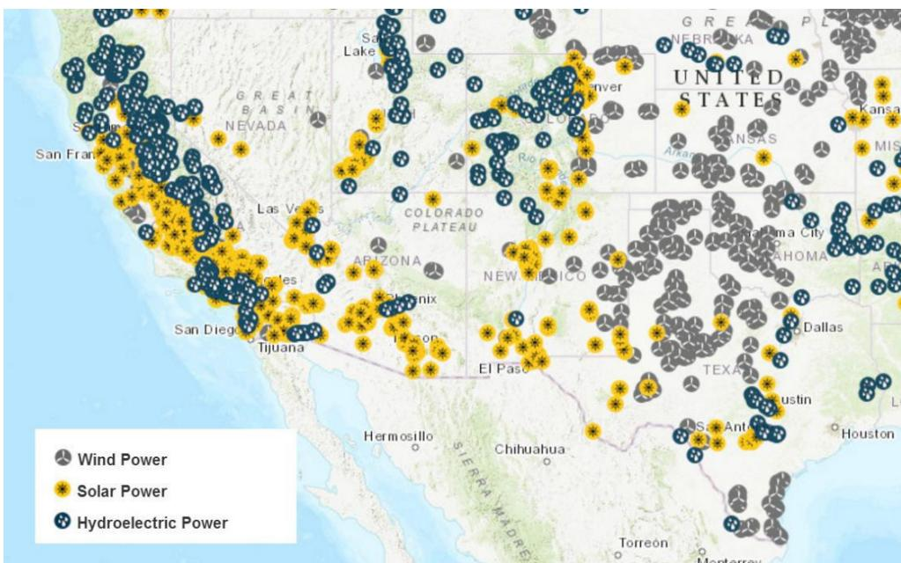
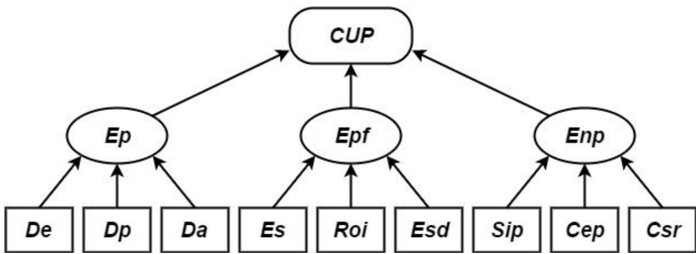
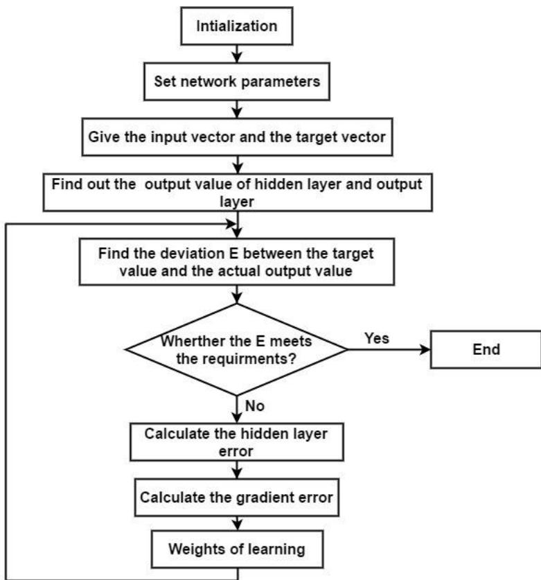

# 2018年美赛O奖论文：基于数据洞察的州际能源合作目标设定系统

原件经识别和整理；“参考解答”是我们补的。

# A Setting System of Interstate Energy Cooperation Goals Based on Data Insight

## Summary

After performing data analysis and modeling, we finally determine a set of development goals for the new four-state energy compact.

First, we preprocess the data provided, which includes default value processing, abnormal value process and data classification. For the sake of analysis, we divide various energy into two broad categories. One is cleaner renewable energy (CRE), the other is traditional fossil energy (TFE). After that, we select 11 important variables from the given data to create the energy profile for each of the four states. We call the 11 variables the basic variables.

Next, we apply the decoupling theory to characterize the dynamic relationship between economic development and energy utilization, which can reflect the evolution of energy profile. We find that the four states differ in production and usage of various energy significantly. To determine the underlying factors that lead to the differences, we construct the simultaneous equations model. Combining natural environment information further, we find out the factors and know the respective strengths of the four states in CRE.

Then, we establish a multi-dimensional evaluation system to identify the state that has the“best”energy profile on the whole. We introduce the index, comprehensive utilization performance (CUP) to measure the energy profile. The CUP is composed of three parts, energy performance, economic performance and environment performance. And each of the three parts includes three indexes respectively, all of which are synthesized by the basic variables. We use the PCA method to integrate the nine indexes into an overall index, namely the CUP. Ranking CUP, we find that California is the“best”.

Finally, we construct BP neural network to predict the energy profile. Analogous to Cobb-Douglas Production Function in economics, we define the CUP in a new way for predicting. Through setting various development scenarios, we get the predictions successfully. After that, we regard the four states as a whole to determine renewable energy usage targets for 2025 and 2050. In this process, we use the BP neutral network and previous models again. We collect real data from 2010 to 2015 to calculate the values of CUP. Compare them to the predicted value, we test our predicting system. The result shows that our predicting system works well.

## Contents

*   MEMO
*   1 Introduction
    *   1.1 Problem Statement
    *   1.2 Our Goals
    *   1.3 Our Thinking
*   2 Assumptions and Notations
    *   2.1 Assumptions
    *   2.2 Notations
*   3 Data Preprocessing
    *   3.1 Default Value Processing
    *   3.2 Abnormal Value Processing
    *   3.3 Data Synthesis and Classification
*   4 Energy Profile
*   5 Model Construction
    *   5.1 Decoupling Analysis
    *   5.2 The Simultaneous Equations Model
    *   5.3 The Multi-dimensional Evaluation System
        *   5.3.1 Construction of Indexes
        *   5.3.2 Principle Component Analysis
    *   5.4 Energy Profile Predicting System
        *   5.4.1 Determining the Predictors
        *   5.4.2 Constructing BP Neural Network
        *   5.4.3 Analyzing the Error
        *   5.4.4 Predicting the Target Values
*   6 Testing Our Model
    *   6.1 Predicting Reliability Test
    *   6.2 Sensitivity Analysis
*   7 Determining Goals for the Energy Compact
    *   7.1 Idea one: Don't cooperate
    *   7.2 Idea two: Cooperate
    *   7.3 Goals and Actions
*   8 Conclusions
*   9 Strengths and Weaknesses
    *   9.1 Strengths
    *   9.2 Weaknesses
*   References
*   Appendices
    *   Appendix A Profiles of Arizona
    *   Appendix B Profile of New Mexico
    *   Appendix C Profiles of Texas

## MEMO

**From:** Team 73767, MCM 2018
**To:** The group of Governors
**Date:** February 13, 2018
**Subject:** Goals for the interstate energy compact

Dear governors, we are honored to inform you our achievement after performing data analysis and modeling.

First, we introduce the energy profiles of your states in 2009. We use comprehensive utilization performance (CUP) to reflect the energy profile on the whole. Ranking the CUP of your four states, California appears to be the best. In terms of the usage of cleaner renewable energy, California, Arizona, Texas and New Mexico has the largest consumption successively in the water power, nuclear power, wind power and solar power. It is decided by the natural environment of your four states, such as geography and climate.

Then, we provide you the goals for the interstate energy compact. Through predicting, your four states’ average CUP will increase to 16.98 by 2025 and to 26.05 by 2050, if your four states can cooperate adequately. Based on the predictions, we set the development goals as follows:

*   Building a community of energy utilization and economic development, so as to realize manual benefit and win-win result.
*   Promoting the production and usage of new energy sources and reducing the dependence on traditional fossil fuels.
*   Increasing the whole economy’s comprehensive utilization performance to 16.98 by 2025 and to 26.05 by 2050, and achieving the harmony of economy, energy and environment ultimately.

According to the goals above and the characteristics of each of your four states, we offer you the following suggestions to meet the goals.

*   Building an energy investment bank to integrate money for developing the clear renewable energy.
*   Enhancing residuals’ environmental protection consciousness.
*   Adjusting the industrial structure properly.

We sincerely hope that you can achieve the goals above!

Please contact us if you have any problems.

### 1 Introduction

### 1.1 Problem Statement

Energy is the main material base and driving force for human's daily production and life. The proper utilization of all kinds of energy are closely link to the sustainability of economic development. The excessive consumption of traditional fossil fuels not only restricts the economic development, but also causes a series of environmental problems, such as global warming. Therefore, in America, many states have been trying to improve the production and usage of energy. A successful practice is that some states with different strengths and weaknesses unite to form an interstate compact, for promoting the usage of cleaner, renewable energy sources, through cooperation and adherence to specific policies.

In the southwest of the U.S., there are four states – California (CA), Arizona (AZ), New Mexico (NM), and Texas (TX) – that hope to form a realistic new energy compact as well. Asked by the four governors of these sates, we determine a set of development goals for the energy compact.

### 1.2 Our Goals

Based on our understanding of the problem, we set the following goals:

• Use the given data to found an energy profile for each state.

• Develop a model system to show the dynamic relationships between various energy consumption and economic development of each of the four states, and explore the underlying factors that lead to these relationships.

• Define the "best" profile for use of cleaner, renewable energy, then set up a system of evaluation to determine the state that has the "best" profile in 2009.

• According to the analysis above, develop a model and set different scenarios to predict the energy profile of each state for 2025 and 2050.

• Based on the established models, decide the usage targets of cleaner and renewable energy for 2025 and 2050. Then provide three actions for the four states to achieve the goals.

### 1.3 Our Thinking

This is a typical big data problem, so we solve it from the point of view of statistical analysis. Here is our thinking.

First, we preprocess the data provided, which includes default value processing, abnormal value processing and data synthesis and classification. Based on our definitions, we select some major energy sources for analysis and divide them into two categories. One is called cleaner renewable energy (CRE), the other is called traditional fossil energy (TFE). The specific definitions will be given later.

Second, we select some important data from the dataset provided to construct the energy profile. Through statistical charts, we visualize them. In this way, we found an energy profile for each state. Comparing the energy files of the four states, we find differences in their utilization of the two kinds of energy sources. To further clarify the differences, we learn from the decoupling theory and use coefficients of elasticity to show the dynamic relationships between various energy consumption and economic development of each state. Then we use the simultaneous equations model to respectively analyze the four states' economy systems, in which way, we find out the reasons why the differences exist.

Third, we introduce the concept of the comprehensive utilization performance (CUP) to evaluate which of the four states appeared to have the "best" profile. Since different states have their own characteristics, therefore, we establish a multi-dimensional evaluation system to measure the comprehensive utilization performance in case of bias. Then we use principle component analysis (PCA) to integrate each evaluation index into an overall index, namely the comprehensive utilization performance.

Finally, we build the BP neural network to predict the energy profile of each state. By setting various change trajectory of independent variables, we get the predictions successfully. After that, we regard the four states as a whole to determine renewable energy usage targets for 2025 and 2050.

### 2 Assumptions and Notations

### 2.1 Assumptions

Due to lack of necessary data and limitation of our knowledge, we make the following assumptions to help us perform modeling. These assumptions are the premise for our subsequent analysis.

• For the four states, all kinds of energy they produce are consumed by themselves each year. Thus we can replace energy output with energy consumption in calculation.

• The policy of each state will not change in the future. This assumption may be not realistic, but it is essential for us when predicting the energy profile in 2025 and 2050.

• The natural environment of the each states will not change. So we can see it as constant. This assumption simplify our analysis, and it is reasonable, since the natural environment is usually stable.

• Once forming an interstate energy compact, the four states can develop and utilize resources together. Thus they can realize manual benefit and win-win result.

### 2.2 Notations

Here are the notations and their meanings in our paper:

Table 1: notation

| Notation | Meaning |
| --- | --- |
| Epd | Electricity production |
| Tpd | Total energy production |
| Rce | Renewable energy expenditure |
| ttdp | GDP |
| Cpd | Renewable energy production |
| Pri | Price energy |
| Ind | Secondary industry consumption |
| Pop | Population |
| Wcs | Wood consumption |
| Tcs | TFE consumption |
| Enc | Total energy consumption |
| Cep | Carbon emission per capita |
| K | Energy expenditures as share of GDP |

### 3 Data Preprocessing

For data-analysis problem, there are usually some incomplete and abnormal data in the large amount of raw data, which may seriously affect the efficiency of modeling and the accuracy of conclusions. So it is quite important to preprocess the data.

### 3.1 Default Value Processing

We use different methods to process variables with various degrees of data loss. (1) For variables with large amount of data missing, we just delete it. Because small data cannot provide enough and valuable information for our modeling. (2) For variables with a small amount of data missing, we use interpolation method to compensate the data. More specifically, we first use existing data points to establish an appropriate interpolation function, and then replace the missing value with the function value $f(x_i)$ at the corresponding point $x_i$.

### 3.2 Abnormal Value Processing

If a value in a set of data is more than twice the standard deviation of the average, we call it the abnormal value. Statistically we can use a box-plot to identify the abnormal values. For the abnormal value, we fix it with the average value of its two adjacent observations.

# 2018年美赛O奖论文：基于数据洞察的州际能源合作目标设定系统

本资料整理自《2018年美赛O奖论文：基于数据洞察的州际能源合作目标设定系统》教材第3部分（第8–11页），由识别工具读取后整理。

## 3.3 Data Synthesis and Classification

There are 605 variables in the dataset provided. Not all of them are used in our model. Thus, we sort the data we need into a new dataset. Besides, we divide the energy sources into two categories for the further analysis, One is called cleaner renewable energy, which includes the hydroenergy, the wind energy, the geothermal energy, the solar energy and the ethanol; the other is called traditional fossil energy, which includes the coal, the petroleum, the natural gas and other fuels.

Definition:

- Cleaner renewable energy is the energy that produces little pollution and can be used directly in the production and life.
- Traditional fossil energy is non−renewable energy and will cause air pollution after burning.

In our model, some synthesized variables are used, for example, the average price of cleaner renewable energy. It can be calculated according to formula (1). Other synthesized variables will be explained later.

$$
P = \frac {\sum_ {i = 1} ^ {} p _ {i} \cdot q _ {i}}{\sum_ {i = 1} ^ {} q _ {i}} \qquad i = 1, 2, \dots\tag{1}
$$

## 4 Energy Profile

After data preprocessing, we choose 11 important variables to create the energy profile. we call them the basic variables

Table 2: basic variable

| Notation | Abbreviation in the original data set |
| :--- | :--- |
| GDP | GDPRX |
| Total population | TPOPP |
| TFE consumption | FFTCB |
| Total consumption | TETCB |
| Wood consumption | WWTCB |
| Electricity production | ESTCB |
| Total energy production | TEPRB |
| Price of renewable energy | AVACD |
| Renewable energy production | REPRB |
| Renewable energy expenditure | RFEIV |
| Secondary industry consumption | TEICB |

Descriptive statistics is usually the first step in statistical analysis, which can shows the important features of the data visually through graphs and tables. In view of this, we adopt the descriptive statistics method to show the energy profile of each state. Here is the energy profile of California, those of other states are attached to the appendix.

Table 3: the cutline in Figure 2 and Figure 3

| | | | |
| :--- | :--- | :--- | :--- |
| **Figure 2 :** | | | |
| Pic1 | Trend graph of TFE and its price | | |
| Pic2 | Trend graph of CRE and its price | | |
| Pic3 | Trend graph of total consumption(TC) and its price | | |
| Pic4 | Trend graph of the ratio of TFE to TC and CRE to TC | | |
| **Figure 3 :** | | | |
| F | Fuel ethanol | C | Coal |
| HY | Hydroelectricity | PE | Petroleum products |
| GE | Geothermal energy | NG | Natural gas |
| WE | Wind energy | OT | Other |
| PH&SO | Photovoltaic and solar thermal energy | | |

(Only the unit of "F"is Thausand Barrels)

Table 4: quantitative change and rate of change of typical variables from 1960 to 2009

| Variable | Quantitative Change | Rate of Change |
| :--- | :--- | :--- |
| Energy total production | 510310.93(Billion Btu) | 156.56% |
| Renewable energy total production | 28262.33(Billion Btu) | 383.32% |
| Fossil fuels, total production | 482048.60(Billion Btu) | 151.32% |
| Electricity production | 16995.11(Billion Btu) | 2279.84% |
| Wood consumption | 4244.64(Billion Btu) | 64.04% |
| Secondary industry consumption | 414753.42(Billion Btu) | 199.64% |
| Renewable energy total end-use expenditures | 750.17(Million dollars) | 873.31% |
| GDP | 59090(Million dollars) | 593.15% |

By comparing the energy profiles of the four states, we preliminarily reached the following conclusions:

- Overall, the four states differ in their utilization and consumption of the two types of energy (CRE&TFE).
- Each of the four states has a growing share of CRE consumption, while the share of TFE is still high.
- California ranks the first in terms of the amount of CRE consumption; Arizona ranks the first in terms of the share of CRE consumption. However, New Mexico lags behind in the usage and consumption of CRE.

## 5 Model Construction

### 5.1 Decoupling Analysis

Since having had a general idea of the energy profiles of the four states, we now intend to calculate the coefficients of elasticity to deeply analyze the dependency between economic development and the various energy consumption of each state. According to the decoupling theory, the higher the absolute value of the elasticity, the stronger the dependency. The formula of coefficient of elasticity is asfollow.

$$
e l a = \left| \frac {\Delta E n c}{\Delta G d p} \cdot \frac {G d p}{E n c} \right|\tag{2}
$$

The calculation results are shown in figure 4. From the figure, we can intuitively know that generally the dependency between economic development and CRE consumption is on the rise for each state, but the intensity of the dependency differs among the four states.

### 5.2 The Simultaneous Equations Model

To explore the underlying factors that leads to the differences of energy files among the four states, we develop a simultaneous equations model, as shown below. Different elements are interrelated and accurately. We introduce three equations into the model, since there are interactions between each two of the three elements, economic development, energy consumption, and environmental pollution.

$$
\left\{ \begin{array}{l} \ln (Enc) = \beta_{0} + \beta_{1} \ln (Gdp) + \beta_{2} \ln (Cep) + \beta_{3} \ln (Pr) + \beta_{4} \ln (pop) + \beta_{5} \ln (Ind) + \beta_{6} \ln (K) + X + \varepsilon_{3} \\ \ln (Gdp) = \alpha_{0} + \alpha_{1} \ln (Enc) + \alpha_{2} \ln (Cep) + \alpha_{3} \ln (K) + \alpha_{4} \ln (Pop) + \varepsilon_{1} \\ \ln (Cep) = \gamma_{0} + \gamma_{1} \ln (Gdp) + \gamma_{2} \ln (Enc) + \gamma_{3} \ln (Pop) + \gamma_{4} \ln (Ind) + \varepsilon_{2} \end{array} \right.\tag{3}
$$

其中 $X$ 为自然环境方面的控制变量集合。

由于缺乏自然环境方面的变量数据，我们在求解模型时忽略控制变量集合 $X$。$\ln(Enc)$ 方程的回归结果如下表所示。回归系数反映了各解释变量对因变量的影响，由此可以判断不同因素对能源变量的影响。

表 5：方程 1 的回归结果（\*、\*\*、\*\*\* 分别表示置信水平为 10%、5%、1%）

| 方程 1 | TFE-AZ | TFE-CA | TFE-NM | TFE-TX | CRE-AZ | CRE-CA | CRE-NM | CRE-TX |
|---|---|---|---|---|---|---|---|---|
| ln(Gdp) | 0.2189\*\*\* | 0.5122\*\* | 0.4896\*\* | 1.2368\*\*\* | 0.1904\*\*\* | 0.4915\*\* | 0.2167\* | 0.4532\*\* |
| ln(Cep) | 0.0012 | 0.0104\*\* | 0.1326\*\* | 0.1725\*\* | 0.0031 | 0.0113\* | 0.0682\*\* | 0.1651\*\*\* |
| ln(K) | 0.2169\*\* | 0.3481\*\* | 0.2018\* | 0.3018\*\* | 0.2267\*\* | 0.4162\*\* | 0.2481\*\*\* | 0.3156\* |
| ln(Pop) | 0.0104 | 0.0341 | 0.0361\* | -0.2214 | 0.0133 | 0.0265 | 0.0421\* | -0.2153 |
| ln(Pri) | 0.1152\* | 0.1421 | 0.1102\*\* | 0.2451 | 0.1842\* | 0.1821\* | 0.2012\*\* | 0.2201 |
| ln(Ind) | 0.1421\* | 0.4142\*\*\* | 0.2269\* | 0.2684\*\* | 0.1723\* | 0.3841\*\*\* | 0.2362\* | 0.2758\* |
| Constant | 17.6421\* | 19.2364\* | 13.2631\* | 50.3641\* | 16.6372\* | 37.6298\* | 13.2156\* | 61.2571\* |

由表 5 可见，人口对能源消费没有显著影响，而经济发展和第二产业占比对能源消费有显著影响。

为确定地理和气候的影响，我们收集了四个州自然环境的相关信息，如图 5 所示。该图展示了太阳能、风能和水电的资源分布。

由图 5 可知，四个州在 CRE 生产潜力方面存在差异，这些差异是由四个州不同的自然环境（如气候和地理）造成的。

### 5.3 多维评价体系

本部分将确定四个州中哪一个在 2009 年拥有“最佳”能源状况。通过上述分析可知，四个州各有先天的优势与劣势。因此，为避免偏差，我们建立多维评价体系来衡量它们的能源状况。

### 5.3.1 指标构建

我们的评价体系的核心指标称为综合利用率（comprehensive utilization performance，CUP），它反映 CRE 的开发与利用水平。CUP 由三部分组成：能源绩效、经济绩效和环境绩效，每部分又各含三个指标。这些指标及其公式详见表 6。

表 6：指标及其公式

| 类别 | 指标名称 | 含义 | 公式 |
|---|---|---|---|
| 能源绩效（Ep） | 开发效率（De） | 反映电力行业中 CRE 开发与利用的状况 | $De = \frac{Cpd}{Epd}$ |
| 能源绩效（Ep） | 开发潜力（Dp） | 反映 CRE 开发与利用的可持续性 | $Dp = \frac{Cpd_t - Cpd_{t-1}}{Cpd_{t-1}}$ |
| 能源绩效（Ep） | 开发成果（Dpa） | 反映 CRE 开发与利用对州能源结构的贡献 | $Dpa = \frac{Cpd}{Tpd}$ |
| 经济绩效（Epf） | 经济支持（Es） | 反映州在投资层面对可再生能源的支持 | $Es = \frac{Rce}{ttdp}$ |
| 经济绩效（Epf） | 投资回报率（Roi） | 反映可再生能源投资的效率与盈利能力 | $Roi = \frac{Cpd}{Rce}$ |
| 经济绩效（Epf） | 供需均衡（Esd） | 反映供给对需求的满足程度 | $Esd = \frac{1}{Pc}$ |
| 环境绩效（Enp） | 第二产业占比（Sip） | 反映各州对污染产业的依赖程度 | $Sip = \frac{Scs}{Tocs}$ |
| 环境绩效（Enp） | 人均碳排放（Cep） | 反映人均温室气体排放状况 | $Cep = \frac{Tcs}{Tpo}$ |
| 环境绩效（Enp） | 人均自然资源消耗（Csr） | 反映人均自然资源消耗状况 | $Cnr = \frac{Wcs}{Tpo}$ |

### 5.3.2 主成分分析

我们采用 PCA 方法将各评价指标综合为一个总体指标，即综合利用率。然后通过比较四个州的 CUP 值，确定“最佳”州。

首先，我们利用给定数据和表 6 中的公式计算各评价指标；然后，用下式对这些指标值进行标准化。

$$
\begin{array}{c} \bar{a}_{ij} = \frac{a_{ij} - \mu_{j}}{s_{j}} \\ \mu_{j} = \frac{1}{n} \sum_{i=1}^{n} a_{ij} \\ s_{j} = \sqrt{\frac{1}{n-1} \sum_{i=1}^{n} (a_{ij} - \mu_{j})^{2}} \end{array}\tag{4}
$$

## 5.3 Principal Component Analysis (PCA)

Next, we use the equation N to calculate the correlation coefficient matrix of the standardized data.

$$
r _ {i j} = \frac {\sum_ {k = 1} ^ {n} \bar {a} _ {k i} \cdot \bar {a} _ {k j}}{n - 1}\tag{5}
$$

Then we compute the eigenvalue $\lambda _ { i }$ and eigenvector $\vec { u } _ { i }$ of the correlation coefficient matrix. According to the eigenvectors, we can get the principal components $y_i$. We can get nine principal components in total, but we can only use three of them, which have the highest contribution rate.

$$
\begin{array}{c} y _ {1} = u _ {1 1} \bar {x} _ {1} + u _ {2 1} \bar {x} _ {2} + \dots + u _ {m 1} \bar {x} _ {m}, \\ y _ {2} = u _ {1 2} \bar {x} _ {1} + u _ {2 2} \bar {x} _ {2} + \dots + u _ {m 2} \bar {x} _ {m}, \\ \vdots \\ y _ {n} = u _ {1 n} \bar {x} _ {1} + u _ {2 n} \bar {x} _ {2} + \dots + u _ {m n} \bar {x} _ {m}, \end{array}\tag{6}
$$

Finally, we calculate the contribution rate based on the formula (7), then use the formula (8) to determine an overall index, which is named comprehensive utilization performance by us. Sorting the CUP, we can find out which of the states is the best.

$$
b _ {j} = \frac {\lambda_ {j}}{\sum_ {k = 1} ^ {m} \lambda_ {k}}\tag{7}
$$

$$
Z = \sum_ {j = 1} ^ {p} b _ {j} y _ {j}\tag{8}
$$

The results of PCA are shown in Table 7. From the table, we can see that California has the “best” energy profile in 2009.

**Table 7: PCA scores**

| Rank | State | PCA Score |
| :--- | :--- | :--- |
| 1 | California | 0.9433 |
| 2 | Texas | 0.5561 |
| 3 | Arizona | 0.2466 |
| 4 | New Mexico | -1.7459 |

### 5.4 Energy Profile Predicting System

#### 5.4.1 Determining the Predictors

In part 5.3, we measured the energy profile in three dimensions: energy performance, economic performance, and environment performance. For the following analysis, we select an index from each of them to calculate the comprehensive utilization performance (CUP) in a different way.

The indexes we select are Dpa, Roi, and Cep. Analogous to Cobb-Douglas Production Function in economics, we derive the following formula.

$$
\begin{array}{l} C U P = A \cdot (D p a) ^ {\alpha} \cdot (R o i) ^ {\beta} \cdot (C e p) ^ {\gamma} \\ \text {where:} \\ \qquad A \text {is unit correction factor;} \\ \qquad \alpha, \beta , \gamma \text {are weight coefficients of variables;} \\ \qquad \alpha + \beta + \gamma = 1. \end{array}\tag{9}
$$

In the previous analysis, we pointed out that there is an interaction between each two of the three elements: economy, energy, and environment. Therefore, we choose GDP per capita (ttdp), Secondary industry proportion (Sip), and carbon emission per capita (Cep) as the independent variables in prediction. Then we can derive the following equation.

$$
C U P = \theta_ {0} + \theta_ {1} t t d p + \theta_ {2} S i p + \theta_ {3} C e p + \varepsilon\tag{10}
$$

#### 5.4.2 Constructing BP Neural Network

Since we have to predict the energy profiles of the four states respectively, it is a heavy task. Thus, we utilize the intelligent algorithm (BP neural network) with high prediction efficiency to finish this work. It has been proved theoretically that BP neural network can approach any nonlinear function with higher precision. The flow chart below shows the principle of BP neural network.

There are two steps in the process of constructing BP neural network. First, we should set the network parameter $k$ that represents the numbers of neurons. Here we let $k=6$. Second, we use existing data of input and output to train the network. We now derive the core formulas of the BP Network.

Set a pair of samples $( X , Y )$, where $X = [ x _ { 1 } , x _ { 2 } , \cdots , x _ { m } ] ^ { T }$, $Y = [ y _ { 1 } , y _ { 2 } , \cdots , y _ { n } ] ^ { T }$. The hidden neural unit is $O = [ O _ { 1 } , O _ { 2 } , \cdots , O _ { l } ]$. The network weight matrix between the input layer and the hidden layer neurons $W ^ { 1 }$, and the network weight matrix between the hidden layer neurons and the output layer $W ^ { 2 }$ are shown below.

$$
W ^ {1} = \left[ \begin{array}{c c c c} \omega_ {1 1} ^ {1} & \omega_ {1 2} ^ {1} & \dots & \omega_ {1 m} ^ {1} \\ \omega_ {2 1} ^ {1} & \omega_ {2 2} ^ {1} & \dots & \omega_ {2 m} ^ {1} \\ \vdots & \vdots & & \vdots \\ \omega_ {l 1} ^ {1} & \omega_ {l 2} ^ {1} & \dots & \omega_ {l m} ^ {1} \end{array} \right], \quad W ^ {2} = \left[ \begin{array}{c c c c} \omega_ {1 1} ^ {2} & \omega_ {1 2} ^ {2} & \dots & \omega_ {1 l} ^ {2} \\ \omega_ {2 1} ^ {2} & \omega_ {2 2} ^ {2} & \dots & \omega_ {2 l} ^ {2} \\ \vdots & \vdots & & \vdots \\ \omega_ {n 1} ^ {2} & \omega_ {n 2} ^ {2} & \dots & \omega_ {n l} ^ {2} \end{array} \right]\tag{11}
$$

The threshold of the hidden layer neurons $\theta ^ { 1 }$ and the output layer neurons $\theta ^ { 2 }$ are:

$$
\theta^ {1} = [ \theta_ {1} ^ {1}, \theta_ {2} ^ {1}, \dots , \theta_ {l} ^ {1} ] ^ {T}, \quad \theta^ {2} = [ \theta_ {1} ^ {2}, \theta_ {2} ^ {2}, \dots , \theta_ {n} ^ {2} ] ^ {T}\tag{12}
$$

So the output of the hidden layer is:

$$
O _ {j} = f (\sum_ {i = 1} ^ {m} \omega_ {j i} ^ {1} x _ {i} - \theta_ {j} ^ {1}) = f (net _ {j})\tag{13}
$$

where $f(\cdot)$ is the transfer function of the hidden layer.

And the output of the output layer is:

$$
z _ {k} = g (\sum_ {j = 1} ^ {l} \omega_ {k j} ^ {2} O _ {j} - \theta_ {k} ^ {2}) = g (net _ {k})\tag{14}
$$

where $g(\cdot)$ is the transfer function of the output layer.

The error between the network's output and the expected output is:

$$
\begin{aligned} E &= \frac {1}{2} \sum_ {k = 1} ^ {n} (y _ {k} - z _ {k}) ^ {2} \\ &= \frac {1}{2} \sum_ {k = 1} ^ {n} [ y _ {k} - g (\sum_ {j = 1} ^ {l} \omega_ {k j} ^ {2} O _ {j} - \theta_ {k} ^ {2}) ] ^ {2} \\ &= \frac {1}{2} \sum_ {k = 1} ^ {n} \{y _ {k} - g [ \sum_ {j = 1} ^ {l} \omega_ {k j} ^ {2} f (\sum_ {i = 1} ^ {m} \omega_ {j i} ^ {1} x _ {i} - \theta_ {j} ^ {1}) - \theta_ {k} ^ {2} ] \} ^ {2} \end{aligned}\tag{15}
$$

$\omega _ { k j } ^ { 2 }$ is the weight of the neurons between hidden layer and output layer. The partial derivative of the error $E$ to $\omega _ { k j } ^ { 2 }$ is:

$$
\frac {\partial E}{\partial \omega_ {k j} ^ {2}} = \frac {\partial E}{\partial z _ {k}} \frac {\partial z _ {k}}{\partial \omega_ {k j} ^ {2}} = - (y _ {k} - z _ {k}) g ^ {\prime} (net _ {k}) O _ {j} = - \delta_ {k} ^ {2} O _ {j}\tag{16}
$$

### 5.4.3 Analyzing the Error

Entering the selected variable data into the network, we get the fitting figures, shown in Figure 8. Then we use the following formula to calculate the average fitting error, the results are showed in table 8

$$
A f e = \frac {1}{n} \sum_ {i = 1} ^ {n} | e _ {i} | = \frac {1}{n} \sum_ {1} ^ {n} | y _ {i} - \hat {y} _ {i} |\tag{19}
$$

Table 8: average fitting error

| State | California | Arizona | New Mexico | Texas |
| :--- | :--- | :--- | :--- | :--- |
| Afe | 6.47% | 5.37% | 8.82% | 12.09% |

### 5.4.3 Predicting the Target Values

To predict the dependent variable, we have to know the independent variables first. Unfortunately, we lack the values of ttdp, Sip and Cep for 2025 and 2050. So we can only predict the dependent variable by setting the change trajectory of the three independent variables in advance. We set two scenarios in total.[^4]

#### Scenario one: Linear trend

As is shown in figure 9, if the change of the three independent variables follows the linear trend. We can use the formula 15 to characterize their trajectory.

$$
x _ {t} = x _ {t - 1} + a\tag{20}
$$

#### Scenario two: Smooth fluctuation

As is shown in figure 10, if the change of the three independent variables follow the smooth fluctuation. Wecan use autoregressive moving average model, ARMA(p,q) to characterize their trajectory.[^5]

$$
x _ {t} = \varphi_ {0} + \varphi_ {1} x _ {t - 1} + \varphi_ {2} x _ {t - 2} + \varphi_ {p} x _ {t - p} + \varepsilon_ {t} - \theta_ {1} \varepsilon_ {t - 1} + \theta_ {2} \varepsilon_ {t - 2} - \theta_ {q} \varepsilon_ {t - q} + \mu\tag{21}
$$

Once determining the change trajectory of independent variables, we can estimate their values. Entering them to the BP networks, we get the predicted values of the CUP of each states. The results are shown in table 9.

Table 9: the predicting results

| | Scenario 1 | | | | | Scenario 2 | | | |
| :--- | :---: | :---: | :---: | :---: | :---: | :---: | :---: | :---: | :---: |
| **State** | **Year** | **DPA** | **ROI** | **CEC** | **CUP** | **DPA** | **ROI** | **CEC** | **CUP** |
| AZ | 2025 | 0.06 | 25.16 | 170.97 | 23.92 | 0.05 | 22.15 | 190.26 | 23.49 |
| AZ | 2050 | 0.07 | 50.45 | 100.45 | 40.19 | 0.06 | 50.15 | 120.15 | 35.22 |
| CA | 2025 | 0.08 | 30.04 | 138.63 | 28.39 | 0.10 | 29.36 | 145.26 | 26.14 |
| CA | 2050 | 0.09 | 57.87 | 89.14 | 45.15 | 0.12 | 55.86 | 108.15 | 39.15 |
| NM | 2025 | 0.07 | 50.14 | 350.45 | 8.20 | 0.07 | 41.26 | 351.22 | 7.89 |
| NM | 2050 | 0.08 | 59.85 | 282.43 | 15.16 | 0.09 | 57.12 | 301.86 | 14.12 |
| TX | 2025 | 0.05 | 20.60 | 348.15 | 7.84 | 0.05 | 19.26 | 369.15 | 6.95 |
| TX | 2050 | 0.08 | 48.29 | 321.53 | 14.50 | 0.08 | 44.12 | 348.85 | 12.19 |

## 6 Testing Our Model

### 6.1 Predicting Reliability Test

To test the predicting reliability of the BP network, we collect relevant data of each state from 2010 to 2015, and use them to predict the CUP. Then we use formula 15 again to compute the average error between the predicted values and the actual ones. Here are the results.

Table 10: the predicting error

| The predicting error | | | | |
| :--- | :---: | :---: | :---: | :---: |
| **State** | **California** | **Arizona** | **New Mexico** | **Texas** |
| **Error** | 5.89% | 6.24% | 7.98% | 10.07% |

### 6.2 Sensitivity Analysis

In the process of constructing BP network, we let the network parameter $k = 9$. How does the change of $k$ influence the predicting results? We analyze the average deviation of CUP caused by changing $k$ slightly.

Table 11: the influence by changing $k$

| State | k-2 | k-1 | k+1 | k+2 |
| :--- | :---: | :---: | :---: | :---: |
| AZ | 11.08% | 4.43% | 3.54% | 8.51% |
| CA | 8.19% | 3.15% | 4.66% | 10.80% |
| NM | 9.78% | 5.39% | 4.66% | 12.28% |
| TX | 6.66% | 2.19% | 2.28% | 12.33% |
| Mean | 8.93% | 3.79% | 3.79% | 10.98% |

From table 11, we can find that the influence of $k$ is not big, which we can bear.

## 7 Determining Goals for the Energy Compact

### 7.1 Idea one: Don't cooperate

If the four states don't cooperate, which means they develop independently, they can only utilize their own resources to enhance the level of renewable energy usage. In this condition, we can just use the predicted values in part 5.4 as their respective targets.

For the two scenarios in part 5.4, we think that scenario two is more reasonable and realistic. Because the evolution of the macro-economy is usually stable, especially for advanced economies like the United States.[6] So we just take scenario two into consideration.

In scenario two, the average comprehensive utilization performance can increase to 16.12 and 25.17 successively in 2025 and 2050.

### 7.2 Idea two: Cooperate

Given that the four-state energy compact is an interstate compact, it is necessary for the four states to cooperate. We presume that they can develop and utilize resources together. In this case, we regard the four states as a whole economy. Then we use previous method and models to predict the whole economy's comprehensive utilization performance for 2025 and 2050.

Table 12: predictions of the whole economy

| Year | 2025 | 2050 |
|---|---|---|
| The whole economy's CUP | 16.98 | 26.05 |

The results shows that the whole economy's comprehensive utilization performance can increase to 16.98 and 26.05 successively in 2025 and 2050, and each of them is higher than that in idea one. Maybe it is because cooperation enables the four states to give full play to their own advantages and promote the development and utilization of cleaner renewable energy.[7]

### 7.3 Goals and Actions

Based on the results in idea two and the previous analysis, we set the following goals for the four-state energy compact.

- Building a community of energy utilization and economic development, so as to realize mutual benefit and win-win result.
- Promoting the production and usage of new energy sources and reducing the dependence on traditional fossil fuels.
- Increasing the whole economy's comprehensive utilization performance to 16.98 by 2025 and to 26.05 by 2050, and achieving the harmony of economy, energy and environment ultimately.

According to the goals above and the characteristics of each state, we propose the actions and measures for the four states.

- Focus on developing their own advantageous energy resource and share their energy and achievements with others.
- Make more investment in scientific research to make better use of renewable energy to improve the low utilization efficiency of new energy sources.
- Introduce a proper subsidy policy to award the enterprises who develop new energy source.
- Make certain quantitative index and do statistic periodically to make sure the direction of energy development is going well.

## 8 Conclusions

We are asked by the governors of the four states to set some goals for their interstate energy compact. After performing data analysis and modeling, we have finished the task successfully. First, using decoupling theory and simultaneous equations model, we characterize the evolution of energy profile of each state from 1960 – 2009, and find out the influential factors. We have known that it is the differences of economic level, industrial structure and natural environment that lead to the distinct energy profiles of each state. In terms of the production and usage of cleaner renewable energy, each of the four states has a growing share of CRE consumption, while the share of TFE consumption is still high.

Second, we construct a multi-dimensional Evaluation System and introduce the core concept in this paper, named comprehensive utilization performance (CUP), which reflects the development and utilization level of CRE. Through the PCA method, we determine that California has the "best" energy profile.

Finally, based on the previous analysis, we build BP neural network for predicting the energy profile of each state. By setting various change trajectory of independent variables, we get the target values successfully. After that, we regard the four states as a whole to determine renewable energy usage targets for 2025 and 2050. In this process, we use BP neural network again.

## 9 Strengths and Weaknesses

### 9.1 Strengths

- Data preprocessing. When faced with big data problem, the data processing is very important. Through this step, we greatly improve the quality of the data. Thus, it is more efficient and convenient for us to solve the problem.
- Accuracy and stability. We use BP neural network to make predictions. It is a powerful algorithm with great nonlinear approximation ability. The error test shows that our predicting results are more accurate. Besides, when changing the network parameter k, its influence is not large. So the BP network is more stable.
- Good expansibility and flexibility. There are three parameters $\alpha$, $\beta$ and γ in our CUP equation, which can be used to reflect the importance of corresponding indicators. In different situations, we can adjust them flexibly.

# 2018年美赛O奖论文：基于数据洞察的州际能源合作目标设定系统

本部分整理自《2018年美赛O奖论文：基于数据洞察的州际能源合作目标设定系统》教材第8部分（第23–28页），包含模型的弱点分析、参考文献以及亚利桑那州、新墨西哥州和德克萨斯州的附录数据。

## 9.2 Weaknesses

### 弱点 1

**Subjectivity.** The calculation of some synthesized variables is subjective. It can cause extra error of our models.

参考解答：模型中部分综合变量的计算具有主观性，这可能导致模型产生额外的误差。

### 弱点 2

**Lack necessary data.** Lack of data on energy production, we can only use data on energy consumption to replace them.

参考解答：由于缺乏能源生产方面的数据，我们只能使用能源消费数据来替代。

### 弱点 3

**Simplifying assumption.** For convenience of modeling, we neglect the elements about import and export, which play import roles in economy.

参考解答：为了便于建模，我们忽略了关于进出口的元素，而这些元素在经济中起着重要作用。

## References

- [1] Carley S. State renewable energy electricity policies: An empirical evaluation of Effectiveness [J]. Energy Policy, 2009, 37(8): 3071–3081.
- [2] Verbruggen A, Fischedick M, Moomaw W, et al. Renewable energy costs, potentials, Barriers: Conceptual issues [J]. Energy Policy 2010, 38(2): 850–861.
- [3] Vries B J M D, Vuuren D P V, Hoogwijk M M. Renewable energy sources: Their global potential for the first-half of the 21st century at a global level: An integrated Approach [J]. Energy Policy, 2007, 35(4):2590-2610. Sliz-Szkliniarz B. Assessment of the renewable energy-mix and land use trade-off at a regional level: A case stud for the Kujawsko–Pomorskie Voivodship [J]. Land Use Policy, 2013, 35: 257–270.
- [4] Al-Badi A H, Malik A, Gastli A. Assessment of renewable energy resources potential in Oman and identification of barrier to their significant utilization[J]. Renewable and Sustainable Energy Reviews, 2009, 13(9): 2734–2739.
- [5] Akella A K, Saini R P, Sharma M P. Social, economic and environmental impacts of renewable energy systems [J]. Renewable Energy, 2009, 34 (2): 390–396.
- [6] Kaygusuz K. Environmental impacts of the solar energy systems [J]. Energy Sources Part A: Recovery Utilization and Environmental Effects, 2009, 31: 1366-1376.
- [7] Wee H M, Yang W H, Chou C W, et al. Renewable energy supply chains, performance, application barriers, and strategies for further development [J]. Renewable and Sustainable Energy Reviews, 2012, 16 (8): 5451–5465.

## Appendices

### Appendix A Profiles of Arizona

#### Table 13: the cutline in Figure 2 and Figure 3

| | |
| :--- | :--- |
| **Figure 12 :** | |
| Pic1 | Trend graph of TFE and its price |
| Pic2 | Trend graph of CRE and its price |
| Pic3 | Trend graph of total consumption(TC) and its price |
| Pic4 | Trend graph of the ratio of TFE to TC and CRE to TC |
| **Figure 13 :** | |
| F | Fuel ethanol |
| HY | Hydroelectricity |
| GE | Geothermal energy |
| WE | Wind energy |
| PH&SO | Photovoltaic and solar thermal energy |
| C | Coal |
| PE | Petroleum products |
| NG | Natural gas |
| OT | Other |

*(Only the unit of "F" is Thousand Barrels)*

#### Figure 13: The constitute of total energy consumption in Arizona in 2009

#### Table 14: The quantitative change and the rate of change of typical variables

| Variable | Quantitative Change | Rate of Change |
| :--- | :--- | :--- |
| Data from 1960 to 2009 | | |
| Energy total production | 1116104.735 (Billion Btu) | 374.35% |
| Renewable energy total production | 67311.832 (Billion Btu) | 186.04% |
| Fossil fuels, total production | 1048792.903 (Billion Btu) | 400.36% |
| Electricity production | 672434.71972 (Billion Btu) | 2090.35% |
| Wood consumption | 6547.67591 (Billion Btu) | 171.44% |
| Secondary industry consumption | 1127324.01293 (Billion Btu) | 816.29% |
| Renewable energy total end-use expenditures | 4885.009 (Million dollars) | 4728.95% |
| GDP | 201016 (Million dollars) | 6.736912662 |

### Appendix B Profile of New Mexico

*(注：原文此处无具体表格或文本内容，仅保留标题结构)*

### Appendix C Profiles of Texas

#### Table 15: the cutline in Figure 2 and Figure 3

| | |
| :--- | :--- |
| **Figure 15 :** | |
| Pic1 | Trend graph of TFE and its price |
| Pic2 | Trend graph of CRE and its price |
| Pic3 | Trend graph of total consumption(TC) and its price |
| Pic4 | Trend graph of the ratio of TFE to TC and CRE to TC |
| **Figure 16 :** | |
| F | Fuel ethanol |
| HY | Hydroelectricity |
| GE | Geothermal energy |
| WE | Wind energy |
| PH&SO | Photovoltaic and solar thermal energy |
| C | Coal |
| PE | Petroleum products |
| NG | Natural gas |
| OT | Other |

*(Only the unit of "F" is Thousand Barrels)*

#### Table 16: The quantitative change and the rate of change of typical variables

| Variables | Quantitative Change | Rate of Change |
| :--- | :--- | :--- |
| Data from 1960 to 2009 | | |
| Energy total production | 510310.930 (Billion Btu) | 156.56% |
| Renewable energy total production | 28262.327 (Billion Btu) | 383.32% |
| Fossil fuels, total production | 482048.602 (Billion Btu) | 151.32% |
| Electricity production | 16995.11376 (Billion Btu) | 2279.84% |
| Wood consumption | 4244.64258 (Billion Btu) | 64.04% |
| Secondary industry consumption | 414753.41587 (Billion Btu) | 199.64% |
| Renewable energy total end-use expenditures | 750.173 (Million dollars) | 873.31% |
| GDP | 59090 (Million dollars) | 593.15% |

# 2018年美赛O奖论文：基于数据洞察的州际能源合作目标设定系统

## 图表说明

### 图 18

**表 17：** 图 2 和图 3 的分界线

| | |
| :--- | :--- |
| **Figure 18 :** | |
| Pic1 | Trend graph of TFE and its price |
| Pic2 | Trend graph of CRE and its price |
| Pic3 | Trend graph of total consumption(TC) and its price |
| Pic4 | Trend graph of the ratio of TFE to TC and CRE to TC |
| **Figure 19 :** | |
| F | Fuel ethanol |
| C | Coal |
| HY | Hydroelectricity |
| PE | Petroleum products |
| GE | Geothermal energy |
| NG | Natural gas |
| WE | Wind energy |
| OT | Other |
| PH&SO | Photovoltaic and solar thermal energy(Only the unit of "F" is Thousand Barrels) |

### 图 19

**图 19：** 2009 年德克萨斯州总能源消费的构成

**表 18：** 典型变量的定量变化及变化率

| Variable | Quantitative Change | Rate of Change |
| :--- | :--- | :--- |
| Energy total production | 6319816.106(Billion Btu) | 142.26% |
| Renewable energy total production | 306479.838(Billion Btu) | 611.07% |
| Fossil fuelS, total production | 6013336.268(Billion Btu) | 136.90% |
| Electricity production | 1061765.94759(Billion Btu) | 8953.51% |
| Wood consumption | 23236.12241(Billion Btu) | 60.67% |
| Secondary industry consumption | 5556015.3619(Billion Btu) | 158.61% |
| Renewable energy total end-use expenditures | 24323.858(Million dollars) | 5688.46% |
| GDP | 876004(Million dollars) | 460.01% |
