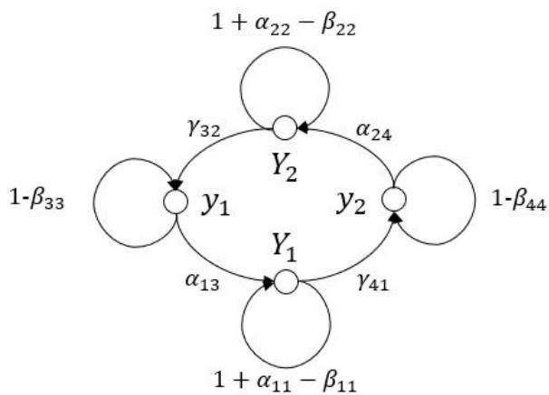
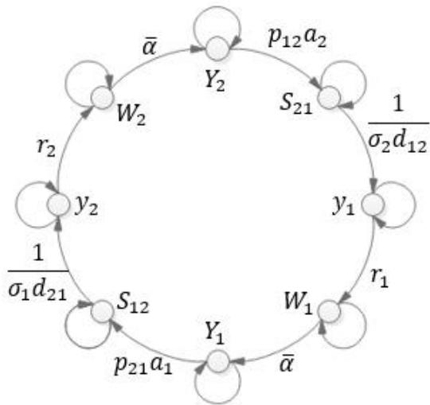

# 2018年美赛O奖论文：基于非齐次转移矩阵与模拟退火算法的语言人口预测与选址优化模型（Problem B，Team 73410）

原件经识别和整理；“参考解答”是我们补的。

本文档整理了第 1–3 页的内容，包括摘要、目录及引言、初步模型的符号定义部分。

## 一、摘要

随着全球化的加速，语言复杂的地理分布开始阻碍国际商业运作和跨文化交流。理解分布动态从未如此重要，但预测分布却非常困难，特别是由于说话者构成的复杂性，以及移民、政府政策、经济发展和学习意愿等各种外生因素的影响。因此，我们建立了一个新模型来取代纯粹基于人口的预测模型，因为后者不仅不准确，而且在支持数据稀缺的情况下也是无效的。

我们的模型关注语言的母语者和非母语者。我们引入转移矩阵来描述不同语言的母语者和非母语者之间的转换，因为一种语言的人口增长不仅仅来自自然出生，还来自移民和学习。此外，我们引入了两个新的群体：学习者和移民，以进一步分析转换。最后，我们引入了一组参数来表示外部影响，一个新变量来表达时间变化，并建立了我们的非齐次转移矩阵。

测试表明，我们的矩阵只需要相对少量的数据输入就能很好地运行。我们利用该模型成功预测了 2067 年语言的地理分布，基于 2017 年的数据。最后，我们采用模拟退火算法帮助我们的客户——一家大型跨国服务公司——选择新办公室的最佳位置选项。

关键词：语言人口，转移，办公室选址

## 二、目录

### 1 Introduction
2

### 2 Preliminary Model
2

#### 2.1 Notations and Symbol Description
2

##### 2.1.1 Symbol Description
2

##### 2.1.2 Notations
3

#### 2.2 General Assumptions
3

#### 2.3 Analysis of the Problem
3

##### 2.3.1 N=2 Model
4

#### 2.4 Calculating and Simplifying the Model
6

#### 2.5 The Model Results
8

### 3 Modified Model
9

#### 3.1 Notations and Symbol Description
9

##### 3.1.1 Additional Notations
9

##### 3.1.2 Additional Symbol Description
10

#### 3.2 Additional Assumptions
10

#### 3.3 Analysis of the Problem
10

#### 3.4 Calculating and Simplifying the Model
12

#### 3.5 The Model Results
13

##### 3.5.1 Graph of Population of Different Language Groups
13

##### 3.5.2 Graph of the Scale of Migration
14

##### 3.5.3 Distribution of Non-native English Speakers
14

#### 3.6 Sensitivity Analysis
15

##### 3.6.1 High Uniformity Scenario
15

##### 3.6.2 Low Uniformity Scenario
16

### 4 Application of Our Model
17

#### 4.1 Assumptions
17

#### 4.2 Symbol Description
18

#### 4.3 Calculating and Simplifying
18

##### 4.3.1 The Year of 2017
18

##### 4.3.2 The Year of 2067
19

### 5 Strengths and Weaknesses
20

### 6 Memo
21

### Appendices
24

## 三、正文内容

### 1 Introduction

目前地球上大约有 6,900 种语言在使用。世界上约一半的人口以十种语言之一作为他们的母语，世界人口中的很大一部分也使用第二语言。然而，由于各种影响，某种语言的说话者人口可能会随时间增加或减少。我们的目标是研究全球语言的趋势和新办公室的选址选项。

在第一部分中，我们将我们的问题与马尔可夫链的概念进行了比较，并添加了转移矩阵来描述从一种语言的母语者到另一种语言的第二语言使用者再到另一种语言的母语者的人口转移。考虑到转移是非齐次的，我们最终建立了非齐次转移矩阵，并使用该矩阵预测不同语言的人口及其地理分布。在第二部分中，基于我们在第一部分中的模型预测，我们使用模拟退火算法寻找新办公室的最佳选址选项。

### 2 Preliminary Model

#### 2.1 Notations and Symbol Description

##### 2.1.1 Symbol Description

| 符号 | 描述 |
| :--- | :--- |
| $N$ | 考虑的语言数量 |
| $Y_{i}^{(n)} (i=1;2;::;N;n=0;1;2::)$ | 第 $n$ 年语言 $i$ 的母语者人数 |
| $y_{i}^{(n)} (i=1;2;::;N;n=0;1;2::)$ | 第 $n$ 年语言 $i$ 的非母语者人数 |
| $Y_{(n)}$ | 第 $n$ 年模型的状态向量 |
| $A$ | 转移矩阵 |
| $\beta_i$ | 语言 $i$ 母语者的年出生率 |
| $\beta_{i(N+i)}$ | 语言 $i$ 非母语者生育出该语言母语者的年度比例 |
| $\delta_i$ | 语言 $i$ 母语者的年死亡率 |
| $\delta_{(N+i)(N+i)}$ | 语言 $i$ 非母语者的年死亡率 |
| $\alpha_{(N+i)j}$ | 语言 $j$ 母语者成功开始掌握语言 $i$ 的年度比例（学习率） |
| $\alpha_i$ | 语言 $i$ 的总学习率 |

## 2.1.2 符号说明

语言 A 的母语者是指第一语言为 A 的人。

语言 A 的非母语者是指第一语言不是 A、但将 A 作为外语掌握的人（意味着该个体具备较高的语言 A 技能，且读写流利）。

## 2.2 一般假设

1. 任一特定语言的使用者可分为两类：母语者与非母语者。

2. 母语者数量仅因自然出生而增加，且所有新生儿在其出生当年均为母语者（不考虑极少数能瞬间学会说外语的神童）；母语者数量仅因死亡而减少（不考虑极少数出生后第一语言能力丧失的情况）。

3. 某一语言的母语者不能转变为本语言的母语者，但可以成为其他语言的母语者。

4. 非母语者数量仅因出生后的学习而增加，仅因死亡而减少（不考虑极少数遗忘所学外语的情况）。

5. 某一语言的母语者不能转变为本语言的母语者，但可以成为其他语言的母语者。

6. 个体一旦掌握一门新语言，就成为该语言的母语者，同时保留此前所有身份。

7. 不会发生导致人口结构剧变的突发、不可预测事件。

## 2.3 问题分析

显然，同一语言的母语者与非母语者关系更为密切，这主要体现在：

1. 父母通常将其子女培养为具有相同的第一语言，或至少是其掌握的语言。因此，我们可以假设新母语者只能由同一语言的母语者或非母语者生育（不考虑难民、寻求庇护者等）。

2. 某一语言的母语者不太可能放弃其第一语言。因此，我们可以假设某一语言的母语者不能转变为本语言的母语者（不考虑极少数出生后第一语言能力丧失的情况）。

此外，每年都有一定数量未能掌握某一语言的人通过学习转变为本语言的母语者。同时也有自然死亡导致各类人群数量下降。

### 2.3.1 N=2 模型

以仅含两种语言（N = 2）的最简模型为例，我们可以绘制不同人群之间的转移关系（见图 1）。

可以得出结论：该模型与齐次马尔可夫链模型十分相似（转入新的人群后，个体仍保留在此前的人群中）。转移遵循以下规律：

$$
\begin{array}{r l} & {\mathbf {Y} ^ {(n + 1)} = \left( \begin{array}{c} Y _ {1} ^ {(n + 1)} \\ Y _ {2} ^ {(n + 1)} \\ y _ {1} ^ {(n + 1)} \\ y _ {2} ^ {(n + 1)} \end{array} \right)} \\ & {\quad = \left( \begin{array}{c c c c} 1 + \alpha_ {1 1} - \beta_ {1 1} & 0 & \alpha_ {1 3} & 0 \\ 0 & 1 + \alpha_ {2 2} - \beta_ {2 2} & 0 & \alpha_ {2 4} \\ 0 & \gamma_ {3 2} & 1 - \beta_ {3 3} & 0 \\ \gamma_ {4 1} & 0 & 0 & 1 - \beta_ {4 4} \end{array} \right) \left( \begin{array}{c} Y _ {1} ^ {(n)} \\ Y _ {2} ^ {(n)} \\ y _ {1} ^ {(n)} \\ y _ {2} ^ {(n)} \end{array} \right)} \\ & {\quad = \mathbf {A Y} ^ {(n)}} \end{array}\tag{1}
$$

式 (1) 中各参数设定如下：

1. $\alpha_{11}$、$\alpha_{22}$ 分别表示语言 1 和语言 2 母语者的年出生率。

2. $\beta_{11}$、$\beta_{22}$ 分别表示语言 1 和语言 2 母语者的年死亡率。

3. $\alpha_{13}$、$\alpha_{24}$ 分别表示语言 1 和语言 2 的非母语者生育对应语言母语者的比例（假设所有生育均为单胎）。

4. $\gamma_{32}$、$\gamma_{41}$ 分别表示语言 1 和语言 2 的母语者学习说另一语言的比例。

5. $\beta_{33}$、$\beta_{44}$ 分别表示语言 1 和语言 2 非母语者的年死亡率。

6. 需注意，我们将矩阵中第 (3, 4) 和第 (4, 3) 个元素设为零，以避免重复计数。

7. 此外，我们还将第 (1, 4) 和第 (2, 3) 个元素设为零以避免重复计数（例如，语言 1 母语者与语言 2 非母语者的后代将被重复计数）。

若转移达到稳态（意味着各人群占总人口的比例稳定，而非绝对数量稳定），则可推导出：

$$
\lim _ {k \rightarrow \infty} \mathbf {A} ^ {k} \mathbf {Y} ^ {(0)} = \lambda^ {k} \mathbf {Y}\tag{2}
$$

其中 $\lambda$ 为总人口增长率，$\mathbf{Y}^{(0)}$ 为任意初始向量，$\mathbf{Y}$ 为常向量。

当转移达到稳态时，有：

$$
\mathbf {A} \mathbf {Y} = \lambda \mathbf {Y}\tag{3}
$$

显然，$\lambda$ 是矩阵 $\mathbf{A}$ 的特征值，$\mathbf{Y}$ 是该矩阵的特征向量。通过对 $\mathbf{Y}$ 作归一化，可得出各类人群的比例。

为简化模型检验，考虑具有以下参数的特殊情形：

$$
\begin{array}{r l} \alpha_ {1 1} & = \alpha_ {2 2} = 0. 0 2 \\ \alpha_ {1 3} & = \alpha_ {2 4} = 0. 0 5 \\ \beta_ {1 1} & = \beta_ {2 2} = \beta_ {3 3} = \beta_ {4 4} = 0. 0 1 \\ \gamma_ {4 1} & = \gamma_ {3 2} = 0. 0 1 \end{array}\tag{4}
$$

转移矩阵为：

$$
\mathbf {A} = \left( \begin{array}{c c c c} 1. 0 1 & 0 & 0. 0 5 & 0 \\ 0 & 1. 0 1 & 0 & 0. 0 0 5 \\ 0 & 0. 0 1 & 0. 9 9 & 0 \\ 0. 0 1 & 0 & 0 & 0. 9 9 \end{array} \right)\tag{5}
$$

该矩阵具有四个不同的特征值，只有当 $\lambda = 1.01049$ 时，特征向量才为半正定向量（所有元素非负）：

$$
\mathbf {Y} = \left( \begin{array}{c} 0. 5 0 0 \\ 0. 5 0 0 \\ 1. 1 2 4 \\ 1. 1 2 4 \end{array} \right)\tag{6}
$$

这就是语言人口结构的稳态，它表明无论初始分布如何，这两种语言的母语者都将各占总人口的 1.124 倍（归一化前）。

# 2018年美赛O奖论文：基于非齐次转移矩阵与模拟退火算法的语言人口预测与选址优化模型（Problem B，Team 73410）

本部分为2018年MCM/ICM Problem B Team 73410的获奖论文整理，内容涵盖双语模型参数约束、非齐次转移矩阵的构建与简化、以及针对不同语言群体出生率、死亡率和学习率的参数设定推导。

## 一、双语模型参数约束分析

在双语模型（$N=2$）中，每种语言的非母语使用者数量均超过该语言的母语使用者数量，这对学习率参数的取值范围构成了间接约束。通过Matlab推导，我们量化了学习率对非母语使用者比例的影响。

如图2所示，当 $\alpha > 0.021$ 时，非母语使用者的比例将超过母语使用者。因此，从长远来看，该模型的学习率不能大于 $0.021$。

## 二、模型的计算与简化

鉴于前二十大语言涵盖了全球大部分人口，我们有理由相信，绝大多数的口头交流和信息交换都是通过这二十种语言进行的。由于数据有限 [1]，本节仅分析这二十六种语言中的二十二种主要语言（后续章节将回到二十六种语言的模型）。因此，我们仅考虑一个包含二十二种语言的模型（$N=22$），其转移矩阵如下：

$$
\mathbf {A} = \left( \begin{array}{c c c c c c} 1 + \alpha_ {1 1} - \beta_ {1 1} & \dots & 0 & \alpha_ {1 (N + 1)} & \dots & 0 \\ \vdots & \ddots & \vdots & \vdots & \ddots & \vdots \\ 0 & \dots & 1 + \alpha_ {N N} - \beta_ {N N} & 0 & \dots & \alpha_ {N (2 N)} \\ 0 & \dots & \gamma_ {(N + 1) N} & 1 - \beta_ {(N + 1) (N + 1)} & \dots & 0 \\ \vdots & \ddots & \vdots & \vdots & \ddots & \vdots \\ \gamma_ {(N + N) 1} & \dots & 0 & 0 & \dots & 1 - \beta_ {(2 N) (2 N)} \end{array} \right)\tag{7}
$$

为了使预测更加准确，我们需要设置模型中的参数值以更好地拟合现实场景：

### 1. 不同语言群体的出生率与死亡率

考虑到不同语言的母语者具有不同的出生率和死亡率，我们引入一组新数据来反映这种差异 [1]。

为了推导不同语言群体的出生率和死亡率，首先按官方语言对国家进行分类，并选择几个主要国家代表每个群体（这些国家的母语者总数占该语言全球母语者总数的90%以上）。附录A中列出了相关表格。

我们参考公开来源的数据，获取上述国家的人口、年出生率和年死亡率（2013年数据）。随后，我们计算了各语言群体的加权平均年出生率和年死亡率，并列于附录A的表格中 [4][5]。

### 2. 非母语者的出生率与死亡率假设

由于一种语言的非母语者可能来自任何国家（除将该语言视为第一语言的国家外），我们可以假设不同语言的非母语者共享相同的出生率和死亡率（等于世界平均死亡率）：

$$
\begin{array}{r l} \beta_ {(N + 1) (N + 1)} = \beta_ {(N + 2) (N + 2)} = \dots = \beta_ {(N + N) (N + N)} & = \overline {{\beta}} \\ \alpha_ {1 (N + 1)} = \alpha_ {2 (N + 2)} = \dots = \alpha_ {N (N + N)} & = \alpha \end{array}\tag{8}
$$

根据公开数据来源：
- 世界平均死亡率：$\overline{\beta} = 0.0083$
- 世界平均出生率：$\overline{\alpha} = 0.0193$
- 某种语言非母语者中移民的比例：$r = 0.172$

因此，我们可以假设：
$$
\alpha = r \overline {{{{\alpha}}}} = 0.0033\tag{9}
$$

### 3. 不同语言的学习率假设

考虑到不同语言具有不同的吸引力，每种语言的学习率也应有所不同。为了简化模型，我们合理地假设一种语言对不同人群具有同等的吸引力，从而导致不同群体间的学习率相同（尽管实际情况可能并非如此）。

$$
\gamma_ {i (N + 1)}: \gamma_ {i (N + 2)}: \dots : \gamma_ {i (N + j)}: \dots : \gamma_ {i (N + N)}; j = 1, 2, \dots , N, j \neq i\tag{10}
$$

上述学习率为恒定速率。我们可以暂时假设一种语言的学习率等于其非母语者占总非母语者的比例乘以总学习率。

注意最后一个方程是归一化的。

因此，第 $i$ 组到第 $j$ 组（非母语者）的年度学习率 $(N+j)i$ 是所示的归一化比率 $\hat {y _ {j}} ^ {(0)}$ 乘以该组的年度总学习率 $\Gamma_ {i}$，即：

$$
\gamma_ {(N + j) i} = \hat {y _ {j}} ^ {(0)} \Gamma_ {i}\tag{12}
$$

修改后的转移矩阵过于庞大（$44 \times 44$），为了节省空间，此处不再展示。

# 2018年美赛O奖论文：基于非齐次转移矩阵与模拟退火算法的语言人口预测与选址优化模型（Problem B，Team 73410）

## 二、模型结果分析

### 计算 1

使用 2013 年的数据建立初始向量 $\mathbf{Y}^{(0)}$，经过四次迭代后获得 2017 年的预测统计数据。$\mathbf{Y}^{(4)} = \mathbf{A}^4 \mathbf{Y}^{(0)}$（仅展示前 10 项数据）（表 1）：

表 1: 2017 年主要语言人口统计预测
| Language | Native (predict) | Native (real) | Non-native (predict) | Non-native (real) |
| :--- | :--- | :--- | :--- | :--- |
| Mandarin | 870 | 897 | 180 | 193 |
| English | 353 | 371 | 521 | 611 |
| Spanish | 422 | 436 | 92 | 91 |
| Hindi/Urdu | 340 | 329 | 219 | 215 |
| Russian | 170 | 153 | 27 | 113 |
| Portuguese | 206 | 218 | 31 | 11 |
| Bengali | 201 | 242 | 20 | 19 |
| French | 78 | 76 | 89 | 153 |
| Japanese | 129 | 128 | ? | ? |
| German | 78 | 76 | 8 | 52 |

存在多项预测数据与实际统计数据之间的偏差，例如非母语德语使用者的人数。引用 2013 年的数据，当时仅有八百万非母语德语使用者，而到 2017 年该数字达到五千二百万。这显然违背常理，因此我们认为这些偏差主要由数据的不准确性引起（事实上，数据源本身也指出了数据的不准确性）。

2013 年的数据见附录 A[1]。

此外，我们可以计算转移矩阵 $\mathbf{A}$ 的正半定特征向量 $\mathbf{Y}$（根据前 22 组数据的统计进行归一化）和特征值：

$$
\begin{array}{l} \mathbf{Y} = (0.0050, \dots, 0.9601, \dots, 0.0003)^T \\ \lambda = 1.0215 \end{array}\tag{13}
$$

这两项具有相应的实际意义：

1. **特征向量**：长期来看，各组人口占总人口的平衡比例。
2. **特征值**：长期来看的平衡总增长率（所有语言组累计增长率的总和）。

我们发现，当达到平衡时，旁遮普语（Panjabi）母语者将占总人口的 96% 以上，这显然违背常理。出现这种现象的原因是旁遮普语母语者的出生率在所有母语群体中最高（0.0286），而在同质模型中，增长率最高的群体将占据主导地位。

因此，为了进行更准确的长期预测，我们必须将时间作为新变量引入模型，即构建一个非齐次模型。

## 三、修正模型

上述初步模型在短期内的不同语言组人口预测相当准确。然而，在长期预测方面，该模型的准确性不足。该模型的缺陷包括：

1. 未考虑语言学习过程，这意味着个人掌握一门新语言需要时间，且学习时间受教育水平、语言相似性（例如英语比汉语更接近法语）和学习意愿的影响。
2. 未考虑随时间变化的出生率和死亡率。
3. 未考虑随时间变化的经济发展。
4. 未能揭示人口迁移的确切影响。
5. 未能推导出客户要求的英语人口群体分布。

因此，在初步模型的基础上，我们引入时间作为新变量以更好地拟合实际情况。此外，我们引入了新的变量维度（语言学习者、移民、英语使用者的细分）以观察学习和迁移的过程。

注：为方便起见，我们将英语编号为 1，中文编号为 2。

### 3.1 符号描述

#### 3.1.1 附加符号说明

从语言 A 学习语言 B 的学习者（Learners of language B from language A）是指开始学习语言 B 的语言 A 母语者（而非语言 B 的非母语者）。

语言群体（区域）A（Language group (region) A）是指语言 A 母语者居住的 region（意味着语言区域 A 的总人口即为语言 A 母语者的人口，且我们使用该地区主要国家的经济数据来代表其对应的语言群体/区域）。

迁入语言 B 区域的移民（Migrants to language B region）是指语言 B 的非母语者，其后代是语言 B 的母语者，或者说是一代移民。

减少矩阵（Decrease matrix）是评估语言群体自然死亡和迁移的矩阵。

# 2018年美赛O奖论文：基于非齐次转移矩阵与模拟退火算法的语言人口预测与选址优化模型（Problem B，Team 73410）

## 一、符号说明

### 符号定义表

| Symbol | Description |
| :--- | :--- |
| $y_{j1}^{(n)} (j = 2, ..., N; n = 0, 1, 2...)$ | the number of non-native English speakers who are converted in the year of $n$, from language $j$ |
| $S_{ji}$ | the number of learners of language $j$ from language $i$ |
| $W_j$ | the number of migrants to language $j$ region |
| $p_{ji}(0 < p_{ij} < 1)$ | the eagerness to learn language $j$ of people from language $i$ group (region) |
| $d_{ji}$ | the similarity between language $i$ and language $j$ |
| $\sigma_i$ | the average length of learning a foreign language of the same family in language $i$ group (region) |
| $a_i$ | the annual proportion of new learners to the total population of language region $i$ |
| $r_j$ | the proportion of migrants to non-native speakers of language $j$ |
| $\Xi$ | the natural growth matrix of native speakers |
| $\Pi_1$ | the decrease matrix of non-native English speakers |
| $\Pi$ | the decrease matrix of non-native speakers |
| $\Omega$ | the death matrix of migrants |
| S | the reproductive matrix of migrants |
| $G_1$ | the learning matrix of English |
| G | the learning matrix of all languages combined |
| $R_1$ | the migration matrix of English region |
| R | the migration matrix |

## 二、附加假设

### 假设 1

The birth rate and death rate of each group is not affected by the population of each group, and only changes over time.

### 假设 2

An individual will not be born as a learner (Implying that the number of learners only increase due to learning, not reproduction), and will not die during learn-ing (However, the natural death rate will not be affected, since learners are mostly young and unlikely to die).

### 假设 3

Offspring of migrants will be considered as native speakers of the language region they migrate into.

### 假设 4

Once an individual successfully migrates into a foreign language region, he will not be considered a non-native speaker of this language (Implying that the nonnative speaker group in the aforementioned preliminary model can actually be broken down into two groups in this model: non-speaker group and migrant group of this language).

## 三、问题分析

Example graph of transition between different groups in a bilingual model with regard to learners and immigrants is shown below (Figure 3):

The transition matrix in the year of n is:

$$
\mathbf {A} ^ {(n)} = \left( \begin{array}{c c c} \boldsymbol {\Xi} ^ {(n)} & \mathbf {0} & \mathbf {S} ^ {(n)} \\ \mathbf {G} ^ {(n)} & \boldsymbol {\Pi} ^ {(n)} & \mathbf {0} \\ \mathbf {0} & \mathbf {R} ^ {(n)} & \boldsymbol {\Omega} ^ {(n)} \end{array} \right)
$$

The population of a language in the year of (n + 1) can be expressed as:

$$
\mathbf {Y} ^ {(n + 1)} = \mathbf {A} ^ {(n)} \mathbf {Y} ^ {(n)}\tag{14}
$$

When Y changes, it will, in turn, influence the transition matrix:

$$
\mathbf {A} ^ {(n + 1)} = F [ \mathbf {Y} ^ {(n)}, n ]\tag{15}
$$

### 矩阵性质说明

#### 说明 1

$\Xi$ is the natural growth matrix of native speakers, and possesses the property of diagonality, with a diagonal entry equal to 1 plus natural growth rate ($1 + \text{natural growth rate}$).

#### 说明 2

$\Pi$ is the decrease matrix of non-native speakers, and possesses the property of diagonality, with a diagonal entry equal to 1 minus death rate and migration rate ($1 - \text{death rate} - \text{migration rate}$).

#### 说明 3

$\Omega$ is the death matrix of migrants, and possesses the property of diagonality.

#### 说明 4

G is the transition matrix from native speakers to non-native speakers of another language (learning matrix), and has a diagonal entry equal to 0.

#### 说明 5

R is the transition matrix from non-native speakers to migrants of the same language (learning matrix), and possesses the property of diagonality.

#### 说明 6

S is the reproduction matrix of migrants, and possesses the property of diagonality.

### 3.4 Calculating and Simplifying the Model

We take the year of 2017 as the starting year. Since the top twenty-six languages cover most of the world population, we have reason to believe that the majority of verbal communications and information exchanges are conducted through these twenty-six languages. Therefore, we only consider a model with twenty-six languages ($N = 26$).

Prior to determining the transition matrix, we should first set the initial vector, which stands for the initial distribution of non-native English speakers. We assume the initial distribution of non-native English speakers to be proportional to the distribution of native speakers in total, which is:

$$
y _ {2 1} ^ {(0)}: \dots : y _ {N 1} ^ {(0)} = Y _ {2} ^ {(0)}: \dots : Y _ {N} ^ {(0)}\tag{16}
$$

To save time, we adopt the annual birth rate, death rate and migration rate projected for the next fifty years by United Nations. We employ the weighted average method to compute the birth rate, death rate and migration rate in the upcoming fifty years, and plot the trend in passing. See Appendix B.

Building upon these data, we can set $\mathbf{\Xi}, \mathbf{G}, \mathbf{\Pi}, \mathbf{S}, \mathbf{R}_1, \mathbf{R}$. Then we should attempt to set $\mathbf{G}$; $\mathbf{G}_1$:

The learning rate $\gamma_{j i}^{(n)}$ from language group $i$ to language $j$ satisfies that:

$$
\gamma_ {j i} ^ {(n)} = \frac {p _ {j i} ^ {(n)} a _ {i} ^ {(n)}}{\sigma_ {i} ^ {(n)} d _ {j i} ^ {(n)}}\tag{17}
$$

We assume the eagerness $p _ {j i} ^ {(n)}$ to learn is proportional to the number of non-native speakers of language $j$ (Assuming that people’s eagerness to learn a language in the past reflects people’s eagerness to learn this language in the future):

$$
p _ {1 i} ^ {(n)}: \dots : p _ {N i} ^ {(n)} = y _ {1} ^ {(n)}: \dots : y _ {N} ^ {(n)} = \hat {y _ {1}} ^ {(n)}: \dots : \hat {y _ {N}} ^ {(n)}
$$

We assume all language groups share the same level of education:

$$
\begin{array}{c} a _ {1} = \dots = a _ {N} = 0. 0 1 \\ \sigma_ {1} = \dots = \sigma_ {N} = 3 \end{array}
$$

We assume that any two languages from the same language family have the first-level similarity (Implying a similarity parameter equal to 1), whereas any two languages from different language families have the second-level similarity (Implying a similarity parameter equal to 2), which can be expressed as:

$$
d _ {j i} = \left\{ \begin{array}{l l} 1, & \text { If language } i \text { and } j \text { belong to the same language family } \\ 2, & \text { If language } i \text { and } j \text { belong to different language families } \end{array} \right.
$$

This implies that one in a hundred people start to learn a foreign language annually in each country. On average, it takes them three years to master a foreign language from the same language family as their first language, and six years if from different language families.

### 3.5 The Model Results

#### 3.5.1 Graph of Population of Different Language Groups

We will skip the computation process to save space. Through repeated alterations, we can plot the graph of population of different language groups in the next fifty years (Figure 4).

Based on the projections, we can align the top ten languages in terms of population in 2017 and 2067: (Table 2):

According to this ranking, Portuguese and French both drop out of the top ten, whereas Hausa and Punjabi make it to the top ten. We observe the following patterns for languages whose ranking elevates:

1. High birth rate, e.g. Hausa and Punjabi
2. For language groups whose migration is mostly immigration, belonging to a bigger family (more languages from the same family) would be better, whereas it is the opposite for language groups whose migration is mostly emigration, e.g. Arabic
3. High attractiveness (Implying people’s stronger eagerness to learn this language), e.g. English

### 3.5.2 Graph of the Scale of Migration

Additionally, we can easily derive the graph of the scale of migration starting from the year of 2017 (Figure 5).

We only label in the graph the top four attractive language regions for immigrants, and it’s apparent that they are all developed countries except for Russia (Mostly due to the historical factor that the population is not clearly divided amongst neighboring countries after the disintegration of USSR). Furthermore, the quantity of immigrants to English region (Over one hundred million) far exceeds that of other language regions’, mostly driven by the extensive acceptance of this language.

### 3.5.3 Distribution of Non-native English Speakers

We can also easily derive the distribution of non-native English speakers (Figure 6):

The scale of non-native English speakers is unparalleled. According to our projections, there are more than ninety million non-native English speakers amongst all native Chinese speakers.

What intrigues us is that despite most English nations (e.g. U.S.A., UK) being isolated in terms of geography, English regions have the largest scale of immigrants and nonnative speakers. This implies that geographic factors will not pose significant impact on migration in the next fifty years.

### 3.6 Sensitivity Analysis

In this subsection, we will be mainly analyzing the sensitivity of our model to the uniformity of eagerness to learn of different language groups (Implying that and that if a language group has a barely uniform eagerness to learn, people in this language group tends to learn different foreign languages).

#### 3.6.1 High Uniformity Scenario

If a language group has high uniformity in terms of eagerness to learn, people’s probability of choosing to learn each language is more uniformly distributed. The major corresponding real cases are:

1. Governments impose no restrictions over second language, and people in this language group can choose which foreign language to learn at their discretion.
2. People are not highly purposeful when it comes to learning a foreign language, which means that they are not learning foreign languages merely for the purpose of attaining more opportunities.

To reflect the characteristics of a high uniformity scenario, we modify expression (17) to:

$$
\gamma_{ji}^{(n)} = \frac{(y_i^{(n)})^k a_i^{(n)}}{\sigma_i^{(n)} d_{ji}^{(n)}}
$$

The higher $k$ is, the lower the uniformity is. The initial model adopts $k = 1$, and when $k = 0; 1$, the graph of population of different language groups are as follows: (Figure 7).

We can find that the population of English doesn’t exceed that of Mandarin’s. The attractiveness of English is impaired.

#### 3.6.2 Low Uniformity Scenario

If a language group has low uniformity in terms of eagerness to learn, people’s probability of choosing to learn each language is less uniformly distributed (concentrated at widely accepted foreign languages). The major corresponding real cases are:

1. Governments introduce restrictions over second language, e.g. all people should learn a specified foreign language.
2. People are highly purposeful when it comes to learning foreign languages, eager to attain more opportunities through language learning.

When $k = 10$, the graph of population of different language groups is as follows (Figure 8).

We can find that the population of English is rocketing, surpassing that of Mandarin’s tens of years earlier. The attractiveness of English is further reinforced.

### 4 Application of Our Model

#### 4.1 Assumptions

With regard to our client company being a large multinational service company, we derive their extrinsic and intrinsic needs for additional international offices:

1. These six new offices should cover the population of major languages (twenty-three major languages listed by our client) in a mutually exclusive and collectively exhaustive way (Implying that each language can only be covered by one of the six offices except for English).
2. The basic working languages of an office are English and local language.
3. These offices should cover languages with the largest population and the most robust economy (Evaluated based on the GDP of different language regions). The transportation costs between each office and the language regions they cover should also be the smallest.
4. One office shouldn’t cover too many different languages, or else there will be an impairment on profit due to lower operation efficiency and higher costs.
5. There must be English speaking residents near each office (Each language region is projected to have English speaking residents by our previous models).

Drawing upon the analysis above, we establish our rating model for office locations:

$$
\begin{cases} 
S_i = \epsilon^{k_i} \sum_{j=0}^{k_i} \frac{P_{ij}^{\eta_1} E_{ij}^{\eta_2}}{D_{ij}^{\eta_3}} - h_i \\ 
h_i = \frac{10^{\eta_1} E_{i0}^{\eta_2}}{D_{i0}^{\eta_3}} 
\end{cases} \tag{18}
$$

# 2018年美赛O奖论文：基于非齐次转移矩阵与模拟退火算法的语言人口预测与选址优化模型（Problem B，Team 73410）第8部分

本资料整理自《2018年美赛O奖论文：基于非齐次转移矩阵与模拟退火算法的语言人口预测与选址优化模型（Problem B，Team 73410）》教材第8部分（第19–20页），由识别工具读出后整理。

## 4.2 Symbol Description

### 符号说明表

| Symbol | Description |
| :--- | :--- |
| $S_i$ | The score of office location i |
| $k_i$ | The number of additional languages used by office i (Other than English and the local language) |
| $\epsilon$ | The marginal impairment rate on profit when an office covers one more language |
| $P_{ij}$ | The total population of language j group (All covered by office i, and evaluated based on accumulated population of major nations in the group) (Unit: million) |
| $E_{ij}$ | The accumulated GDP of language j group (All covered by office i, and evaluated based on accumulated GDP of major nations in the group) (Unit: ten billion USD) |
| $D_{ij}$ | The transportation costs from office i to language j region (Office i covering language j, and evaluated based on current weighted average transportation costs by air, water and land route (if possible), from the site to major nations in the region) |
| $\eta_1, \eta_2, \eta_3$ | Weight coefficient |
| $h_i$ | The establishment cost of office i (e.g. rent) |

Note: j = 0 represents the local language of the office

## 4.3 Calculating and Simplifying

To start with, we propose a list of candidate cities for further examination and selec-tion. These cities cover major nations of all twenty-three languages, except for English, Mandarin and Wu (Because our client has already set up offices in cities covering those language regions):

Bombay, Dubai, Madrid, Jakarta, Moscow, Rio de Janeiro, Dhaka, Paris, Abuja, Islam-abad, Tokyo, Berlin, Tehran, Dodoma, Seoul, Hong Kong, Istanbul, Ho Chi Minh City, Rome.

### 4.3.1 The Year of 2017

We conduct simulation on the data of 2017, with weight coefficients set as (Set to fit the real case and their orders of magnitude):

$$
\epsilon = 0.98, \eta_ {1} = \eta_ {2} = \eta_ {3} = 1,
$$

Given the enumeration method taking too much time, we decide to adopt the simulated annealing algorithm to derive the model. We set the initial temperature: $T _ { 0 } = 9 7 ,$ terminal temperature: $T _ { t } = 3 ,$ attenuation coefficient: α = 0.99, Markoff chain length: $l = 1 0 0 0 0 ,$ , and language-city transition ratio: $\rho = 8 : 2$ . We assume the model satisfies Metro Polis-Hastings algorithm.

After repeating for ten times, we have the stable solution with the highest accumulated scores:

#### 六办公室选址方案

| Office location | Covering languages (Exclusive of English) |
| :--- | :--- |
| Tokyo | Japanese, Korean, Javanese, Malay |
| Bombay | Hindustani, Telugu, Tamil, marathi |
| Madrid | Spanish, Italian |
| Rio de Janeiro | Portuguese |
| Moscow | Arabic ,Russian ,Bengali, Hausa, Punjabi, Persian, Swahili, Yue, Vietnamese, Turkish |
| Paris | French, Germany |
| **Accumulated scores** | **43.0** |

#### 五办公室选址方案

If we set up only five offices, then the optimal stable solution is as follows:

| Office location | Covering languages (Exclusive of English) |
| :--- | :--- |
| Tokyo | Japanese, Korean, Javanese, Malay |
| Bombay | Hindustani, Telugu, Tamil, marathi |
| Madrid | Spanish, Germany |
| Moscow | Arabic ,Russian ,Bengali, Hausa, Punjabi, Persian, Swahili, Yue, Vietnamese, Turkish |
| Paris | French, Portuguese, Italian |
| **Accumulate scores** | **39.7** |

We can see that despite the costs of opening more offices, opening six offices is still superior to opening five offices.

We also simulate other scenarios with different weight coefficients if our client attaches great importance to regional economy or population. See: Appendix A

### 4.3.2 The Year of 2067

Given an intrinsic change in communications and transportation in 2067 (Compared to 2017), the geographic factor is less significant. We set the coefficients as:

$$
\epsilon = 0.98, \eta_ {1} = \eta_ {2} = 1, \eta_ {3} = 0.1,
$$

We make projections about the economy (GDP) of each language region (Evaluated based on major nations in each region), by establishing a cycle projection model. We integrate the Kitchin cycle, Juglar cycle, Kuznets swing and Kondratiev wave, and sim-ulate the integrated cycle with a trigonometric function. We then use the GDP data of each region in the past forty-six years to solve for the coefficients, and then employ the function to forecast GDP of each language region in 2067. See Appendix A[6] for our projected growth rate in each cycle and terminal GDP (Starting at 2015, with each cycle representing approximately thirteen years).

Combined with the projected distribution of population of different languages in 2067 by our previous models, we can derive the optimal stable solution:

# 2018年美赛O奖论文：基于非齐次转移矩阵与模拟退火算法的语言人口预测与选址优化模型（Problem B，Team 73410）

本资料整理了2018年美国大学生数学建模竞赛（MCM/ICM）获奖论文 Team 73410 的第 9 部分内容，主要涉及模型优缺点分析及给客户的备忘录。

## 五、模型的优点与缺点

### 5.1 优点

1. 我们在模型中保留了足够的接口，以便进行进一步的分析并考虑更多的变量。

2. 我们剔除了不相关（或弱相关）的变量，使模型简洁明了。

3. 通过引入转移矩阵和转移图，我们使模型更具可读性和适用性。

4. 通过将学习者、移民者和英语使用者与其他群体区分开来，我们使模型更贴合实际情况。

### 5.2 缺点

1. 我们对经济发展影响的考虑不够充分。

2. 我们将自然增长、迁移和语言学习视为影响语言结构的主要因素。然而，语言结构的变化反过来也会影响这三个因素。在我们的模型中，我们仅考虑了其对语言学习的影响。

3. 移民的第一语言也会影响他们迁入地区的语言结构。该模型未对此予以考虑。

4. 我们的模型未充分考虑到不同语言地区在教育水平上的差异。

## 六、备忘录

Dear Sir or Madame,

In accordance to your requests, we establish two customized models to develop accurate projections and help your company deliver successful global solutions at the lowest possible costs.

First, we investigate trends of global languages through our inhomogeneous transition model, and cast a projection for population of different languages in the next 50 years (With regard to the uneven distribution of population amongst languages, we only examine languages with a population larger than 50 million in 2017).

The projected distribution is rather different from that in 2017, and the key findings are:

1. The population of English rises to surpass Mandarin, and dominates as the international language with most speakers, mostly due to its extensive acceptance by people across the world. The population of non-native English speakers will reach approximately 490 million, with most of being native Chinese speakers (91 million).

2. The population of Arabic / Punjabi / Hausa increases greatly (The number of Arabic speakers only falls behind that of English’s and Mandarin’s), mostly due to the high birth rate.

3. The population of Mandarin / Japanese / Russian / Korean / Yue / Wu decreases sharply, mostly due to the declining birth rate and aging population.

4. The geographic distribution of migrants is extremely uneven in 2067, with the English region hosting most immigrants (More than 100 million), mostly due to the imbalanced migration amongst developed and under-developed regions.

Building upon our language population model, we establish the site rating model. If your company value cost savings and revenues expansion equally, we hereby propose the optimal location options for new offices:

| Office location | Covering languages (Exclusive of English) |
| :--- | :--- |
| Tokyo | Japanese, Korean, Javanese, Malay |
| Bombay | Hindustani, Telugu, Tamil, marathi |
| Madrid | Spanish, Italian |
| Rio de Janeiro | Portuguese |
| Moscow | Arabic, Russian, Bengali, Hausa, Punjabi, Persian, Swahili, Yue, Vietnamese, Turkish |
| Paris | French, Germany |

If your company offers necessities (Implying that prices of your offerings vary little to consumption power / GDP), then total population of covered languages has a greater impact on the revenues of each office. We hereby propose:

# 2018年美赛O奖论文：基于非齐次转移矩阵与模拟退火算法的语言人口预测与选址优化模型（Problem B，Team 73410）

本部分整理自《2018年美赛O奖论文》第 23–25 页内容，主要包含关于办公地点语言覆盖策略的说明、长期预测建议以及附录中的统计数据表。

## 一、办公地点语言覆盖策略与调整建议

### 策略说明

我们根据公司的全球化战略，假设这6个新办公室能够以互斥且完备的方式覆盖除主要语言外的其余23种语言，从而节约资源。

注意以下三点：

1. 我们从不同语言区域的主要城市或枢纽城市候选名单中选择这些地点。例如，我们选择柏林代表德语区，选择里约热内卢代表葡萄牙语区（因为巴西的GDP高于葡萄牙）。
2. 对于贵公司已在纽约（美国）和上海（中国）设立的办公室，我们在模型中排除了英语、普通话和吴语（上海办公室可覆盖普通话和吴语，且所有办公室均强制使用英语）。
3. 如果贵公司提供的产品属于非必需品（意味着产品价格随消费能力/GDP差异巨大），那么被覆盖语言区域的累计GDP对每个办公室的收入影响更大。为此我们提出如下调整方案：

<table>
<tr><td>Office location</td><td>Covering languages (Exclusive of English)</td></tr>
<tr><td>Tokyo</td><td>Japanese, Korean, Malay, Javanese</td></tr>
<tr><td>Bombay</td><td>Hindustani, Telugu, Tamil, marathi</td></tr>
<tr><td>Madrid</td><td>Spanish, Portuguese</td></tr>
<tr><td>Beilin</td><td>German, Hausa</td></tr>
<tr><td>Moscow</td><td>Arabic, Russian, Punjabi, Persian, Swahili, Yue, Vietnamese, Turkish, Bengali</td></tr>
<tr><td>Paris</td><td>French, Italian</td></tr>
</table>

### 长期预测与建议

结合两个模型，我们预计即使经过50年，我们的提议仍然有效。然而，由于中东和东南亚的经济发展，以及阿拉伯语和东南亚多种语言的人口增长，我们建议贵公司将莫斯科和巴黎的办公室迁至迪拜和雅加达。同时，各办公室覆盖的语言也应进行调整。

<table>
<tr><td>Office location</td><td>Covering languages (Exclusive of English)</td></tr>
<tr><td>Tokyo</td><td>Japanese, Korean, Hausa</td></tr>
<tr><td>Bombay</td><td>Hindustani, Telugu, Tamil, marathi</td></tr>
<tr><td>Madrid</td><td>Spanish, Portuguese</td></tr>
<tr><td>Jakarta</td><td>Javanese, Malay, Bengali</td></tr>
<tr><td>Moscow</td><td>Arabic, Russian, Punjabi, Persian, Swahili, Yue, Vietnamese, Turkish</td></tr>
<tr><td>Paris</td><td>French, Italian, German</td></tr>
</table>

我们不推荐在短期内将新办公室数量削减至6个以下，但我们的模型预测，随着通信和交通的发展，开设5个新办公室的收益正在赶上开设6个新办公室的收益。到2067年，差异约为5%，因此我们建议贵公司可以考虑关闭一个办公室，如果节省的成本能弥补损失的5%收入。

## 二、参考文献

[1] https://en.wikipedia.org/wiki/List_of_languages_by_total_number_of_speakers

[2] UN Data. Net migration rate. http://data.un.org/Data.aspx?q=migration&d=PopDiv&f=variableID%3a85

[3] UN Data. GDP by Type of Expenditure at current prices - US dollars. http://data.un.org/Data.aspx?q=GDP&d=SNAAMA&f=grID%3a101%3bcurrID%3aUSD%3bpcFlag%3a0

[4] UN Data. Crude death rate. http://data.un.org/Data.aspx?q=death+rate&d=PopDiv&f=variableID%3a65

[5] UN Data. Crude birth rate. http://data.un.org/Data.aspx?q=birth+rate&d=PopDiv&f=variableID%3a53

[6] 2018 | 22nd ANNUAL EDITION LONG-TERM CAPITAL MARKET ASSUMPTIONS, by J.P. Morgan Asset Management

## 三、附录 A 表格

### Table 3: Major Countries of Different Language Groups

<table>
<tr><td>Language</td><td>Countries</td></tr>
<tr><td>Mandarin</td><td>China, Singapore</td></tr>
<tr><td>English</td><td>United Kingdom, United States of America, Canada, Australia, New Zealand, South Africa</td></tr>
<tr><td>Spanish</td><td>Spain, Mexico, Colombia, Argentina</td></tr>
<tr><td>Hindi/Urdu</td><td>India, Pakistan</td></tr>
<tr><td>Russian</td><td>Russia, Belarus, Kyrgyz Republic, Kazakhstan</td></tr>
<tr><td>Portuguese</td><td>Portugal, Brazil</td></tr>
<tr><td>Bengali</td><td>Bangladesh</td></tr>
<tr><td>French</td><td>France, Canada, Belgium, Switzerland</td></tr>
<tr><td>Japanese</td><td>Japan</td></tr>
<tr><td>German</td><td>Germany, Austria, Switzerland</td></tr>
</table>

### Table 4: Birth Rate and Death Rate of Major Language Groups

<table>
<tr><td>Language</td><td>Weighted average birth rate</td><td>Weighted average death rate</td></tr>
<tr><td>Mandarin</td><td>0.0121</td><td>0.0071</td></tr>
<tr><td>English</td><td>0.0136</td><td>0.0086</td></tr>
<tr><td>Spanish</td><td>0.0206</td><td>0.0078</td></tr>
<tr><td>Hindi/Urdu</td><td>0.0161</td><td>0.0058</td></tr>
<tr><td>Russian</td><td>0.0140</td><td>0.0141</td></tr>
<tr><td>Portuguese</td><td>0.0141</td><td>0.0067</td></tr>
<tr><td>Bengali</td><td>0.0193</td><td>0.0057</td></tr>
<tr><td>French</td><td>0.0113</td><td>0.0082</td></tr>
<tr><td>Japanese</td><td>0.0082</td><td>0.0094</td></tr>
<tr><td>German</td><td>0.0097</td><td>0.0093</td></tr>
</table>

### Table 5: Population Statistics of Major Languages in 2013

<table>
<tr><td>Language</td><td>Native</td><td>Non-native</td></tr>
<tr><td>Mandarin</td><td>850</td><td>178</td></tr>
<tr><td>English</td><td>353</td><td>510</td></tr>
<tr><td>Spanish</td><td>400</td><td>90</td></tr>
<tr><td>Hindi/Urdu</td><td>324</td><td>214</td></tr>
<tr><td>Russian</td><td>170</td><td>26</td></tr>
<tr><td>Portuguese</td><td>200</td><td>30</td></tr>
<tr><td>Bengali</td><td>190</td><td>20</td></tr>
<tr><td>French</td><td>76</td><td>87</td></tr>
<tr><td>Japanese</td><td>130</td><td>?</td></tr>
<tr><td>German</td><td>78</td><td>8</td></tr>
</table>

## Table 6: Office Location Selections When $1 = 2 ; 2 = \ 3 = 1$ (More regard to population)

| Office location | Covering languages (Exclusive of English) |
| :--- | :--- |
| Tokyo | Japanese, Korean, Hausa |
| Bombay | Hindustani, Telugu, Tamil, Marathi |
| Madrid | Spanish, Portuguese |
| Jakarta | Javanese, Malay, Bengali |
| Moscow | Arabic, Russian, Punjabi, Persian, Swahili, Yue, Vietnamese, Turkish |
| Paris | French, Italian, German |

## Table 7: Office Location Selections When $1 = 2 ; 2 = \ 3 = 1$ (More regard to population)

| Office location | Covering languages (Exclusive of English) |
| :--- | :--- |
| Tokyo | Japanese, Korean, Malay, Javanese |
| Bombay | Hindustani, Telugu, Tamil, Marathi |
| Madrid | Spanish, Portuguese |
| Berlin | German, Hausa |
| Moscow | Arabic, Russian, Punjabi, Persian, Swahili, Yue, Vietnamese, Turkish, Bengali |
| Paris | French, Italian |

## Table 8: Economic Outlook for the Next Fifty Years

| Country | Cycle 1 | Cycle 2 | Cycle 3 | Cycle 4 | 2017 GDP | 2067 GDP |
| :--- | :--- | :--- | :--- | :--- | :--- | :--- |
| India | 1.77093244 | 1.79285437 | 1.20503007 | 1.18984108 | 2.11624E+12 | 9.63382E+12 |
| UAE | 2.34739506 | 2.39043403 | 1.32380487 | 1.29887136 | 3.70296E+11 | 3.57275E+12 |
| Spain | 1.77925415 | 1.80145680 | 1.20690268 | 1.19156508 | 1.19296E+12 | 5.49389E+12 |
| Malaysia | 2.04379203 | 2.07530650 | 1.26381944 | 1.24388686 | 8.61934E+11 | 5.74723E+12 |
| Russia | 1.17979323 | 1.18406734 | 1.05484027 | 1.05099867 | 1.32602E+12 | 2.05362E+12 |
| Bangladesh | 1.74035172 | 1.76124883 | 1.19810151 | 1.18346095 | 1.94466E+11 | 8.45179E+11 |
| Spain | 1.93249998 | 1.96000801 | 1.24046279 | 1.22243396 | 1.77259E+12 | 1.01811E+13 |
| France | 1.63293805 | 1.65032250 | 1.17315091 | 1.16046588 | 2.41895E+12 | 8.87464E+12 |
| Nigeria | 1.80587369 | 1.82897954 | 1.21285675 | 1.19704555 | 4.94583E+11 | 2.37168E+12 |
| Pakistan | 1.68267193 | 1.70166563 | 1.18482564 | 1.17122932 | 2.66458E+11 | 1.05876E+12 |
| Japan | 1.70175575 | 1.72137488 | 1.18924877 | 1.17530547 | 4.38308E+12 | 1.79463E+13 |
| Germany | 1.62696655 | 1.64415981 | 1.17173442 | 1.15915950 | 3.3636E+12 | 1.222078E+13 |
| Iran | 1.90019888 | 1.92656774 | 1.23352935 | 1.21606083 | 3.98563E+11 | 2.18869E+12 |
| Tanzania | 1.67179450 | 1.69043368 | 1.18229065 | 1.16889277 | 4.56282E+10 | 1.78202E+11 |
| Korea | 2.09597423 | 2.12940922 | 1.27450158 | 1.25369008 | 1.37787E+12 | 9.82618E+12 |
| Hong Kong | 1.94604458 | 1.97403352 | 1.24334890 | 1.22508618 | 3.09236E+11 | 1.80953E+12 |
| Turkey | 1.81628507 | 1.83974633 | 1.21517075 | 1.19917504 | 7.17888E+11 | 3.49557E+12 |
| Vietnam | 2.02929384 | 2.06027943 | 1.26082183 | 1.24113496 | 1.93241E+11 | 1.26428E+12 |
| Italy | 1.63241448 | 1.64978215 | 1.17302684 | 1.16035146 | 1.82158E+12 | 6.67733E+12 |
